# Lab 02 – Windows Server 2025 domain controller: Active Directory, DNS and NTP

**Level:** basic · **Duration:** 60–90 minutes

## Dependencies

- **Previous labs:** [Lab 01 – Lab architecture](01-lab-architecture.md).
- **Server:** `desopve-dc01` powered off: 4 cores, 8 GB of RAM, 90 GB and 300 GB disks, two network cards, UEFI firmware with Secure Boot (see the [lab hardware](01-lab-architecture.md#lab-hardware)).
- **ISO:** Windows Server 2025 Evaluation (`26100.1742…SERVER_EVAL_x64FRE_en-us.iso`), on a USB stick or on the *virtual media* of the management controller.
- **Services:** `netsvc` running on `172.27.199.250`, with HTTP proxy (port 3128) and NTP.
- **Addresses:** `172.27.199.20` (management network) and `172.32.199.20` (cluster/storage network).
- **Credentials:** `<lab-password>` for Administrator and for Directory Services Restore Mode (DSRM) → [Appendix B](b-credentials-and-addresses.md).

## Objectives

- Install Windows Server 2025 with the graphical interface.
- Configure the network, the time zone and Remote Desktop.
- Create the `proxmox.community` Active Directory forest with integrated DNS.
- Register all the lab servers in DNS, with reverse lookup zones.
- Synchronize the domain time with the lab NTP server.
- Configure the system HTTP proxy.

## How it works

A Proxmox VE cluster also works without Active Directory, but three services of the domain controller make the rest of the manual simpler.

- **DNS.** The nodes are reached by name (`desopve01.proxmox.community`), and the web interface certificates, the cluster and shared storage work better with names that resolve in both directions: name → address and address → name (reverse zones).
- **Active Directory.** In track D (lab 43), Proxmox VE will use the domain users and groups for access to the web interface.
- **Accurate time.** Corosync, Ceph, Kerberos and certificates are sensitive to clock skew. In the lab, time follows this chain:

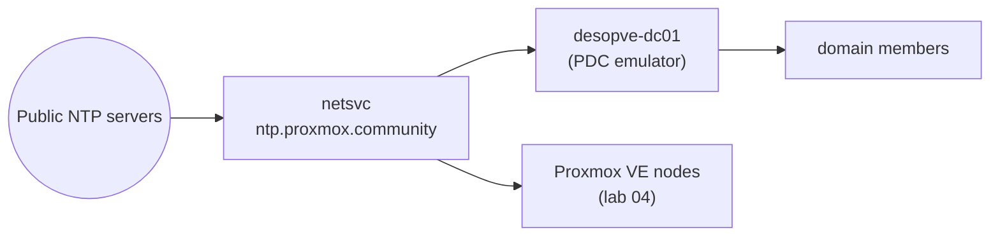

### The DNS server is authoritative for `proxmox.community`

The lab domain is `proxmox.community`, the same name as the public website. The domain controller becomes **authoritative** for that zone: for every name ending in `proxmox.community` it answers only with the records it knows.

A name that exists on the Internet but not in the internal zone (for example `www.proxmox.community`) therefore **does not exist** for the lab servers. If you need public names from the same domain, add them manually to the internal zone. This is the configuration known as *split DNS*: the same domain name has different content inside and outside the company.

### No DNS forwarders

The domain controller's DNS server does not forward queries to the Internet: the lab has no direct Internet access. Public names (for example `deb.debian.org`) are resolved by the **proxy**, when a server requests a page through `proxy.proxmox.community:3128`.

## Procedure

### 1. Install Windows Server 2025

1. Boot the server from the USB stick (or from the *virtual media* of the management controller). At the *Press any key to boot from CD or DVD* prompt, press a key. On the first screen, leave **English (United States)** as the language and format, then click **Next**.

   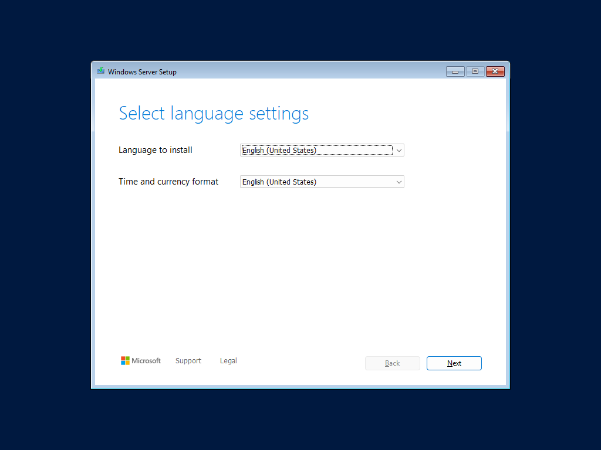

2. Choose the **Italian** keyboard layout and click **Next**.

   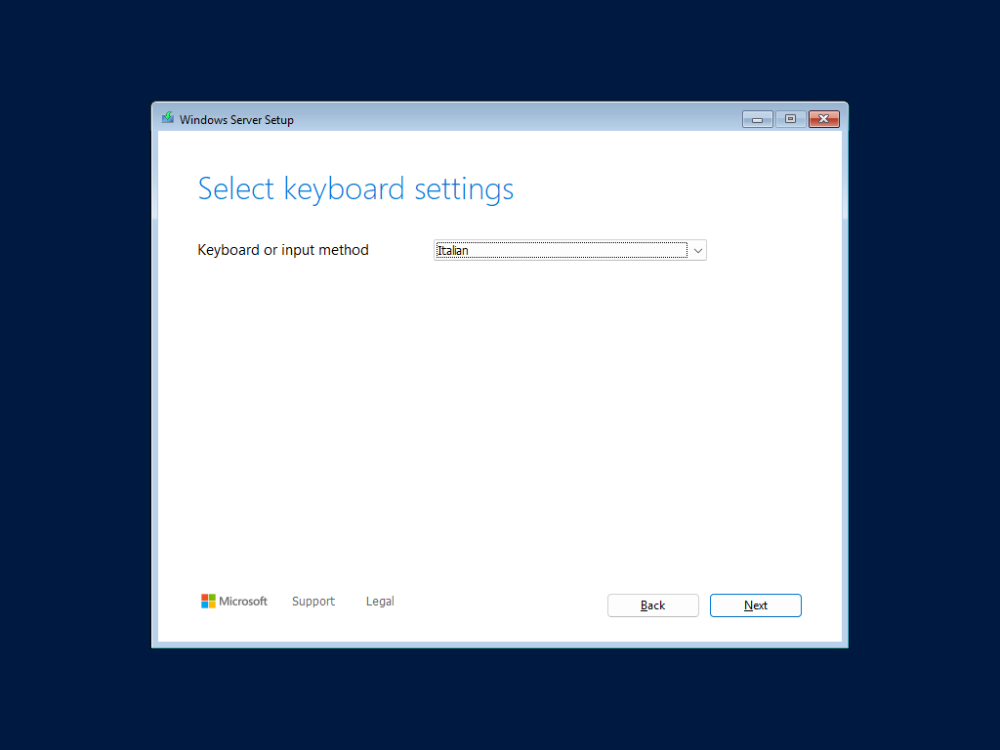

3. Select **Install Windows Server**, check *I agree everything will be deleted including files, apps, and settings* and click **Next**.

   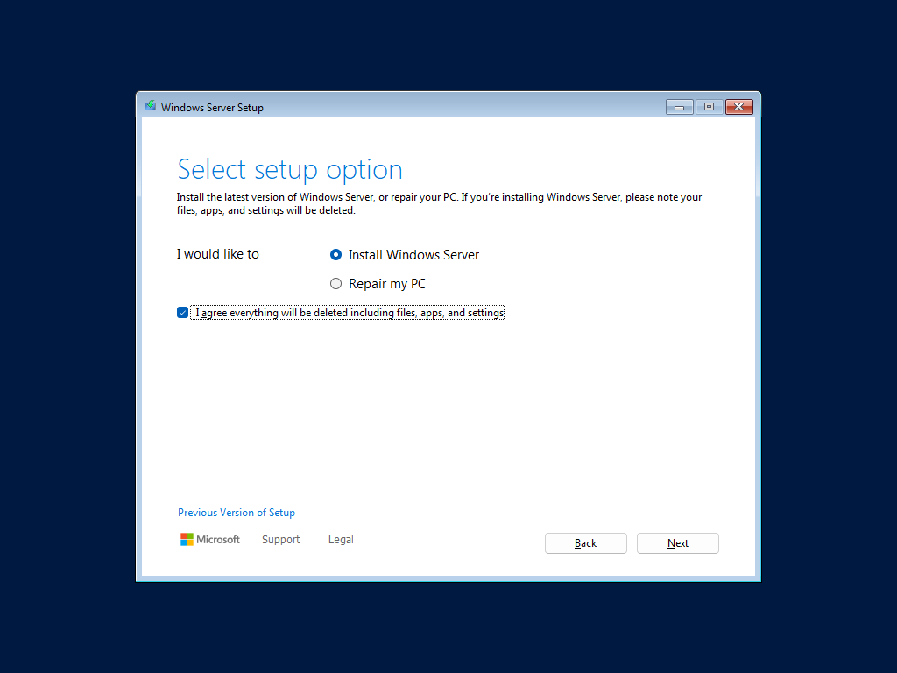

4. Choose the **Windows Server 2025 Standard Evaluation (Desktop Experience)** edition. The edition without *Desktop Experience* is Server Core, with no graphical interface.

   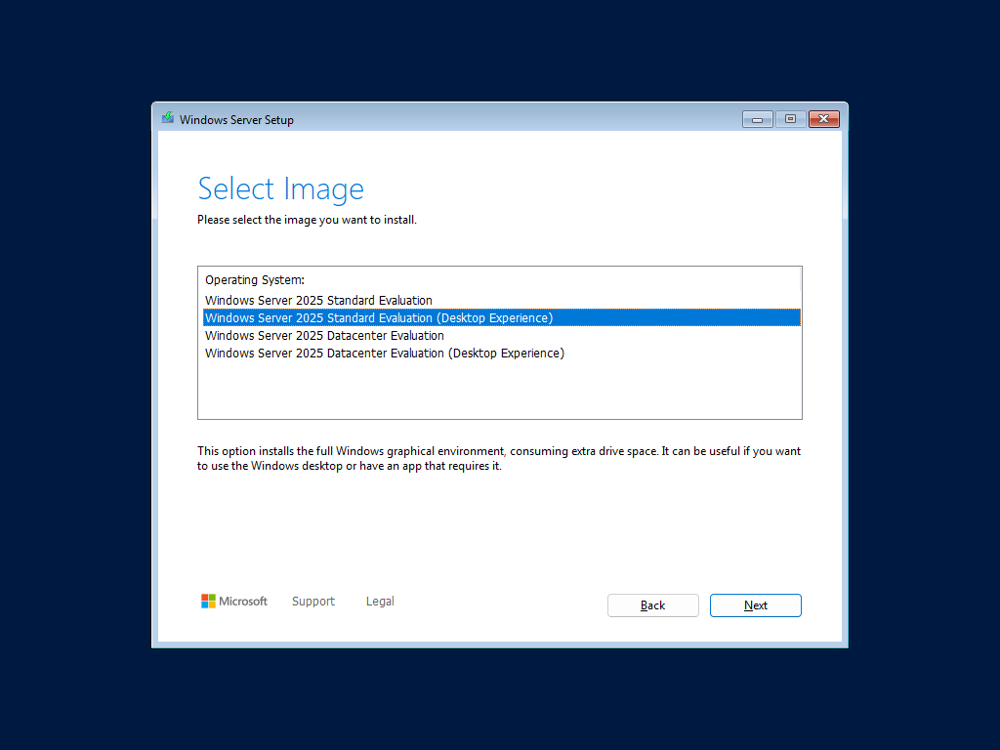

5. Accept the license terms with **Accept**.

   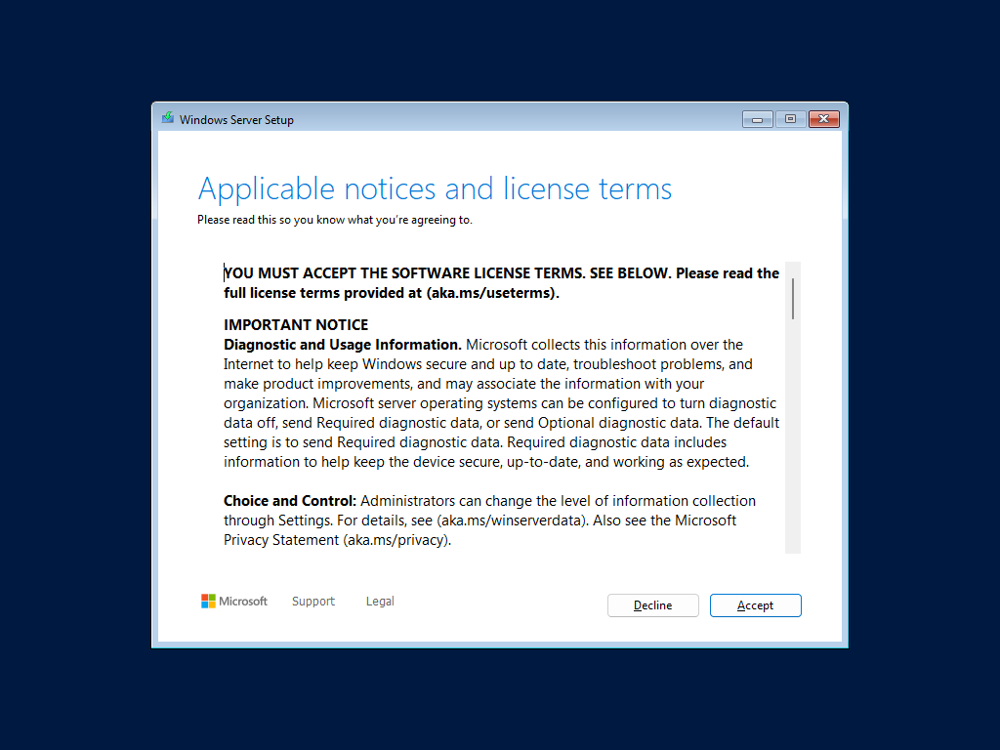

6. Select **Disk 0** (90 GB) as the target and click **Next**. The 300 GB disk stays free: no lab uses it, so you can also leave it out.

   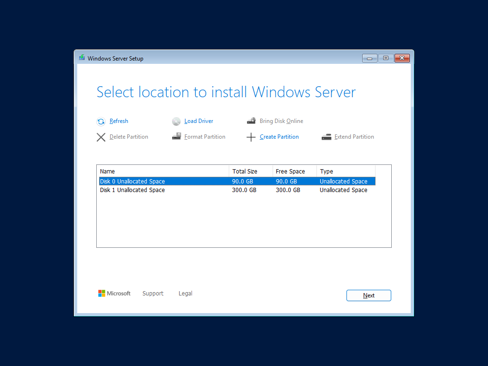

7. Check the summary and click **Install**.

   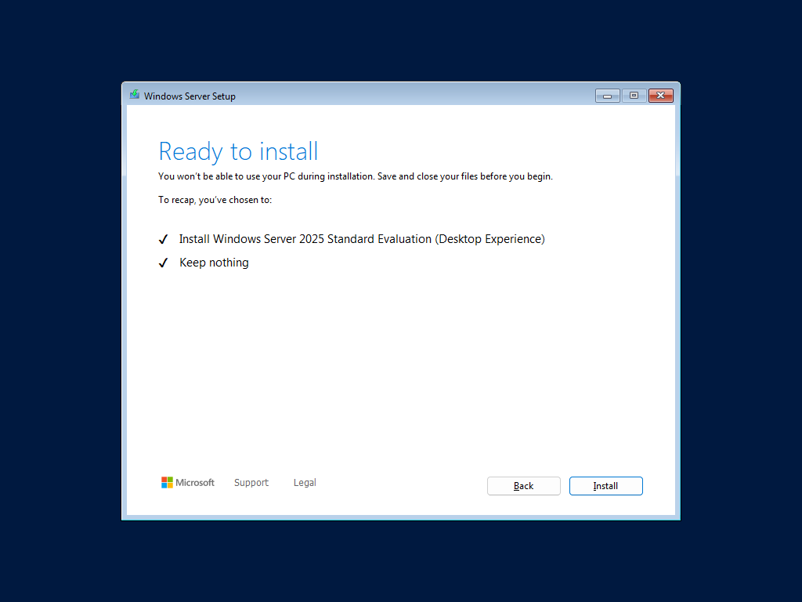

8. Wait for the installation to finish: the server restarts by itself, possibly several times.

   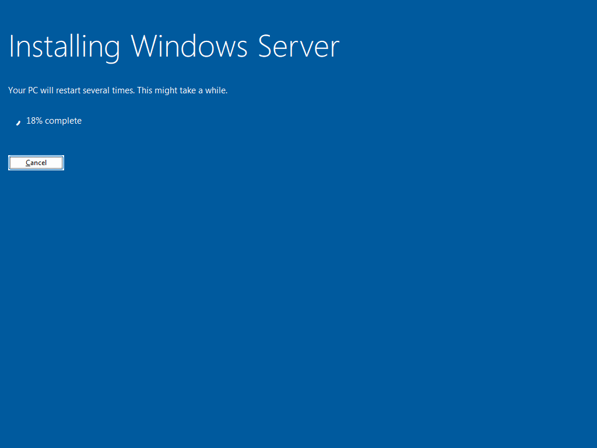

### 2. First sign-in

1. Set the **Administrator** password (`<lab-password>`) in both fields and click **Finish**.

   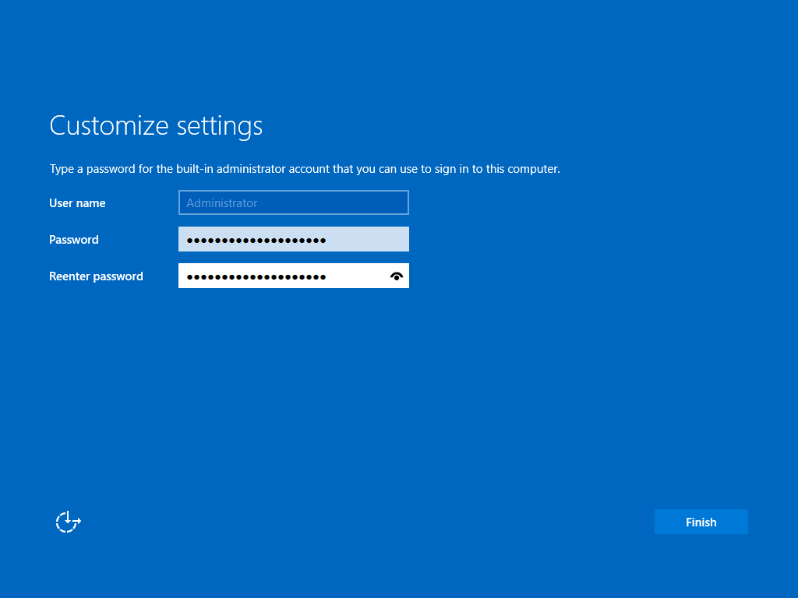

2. Sign in as Administrator (Ctrl+Alt+Del). When asked about diagnostic data, choose **Required only**.

3. **Server Manager**, the server management console, opens. Close the pane that offers Windows Admin Center and Azure Arc.

   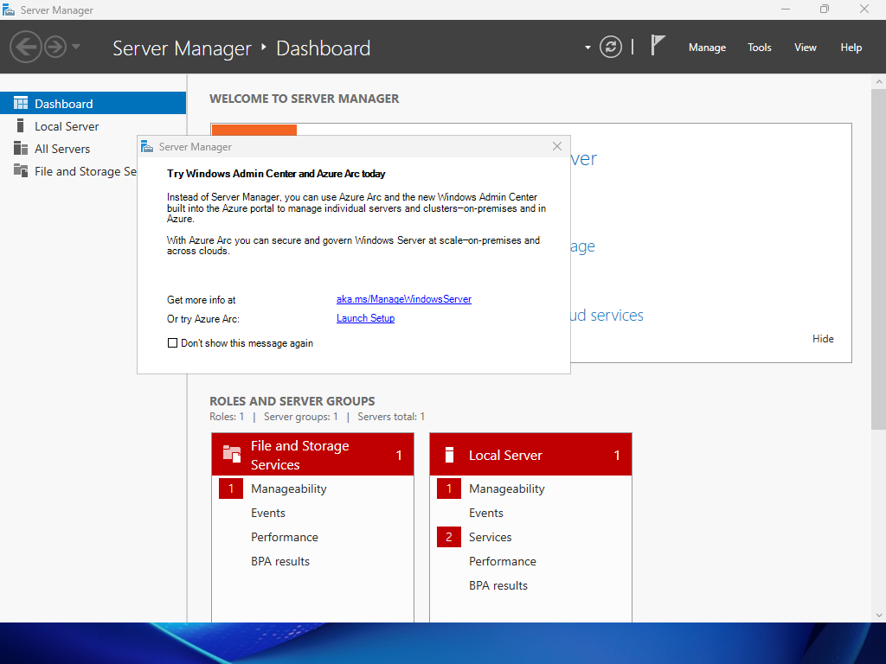

### 3. Network, Remote Desktop and server name

Run these commands in a **PowerShell** window opened as administrator (right-click the Start button → *Terminal (Admin)*).

1. List the network adapters:

   ```powershell
   Get-NetAdapter | Format-Table Name, InterfaceDescription, Status
   ```

   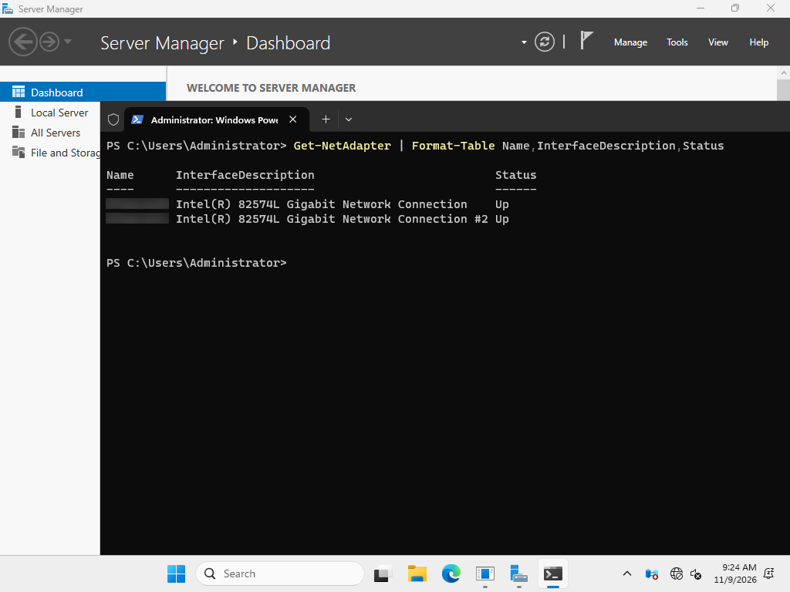

   Windows gives the adapters generic names that depend on the hardware: shortly we will rename them after their role. In the lab, the first adapter by index is connected to the management network, the second to the cluster/storage network. If the order is different in your lab, swap the two adapters in the following commands.

2. Assign the static addresses. The management adapter uses itself (`127.0.0.1`) as its DNS server, because this server will shortly become the domain DNS server:

   ```powershell
   $if  = (Get-NetAdapter | Sort-Object ifIndex | Select-Object -First 1).Name
   New-NetIPAddress -InterfaceAlias $if -IPAddress 172.27.199.20 -PrefixLength 24 -DefaultGateway 172.27.199.1
   Set-DnsClientServerAddress -InterfaceAlias $if -ServerAddresses 127.0.0.1

   $if2 = (Get-NetAdapter | Sort-Object ifIndex | Select-Object -Skip 1 -First 1).Name
   New-NetIPAddress -InterfaceAlias $if2 -IPAddress 172.32.199.20 -PrefixLength 24
   ```

   `New-NetIPAddress` shows the address it has just assigned; the `Tentative` state becomes `Preferred` after a few seconds, once Windows has verified that the address is not already in use.

   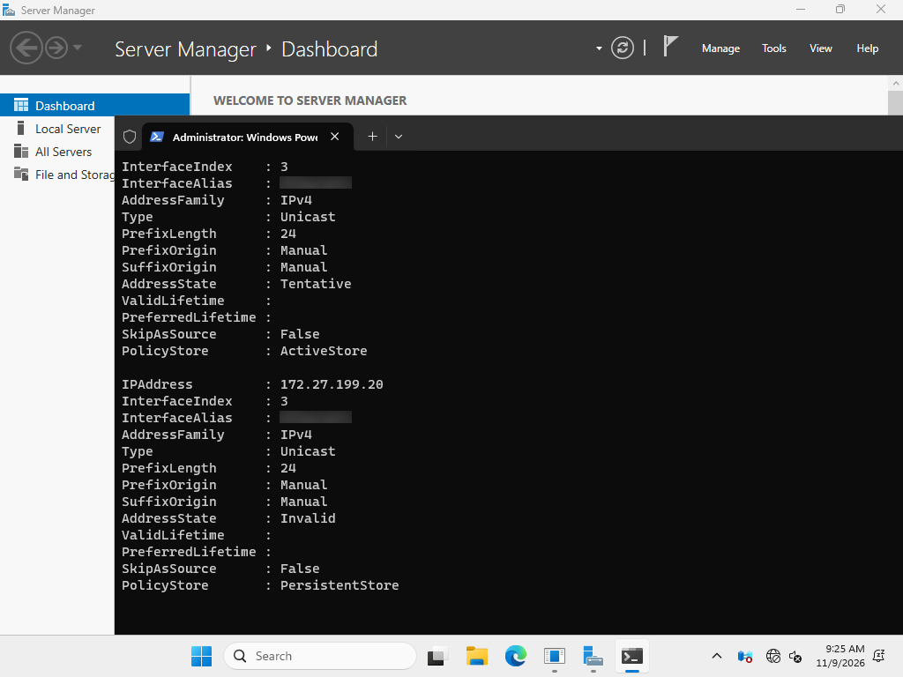

3. Enable Remote Desktop and its firewall rule:

   ```powershell
   Set-ItemProperty -Path "HKLM:\SYSTEM\CurrentControlSet\Control\Terminal Server" -Name fDenyTSConnections -Value 0
   Enable-NetFirewallRule -DisplayGroup "Remote Desktop"
   ```

4. Rename the server and restart it:

   ```powershell
   Rename-Computer -NewName desopve-dc01 -Restart
   ```

From here on you can work over **Remote Desktop** (`mstsc`) to `172.27.199.20` from the administration PC connected to the management network (see [Administration workstation](01-lab-architecture.md#administration-workstation)), which is more convenient than the console.

5. Set the Italian time zone. The English installation starts with the Pacific time zone:

   ```powershell
   Set-TimeZone -Id "W. Europe Standard Time"
   Get-TimeZone | Format-List Id, DisplayName
   ```

   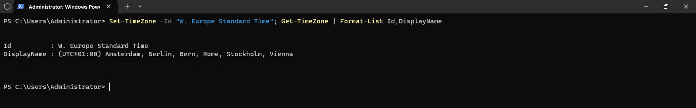

6. Rename the network adapters after their role: `MGMT` for management, `CLUSTER` for the cluster/storage network. On the `CLUSTER` adapter, disable DNS registration, so that the server name resolves only to the management address:

   ```powershell
   Rename-NetAdapter -Name (Get-NetIPAddress -IPAddress 172.27.199.20).InterfaceAlias -NewName MGMT
   Rename-NetAdapter -Name (Get-NetIPAddress -IPAddress 172.32.199.20).InterfaceAlias -NewName CLUSTER
   Set-DnsClient -InterfaceAlias CLUSTER -RegisterThisConnectionsAddress $false
   ```

   Check the result:

   ```powershell
   Get-NetAdapter | Format-Table Name, InterfaceDescription, Status, LinkSpeed -AutoSize
   Get-NetIPConfiguration | Select-Object InterfaceAlias,
       @{n='IPv4';e={$_.IPv4Address.IPAddress}},
       @{n='Gateway';e={$_.IPv4DefaultGateway.NextHop}},
       @{n='DNS';e={$_.DNSServer.ServerAddresses -join ', '}} | Format-Table -AutoSize
   Get-DnsClient -InterfaceAlias MGMT, CLUSTER | Format-Table InterfaceAlias, RegisterThisConnectionsAddress -AutoSize
   ```

   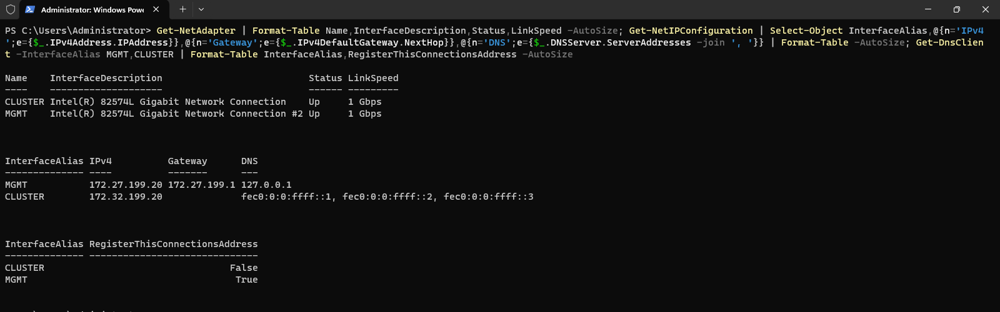

   Giving the adapters names that say what they are for is a good habit: scripts and documentation stay clear even when the hardware changes.

### 4. Install Active Directory and create the forest

1. Install the **Active Directory Domain Services** role with the management tools:

   ```powershell
   Install-WindowsFeature -Name AD-Domain-Services -IncludeManagementTools
   ```

   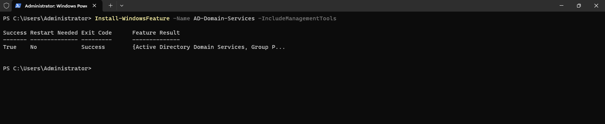

2. Create the new `proxmox.community` forest with integrated DNS. The NetBIOS name (`PROXMOX`) is the short name of the domain, used for example in `PROXMOX\Administrator`:

   ```powershell
   Install-ADDSForest -DomainName proxmox.community -DomainNetbiosName PROXMOX -InstallDns `
       -SafeModeAdministratorPassword (Read-Host -AsSecureString -Prompt "Password DSRM") -Force
   ```

   At the *Password DSRM* prompt, type `<lab-password>`. It is the password of **Directory Services Restore Mode**, the local account used to repair Active Directory when the service does not start: in production, keep it in a safe place.

3. The promotion checks the prerequisites, creates the directory partitions and configures DNS. When it finishes, the server restarts by itself.

   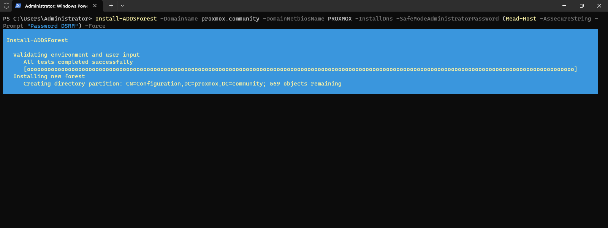

4. After the restart, sign in as `PROXMOX\Administrator`. The first sign-in takes a few minutes (*Please wait for the Group Policy Client*). The **AD DS** and **DNS** roles appear in Server Manager.

   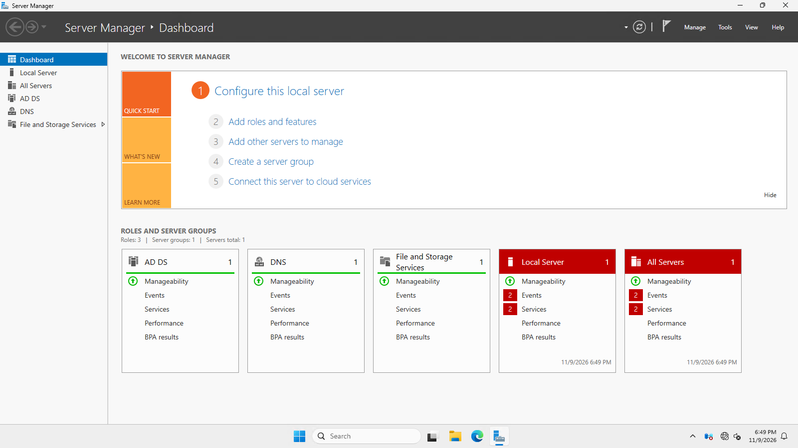

5. Check the domain, the forest and the domain controller:

   ```powershell
   Get-ADDomain | Format-List Name, DNSRoot, NetBIOSName, DomainMode, PDCEmulator
   Get-ADForest | Format-List Name, ForestMode, SchemaMaster
   Get-ADDomainController | Format-List HostName, IPv4Address, Site, IsGlobalCatalog
   ```

   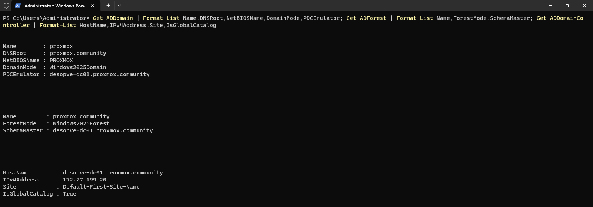

   The functional level is **Windows2025Domain** / **Windows2025Forest**, the default for a new forest on Windows Server 2025.

### 5. Prepare the lab DNS

1. Create the **reverse lookup zones** for the two lab networks, integrated in Active Directory and replicated across the whole forest:

   ```powershell
   Add-DnsServerPrimaryZone -NetworkId "172.27.199.0/24" -ReplicationScope Forest
   Add-DnsServerPrimaryZone -NetworkId "172.32.199.0/24" -ReplicationScope Forest
   Get-DnsServerZone | Format-Table ZoneName, ZoneType, IsDsIntegrated, IsReverseLookupZone -AutoSize
   ```

   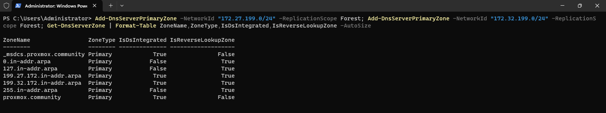

2. Register all the lab servers. `-CreatePtr` also creates the reverse record (PTR). `proxy` and `ntp` are aliases (CNAME) of `netsvc`: if the service moves one day, you only need to change the alias:

   ```powershell
   $z = 'proxmox.community'
   Add-DnsServerResourceRecordA -ZoneName $z -Name desopve01 -IPv4Address 172.27.199.21 -CreatePtr
   Add-DnsServerResourceRecordA -ZoneName $z -Name desopve02 -IPv4Address 172.27.199.22 -CreatePtr
   Add-DnsServerResourceRecordA -ZoneName $z -Name desopve03 -IPv4Address 172.27.199.23 -CreatePtr
   Add-DnsServerResourceRecordA -ZoneName $z -Name desopve04 -IPv4Address 172.27.199.24 -CreatePtr
   Add-DnsServerResourceRecordA -ZoneName $z -Name desonas   -IPv4Address 172.27.199.10 -CreatePtr
   Add-DnsServerResourceRecordA -ZoneName $z -Name netsvc    -IPv4Address 172.27.199.250 -CreatePtr
   Add-DnsServerResourceRecordA -ZoneName $z -Name esxi8     -IPv4Address 172.27.199.30 -CreatePtr
   Add-DnsServerResourceRecordCName -ZoneName $z -Name proxy -HostNameAlias netsvc.proxmox.community
   Add-DnsServerResourceRecordCName -ZoneName $z -Name ntp   -HostNameAlias netsvc.proxmox.community
   ipconfig /registerdns
   ```

   `ipconfig /registerdns` registers the domain controller itself again, so that its reverse record is also created in the zone you have just created. Check the records:

   ```powershell
   Get-DnsServerResourceRecord -ZoneName $z | Where-Object RecordType -in 'A','CNAME' |
       Format-Table HostName, RecordType,
       @{n='Dato';e={ if ($_.RecordType -eq 'A') { $_.RecordData.IPv4Address } else { $_.RecordData.HostNameAlias } }} -AutoSize
   ```

   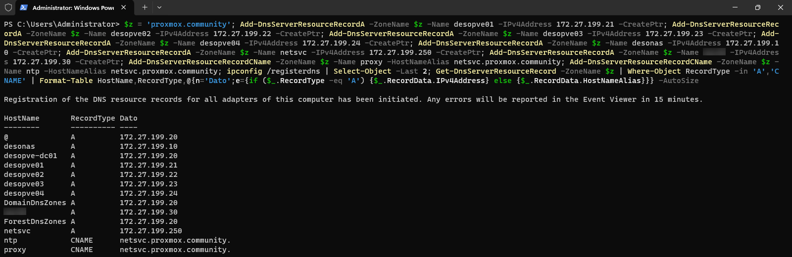

3. Also register the lab router and the servers introduced in the later tracks (Proxmox Backup Server, Proxmox Datacenter Manager and the VMs of the source ESXi server in lab 50). The router has an address on both networks: the A record points to the management address, while for `172.32.199.1` the reverse record is enough:

   ```powershell
   Add-DnsServerResourceRecordA -ZoneName $z -Name rtr-core    -IPv4Address 172.27.199.1  -CreatePtr
   Add-DnsServerResourceRecordPtr -ZoneName 199.32.172.in-addr.arpa -Name 1 -PtrDomainName rtr-core.proxmox.community
   Add-DnsServerResourceRecordA -ZoneName $z -Name desopbs01   -IPv4Address 172.27.199.40 -CreatePtr
   Add-DnsServerResourceRecordA -ZoneName $z -Name desopdm01   -IPv4Address 172.27.199.41 -CreatePtr
   Add-DnsServerResourceRecordA -ZoneName $z -Name linux-src01 -IPv4Address 172.27.199.31 -CreatePtr
   Add-DnsServerResourceRecordA -ZoneName $z -Name win-src01   -IPv4Address 172.27.199.32 -CreatePtr
   ```

   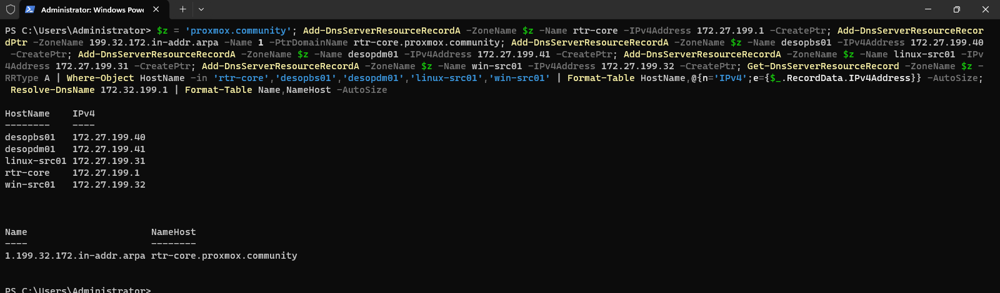

4. The DNS server registers the domain controller's name for **every** address it listens on, including `172.32.199.20` on the `CLUSTER` adapter: disabling registration in step 3.6 is not enough. A client could therefore receive `172.32.199.20` as the DC address and fail to reach it. Look for the records that point to the cluster network:

   ```powershell
   Get-DnsServerResourceRecord -ZoneName proxmox.community -RRType A |
       Where-Object { $_.RecordData.IPv4Address -like '172.32.*' }
   ```

   If `desopve-dc01` appears with `172.32.199.20`, restrict the DNS server to listen only on the management address (in DNS Manager: **Properties** → **Interfaces** → **Only the following IP addresses**) and restart the service. As soon as the listening addresses change, the DNS server removes the cluster network record by itself:

   ```powershell
   $s = Get-DnsServerSetting -All
   $s.ListeningIPAddress = @('172.27.199.20')
   Set-DnsServerSetting -InputObject $s
   Restart-Service DNS
   Get-DnsServerResourceRecord -ZoneName proxmox.community -RRType A -Name desopve-dc01 |
       Format-Table HostName, RecordType, @{n='IPv4Address';e={$_.RecordData.IPv4Address}} -AutoSize
   ```

   ```text
   HostName     RecordType IPv4Address
   --------     ---------- -----------
   desopve-dc01 A          172.27.199.20
   ```

   If you repeat the previous search, it no longer returns anything. You see the same result by resolving the name:

   ```powershell
   Resolve-DnsName desopve-dc01.proxmox.community -DnsOnly | Format-Table Name, Type, IPAddress -AutoSize
   ```

   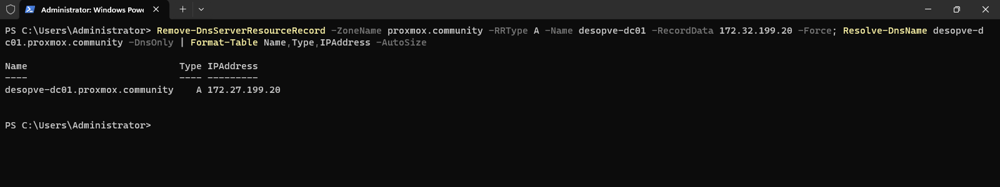

   In [Lab 25](25-ipv6.md), with IPv6, `fd27:199::20` is added to the list of listening addresses.

5. You can also see the same records graphically in **DNS Manager** (`dnsmgmt.msc`) → *Forward Lookup Zones* → `proxmox.community`.

### 6. Synchronize the time

The first domain controller of the forest holds the **PDC emulator** role and is the time source for the whole domain. Configure it to synchronize with the lab NTP server:

```powershell
w32tm /config /manualpeerlist:"ntp.proxmox.community,0x8" /syncfromflags:manual /reliable:yes /update
Restart-Service w32time
w32tm /resync /force
w32tm /query /status
Get-Date
```

`0x8` tells the service to query the server in client mode; `/reliable:yes` advertises the DC as a reliable time source for the domain members.

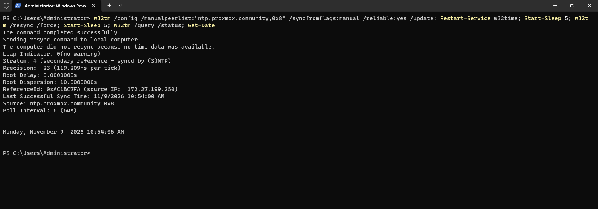

Right after the service restart, `w32tm /resync` may answer *no time data was available*: the service has not received the first response yet. What counts is `w32tm /query /status`: **Source** must be `ntp.proxmox.community,0x8`, **Last Successful Sync Time** recent, and **ReferenceId** must show the address `172.27.199.250`.

### 7. Configure the system proxy

The Windows services that download data (for example root certificate updates) use the **WinHTTP** proxy, which is separate from the browser's. Set it and check that the proxy responds:

```powershell
netsh winhttp set proxy proxy-server="proxy.proxmox.community:3128" bypass-list="*.proxmox.community;172.27.199.*;172.32.199.*;<local>"
netsh winhttp show proxy
(Invoke-WebRequest -Uri http://deb.debian.org/debian/ -Proxy http://proxy.proxmox.community:3128 -UseBasicParsing).StatusCode
```

The *bypass-list* keeps the traffic to the lab servers from going through the proxy.

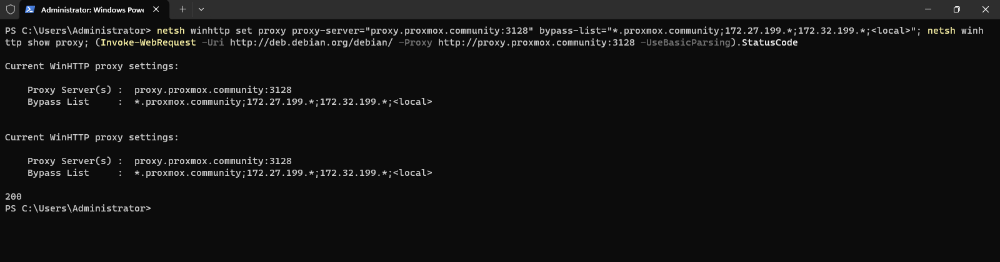

> **Windows updates.** In this lab the proxy lets through only a short list of sites, and Windows Update uses many different Microsoft services: this is why the lab's domain controller is not updated. In a real environment, always update the server before putting it into service, by allowing the Windows Update addresses in the proxy or by using an internal WSUS server.

## Verification and tests

From the domain controller:

```powershell
Resolve-DnsName desopve01.proxmox.community | Format-Table Name, Type, IPAddress -AutoSize
Resolve-DnsName 172.27.199.21 | Format-Table Name, Type, NameHost -AutoSize
Resolve-DnsName proxy.proxmox.community | Format-Table Name, Type, NameHost, IPAddress -AutoSize
Resolve-DnsName www.proxmox.community -ErrorAction SilentlyContinue -ErrorVariable e | Out-Null; $e[0].Exception.Message
w32tm /query /source
```

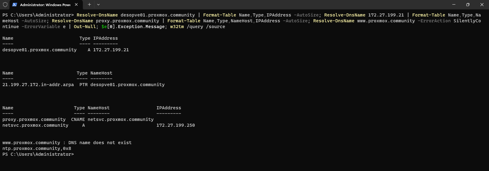

Expected results:

- [ ] `desopve01.proxmox.community` → `172.27.199.21`, and `172.27.199.21` → `desopve01.proxmox.community`.
- [ ] `proxy.proxmox.community` is an alias of `netsvc.proxmox.community` → `172.27.199.250`.
- [ ] `www.proxmox.community` → *DNS name does not exist*: this is the effect of the authoritative zone described in [How it works](#the-dns-server-is-authoritative-for-proxmoxcommunity).
- [ ] The time source is `ntp.proxmox.community,0x8`.

## Final lab state

- `desopve-dc01.proxmox.community` (172.27.199.20) is the domain controller of the `proxmox.community` forest (NetBIOS `PROXMOX`), with integrated DNS listening only on the management address.
- Forward and reverse zones populated with all the lab servers; `proxy` and `ntp` aliases pointing to `netsvc`.
- Time synchronized with `ntp.proxmox.community`; WinHTTP proxy configured.
- Remote Desktop enabled.

## What you learned

- How to install Windows Server 2025 and promote it to domain controller from PowerShell.
- Why forward and reverse DNS and accurate time are prerequisites for a cluster.
- What it means to have an authoritative DNS server for a domain that also exists on the Internet (*split DNS*).
- How a server reaches the Internet through a proxy, without public DNS and without a gateway to the Internet.

## References

- [Proxmox VE – Time Synchronization](https://pve.proxmox.com/pve-docs/pve-admin-guide.html#_time_synchronization)
- [Microsoft Learn – Install-ADDSForest](https://learn.microsoft.com/powershell/module/addsdeployment/install-addsforest)
- [Microsoft Learn – Windows Time service tools and settings (w32tm)](https://learn.microsoft.com/windows-server/networking/windows-time-service/windows-time-service-tools-and-settings)
- [Microsoft Learn – Add-DnsServerResourceRecordA](https://learn.microsoft.com/powershell/module/dnsserver/add-dnsserverresourcerecorda)
