# Lab 03 – Installing Proxmox VE 9.2 (ZFS RAID1 and ext4)

**Level:** basic · **Duration:** 20 minutes per node

## Dependencies

- **Previous labs:** [Lab 01](01-lab-architecture.md), [Lab 02](02-domain-controller.md). DNS must already contain the records of `desopve01`…`desopve04`.
- **Servers:** `desopve01`, `desopve02` and `desopve03` (4 cores, 32 GB, 2 × 50 GB + 2 × 60 GB disks, 3 network cards) and `desopve04` (4 cores, 16 GB, only the 50 GB system disk, 2 network cards), with VT-x/AMD-V enabled in the firmware. This is the [lab hardware](01-lab-architecture.md#lab-hardware) at the start of the course: the other disks and cards arrive in the labs that use them.
- **ISO:** `proxmox-ve_9.2-1.iso`, with its SHA-256 checksum verified, on a USB stick or on the *virtual media* of the management controller.
- **Addresses:** from `172.27.199.21` to `172.27.199.24`, gateway `172.27.199.1`, DNS `172.27.199.20`.
- **Credentials:** `<lab-password>` for `root` → [Appendix B](b-credentials-and-addresses.md).

## Objectives

- Install Proxmox VE 9.2 on three nodes with the system on **ZFS RAID1** (mirror).
- Install the fourth node on **ext4 with LVM-thin**, to compare the two layouts.
- Understand what the installer creates: ZFS pool or LVM volume group, `local` storage, `vmbr0` bridge, network interface names.
- Verify the installation from the command line.

## How it works

Proxmox VE is a **Debian** distribution (9.2 is based on Debian 13 "Trixie") with its own kernel, QEMU/KVM for VMs, LXC for containers and a web interface on port **8006**. In a few minutes, the installer does what would take hours by hand: it partitions the disks, creates the file system, installs the packages and configures the network and the bootloader.

### Which file system for the system disk

The installer offers **ext4**, **xfs**, **ZFS** and **Btrfs**. These are the two most common choices:

| | ZFS (RAID1) | ext4 + LVM-thin |
|---|---|---|
| Disks | at least 2 | 1 is enough |
| System redundancy | yes (mirror) | no, unless you have hardware RAID |
| VM snapshots | yes, native (zvol) | yes, with LVM-thin |
| Memory | uses RAM as a cache (ARC) | minimal usage |
| Storage created | `local` (directory) + `local-zfs` | `local` (directory) + `local-lvm` (LVM-thin) |
| Hardware RAID compatibility | no: ZFS wants "bare" disks | yes |

In the lab, the cluster nodes use **ZFS RAID1** on the two 50 GB disks: if a disk fails, the node keeps running (you will try a disk failure in a redundant pool in lab 10). The two 60 GB disks stay free for Ceph (lab 17). `desopve04` uses **ext4**: this is the configuration of a server with a single disk or with a hardware RAID controller.

### Pinned network interface names (new in 9.x)

On Linux, network interface names (for example `enp65s0f0`) derive from the position of the card on the PCI bus and can change after a kernel or firmware update, breaking the network configuration. The Proxmox VE 9.2 installer has the **Pin network interface names** option, **enabled by default**: it assigns stable names `nic0`, `nic1`, `nic2`… tied to the card's MAC address, through systemd `.link` files in `/usr/local/lib/systemd/network/`.

## Procedure

### 1. Install `desopve01` on ZFS RAID1

1. Boot the server from the USB stick with the ISO (or from the *virtual media* of the management controller) and choose **Install Proxmox VE (Graphical)**.

   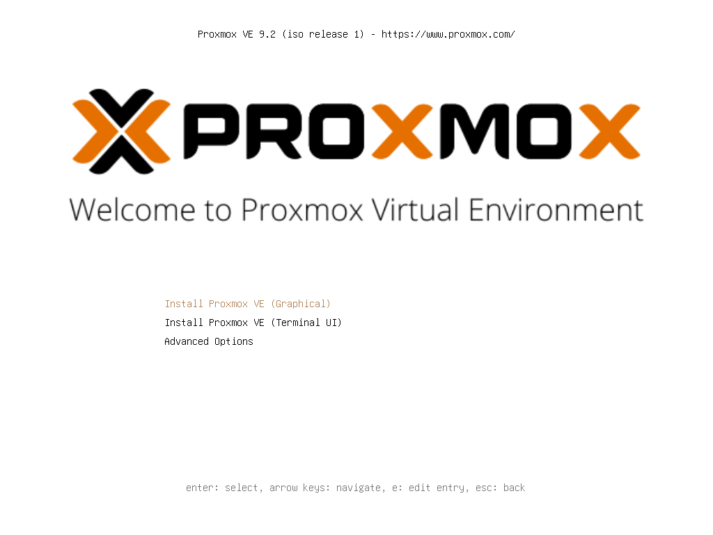

2. Accept the license with **I agree**.

   

3. On the target disk screen, click **Options**: for a configuration with several disks, that is where you make the choice.

   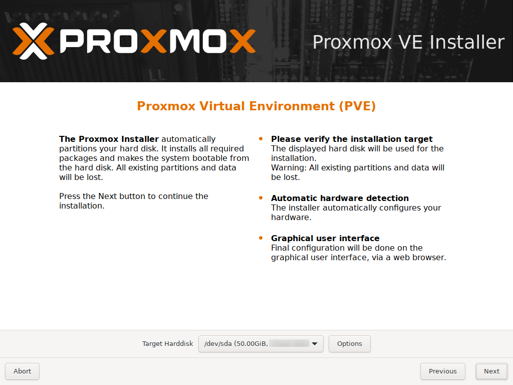

4. The default file system is **ext4** on a single disk.

   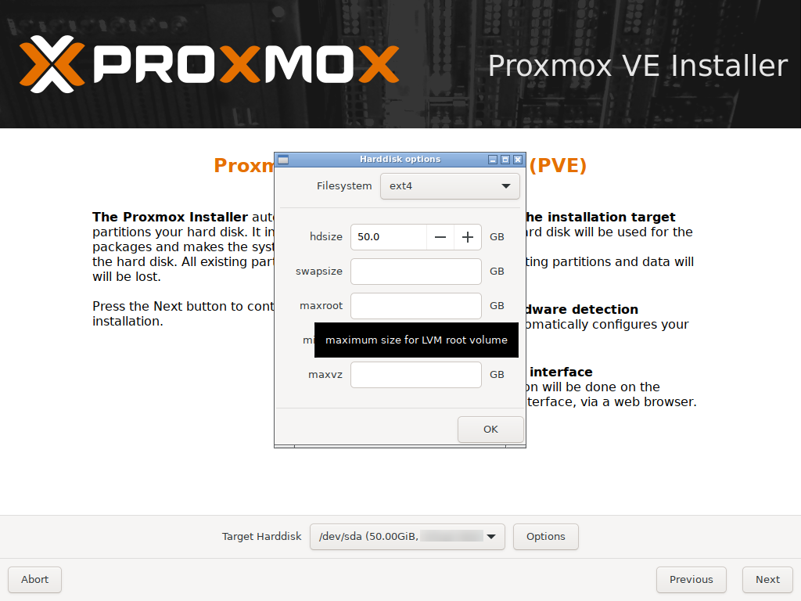

5. Set **Filesystem** to `zfs (RAID1)`. Leave **Harddisk 0** and **Harddisk 1** selected (the two 50 GB disks) and set the other two to `-- do not use --`: the 60 GB disks are for Ceph. Click **OK** and then **Next**.

   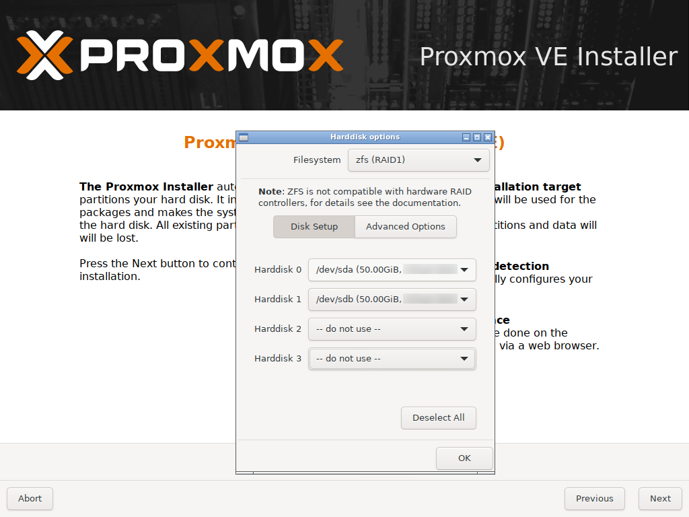

   > The note in the dialog reminds you that ZFS is not compatible with hardware RAID controllers: it must see the individual disks to manage redundancy and data integrity itself.

6. Set **Country** to `Italy`, **Time zone** to `Europe/Rome` and **Keyboard Layout** to `Italian`.

   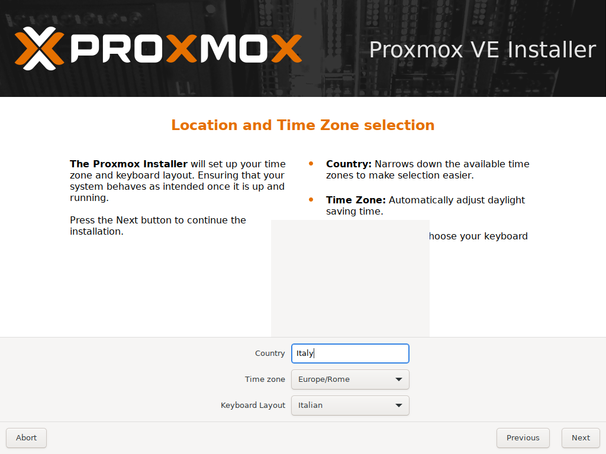

7. Enter the `root` password (`<lab-password>`) twice and the email address to which the node will send alerts (`admin@proxmox.community`).

   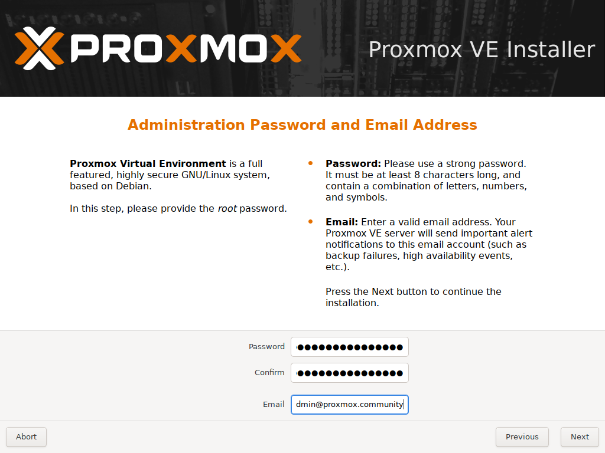

8. Configure the management network:

   | Field | Value |
   |---|---|
   | Management Interface | `nic0` |
   | Hostname (FQDN) | `desopve01.proxmox.community` |
   | IP Address (CIDR) | `172.27.199.21` / `24` |
   | Gateway | `172.27.199.1` |
   | DNS Server | `172.27.199.20` |

   Leave **Pin network interface names** checked.

   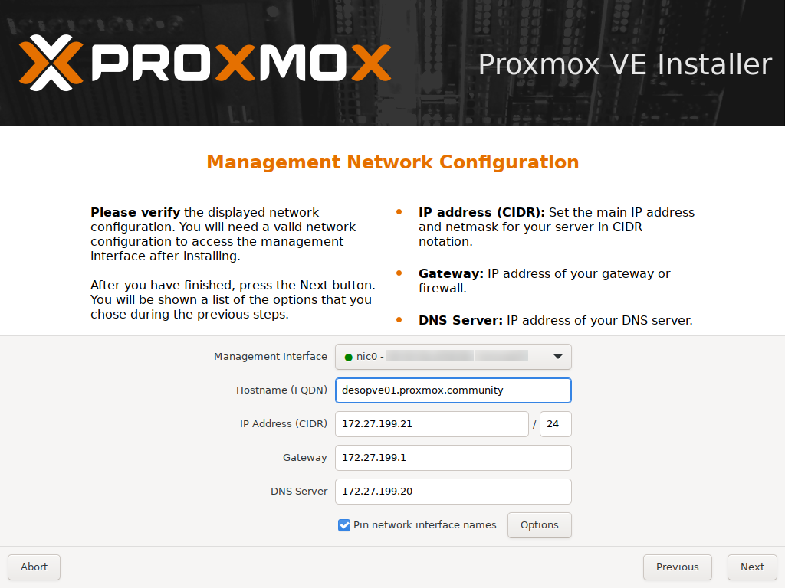

   > Enter the **fully qualified** name (FQDN): the installer derives from it both the node name (`desopve01`) and the DNS search domain.

9. Check the summary. Uncheck **Automatically reboot after successful installation** if you need to remove the USB stick (or unmount the *virtual media*) before the reboot, then click **Install**.

   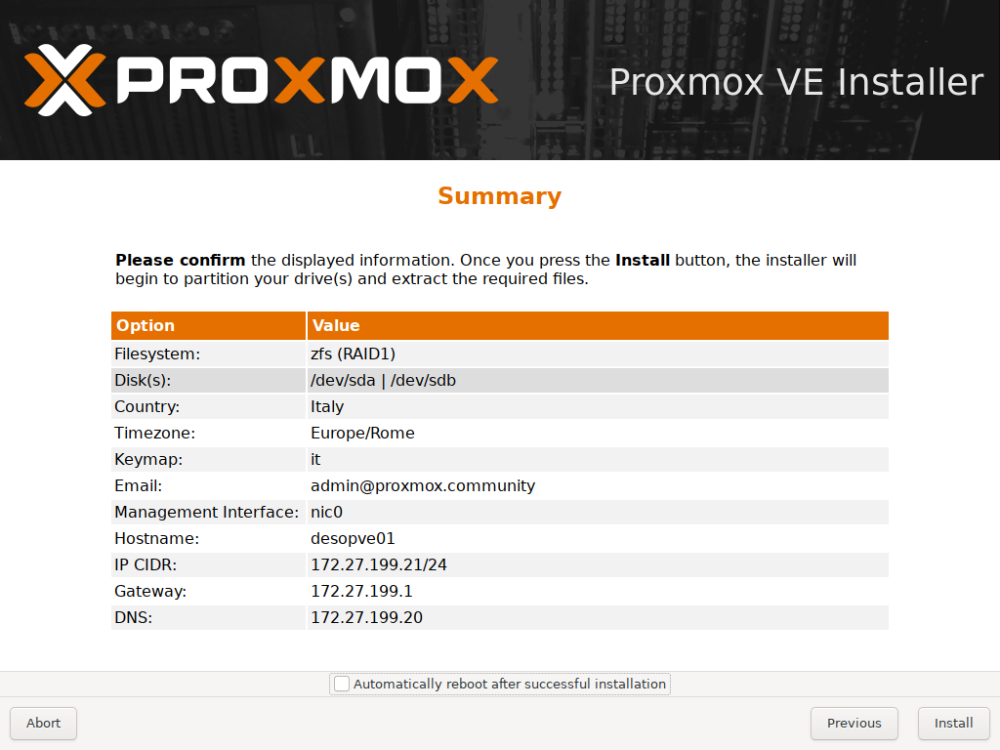

10. The installation takes a few minutes.

    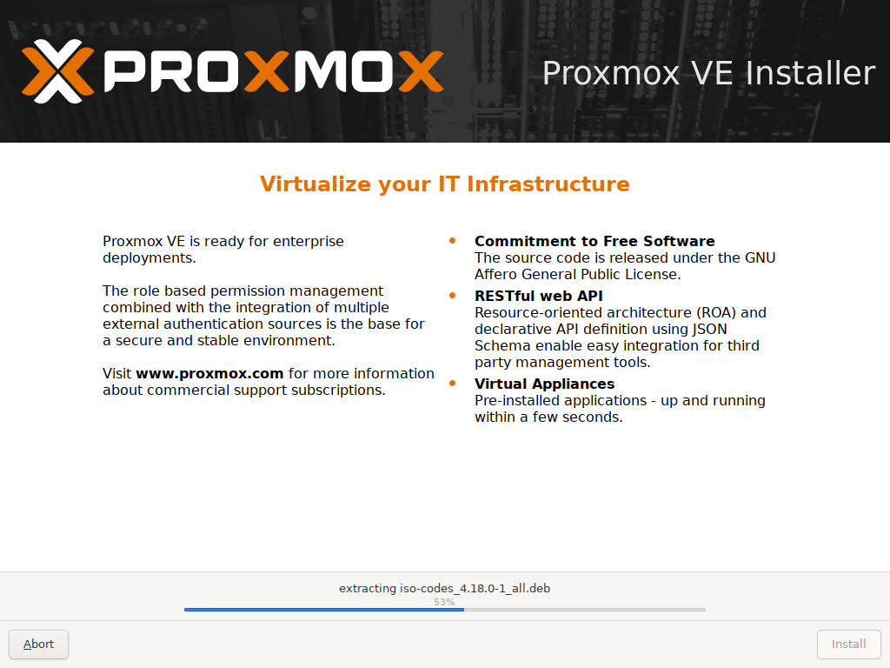

11. When it finishes, the installer shows the address of the web interface. Remove the USB stick (or unmount the *virtual media*) and click **Reboot**.

    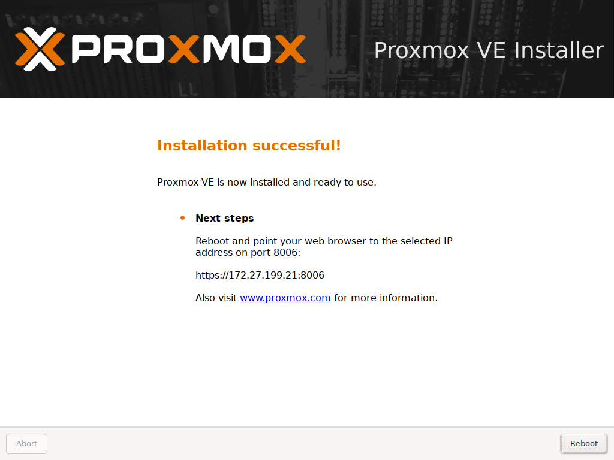

12. After the reboot, the console shows the web interface address and the login prompt.

    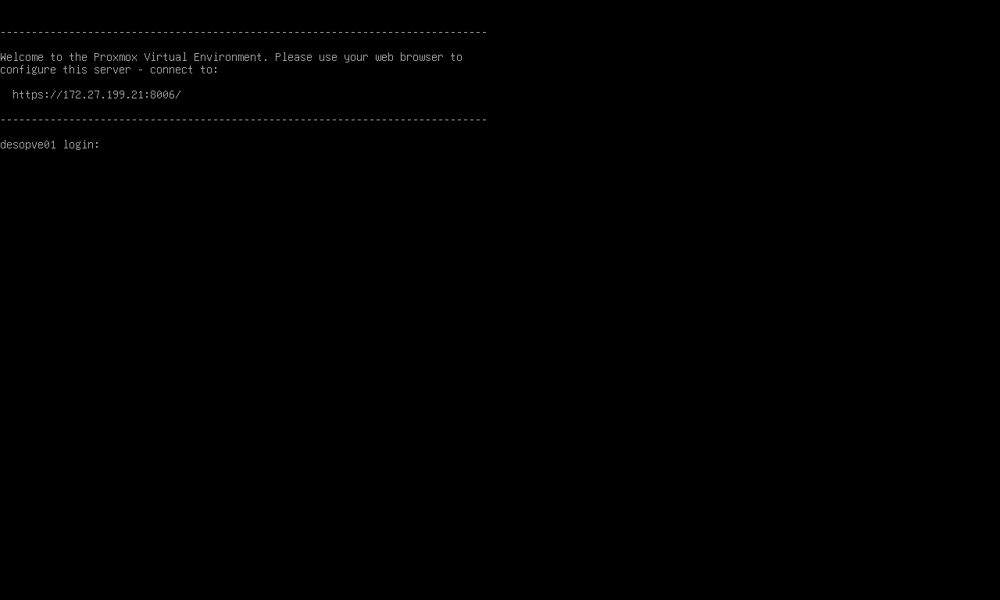

### 2. Install `desopve02` and `desopve03`

Repeat the procedure of step 1, changing only the name and the address:

| Node | Hostname (FQDN) | IP Address (CIDR) |
|---|---|---|
| desopve02 | `desopve02.proxmox.community` | `172.27.199.22/24` |
| desopve03 | `desopve03.proxmox.community` | `172.27.199.23/24` |

### 3. Install `desopve04` on ext4

Repeat the procedure with these differences:

1. In **Options**, leave **Filesystem** set to `ext4` on the single 50 GB disk (`/dev/sda`): the hot-swap bays stay empty, and the 20 GB disks arrive in lab 09. The `hdsize`, `swapsize`, `maxroot`, `minfree` and `maxvz` fields (in the screenshot a tooltip covers the `minfree` label) stay empty: the installer calculates the sizes by itself.

   

2. Hostname `desopve04.proxmox.community`, address `172.27.199.24/24`.

### 4. Check the name of each node

After the reboot, log in at the console as `root` and check the full name with `hostname -f`: it must contain the `proxmox.community` domain. For example, on `desopve02`:

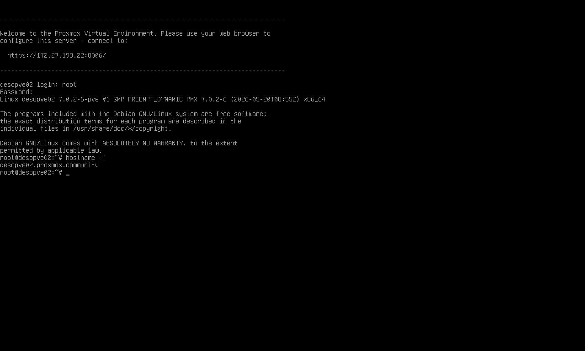

## Verification and tests

Connect to each node over SSH as `root` (or from the console) and check the following.

**Name and version:**

```bash title="root@desopve01"
hostname -f
```

``` { .text .no-copy title="Output" }
desopve01.proxmox.community
```

```bash title="root@desopve01"
pveversion
```

``` { .text .no-copy title="Output" }
pve-manager/9.2.2/b9984c6d90a4bd80 (running kernel: 7.0.2-6-pve)
```

**System ZFS pool** (`-L` shows the disk names instead of the long identifiers):

```bash title="root@desopve01"
zpool status -L rpool
```

``` { .text .no-copy title="Output" }
  pool: rpool
 state: ONLINE
config:

	NAME        STATE     READ WRITE CKSUM
	rpool       ONLINE       0     0     0
	  mirror-0  ONLINE       0     0     0
	    sda3    ONLINE       0     0     0
	    sdb3    ONLINE       0     0     0

errors: No known data errors
```

```bash title="root@desopve01"
zfs list
```

``` { .text .no-copy title="Output" }
NAME               USED  AVAIL  REFER  MOUNTPOINT
rpool             2.00G  45.5G    96K  /rpool
rpool/ROOT        2.00G  45.5G    96K  /rpool/ROOT
rpool/ROOT/pve-1  2.00G  45.5G  2.00G  /
rpool/data          96K  45.5G    96K  /rpool/data
rpool/var-lib-vz    96K  45.5G    96K  /var/lib/vz
```

`rpool/ROOT/pve-1` is the system, `rpool/data` holds the VM disks (`local-zfs` storage) and `rpool/var-lib-vz` contains ISOs, templates and backups (`local` storage).

**Booting from both disks.** With ZFS RAID1 the installer creates an EFI boot partition on **each** disk and keeps them in sync with `proxmox-boot-tool`: the node boots even if the first disk fails.

```bash title="root@desopve01"
proxmox-boot-tool status
```

``` { .text .no-copy title="Output" }
Re-executing '/usr/sbin/proxmox-boot-tool' in new private mount namespace..
System currently booted with uefi
F98D-1B42 is configured with: uefi (versions: 7.0.2-6-pve)
F990-B56D is configured with: uefi (versions: 7.0.2-6-pve)
```

**Storage created by the installer:**

```bash title="root@desopve01"
pvesm status
```

``` { .text .no-copy title="Output" }
Name             Type     Status     Total (KiB)      Used (KiB) Available (KiB)        %
local             dir     active        47723008             128        47722880    0.00%
local-zfs     zfspool     active        47723048              96        47722952    0.00%
```

On `desopve04` (ext4) the storages are `local` and `local-lvm`, that is, the `data` thin pool of the `pve` LVM volume group:

```bash title="root@desopve04"
pvesm status
```

``` { .text .no-copy title="Output" }
Name             Type     Status     Total (KiB)      Used (KiB) Available (KiB)        %
local             dir     active        22203544         4193740        16856576   18.89%
local-lvm     lvmthin     active        14217216               0        14217216    0.00%
```

```bash title="root@desopve04"
lvs
```

``` { .text .no-copy title="Output" }
  LV   VG  Attr       LSize   Pool Origin Data%  Meta%  Move Log Cpy%Sync Convert
  data pve twi-a-tz-- <13.56g             0.00   1.58
  root pve -wi-ao----  21.68g
  swap pve -wi-ao----   6.12g
```

Note the difference: on ZFS the space is shared between the system and the VMs, while with LVM the installer splits the disk into fixed partitions (`root`, `swap`, `data`).

**Network.** The management address is not on the physical card but on the `vmbr0` bridge, to which `nic0` is attached: VMs connected to `vmbr0` go out on the same network as the node.

```bash title="root@desopve01"
ip -br -4 addr
```

``` { .text .no-copy title="Output" }
lo               UNKNOWN        127.0.0.1/8
vmbr0            UP             172.27.199.21/24
```

```bash title="root@desopve01"
cat /etc/network/interfaces
```

``` { .text .no-copy title="Output" }
auto lo
iface lo inet loopback

iface nic0 inet manual

auto vmbr0
iface vmbr0 inet static
	address 172.27.199.21/24
	gateway 172.27.199.1
	bridge-ports nic0
	bridge-stp off
	bridge-fd 0

iface nic1 inet manual

iface nic2 inet manual


source /etc/network/interfaces.d/*
```

```bash title="root@desopve01"
ls /usr/local/lib/systemd/network/
```

``` { .text .no-copy title="Output" }
50-pmx-nic0.link  50-pmx-nic1.link  50-pmx-nic2.link
```

The three `.link` files bind the names `nic0`…`nic2` to the MAC addresses of the cards.

**Virtualization extensions.** The node must see the processor's virtualization extensions and the `/dev/kvm` device, otherwise it cannot start VMs:

```bash title="root@desopve01"
grep -c -E 'vmx|svm' /proc/cpuinfo
```

``` { .text .no-copy title="Output" }
8
```

```bash title="root@desopve01"
ls -la /dev/kvm
```

``` { .text .no-copy title="Output" }
crw-rw---- 1 root kvm 10, 232 Nov  9 10:33 /dev/kvm
```

A result of `0` means that VT-x/AMD-V is disabled in the server firmware (BIOS/UEFI): enable it and reboot, as described in [Lab 01](01-lab-architecture.md#lab-hardware).

### If `hostname -f` shows a different domain

This can happen if you go back in the installer and change the name after you have already confirmed it. Fix `/etc/hosts` **before** creating the cluster and regenerate the web interface certificate:

```bash title="root@desopve01"
sed -i 's/vecchio-dominio/proxmox.community/g' /etc/hosts /etc/resolv.conf /etc/postfix/main.cf
pvecm updatecerts --force
```

``` { .text .no-copy title="Output" }
(re)generate node files
generate new node certificate
```

```bash title="root@desopve01"
systemctl restart pveproxy
openssl x509 -in /etc/pve/local/pve-ssl.pem -noout -ext subjectAltName
```

``` { .text .no-copy title="Output" }
X509v3 Subject Alternative Name:
    IP Address:127.0.0.1, IP Address:0:0:0:0:0:0:0:1, DNS:localhost, IP Address:172.27.199.21, DNS:desopve01, DNS:desopve01.proxmox.community
```

Summary of the checks:

- [ ] `hostname -f` returns the full name in `proxmox.community` on all four nodes.
- [ ] `pveversion` shows `pve-manager/9.2.x`.
- [ ] On `desopve01`…`03`, `rpool` is `ONLINE` as a mirror of two disks; on `desopve04`, `local-lvm` exists.
- [ ] The management address is on `vmbr0`, and the interfaces are named `nic0`, `nic1`, …
- [ ] `/dev/kvm` exists.

## Final lab state

- Four independent Proxmox VE 9.2 nodes (not yet in a cluster), reachable at `https://desopve0N.proxmox.community:8006`.
- `desopve01`…`03`: system on ZFS RAID1 (`rpool`), 60 GB disks free.
- `desopve04`: system on ext4 with LVM-thin.
- Only `nic0` is configured (`vmbr0` bridge); the other cards are free for the following labs.

## What you learned

- How to install Proxmox VE and what the installer decides for you.
- The practical differences between ZFS RAID1 and ext4/LVM-thin for the system disk.
- Why Proxmox VE 9 pins network interface names and where it stores this mapping.
- That the management address lives on a bridge, not on the physical card.

## References

- [Proxmox VE – Installation](https://pve.proxmox.com/pve-docs/pve-admin-guide.html#chapter_installation)
- [Proxmox VE – ZFS on Linux](https://pve.proxmox.com/pve-docs/pve-admin-guide.html#chapter_zfs)
- [Proxmox VE – Host Bootloader (proxmox-boot-tool)](https://pve.proxmox.com/pve-docs/pve-admin-guide.html#sysboot)
- [Proxmox VE – Network Configuration](https://pve.proxmox.com/pve-docs/pve-admin-guide.html#sysadmin_network_configuration)
