# Lab 04 – First access, repositories and updates

**Level:** basic · **Duration:** 45 minutes

## Dependencies

- **Previous labs:** [Lab 02](02-domain-controller.md) (DNS with the node records and the `proxy` and `ntp` aliases), [Lab 03](03-install-proxmox-ve.md) (four nodes installed).
- **Services:** proxy `proxy.proxmox.community:3128` and NTP `ntp.proxmox.community`.
- **Credentials:** `root` / `<lab-password>` → [Appendix B](b-credentials-and-addresses.md).

## Objectives

- Log in to the web interface and find your way around **Datacenter** and the **nodes**.
- Understand the Proxmox VE repositories and configure the **no-subscription** one, from the GUI and from the command line.
- Route updates and downloads through the corporate proxy.
- Update the nodes to the latest 9.2 release and reboot them into the new kernel.
- Synchronize the time of the nodes with the lab NTP server.

## How it works

### The Proxmox VE repositories

Proxmox VE is free software (AGPLv3 license): all features are available without a subscription. The paid **subscription** gives access to support and to the **enterprise** repository, which receives updates only after a longer testing period.

| Repository | For whom | Notes |
|---|---|---|
| `pve-enterprise` | servers with a subscription | the most stable; without a key, updating fails (error 401) |
| `pve-no-subscription` | labs, testing, use without support | same packages, published before enterprise |
| `pve-test` | those who want to try new features early | not for production use |

After the installation only the **enterprise** repository is enabled, for both Proxmox VE and Ceph. Without a subscription you need to disable it and enable `no-subscription`, otherwise `apt update` fails and the node does not receive security updates.

Since Debian 13, repositories are described in the **deb822** format: a `.sources` file in `/etc/apt/sources.list.d/` with the fields `Types`, `URIs`, `Suites`, `Components`, `Signed-By` and, optionally, `Enabled: no` to disable them.

### The "No valid subscription" notice

At every login, and before some operations (adding a repository, updating), the interface shows the *No valid subscription* notice. It is informational only: close it with **OK**. The modifications that hide it are undone by every update and are not recommended.

### The proxy

In a company, servers rarely access the Internet directly. Proxmox VE has a single setting, **Datacenter → Options → HTTP proxy**, saved in `/etc/pve/datacenter.cfg`. It is used by:

- the package list refresh from the web interface and the daily `pveupdate` service, which write the proxy to `/etc/apt/apt.conf.d/76pveproxy`, so that `apt` on the command line uses it too;
- the download of ISOs and templates from the interface (*Download from URL*, lab 07).

In a cluster, `datacenter.cfg` is shared: you only need to set it once.

## Procedure

### 1. First access to the web interface

1. From the domain controller's browser, over Remote Desktop (lab 02), open `https://desopve01.proxmox.community:8006`. The certificate is signed by the cluster CA, which the browser does not know: accept the exception (in [Lab 45](45-two-factor-authentication.md) you will import the cluster CA into the browser).
2. Log in with **User name** `root`, **Password** `<lab-password>`, **Realm** *Linux PAM standard authentication*. It is best to leave the language set to **English**: the menu names match the documentation and the forums.

   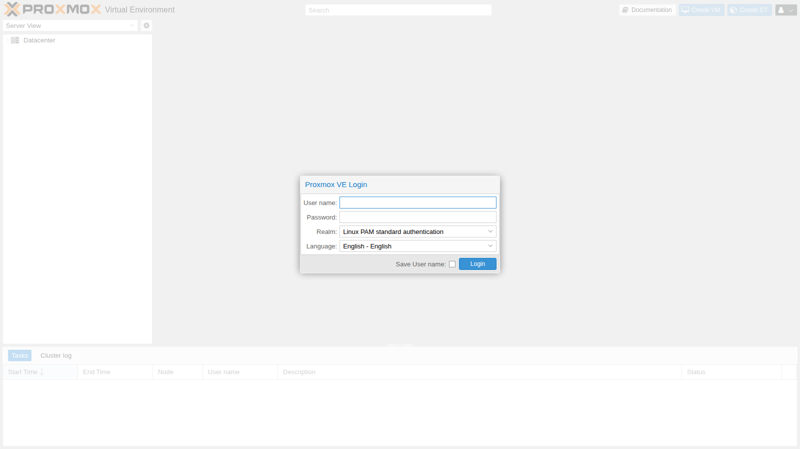

3. Close the *No valid subscription* notice with **OK**.

   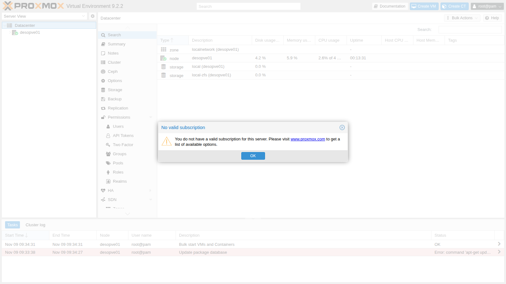

4. On the left is the **resource tree**. **Datacenter** groups the settings common to all nodes (permissions, shared storage, backup, firewall, options), while each **node** has its own local resources (network, disks, updates, shell). The storages appear under the node and, later, VMs and containers.

   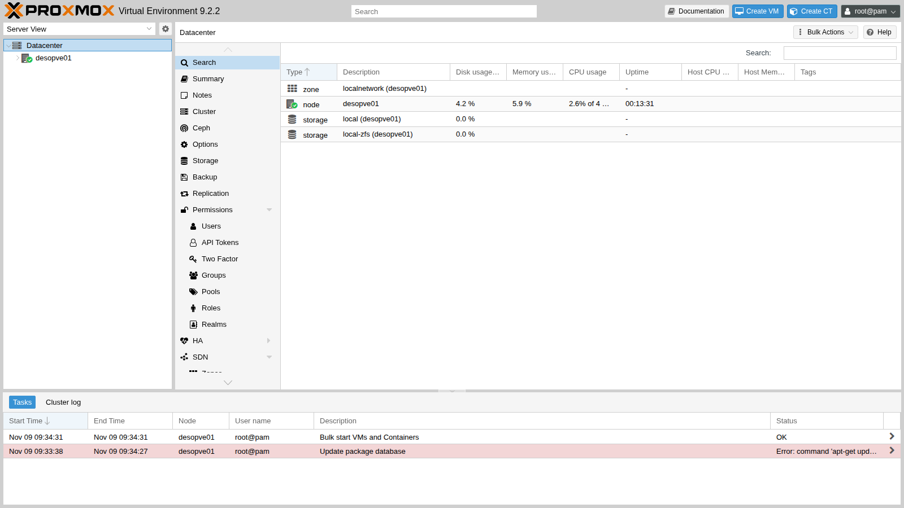

5. Select the `desopve01` node → **Summary**: CPU, memory and disk usage, kernel and Proxmox VE versions, repository status.

   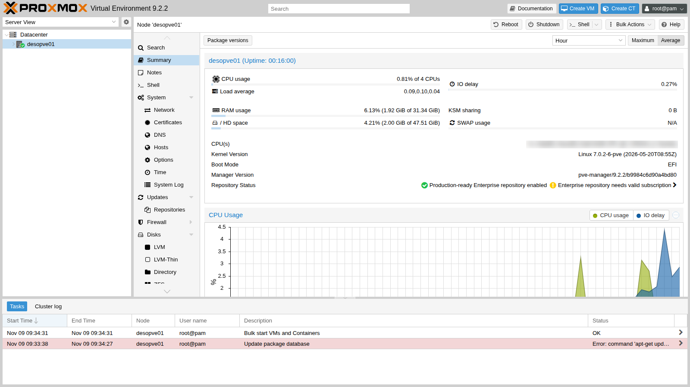

### 2. Configure the repositories from the web interface

1. Go to `desopve01` → **Updates** → **Repositories**. The status reports *The enterprise repository is enabled, but there is no active subscription!*: only `pve-enterprise` and `ceph-squid` *enterprise* are enabled, plus the Debian repositories.

   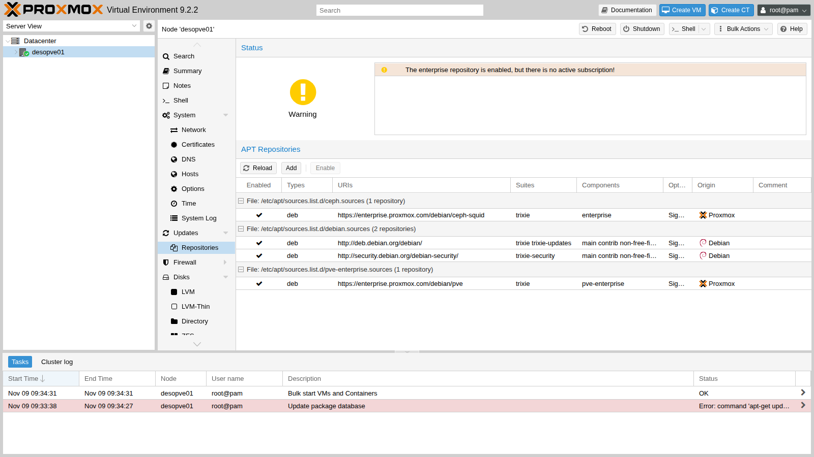

2. Click **Add** (close the subscription notice) and open the **Repository** list: besides the Proxmox VE ones, there are the Ceph repositories in the Enterprise, No-Subscription and Test variants.

   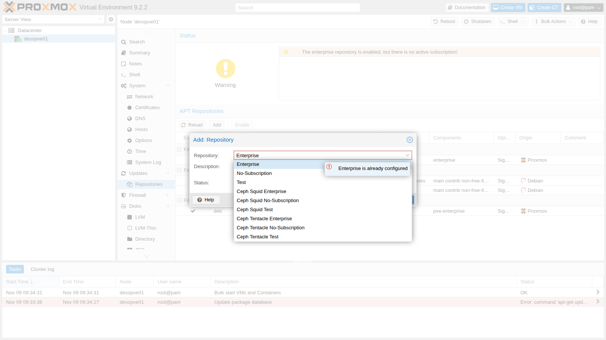

3. Choose **No-Subscription** and click **Add**. The dialog reminds you that the repository is recommended for testing and non-production use.

   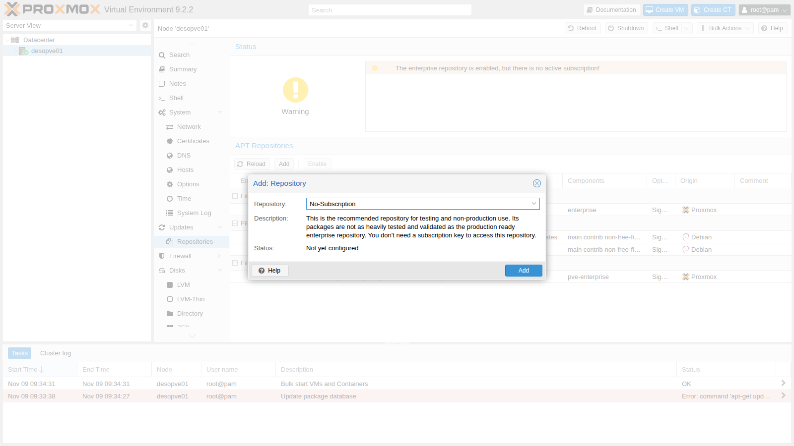

4. Select the `pve-enterprise` row and click **Disable**; do the same with the `ceph-squid` *enterprise* row. The status becomes *You get updates for Proxmox VE*. The remaining warning *The no-subscription repository is not recommended for production use!* is expected.

   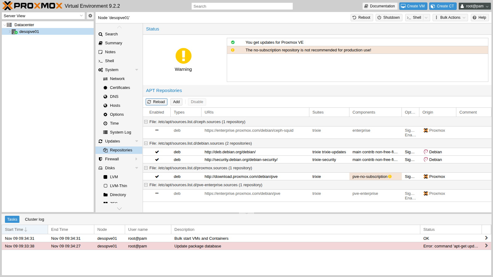

   The GUI has created the `/etc/apt/sources.list.d/proxmox.sources` file and added `Enabled: no` to the enterprise files.

### 3. Set the proxy

Go to **Datacenter** → **Options**, double-click **HTTP proxy** and enter `http://proxy.proxmox.community:3128`.

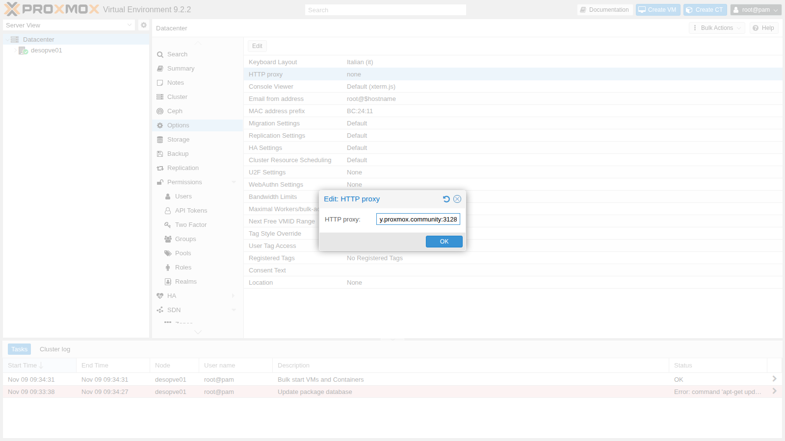

### 4. Update from the web interface

1. Go back to `desopve01` → **Updates** and click **Refresh**. The task runs `apt-get update` through the proxy and ends with **TASK OK**.

   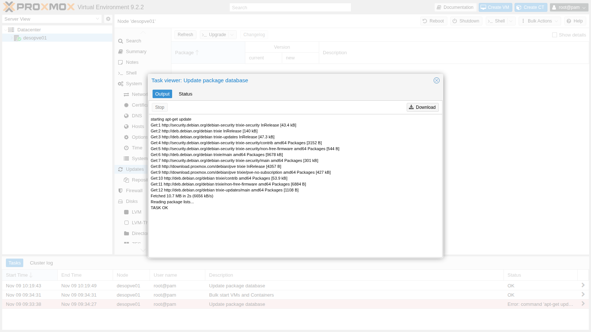

2. The list shows the upgradable packages, with the installed and the new version. Right after installing from the 9.2-1 ISO there were more than two hundred.

   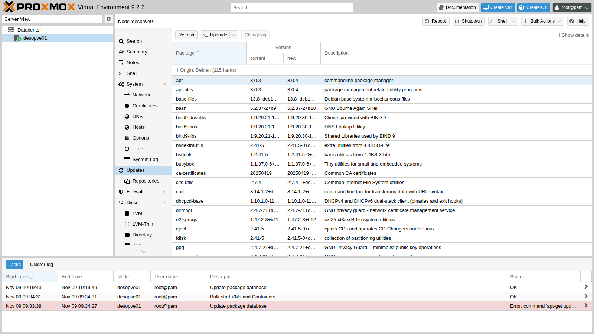

3. Click **Upgrade**: a console opens and runs `apt-get dist-upgrade`. Check the summary and confirm with `y`.

   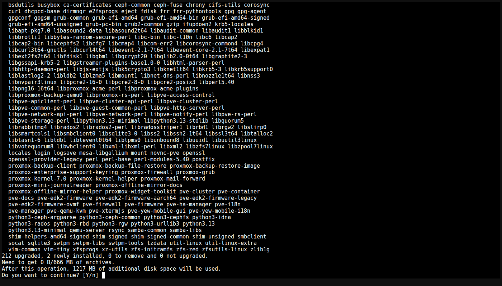

   > During the upgrade, `apt-listchanges` may show the package release notes in a pager: the upgrade stays paused until you press `q`.

4. When it finishes, the console reports *Your System is up-to-date* and opens a shell.

   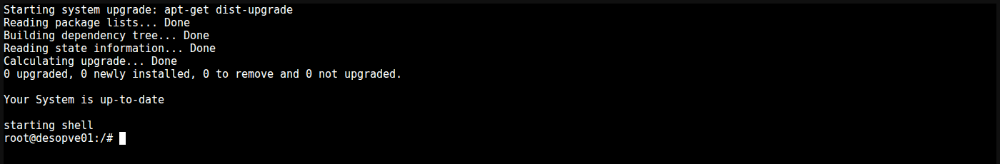

5. The upgrade installed a new kernel: reboot the node with **Reboot** at the top right. After the reboot, the **Summary** shows the new version (`pve-manager/9.2.26`) and the `7.0.14-28-pve` kernel.

   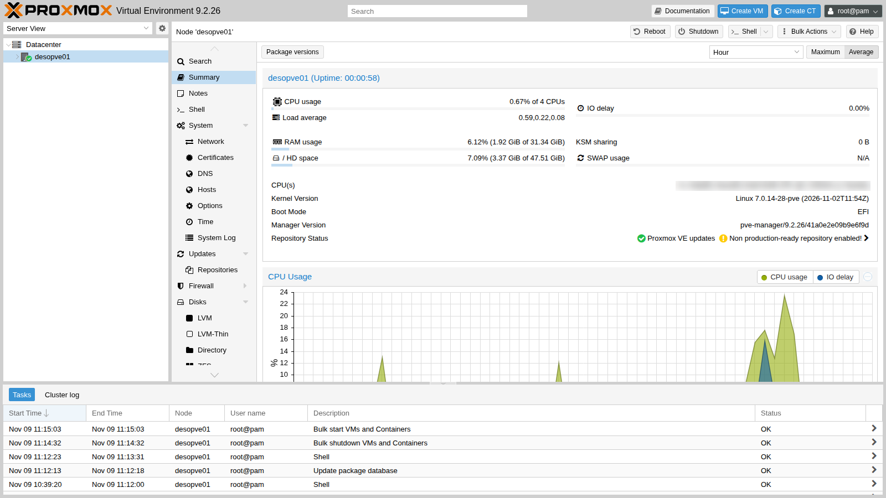

### 5. Do the same from the command line

On the other nodes (`desopve02`, `desopve03` and `desopve04`), perform the same steps from the command line, in the **Shell** of each node in the web interface (from [Lab 05](05-ssh-shell-cli.md) on you will use SSH): they are the same commands you will use in scripts.

1. Look at the existing repositories and disable the enterprise ones by adding `Enabled: no`:

   ```bash title="root@desopve02"
   ls /etc/apt/sources.list.d/
   ```

   ``` { .text .no-copy title="Output" }
   ceph.sources  debian.sources  pve-enterprise.sources
   ```

   ```bash title="root@desopve02"
   echo 'Enabled: no' >> /etc/apt/sources.list.d/pve-enterprise.sources
   echo 'Enabled: no' >> /etc/apt/sources.list.d/ceph.sources
   cat /etc/apt/sources.list.d/pve-enterprise.sources
   ```

   ``` { .text .no-copy title="Output" }
   Types: deb
   URIs: https://enterprise.proxmox.com/debian/pve
   Suites: trixie
   Components: pve-enterprise
   Signed-By: /usr/share/keyrings/proxmox-archive-keyring.gpg
   Enabled: no
   ```

2. Create the no-subscription repository:

   ```bash title="root@desopve02"
   cat > /etc/apt/sources.list.d/proxmox.sources <<'EOF'
   Types: deb
   URIs: http://download.proxmox.com/debian/pve
   Suites: trixie
   Components: pve-no-subscription
   Signed-By: /usr/share/keyrings/proxmox-archive-keyring.gpg
   EOF
   ```

3. Set the datacenter proxy with `pvesh`, the command-line client of the API (lab 05), and run `pveupdate`, which writes the proxy configuration for `apt` and refreshes the package list:

   ```bash title="root@desopve02"
   pvesh set /cluster/options --http_proxy http://proxy.proxmox.community:3128
   cat /etc/pve/datacenter.cfg
   ```

   ``` { .text .no-copy title="Output" }
   http_proxy: http://proxy.proxmox.community:3128
   keyboard: it
   ```

   ```bash title="root@desopve02"
   pveupdate
   ```

   ``` { .text .no-copy title="Output" }
   error reading cached package status in '/var/lib/pve-manager/pkgupdates' - can't open '/var/lib/pve-manager/pkgupdates' - No such file or directory
   ```

   ```bash title="root@desopve02"
   cat /etc/apt/apt.conf.d/76pveproxy
   ```

   ``` { .text .no-copy title="Output" }
   Acquire::http::Proxy "http://proxy.proxmox.community:3128";
   ```

   The `pveupdate` message appears only the first time: the file with the list of updates does not exist yet and is created at that moment.

4. Upgrade. With `apt`, always use **`full-upgrade`** (or `dist-upgrade`), never plain `upgrade`: a Proxmox VE update may need to install new packages, such as a kernel, which `upgrade` would leave behind.

   ```bash title="root@desopve02"
   apt update
   ```

   ``` { .text .no-copy title="Output" }
   …
   212 packages can be upgraded. Run 'apt list --upgradable' to see them.
   ```

   ```bash title="root@desopve02"
   apt full-upgrade
   ```

   ``` { .text .no-copy title="Output" }
   …
   Summary:
     Upgrading: 212, Installing: 2, Removing: 0, Not Upgrading: 0
     Download size: 666 MB
     Space needed: 1,217 MB / 48.8 GB available
   …
   ```

   ```bash title="root@desopve02"
   systemctl reboot
   ```

### 6. Synchronize the time

Proxmox VE uses **chrony**. After the installation it points to the public `2.debian.pool.ntp.org` servers, which cannot be reached from the lab: `chronyc sources` shows no source. On **each** node, replace the pool with the lab NTP server:

```bash title="root@desopve02"
sed -i 's/^pool 2.debian.pool.ntp.org iburst/#pool 2.debian.pool.ntp.org iburst/' /etc/chrony/chrony.conf
echo 'server ntp.proxmox.community iburst' > /etc/chrony/sources.d/lab.sources
systemctl restart chrony
chronyc sources
```

``` { .text .no-copy title="Output" }
MS Name/IP address         Stratum Poll Reach LastRx Last sample
===============================================================================
^* netsvc.proxmox.community      3   6    17     6  +5191ns[  -60us] +/-   23ms
```

```bash title="root@desopve02"
timedatectl | grep -E 'synchronized|NTP service'
```

``` { .text .no-copy title="Output" }
System clock synchronized: yes
              NTP service: active
```

The asterisk (`^*`) marks the source selected by chrony. `sources.d` is the directory that Debian's `chrony.conf` reads with the `sourcedir` directive: keeping your own configuration in a separate file avoids conflicts when a package update brings a new `chrony.conf`.

### 7. Check the node DNS

`desopve01` → **System** → **DNS** shows the search domain (`proxmox.community`) and the DNS server (`172.27.199.20`) set by the installer, saved in `/etc/resolv.conf`.

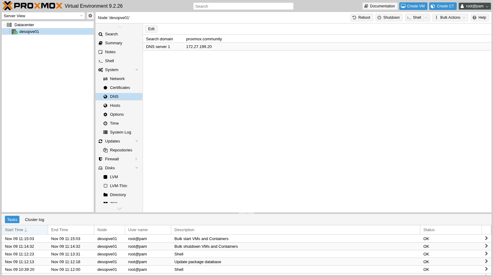

## Verification and tests

On all four nodes:

```bash title="root@desopve01"
pveversion
```

``` { .text .no-copy title="Output" }
pve-manager/9.2.26/41a0e2e09b9e6f9d (running kernel: 7.0.14-28-pve)
```

```bash title="root@desopve01"
pveversion -v | head -4
```

``` { .text .no-copy title="Output" }
proxmox-ve: 9.2.0 (running kernel: 7.0.14-28-pve)
pve-manager: 9.2.26 (running version: 9.2.26/41a0e2e09b9e6f9d)
proxmox-kernel-helper: 9.2.1
proxmox-kernel-7.0: 7.0.14-28
```

```bash title="root@desopve02"
apt update
```

``` { .text .no-copy title="Output" }
…
All packages are up to date.
```

```bash title="root@desopve02"
cat /etc/apt/sources.list.d/ceph.sources
```

``` { .text .no-copy title="Output" }
Types: deb
URIs: https://enterprise.proxmox.com/debian/ceph-squid
Suites: trixie
Components: enterprise
Signed-By: /usr/share/keyrings/proxmox-archive-keyring.gpg
Enabled: no
```

- [ ] `pveversion` shows `pve-manager/9.2.26` and the `7.0.14-28-pve` kernel (so the node has been rebooted).
- [ ] `apt update` completes without errors and reports *All packages are up to date*.
- [ ] The Proxmox VE and Ceph enterprise repositories are disabled, `pve-no-subscription` is enabled.
- [ ] `chronyc sources` shows `^* netsvc.proxmox.community`.

## Final lab state

- Four Proxmox VE **9.2.26** nodes with the `7.0.14-28-pve` kernel, not yet in a cluster.
- Repositories: `pve-no-subscription` enabled, Proxmox VE and Ceph enterprise disabled.
- Proxy `http://proxy.proxmox.community:3128` in the `datacenter.cfg` of each node and in `/etc/apt/apt.conf.d/76pveproxy`.
- Time synchronized with `ntp.proxmox.community` on all nodes.

## What you learned

- The difference between **Datacenter** settings and **node** resources.
- What the enterprise, no-subscription and test repositories offer, and how to manage them in the deb822 format.
- How Proxmox VE uses an HTTP proxy for updates and downloads.
- Why you upgrade with `full-upgrade` and when you need to reboot.
- How to point chrony to an internal NTP server.

## References

- [Proxmox VE – Package Repositories](https://pve.proxmox.com/pve-docs/pve-admin-guide.html#sysadmin_package_repositories)
- [Proxmox VE – System Software Updates](https://pve.proxmox.com/pve-docs/pve-admin-guide.html#system_software_updates)
- [Proxmox VE – Datacenter configuration (datacenter.cfg)](https://pve.proxmox.com/pve-docs/datacenter.cfg.5.html)
- [Proxmox VE – Time Synchronization](https://pve.proxmox.com/pve-docs/pve-admin-guide.html#_time_synchronization)
