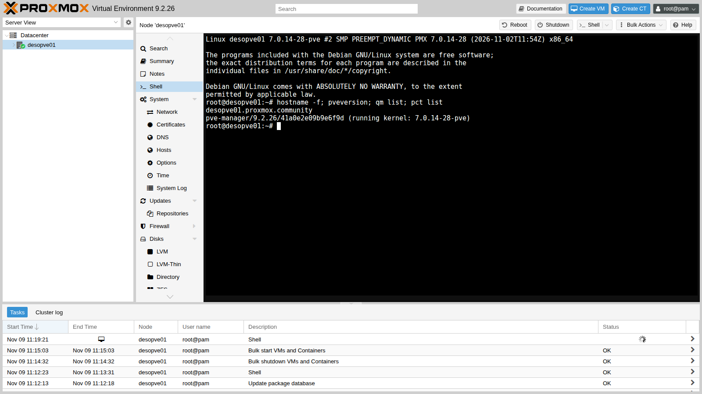
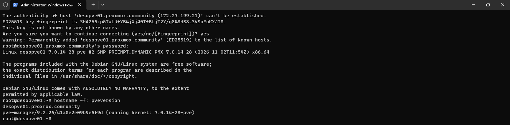
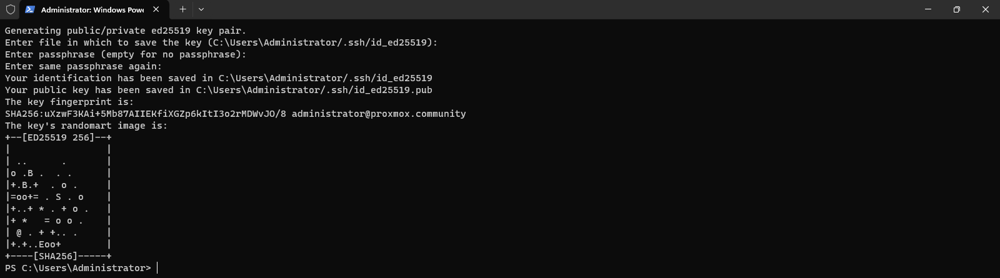
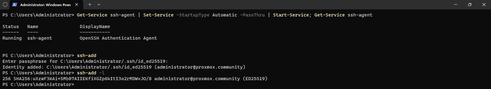
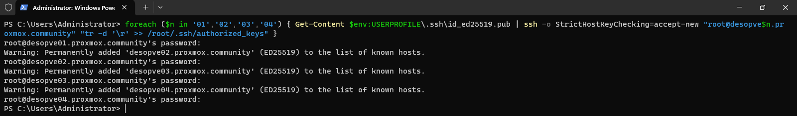
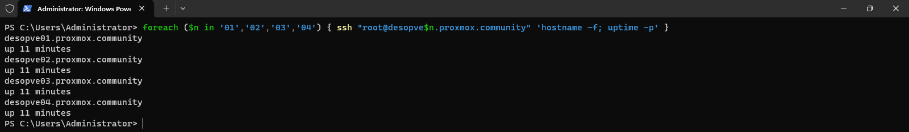

# Lab 05 – SSH, shell and command-line tools

**Level:** basic · **Duration:** 45 minutes

## Dependencies

- **Previous labs:** [Lab 02](02-domain-controller.md), to use the `desopve-dc01` domain controller as the administration workstation, and [Lab 04](04-first-access-repositories-updates.md), with the four nodes updated.
- **Software:** the OpenSSH client, already included in Windows Server 2025: there is nothing to install.
- **Credentials:** `root` / `<lab-password>` on the nodes, `PROXMOX\Administrator` on the DC → [Appendix B](b-credentials-and-addresses.md).

## Objectives

- Open a shell on a node directly from the web interface.
- Connect over SSH from the administration workstation, verifying the fingerprint of the server key.
- Create a passphrase-protected ED25519 key pair, load it into the Windows SSH agent and distribute it to the four nodes.
- Get to know the Proxmox VE command-line tools: `pvesh`, `qm`, `pct`, `pvesm`, `pveum`, `pvenode` and `pvecm`.

## How it works

### Three ways to the command line

| Way | How to open it | When to use it |
|---|---|---|
| **GUI shell** | node → **Shell** | quick tasks, without other programs: it is a terminal in the browser (xterm.js), connected to the node through port 8006 |
| **SSH** | `ssh` client to port 22 of the node | daily work, scripts, file copies (`scp`) |
| **Server console** | monitor and keyboard, or the remote console of the management controller | when the node's network is not working |

The GUI shell opens a `root` session on the selected node. This is why it is reserved for users with the `Sys.Console` privilege, as you will see in lab 44.

### Server keys and user keys

SSH uses two kinds of keys, for different purposes:

- the **server key** (*host key*) proves to the client that it is talking to the right server. On the first connection, the client shows its *fingerprint*. If you accept it, the client saves it in `known_hosts` and from then on refuses to connect if the key changes: this is the protection against anyone impersonating the server;
- the **user key pair** replaces the password. The **private** key stays on your workstation; the **public** key is copied to the server, into the user's `authorized_keys` file.

An unprotected private key is worth as much as a password written in a file. This is why we protect it with a **passphrase** and use the **SSH agent** (`ssh-agent`): you type the passphrase only once, when the key is loaded into the agent. On Windows the agent is a service, which keeps the keys, protected by the user account, even after a restart.

On Proxmox VE the `/root/.ssh/authorized_keys` file is a link to `/etc/pve/priv/authorized_keys`, inside the cluster file system. As long as the nodes are separate, each one has its own file. When you form the cluster (lab 06), there will be a single file, shared by all the nodes.

### Everything goes through the API

Proxmox VE is built around a **REST API**, reachable at `https://<nodo>:8006/api2/json/`. The web interface is just one of its clients: every click becomes an API call, and every long-running operation becomes a **task** that you find in the bottom panel.

The command-line tools use the same API:

| Command | What it is for |
|---|---|
| `pvesh` | direct access to the API: `get`, `create`, `set`, `delete`, `ls` on any path |
| `qm` | virtual machines (QEMU/KVM) |
| `pct` | containers (LXC) |
| `pvesm` | storage |
| `pveum` | users, groups, roles, permissions and tokens |
| `pvecm` | cluster |
| `pvenode` | node settings and tasks |
| `pveversion` | installed versions |

When run as `root` on the node, they do not ask for credentials. Each command has its own man page (`man qm`) and, without arguments, shows the list of its subcommands.

## Procedure

### 1. The shell from the web interface

1. In the web interface, select the `desopve01` node and click **Shell**.
2. In the terminal, run `hostname -f; pveversion; qm list; pct list`. The two lists are empty, because there are no VMs or containers yet. The **Shell** task appears in the **Tasks** panel at the bottom, running as long as the terminal stays open.

   

3. Leave the terminal open: you need it in the next step to read the fingerprint of the node key.

   ```bash title="root@desopve01"
   ssh-keygen -lf /etc/ssh/ssh_host_ed25519_key.pub
   ```

   ``` { .text .no-copy title="Output" }
   256 SHA256:p5TwLK+YB4jXj40TfBtjT2Y/g848HB8t3VSoFoKXJIM root@desopve01 (ED25519)
   ```

### 2. First SSH login from the administration workstation

1. Connect over Remote Desktop to `desopve-dc01` as `PROXMOX\Administrator` and open **Terminal** (PowerShell) as administrator.
2. Connect to the node:

   ```powershell
   ssh root@desopve01.proxmox.community
   ```

3. The client does not know the server and shows its fingerprint. Compare it with the one you read in step 1: they must match. Answer `yes`, then enter the `root` password.

   

   The node key is now saved in `C:\Users\Administrator\.ssh\known_hosts`.

4. Close the session with `exit`.

### 3. Create the key pair

1. Generate an ED25519 key. The comment helps you recognize it when you find it in `authorized_keys`:

   ```powershell
   ssh-keygen -t ed25519 -C "administrator@proxmox.community"
   ```

2. Press **Enter** to accept the suggested path (`C:\Users\Administrator/.ssh/id_ed25519`), then choose `<lab-password>` as the passphrase and repeat it (in production, use a passphrase different from the server passwords).

   

   Two files have been created: `id_ed25519`, the private key, which you must never copy elsewhere, and `id_ed25519.pub`, the public key to distribute.

### 4. Load the key into the SSH agent

The Windows `ssh-agent` service is installed but disabled. Set it to start automatically, start it and load the key into it: the passphrase is requested only once.

```powershell
Get-Service ssh-agent | Set-Service -StartupType Automatic -PassThru | Start-Service; Get-Service ssh-agent
ssh-add
ssh-add -l
```



### 5. Distribute the public key to the nodes

Copy the public key into `authorized_keys` on all four nodes with a single loop. The `root` password is requested once per node:

```powershell
foreach ($n in '01','02','03','04') { Get-Content $env:USERPROFILE\.ssh\id_ed25519.pub | ssh -o StrictHostKeyChecking=accept-new "root@desopve$n.proxmox.community" "tr -d '\r' >> /root/.ssh/authorized_keys" }
```



Two details of the command:

- `StrictHostKeyChecking=accept-new` saves the key of nodes never seen before without asking. A **changed** key is still rejected. This is convenient in the lab; in production, verify the fingerprint of each server as in step 2.
- Windows ends lines with CR+LF, Linux with LF only. `tr -d '\r'` strips the CR character before appending the key to the file, so `authorized_keys` stays clean.

### 6. Log in without a password

Repeat the loop, running a command on each node: no password is requested, because the agent presents the key.

```powershell
foreach ($n in '01','02','03','04') { ssh "root@desopve$n.proxmox.community" 'hostname -f; uptime -p' }
```



### 7. The command-line tools

Connect to `desopve01` (`ssh root@desopve01.proxmox.community`) and try the main commands.

1. **`pvesh`** queries the API. The version:

   ```bash title="root@desopve01"
   pvesh get /version
   ```

   ``` { .text .no-copy title="Output" }
   ┌─────────┬──────────────────┐
   │ key     │ value            │
   ╞═════════╪══════════════════╡
   │ release │ 9.2              │
   ├─────────┼──────────────────┤
   │ repoid  │ 41a0e2e09b9e6f9d │
   ├─────────┼──────────────────┤
   │ version │ 9.2.26           │
   └─────────┴──────────────────┘
   ```

   `pvesh ls` lists the paths under a node. The letters show the allowed methods: `D` subdirectory, `r` read (get), `w` modify (set), `c` create, `d` delete.

   ```bash title="root@desopve01"
   pvesh ls /nodes/desopve01 | head -12
   ```

   ``` { .text .no-copy title="Output" }
   -r-c-        aplinfo
   Dr---        apt
   Dr---        capabilities
   Dr---        ceph
   Dr---        certificates
   -rw--        config
   Dr---        disks
   -rw--        dns
   Dr---        firewall
   Dr---        hardware
   -r-c-        hosts
   -r---        journal
   ```

   The `--output-format` option changes the format (`text`, `json`, `json-pretty`, `yaml`), which is useful in scripts:

   ```bash title="root@desopve01"
   pvesh get /nodes --output-format yaml
   ```

   ``` { .text .no-copy title="Output" }
   ---
   - cpu: 0.125779885200898
     disk: 3614965760
     id: node/desopve01
     level: ''
     maxcpu: 4
     maxdisk: 51013746688
     maxmem: 33654243328
     mem: 2262896640
     node: desopve01
     ssl_fingerprint: 14:32:84:88:C7:D8:14:A6:29:17:FA:04:65:09:52:2A:BC:3E:92:77:76:6D:32:04:CB:3F:3A:FC:A5:69:5B:F3
     status: online
     type: node
     uptime: 731
   ```

   `pvesh usage` shows the parameters of a call, for example the creation of a VM (`--verbose` describes them all):

   ```bash title="root@desopve01"
   pvesh usage /nodes/desopve01/qemu --command create
   ```

   ``` { .text .no-copy title="Output" }
   USAGE: pvesh create /nodes/desopve01/qemu --vmid <integer> [OPTIONS]
   ```

2. **`pvesm`** shows the node storages. With the ZFS installation there are `local`, a directory for ISOs, templates and backups, and `local-zfs`, for VM and container disks:

   ```bash title="root@desopve01"
   pvesm status
   ```

   ``` { .text .no-copy title="Output" }
   Name             Type     Status     Total (KiB)      Used (KiB) Available (KiB)        %
   local             dir     active        46288000             128        46287872    0.00%
   local-zfs     zfspool     active        46288016              96        46287920    0.00%
   ```

3. **`pveum`** manages users. For now there is only `root@pam`:

   ```bash title="root@desopve01"
   pveum user list
   ```

   ``` { .text .no-copy title="Output" }
   ┌──────────┬─────────┬─────────────────────────┬────────┬────────┬───────────┬────────┬──────┬──────────┬────────────┬──────────────────┬────────┬─────────────┐
   │ userid   │ comment │ email                   │ enable │ expire │ firstname │ groups │ keys │ lastname │ realm-type │ tfa-locked-until │ tokens │ totp-locked │
   ╞══════════╪═════════╪═════════════════════════╪════════╪════════╪═══════════╪════════╪══════╪══════════╪════════════╪══════════════════╪════════╪═════════════╡
   │ root@pam │         │ admin@proxmox.community │ 1      │      0 │           │        │      │          │ pam        │                  │        │             │
   └──────────┴─────────┴─────────────────────────┴────────┴────────┴───────────┴────────┴──────┴──────────┴────────────┴──────────────────┴────────┴─────────────┘
   ```

4. **`pvenode task list`** shows the latest tasks of the node, the same ones as in the **Tasks** panel. Each task has a unique identifier (UPID) that contains the node, the type and the user:

   ```bash title="root@desopve01"
   pvenode task list --limit 3
   ```

   ``` { .text .no-copy title="Output" }
   ┌───────────────────────────────────────────────────────────────┬──────────┬────┬──────────┬─────────────────────┬─────────────────────┬────────┐
   │ UPID                                                          │ Type     │ ID │ User     │           Starttime │             Endtime │ Status │
   ╞═══════════════════════════════════════════════════════════════╪══════════╪════╪══════════╪═════════════════════╪═════════════════════╪════════╡
   │ UPID:desopve01:00000652:00000730:6AF1AB37:startall::root@pam: │ startall │    │ root@pam │ 2026-11-09 12:15:03 │ 2026-11-09 12:15:03 │ OK     │
   ├───────────────────────────────────────────────────────────────┼──────────┼────┼──────────┼─────────────────────┼─────────────────────┼────────┤
   │ UPID:desopve01:0000098F:00006BCF:6AF1AC39:vncshell::root@pam: │ vncshell │    │ root@pam │ 2026-11-09 12:19:21 │ 2026-11-09 12:19:35 │ OK     │
   ├───────────────────────────────────────────────────────────────┼──────────┼────┼──────────┼─────────────────────┼─────────────────────┼────────┤
   │ UPID:desopve01:0000B1AC:000953A0:6AF1AB18:stopall::root@pam:  │ stopall  │    │ root@pam │ 2026-11-09 12:14:32 │ 2026-11-09 12:14:32 │ OK     │
   └───────────────────────────────────────────────────────────────┴──────────┴────┴──────────┴─────────────────────┴─────────────────────┴────────┘
   ```

5. **`qm`** and **`pct`** manage VMs and containers; you will use them from lab 07 on. Without arguments they show the subcommands:

   ```bash title="root@desopve01"
   pct
   ```

   ``` { .text .no-copy title="Output" }
   ERROR: no command specified
   USAGE: pct <COMMAND> [ARGS] [OPTIONS]

          pct clone <vmid> <newid> [OPTIONS]
          pct create <vmid> <ostemplate> [OPTIONS]
          pct destroy <vmid> [OPTIONS]
   …
   ```

6. **`pvecm`** manages the cluster. For now it returns an error, because the node is not part of a cluster yet: you will create the cluster in lab 06.

   ```bash title="root@desopve01"
   pvecm status
   ```

   ``` { .text .no-copy title="Output" }
   Error: Corosync config '/etc/pve/corosync.conf' does not exist - is this node part of a cluster?
   ```

> **Note:** in production it is advisable to disable SSH password login for `root` (`PermitRootLogin prohibit-password` in `/etc/ssh/sshd_config`), allowing only keys. In the lab it stays enabled, because some labs use it.

## Verification and tests

1. From the DC, the loop of step 6 returns the four names without asking for a password.
2. On each node, the DC key is in `authorized_keys`, without CR characters:

   ```bash title="root@desopve01"
   tail -1 /root/.ssh/authorized_keys | cut -d' ' -f1,3
   ```

   ``` { .text .no-copy title="Output" }
   ssh-ed25519 administrator@proxmox.community
   ```

   ```bash title="root@desopve01"
   grep -c $'\r' /root/.ssh/authorized_keys
   ```

   ``` { .text .no-copy title="Output" }
   0
   ```

3. **Test: without the agent, you need the passphrase.** Empty the agent and connect: the key still works, but now `ssh` asks for the passphrase. Load the key again with `ssh-add`, and login is automatic again:

   ```powershell title="PowerShell — desopve-dc01"
   ssh-add -D
   ```

   ``` { .text .no-copy title="Output" }
   All identities removed.
   ```

   ```powershell title="PowerShell — desopve-dc01"
   ssh root@desopve02.proxmox.community hostname -f
   ```

   ``` { .text .no-copy title="Output" }
   Enter passphrase for key 'C:\Users\Administrator/.ssh/id_ed25519':
   desopve02.proxmox.community
   ```

   ```powershell title="PowerShell — desopve-dc01"
   ssh-add
   ```

   ``` { .text .no-copy title="Output" }
   Enter passphrase for C:\Users\Administrator/.ssh/id_ed25519:
   Identity added: C:\Users\Administrator/.ssh/id_ed25519 (administrator@proxmox.community)
   ```

   ```powershell title="PowerShell — desopve-dc01"
   ssh root@desopve02.proxmox.community hostname -f
   ```

   ``` { .text .no-copy title="Output" }
   desopve02.proxmox.community
   ```

- [ ] Key-based SSH login to the four nodes, without a password.
- [ ] The `ssh-agent` service on the DC is running and set to start automatically, with the key loaded (`ssh-add -l`).
- [ ] `pvesh get /version` returns `9.2.26`.

## Final lab state

- On the DC: key pair `C:\Users\Administrator\.ssh\id_ed25519` (with passphrase), `ssh-agent` service set to automatic with the key loaded, `known_hosts` with the keys of the four nodes.
- On each node: the `administrator@proxmox.community` public key in `/root/.ssh/authorized_keys`. The four files are still separate, because the nodes are not in a cluster.
- No VMs, no containers; `local` and `local-zfs` storage (`local` and `local-lvm` on `desopve04`).

## What you learned

- The three ways to the command line: GUI shell, SSH and console.
- What the server key and the user key pair are for, and why you verify the fingerprint on the first connection.
- How to protect the key with a passphrase without typing it every time, thanks to the SSH agent.
- That the web interface and the `pvesh`, `qm`, `pct`, `pvesm`, `pveum`, `pvecm` and `pvenode` commands use the same API.

## References

- [Proxmox VE – Command-line tools](https://pve.proxmox.com/pve-docs/pve-admin-guide.html#_command_line_tools)
- [Proxmox VE – pvesh](https://pve.proxmox.com/pve-docs/pvesh.1.html)
- [Proxmox VE – API Viewer](https://pve.proxmox.com/pve-docs/api-viewer/)
- [Microsoft – Key-based authentication in OpenSSH for Windows](https://learn.microsoft.com/windows-server/administration/openssh/openssh_keymanagement)
