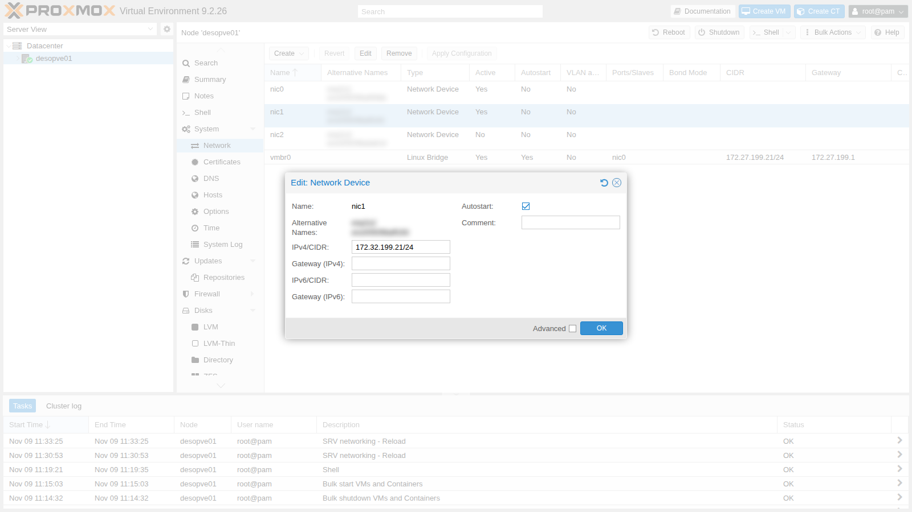
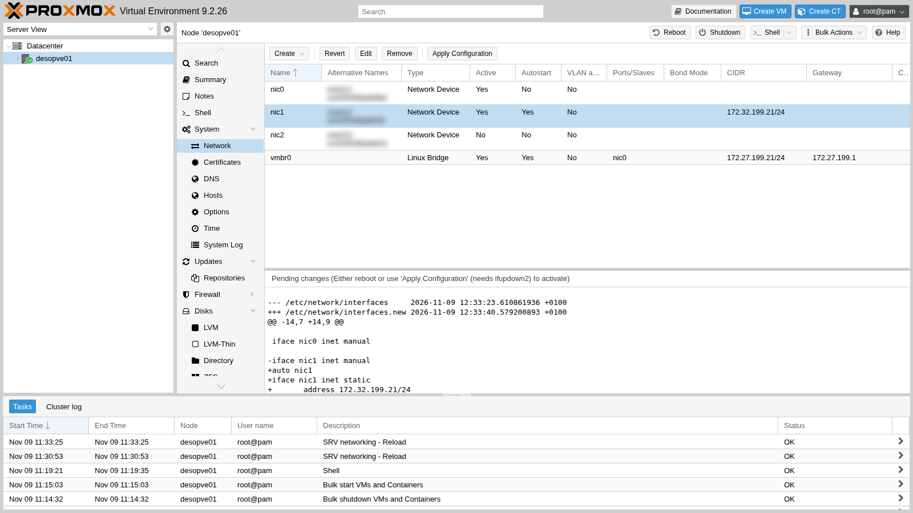
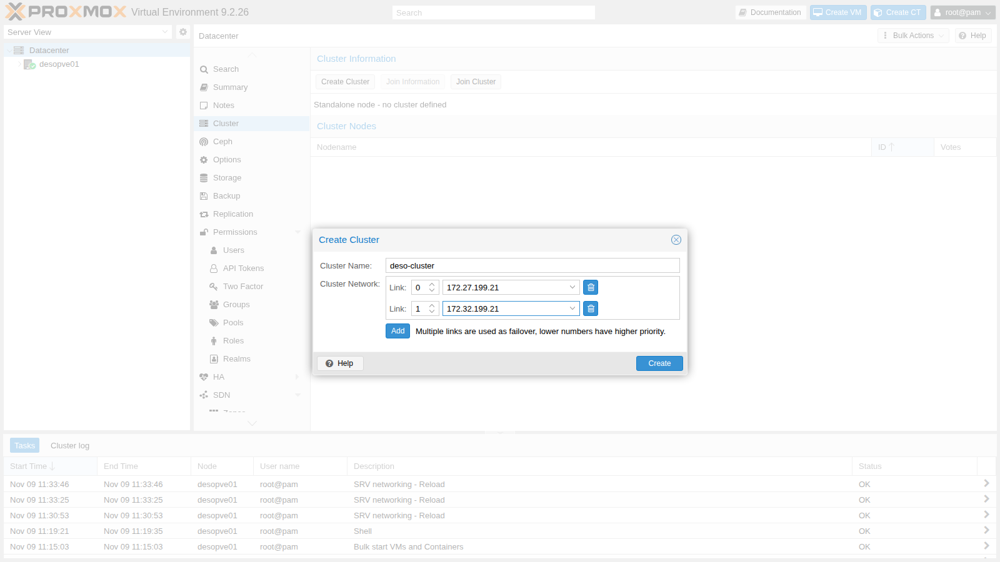
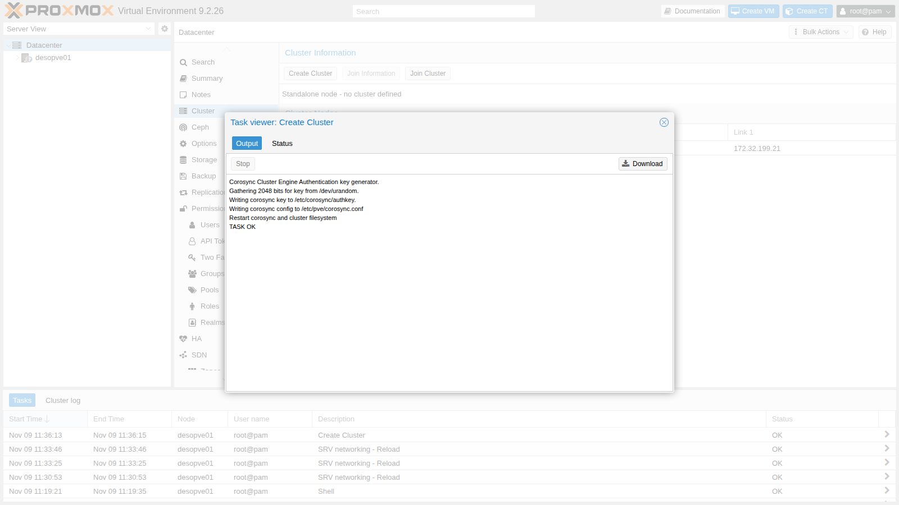
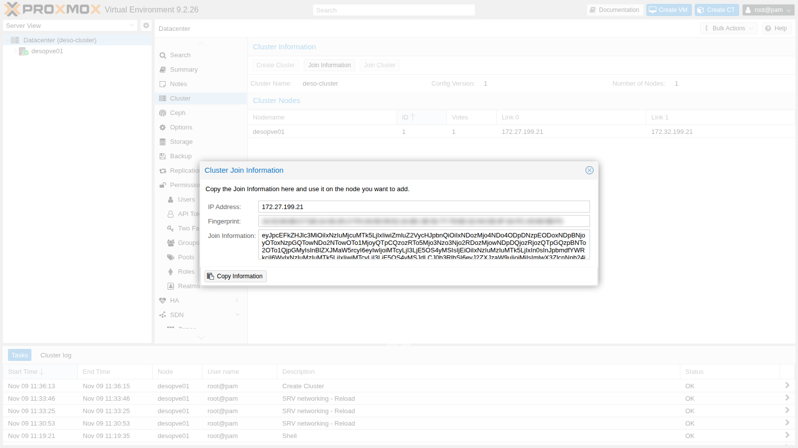
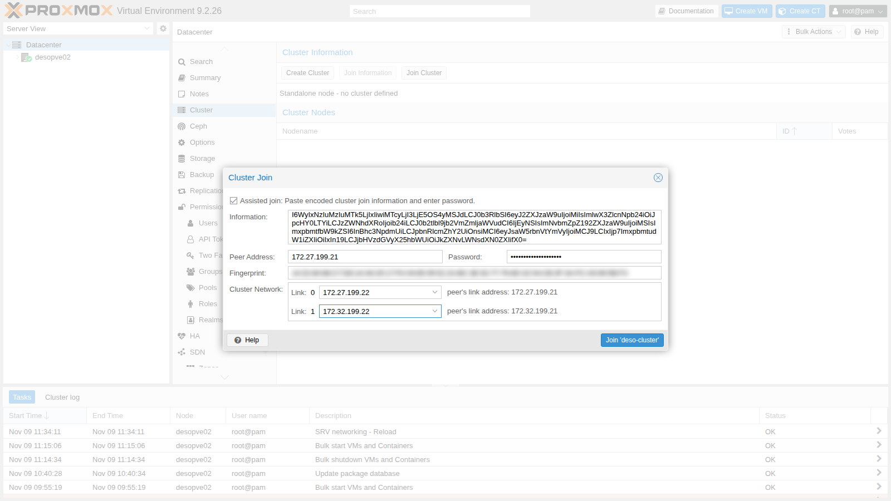
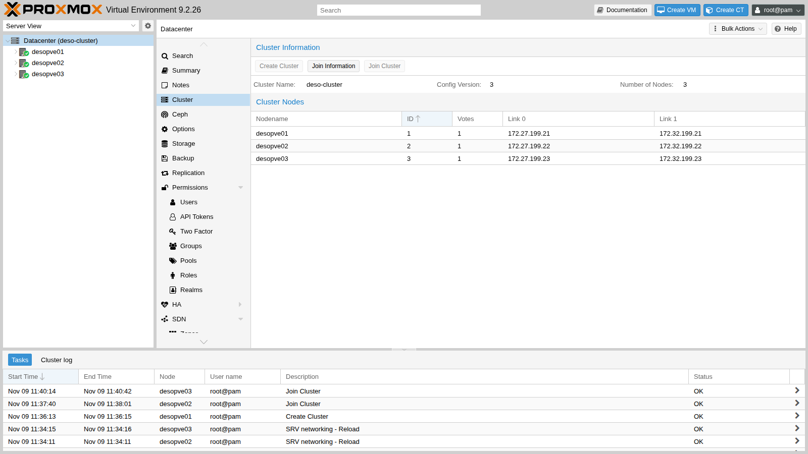
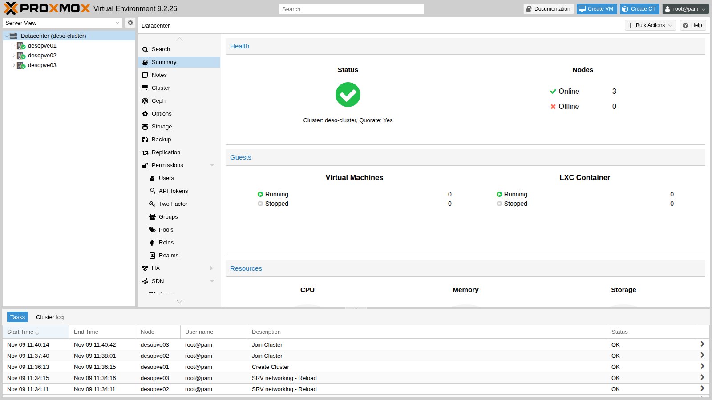

# Lab 06 – Three-node cluster and Corosync

**Level:** basic · **Duration:** 1 hour

## Dependencies

- **Previous labs:** [Lab 04](04-first-access-repositories-updates.md), with the nodes updated to the same version and their time synchronized, and [Lab 05](05-ssh-shell-cli.md), for key-based SSH access from the DC.
- **Servers:** `desopve01`, `desopve02` and `desopve03` powered on, with no VMs or containers; `desopve04` also powered on, only to configure its `nic1` (it stays outside the cluster). A node that joins a cluster must not have any guests, because their IDs could conflict with those of the cluster.
- **Network:** the second network card of each node (`nic1`) connected to the `172.32.199.0/24` network.
- **Credentials:** `root` / `<lab-password>` → [Appendix B](b-credentials-and-addresses.md).

## Objectives

- Understand what **Corosync**, the **quorum** and the cluster file system (**pmxcfs**) do.
- Prepare a second network for Corosync.
- Create the `deso-cluster` cluster from the web interface, with two links.
- Add one node from the web interface and one from the command line.
- Diagnose the cluster status and verify what happens when a link or a node goes down.

## How it works

### The cluster components

A Proxmox VE cluster is a set of nodes managed as one: from any node you see and manage all the others, and you can move VMs and containers between nodes. Three components work together:

| Component | What it does |
|---|---|
| **Corosync** | carries the messages between nodes and knows at every moment which nodes are present (*membership*). It uses the **kronosnet** (knet) protocol over UDP, ports 5405-5412 |
| **Quorum** (`votequorum`) | each node has one vote; the cluster is operational (*quorate*) only if a **majority** of the votes is present |
| **pmxcfs** | the cluster file system, mounted on `/etc/pve`: VM, storage, user and permission configurations, replicated to all nodes through Corosync |

Thanks to pmxcfs, a change made on one node is instantly visible on all the others. A node that loses quorum makes `/etc/pve` **read-only**: this way, two groups of nodes isolated from each other cannot modify the same configuration in different ways (*split brain*).

### Why three nodes and not four

With three nodes the quorum is 2: the cluster survives the loss of any one node. With four nodes the quorum is 3: the cluster still survives the loss of only one node, but if the network splits in half (two nodes on one side, two on the other), **neither** half has the majority and the whole cluster stops. For clusters with an even number of nodes there is the **QDevice**, an external vote that acts as a tie-breaker.

This is why `desopve04` stays **standalone**: it is a second "datacenter" that you will need for migrations between clusters ([Lab 48](48-migrations.md)) and to compare the ext4/LVM installation with the ZFS one.

### Two links for Corosync

Corosync is sensitive to **latency**, not to bandwidth: if the network is congested (for example by a backup or a migration), messages arrive late and the nodes may believe they are isolated. This is why best practices call for:

- at least **two links** on different networks, so that the loss of one network does not stop the cluster;
- a link dedicated to Corosync only, in production clusters: you will set it up with VLANs in lab 22.

With knet, the links work in **passive** mode: Corosync uses one at a time, the one with the highest priority (by default the lowest number, so link 0), and switches to the other within moments if the first one goes down.

| Link | Network | Addresses |
|---|---|---|
| 0 | management `172.27.199.0/24` | `vmbr0` of the nodes, `.21`-`.23` |
| 1 | cluster/storage `172.32.199.0/24` | `nic1` of the nodes, `.21`-`.23` |

## Procedure

### 1. Configure the second network card

On each node, `nic1` is connected to the `172.32.199.0/24` network but has no address. Configure it from the web interface on `desopve01` and from the command line on the other nodes.

1. Log in to `https://desopve01.proxmox.community:8006`, select `desopve01` → **System** → **Network** and double-click `nic1`.
2. Enter **IPv4/CIDR** `172.32.199.21/24`, leave the gateway empty (the network is directly reachable) and check **Autostart**, so that the interface comes up at boot. Click **OK**.

   

3. The change is not active yet: Proxmox VE has written it to `/etc/network/interfaces.new` and shows at the bottom the differences from the file in use. Click **Apply Configuration** and confirm with **Yes**: the *SRV networking - Reload* task applies the configuration with `ifreload` without rebooting the node.

   

4. On the other three nodes, do the same with `pvesh`: the first command stages the change, the second one applies it.

   ```console
   root@desopve02:~# pvesh set /nodes/desopve02/network/nic1 --type eth --cidr 172.32.199.22/24 --autostart 1
   root@desopve02:~# pvesh set /nodes/desopve02/network
   UPID:desopve02:00001497:0001C658:6AF1AFB3:srvreload:networking:root@pam:
   root@desopve02:~# ip -br -4 addr show nic1
   nic1             UP             172.32.199.22/24
   ```

   Repeat on `desopve03` (`172.32.199.23`) and `desopve04` (`172.32.199.24`).

5. Check that the nodes can reach each other on the second network:

   ```console
   root@desopve01:~# for n in 22 23 24; do ping -c1 -W1 172.32.199.$n | grep "bytes from"; done
   64 bytes from 172.32.199.22: icmp_seq=1 ttl=64 time=1.94 ms
   64 bytes from 172.32.199.23: icmp_seq=1 ttl=64 time=0.963 ms
   64 bytes from 172.32.199.24: icmp_seq=1 ttl=64 time=0.906 ms
   ```

### 2. Create the cluster

1. On `desopve01`, go to **Datacenter** → **Cluster** and click **Create Cluster**.
2. Fill in:
   - **Cluster Name:** `deso-cluster`. At most 15 characters, and it cannot be changed later;
   - **Cluster Network – Link 0:** choose `172.27.199.21` from the list;
   - click **Add** and, for **Link 1**, choose `172.32.199.21`.

   The dialog reminds you of the link rule: all else being equal, the lowest number wins.

   

3. Click **Create**. The task generates the Corosync authentication key (`/etc/corosync/authkey`), writes `/etc/pve/corosync.conf` and restarts Corosync and pmxcfs.

   

### 3. Add `desopve02` from the web interface

1. On `desopve01`, in **Datacenter** → **Cluster**, click **Join Information**. The dialog contains, encoded in a single string, the node address, the fingerprint of its certificate and the link configuration. Click **Copy Information**.

   

2. Log in to the web interface of **`desopve02`** (`https://desopve02.proxmox.community:8006`) and go to **Datacenter** → **Cluster** → **Join Cluster**.
3. Paste the string into **Information**: the address and the fingerprint fill in automatically. Enter the `root` **password** of `desopve01` and choose the **local** addresses of `desopve02` for the two links: `172.27.199.22` for link 0 and `172.32.199.22` for link 1.

   

4. Click **Join 'deso-cluster'**. During the join, the node receives a new certificate and restarts the web service, so the task window stops updating after *Request addition of this node*. This is normal: wait a few seconds, reload the page and log in again. The complete task log, in `desopve02` → **Task History**, is this:

   ```text
   Establishing API connection with host '172.27.199.21'
   Login succeeded.
   check cluster join API version
   Request addition of this node
   Join request OK, finishing setup locally
   stopping pve-cluster service
   backup old database to '/var/lib/pve-cluster/backup/config-1794224271.sql.gz'
   waiting for quorum...OK
   (re)generate node files
   generate new node certificate
   merge authorized SSH keys
   generated new node certificate, restart pveproxy and pvedaemon services
   successfully added node 'desopve02' to cluster.
   TASK OK
   ```

   Note two steps. The node **backs up** its old configuration (`backup old database`) and replaces it with the cluster's: this is why it must be empty. Then it **merges the authorized SSH keys**: the DC key, which you copied to each node in lab 05, is now in a single shared file.

### 4. Add `desopve03` from the command line

From the DC, connect over SSH to `desopve03` (with the key from lab 05 you do not need the password) and use `pvecm add`. The first argument is a node that is already part of the cluster; `--link0` and `--link1` are the **local** addresses of the joining node. The command asks for the `root` password of the specified node and, on the first connection, shows its certificate fingerprint: compare it with the one in the **Join Information** and answer `yes`.

```console
PS C:\Users\Administrator> ssh root@desopve03.proxmox.community
root@desopve03:~# pvecm add desopve01.proxmox.community --link0 172.27.199.23 --link1 172.32.199.23
Please enter superuser (root) password for 'desopve01.proxmox.community': ********************
Establishing API connection with host 'desopve01.proxmox.community'
The authenticity of host 'desopve01.proxmox.community' can't be established.
X509 SHA256 key fingerprint is 14:32:84:88:C7:D8:14:A6:29:17:FA:04:65:09:52:2A:BC:3E:92:77:76:6D:32:04:CB:3F:3A:FC:A5:69:5B:F3.
Are you sure you want to continue connecting (yes/no)? yes
Login succeeded.
check cluster join API version
Request addition of this node
Join request OK, finishing setup locally
stopping pve-cluster service
backup old database to '/var/lib/pve-cluster/backup/config-1794224432.sql.gz'
waiting for quorum...OK
(re)generate node files
generate new node certificate
merge authorized SSH keys
generated new node certificate, restart pveproxy and pvedaemon services
successfully added node 'desopve03' to cluster.
```

### 5. The cluster in the web interface

1. Reload the `desopve01` interface: the tree now shows **Datacenter (deso-cluster)** with three nodes. In **Datacenter** → **Cluster** you see the nodes, their IDs, votes and the addresses of the two links.

   

2. **Datacenter** → **Summary** summarizes the status: *Cluster: deso-cluster, Quorate: Yes*, three nodes online.

   

   From now on you can manage all three nodes by logging in to the interface of any one of them.

### 6. Diagnostics from the command line

1. **`pvecm status`** is the first command to run when in doubt. Check `Quorate: Yes` and the ratio between **Total votes** and **Quorum**:

   ```console
   root@desopve01:~# pvecm status
   Cluster information
   -------------------
   Name:             deso-cluster
   Config Version:   3
   Transport:        knet
   Secure auth:      on

   Quorum information
   ------------------
   Date:             Mon Nov  9 12:41:44 2026
   Quorum provider:  corosync_votequorum
   Nodes:            3
   Node ID:          0x00000001
   Ring ID:          1.d
   Quorate:          Yes

   Votequorum information
   ----------------------
   Expected votes:   3
   Highest expected: 3
   Total votes:      3
   Quorum:           2
   Flags:            Quorate

   Membership information
   ----------------------
       Nodeid      Votes Name
   0x00000001          1 172.27.199.21 (local)
   0x00000002          1 172.27.199.22
   0x00000003          1 172.27.199.23
   ```

2. **`pvecm nodes`** lists the nodes by name:

   ```console
   root@desopve01:~# pvecm nodes

   Membership information
   ----------------------
       Nodeid      Votes Name
            1          1 desopve01 (local)
            2          1 desopve02
            3          1 desopve03
   ```

3. **`corosync-cfgtool -s`** shows the status of each link to each node:

   ```console
   root@desopve01:~# corosync-cfgtool -s
   Local node ID 1, transport knet
   LINK ID 0 udp
   	addr	= 172.27.199.21
   	status:
   		nodeid:          1:	localhost
   		nodeid:          2:	connected
   		nodeid:          3:	connected
   LINK ID 1 udp
   	addr	= 172.32.199.21
   	status:
   		nodeid:          1:	localhost
   		nodeid:          2:	connected
   		nodeid:          3:	connected
   ```

4. The Corosync configuration is in `/etc/pve/corosync.conf`: for each node one address per link (`ring0_addr`, `ring1_addr`), and in `totem` the cluster name, the `passive` link mode and encrypted authentication (`secauth`). Edit it only with great care, incrementing `config_version`: a mistake can stop the entire cluster.

   ```console
   root@desopve01:~# cat /etc/pve/corosync.conf
   logging {
     debug: off
     to_syslog: yes
   }

   nodelist {
     node {
       name: desopve01
       nodeid: 1
       quorum_votes: 1
       ring0_addr: 172.27.199.21
       ring1_addr: 172.32.199.21
     }
     node {
       name: desopve02
       nodeid: 2
       quorum_votes: 1
       ring0_addr: 172.27.199.22
       ring1_addr: 172.32.199.22
     }
     node {
       name: desopve03
       nodeid: 3
       quorum_votes: 1
       ring0_addr: 172.27.199.23
       ring1_addr: 172.32.199.23
     }
   }

   quorum {
     provider: corosync_votequorum
   }

   totem {
     cluster_name: deso-cluster
     config_version: 3
     interface {
       linknumber: 0
     }
     interface {
       linknumber: 1
     }
     ip_version: ipv4-6
     link_mode: passive
     secauth: on
     token_coefficient: 125
     version: 2
   }
   ```

5. In `/etc/pve` each node has its own directory, and `.members` shows the pmxcfs view. The authorized SSH keys are now also a single shared file, with the `root` key of each node and the DC key:

   ```console
   root@desopve01:~# ls /etc/pve/nodes
   desopve01
   desopve02
   desopve03
   root@desopve01:~# cat /etc/pve/.members
   {
   "nodename": "desopve01",
   "version": 9,
   "cluster": { "name": "deso-cluster", "version": 3, "nodes": 3, "quorate": 1 },
   "nodelist": {
     "desopve01": { "id": 1, "online": 1, "ip": "172.27.199.21"},
     "desopve02": { "id": 2, "online": 1, "ip": "172.27.199.22"},
     "desopve03": { "id": 3, "online": 1, "ip": "172.27.199.23"}
     }
   }
   root@desopve01:~# cut -d" " -f1,3 /etc/pve/priv/authorized_keys

   ssh-rsa root@desopve01
   ssh-ed25519 administrator@proxmox.community
   ssh-rsa root@desopve02
   ssh-rsa root@desopve03
   ```

## Verification and tests

### Test 1 – Link 1 goes down

Bring down `nic1` on `desopve03`, which loses the `172.32.199.0/24` network:

```console
root@desopve03:~# ip link set nic1 down
```

On `desopve01`, link 1 to node 3 shows as `disconnected`, but the cluster stays **Quorate** with three votes, because link 0 still works:

```console
root@desopve01:~# corosync-cfgtool -s
Local node ID 1, transport knet
LINK ID 0 udp
	addr	= 172.27.199.21
	status:
		nodeid:          1:	localhost
		nodeid:          2:	connected
		nodeid:          3:	connected
LINK ID 1 udp
	addr	= 172.32.199.21
	status:
		nodeid:          1:	localhost
		nodeid:          2:	connected
		nodeid:          3:	disconnected
root@desopve01:~# pvecm status | grep -E "^Quorate|Total votes"
Quorate:          Yes
Total votes:      3
root@desopve01:~# journalctl -u corosync --since "-30 sec" --no-hostname | tail -2
Nov 09 12:41:51 corosync[6048]:   [KNET  ] link: host: 3 link: 1 is down
Nov 09 12:41:51 corosync[6048]:   [KNET  ] host: host: 3 (passive) best link: 0 (pri: 1)
```

Bring the card back up (`ip link set nic1 up`): after a few seconds the link is `connected` again.

### Test 2 – The management network goes down

Now take down **link 0**, the management network. Bring down `nic0` on `desopve03`, the port of the `vmbr0` bridge. An SSH session open on `172.27.199.23` would be cut off, so run the command from `desopve01` **by connecting to the address on the second network**. It is the first SSH connection to that address: `accept-new` saves its key without asking for confirmation.

```console
root@desopve01:~# ssh -o StrictHostKeyChecking=accept-new root@172.32.199.23 "ip link set nic0 down"
Warning: Permanently added '172.32.199.23' (ED25519) to the list of known hosts.
```

`desopve03` no longer responds on the management network, but stays in the cluster: Corosync has switched to link 1 by itself.

```console
root@desopve01:~# ping -c1 -W1 172.27.199.23 | grep loss
1 packets transmitted, 0 received, 100% packet loss, time 0ms
root@desopve01:~# pvecm status | grep -E "^Quorate|Total votes"
Quorate:          Yes
Total votes:      3
root@desopve01:~# journalctl -u corosync --since "-25 sec" --no-hostname | tail -2
Nov 09 12:44:52 corosync[6048]:   [KNET  ] link: host: 3 link: 0 is down
Nov 09 12:44:52 corosync[6048]:   [KNET  ] host: host: 3 (passive) best link: 1 (pri: 1)
```

Bring the card back up: Corosync returns to the preferred link, link 0.

```console
root@desopve01:~# ssh root@172.32.199.23 "ip link set nic0 up"
root@desopve01:~# journalctl -u corosync --since "-12 sec" --no-hostname | tail -2
Nov 09 12:45:05 corosync[6048]:   [KNET  ] host: host: 3 (passive) best link: 0 (pri: 1)
Nov 09 12:45:05 corosync[6048]:   [KNET  ] pmtud: Global data MTU changed to: 1397
```

### Test 3 – A node loses quorum

Stop Corosync on `desopve03`, as if the node were isolated from both networks:

```console
root@desopve03:~# systemctl stop corosync
```

The other two nodes have 2 votes out of 3, that is, the quorum: the cluster keeps working.

```console
root@desopve01:~# pvecm status | sed -n "/Votequorum/,\$p"
Votequorum information
----------------------
Expected votes:   3
Highest expected: 3
Total votes:      2
Quorum:           2
Flags:            Quorate

Membership information
----------------------
    Nodeid      Votes Name
0x00000001          1 172.27.199.21 (local)
0x00000002          1 172.27.199.22
```

The isolated node, on the other hand, can no longer modify the shared configuration: `/etc/pve` is read-only.

```console
root@desopve03:~# touch /etc/pve/prova.txt
touch: cannot touch '/etc/pve/prova.txt': Permission denied
```

Start Corosync again (`systemctl start corosync`): the node rejoins, you are back to three votes and `/etc/pve` is writable again.

```console
root@desopve03:~# systemctl start corosync
root@desopve03:~# pvecm status | grep -E "^Quorate|Total votes"
Quorate:          Yes
Total votes:      3
root@desopve03:~# touch /etc/pve/prova.txt && echo scrittura-ok && rm /etc/pve/prova.txt
scrittura-ok
```

- [ ] `pvecm status` on any node: `Quorate: Yes`, `Total votes: 3`.
- [ ] `corosync-cfgtool -s`: link 0 and link 1 `connected` to all nodes.
- [ ] The web interface of a node shows all three nodes with a green status.

## Final lab state

- Cluster **`deso-cluster`** with `desopve01` (ID 1), `desopve02` (ID 2) and `desopve03` (ID 3), one vote each, quorum 2.
- Corosync on two links: link 0 `172.27.199.0/24` (`vmbr0`), link 1 `172.32.199.0/24` (`nic1`).
- `nic1` configured on all four nodes (`172.32.199.21`-`.24`).
- `desopve04` remains a standalone node, outside the cluster.
- Authorized SSH keys shared among the cluster nodes in `/etc/pve/priv/authorized_keys`.

## What you learned

- The role of Corosync, quorum and pmxcfs, and why a node without quorum makes `/etc/pve` read-only.
- Why a cluster should have an odd number of votes, and when you need a QDevice.
- How to create a cluster and add nodes from the web interface and with `pvecm add`.
- How to read the cluster status with `pvecm status` and `corosync-cfgtool -s`.
- That a second link keeps the cluster running when a network goes down.

## References

- [Proxmox VE – Cluster Manager](https://pve.proxmox.com/pve-docs/pve-admin-guide.html#chapter_pvecm)
- [Proxmox VE – Cluster Network](https://pve.proxmox.com/pve-docs/pve-admin-guide.html#pvecm_cluster_network)
- [Proxmox VE – Proxmox Cluster File System (pmxcfs)](https://pve.proxmox.com/pve-docs/pve-admin-guide.html#chapter_pmxcfs)
- [Proxmox VE – Corosync External Vote Support (QDevice)](https://pve.proxmox.com/pve-docs/pve-admin-guide.html#_corosync_external_vote_support)
