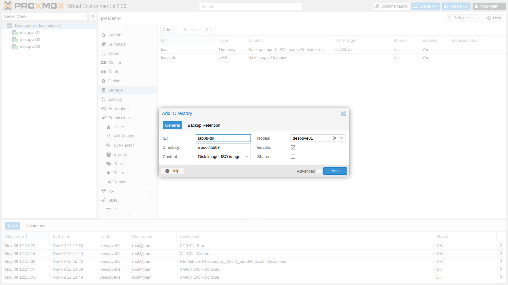
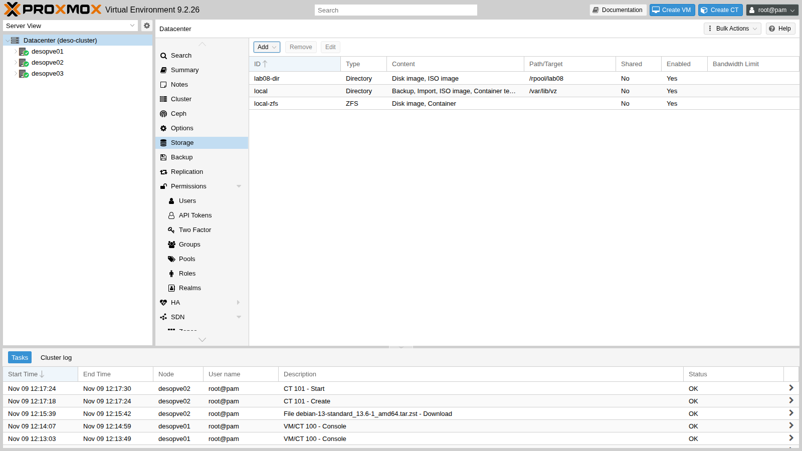
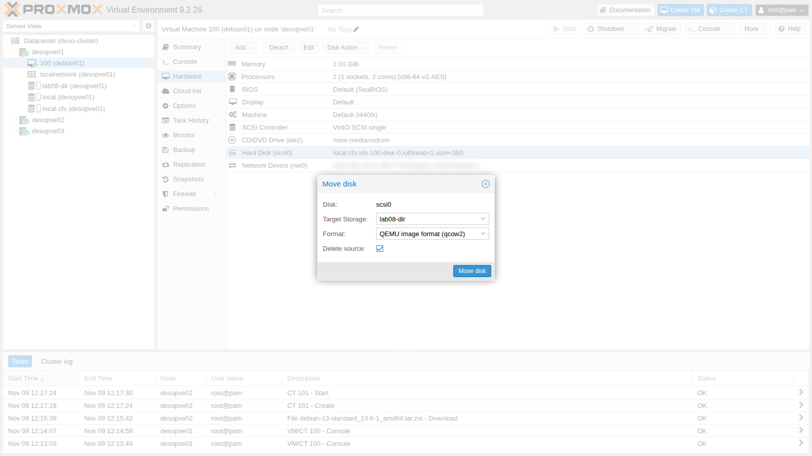
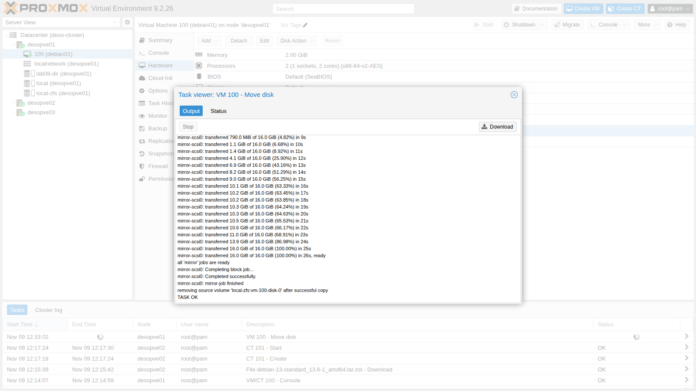
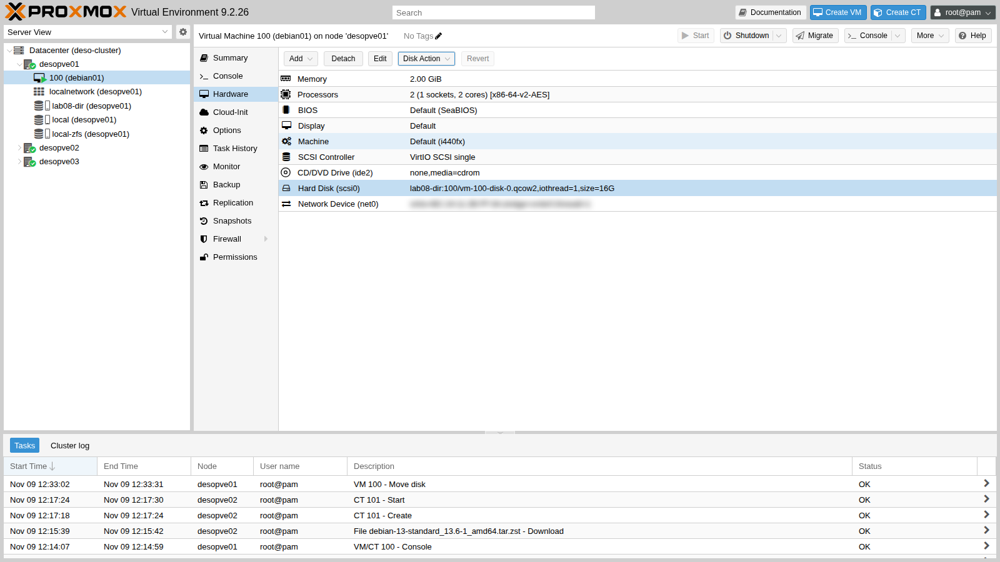

# Lab 08 – The Proxmox VE storage model

**Level:** intermediate · **Duration:** 1 hour

## Dependencies

- **Previous labs:** [Lab 07](07-first-vm-and-container.md): VM `100` `debian01` running on `desopve01`, with its disk on `local-zfs`.
- **Nodes:** `desopve01` of the `deso-cluster` cluster.
- **Credentials:** `root` / `<lab-password>` → [Appendix B](b-credentials-and-addresses.md).

## Objectives

- Understand how Proxmox VE describes storage: type, content, formats, local and shared storage.
- Read `/etc/pve/storage.cfg` and query the storages with `pvesm`.
- Add a **Directory** storage and protect it with `is_mountpoint`.
- Move the disk of a running VM from a block storage to a file storage, changing its format.
- See **thin provisioning** in numbers: virtual size versus space used.

## How it works

### Storages, volumes and `storage.cfg`

For Proxmox VE, a **storage** is a place to keep disks, ISOs, templates or backups. It is defined only once for the whole cluster, in `/etc/pve/storage.cfg`, and identified by an **ID** (`local`, `local-zfs`…). Each object inside a storage is a **volume** and has a unique address, the **volume ID**:

```text
local-zfs:vm-100-disk-0                     disk of VM 100 on the local-zfs storage
local:iso/debian-13.7.0-amd64-netinst.iso   ISO on the local storage
```

In the configuration of a VM, the disks are written exactly this way (`scsi0: local-zfs:vm-100-disk-0,...`): the VM does not know the physical path, which Proxmox VE derives from the storage. This is why a disk can be moved from one storage to another without touching the rest of the configuration.

### Storage types

The **type** tells you which technology lies underneath. The types available in Proxmox VE 9.2 are:

| Type | Description | Level | Shared | Snapshots |
|---|---|---|---|---|
| `dir` | Directory on a local file system | file | no | with qcow2 |
| `btrfs` | BTRFS file system (technology preview) | file | no | yes |
| `nfs` | NFS share | file | yes | with qcow2 |
| `cifs` | SMB/CIFS share | file | yes | with qcow2 |
| `cephfs` | Ceph file system | file | yes | yes |
| `zfspool` | Local ZFS pool: zvols for VMs, datasets for containers | both | no | yes |
| `lvm` | LVM volume group | block | no, yes on a shared LUN | volume chain (lab 16) |
| `lvmthin` | LVM thin pool | block | no | yes |
| `iscsi` | iSCSI LUN with the kernel initiator | block | yes | no |
| `iscsidirect` | iSCSI LUN with libiscsi, inside QEMU | block | yes | no |
| `rbd` | Ceph RBD | block | yes | yes |
| `zfs` | ZFS over iSCSI | block | yes | yes |
| `pbs` | Proxmox Backup Server, for backups only | both | yes | – |
| `esxi` | ESXi host, only for importing VMs (lab 50) | – | – | – |

- **File** or **block**: a file storage contains files (`.qcow2` and `.raw` images, ISOs); a block storage provides block devices (LVs, zvols, LUNs), one per disk.
- **Shared**: the same storage is reachable from all nodes, with the same data. This is what enables live migration without copying the disks, and high availability (labs 48-49). Note: the `shared` flag tells Proxmox VE that the data *are already* shared; it does not make them shared.

### Content types

Each storage accepts only the content types you enable on it:

| Content | In the interface | What it contains | Folder in a `dir` storage |
|---|---|---|---|
| `images` | Disk image | VM disks | `images/<VMID>/` |
| `rootdir` | Container | container disks | `images/<VMID>/` |
| `iso` | ISO image | ISO images | `template/iso/` |
| `vztmpl` | Container template | LXC templates | `template/cache/` |
| `backup` | VZDump backup file | backups | `dump/` |
| `snippets` | Snippets | hookscripts, cloud-init files | `snippets/` |
| `import` | Import | images and OVAs to import | `import/` |

### Disk formats

- **raw**: the bytes of the disk, with no headers. It is the fastest format and the one used by block storages (a zvol or an LV *is* the disk). The only exception: LVM with the Proxmox VE 9 *snapshot as volume chain* feature, which writes qcow2 inside the LVs (lab 16).
- **qcow2**: the QEMU format, on file storages. It grows as data is written (thin) and supports snapshots.
- **vmdk**: the format of other hypervisors, useful only for compatibility.
- **subvol**: for containers on ZFS or on directories: the disk is a folder (a ZFS dataset), not an image.

### Thin provisioning

A **thin** disk uses only the space actually written; a **thick** disk reserves its full size right away. Thin provisioning lets you assign more space than actually exists (**overprovisioning**), but you have to make sure that the real space does not run out (lab 09).

| Storage | How it becomes thin |
|---|---|
| `zfspool` | `sparse` option (enabled on `local-zfs`): the zvol has no `refreservation` |
| `lvmthin` | always thin |
| `dir`, `nfs`, `cifs` | qcow2, or "sparse" raw; the `preallocation` option (default `metadata`) decides how much to reserve at creation |
| `lvm` | always thick |

## Procedure

### 1. The storage configuration

1. In the web interface, open **Datacenter** → **Storage**: the storages created by the installation are listed.

   

2. The same data are in the shared cluster file:

   ```bash title="root@desopve01"
   cat /etc/pve/storage.cfg
   ```

   ``` { .text .no-copy title="Output" }
   dir: local
   	path /var/lib/vz
   	content iso,vztmpl,backup,import

   zfspool: local-zfs
   	pool rpool/data
   	sparse
   	content images,rootdir
   ```

   - `local` is a **directory** on `/var/lib/vz`, which the ZFS installation placed on a dedicated dataset (`rpool/var-lib-vz`). It contains ISOs, templates, backups and files to import: it is a **file** storage.
   - `local-zfs` uses the `rpool/data` dataset for VM and container disks: it is a **block** storage for VMs (zvols) and a file storage for containers (subvols). It is `sparse`, hence **thin**.

3. The list of types is also in the `pvesm` help:

   ```bash title="root@desopve01"
   pvesm help add | sed -n 1,7p
   ```

   ``` { .text .no-copy title="Output" }
   USAGE: pvesm add <type> <storage> [OPTIONS]

     Create a new storage.

     <type>     <btrfs | cephfs | cifs | dir | esxi | iscsi | iscsidirect |
   	     lvm | lvmthin | nfs | pbs | rbd | zfs | zfspool>
   	     Storage type.
   ```

### 2. Query the storages with `pvesm`

1. **Status** of all the node's storages, or only of those that accept a given content type:

   ```bash title="root@desopve01"
   pvesm status
   ```

   ``` { .text .no-copy title="Output" }
   Name             Type     Status     Total (KiB)      Used (KiB) Available (KiB)        %
   local             dir     active        44854016          768000        44086016    1.71%
   local-zfs     zfspool     active        45518240         1432128        44086112    3.15%
   ```

   The two storages show the same available space (about 42 GiB): they sit on the same `rpool` pool and share it.

2. **Content** of a storage, with volume ID, format and size:

   ```bash title="root@desopve01"
   pvesm list local
   ```

   ``` { .text .no-copy title="Output" }
   Volid                                     Format  Type           Size VMID
   local:iso/debian-13.7.0-amd64-netinst.iso iso     iso       792723456
   ```

   ```bash title="root@desopve01"
   pvesm list local-zfs
   ```

   ``` { .text .no-copy title="Output" }
   Volid                   Format  Type             Size VMID
   local-zfs:vm-100-disk-0 raw     images    17179869184 100
   ```

3. Actual **path** of a volume and space actually used. The disk of VM 100 is a zvol, that is, a block device:

   ```bash title="root@desopve01"
   pvesm path local-zfs:vm-100-disk-0
   ```

   ``` { .text .no-copy title="Output" }
   /dev/zvol/rpool/data/vm-100-disk-0
   ```

   ```bash title="root@desopve01"
   zfs get -H -o property,value volsize,used,refreservation,volblocksize,compression rpool/data/vm-100-disk-0
   ```

   ``` { .text .no-copy title="Output" }
   volsize	16G
   used	1.37G
   refreservation	none
   volblocksize	16K
   compression	on
   ```

   The disk is 16 GiB, but it uses 1.37 GiB on the pool: it is thin (`refreservation none`) and ZFS compresses it.

### 3. Add a Directory storage

A `dir` storage can live on any mounted file system. Here you use a new ZFS dataset, but the procedure is identical with a disk formatted with ext4 or XFS.

1. Create the dataset, which ZFS mounts by itself on `/rpool/lab08`:

   ```bash title="root@desopve01"
   zfs create rpool/lab08
   zfs list -o name,used,avail,mountpoint rpool/lab08
   ```

   ``` { .text .no-copy title="Output" }
   NAME          USED  AVAIL  MOUNTPOINT
   rpool/lab08    96K  42.0G  /rpool/lab08
   ```

2. In **Datacenter** → **Storage**, click **Add** → **Directory** and fill in:
   - **ID** `lab08-dir`, **Directory** `/rpool/lab08`;
   - **Content** `Disk image` and `ISO image`;
   - **Nodes** `desopve01`: the folder exists only on this node, so the storage must be restricted to it;
   - **Shared** off: it is a local storage.

   

3. Click **Add**. The new storage appears in the list and, in the tree, only under `desopve01`.

   

4. The storage points to a mount point. If the dataset were not mounted, Proxmox VE would write the disks into the empty folder underneath, on the system file system. The `is_mountpoint` option, which you set from the command line, prevents this: if the path is not mounted, the storage is reported as inactive.

   ```bash title="root@desopve01"
   pvesm set lab08-dir --is_mountpoint yes
   grep -A6 "dir: lab08-dir" /etc/pve/storage.cfg
   ```

   ``` { .text .no-copy title="Output" }
   dir: lab08-dir
   	path /rpool/lab08
   	content iso,images
   	is_mountpoint yes
   	nodes desopve01
   	prune-backups keep-all=1
   	shared 0
   ```

### 4. Move the VM disk to a file storage

You move the disk of VM `100`, **while it is running**, from `local-zfs` (zvol, raw) to `lab08-dir` (file, qcow2).

1. Open VM `100` → **Hardware**, select **Hard Disk (scsi0)** and choose **Disk Action** → **Move Storage**.
2. **Target Storage** `lab08-dir`, **Format** `QEMU image format (qcow2)`; check **Delete source** to delete the source disk once the copy is complete.

   

3. Click **Move disk**. QEMU copies the disk while the VM keeps working (*drive mirror*): once the copy is in sync, it switches to the new disk and deletes the old one.

   

   ```text
   create full clone of drive scsi0 (local-zfs:vm-100-disk-0)
   Formatting '/rpool/lab08/images/100/vm-100-disk-0.qcow2', fmt=qcow2 cluster_size=65536 extended_l2=off preallocation=metadata compression_type=zlib size=17179869184 lazy_refcounts=off refcount_bits=16
   allocated target volume 'lab08-dir:100/vm-100-disk-0.qcow2'
   drive mirror is starting for drive-scsi0
   ...
   mirror-scsi0: transferred 16.0 GiB of 16.0 GiB (100.00%) in 26s, ready
   all 'mirror' jobs are ready
   mirror-scsi0: Completing block job...
   mirror-scsi0: Completed successfully.
   mirror-scsi0: mirror-job finished
   removing source volume 'local-zfs:vm-100-disk-0' after successful copy
   TASK OK
   ```

4. In the **Hardware** tab, the disk is now `lab08-dir:100/vm-100-disk-0.qcow2`.

   

5. From the command line: the file "weighs" 17 GB as apparent size, but it uses only 1.2 GB on disk. `qemu-img` shows the virtual size of the disk and the actual size of the file.

   ```bash title="root@desopve01"
   pvesm list lab08-dir
   ```

   ``` { .text .no-copy title="Output" }
   Volid                             Format  Type             Size VMID
   lab08-dir:100/vm-100-disk-0.qcow2 qcow2   images    17179869184 100
   ```

   ```bash title="root@desopve01"
   ls -lsh /rpool/lab08/images/100/
   ```

   ``` { .text .no-copy title="Output" }
   total 1.2G
   1.2G -rw-r----- 1 root root 17G Nov  9 13:33 vm-100-disk-0.qcow2
   ```

   ```bash title="root@desopve01"
   qemu-img info /rpool/lab08/images/100/vm-100-disk-0.qcow2 | head -4
   ```

   ``` { .text .no-copy title="Output" }
   image: /rpool/lab08/images/100/vm-100-disk-0.qcow2
   file format: qcow2
   virtual size: 16 GiB (17179869184 bytes)
   disk size: 1.18 GiB
   ```

### 5. Move the disk back to ZFS from the command line

You can do the same move with `qm disk move`. Move the disk back to `local-zfs`, where it must stay for the following labs. The format becomes `raw` again, because no other format exists on a zvol.

```bash title="root@desopve01"
qm disk move 100 scsi0 local-zfs --delete 1
```

``` { .text .no-copy title="Output" }
copying volume 'lab08-dir:100/vm-100-disk-0.qcow2' from current storage 'lab08-dir' to target storage 'local-zfs'
create full clone of drive scsi0 (lab08-dir:100/vm-100-disk-0.qcow2)
allocated target volume 'local-zfs:vm-100-disk-0'
drive mirror is starting for drive-scsi0
...
mirror-scsi0: transferred 16.0 GiB of 16.0 GiB (100.00%) in 29s, ready
all 'mirror' jobs are ready
mirror-scsi0: Completing block job...
mirror-scsi0: Completed successfully.
mirror-scsi0: mirror-job finished
removing source volume 'lab08-dir:100/vm-100-disk-0.qcow2' after successful copy
```

```bash title="root@desopve01"
qm config 100 | grep scsi0
```

``` { .text .no-copy title="Output" }
scsi0: local-zfs:vm-100-disk-0,iothread=1,size=16G
```

```bash title="root@desopve01"
zfs get -H -o property,value volsize,used,refreservation rpool/data/vm-100-disk-0
```

``` { .text .no-copy title="Output" }
volsize	16G
used	1.37G
refreservation	none
```

The disk is thin again: the copy did not write the empty blocks.

## Verification and tests

### Test 1 – Thin and thick on the same pool

The `sparse` option of the storage decides whether a zvol is thin. To see it, define a second storage, `lab08-thick`, on the **same** dataset but without `sparse`, and create a 4 GiB volume in each. `pvesm alloc` creates a volume without a VM, here assigned to a nonexistent VMID (`990`).

```bash title="root@desopve01"
pvesm alloc local-zfs 990 vm-990-disk-0 4G
```

``` { .text .no-copy title="Output" }
successfully created 'local-zfs:vm-990-disk-0'
```

```bash title="root@desopve01"
pvesm add zfspool lab08-thick --pool rpool/data --content images --nodes desopve01
pvesm alloc lab08-thick 990 vm-990-disk-1 4G
```

``` { .text .no-copy title="Output" }
successfully created 'lab08-thick:vm-990-disk-1'
```

```bash title="root@desopve01"
zfs list -o name,volsize,used,refreservation,avail -r rpool/data
```

``` { .text .no-copy title="Output" }
NAME                      VOLSIZE   USED  REFRESERV  AVAIL
rpool/data                      -  5.43G       none  38.0G
rpool/data/vm-100-disk-0      16G  1.37G       none  38.0G
rpool/data/vm-990-disk-0       4G    56K       none  38.0G
rpool/data/vm-990-disk-1       4G  4.06G      4.06G  42.0G
```

- The thin volume (`disk-0`) uses 56 KiB.
- The thick volume (`disk-1`) has immediately reserved 4.06 GiB: the available space of the pool drops from 42 to 38 GiB even though nothing has been written to it.

Delete the test volumes and the `lab08-thick` storage:

```bash title="root@desopve01"
pvesm free local-zfs:vm-990-disk-0
```

``` { .text .no-copy title="Output" }
Removed volume 'local-zfs:vm-990-disk-0'
```

```bash title="root@desopve01"
pvesm free lab08-thick:vm-990-disk-1
```

``` { .text .no-copy title="Output" }
Removed volume 'lab08-thick:vm-990-disk-1'
```

```bash title="root@desopve01"
pvesm remove lab08-thick
```

### Test 2 – An unmounted Directory storage

Unmount the dataset and look at the storage status: thanks to `is_mountpoint`, Proxmox VE reports the storage as inactive instead of writing to the system disk.

```bash title="root@desopve01"
zfs unmount rpool/lab08
pvesm status
```

``` { .text .no-copy title="Output" }
unable to activate storage 'lab08-dir' - directory is expected to be a mount point but is not mounted: '/rpool/lab08'
Name             Type     Status     Total (KiB)      Used (KiB) Available (KiB)        %
lab08-dir         dir   inactive               0               0               0    0.00%
...
```

```bash title="root@desopve01"
zfs mount rpool/lab08
pvesm status | grep lab08
```

``` { .text .no-copy title="Output" }
lab08-dir         dir     active        44085504             128        44085376    0.00%
```

### Cleanup

Removing a storage deletes only its definition, not the data: the dataset must be destroyed separately.

```bash title="root@desopve01"
pvesm remove lab08-dir
zfs destroy rpool/lab08
pvesm status
```

``` { .text .no-copy title="Output" }
Name             Type     Status     Total (KiB)      Used (KiB) Available (KiB)        %
local             dir     active        44853504          768000        44085504    1.71%
local-zfs     zfspool     active        45517724         1432132        44085592    3.15%
```

- [ ] You can read `storage.cfg` and tell apart the type, content, nodes and options of a storage.
- [ ] The disk of VM `100` was moved live to `lab08-dir` as qcow2 and back to `local-zfs`, with the VM running the whole time.
- [ ] You have seen the difference between a thin (`sparse`) zvol and a thick one.
- [ ] With `is_mountpoint yes`, an unmounted Directory storage shows as `inactive`.

## Final lab state

- Unchanged from lab 07: VM `100` is running on `desopve01` with the disk `local-zfs:vm-100-disk-0` (raw, thin), and CT `101` is running on `desopve02`.
- The test storages `lab08-dir` and `lab08-thick` and the `rpool/lab08` dataset have been removed.

## What you learned

- A storage has a type (the technology), allowed content types and a visibility (nodes, shared or not), all described in `/etc/pve/storage.cfg`.
- Volumes have a `storage:nome` ID that is independent of the physical path, which `pvesm path` translates.
- Block storages use the raw format (except LVM with volume chain, lab 16); file storages can also use qcow2, with thin provisioning and snapshots.
- Thin provisioning depends on the storage: `sparse` on ZFS, always on LVM-thin, qcow2 or sparse raw on directories.
- A disk can be moved between storages while the VM is running, even changing its format.
- A Directory storage on a mount point must be protected with `is_mountpoint`.

## References

- [Proxmox VE – Storage](https://pve.proxmox.com/pve-docs/pve-admin-guide.html#chapter_storage)
- [Proxmox VE – Directory Backend](https://pve.proxmox.com/pve-docs/pve-admin-guide.html#storage_directory)
- [Proxmox VE – Local ZFS Pool Backend](https://pve.proxmox.com/pve-docs/pve-admin-guide.html#storage_zfspool)
- [`pvesm`(1)](https://pve.proxmox.com/pve-docs/pvesm.1.html)
