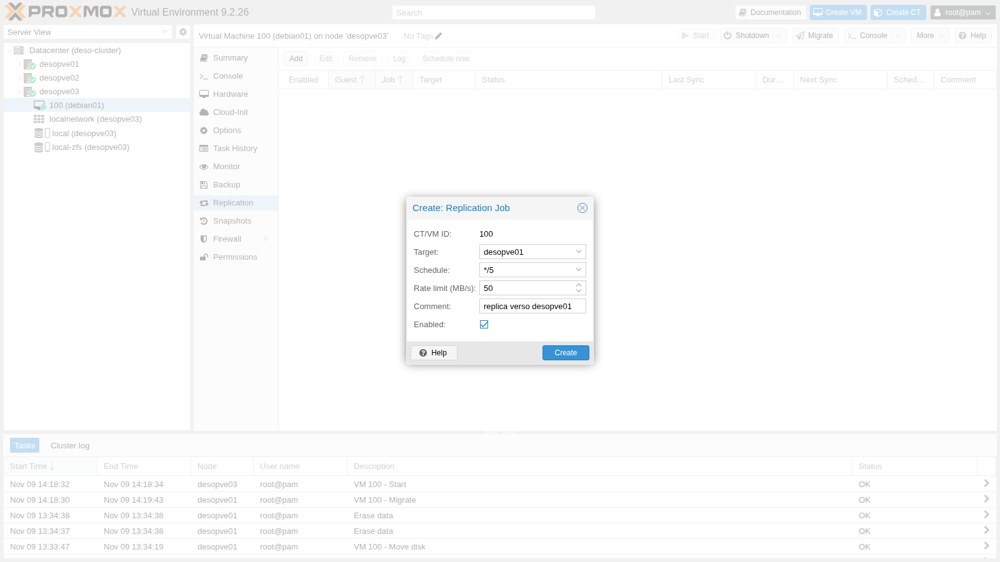
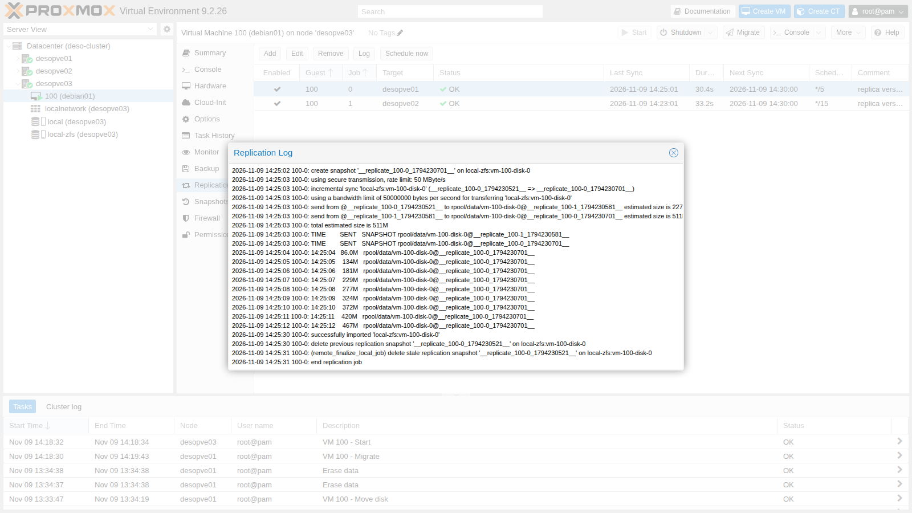
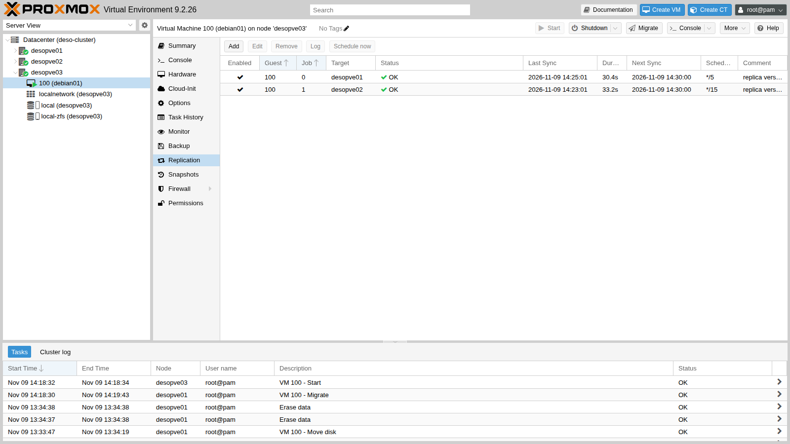
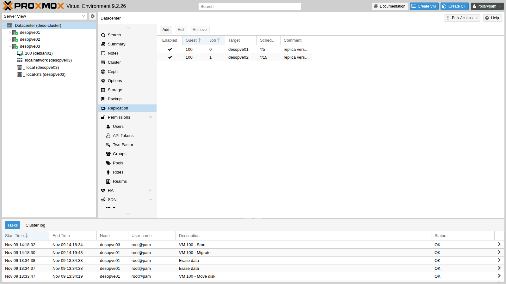
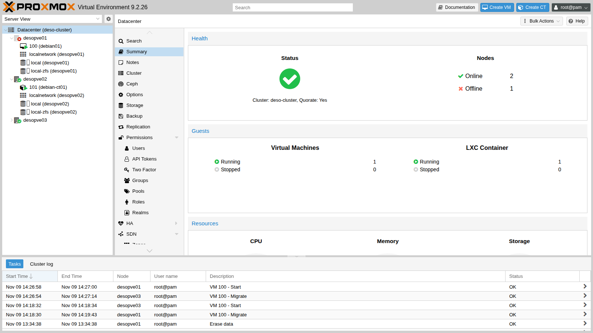
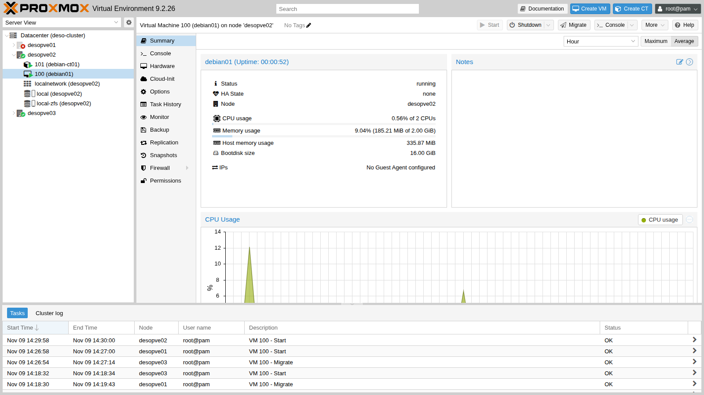

# Lab 11 – ZFS replication between nodes and manual failover

**Level:** intermediate · **Duration:** 1 hour 30 minutes

## Dependencies

- **Previous labs:** [Lab 06](06-cluster-corosync.md) for the three-node `deso-cluster` cluster, [Lab 07](07-first-vm-and-container.md) for VM 100 `debian01` and [Lab 10](10-zfs.md) for the concepts of snapshots and `zfs send`.
- **Storage:** `local-zfs` (pool `rpool/data`) on **all** nodes of the cluster, with the same name. It is the storage created by the installation on ZFS (lab 03).
- **VM:** 100 `debian01` running on `desopve01`, with its disk on `local-zfs`, reachable over SSH at `172.27.199.100` as `labuser`.
- **For the failure test:** the ability to cut the power to a node abruptly and to power it back on. Here the node is switched off with a kernel command and powered back on from the remote management card (IPMI, iDRAC, iLO) or with the power button.
- **Credentials:** `root` / `<lab-password>` → [Appendix B](b-credentials-and-addresses.md).

## Objectives

- Understand how Proxmox VE asynchronous replication works and when it is worth using.
- Create replication jobs to multiple nodes, with a schedule and a rate limit.
- Read the status and logs of the jobs, and recognize the replication snapshots.
- Measure how much a replica shortens the migration of a VM with local disks.
- Manually recover a VM from a failed node and measure the data lost.
- Put the cluster back in order when the failed node returns to service.

## How it works

### Replication, not shared storage

With a local storage like `local-zfs`, the disk of a VM exists on **one node only**: if the node stops, the VM cannot restart elsewhere. **Replication** (Storage Replication, the `pvesr` command) keeps an up-to-date copy of it on other nodes:

```text
 desopve01 (source)                        desopve02 (target)
 rpool/data/vm-100-disk-0                  rpool/data/vm-100-disk-0
   @__replicate_100-1_<time>__  ── zfs send ──▶  @__replicate_100-1_<time>__
         (every 15 minutes it sends only the blocks changed since the last snapshot)
```

- Replication is **asynchronous** and based on ZFS snapshots: on every run the job creates a snapshot, sends the difference from the previous run over SSH (incremental `zfs send`) and deletes the old snapshot. The first run sends the whole disk.
- It works **only with ZFS storage** (`zfspool`) and requires the storage to have the same name on the source and on the target.
- It is configured **per guest and per target node**: a job has an ID in the form `<VMID>-<number>` and one target; to have copies on two nodes you need two jobs.
- The jobs are run by the **`pvescheduler`** service, according to a schedule in *calendar event* format (`*/15`, i.e. every 15 minutes, is the default; forms like `mon..fri 22:30` can be used too).
- The copy is **not real-time**: if the source node fails, everything written after the last replication is lost. This window, the *Recovery Point Objective* (RPO), is at most the schedule interval plus the duration of the job.

### What you gain

- **Fast migrations:** if the target already has a replica, the migration sends only the difference. Live migration benefits too: QEMU keeps a *dirty bitmap* of the blocks written after the last replication and copies only those.
- **Restart after a failure:** the VM can be restarted on the node that holds the replica, manually (this lab) or automatically with high availability (lab 49), accepting the loss of the most recent data.

Replication **does not replace backups** (labs 46-47): a deleted file or ransomware gets replicated like any other change.

### Who owns the VM

The configuration of a VM lives in the cluster file system, in `/etc/pve/nodes/<node>/qemu-server/<VMID>.conf`: the **directory** that contains the file decides which node the VM runs on. To restart a VM on another node after a failure you move that file, but only if the failed node is **definitely powered off**: if it were still running and cut off from the network, the VM would run twice on the same data.

## Procedure

### 1. Check the storage

The `local-zfs` storage is defined only once for the whole cluster, without a `nodes` line, so it exists on all nodes with the same name:

```console
root@desopve01:~# grep -A4 "zfspool: local-zfs" /etc/pve/storage.cfg
zfspool: local-zfs
	pool rpool/data
	content rootdir,images
	sparse 1
```

### 2. A baseline migration, without replication

To have a point of comparison, live-migrate VM 100 to `desopve03`, which does not have any copy of the disk yet. With `--with-local-disks` Proxmox VE copies the whole 16 GiB disk while the VM keeps running:

```console
root@desopve01:~# qm migrate 100 desopve03 --online --with-local-disks
…
mirror-scsi0: transferred 16.0 GiB of 16.0 GiB (100.00%) in 57s, ready
2026-11-09 14:19:36 average migration speed: 1.0 GiB/s - downtime 10 ms
2026-11-09 14:19:36 migration completed, transferred 333.6 MiB VM-state
2026-11-09 14:19:43 migration finished successfully (duration 00:01:13)
```

Well over a minute for an almost empty disk: the time grows with the size of the disk and with the network bandwidth. The VM now runs on `desopve03`.

### 3. Create the replication jobs

1. Select VM **100 (debian01)** → **Replication** → **Add**.
2. Fill in the job to `desopve01`:
   - **Target** `desopve01`;
   - **Schedule** `*/5`, every 5 minutes (in the lab, to see the runs without waiting too long);
   - **Rate limit (MB/s)** `50`, so as not to saturate the network during the first full send;
   - **Comment** `replica verso desopve01`.

   

3. Click **Create**, then add a second job: **Target** `desopve02`, **Schedule** `*/15` (the default), no rate limit.

The configuration is in the cluster file system:

```console
root@desopve03:~# cat /etc/pve/replication.cfg
local: 100-0
	comment replica verso desopve01
	target desopve01
	rate 50
	schedule */5
	source desopve03

local: 100-1
	comment replica verso desopve02
	target desopve02
	source desopve03
```

The second job has no `schedule` line because it uses the default value.

### 4. The first run: a full copy

A few seconds after creation the first runs start. **Log** shows what happens: snapshot, full send (`full sync`) and import on the target. With the 50 MB/s limit, 1.9 GB take about 40 seconds:

```text
2026-11-09 14:22:02 100-0: create snapshot '__replicate_100-0_1794230521__' on local-zfs:vm-100-disk-0
2026-11-09 14:22:02 100-0: using secure transmission, rate limit: 50 MByte/s
2026-11-09 14:22:02 100-0: full sync 'local-zfs:vm-100-disk-0' (__replicate_100-0_1794230521__)
2026-11-09 14:22:03 100-0: full send of rpool/data/vm-100-disk-0@__replicate_100-0_1794230521__ estimated size is 1.91G
…
2026-11-09 14:22:43 100-0: 14:22:43   1.90G   rpool/data/vm-100-disk-0@__replicate_100-0_1794230521__
2026-11-09 14:23:00 100-0: successfully imported 'local-zfs:vm-100-disk-0'
2026-11-09 14:23:01 100-0: end replication job
```

The 16 GiB volume contains only 1.9 GB of written data: `zfs send` sends the used blocks, not the empty space. The job to `desopve02`, with no limit, sends the same amount in 7 seconds.

### 5. Subsequent runs: only the differences

1. In the VM, write 500 MB of new data:

   ```console
   labuser@debian01:~$ dd if=/dev/urandom of=$HOME/dati-1.bin bs=1M count=500 status=none; sync
   ```

2. Select the job to `desopve01` and click **Schedule now**, then open **Log**. This time the run is **incremental** (`incremental sync`) and sends only the 511 MB that changed:

   

3. The job list shows, for each job, the last sync, the duration, the next run and the state:

   

   From the command line:

   ```console
   root@desopve03:~# pvesr status
   JobID      Enabled    Target                           LastSync             NextSync   Duration  FailCount State
   100-0      Yes        local/desopve01       2026-11-09_14:25:01  2026-11-09_14:30:00  30.423273          0 OK
   100-1      Yes        local/desopve02       2026-11-09_14:23:01  2026-11-09_14:30:00  33.221129          0 OK
   ```

4. **Datacenter** → **Replication** lists the jobs of all the guests in the cluster: it is the place to check them all at once.

   

5. The replication snapshots can be seen with `zfs list`. Each volume keeps the last snapshot of each job, which serves as the base for the next run:

   ```console
   root@desopve03:~# zfs list -t snapshot -o name,used,creation -r rpool/data
   NAME                                                      USED  CREATION
   rpool/data/vm-100-disk-0@__replicate_100-1_1794230581__  1.12M  Mon Nov  9 14:23 2026
   rpool/data/vm-100-disk-0@__replicate_100-0_1794230701__   188K  Mon Nov  9 14:25 2026
   root@desopve03:~# ssh desopve01 zfs list -t snapshot -o name,used,creation -r rpool/data
   NAME                                                      USED  CREATION
   rpool/data/vm-100-disk-0@__replicate_100-1_1794230581__  1.12M  Mon Nov  9 14:23 2026
   rpool/data/vm-100-disk-0@__replicate_100-0_1794230701__     0B  Mon Nov  9 14:25 2026
   ```

   Do not delete the `__replicate_…` snapshots by hand: without the common base, the next run would have to start over with a full copy.

### 6. Migrate a replicated VM

Migrate VM 100 from `desopve03` to `desopve01`, which already has a replica:

```console
root@desopve03:~# qm migrate 100 desopve01 --online --with-local-disks
…
2026-11-09 14:26:55 incremental sync 'local-zfs:vm-100-disk-0' (__replicate_100-0_1794230701__ => __replicate_100-0_1794230814__)
2026-11-09 14:26:56 send from @__replicate_100-0_1794230701__ to rpool/data/vm-100-disk-0@__replicate_100-0_1794230814__ estimated size is 154K
…
drive mirror re-using dirty bitmap 'repl_scsi0'
…
2026-11-09 14:27:07 average migration speed: 688.3 MiB/s - downtime 20 ms
2026-11-09 14:27:14 migration finished successfully (duration 00:00:20)
```

| Live migration of VM 100 | Disk data copied | Duration |
|---|---|---|
| To a node without a replica (step 2) | the whole 16 GiB disk | 1 minute 13 seconds |
| To a node with the replica | 154 KB plus the blocks written during the migration | 20 seconds |

Before moving the VM, the migration performs one last replication run; then QEMU reuses the `repl_scsi0` *dirty bitmap* and copies only the blocks written after that run. The rest of the time is spent copying the memory.

After the migration Proxmox VE **reverses** the jobs on its own: the one that pointed to `desopve01` now replicates to the old node, `desopve03`. The comment, however, stays as it was written by hand:

```console
root@desopve01:~# cat /etc/pve/replication.cfg
local: 100-0
	comment replica verso desopve01
	target desopve03
	rate 50
	schedule */5
	source desopve01

local: 100-1
	comment replica verso desopve02
	target desopve02
	source desopve01
```

## Verification and tests

### Test – The node suddenly powers off

VM 100 runs on `desopve01` and is replicated to `desopve02` and `desopve03`. You simulate a power failure on `desopve01` and restart the VM from the replica on `desopve02`.

1. In the VM, write a file, start a replication run to `desopve02` and wait for it to finish. Then write more data, **after** the replication:

   ```console
   labuser@debian01:~$ date "+%F %T" > $HOME/A-prima-della-replica.txt; sync
   root@desopve01:~# pvesr schedule-now 100-1
   root@desopve01:~# pvesr status
   JobID      Enabled    Target                           LastSync             NextSync   Duration  FailCount State
   100-0      Yes        local/desopve03       2026-11-09_14:26:54  2026-11-09_14:30:00   3.183833          0 OK
   100-1      Yes        local/desopve02       2026-11-09_14:28:01  2026-11-09_14:30:00  13.542599          0 OK
   labuser@debian01:~$ date "+%F %T" > $HOME/B-dopo-la-replica.txt
   labuser@debian01:~$ dd if=/dev/urandom of=$HOME/dati-2.bin bs=1M count=200 status=none; sync
   labuser@debian01:~$ ls -l --time-style=+%T $HOME
   -rw-rw-r-- 1 labuser labuser        20 14:27:34 A-prima-della-replica.txt
   -rw-rw-r-- 1 labuser labuser        20 14:28:11 B-dopo-la-replica.txt
   -rw-rw-r-- 1 labuser labuser 524288000 14:24:00 dati-1.bin
   -rw-rw-r-- 1 labuser labuser 209715200 14:28:12 dati-2.bin
   ```

2. At 14:28:28, before the next run, power off `desopve01` abruptly, without shutting anything down. The *SysRq* `o` command tells the kernel to cut the power immediately:

   ```console
   root@desopve01:~# echo o > /proc/sysrq-trigger
   ```

3. The other two nodes still have quorum (2 votes out of 3), so the cluster stays operational:

   ```console
   root@desopve02:~# pvecm status | grep -E "Total votes|Quorum:|Flags"
   Total votes:      2
   Quorum:           2
   Flags:            Quorate
   ```

   The web interface marks `desopve01` as offline. VM 100 still appears under `desopve01`, with its last known state: nothing restarts it automatically, because there is no high availability.

   

4. On `desopve02`, check the last replication snapshot received: it is the one from 14:28.

   ```console
   root@desopve02:~# zfs list -t snapshot -o name,creation -r rpool/data/vm-100-disk-0
   NAME                                                     CREATION
   rpool/data/vm-100-disk-0@__replicate_100-0_1794230814__  Mon Nov  9 14:26 2026
   rpool/data/vm-100-disk-0@__replicate_100-1_1794230881__  Mon Nov  9 14:28 2026
   ```

5. You know for certain that `desopve01` is off: move the VM configuration into the `desopve02` directory and start the VM.

   ```console
   root@desopve02:~# mv /etc/pve/nodes/desopve01/qemu-server/100.conf /etc/pve/nodes/desopve02/qemu-server/100.conf
   root@desopve02:~# qm start 100
   ```

   

6. In the VM, check the files:

   ```console
   labuser@debian01:~$ ls -l --time-style=+%T $HOME
   -rw-rw-r-- 1 labuser labuser        20 14:27:34 A-prima-della-replica.txt
   -rw-rw-r-- 1 labuser labuser 524288000 14:24:00 dati-1.bin
   labuser@debian01:~$ cat $HOME/B-dopo-la-replica.txt
   cat: /home/labuser/B-dopo-la-replica.txt: No such file or directory
   ```

   The VM restarted with the disk as it was at **14:28:01**, the time of the last replication. File `B` and the 200 MB of `dati-2.bin`, written between 14:28:01 and the power-off at 14:28:28, are **lost**: 27 seconds of writes. With the `*/15` schedule the loss could have reached a quarter of an hour. The VM file system, on the other hand, is intact: the snapshot is consistent, as after a power failure, and the ext4 journal puts it back in order at boot.

7. Meanwhile the jobs have adjusted by themselves. The one to `desopve02` (the node the VM now runs on) now points to the failed node, `desopve01`, and keeps failing as long as that node is off. The one to `desopve03` continues from the new node:

   ```console
   root@desopve02:~# pvesr status
   JobID      Enabled    Target                           LastSync             NextSync   Duration  FailCount State
   100-0      Yes        local/desopve03       2026-11-09_14:30:01  2026-11-09_14:35:00   6.464296          0 OK
   100-1      Yes        local/desopve01                         -                    -   3.111215          1 command '/usr/bin/ssh -e none … root@172.27.199.21 -- pvesr prepare-local-job 100-1 --last_sync 0 -- local-zfs:vm-100-disk-0' failed: exit code 255
   ```

### Test – The failed node returns to service

1. Power `desopve01` back on from the remote management card. At boot it rejoins the cluster and receives the updated configuration: VM 100 no longer belongs to it, so it does not start.

   ```console
   root@desopve01:~# pvecm status | grep -E "Total votes|Quorate"
   Quorate:          Yes
   Total votes:      3
   root@desopve01:~# qm list
   root@desopve01:~# zfs list -t all -o name,creation -r rpool/data | grep vm-100
   rpool/data/vm-100-disk-0                                 Mon Nov  9 14:22 2026
   rpool/data/vm-100-disk-0@__replicate_100-0_1794230814__  Mon Nov  9 14:26 2026
   rpool/data/vm-100-disk-0@__replicate_100-1_1794230881__  Mon Nov  9 14:28 2026
   ```

   The disk left on `desopve01` is **stale**: it contains the 27 seconds of writes that were never replicated, but the VM now lives on `desopve02`.

2. On the next run the job resumes by itself. It finds the common snapshot from 14:28 (`__replicate_100-1_1794230881__`), rolls the disk on `desopve01` back to that point and sends only the differences accumulated on `desopve02`: 12.5 MB.

   ```text
   2026-11-09 14:36:02 100-1: incremental sync 'local-zfs:vm-100-disk-0' (__replicate_100-1_1794230881__ => __replicate_100-1_1794231361__)
   2026-11-09 14:36:03 100-1: total estimated size is 12.5M
   2026-11-09 14:36:10 100-1: successfully imported 'local-zfs:vm-100-disk-0'
   2026-11-09 14:36:11 100-1: end replication job
   ```

   The writes left only on `desopve01` are discarded: the good copy is the one the VM kept working on. If you needed them, you would have to recover them **before** replication resumes, for example by disabling the job.

3. Move the VM back to its node. Thanks to replication, the migration again takes only a few seconds:

   ```console
   root@desopve02:~# qm migrate 100 desopve01 --online --with-local-disks
   …
   2026-11-09 14:36:43 incremental sync 'local-zfs:vm-100-disk-0' (__replicate_100-1_1794231361__ => __replicate_100-1_1794231402__)
   drive mirror re-using dirty bitmap 'repl_scsi0'
   2026-11-09 14:37:01 migration finished successfully (duration 00:00:20)
   ```

### Cleanup

Delete the replication jobs and the test files in the VM. Removing a job is a background operation: the job is marked with `remove_job full`, and on the next run `pvescheduler` deletes the replicated volumes on the target and the snapshots on the source.

```console
labuser@debian01:~$ rm -f $HOME/dati-*.bin $HOME/A-*.txt $HOME/B-*.txt
root@desopve01:~# pvesr delete 100-0
Replication job removal is a background task and will take some time.
root@desopve01:~# pvesr delete 100-1
Replication job removal is a background task and will take some time.
root@desopve01:~# grep -E "^local|remove_job" /etc/pve/replication.cfg
local: 100-0
	remove_job full
local: 100-1
	remove_job full
```

A minute later the jobs are gone, together with the copies on the other nodes:

```console
root@desopve01:~# cat /etc/pve/replication.cfg
root@desopve01:~# zfs list -t all -o name -r rpool/data | grep vm-100
rpool/data/vm-100-disk-0
root@desopve01:~# ssh desopve02 'zfs list -t all -o name -r rpool/data | grep vm-100 || echo "nessun volume della VM 100"'
nessun volume della VM 100
root@desopve01:~# ssh desopve03 'zfs list -t all -o name -r rpool/data | grep vm-100 || echo "nessun volume della VM 100"'
nessun volume della VM 100
```

- [ ] You created two replication jobs, one with a `*/5` schedule and a rate limit, and you read their state and logs.
- [ ] The first run sent all the written data of the disk, the following ones only the differences.
- [ ] The migration to a node with the replica took 20 seconds instead of 1 minute 13 seconds.
- [ ] With the source node powered off you restarted the VM on another node, losing only the writes made after the last replication.
- [ ] When the node came back, replication realigned itself on the good copy.

## Final lab state

- Cluster `deso-cluster` with the three nodes online; `desopve04` unchanged.
- VM 100 `debian01` running on `desopve01`, disk `local-zfs:vm-100-disk-0`, with no test files.
- No replication jobs: `/etc/pve/replication.cfg` is empty and there are no copies of VM 100 on `desopve02` and `desopve03`.
- CT 101 `debian-ct01` running on `desopve02`, unchanged.

## What you learned

- Proxmox VE replication copies ZFS disks to other nodes with incremental `zfs send`, on a schedule: it is asynchronous and leaves a window of unprotected data.
- A job covers one VM and one target; more copies require more jobs. The rate limit protects the network during the first full send.
- With a replica on the target node, the migration of a VM with local disks sends only the differences and is much faster.
- If the source node fails, the VM is restarted by moving its configuration file into the directory of a node that holds the replica, but only after making sure that the failed node is powered off.
- The writes made after the last replication are lost; when the node returns, replication realigns on the copy in use and discards the writes left on the failed node.
- Replication is not a backup and does not restart VMs by itself: automatic restart requires high availability (lab 49).

## References

- [Proxmox VE – Storage Replication](https://pve.proxmox.com/pve-docs/pve-admin-guide.html#chapter_pvesr)
- [Proxmox VE – Schedule Format (calendar events)](https://pve.proxmox.com/pve-docs/pve-admin-guide.html#chapter_calendar_events)
- [Proxmox VE – `pvesr` man page](https://pve.proxmox.com/pve-docs/pvesr.1.html)
- [Proxmox VE – Migration](https://pve.proxmox.com/pve-docs/pve-admin-guide.html#qm_migration)
