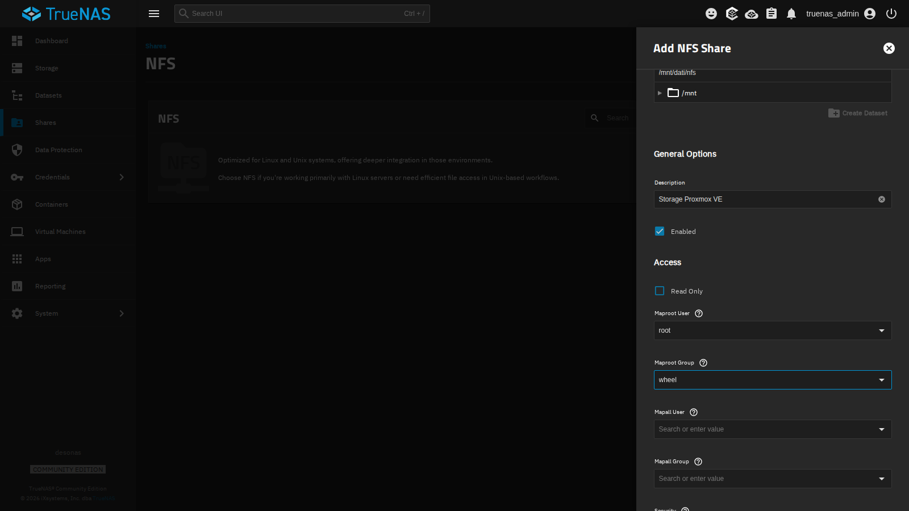
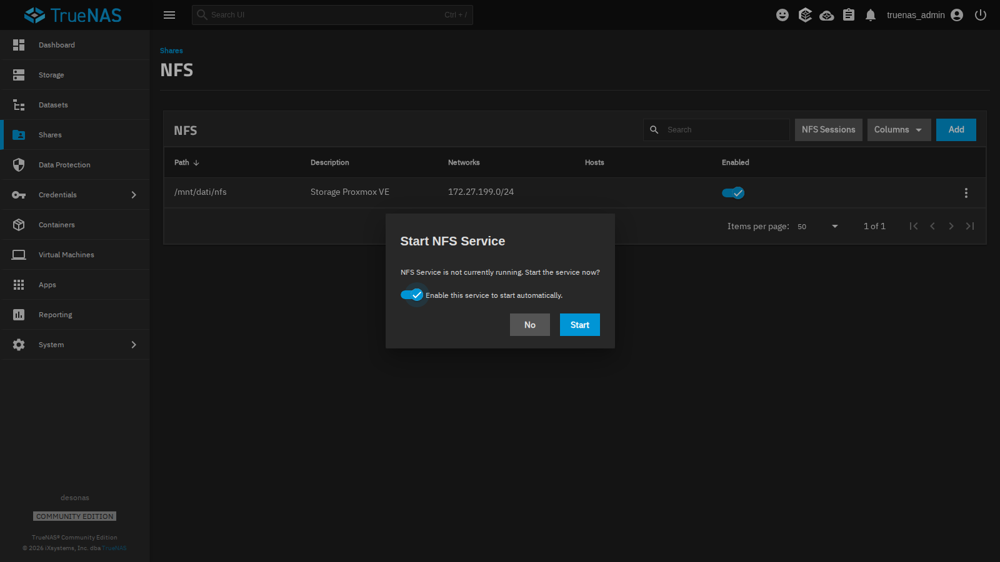
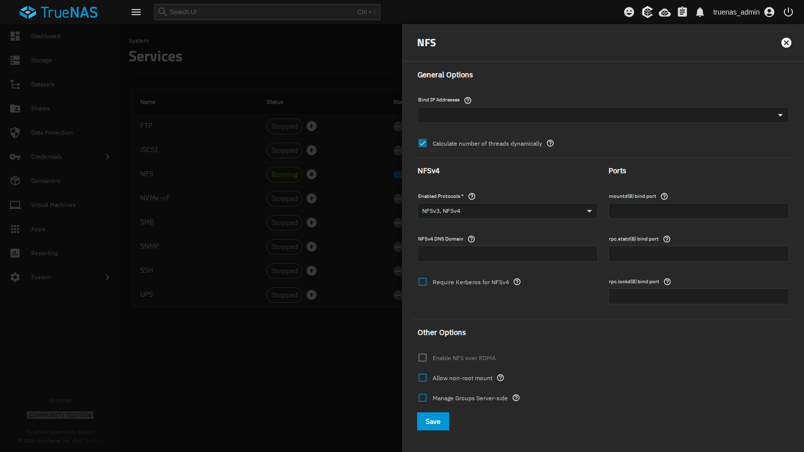
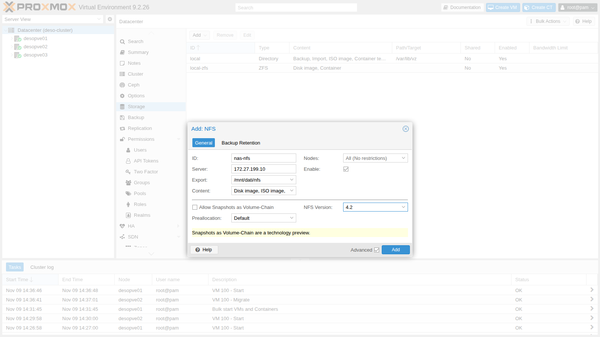
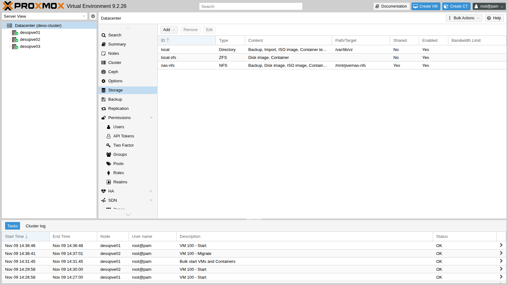
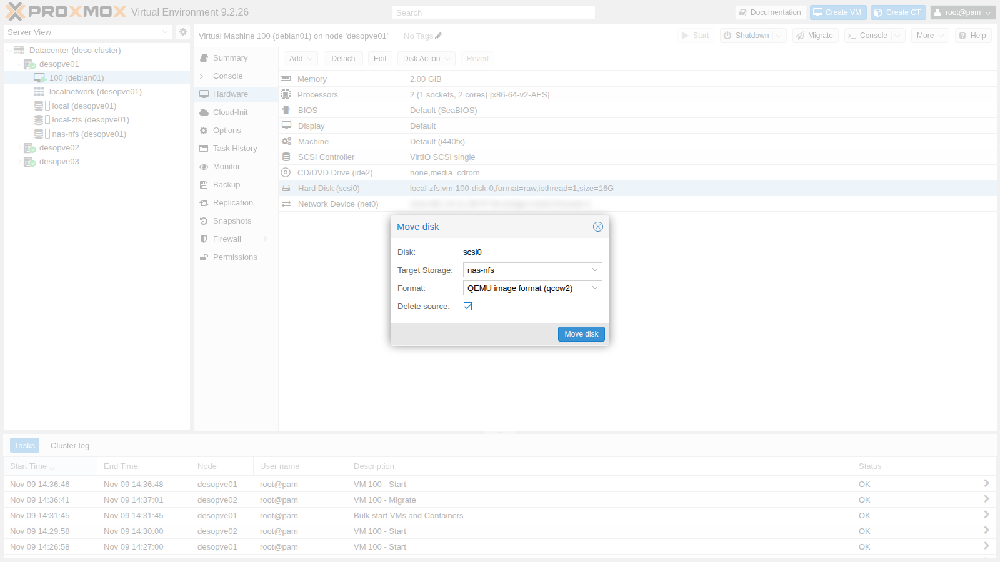
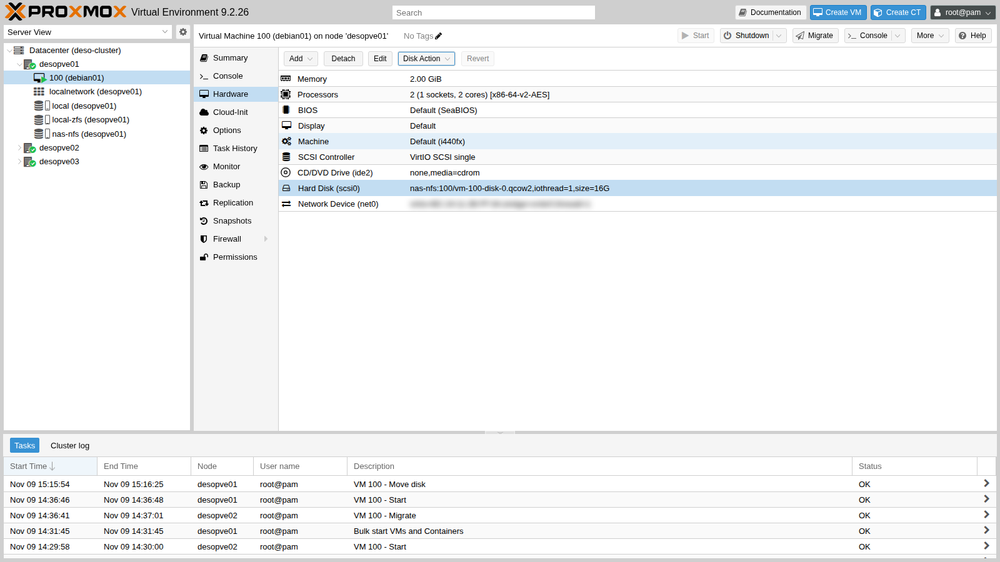
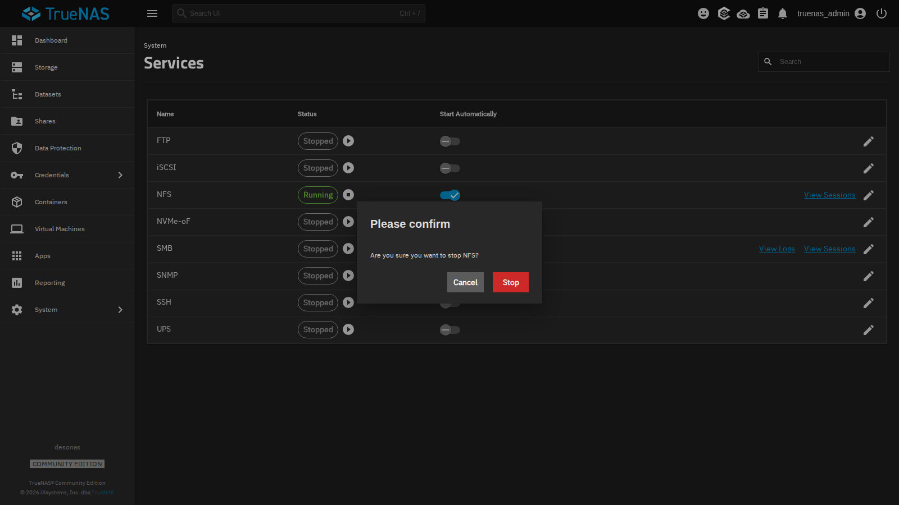
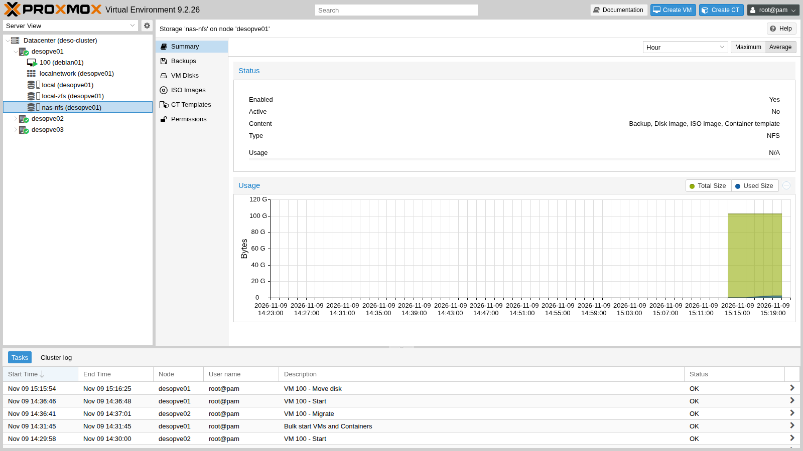
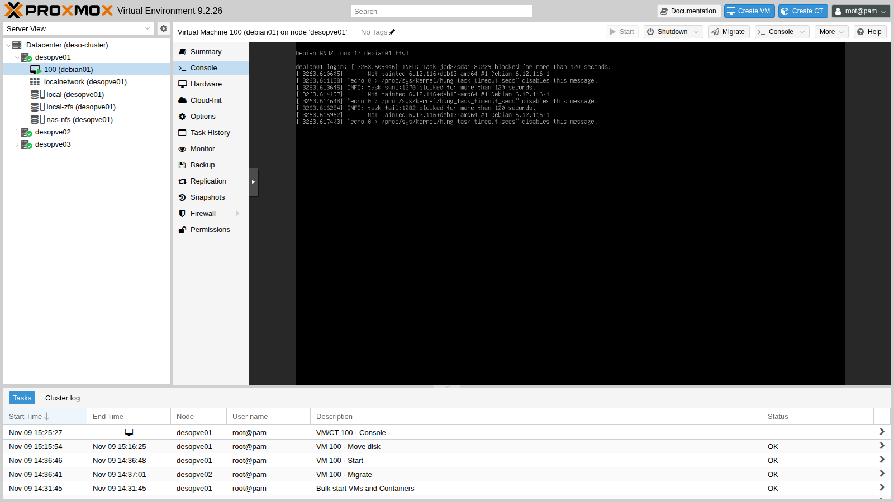

# Lab 13 – NFS storage: share, performance and NAS outage

**Level:** intermediate · **Duration:** 1 hour 30 minutes

## Dependencies

- **Previous labs:** [Lab 12](12-truenas-nas.md) for the NAS `desonas` with the `dati/nfs` dataset, and [Lab 08](08-storage-model.md) for the storage and content types.
- **Cluster:** `deso-cluster` with the three nodes (lab 06). VM 100 `debian01` is running on `desopve01` with its disk on `local-zfs` (lab 07, state at the end of lab 11).
- **Network:** the nodes reach `172.27.199.10` on the lab LAN.
- **Credentials:** `root` / `<lab-password>` on the nodes, `truenas_admin` / `<lab-password>` on the NAS → [Appendix B](b-credentials-and-addresses.md).

## Objectives

- Share a dataset over NFS from TrueNAS, restricting access to the lab network.
- Add the NFS storage to the cluster and understand what Proxmox VE does when it mounts it.
- Move the disk of a running VM to NFS.
- Measure the performance against local storage, avoiding misleading tests.
- See what happens to nodes and VMs when the NAS stops responding, and how they recover.

## How it works

### NFS in Proxmox VE

NFS (*Network File System*) shares a directory of the server over the network. Proxmox VE **mounts it on every node** under `/mnt/pve/<ID>` and treats it as a directory-type storage, but a **shared** one: all nodes see the same files.

```text
 desonas (TrueNAS)                         desopve01 / 02 / 03
 /mnt/dati/nfs ── NFS 4.2 over TCP ──▶ /mnt/pve/nas-nfs
                                         ├── images/100/vm-100-disk-0.qcow2   VM disks
                                         ├── template/iso/                     ISO images
                                         ├── template/cache/                   container templates
                                         └── dump/                             backups
```

- On a file-based storage, VM disks are **`raw`** or **`qcow2`** files. With `qcow2`, snapshots work on NFS too.
- The storage is **shared** (`shared`): a VM with its disk on NFS is migrated by copying only its memory, and with high availability (lab 49) it can restart on another node.
- Proxmox VE accesses the files as **root**. On the server, the export must therefore not "squash" root to the `nobody` user (*root squash*), otherwise disk creation fails with permission errors. In TrueNAS this is set with **Maproot User** `root`.
- The mount is **`hard`** (the default): if the server does not respond, operations wait and resume when it comes back, without returning errors to the applications. With `soft` the client would return an error after its retries, and for a VM disk that would mean corrupted data: never use it.

### Versions

| Version | Features |
|---|---|
| NFSv3 | stateless on the server, additional ports (`mountd`, `lockd`, `statd`) |
| NFSv4.x | a single TCP port (2049), built-in locking, sessions |
| NFSv4.2 | in addition: server-side copy, sparse files (*hole punching*), space allocation |

In the lab we use **NFS 4.2**, set in the mount options of the storage.

## Procedure

### 1. The share on TrueNAS

1. On the NAS: **Shares** → **NFS** → **Add**.
2. **Path** `/mnt/dati/nfs`, **Description** `Storage Proxmox VE`. Under **Networks** click **Add** and enter `172.27.199.0` / `24`: only the lab network will be able to mount the share.
3. Open **Advanced Options** and set **Maproot User** `root` and **Maproot Group** `wheel`.

   

4. **Save**. TrueNAS offers to start the NFS service: leave **Enable this service to start automatically** checked and click **Start**.

   

5. In **System** → **Services** → **NFS** (pencil icon) the service settings confirm that **NFSv3** and **NFSv4** are enabled. Nothing else needs to be changed.

   

### 2. Check the export from the nodes

Before adding the storage, check from the node that the server exports the directory and responds over NFSv4:

```bash title="root@desopve01"
pvesm scan nfs 172.27.199.10
```

``` { .text .no-copy title="Output" }
/mnt/dati/nfs 172.27.199.0/24
```

```bash title="root@desopve01"
rpcinfo -T tcp 172.27.199.10 nfs 4
```

``` { .text .no-copy title="Output" }
program 100003 version 4 ready and waiting
```

### 3. Add the storage to the cluster

1. **Datacenter** → **Storage** → **Add** → **NFS**.
2. Fill in:
   - **ID** `nas-nfs`;
   - **Server** `172.27.199.10`. Using the IP address keeps the storage independent of DNS: if DNS goes down, the storage keeps working;
   - **Export** `/mnt/dati/nfs`, which the drop-down offers after querying the server;
   - **Content**: `Disk image`, `ISO image`, `Container template`, `Backup`;
   - **Nodes**: all.
3. Check **Advanced** at the bottom and choose **NFS Version** `4.2`. Leave **Allow Snapshots as Volume-Chain** disabled: it is a technology preview that you will see in lab 16.

   

4. **Add**. The storage appears in the list, shared (**Shared** `Yes`) and active:

   

From the command line:

```bash title="root@desopve01"
grep -A6 "nfs: nas-nfs" /etc/pve/storage.cfg
```

``` { .text .no-copy title="Output" }
nfs: nas-nfs
	export /mnt/dati/nfs
	path /mnt/pve/nas-nfs
	server 172.27.199.10
	content images,iso,backup,vztmpl
	options vers=4.2
	prune-backups keep-all=1
```

```bash title="root@desopve01"
pvesm status | grep nas-nfs
```

``` { .text .no-copy title="Output" }
nas-nfs           nfs     active       100070400               0       100070400    0.00%
```

```bash title="root@desopve01"
mount | grep nas-nfs
```

``` { .text .no-copy title="Output" }
172.27.199.10:/mnt/dati/nfs on /mnt/pve/nas-nfs type nfs4 (rw,relatime,vers=4.2,rsize=1048576,wsize=1048576,namlen=255,hard,fatal_neterrors=none,proto=tcp,timeo=600,retrans=2,sec=sys,clientaddr=172.27.199.21,local_lock=none,addr=172.27.199.10)
```

```bash title="root@desopve01"
ssh desopve03 ls /mnt/pve/nas-nfs
```

``` { .text .no-copy title="Output" }
dump
images
template
```

- `pvestatd` mounts the storage by itself on every node, in the `/mnt/pve/nas-nfs` directory, and creates the subdirectories for the selected content types.
- The mount options show `hard`, `timeo=600` (60 seconds before a request is retried) and `retrans=2`.
- The capacity is that of the `dati` pool on the NAS: about 95 GiB.

### 4. Measure the performance with the local disk

Before moving the disk, measure how it performs on local storage: these are the reference values for NFS. The disk of VM 100 is on `local-zfs`.

**A misleading test.** In the VM, write 1 GiB of zeros with `dd`:

```bash title="labuser@debian01"
dd if=/dev/zero of=$HOME/test.bin bs=1M count=1024 oflag=direct
```

``` { .text .no-copy title="Output" }
1073741824 bytes (1.1 GB, 1.0 GiB) copied, 1.40965 s, 762 MB/s
```

You will repeat it on NFS in step 6, and there you will see why zeros are no good for measuring.

**Sequential writes and reads with random data.** Generate 512 MiB of random data in RAM (`/dev/shm`), write it to the disk with direct I/O, waiting until it has actually reached the storage (`oflag=direct conv=fsync`), then read it back. Repeat the write three times and the read twice, because a single value is not enough:

```bash title="labuser@debian01"
head -c 512M /dev/urandom > /dev/shm/rnd.bin
for i in 1 2 3; do dd if=/dev/shm/rnd.bin of=$HOME/test.bin bs=1M oflag=direct conv=fsync 2>&1 | tail -1; done
```

``` { .text .no-copy title="Output" }
536870912 bytes (537 MB, 512 MiB) copied, 15.0205 s, 35.7 MB/s
536870912 bytes (537 MB, 512 MiB) copied, 5.48904 s, 97.8 MB/s
536870912 bytes (537 MB, 512 MiB) copied, 16.7323 s, 32.1 MB/s
```

```bash title="labuser@debian01"
for i in 1 2; do dd if=$HOME/test.bin of=/dev/null bs=1M iflag=direct 2>&1 | tail -1; done
```

``` { .text .no-copy title="Output" }
536870912 bytes (537 MB, 512 MiB) copied, 0.737017 s, 728 MB/s
536870912 bytes (537 MB, 512 MiB) copied, 0.620782 s, 865 MB/s
```

```bash title="labuser@debian01"
rm -f $HOME/test.bin /dev/shm/rnd.bin
```

**Random writes in 4 KiB blocks**, the typical workload of databases and operating systems, measured with `fio` directly from the node on the local storage. The `--unlink=1` option deletes the test file at the end:

```bash title="root@desopve01"
apt install fio
fio --name=rw4k --directory=/var/lib/vz --rw=randwrite --bs=4k --size=1G \
      --iodepth=16 --ioengine=libaio --direct=1 --runtime=30 --time_based --group_reporting --unlink=1
```

``` { .text .no-copy title="Output" }
  write: IOPS=2118, BW=8476KiB/s (8679kB/s)(275MiB/33273msec); 0 zone resets
```

```bash title="root@desopve01"
fio --name=rw4k --directory=/var/lib/vz --rw=randwrite --bs=4k --size=1G \
      --iodepth=16 --ioengine=libaio --direct=1 --runtime=30 --time_based --group_reporting --unlink=1
```

``` { .text .no-copy title="Output" }
  write: IOPS=11.2k, BW=43.7MiB/s (45.8MB/s)(1310MiB/30001msec); 0 zone resets
```

### 5. Move the VM disk to NFS

1. VM **100** → **Hardware** → select **Hard Disk (scsi0)** → **Disk Action** → **Move Storage**.
2. **Target Storage** `nas-nfs`, **Format** `QEMU image format (qcow2)`, **Delete source** checked, then **Move disk**.

   

   The VM stays running: QEMU copies the disk in the background (*drive mirror*) and at the end switches over to the new file. The 16 GiB disk was copied in 3 minutes and 35 seconds:

   ```text
   mirror-scsi0: transferred 16.0 GiB of 16.0 GiB (100.00%) in 3m 35s, ready
   mirror-scsi0: Completed successfully.
   removing source volume 'local-zfs:vm-100-disk-0' after successful copy
   TASK OK
   ```

3. The disk is now a `qcow2` file on the NAS:

   

   ```bash title="root@desopve01"
   qm config 100 | grep scsi0
   ```

   ``` { .text .no-copy title="Output" }
   scsi0: nas-nfs:100/vm-100-disk-0.qcow2,iothread=1,size=16G
   ```

   ```bash title="root@desopve01"
   qemu-img info /mnt/pve/nas-nfs/images/100/vm-100-disk-0.qcow2 | head -4
   ```

   ``` { .text .no-copy title="Output" }
   image: /mnt/pve/nas-nfs/images/100/vm-100-disk-0.qcow2
   file format: qcow2
   virtual size: 16 GiB (17179869184 bytes)
   disk size: 6.5 GiB
   ```

   The 16 GiB file takes up 6.5 GiB: `qcow2` allocates space only for the blocks that contain data.

### 6. Repeat the measurements on NFS and compare

In the VM, repeat the same commands as in step 4, now with the disk on NFS:

```bash title="labuser@debian01"
dd if=/dev/zero of=$HOME/test.bin bs=1M count=1024 oflag=direct
```

``` { .text .no-copy title="Output" }
1073741824 bytes (1.1 GB, 1.0 GiB) copied, 0.403307 s, 2.7 GB/s
```

```bash title="labuser@debian01"
head -c 512M /dev/urandom > /dev/shm/rnd.bin
for i in 1 2 3; do dd if=/dev/shm/rnd.bin of=$HOME/test.bin bs=1M oflag=direct conv=fsync 2>&1 | tail -1; done
```

``` { .text .no-copy title="Output" }
536870912 bytes (537 MB, 512 MiB) copied, 6.69699 s, 80.2 MB/s
536870912 bytes (537 MB, 512 MiB) copied, 20.2377 s, 26.5 MB/s
536870912 bytes (537 MB, 512 MiB) copied, 26.9102 s, 20.0 MB/s
```

```bash title="labuser@debian01"
for i in 1 2; do dd if=$HOME/test.bin of=/dev/null bs=1M iflag=direct 2>&1 | tail -1; done
```

``` { .text .no-copy title="Output" }
536870912 bytes (537 MB, 512 MiB) copied, 1.44691 s, 371 MB/s
536870912 bytes (537 MB, 512 MiB) copied, 1.7027 s, 315 MB/s
```

```bash title="labuser@debian01"
rm -f $HOME/test.bin /dev/shm/rnd.bin
```

Zeros on NFS at 2.7 GB/s, faster than the local disk? No: QEMU detects blocks full of zeros and, on `qcow2`, records them as "zero" without writing them. To measure for real you need **random data**.

And from the node, 4 KiB random writes on the NFS share:

```bash title="root@desopve01"
fio --name=rw4k --directory=/mnt/pve/nas-nfs --rw=randwrite --bs=4k --size=1G \
      --iodepth=16 --ioengine=libaio --direct=1 --runtime=30 --time_based --group_reporting --unlink=1
```

``` { .text .no-copy title="Output" }
  write: IOPS=865, BW=3463KiB/s (3546kB/s)(101MiB/30007msec); 0 zone resets
```

```bash title="root@desopve01"
fio --name=rw4k --directory=/mnt/pve/nas-nfs --rw=randwrite --bs=4k --size=1G \
      --iodepth=16 --ioengine=libaio --direct=1 --runtime=30 --time_based --group_reporting --unlink=1
```

``` { .text .no-copy title="Output" }
  write: IOPS=966, BW=3867KiB/s (3959kB/s)(114MiB/30151msec); 0 zone resets
```

| Test | Local storage (node's ZFS) | NFS |
|---|---|---|
| Sequential write, random data (in the VM) | 32-98 MB/s | 20-80 MB/s |
| Sequential read (in the VM) | 728-865 MB/s | 315-371 MB/s |
| 4 KiB random write (from the node, `fio`) | 2,118-11,200 IOPS | 865-966 IOPS |

- **Small random writes** are the weak spot of NFS: with `cache=none` (the default for disks) each write is acknowledged only once the NAS has stored it safely. On ZFS this is a **synchronous** write, which goes through the ZIL. Production NAS systems put the ZIL on a dedicated fast SSD (SLOG) and use 10 Gbit/s or faster networks.
- **Reads** hold up better on NFS, but still fall short of the local disk: every block has to cross the network.
- Sequential writes vary a lot from one run to the next, on both storages, because they depend on how busy the rest of the lab is at that moment. That is why comparisons are made with multiple runs, at the same time, looking at the ranges rather than at a single value. In lab 19 you will repeat the tests on all storages, with a more rigorous method.

## Verification and tests

### Test – The NAS stops responding

You leave the VM disk on NFS and stop the NFS service on the NAS, as would happen with a NAS or network failure.

1. In the VM, start a "heartbeat" that writes the time every second and forces it to disk:

   ```bash title="labuser@debian01"
   nohup sh -c 'while true; do date +%T >> $HOME/battito.log; sync; sleep 1; done' >/dev/null 2>&1 &
   ```

2. On the NAS: **System** → **Services** → **NFS** → **Stop Service** and confirm with **Stop**.

   

3. A minute later, on the node, the server no longer responds over NFS and `pvestatd` marks the storage as not active. The VM, however, still shows as running:

   ```bash title="root@desopve01"
   rpcinfo -T tcp 172.27.199.10 nfs 4
   ```

   ``` { .text .no-copy title="Output" }
   rpcinfo: RPC: Program not registered
   ```

   ```bash title="root@desopve01"
   pvesm status
   ```

   ``` { .text .no-copy title="Output" }
   storage 'nas-nfs' is not online
   Name             Type     Status     Total (KiB)      Used (KiB) Available (KiB)        %
   local             dir     active        46255488          768000        45487488    1.66%
   local-zfs     zfspool     active        45487664              96        45487568    0.00%
   nas-nfs           nfs   inactive               0               0               0    0.00%
   ```

   ```bash title="root@desopve01"
   journalctl -u pvestatd --since "-3 min" | tail -2
   ```

   ``` { .text .no-copy title="Output" }
   Nov 09 15:21:57 desopve01 pvestatd[1611]: storage 'nas-nfs' is not online
   Nov 09 15:22:07 desopve01 pvestatd[1611]: storage 'nas-nfs' is not online
   ```

   ```bash title="root@desopve01"
   qm status 100
   ```

   ``` { .text .no-copy title="Output" }
   status: running
   ```

   In the web interface the storage shows **Active: No**, with no usage data:

   

   `pvestatd` checks the server with an RPC request before touching the mount, so it does not get stuck. Anything that accesses the files on the mount, instead, is left waiting.

4. Try to access the mount: the process gets stuck in state **`D`** (uninterruptible I/O wait), waiting for the server. The kernel reports it in the log:

   ```bash title="root@desopve01"
   timeout 20 ls -la /mnt/pve/nas-nfs/images/100/ &
   ps -eo stat,pid,etime,comm,wchan:28 | awk 'NR==1 || $1 ~ /^D/'
   ```

   ``` { .text .no-copy title="Output" }
   STAT     PID     ELAPSED COMMAND         WCHAN
   D      12326       00:20 172.27.199.10-m rpc_wait_bit_killable
   D      12419       00:03 ls              rpc_wait_bit_killable
   ```

   ```bash title="root@desopve01"
   dmesg -T | grep "nfs: server"
   ```

   ``` { .text .no-copy title="Output" }
   [Mon Nov  9 15:24:04 2026] nfs: server 172.27.199.10 not responding, still trying
   ```

   The first process is the kernel thread that manages the NFSv4 state with the server. State `D` is also the reason why a stopped NAS drives up the *load average* of the nodes.

5. In the VM, I/O to the disk is frozen. The heartbeat stopped at 15:20:58, and after two minutes the VM kernel reports on the console the processes blocked on the disk, starting with the file system journal (`jbd2`):

   

   The VM does not fail and does not shut down: it waits, just like the processes on the node.

6. Restart the service on the NAS (**Start Service**). A few seconds later the NFS client reconnects, the storage becomes active again and no process is left in state `D`:

   ```bash title="root@desopve01"
   dmesg -T | grep "nfs: server" | tail -1
   ```

   ``` { .text .no-copy title="Output" }
   [Mon Nov  9 15:37:36 2026] nfs: server 172.27.199.10 OK
   ```

   ```bash title="root@desopve01"
   pvesm status | grep nas-nfs
   ```

   ``` { .text .no-copy title="Output" }
   nas-nfs           nfs     active       100069376         2021376        98048000    2.02%
   ```

   ```bash title="root@desopve01"
   ps -eo stat,comm | awk '$1 ~ /^D/' | wc -l
   ```

   ``` { .text .no-copy title="Output" }
   0
   ```

   In the lab the service stayed down for about 16 minutes. When it came back, the VM completed the pending writes and kept running without a reboot: this is the effect of the `hard` mount.

### Cleanup

Stop the heartbeat and move the VM disk back to local storage. The `nas-nfs` storage stays configured for the following labs.

```bash title="labuser@debian01"
pkill -f battito.log; rm -f $HOME/battito.log
```

```bash title="root@desopve01"
qm disk move 100 scsi0 local-zfs --delete 1
```

``` { .text .no-copy title="Output" }
…
mirror-scsi0: transferred 16.0 GiB of 16.0 GiB (100.00%) in 38s, ready
removing source volume 'nas-nfs:100/vm-100-disk-0.qcow2' after successful copy
```

```bash title="root@desopve01"
qm config 100 | grep scsi0
```

``` { .text .no-copy title="Output" }
scsi0: local-zfs:vm-100-disk-0,iothread=1,size=16G
```

- [ ] The NAS exports `/mnt/dati/nfs` only to the `172.27.199.0/24` network, with root mapped to `root`.
- [ ] The `nas-nfs` storage is mounted with NFS 4.2 on all three nodes.
- [ ] You moved the VM disk to NFS and back to local storage while the VM was running.
- [ ] You know why `dd` with zeros does not measure performance, and you compared NFS and local storage with random data.
- [ ] With the NAS stopped you saw the storage go inactive, the processes in state `D` and the VM waiting; when the service came back, everything resumed by itself.

## Final lab state

- **NAS:** NFS share `/mnt/dati/nfs` for `172.27.199.0/24`, **Maproot** `root:wheel`; NFS service running and set to start automatically.
- **Cluster:** storage **`nas-nfs`** (NFS 4.2, `172.27.199.10:/mnt/dati/nfs`, content `images,iso,backup,vztmpl`, shared, on all nodes), mounted at `/mnt/pve/nas-nfs` and empty.
- VM 100 `debian01` running on `desopve01`, with its disk on `local-zfs`.
- `fio` installed on `desopve01`.

## What you learned

- Proxmox VE mounts an NFS storage on every node under `/mnt/pve/<ID>`: it is a file-based storage, shared by all nodes.
- The export must be restricted to the nodes' network and must not squash the root user.
- VM disks on NFS are `raw` or `qcow2` files, and they can be moved from one storage to another while the VM is running.
- Writes to NFS are synchronous and are affected by the network and the NAS; measuring them requires random data, not zeros.
- With the `hard` mount, a NAS that does not respond stops I/O without corrupting data: storage inactive, processes in state `D`, VMs waiting. When the server comes back, everything resumes by itself.

## References

- [Proxmox VE – NFS Backend](https://pve.proxmox.com/pve-docs/pve-admin-guide.html#storage_nfs)
- [Proxmox VE – Storage](https://pve.proxmox.com/pve-docs/pve-admin-guide.html#chapter_storage)
- [Proxmox VE – Move disk (`qm disk move`)](https://pve.proxmox.com/pve-docs/qm.1.html)
- [TrueNAS – Adding NFS Shares](https://www.truenas.com/docs/scale/scaletutorials/shares/addingnfsshares/)
- [`nfs(5)` – `hard`, `timeo`, `retrans` mount options](https://man7.org/linux/man-pages/man5/nfs.5.html)
