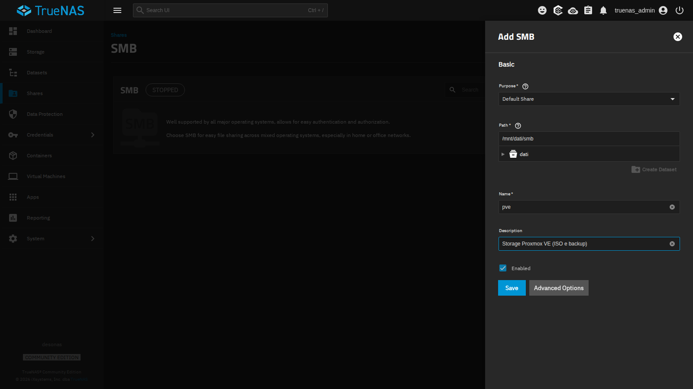
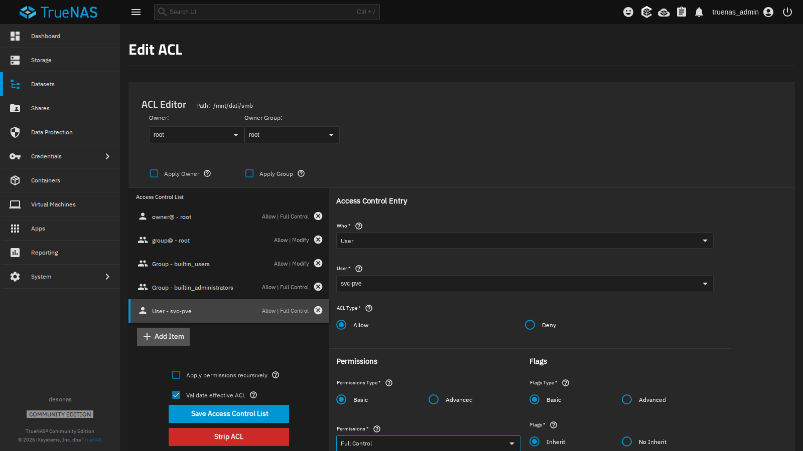
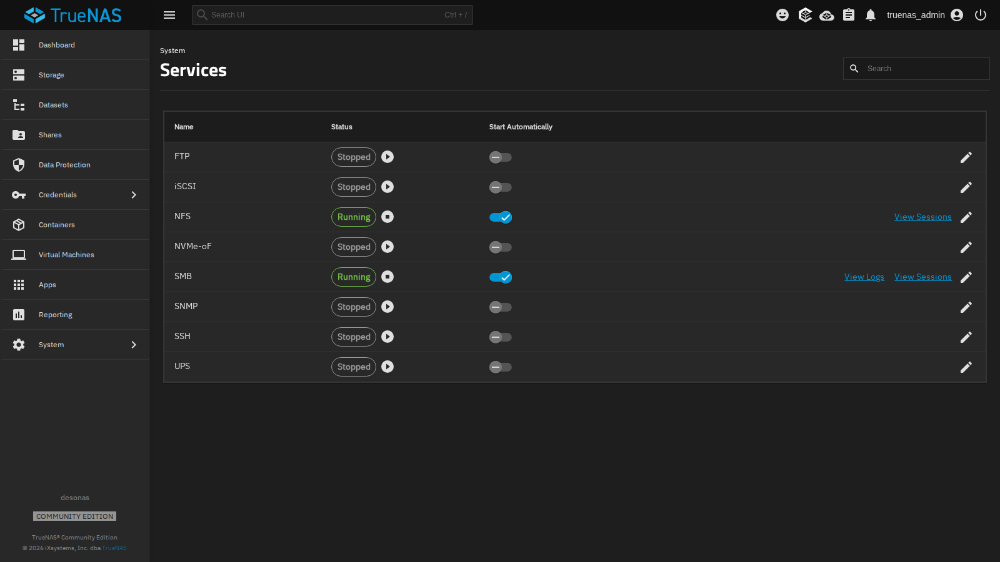
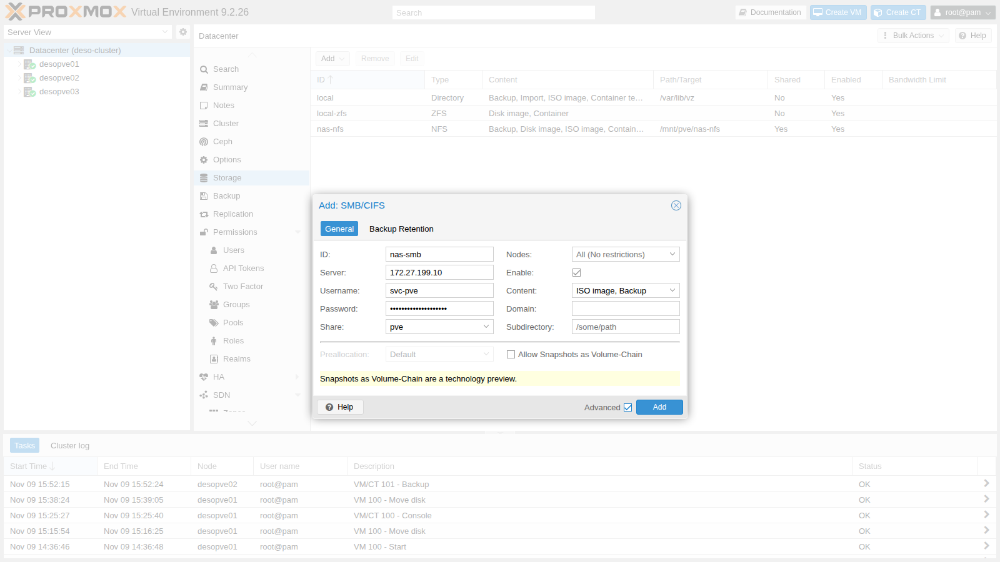
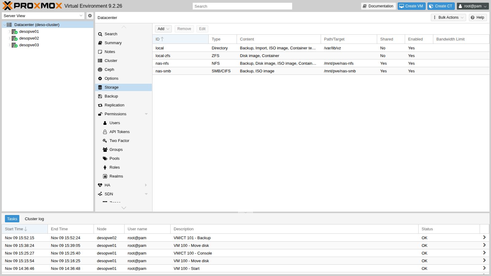
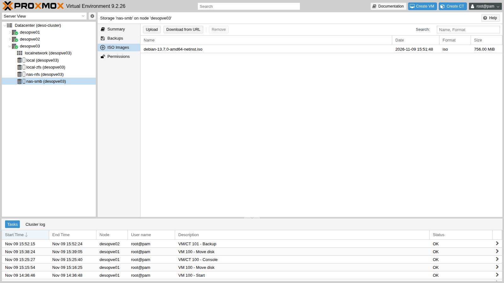
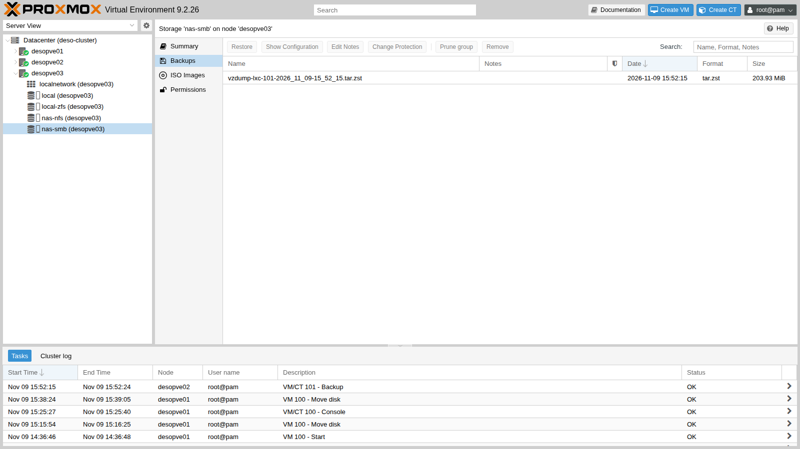

# Lab 14 – SMB/CIFS storage: authenticated share, permissions and comparison with NFS

**Level:** intermediate · **Duration:** 1 hour

## Dependencies

- **Previous labs:** [Lab 12](12-truenas-nas.md) for the NAS `desonas` with the `dati/smb` dataset (SMB preset) and the user `svc-pve`, and [Lab 13](13-nfs.md) for the `nas-nfs` storage, which you will use in the comparison.
- **Cluster:** `deso-cluster` with the three nodes (lab 06). Node `desopve01` has the Debian 13 ISO downloaded in lab 07; container 101 runs on node `desopve02`.
- **Network:** the nodes reach `172.27.199.10` on the lab LAN (TCP port 445).
- **Credentials:** `root` / `<lab-password>` on the nodes, `truenas_admin` / `<lab-password>` on the NAS, `svc-pve` / `<lab-password>` for SMB access → [Appendix B](b-credentials-and-addresses.md).

## Objectives

- Create an SMB share on TrueNAS and grant permissions to a service user.
- Add the SMB/CIFS storage to the cluster and understand where Proxmox VE stores the password.
- Pin the SMB protocol version.
- Use the share for ISOs and backups, visible from all nodes.
- Recognize the typical problems: credentials, permissions, `soft` mount.
- Compare SMB and NFS, including how safe their writes are.

## How it works

### SMB in Proxmox VE

SMB (*Server Message Block*), also known as CIFS, is the Windows file-sharing protocol. As with NFS, Proxmox VE **mounts the share on every node** under `/mnt/pve/<ID>` and uses it as a shared file-based storage. Unlike NFS, access is **authenticated**: each node presents itself to the server with a user name and a password.

```text
 desonas (TrueNAS)                              desopve01 / 02 / 03
 /mnt/dati/smb  ── share "pve" ── SMB 3.1.1 ──▶  /mnt/pve/nas-smb
                   user svc-pve                   ├── template/iso/   ISO images
                                                  └── dump/           backups
```

- The user's password is stored in `/etc/pve/priv/storage/<ID>.pw`. It is in the cluster file system, so all nodes know it, but the `priv` directory is readable only by root.
- The server decides the permissions with its ACLs: on TrueNAS, the `svc-pve` user must have full control of the dataset.
- The Linux client mounts the share with options that differ from NFS: Unix permissions do not exist (`nounix`), and the mount is **`soft`**. If the server does not respond, operations fail with an error instead of waiting.

### When to use SMB

| | NFS | SMB/CIFS |
|---|---|---|
| Authentication | by client IP address | user name and password (or AD domain) |
| Unix permissions (owner, `chmod`) | yes | no: the server decides them |
| Behavior if the server goes down | `hard`: waits | `soft`: error after a few seconds |
| Typical use in Proxmox VE | VM disks, ISOs, backups | ISOs, templates and backups; a NAS already in use with Windows |

For VM disks NFS is the better choice (or iSCSI, in lab 15): with SMB, a NAS that stops responding for a few seconds returns I/O errors to the virtual disk. In the lab you will use SMB for **ISOs and backups**.

### Alternative: authentication with Active Directory

In the lab the NAS uses a local user. In a company with Active Directory, TrueNAS can be joined to the domain (**Credentials** → **Directory Services** → **Configure Active Directory**: domain `proxmox.community`, an account with the right to join computers to the domain). This way:

- the service user becomes a domain account (for example `PROXMOX\svc-pve`), managed and expired according to the domain rules;
- in Proxmox VE the storage is configured with **Username** `svc-pve` and **Domain** `PROXMOX`;
- the ACLs of the share use domain users and groups.

Before joining the domain, the NAS needs correct DNS and time settings (lab 12): Kerberos rejects clock differences greater than 5 minutes.

## Procedure

### 1. The share on TrueNAS

1. On the NAS: **Shares** → **SMB** → **Add**.
2. **Purpose** `Default Share`, **Path** `/mnt/dati/smb`, **Name** `pve`, **Description** `Storage Proxmox VE (ISO e backup)`.

   

3. **Save**. TrueNAS asks **Configure ACL**: answer **Configure** to open the dataset permissions editor.
4. In the ACL editor click **Add Item** and create the entry:
   - **Who** `User`, **User** `svc-pve`;
   - **ACL Type** `Allow`, **Permissions** `Full Control`, **Flags** `Inherit`, so that it also applies to the directories and files that Proxmox VE will create.

   

5. **Save Access Control List**.
6. **System** → **Services**: enable **Start Automatically** for **SMB** and start the service.

   

From a node, check that the user can see the share:

```bash title="root@desopve01"
pvesm scan cifs 172.27.199.10 --username svc-pve --password '<lab-password>'
```

``` { .text .no-copy title="Output" }
pve Storage
```

### 2. Add the storage to the cluster

1. **Datacenter** → **Storage** → **Add** → **SMB/CIFS**.
2. Fill in:
   - **ID** `nas-smb`, **Server** `172.27.199.10`;
   - **Username** `svc-pve` and **Password**: the **Share** drop-down fills with the shares the user can access; choose `pve`;
   - **Content**: `ISO image` and `Backup` (remove `Disk image`);
   - **Nodes**: all.
3. Check **Advanced**: leave **Preallocation** `Default` and **Allow Snapshots as Volume-Chain** disabled.

   

4. **Add**. The storage appears as shared and active:

   

### 3. Pin the SMB version

The dialog has no field for the protocol version: when none is specified, the client negotiates the highest version both sides support. Pinning it prevents a misconfigured server from dragging the connection down to an old version. It is set from the command line, and takes effect at the next mount:

```bash title="root@desopve01"
pvesm set nas-smb --smbversion 3.11
umount /mnt/pve/nas-smb        # on every node: pvestatd remounts it by itself
grep -A8 "cifs: nas-smb" /etc/pve/storage.cfg
```

``` { .text .no-copy title="Output" }
cifs: nas-smb
	path /mnt/pve/nas-smb
	server 172.27.199.10
	share pve
	content iso,backup
	prune-backups keep-all=1
	smbversion 3.11
	username svc-pve
```

```bash title="root@desopve01"
ls -l /etc/pve/priv/storage/
```

``` { .text .no-copy title="Output" }
-rw------- 1 root www-data 30 Nov  9 15:49 nas-smb.pw
```

```bash title="root@desopve01"
mount | grep nas-smb
```

``` { .text .no-copy title="Output" }
//172.27.199.10/pve on /mnt/pve/nas-smb type cifs (rw,relatime,vers=3.1.1,cache=strict,upcall_target=app,username=svc-pve,uid=0,noforceuid,gid=0,noforcegid,addr=172.27.199.10,file_mode=0755,dir_mode=0755,soft,nounix,serverino,mapposix,reparse=nfs,nativesocket,symlink=native,rsize=4194304,wsize=4194304,bsize=1048576,echo_interval=60,actimeo=1,closetimeo=1)
```

- `vers=3.1.1`: this is SMB version 3.11, the most recent one.
- `uid=0`, `gid=0`, `file_mode=0755`: all files appear to belong to root, with fixed permissions, whoever their owner is on the server.
- `soft`: operations fail if the server does not respond (you will see this in the tests).

### 4. Shared ISOs and backups

Copy the Debian ISO downloaded in lab 07 to the share and look at it from another node:

```bash title="root@desopve01"
cp /var/lib/vz/template/iso/debian-13.7.0-amd64-netinst.iso /mnt/pve/nas-smb/template/iso/
```

```bash title="root@desopve03"
pvesm list nas-smb
```

``` { .text .no-copy title="Output" }
Volid                                       Format  Type           Size VMID
nas-smb:iso/debian-13.7.0-amd64-netinst.iso iso     iso       792723456
```



Back up container 101 to the share (backups are the topic of lab 46):

```bash title="root@desopve02"
vzdump 101 --storage nas-smb --mode snapshot --compress zstd
```

``` { .text .no-copy title="Output" }
INFO: Starting Backup of VM 101 (lxc)
INFO: creating vzdump archive '/mnt/pve/nas-smb/dump/vzdump-lxc-101-2026_11_09-15_52_15.tar.zst'
INFO: Total bytes written: 706631680 (674MiB, 87MiB/s)
INFO: archive file size: 203MB
INFO: Finished Backup of VM 101 (00:00:09)
```



## Verification and tests

### Test 1 – Wrong credentials

With a wrong password the server denies access. It is the same error you would see if the password of `svc-pve` changed on the NAS without the storage being updated:

```bash title="root@desopve01"
pvesm scan cifs 172.27.199.10 --username svc-pve --password sbagliata
```

``` { .text .no-copy title="Output" }
unexpected status: NT_STATUS_ACCESS_DENIED
```

To update the password: **Datacenter** → **Storage** → `nas-smb` → **Edit**, or `pvesm set nas-smb --password`.

### Test 2 – Unix permissions do not exist

```bash title="root@desopve01:/mnt/pve/nas-smb"
touch prova.txt; chmod 600 prova.txt; chown 1000:1000 prova.txt; echo $?
```

``` { .text .no-copy title="Output" }
0
```

```bash title="root@desopve01:/mnt/pve/nas-smb"
ls -l prova.txt
```

``` { .text .no-copy title="Output" }
-rwxr-xr-x 1 root root 0 Nov  9 15:51 prova.txt
```

`chmod` and `chown` return no error but change nothing: with `nounix`, the permissions are decided by the server through its ACLs. This is why SMB is not suitable for containers, which need real Unix owners and permissions.

### Test 3 – The NAS stops responding

On node `desopve01`, start a "heartbeat" that writes the time to the share every 2 seconds and logs the outcome:

```bash title="root@desopve01"
nohup sh -c 'while true; do if date +%T > /mnt/pve/nas-smb/battito.txt; then echo "$(date +%T) ok"; else echo "$(date +%T) ERRORE"; fi >> /root/smb-battito.log; sleep 2; done' >/dev/null 2>&1 &
```

On the NAS, stop the SMB service (**System** → **Services** → **SMB** → **Stop Service**). Writes hang for about ten seconds, then fail, and so does every subsequent attempt:

```bash title="root@desopve01"
tail -4 /root/smb-battito.log
```

``` { .text .no-copy title="Output" }
15:55:33 ok
15:55:35 ok
15:55:47 ERRORE
15:55:59 ERRORE
```

```bash title="root@desopve01"
bash -c 'echo x > /mnt/pve/nas-smb/prova.txt'
```

``` { .text .no-copy title="Output" }
bash: line 1: /mnt/pve/nas-smb/prova.txt: Host is down
```

```bash title="root@desopve01"
pvesm status | grep nas-smb
```

``` { .text .no-copy title="Output" }
nas-smb          cifs   inactive               0               0               0    0.00%
```

This is the difference from NFS in lab 13: there, processes kept waiting, without errors, until the server came back. Here the application gets an error (`Host is down`). For an ISO file or a backup in progress this means a failed operation that has to be repeated; for a VM disk it would mean I/O errors in the guest operating system.

Restart the SMB service: after a few seconds the client reconnects by itself and the writes resume:

```bash title="root@desopve01"
tail -3 /root/smb-battito.log
```

``` { .text .no-copy title="Output" }
15:57:38 ok
15:57:40 ok
15:57:42 ok
```

```bash title="root@desopve01"
pvesm status | grep nas-smb
```

``` { .text .no-copy title="Output" }
nas-smb          cifs     active       100069248          977024        99092224    0.98%
```

Stop the heartbeat and delete the test files:

```bash title="root@desopve01"
pkill -f "^sh -c while true"; rm -f /mnt/pve/nas-smb/battito.txt /mnt/pve/nas-smb/prova.txt /root/smb-battito.log
```

### Test 4 – SMB versus NFS

From node `desopve01`, use `fio` to measure the same writes on the two NAS storages (same pool, same network):

```bash title="root@desopve01"
fio --name=t --directory=/mnt/pve/nas-smb --rw=randwrite --bs=4k --size=1G \
      --iodepth=16 --ioengine=libaio --direct=1 --runtime=20 --time_based --group_reporting
```

``` { .text .no-copy title="Output" }
  write: IOPS=5430, BW=21.2MiB/s (22.2MB/s)(425MiB/20017msec); 0 zone resets
```

```bash title="root@desopve01"
fio --name=t --directory=/mnt/pve/nas-nfs --rw=randwrite --bs=4k --size=1G \
      --iodepth=16 --ioengine=libaio --direct=1 --runtime=20 --time_based --group_reporting
```

``` { .text .no-copy title="Output" }
  write: IOPS=962, BW=3851KiB/s (3943kB/s)(75.9MiB/20179msec); 0 zone resets
```

SMB looks five times faster. Repeat the test, forcing each write to be stored safely (`--fsync=1`, as a database does):

```bash title="root@desopve01"
fio --name=t --directory=/mnt/pve/nas-smb --rw=randwrite --bs=4k --size=1G \
      --iodepth=1 --ioengine=psync --direct=1 --fsync=1 --runtime=20 --time_based
```

``` { .text .no-copy title="Output" }
  write: IOPS=185, BW=741KiB/s (759kB/s)(14.9MiB/20557msec); 0 zone resets
```

```bash title="root@desopve01"
fio --name=t --directory=/mnt/pve/nas-nfs --rw=randwrite --bs=4k --size=1G \
      --iodepth=1 --ioengine=psync --direct=1 --fsync=1 --runtime=20 --time_based
```

``` { .text .no-copy title="Output" }
  write: IOPS=339, BW=1358KiB/s (1391kB/s)(26.5MiB/20001msec); 0 zone resets
```

Finally, sequential writes in 1 MiB blocks, typical of ISOs and backups:

```bash title="root@desopve01"
fio --name=t --directory=/mnt/pve/nas-smb --rw=write --bs=1M --size=1G \
      --iodepth=4 --ioengine=libaio --direct=1 --runtime=20 --time_based --group_reporting
```

``` { .text .no-copy title="Output" }
  write: IOPS=688, BW=688MiB/s (722MB/s)(13.6GiB/20292msec); 0 zone resets
```

```bash title="root@desopve01"
fio --name=t --directory=/mnt/pve/nas-nfs --rw=write --bs=1M --size=1G \
      --iodepth=4 --ioengine=libaio --direct=1 --runtime=20 --time_based --group_reporting
```

``` { .text .no-copy title="Output" }
  write: IOPS=33, BW=33.3MiB/s (34.9MB/s)(673MiB/20201msec); 0 zone resets
```

Delete the test files created by `fio`:

```bash title="root@desopve01"
rm -f /mnt/pve/nas-smb/t.0.0 /mnt/pve/nas-nfs/t.0.0
```

| Test (from the node, `fio`) | NFS | SMB |
|---|---|---|
| 4 KiB random write, queue depth 16 | 962 IOPS | 5,430 IOPS |
| 1 MiB sequential write, queue depth 4 | 33 MiB/s | 688 MiB/s |
| 4 KiB random write with `fsync` after every write | 339 IOPS | 185 IOPS |

- With NFS, every direct write reaches the NAS as a **stable** write: the NAS replies only after storing it safely (ZIL).
- With SMB, the NAS acknowledges a write as soon as it receives it in RAM and writes it to disk later, unless the client explicitly asks for a flush (`fsync`). If the NAS suddenly lost power, the last acknowledged writes would be lost.
- When safety is the same (third test), SMB is no faster than NFS.

For ISOs and backups, where every file is closed and verified, the speed of SMB is an advantage. For VM disks, which expect safe writes, it is an extra risk.

- [ ] The `pve` share uses the `dati/smb` dataset, and the `svc-pve` user has full control.
- [ ] The `nas-smb` storage is mounted with SMB 3.1.1 on all three nodes, with the password in `/etc/pve/priv/storage/`.
- [ ] The ISO and the container backup are visible from every node.
- [ ] You know what happens with a wrong password, with `chmod` and with the NAS stopped.
- [ ] You can explain why SMB "wins" the first comparison with NFS and loses the third.

## Final lab state

- **NAS:** SMB share **`pve`** on `/mnt/dati/smb`; ACL with `svc-pve` set to `Full Control` (inherited); SMB service running and set to start automatically. NFS unchanged.
- **Cluster:** storage **`nas-smb`** (CIFS, `//172.27.199.10/pve`, user `svc-pve`, `smbversion 3.11`, content `iso,backup`, shared, on all nodes), mounted at `/mnt/pve/nas-smb`. It contains:
  - the ISO `debian-13.7.0-amd64-netinst.iso`;
  - the backup `vzdump-lxc-101-2026_11_09-15_52_15.tar.zst` of container 101.
- Storage `nas-nfs` unchanged and empty. VM 100 running on `desopve01` (disk on `local-zfs`), CT 101 running on `desopve02`.

## What you learned

- An SMB/CIFS storage is a shared file-based storage, mounted on every node under `/mnt/pve/<ID>`, with the user name and password stored in `/etc/pve/priv/storage/`.
- On the NAS, permissions are granted with the dataset ACLs; on the client, Unix permissions do not exist.
- The protocol version is pinned with `pvesm set <ID> --smbversion`.
- The SMB mount is `soft`: with the NAS down, operations fail after a few seconds, whereas with NFS they wait.
- A speed comparison only makes sense when write safety is the same: SMB acknowledges writes before storing them, NFS does not.
- SMB is suitable for ISOs, templates and backups; for VM disks, NFS, iSCSI or Ceph are preferred.

## References

- [Proxmox VE – CIFS Backend](https://pve.proxmox.com/pve-docs/pve-admin-guide.html#storage_cifs)
- [Proxmox VE – `pvesm`](https://pve.proxmox.com/pve-docs/pvesm.1.html)
- [TrueNAS – Adding SMB Shares](https://www.truenas.com/docs/scale/scaletutorials/shares/smb/addsmbshares/)
- [TrueNAS – Configuring Active Directory](https://www.truenas.com/docs/scale/scaletutorials/credentials/directoryservices/configuringadscale/)
- [`mount.cifs(8)` – `soft`, `vers`, `nounix` options](https://man7.org/linux/man-pages/man8/mount.cifs.8.html)
