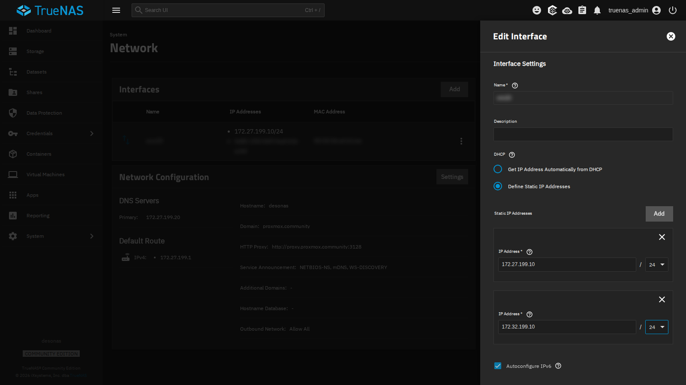
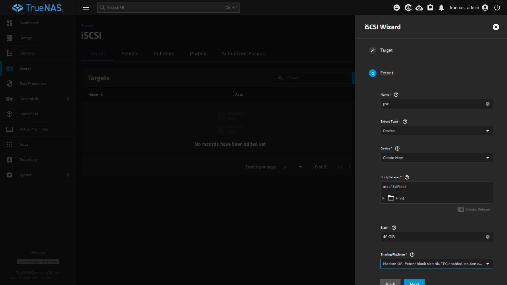
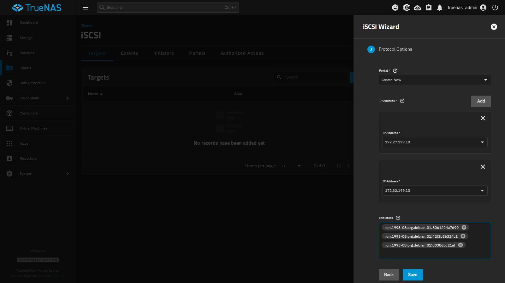
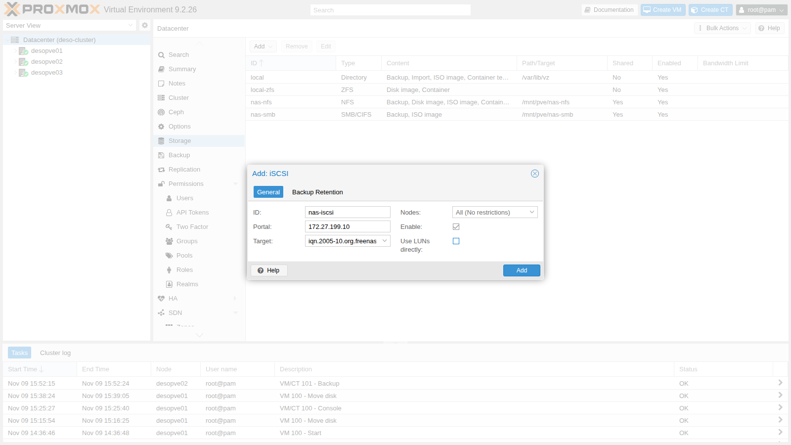
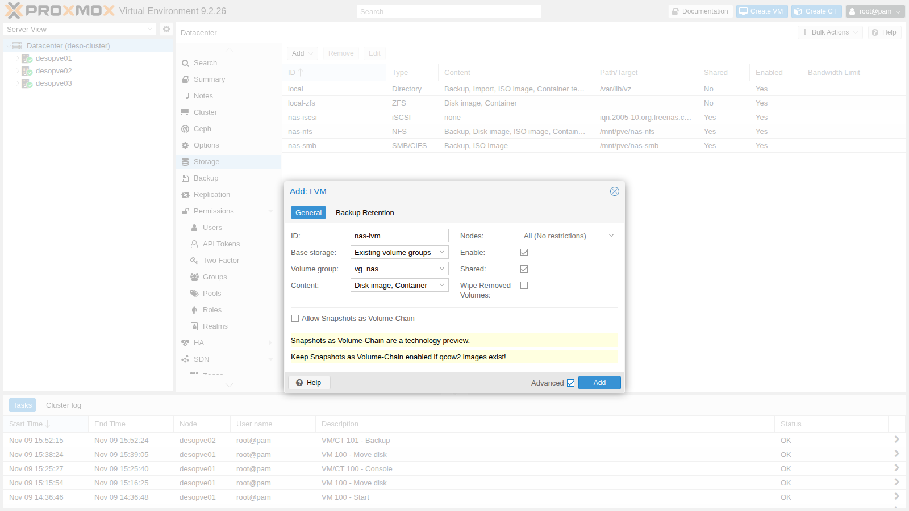
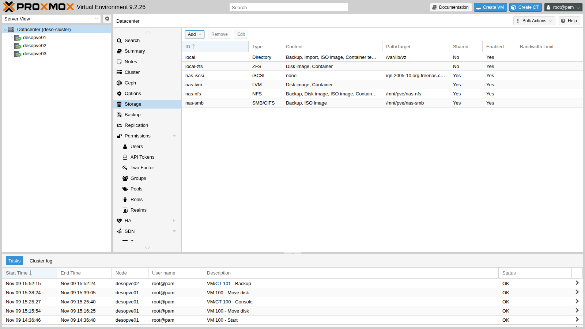

# Lab 15 – iSCSI with shared LVM and multipath: losing a path

**Level:** advanced · **Duration:** 2 hours

## Dependencies

- **Previous labs:** [Lab 12](12-truenas-nas.md) for the NAS `desonas` with the `dati/iscsi` dataset, [Lab 09](09-lvm-and-lvm-thin.md) for the LVM concepts, [Lab 06](06-cluster-corosync.md) for the nodes with the second NIC `nic1` (`172.32.199.21-23`), [Lab 11](11-zfs-replication.md) for the migration times to compare against.
- **Cluster:** `deso-cluster` with the three nodes; VM 100 `debian01` running on `desopve01`, with its disk on `local-zfs`.
- **Network:** the nodes reach the NAS at `172.27.199.10` (interface `vmbr0`) and, after the first step, at `172.32.199.10` (interface `nic1`).
- **Software:** `open-iscsi` is already installed in Proxmox VE; you will install `multipath-tools` through the lab proxy (lab 04).
- **Credentials:** `root` / `<lab-password>` on the nodes, `truenas_admin` / `<lab-password>` on the NAS, `labuser` / `<lab-password>` in VM 100 → [Appendix B](b-credentials-and-addresses.md).

## Objectives

- Export a block volume (zvol) from TrueNAS over iSCSI, on two addresses.
- Connect the nodes to the target and create a **shared LVM** storage on top of it.
- Combine the two paths to the NAS into a single device with **multipath**.
- Live-migrate a VM with its disk on shared storage, copying only the memory.
- Cut a path while I/O is in progress and measure the effect on the VM.
- Recognize a real-world problem that occurs when a node has two NICs on the same network (same switch, same VLAN).

## How it works

### iSCSI

iSCSI carries SCSI commands over TCP: the node sees a **disk** on the NAS as if it were attached locally (`/dev/sdX`). Unlike NFS and SMB, it does not share files, but blocks.

| Term | In the lab |
|---|---|
| **Target**: the "server" that exposes the disks, identified by an IQN | `iqn.2005-10.org.freenas.ctl:pve` on `desonas` |
| **LUN** / **extent**: the exported disk | the 40 GiB zvol `dati/iscsi/pve`, LUN 0 |
| **Portal**: IP address and TCP port (3260) on which the target responds | `172.27.199.10:3260` and `172.32.199.10:3260` |
| **Initiator**: the client, with its own IQN | the three nodes, `iqn.1993-08.org.debian:01:…` |
| **Initiator group**: who is allowed to connect to the target | only the IQNs of the three nodes |

### Shared LVM

The same iSCSI disk is seen by all nodes. On top of it you create **a single** LVM volume group (`vg_nas`), and each VM disk is a logical volume (LV):

```text
                 desonas: zvol dati/iscsi/pve (40 GiB)
                   │ 172.27.199.10            │ 172.32.199.10
               path 1 (vmbr0)              path 2 (nic1)
                   │                          │
  each node:    /dev/sde                   /dev/sdf      ← the same LUN, twice
                   └──────── multipath ───────┘
                      /dev/mapper/nas-lun0
                               │
                       VG vg_nas (shared)
                       └── vm-100-disk-0 (LV)
```

- LVM is not a cluster file system: Proxmox VE coordinates the changes (creating, growing, deleting LVs) with a cluster lock, and an LV is active on only one node at a time, the one where the VM runs.
- The storage is **thick**: every LV takes up all its space right away. Thin provisioning (LVM-thin) cannot be shared across nodes.
- Snapshots on shared LVM exist only with the *volume chain* feature of Proxmox VE 9, which you will see in lab 16.

### Multipath

With two portals, each node opens **two iSCSI sessions** and sees the LUN twice (`sde`, `sdf`). Using them directly would be dangerous: LVM would find two copies of the same disk. The **multipathd** daemon recognizes that they have the same identifier (WWID) and combines them into a single device, `/dev/mapper/nas-lun0`:

- with `path_grouping_policy multibus` and `round-robin`, I/O uses **both** paths;
- if a path goes down, multipathd marks it `failed` and I/O carries on over the other one; when it comes back, multipathd reinstates it by itself (it checks every `polling_interval` seconds);
- with `no_path_retry queue`, if **all** paths go down, I/O is queued (like with the NFS `hard` mount) instead of returning errors to the VM disk.

## Procedure

### 1. A second address on the NAS

The NAS has a single network card: add the second address as an alias, on the `172.32.199.0/24` network that the nodes reach through `nic1`.

1. **System** → **Network** → interface row → **⋮** → **Edit**.
2. Under **Static IP Addresses** click **Add** and enter `172.32.199.10` / `24`.

   

3. **Save**, then **Test Changes** and, within the time shown, **Save Changes**: if the network stopped working, TrueNAS would revert to the previous configuration by itself.

### 2. The iSCSI target

1. **Shares** → **iSCSI** → **Wizard**.
2. **Target**: `Create New`, **Next**.
3. **Extent**:
   - **Name** `pve` (it becomes the name of the target and of the extent);
   - **Extent Type** `Device`, **Device** `Create New`: TrueNAS creates a **zvol**, a ZFS block volume. A *dataset* will not do: it is a file system, not a disk;
   - **Pool/Dataset** `/mnt/dati/iscsi`, **Size** `40 GiB`;
   - **Sharing Platform** `Modern OS` (4 KiB blocks).

   

4. **Protocol Options**:
   - **Portal** `Create New`, with two **IP Address** entries: `172.27.199.10` and `172.32.199.10`;
   - **Initiators**: the IQNs of the three nodes, read on each node with `cat /etc/iscsi/initiatorname.iscsi`. Only these will be able to connect.

   

5. **Save**, and accept starting the iSCSI service with automatic start enabled.

> **CHAP authentication.** The initiator group restricts access to the IQNs of the nodes, but an IQN can be spoofed. On networks that are not dedicated, add CHAP (**Authorized Access** on the NAS, and user name and password in the `/etc/iscsi/iscsid.conf` file of the nodes). In the lab the network is isolated and we do not use it.

The zvol is **thick** (it reserves the 40 GiB right away): the free space seen by the NFS and SMB storages drops from about 95 to 56 GiB.

### 3. Connect the nodes to the target

On **all three nodes**, before the first connection, reduce the time after which a lost path is considered failed (the default is 120 seconds):

```console
root@desopve01:~# sed -i 's/^node.session.timeo.replacement_timeout = 120/node.session.timeo.replacement_timeout = 15/' /etc/iscsi/iscsid.conf
root@desopve01:~# pvesm scan iscsi 172.27.199.10
iqn.2005-10.org.freenas.ctl:pve 172.27.199.10:3260,172.32.199.10:3260
```

The target advertises both portals. Add the iSCSI storage:

1. **Datacenter** → **Storage** → **Add** → **iSCSI**.
2. **ID** `nas-iscsi`, **Portal** `172.27.199.10`, **Target** from the drop-down.
3. **Uncheck** **Use LUNs directly**: the LUN will not hold the VM disks directly, but the LVM volume group.

   

4. **Add**. Proxmox VE connects to the target from every node, on **all** the advertised portals:

```console
root@desopve01:~# iscsiadm -m session
tcp: [1] 172.27.199.10:3260,1 iqn.2005-10.org.freenas.ctl:pve (non-flash)
tcp: [2] 172.32.199.10:3260,1 iqn.2005-10.org.freenas.ctl:pve (non-flash)
root@desopve01:~# lsblk -o NAME,SIZE,TRAN,VENDOR,MODEL | grep iscsi
sde      40G iscsi  TrueNAS  iSCSI Disk
sdf      40G iscsi  TrueNAS  iSCSI Disk
root@desopve01:~# iscsiadm -m session -P3 | grep -E 'Current Portal|Attached scsi disk'
	Current Portal: 172.27.199.10:3260,1
			Attached scsi disk sde		State: running
	Current Portal: 172.32.199.10:3260,1
			Attached scsi disk sdf		State: running
```

`sde` and `sdf` are the **same** disk, seen through the two paths.

### 4. Two NICs on the same network: ARP

In this lab `vmbr0` and `nic1` are connected to the same switch, in the same VLAN. By default, Linux answers ARP requests for **any** of its addresses on **any** interface (*ARP flux*): the NAS can therefore learn that `172.32.199.22` sits behind the `vmbr0` interface, and send the traffic of the second path there.

> **How to recognize it.** The problem usually shows up after an outage of one of the two NICs, for example `nic1`. The replies from the NAS arrive on the wrong interface, the session of the second path drops every 10 seconds and the I/O of the VM can stall for a long time (it happened in this lab, with pauses of up to 85 seconds). The log shows repeated connection errors, and traffic from the `172.32.199.10` portal, which should arrive only on `nic1`, shows up on `vmbr0`. An example from `desopve02`:
>
> ```console
> root@desopve02:~# dmesg -T | grep "conn error" | tail -2
> [Mon Nov  9 16:28:15 2026]  connection2:0: detected conn error (1022)
> [Mon Nov  9 16:28:25 2026]  connection2:0: detected conn error (1022)
> root@desopve02:~# tcpdump -ni vmbr0 -c 2 host 172.32.199.10
> 16:28:46.780034 IP 172.32.199.10.3260 > 172.32.199.22.36180: Flags [S.], seq 2256764707, ack 4002835344, win 65160, options [mss 1460,sackOK,TS val 675916009 ecr 343433178,nop,wscale 7], length 0
> 16:28:46.781033 IP 172.32.199.10.3260 > 172.32.199.22.36180: Flags [.], ack 49, win 509, options [nop,nop,TS val 675916010 ecr 343433179], length 0
> ```

So it is best to prevent it right away, before configuring multipath.

The solution, on **all** nodes with more than one NIC on the same network: each interface answers only for its own addresses (`arp_ignore=1`) and always announces the right address (`arp_announce=2`).

```console
root@desopve01:~# printf 'net.ipv4.conf.all.arp_ignore = 1\nnet.ipv4.conf.all.arp_announce = 2\n' > /etc/sysctl.d/90-arp-multihomed.conf
root@desopve01:~# sysctl -p /etc/sysctl.d/90-arp-multihomed.conf
net.ipv4.conf.all.arp_ignore = 1
net.ipv4.conf.all.arp_announce = 2
```

If the NAS has already learned the wrong mapping, correct it with an ARP announcement from the right interface:

```console
root@desopve02:~# apt install iputils-arping
root@desopve02:~# arping -c 3 -U -I nic1 -s 172.32.199.22 172.32.199.22
```

In production networks the storage network is kept separate (dedicated switches or VLANs) and the problem does not arise.

### 5. Multipath

On **all three nodes**:

1. Install the package and read the WWID of the LUN:

   ```console
   root@desopve01:~# apt install multipath-tools
   root@desopve01:~# /lib/udev/scsi_id -g -u -d /dev/sde
   36589cfc000000580bcccfa017f51b957
   ```

2. Create `/etc/multipath.conf`: all disks are excluded (`blacklist`) except the NAS LUN, which is given a readable name.

   ```text
   defaults {
       polling_interval        2
       path_selector           "round-robin 0"
       path_grouping_policy    multibus
       uid_attribute           ID_SERIAL
       failback                immediate
       no_path_retry           queue
       user_friendly_names     yes
   }
   blacklist {
       wwid .*
   }
   blacklist_exceptions {
       wwid "36589cfc000000580bcccfa017f51b957"
   }
   multipaths {
       multipath {
           wwid  "36589cfc000000580bcccfa017f51b957"
           alias nas-lun0
       }
   }
   ```

3. Register the WWID (recent versions of multipath-tools create the device only for known WWIDs), then reload:

   ```console
   root@desopve01:~# multipath -a 36589cfc000000580bcccfa017f51b957
   root@desopve01:~# systemctl restart multipathd; multipath -r
   root@desopve01:~# multipath -ll
   nas-lun0 (36589cfc000000580bcccfa017f51b957) dm-0 TrueNAS,iSCSI Disk
   size=40G features='1 queue_if_no_path' hwhandler='0' wp=rw
   `-+- policy='round-robin 0' prio=1 status=active
     |- 33:0:0:0 sde 8:64 active ready running
     `- 34:0:0:0 sdf 8:80 active ready running
   ```

   One device, two active paths; `queue_if_no_path` is the effect of `no_path_retry queue`.

### 6. The shared LVM volume group

Create the volume group **only once**, from a single node, on the multipath device (never on `sde` or `sdf`):

```console
root@desopve01:~# pvcreate /dev/mapper/nas-lun0
  Physical volume "/dev/mapper/nas-lun0" successfully created.
root@desopve01:~# vgcreate vg_nas /dev/mapper/nas-lun0
  Volume group "vg_nas" successfully created
root@desopve02:~# pvs
  PV                   VG     Fmt  Attr PSize  PFree
  /dev/mapper/nas-lun0 vg_nas lvm2 a--  39.99g 39.99g
```

The other nodes see the volume group right away, again through the multipath device: LVM ignores the individual paths by itself (`multipath_component_detection=1`).

1. **Datacenter** → **Storage** → **Add** → **LVM**.
2. **ID** `nas-lvm`, **Base storage** `Existing volume groups`, **Volume group** `vg_nas`, **Content** `Disk image, Container`.
3. Check **Shared**: without it, Proxmox VE would treat the volume group as local to each node.

   

4. **Add**.



```console
root@desopve01:~# grep -A5 "lvm: nas-lvm" /etc/pve/storage.cfg
lvm: nas-lvm
	vgname vg_nas
	content images,rootdir
	saferemove 0
	shared 1
```

### 7. A VM on shared storage

Move the disk of VM 100 to `nas-lvm` while the VM is running (it becomes a `raw` LV) and migrate the VM:

```console
root@desopve01:~# qm disk move 100 scsi0 nas-lvm --delete 1
mirror-scsi0: transferred 16.0 GiB of 16.0 GiB (100.00%) in 1m 20s, ready
mirror-scsi0: Completed successfully.
removing source volume 'local-zfs:vm-100-disk-0' after successful copy
root@desopve01:~# lvs vg_nas
  LV            VG     Attr       LSize  Pool Origin Data%  Meta%  Move Log Cpy%Sync Convert
  vm-100-disk-0 vg_nas -wi-ao---- 16.00g
root@desopve01:~# qm migrate 100 desopve02 --online
2026-11-09 16:22:48 starting migration of VM 100 to node 'desopve02' (172.27.199.22)
2026-11-09 16:22:54 migration completed, transferred 274.2 MiB VM-state
2026-11-09 16:22:58 migration finished successfully (duration 00:00:10)
```

The disk does not move: the destination node activates the same LV. Only the memory in use is copied (274 MiB).

| Live migration of VM 100 | Duration |
|---|---|
| Local disk, no replication (lab 11) | 1 min 13 s |
| Local disk with ZFS replication (lab 11) | 20 s |
| Disk on shared storage (LVM on iSCSI) | 10 s |

## Verification and tests

### Test – A path goes down while I/O is in progress

1. In VM 100, now on `desopve02`, start a "heartbeat" that every second writes the time, down to hundredths of a second, and forces it to disk:

   ```console
   labuser@debian01:~$ nohup sh -c 'while true; do date +%T.%N | cut -c1-12 >> $HOME/battito.log; sync; sleep 1; done' >/dev/null 2>&1 &
   ```

2. On `desopve02`, take down the NIC of the second path, as if a cable had been unplugged:

   ```console
   root@desopve02:~# date +%T.%N | cut -c1-12; ip link set nic1 down
   16:32:14.282
   ```

3. After about 15 seconds the path is marked as failed and I/O continues over the first one:

   ```console
   root@desopve02:~# multipath -ll nas-lun0 | tail -2
     |- 33:0:0:0 sde 8:64 active ready  running
     `- 35:0:0:0 sdg 8:96 failed faulty offline
   root@desopve02:~# dmesg -T | grep -E 'conn error|recovery timed|Failing path'
   [Mon Nov  9 16:32:24 2026]  connection3:0: detected conn error (1022)
   [Mon Nov  9 16:32:29 2026]  session3: session recovery timed out after 5 secs
   [Mon Nov  9 16:32:29 2026] device-mapper: multipath: 252:0: Failing path 8:96.
   ```

   - 10 seconds after the disconnection, the periodic session check (*NOP-Out*, 5 seconds plus a 5-second timeout) detects the error.
   - After another 5 seconds the session is declared lost: multipathd sets a 5-second timeout (`fast_io_fail_tmo`) on the iSCSI sessions, shorter than the 15 seconds in `iscsid.conf`. The path is `failed`.

4. Bring the NIC back up: the path comes back by itself.

   ```console
   root@desopve02:~# date +%T.%N | cut -c1-12; ip link set nic1 up
   16:32:49.332
   root@desopve02:~# dmesg -T | grep Reinstating
   [Mon Nov  9 16:32:58 2026] device-mapper: multipath: 252:0: Reinstating path 8:96.
   root@desopve02:~# multipath -ll nas-lun0 | tail -2
     |- 33:0:0:0 sde 8:64 active ready running
     `- 35:0:0:0 sdg 8:96 active ready running
   ```

   The path comes back with the same device: multipath recognizes it by its WWID, and nothing changes for LVM or for the VM. In this output the second path is called `sdg` instead of `sdf`, because on `desopve02` its session had already been recreated once during the ARP problem described in step 4, and the kernel had given it a new name. On your nodes it will probably be `sdf`.

5. In the VM, look for heartbeat pauses longer than 1.5 seconds:

   ```console
   labuser@debian01:~$ awk -F: '{s=$1*3600+$2*60+$3; if (NR>1 && s-p>1.5) printf "pausa di %.1f s, da %s a %s\n", s-p, q, $0; p=s; q=$0}' $HOME/battito.log
   pausa di 15.3 s, da 16:32:09.700 a 16:32:25.034
   pausa di 1.8 s, da 16:32:40.597 a 16:32:42.416
   pausa di 1.6 s, da 16:32:44.484 a 16:32:46.123
   pausa di 1.6 s, da 16:32:46.123 a 16:32:47.678
   ```

   - One write waited for 15.3 seconds: the time needed to detect the failure (10 seconds of *NOP-Out* plus 5 of `fast_io_fail_tmo`) and to resend the I/O over the healthy path. No errors in the VM, just a wait.
   - The heartbeat times come from the VM clock, which here was a few seconds behind the node: to compare them with the `dmesg` of the node, first synchronize the VM with `ntp.proxmox.community`.
   - The 1.6-1.8 second pauses are the `sleep 1` plus the `sync` with a single path.
   - When the path comes back (16:32:58) there is no pause at all.

On `desopve02`, Corosync link 1 (lab 06), which uses the same NIC, went down too: the cluster stayed quorate thanks to link 0.

Stop the heartbeat:

```console
labuser@debian01:~$ pkill -f "^sh -c while true"; rm -f $HOME/battito.log
```

### Cleanup

Move the VM back to `desopve01` and its disk back to local storage. The `nas-iscsi` and `nas-lvm` storages stay configured for the following labs.

```console
root@desopve02:~# qm migrate 100 desopve01 --online
2026-11-09 16:34:07 migration finished successfully (duration 00:00:10)
root@desopve01:~# qm disk move 100 scsi0 local-zfs --delete 1
mirror-scsi0: transferred 16.0 GiB of 16.0 GiB (100.00%) in 2m 30s, ready
removing source volume 'nas-lvm:vm-100-disk-0' after successful copy
```

- [ ] The NAS responds on `172.27.199.10` and `172.32.199.10`, and exports the `dati/iscsi/pve` zvol only to the IQNs of the nodes.
- [ ] Each node has two iSCSI sessions and a single multipath device `nas-lun0` with two active paths.
- [ ] The `nas-lvm` storage is shared, on the `vg_nas` volume group created on the multipath device.
- [ ] Live migration with the disk on `nas-lvm` copies only the memory.
- [ ] With a path unplugged, the I/O of the VM stops for a few seconds and then resumes; when the path comes back, nothing happens.
- [ ] `arp_ignore=1` and `arp_announce=2` are active on the nodes.

## Final lab state

- **NAS:** alias `172.32.199.10/24` on the network card; zvol **`dati/iscsi/pve`** (40 GiB, thick); target **`iqn.2005-10.org.freenas.ctl:pve`** with LUN 0, portals `172.27.199.10:3260` and `172.32.199.10:3260`, initiator group with the three nodes, no CHAP; iSCSI service running and set to start automatically.
- **Nodes `desopve01-03`:**
  - `node.session.timeo.replacement_timeout = 15` in `/etc/iscsi/iscsid.conf`;
  - `multipath-tools` with `/etc/multipath.conf` (alias `nas-lun0`) and the WWID registered;
  - `/etc/sysctl.d/90-arp-multihomed.conf` with `arp_ignore=1` and `arp_announce=2`;
  - on `desopve02`, `iputils-arping` as well.
- **Cluster:** storages **`nas-iscsi`** (iSCSI, no direct content) and **`nas-lvm`** (shared LVM on the `vg_nas` VG, content `images,rootdir`, empty).
- Storages `nas-nfs` and `nas-smb` unchanged. VM 100 running on `desopve01`, disk on `local-zfs`; CT 101 running on `desopve02`.

## What you learned

- iSCSI exports block disks: target, LUN, portal and initiator; with TrueNAS the disk is a zvol, not a dataset.
- On a shared LUN you create a single LVM volume group, marked as **Shared**: each VM disk is an LV, active on one node at a time.
- With two portals each node sees the LUN twice; multipath combines them into one device with multiple paths, and that is where LVM must be created.
- A VM on shared storage is migrated by copying only its memory.
- When a path goes down, I/O stops for the time it takes to detect the failure (about 10-15 seconds with the defaults) and resumes over the other path, without errors.
- Two NICs on the same network (same switch, same VLAN) require `arp_ignore` and `arp_announce`, otherwise traffic can come back on the wrong interface.

## References

- [Proxmox VE – Open-iSCSI initiator](https://pve.proxmox.com/pve-docs/pve-admin-guide.html#storage_open_iscsi)
- [Proxmox VE – LVM Backend](https://pve.proxmox.com/pve-docs/pve-admin-guide.html#storage_lvm)
- [Proxmox VE wiki – Multipath](https://pve.proxmox.com/wiki/Multipath)
- [TrueNAS – Block (iSCSI) Shares Targets](https://www.truenas.com/docs/scale/scaletutorials/shares/iscsi/)
- [`multipath.conf(5)`](https://man7.org/linux/man-pages/man5/multipath.conf.5.html)
- [Linux kernel – `arp_ignore` and `arp_announce`](https://docs.kernel.org/networking/ip-sysctl.html)
