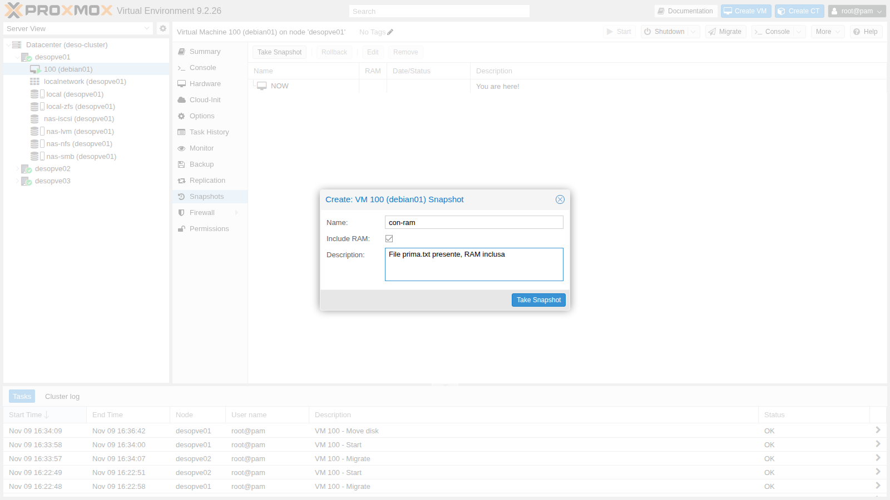
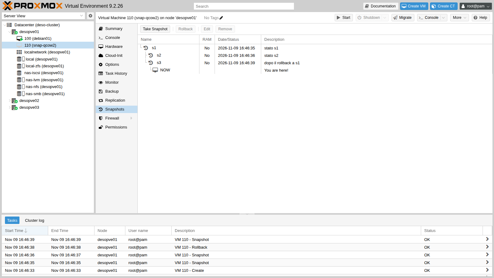
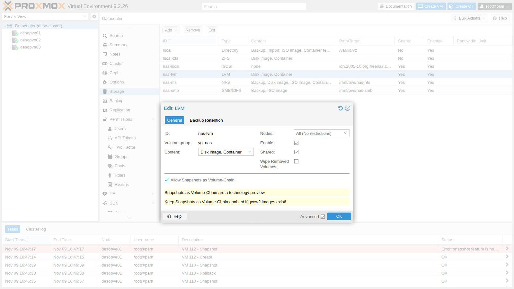
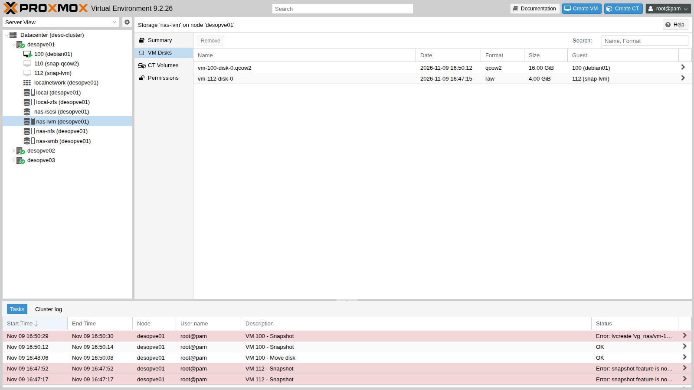
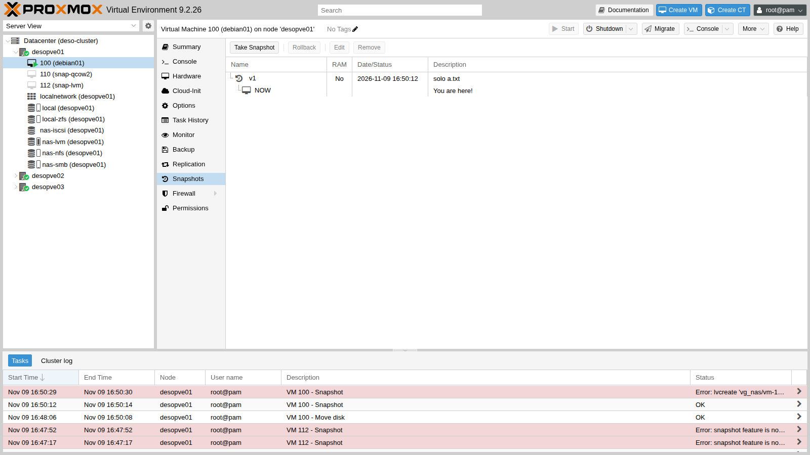

# Lab 16 – Snapshots: with and without RAM, rollback, trees and volume chain

**Level:** advanced · **Duration:** 1 hour 30 minutes

## Dependencies

- **Previous labs:** [Lab 10](10-zfs.md) (ZFS snapshots), [Lab 09](09-lvm-and-lvm-thin.md) (LVM-thin on `desopve04`), [Lab 13](13-nfs.md) (`nas-nfs` storage), [Lab 15](15-iscsi-lvm-multipath.md) (`nas-lvm` storage on iSCSI).
- **Cluster:** VM 100 `debian01` running on `desopve01` with its disk on `local-zfs`; `desopve04` standalone with the `local-lvm` storage (LVM-thin).
- **Space:** the `vg_nas` volume group has 40 GiB free; the disk of VM 100 is 16 GiB.
- **Credentials:** `root` / `<lab-password>` on the nodes, `labuser` / `<lab-password>` in VM 100 → [Appendix B](b-credentials-and-addresses.md).

## Objectives

- Take snapshots of a VM with and without RAM, and understand what happens on rollback.
- Recognize how each storage type implements snapshots and what its limits are.
- Build a snapshot tree with branches.
- Enable snapshots as a *volume chain* on shared LVM, inspect the chain of volumes and measure its cost in space.

## How it works

### What a snapshot is in Proxmox VE

A snapshot freezes the state of the VM at a given instant:

- the state of the **disks**, implemented by the storage (ZFS, qcow2, LVM-thin, Ceph…);
- the VM **configuration**, saved in the `/etc/pve/qemu-server/<VMID>.conf` file in a `[snapshot-name]` section;
- optionally the **RAM** (*vmstate*), i.e. the state of the running VM: processes, connections, memory contents. It is saved in a separate volume on the same storage.

**Rollback** takes the VM back exactly to that point. With RAM, the VM comes back running, as if nothing had happened; without RAM it comes back powered off, as after a power failure.

A snapshot **is not a backup**: it lives on the same storage as the VM, and if the storage fails, the VM and its snapshots are lost together. Backups are the topic of labs 46 and 47.

### Snapshots by storage type

| Storage | How it works | Rollback to a snapshot other than the latest |
|---|---|---|
| ZFS | native snapshot of the ZFS volume, instant | no: the more recent ones must be deleted first |
| qcow2 on NFS, SMB or directory | snapshots internal to the qcow2 file | yes, with branches (tree) |
| LVM-thin | thin volume that shares its blocks with the original | yes, with branches |
| LVM (thick, shared too) | **none** | – |
| LVM with *volume chain* (PVE 9) | chain of qcow2 volumes, each on its own LV | no: only to the latest |
| Ceph RBD | native RBD snapshot (lab 17) | yes, even to an older snapshot: the later ones are kept |

### Snapshots as a volume chain

Thick LVM has no usable snapshots: classic LVM snapshots (*copy-on-write*) slow down writes to the origin volume and cannot be used on a volume group shared between nodes. Proxmox VE 9 introduces an alternative, still a *technology preview*, that works with any block storage (iSCSI, Fibre Channel):

```text
 before the snapshot          after snapshot "v1"
 ┌──────────────────────┐     ┌──────────────────────────────┐   ┌──────────────────────┐
 │ vm-100-disk-0.qcow2  │ ──▶ │ snap_vm-100-disk-0_v1.qcow2  │ ◀─│ vm-100-disk-0.qcow2  │
 │ (16 GiB LV)          │     │ frozen state (16 GiB)        │   │ new, only the        │
 └──────────────────────┘     └──────────────────────────────┘   │ differences (16 GiB) │
                                         backing file            └──────────────────────┘
```

- The VM disk is in **qcow2** format, written directly inside an LV.
- The snapshot **renames** the current volume (which becomes the frozen state) and creates a new volume that contains only the differences, with the previous one as its *backing file*.
- Each volume is a **thick LV the size of the entire disk**: a snapshot of a 16 GiB disk takes up another 16 GiB in the volume group.

## Procedure

### 1. Snapshot with RAM on ZFS

1. In VM 100, create a file to use as a reference:

   ```console
   labuser@debian01:~$ echo "creato prima dello snapshot" > $HOME/prima.txt; sync; uptime -s
   2026-11-09 14:30:12
   ```

   `uptime -s` shows when the VM was started.

2. VM **100** → **Snapshots** → **Take Snapshot**: **Name** `con-ram`, a description, and **Include RAM** checked (the default when the VM is running).

   

3. On the node, look at what ZFS created:

   ```console
   root@desopve01:~# qm listsnapshot 100
   `-> con-ram                     2026-11-09 16:41:06     File prima.txt presente, RAM inclusa
    `-> current                                            You are here!
   root@desopve01:~# zfs list -t all -o name,used,refer -r rpool/data | grep -E 'NAME|vm-100'
   NAME                               USED  REFER
   rpool/data/vm-100-disk-0          5.86G  5.86G
   rpool/data/vm-100-disk-0@con-ram   804K  5.86G
   rpool/data/vm-100-state-con-ram    154M   154M
   ```

   - `vm-100-disk-0@con-ram` is the disk snapshot: right after it is created it takes up almost nothing (804K), because it shares all its blocks with the disk.
   - `vm-100-state-con-ram` is a separate volume with the contents of the RAM (154 MiB in use out of 2 GiB).

4. In the VM, delete the file and create another one, then roll back:

   ```console
   labuser@debian01:~$ rm $HOME/prima.txt; echo "creato dopo lo snapshot" > $HOME/dopo.txt; sync
   root@desopve01:~# time qm rollback 100 con-ram
   real	0m4.404s
   root@desopve01:~# qm status 100
   status: running
   labuser@debian01:~$ ls $HOME; uptime -s
   prima.txt
   2026-11-09 14:30:12
   ```

   In 4 seconds the VM went back to the moment of the snapshot, **running**: `prima.txt` is there, `dopo.txt` never existed, and the boot time has not changed because the VM did not reboot. Even an SSH session opened before the snapshot picks up again, unless it timed out in the meantime.

### 2. Snapshot without RAM and the ZFS limitation

1. Take a snapshot without RAM:

   ```console
   root@desopve01:~# qm snapshot 100 senza-ram --vmstate 0
   root@desopve01:~# qm listsnapshot 100
   `-> con-ram                     2026-11-09 16:41:06     File prima.txt presente, RAM inclusa
    `-> senza-ram                  2026-11-09 16:45:34     no-description
     `-> current                                           You are here!
   ```

2. Try to go back to the first snapshot, which is not the most recent one:

   ```console
   root@desopve01:~# qm rollback 100 con-ram
   can't rollback, 'con-ram' is not most recent snapshot on 'local-zfs:vm-100-disk-0'
   ```

   ZFS can only go back to the latest snapshot: to go back to an earlier one, you first have to delete the more recent ones.

3. Roll back to `senza-ram`: without RAM the VM ends up **stopped** and must be started again.

   ```console
   root@desopve01:~# qm rollback 100 senza-ram; qm status 100
   status: stopped
   root@desopve01:~# qm start 100
   ```

4. Delete `senza-ram`: now `con-ram` is the most recent one and the rollback is allowed. Then delete `con-ram` as well.

   ```console
   root@desopve01:~# qm delsnapshot 100 senza-ram
   root@desopve01:~# qm rollback 100 con-ram; qm status 100
   status: running
   root@desopve01:~# qm delsnapshot 100 con-ram
   ```

   If `qm delsnapshot` replies `can't lock file '/var/lock/qemu-server/lock-100.conf' - got timeout`, the previous rollback is still finishing: try again after a few seconds.

### 3. A snapshot tree with qcow2 on NFS

On a file-based storage with qcow2 disks, snapshots are **internal** to the file and you can go back to any of them. Use a test VM without an operating system:

```console
root@desopve01:~# qm create 110 --name snap-qcow2 --memory 512 --scsihw virtio-scsi-single --scsi0 nas-nfs:4,format=qcow2
root@desopve01:~# qm snapshot 110 s1 --description "stato s1"
root@desopve01:~# qm snapshot 110 s2 --description "stato s2"
root@desopve01:~# qm rollback 110 s1
root@desopve01:~# qm snapshot 110 s3 --description "dopo il rollback a s1"
root@desopve01:~# qm listsnapshot 110
`-> s1                          2026-11-09 16:46:35     stato s1
 `-> s2                         2026-11-09 16:46:36     stato s2
 `-> s3                         2026-11-09 16:46:39     dopo il rollback a s1
  `-> current                                           You are here!
root@desopve01:~# qemu-img snapshot -l /mnt/pve/nas-nfs/images/110/vm-110-disk-0.qcow2
Snapshot list:
ID      TAG               VM_SIZE                DATE        VM_CLOCK     ICOUNT
1       s1                    0 B 2026-11-09 16:46:35  0000:00:00.000          0
2       s2                    0 B 2026-11-09 16:46:36  0000:00:00.000          0
3       s3                    0 B 2026-11-09 16:46:39  0000:00:00.000          0
```

The rollback to `s1` succeeded even though `s2` existed. Snapshot `s3`, created afterwards, stems from `s1`: the tree has two branches, `s2` and `s3`. In the web interface it looks like this:



Creating or deleting an internal qcow2 snapshot **blocks the VM** for the duration of the operation, and on network storage with large disks it can take minutes. With large disks on NFS it is better to perform these operations with the VM powered off, or to use the volume chain.

### 4. LVM-thin

On `desopve04` the `local-lvm` storage is LVM-thin (lab 09):

```console
root@desopve04:~# qm create 940 --name snap-thin --memory 512 --scsihw virtio-scsi-single --scsi0 local-lvm:4
root@desopve04:~# qm snapshot 940 prima
root@desopve04:~# lvs -o lv_name,lv_attr,lv_size,pool_lv,origin,data_percent pve | grep -E 'LV|940'
  LV                       Attr       LSize   Pool Origin        Data%
  snap_vm-940-disk-0_prima Vri---tz-k   4.00g data vm-940-disk-0
  vm-940-disk-0            Vwi-a-tz--   4.00g data               0.00
```

The snapshot is a thin volume (`snap_vm-940-disk-0_prima`) whose origin is the disk: it shares the blocks and takes up space only for the blocks that change afterwards. As with qcow2, you can go back to any snapshot: with two snapshots `uno` and `due`, `qm rollback` to `uno` succeeds.

### 5. Thick LVM: no snapshots

On the `nas-lvm` storage from lab 15, as it was created, the disks are `raw` LVs:

```console
root@desopve01:~# qm create 112 --name snap-lvm --memory 512 --scsihw virtio-scsi-single --scsi0 nas-lvm:4
root@desopve01:~# qm snapshot 112 prova
snapshot feature is not available
```

### 6. Enable snapshots as a volume chain

1. **Datacenter** → **Storage** → `nas-lvm` → **Edit**, check **Advanced** and then **Allow Snapshots as Volume-Chain**. The interface reminds you that it is a technology preview.

   

2. The option applies only to disks **created from that moment on**:

   ```console
   root@desopve01:~# grep -A6 "lvm: nas-lvm" /etc/pve/storage.cfg
   lvm: nas-lvm
   	vgname vg_nas
   	content rootdir,images
   	saferemove 0
   	shared 1
   	snapshot-as-volume-chain 1
   root@desopve01:~# qm snapshot 112 prova
   snapshot feature is not available
   ```

   The `raw` disk of VM 112 still cannot have snapshots.

3. Move the disk of VM 100 to `nas-lvm` in **qcow2** format, while the VM is running:

   ```console
   root@desopve01:~# qm disk move 100 scsi0 nas-lvm --format qcow2 --delete 1
   mirror-scsi0: transferred 16.0 GiB of 16.0 GiB (100.00%) in 1m 57s, ready
   removing source volume 'local-zfs:vm-100-disk-0' after successful copy
   root@desopve01:~# qm config 100 | grep scsi0
   scsi0: nas-lvm:vm-100-disk-0.qcow2,iothread=1,size=16G
   ```

4. In the VM, create `a.txt`, take the snapshot `v1`, then write 300 MiB of data and try a second snapshot, `v2`:

   ```console
   labuser@debian01:~$ echo uno > $HOME/a.txt; sync
   root@desopve01:~# qm snapshot 100 v1 --vmstate 0 --description 'solo a.txt'
   blockdev replace current by v1
   blockdev-snapshot: reopen current with v1 backing image
   labuser@debian01:~$ head -c 300M /dev/urandom > $HOME/b.bin; sync
   root@desopve01:~# qm snapshot 100 v2 --vmstate 0 --description 'a.txt e b.bin (300 MiB)'
   snapshot create failed: starting cleanup
   lvcreate 'vg_nas/vm-100-disk-0.qcow2' error:   Volume group "vg_nas" has insufficient free space (1020 extents): 4097 required.
   labuser@debian01:~$ echo tre > $HOME/c.txt; sync
   ```

   The second snapshot does not fit: the 40 GiB volume group already holds the disk (16 GiB), the snapshot `v1` (another 16 GiB) and the disk of VM 112 (4 GiB). Each snapshot requires a new LV of the **full size** of the disk, even if the differences amount to only 300 MiB.

5. Look at the chain:

   ```console
   root@desopve01:~# lvs -o lv_name,lv_size,lv_attr vg_nas
     LV                          LSize  Attr
     snap_vm-100-disk-0_v1.qcow2 16.00g -wi-ao----
     vm-100-disk-0.qcow2         16.00g -wi-ao----
     vm-112-disk-0                4.00g -wi-a-----
   root@desopve01:~# qemu-img info --backing-chain /dev/vg_nas/vm-100-disk-0.qcow2 | grep -E '^image|backing file:'
   image: /dev/vg_nas/vm-100-disk-0.qcow2
   backing file: snap_vm-100-disk-0_v1.qcow2 (actual path: /dev/vg_nas/snap_vm-100-disk-0_v1.qcow2)
   image: /dev/vg_nas/snap_vm-100-disk-0_v1.qcow2
   ```

   In the web interface the storage shows only the VM disk: the snapshot volumes can be seen with `lvs`. The task list at the bottom shows the two errors from steps 2 and 4.

   

   

6. Roll back to `v1` (without RAM, so the VM stops):

   ```console
   root@desopve01:~# time qm rollback 100 v1
     Logical volume "vm-100-disk-0.qcow2" successfully removed.
     Rounding up size to full physical extent 16.00 GiB
     Logical volume "vm-100-disk-0.qcow2" created.
   Formatting '/dev/vg_nas/vm-100-disk-0.qcow2', fmt=qcow2 cluster_size=131072 extended_l2=on preallocation=metadata compression_type=zlib size=17179869184 backing_file=snap_vm-100-disk-0_v1.qcow2 backing_fmt=qcow2 lazy_refcounts=off refcount_bits=16
   real	0m3.610s
   root@desopve01:~# qm start 100
   labuser@debian01:~$ ls -s $HOME
   total 4
   4 a.txt
   ```

   The rollback deletes the current volume and creates a new, empty one on top of `v1`: `b.bin` and `c.txt`, written after the snapshot, are gone.

7. Deleting a snapshot means **merging** the differences into the underlying volume:

   ```console
   root@desopve01:~# time qm delsnapshot 100 v1
   commit-drive-scsi0: Completed successfully.
   commit-drive-scsi0: commit-job finished
   delete old /dev/vg_nas/vm-100-disk-0.qcow2
     Logical volume "vm-100-disk-0.qcow2" successfully removed.
     Renamed "snap_vm-100-disk-0_v1.qcow2" to "vm-100-disk-0.qcow2" in volume group "vg_nas"
   blockdev replace v1 by current
   real	0m3.570s
   ```

   QEMU copies (*commits*) the differences into `v1`, then the old volume is deleted and `v1` takes over the name of the disk.

### 7. Several snapshots in a chain

With a small disk there is enough space for several snapshots. Delete VM 112 and create a 4 GiB test VM:

```console
root@desopve01:~# qm destroy 112 --purge
root@desopve01:~# qm create 113 --name snap-chain --memory 512 --scsihw virtio-scsi-single --scsi0 nas-lvm:4
root@desopve01:~# qm config 113 | grep scsi0
scsi0: nas-lvm:vm-113-disk-0.qcow2,size=4G
root@desopve01:~# qm snapshot 113 s1; qm snapshot 113 s2
root@desopve01:~# lvs -o lv_name,lv_size vg_nas | grep 113
  snap_vm-113-disk-0_s1.qcow2  4.00g
  snap_vm-113-disk-0_s2.qcow2  4.00g
  vm-113-disk-0.qcow2          4.00g
root@desopve01:~# qm rollback 113 s1
can't rollback, 's1' is not most recent snapshot on 'vm-113-disk-0.qcow2'
root@desopve01:~# qm delsnapshot 113 s1
vm-113-disk-0.qcow2: deleting snapshot 's1' by commiting snapshot 's2'
running 'qemu-img commit /dev/vg_nas/snap_vm-113-disk-0_s2.qcow2'
Image committed.
delete snap_vm-113-disk-0_s2.qcow2
  Logical volume "snap_vm-113-disk-0_s2.qcow2" successfully removed.
rename snap_vm-113-disk-0_s1.qcow2 to snap_vm-113-disk-0_s2.qcow2
  Renamed "snap_vm-113-disk-0_s1.qcow2" to "snap_vm-113-disk-0_s2.qcow2" in volume group "vg_nas"
```

- Two snapshots of a 4 GiB disk, together with the current volume, take up 12 GiB in the volume group.
- As with ZFS, rollback is only possible to the most recent snapshot.
- Deleting an intermediate snapshot merges the next one into it.

## Verification and tests

- [ ] You rolled back to a snapshot with RAM and the VM came back running, without a reboot.
- [ ] You know why, on ZFS and with the volume chain, you cannot go back to an old snapshot without deleting the more recent ones.
- [ ] You created a tree with two branches on qcow2.
- [ ] You saw that an LVM-thin snapshot is a thin volume with the disk as its origin.
- [ ] You saw that thick LVM has no snapshots, and that the volume chain applies only to new disks.
- [ ] You measured the space cost of the volume chain: one LV the full size of the disk for each snapshot.

### Cleanup

Delete the test VMs, move the disk of VM 100 back to `local-zfs` (with the volume chain, a disk that has snapshots cannot be moved: delete them first) and disable the volume chain, still a technology preview, on the shared storage used by the following labs:

```console
root@desopve01:~# qm destroy 113 --purge; qm destroy 110 --purge
root@desopve04:~# qm destroy 940 --purge
root@desopve01:~# qm disk move 100 scsi0 local-zfs --delete 1
mirror-scsi0: transferred 16.0 GiB of 16.0 GiB (100.00%) in 2m 2s, ready
removing source volume 'nas-lvm:vm-100-disk-0.qcow2' after successful copy
root@desopve01:~# pvesm set nas-lvm --delete snapshot-as-volume-chain
labuser@debian01:~$ rm -f $HOME/a.txt
```

## Final lab state

- **Cluster:** VM 100 `debian01` running on `desopve01`, disk `local-zfs:vm-100-disk-0` (raw), with no snapshots; CT 101 running on `desopve02`.
- **Storage:** `nas-lvm` back without volume chain and empty; `nas-nfs` empty; `nas-smb` with the ISO and the backup from lab 14; `nas-iscsi` unchanged.
- **`desopve04`:** no VMs; `local-lvm` empty.
- No test VMs left over (110, 112, 113 and 940 deleted).

## What you learned

- A snapshot saves the disks, the configuration and, if requested, the RAM; with RAM, a rollback brings the VM back running at that same instant.
- Each storage implements snapshots in its own way: ZFS and the volume chain allow rollback only to the latest snapshot; qcow2 and LVM-thin allow trees with branches.
- Thick LVM has no snapshots; Proxmox VE 9 adds them with the volume chain, which is enabled per storage and applies to new disks in qcow2 format.
- With the volume chain, each snapshot takes up an LV the full size of the disk: plan the space in the volume group accordingly.
- Internal qcow2 snapshots on network storage block the VM while they are created and deleted.
- A snapshot does not replace a backup.

## References

- [Proxmox VE – VM Snapshots](https://pve.proxmox.com/pve-docs/pve-admin-guide.html#qm_snapshots)
- [Proxmox VE – Storage, feature table](https://pve.proxmox.com/pve-docs/pve-admin-guide.html#chapter_storage)
- [Proxmox VE – LVM Backend and `snapshot-as-volume-chain`](https://pve.proxmox.com/pve-docs/pve-admin-guide.html#storage_lvm)
- [Proxmox VE – `qm`](https://pve.proxmox.com/pve-docs/qm.1.html)
- [QEMU – `qemu-img`](https://www.qemu.org/docs/master/tools/qemu-img.html)
