# Lab 18 – Ceph 2: growth, maintenance, pool configuration and failures

**Level:** advanced · **Duration:** 3 hours

## Dependencies

- **Previous labs:** [Lab 17](17-ceph-installation.md) (Ceph on `desopve01-03`, pool `rbd-vm`, CephFS), [Lab 06](06-cluster-corosync.md) (cluster and Corosync with two links), [Lab 09](09-lvm-and-lvm-thin.md) (`local-lvm` and templates on `desopve04`), [Lab 10](10-zfs.md) (pool `tank` on `desopve04`), [Lab 13](13-nfs.md) and [Lab 14](14-smb-cifs.md) (storages `nas-nfs` and `nas-smb`), [Lab 15](15-iscsi-lvm-multipath.md) (storages `nas-iscsi`/`nas-lvm` and the LUNs `sde`/`sdf` on the nodes).
- **Hardware to add during the lab:**
  - a new 60 GB disk for `desopve03`, to hot-plug into a free hot-swap bay;
  - for `desopve04`, two new 40 GB disks (free hot-swap bays) and a single-port network card for the Ceph VLANs, to install with the server powered off (step 4.2).
- **VM:** VM 100 `debian01` on `rbd-vm`, running on `desopve01`. During the tests it writes continuously, to measure I/O pauses.
- **`desopve04`:** standalone node, **with no VMs or containers**, with the storages `local-lvm` and `tank`.
- **Credentials:** `root` / `<lab-password>` on the nodes, `labuser` / `<lab-password>` in VM 100 → [Appendix B](b-credentials-and-addresses.md).

## Objectives

- Grow Ceph: add a disk to a node and then a whole node, and watch the rebalancing.
- Perform maintenance without unnecessary data movement: the `noout` flag, orderly reboots, updates.
- Change how data is protected: 3-way and 2-way replication, *erasure coding*, *device classes* and CRUSH rules, the PG autoscaler.
- See what really happens when a disk fails or a node suddenly powers off, measuring the I/O pauses inside the VM.
- Decommission a node from Ceph and from the Proxmox cluster **without reinstalling it**.

## How it works

### OSD states: *up/down* and *in/out*

Each OSD has two independent states:

| State | Meaning | Who decides it |
|---|---|---|
| **up / down** | the OSD process is alive and responding | the other OSDs and the monitors, through *heartbeats* |
| **in / out** | the OSD takes part in data placement | the administrator, or the monitors after 600 s *down* |

- An OSD that is **down but in** receives no I/O. The PGs it held become *degraded*: they have one copy fewer, but the pool stays writable as long as at least `min_size` copies remain. Ceph **waits**: it might just be a reboot.
- An OSD that is **out** no longer counts: CRUSH recomputes where to place its PGs and Ceph recreates the missing copies elsewhere (*recovery* and *backfill*).
- After `mon_osd_down_out_interval` (600 seconds) the monitors automatically mark a *down* OSD *out*. The **`noout`** flag prevents this: you use it during maintenance, when you know the node will come back.

### The PG states you will see

| State | Meaning |
|---|---|
| `active+clean` | all good: all the copies, in the right places |
| `peering` | the PG's OSDs are agreeing on its state. For a few seconds, I/O on that PG stops. |
| `undersized` / `degraded` | copies are missing: the data is there, but less protected |
| `remapped` + `backfill_wait` / `backfilling` | the PG has to move to other OSDs; the copy is queued or in progress |

### Replication and erasure coding

| Scheme | Copies | Usable space | Failures tolerated | Notes |
|---|---|---|---|---|
| Replication `size 3`, `min_size 2` | 3 | 1/3 | 1 without interruption, 2 without data loss | the default, the most common choice for VM disks |
| Replication `size 2`, `min_size 2` | 2 | 1/2 | 0 without interruption: one failure blocks writes | to be avoided |
| Replication `size 2`, `min_size 1` | 2 | 1/2 | 1, but with a real risk of losing data | **never** in production |
| Erasure coding `k=2`, `m=2` | 2 data chunks + 2 parity chunks | 1/2 | 1 without interruption (`min_size` 3), 2 without data loss | needs at least `k+m` = 4 hosts; more CPU and higher write latency |

*Erasure coding* is Ceph's "distributed RAID 6": it splits each object into `k` data chunks and computes `m` parity chunks, each stored on a different host.

## Procedure

> Throughout the lab, a script runs in VM 100 that writes 16 MiB every second with `O_DIRECT` and `fsync` and logs how long each write takes. A normal write takes 25-45 ms: any much higher value is an I/O pause as seen by the VM.
>
> ```bash title="labuser@debian01"
> nohup bash -c 'while true; do s=$(date +%s%N)
>   dd if=/dev/zero of=$HOME/io.bin bs=4M count=4 oflag=direct conv=fsync 2>/dev/null
>   e=$(date +%s%N); echo "$(date +%T) $(( (e - s) / 1000000 )) ms"; sleep 1
> done' > $HOME/io.log 2>&1 &
> ```
>
> The script keeps running in the background even after you close the SSH session; at the end of the lab you stop it and delete its files (*Cleanup* section).

### 1. Growth: a new disk in a node

1. Insert the 60 GB disk into a free hot-swap bay of `desopve03`. If Linux does not see it right away, force a rescan of the bus:

   ```bash title="root@desopve03"
   for h in /sys/class/scsi_host/host*/scan; do echo "- - -" > $h; done
   lsblk -dno NAME,SIZE,TYPE,TRAN
   ```

   ``` { .text .no-copy title="Output" }
   sda   50G disk
   sdb   50G disk
   sdc   60G disk
   sdd   60G disk
   sde   40G disk iscsi
   sdf   40G disk iscsi
   sdg   60G disk
   ```

   Watch the names: `sde` and `sdf` are the iSCSI LUNs from lab 15, so the new disk is `sdg`. Always check the size and the type before creating an OSD.

2. Node **desopve03** → **Ceph** → **OSD** → **Create: OSD**, **Disk** `/dev/sdg`. The list offers only free disks.

   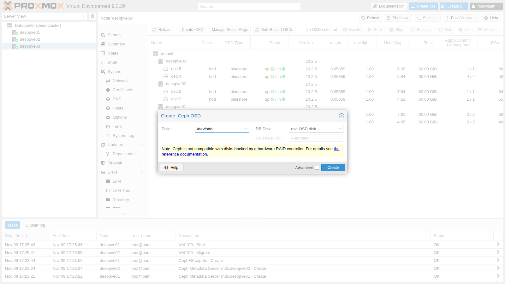

3. Watch the rebalancing:

   ```bash title="root@desopve01"
   ceph -s
   ```

   ``` { .text .no-copy title="Output" }
   ...
       osd: 7 osds: 7 up (since 104s), 7 in (since 109s)
   ...
     io:
       client:   3.4 MiB/s wr, 0 op/s rd, 0 op/s wr
       recovery: 8.2 MiB/s, 2 objects/s
   ```

   In about a minute Ceph moved part of the PGs of `desopve03` to the new `osd.6`:

   ```bash title="root@desopve01"
   ceph osd df tree
   ```

   ``` { .text .no-copy title="Output" }
   ID  CLASS  WEIGHT   REWEIGHT  SIZE     RAW USE  DATA     ...  %USE  VAR   PGS  STATUS  TYPE NAME
   -1         0.41016         -  420 GiB   22 GiB   22 GiB  ...  5.27  1.00    -          root default
   -3         0.11719         -  120 GiB  7.4 GiB  7.2 GiB  ...  6.13  1.16    -              host desopve01
   ...
   -7         0.17578         -  180 GiB  7.4 GiB  7.2 GiB  ...  4.13  0.78    -              host desopve03
    4    hdd  0.05859   1.00000   60 GiB  2.4 GiB  2.3 GiB  ...  4.00  0.76   33      up          osd.4
    5    hdd  0.05859   1.00000   60 GiB  2.3 GiB  2.3 GiB  ...  3.90  0.74   32      up          osd.5
    6    hdd  0.05859   1.00000   60 GiB  2.7 GiB  2.6 GiB  ...  4.48  0.85   32      up          osd.6
   ```

   **Each host still holds 7.4 GiB**, that is, a complete copy: with three hosts and 3-way replication, the CRUSH rule always puts one copy on each host. The new disk only spread the data better **within** `desopve03`. To really increase the usable space you need disks on all the hosts, or a fourth host (step 4).

### 2. OSD failure

1. Stop an OSD as if its disk had failed:

   ```bash title="root@desopve02"
   systemctl stop ceph-osd@2
   ```

   ```bash title="root@desopve01"
   ceph health detail | head -5
   ```

   ``` { .text .no-copy title="Output" }
   HEALTH_WARN 1 osds down; Degraded data redundancy: 866/5694 objects degraded (15.209%), 38 pgs degraded
   [WRN] OSD_DOWN: 1 osds down
       osd.2 (root=default,host=desopve02) is down
   [WRN] PG_DEGRADED: Degraded data redundancy: 866/5694 objects degraded (15.209%), 38 pgs degraded
       pg 2.4 is active+undersized+degraded, acting [1,4]
   ```

   `acting [1,4]`: PG 2.4 now lives on only two OSDs instead of three. It is still **active**: with `min_size 2`, writes continue.

   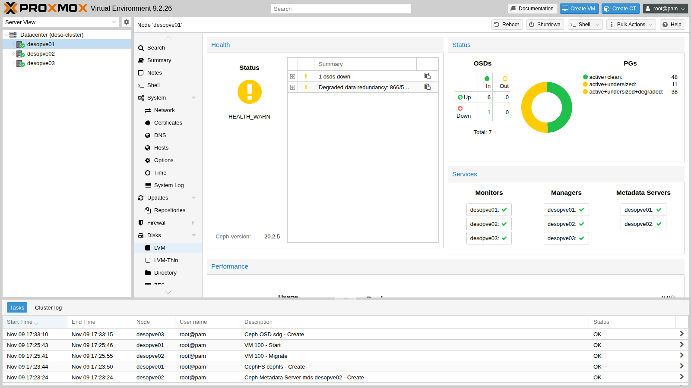

   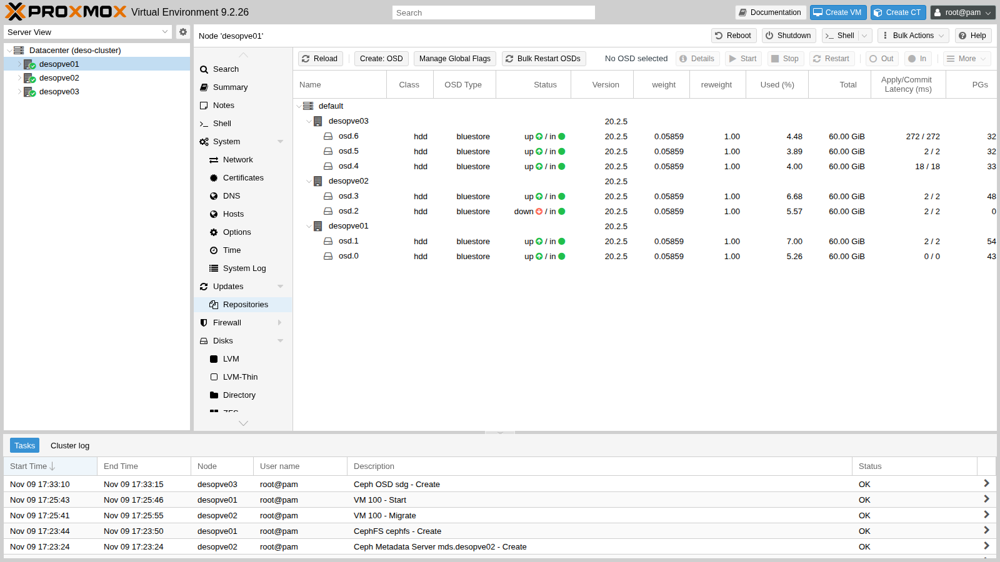

2. Ceph waits 600 seconds before rebuilding the copies:

   ```bash title="root@desopve01"
   ceph config get mon mon_osd_down_out_interval
   ```

   ``` { .text .no-copy title="Output" }
   600
   ```

   To avoid waiting, mark the OSD *out* yourself. In less than 40 seconds the missing copies are recreated on the other OSD of `desopve02`:

   ```bash title="root@desopve01"
   ceph osd out 2
   ```

   ``` { .text .no-copy title="Output" }
   marked out osd.2.
   ```

   ```bash title="root@desopve01"
   ceph -s
   ```

   ``` { .text .no-copy title="Output" }
   ...
       health: HEALTH_OK
       osd: 7 osds: 6 up (since 89s), 6 in (since 41s)
       pgs:     97 active+clean
   ```

3. The disk has been "replaced": restart the OSD and mark it *in* again. Ceph moves the data back to `osd.2`:

   ```bash title="root@desopve02"
   systemctl start ceph-osd@2
   ```

   ```bash title="root@desopve01"
   ceph osd in 2
   ```

   ``` { .text .no-copy title="Output" }
   marked in osd.2.
   ```

   ```bash title="root@desopve01"
   ceph -s
   ```

   ``` { .text .no-copy title="Output" }
   ...
       pgs:     12.371% pgs not active
                330/5694 objects misplaced (5.796%)
                59 active+clean
                26 active+clean+remapped
                8  peering
                4  remapped+peering
   ```

4. What the VM saw:

   ```bash title="labuser@debian01"
   awk '$1>="17:36:30" && $1<="17:39:30"' io.log | sort -k2 -n | tail -4
   ```

   ``` { .text .no-copy title="Output" }
   17:38:26 1715 ms
   17:38:18 1943 ms
   17:38:22 2051 ms
   17:37:56 4261 ms
   ```

   No errors, but pauses of up to 4 seconds during **peering**, when the PGs change OSDs. With SSD/NVMe disks and 25 Gbit/s networks, peering takes a fraction of a second.

### 3. Maintenance: the `noout` flag, orderly reboot and updates

Before rebooting a node, for example for a kernel update, set `noout`: Ceph will not rebuild the missing copies, because the node is about to come back.

1. **Ceph** → **OSD** → **Manage Global Flags** → check **noout** → **Apply**.

   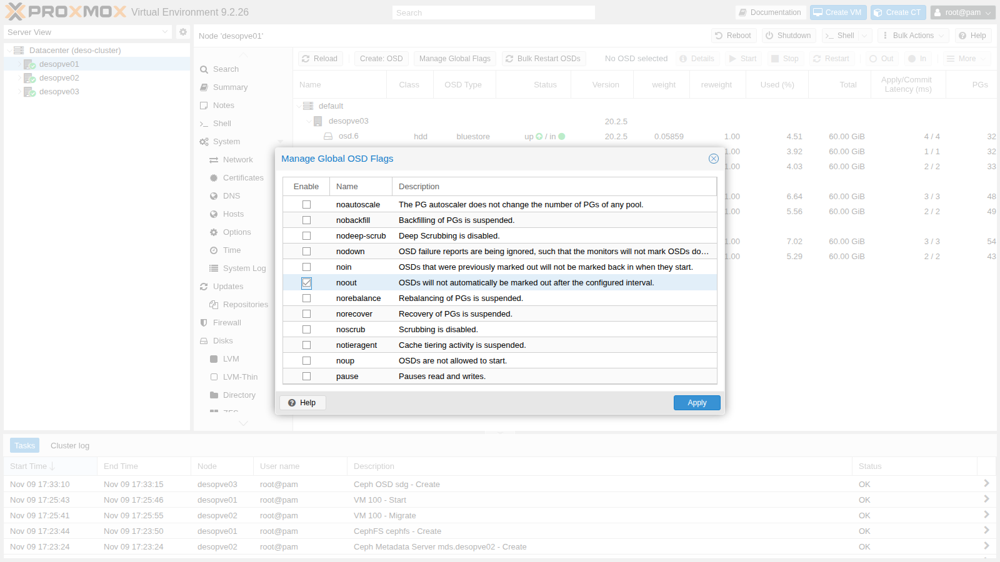

   ```bash title="root@desopve01"
   ceph osd dump | grep ^flags
   ```

   ``` { .text .no-copy title="Output" }
   flags noout,sortbitwise,recovery_deletes,purged_snapdirs,pglog_hardlimit
   ```

2. Check whether there are Ceph updates to install along with the reboot:

   ```bash title="root@desopve02"
   apt update && apt list --upgradable 2>/dev/null | grep -ciE "ceph|rados|rbd"
   ```

   ``` { .text .no-copy title="Output" }
   0
   ```

   Today there are none. When there are, the rule is to update **one node at a time**: `apt full-upgrade`, then restart the services in this order:

   1. monitors;
   2. managers;
   3. OSDs;
   4. MDSs.

   Move on to the next node only when the status is `HEALTH_OK`, apart from the `noout` flag. `ceph versions` shows which version each daemon is running.

3. Reboot `desopve02`. CT 101 lives on that node's `local-zfs`: shut it down first and start it again afterwards (in [Lab 48](48-migrations.md) you will see how to move it). During the reboot:

   ```bash title="root@desopve02"
   pct shutdown 101; reboot
   ```

   ```bash title="root@desopve01"
   ceph -s
   ```

   ``` { .text .no-copy title="Output" }
     cluster:
       health: HEALTH_WARN
               1 filesystem is degraded
               insufficient standby MDS daemons available
               1/3 mons down, quorum desopve01,desopve03
               noout flag(s) set
               2 osds down
               1 host (2 osds) down
               Reduced data availability: 7 pgs inactive, 11 pgs peering
               Degraded data redundancy: 961/5694 objects degraded (16.877%), 45 pgs degraded
   ```

   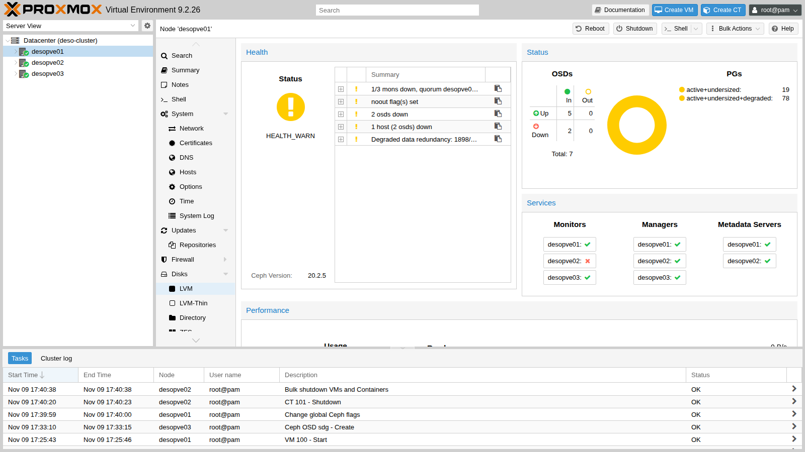

   - The monitor on `desopve02` is out of quorum: the other two are enough.
   - The active MDS was on `desopve02`: CephFS fails over to the standby MDS on `desopve01`.
   - The OSDs are *down* but stay *in*: no copy is moved.

4. The node comes back online (in this lab after about 70 seconds; a server with a long POST can take a few minutes). Ceph recovers only the writes made in the meantime; then remove the flag:

   ```bash title="root@desopve01"
   ceph -s | grep -E "health|noout|pgs:"
   ```

   ``` { .text .no-copy title="Output" }
       health: HEALTH_WARN
               noout flag(s) set
       pgs:     97 active+clean
   ```

   ```bash title="root@desopve01"
   ceph osd unset noout
   ```

   ``` { .text .no-copy title="Output" }
   noout is unset
   ```

   ```bash title="root@desopve01"
   ceph fs status | grep -E "active|STANDBY" -A1 | head -4
   ```

   ``` { .text .no-copy title="Output" }
    0    active  desopve01  Reqs:    0 /s    15     18     16     15
   --
   STANDBY MDS
    desopve02
   ```

   ```bash title="root@desopve02"
   pct start 101
   ```

   In the VM the longest pause was **13.5 seconds**: the time needed to notice that the node was no longer responding and to re-peer its PGs.

### 4. Growth: a new node in the cluster and in Ceph

`desopve04` is a standalone node with the ZFS pool `tank` (lab 10). It joins the Proxmox cluster first, then Ceph.

1. **Before joining it**, check that it has no VMs or containers and save its storage configuration: the join replaces it with the cluster's.

   ```bash title="root@desopve04"
   qm list; pct list
   cp /etc/pve/storage.cfg /root/storage.cfg.standalone
   ```

2. **Hardware.** Power off `desopve04` (it has no guests), install the single-port network card, connect the port to the switch (a trunk port carrying the Ceph VLANs) and insert the two 40 GB disks into the free bays; then power the node back on. The new port gets a "system" name (`ens<N>`, where the number depends on the PCI slot). Pin it as `nic2`, as on the other nodes (name pinning is the subject of lab 20):

   ```bash title="root@desopve04"
   pve-network-interface-pinning generate --interface ens<N> --target-name nic2
   ```

   ``` { .text .no-copy title="Output" }
   ...
   Successfully updated Proxmox VE configuration files.

   Please reboot to apply the changes to your configuration
   ```

   ```bash title="root@desopve04"
   reboot
   ```

3. On `desopve01`: **Datacenter** → **Cluster** → **Join Information** → **Copy Information**.

   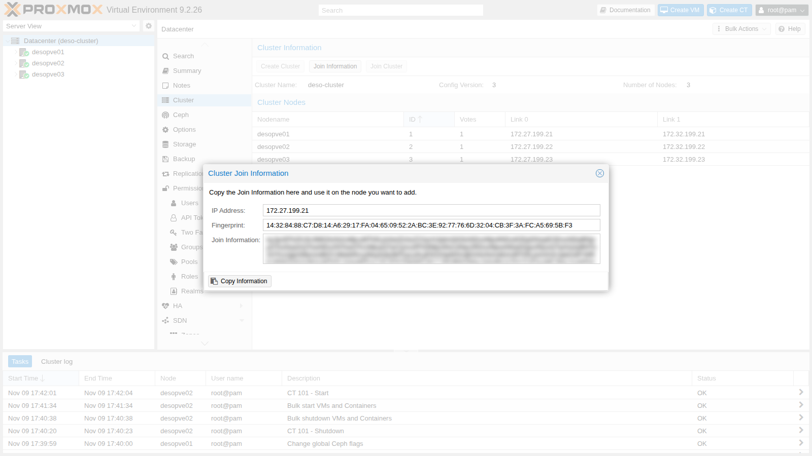

4. On `desopve04`: **Datacenter** → **Cluster** → **Join Cluster**.
   - Paste the information and enter the `root` password of `desopve01`.
   - Choose the two Corosync links: **Link 0** `172.27.199.24`, **Link 1** `172.32.199.24`.

   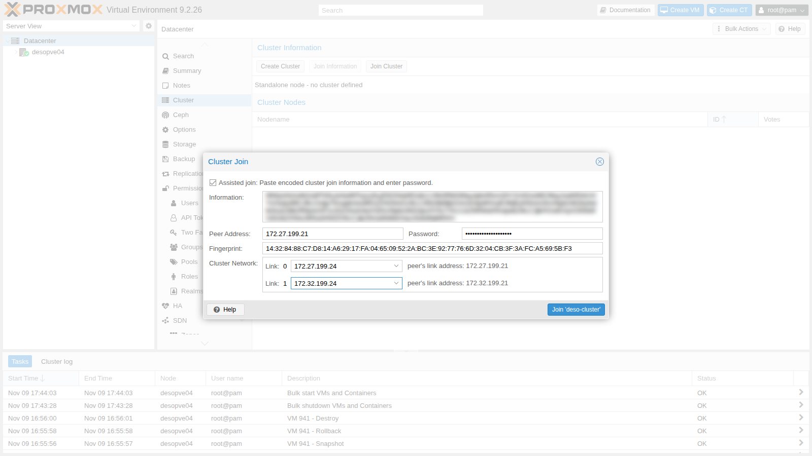

   ```bash title="root@desopve01"
   pvecm nodes
   ```

   ``` { .text .no-copy title="Output" }
       Nodeid      Votes Name
            1          1 desopve01 (local)
            2          1 desopve02
            3          1 desopve03
            4          1 desopve04
   ```

   With four votes the quorum is 3: the cluster still tolerates only one node down, just as with three. With an even number of nodes you usually add a *QDevice* ([Lab 06](06-cluster-corosync.md)).

5. **Fix the storages.** After the join, `desopve04` uses the cluster's `storage.cfg`: it sees storages it does not have and has lost its own.

   ```bash title="root@desopve04"
   pvesm status
   ```

   ``` { .text .no-copy title="Output" }
   could not activate storage 'local-zfs', zfs error: cannot import 'rpool': no such pool available
   command '/usr/bin/iscsiadm --mode node --targetname iqn.2005-10.org.freenas.ctl:pve --login' failed: exit code 21
   ...
   Name             Type     Status     Total (KiB)      Used (KiB) Available (KiB)        %
   cephfs         cephfs   inactive               0               0               0    0.00%
   local             dir     active        22203544         5789716        15260600   26.08%
   local-zfs     zfspool   inactive               0               0               0    0.00%
   nas-iscsi       iscsi   inactive               0               0               0    0.00%
   nas-lvm           lvm   inactive               0               0               0    0.00%
   nas-nfs           nfs     active        56489984               0        56489984    0.00%
   nas-smb          cifs     active        57466112          977024        56489088    1.70%
   rbd-vm            rbd   inactive               0               0               0    0.00%
   ```

   Restrict the local storages and the iSCSI ones to the right nodes (the initiator of `desopve04` is not authorized on the NAS), then add `local-lvm` and `tank` back for `desopve04` only. The data in `tank` is intact: only the configuration has changed.

   ```bash title="root@desopve01"
   pvesm set local-zfs --nodes desopve01,desopve02,desopve03
   pvesm set nas-iscsi --nodes desopve01,desopve02,desopve03
   pvesm set nas-lvm --nodes desopve01,desopve02,desopve03
   pvesm add lvmthin local-lvm --vgname pve --thinpool data --content images,rootdir --nodes desopve04
   pvesm add zfspool tank --pool tank --mountpoint /tank --content images,rootdir --sparse 1 --nodes desopve04
   ```

6. **Ceph on the new node:** packages, VLANs 50/51 on `nic2` (as in lab 17) and the two OSDs.

   ```bash title="root@desopve04"
   pveceph install --repository no-subscription --version tentacle
   pvesh create /nodes/desopve04/network --iface nic2.50 --type vlan --cidr 10.50.10.24/24 --autostart 1
   pvesh create /nodes/desopve04/network --iface nic2.51 --type vlan --cidr 10.51.10.24/24 --autostart 1
   pvesh set /nodes/desopve04/network
   ceph -s
   ```

   ``` { .text .no-copy title="Output" }
   Error initializing cluster client: ObjectNotFound('RADOS object not found (error calling conf_read_file)')
   ```

   The `ceph` client looks for `/etc/ceph/ceph.conf`, but on the new node the link to the shared configuration does not exist yet: when you only install the packages from the command line, you have to create it by hand.

   ```bash title="root@desopve04"
   ln -s /etc/pve/ceph.conf /etc/ceph/ceph.conf
   pveceph osd create /dev/sdf
   ```

   ``` { .text .no-copy title="Output" }
   --> ceph-volume lvm create successful for: /dev/sdf
   ```

   ```bash title="root@desopve04"
   pveceph osd create /dev/sdg
   ```

   ``` { .text .no-copy title="Output" }
   --> ceph-volume lvm create successful for: /dev/sdg
   ```

7. **A monitor here too?** No. The monitors decide by majority:
   - with 3 monitors you need 2, so you can lose 1;
   - with 4 you need 3, so you can still lose only 1, with more traffic;
   - you move to 5 monitors only in larger clusters.

   The new node contributes only disks.

8. Rebalancing onto the fourth host takes about a minute and a half:

   ```bash title="root@desopve04"
   ceph -s
   ```

   ``` { .text .no-copy title="Output" }
       osd: 9 osds: 8 up (since 2s), 9 in (since 3s); 32 remapped pgs
       pgs:     ...
                10 active+remapped+backfill_wait
                9  remapped+peering
   ...
   ```

   ```bash title="root@desopve01"
   ceph -s
   ```

   ``` { .text .no-copy title="Output" }
       osd: 9 osds: 9 up (since 57s), 9 in (since 64s); 7 remapped pgs
       recovery: 87 MiB/s, 22 objects/s
   ...
   ```

   ```bash title="root@desopve01"
   ceph osd df tree | grep host
   ```

   ``` { .text .no-copy title="Output" }
   -3         0.11719         -  120 GiB  5.7 GiB  5.4 GiB  ...  4.75  1.06    -              host desopve01
   -5         0.11719         -  120 GiB  5.3 GiB  5.2 GiB  ...  4.45  0.99    -              host desopve02
   -7         0.17578         -  180 GiB  6.8 GiB  6.5 GiB  ...  3.77  0.84    -              host desopve03
   -9         0.07819         -   80 GiB  4.5 GiB  4.4 GiB  ...  5.68  1.27    -              host desopve04
   ```

   Now the three copies are spread across four hosts, and no host has to hold everything anymore. The pool's estimated usable space goes up:

   ```bash title="root@desopve01"
   ceph df | grep -E "POOL|rbd-vm"
   ```

   ``` { .text .no-copy title="Output" }
   POOL             ID  PGS   STORED  OBJECTS     USED  %USED  MAX AVAIL
   rbd-vm            2   32  6.4 GiB    1.69k   19 GiB   4.15    148 GiB
   ```

   In lab 17, with six OSDs on three nodes, it was 106 GiB. MAX AVAIL is an estimate based on the OSD that would fill up first: read it as a trend, not as a guarantee.

### 5. Pool configuration

#### Replication 3 → 2 and back

1. **Ceph** → **Pools** → double-click `rbd-vm`: **Size** 2, **Min. Size** 2.

   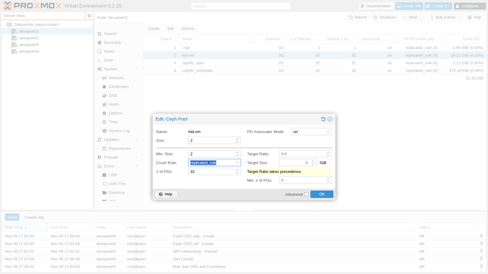

   Ceph deletes the third copy right away: the used space goes down and the available space goes up.

   ```bash title="root@desopve01"
   ceph df | grep -E "POOL|rbd-vm"
   ```

   ``` { .text .no-copy title="Output" }
   POOL             ID  PGS   STORED  OBJECTS     USED  %USED  MAX AVAIL
   rbd-vm            2   32  6.4 GiB    1.69k   13 GiB   2.75    226 GiB
   ```

   The price is high. With `size 2` and `min_size 2`, a single failed OSD blocks writes to its PGs. With `min_size 1` writes continue on a single copy, and if that copy is lost too, the data is gone. That is why in Proxmox VE you stay at **3/2**.

2. Go back to 3-way replication:

   ```bash title="root@desopve01"
   pveceph pool set rbd-vm --size 3
   ```

   ``` { .text .no-copy title="Output" }
   pool rbd-vm: applying size = 3
   ```

#### Device classes and CRUSH rules

Every OSD has a *class* (`hdd`, `ssd`, `nvme`), detected automatically. A CRUSH rule can be restricted to a single class: this is how, in a cluster with mixed disks, you create a "fast" pool on the SSDs only.

1. In the lab all the disks are the same: simulate one SSD per host by changing the class of one OSD per node, then create a rule that uses only the `ssd` class, still with one copy per host:

   ```bash title="root@desopve01"
   for o in 1 3 5 7; do ceph osd crush rm-device-class osd.$o; ceph osd crush set-device-class ssd osd.$o; done
   ceph osd crush rule create-replicated fast default host ssd
   ceph osd crush rule ls
   ```

   ``` { .text .no-copy title="Output" }
   replicated_rule
   fast
   ```

   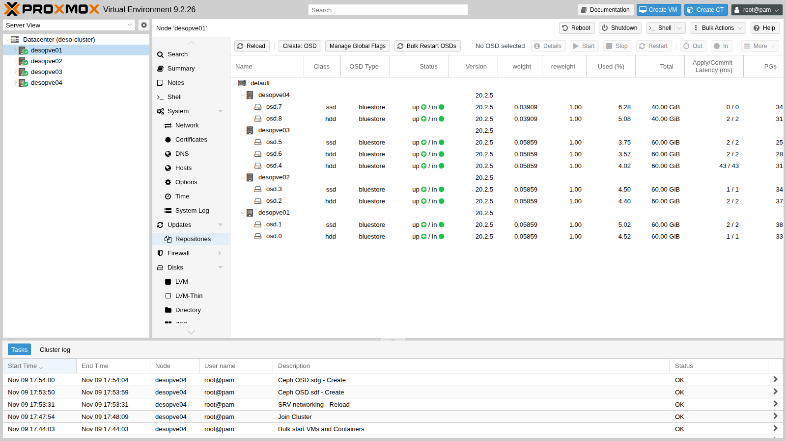

2. Create a pool that uses the `fast` rule: you select it in **Create** → **Crush Rule**, or from the command line.

   ```bash title="root@desopve01"
   pveceph pool create rbd-fast --crush_rule fast --pg_autoscale_mode on
   ceph pg ls-by-pool rbd-fast -f json | python3 -c 'import sys,json; d=json.load(sys.stdin); d=d.get("pg_stats", d) if isinstance(d, dict) else d; s=set(); [s.update(p["acting"]) for p in d]; print("OSD usati da rbd-fast:", sorted(s))'
   ```

   ``` { .text .no-copy title="Output" }
   OSD usati da rbd-fast: [1, 3, 5, 7]
   ```

   ```bash title="root@desopve01"
   ceph osd crush rule dump fast | grep -E 'item_name|type"'
   ```

   ``` { .text .no-copy title="Output" }
       "type": 1,
               "item_name": "default~ssd"
               "type": "host"
   ```

   `default~ssd` is the "shadow" tree that CRUSH builds for each class. The `rbd-vm` pool still uses `replicated_rule`, which has no class: changing the class of the OSDs did not move its data.

#### Erasure coding

1. With four hosts you can create an EC pool with `k=2,m=2`. Proxmox creates two pools:
   - `ec22-data`, erasure coded, for the data;
   - `ec22-metadata`, replicated, for the RBD metadata, which cannot be stored in an EC pool.

   It also creates the `ec22` storage:

   ```bash title="root@desopve01"
   pveceph pool create ec22 --erasure-coding k=2,m=2 --add_storages 1
   ceph osd erasure-code-profile get pve_ec_ec22
   ```

   ``` { .text .no-copy title="Output" }
   crush-device-class=
   crush-failure-domain=host
   ...
   k=2
   m=2
   plugin=isa
   technique=reed_sol_van
   ```

   ```bash title="root@desopve01"
   grep -A5 "rbd: ec22" /etc/pve/storage.cfg
   ```

   ``` { .text .no-copy title="Output" }
   rbd: ec22
   	content images,rootdir
   	data-pool ec22-data
   	krbd 0
   	pool ec22-metadata
   ```

2. Write 1 GiB to the EC pool and 1 GiB to the replicated pool `rbd-fast`, and compare the space used:

   ```bash title="root@desopve01"
   rbd create ec22-metadata/bench --size 2G --data-pool ec22-data
   rbd create rbd-fast/bench --size 2G
   rbd bench --io-type write --io-size 4M --io-total 1G --io-pattern seq ec22-metadata/bench
   ```

   ``` { .text .no-copy title="Output" }
   elapsed: 3   ops: 256   ops/sec: 76.5535   bytes/sec: 306 MiB/s
   ```

   ```bash title="root@desopve01"
   rbd bench --io-type write --io-size 4M --io-total 1G --io-pattern seq rbd-fast/bench
   ```

   ``` { .text .no-copy title="Output" }
   elapsed: 4   ops: 256   ops/sec: 63.8073   bytes/sec: 255 MiB/s
   ```

   ```bash title="root@desopve01"
   ceph df | sed -n "/POOLS/,\$p"
   ```

   ``` { .text .no-copy title="Output" }
   --- POOLS ---
   POOL             ID  PGS    STORED  OBJECTS     USED  %USED  MAX AVAIL
   .mgr              1    1   1.3 MiB        2  4.0 MiB      0    144 GiB
   rbd-vm            2   32   6.4 GiB    1.69k   19 GiB   4.25    144 GiB
   cephfs_data       3   32   756 MiB      189  2.2 GiB   0.51    144 GiB
   cephfs_metadata   4   32    98 KiB       22  379 KiB      0    144 GiB
   rbd-fast          5  127  1007 MiB      259  2.9 GiB   1.53     63 GiB
   ec22-data         6  128   1.0 GiB      257  2.0 GiB   0.46    216 GiB
   ec22-metadata     7   32     969 B        4   26 KiB      0    144 GiB
   ```

   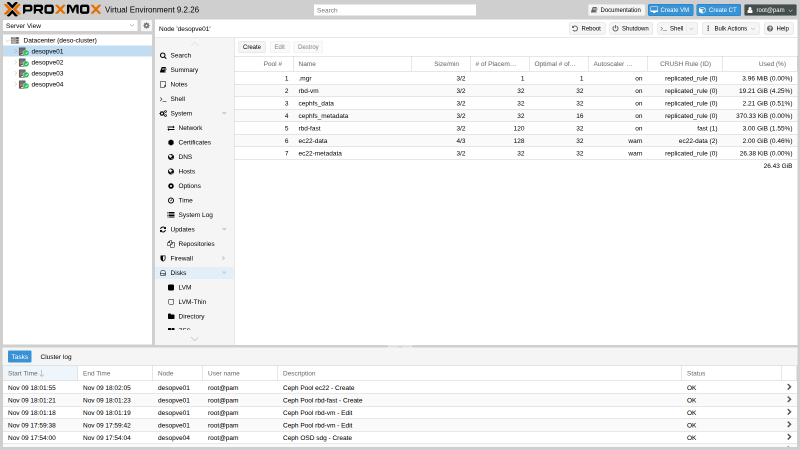

   - **EC 2+2:** 1 GiB written takes up 2: the efficiency is 50%, and it tolerates two failures.
   - **3-way replication:** 1 GiB takes up 3 (2.9 in the output): the efficiency is 33%.
   - **`rbd-fast`** has only 63 GiB available: it uses only the four OSDs of class `ssd`.

#### The PG autoscaler

```bash title="root@desopve01"
ceph osd pool autoscale-status
```

``` { .text .no-copy title="Output" }
POOL               SIZE  TARGET SIZE  RATE  RAW CAPACITY   RATIO  FINAL RATIO  TARGET RATIO  EFFECTIVE RATIO  BIAS  PG_NUM  NEW PG_NUM  AUTOSCALE  BULK
...
ec22-data         1024M                2.0        499.9G  0.0040       0.1829                                  1.0     128          32  warn       False
rbd-fast          1026M                3.0        219.9G  0.0137       0.4800                                  1.0      32              on         False
```

- **RATE** is the space multiplier: 3.0 for 3-way replication, 2.0 for EC 2+2.
- Proxmox creates EC pools with the autoscaler in **`warn`** mode: it suggests 32 PGs (**NEW PG_NUM**) but does not change them, and it reports this with the `POOL_TOO_MANY_PGS` warning. With **`on`** the autoscaler acts on its own, as it does for `rbd-vm`.
- If you already know that a pool will grow, set its expected size (`target_size_ratio` or `target_size`, in the pool's advanced options): the autoscaler sets the right number of PGs from the start and you avoid rebalancing later on.

When you are done, remove the test pools and rule and set the OSDs back to class `hdd`:

```bash title="root@desopve01"
rbd rm rbd-fast/bench; rbd rm ec22-metadata/bench
pveceph pool destroy rbd-fast
pveceph pool destroy ec22-data --remove_storages 1
pveceph pool destroy ec22-metadata
ceph osd crush rule rm fast
for o in 1 3 5 7; do ceph osd crush rm-device-class osd.$o; ceph osd crush set-device-class hdd osd.$o; done
```

### 6. Failure: a node suddenly powers off

1. Simulate a power outage on `desopve03` (monitor, standby manager, three OSDs) while VM 100 is writing on `desopve01`:

   ```bash title="root@desopve03"
   echo 1 > /proc/sys/kernel/sysrq; echo o > /proc/sysrq-trigger
   ```

2. For the first few seconds Ceph does not know anything yet: the OSDs are declared *down* only after about 20 seconds without *heartbeats*.

   ```bash title="root@desopve01"
   ceph -s          # 13 seconds later
   ```

   ``` { .text .no-copy title="Output" }
       health: HEALTH_WARN
               1/3 mons down, quorum desopve01,desopve02
       osd: 9 osds: 9 up (since 10m), 9 in (since 10m)
   ```

   ```bash title="root@desopve01"
   ceph -s          # 38 seconds later
   ```

   ``` { .text .no-copy title="Output" }
       health: HEALTH_WARN
               1/3 mons down, quorum desopve01,desopve02
               3 osds down
               1 host (3 osds) down
               Degraded data redundancy: 1710/5694 objects degraded (30.032%), 70 pgs degraded
       osd: 9 osds: 6 up (since 12s), 9 in (since 10m)
   ```

   ```bash title="root@desopve01"
   pvecm status | grep -E "Quorate|Total votes"
   ```

   ``` { .text .no-copy title="Output" }
   Quorate:          Yes
   Total votes:      3
   ```

   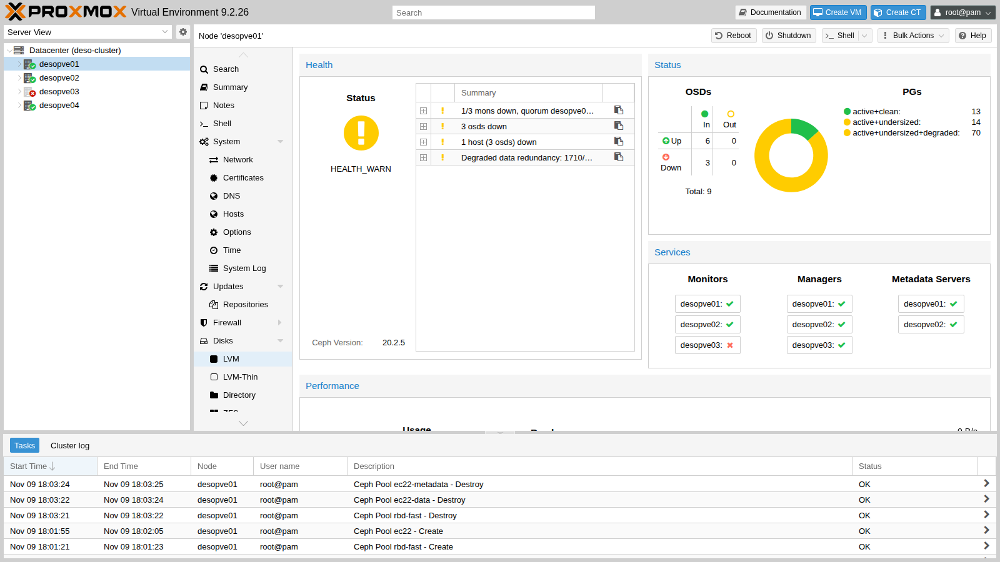

   The VM saw **a 26.8-second pause**: writes to the PGs whose primary was on `desopve03` stayed pending until the OSDs were declared *down*. Then I/O resumed on the remaining copies.

   ```bash title="labuser@debian01"
   sort -k2 -n io.log | tail -1
   ```

   ``` { .text .no-copy title="Output" }
   18:04:48 26833 ms
   ```

3. After 600 seconds the monitors mark the OSDs *out* and Ceph rebuilds the copies on the other three hosts: with four hosts there is room for them.

   ```bash title="root@desopve01"
   grep "Marking osd" /var/log/ceph/ceph.log
   ```

   ``` { .text .no-copy title="Output" }
   2026-11-09T18:14:52.615748+0100 mon.desopve01 (mon.0) 4032 : cluster [INF] Marking osd.4 out (has been down for 604 seconds)
   2026-11-09T18:14:52.615827+0100 mon.desopve01 (mon.0) 4033 : cluster [INF] Marking osd.5 out (has been down for 604 seconds)
   2026-11-09T18:14:52.615849+0100 mon.desopve01 (mon.0) 4034 : cluster [INF] Marking osd.6 out (has been down for 604 seconds)
   ```

   ```bash title="root@desopve01"
   ceph -s          # 11 seconds later
   ```

   ``` { .text .no-copy title="Output" }
   ...
       recovery: 181 MiB/s, 0 keys/s, 48 objects/s
   ...
   ```

   ```bash title="root@desopve01"
   ceph -s          # 52 seconds later
   ```

   ``` { .text .no-copy title="Output" }
       osd: 9 osds: 6 up (since 10m), 6 in (since 52s); 2 remapped pgs
       pgs:     1.031% pgs not active
                82/5694 objects degraded (1.440%)
                94 active+clean
   ```

4. Power the node back on. The OSDs come back *up* and the monitors mark them *in* again on their own, because they had been marked *out* automatically:

   ```bash title="root@desopve01"
   ceph -s
   ```

   ``` { .text .no-copy title="Output" }
       health: HEALTH_WARN
               clock skew detected on mon.desopve03
       osd: 9 osds: 9 up (since 13s), 9 in (since 13s)
   ...
   ```

   ```bash title="root@desopve01"
   ceph -s          # 20 seconds later
   ```

   ``` { .text .no-copy title="Output" }
       health: HEALTH_OK
   ```

   - The `clock skew` warning lasts a few seconds: after power-on, the node's clock syncs with NTP. Ceph is very sensitive to time, which is why NTP is among the prerequisites (lab 04).
   - The log also shows `OSD bench result ... is not within the threshold` warnings. At startup every OSD benchmarks its own disk. If the result falls outside the thresholds expected for the disk's class (for example a disk classified as `hdd` that performs like an SSD because it sits behind a controller cache), Ceph discards it and uses the default value. In production you measure the capacity with fio and set it with `osd_mclock_max_capacity_iops_hdd`/`_ssd`.
   - With slow disks under load, the `BLUESTORE_SLOW_OP_ALERT` warning can also appear; by default it stays visible for 24 hours after the last occurrence. If you want it to clear sooner, reduce the time to 10 minutes:

     ```bash title="root@desopve01"
     ceph config set osd bluestore_slow_ops_warn_lifetime 600
     ```

### 7. Decommissioning a node without reinstalling it

Now `desopve04` leaves Ceph and the cluster and becomes a standalone node again, with its own storages. It will be needed in this state in [Lab 48](48-migrations.md), for the migration between clusters.

1. **Drain the OSDs.** Mark them *out* and wait until Ceph has moved everything:

   ```bash title="root@desopve01"
   ceph osd out 7 8
   ```

   ``` { .text .no-copy title="Output" }
   marked out osd.7. marked out osd.8.
   ```

   ```bash title="root@desopve01"
   ceph osd safe-to-destroy 7 8
   ```

   ``` { .text .no-copy title="Output" }
   OSD(s) 7,8 are safe to destroy without reducing data durability.
   ```

   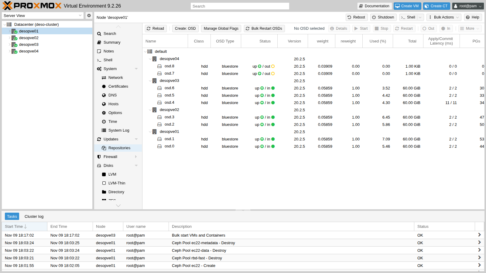

   Never use `destroy` on an OSD that still holds data: `safe-to-destroy` checks this for you.

2. **Destroy the OSDs** and remove the host from the CRUSH map:

   ```bash title="root@desopve04"
   systemctl stop ceph-osd@7 ceph-osd@8
   pveceph osd destroy 7 --cleanup 1
   ```

   ``` { .text .no-copy title="Output" }
    stdout: Labels on physical volume "/dev/sdf" successfully wiped.
   ```

   ```bash title="root@desopve04"
   pveceph osd destroy 8 --cleanup 1
   ```

   ``` { .text .no-copy title="Output" }
    stdout: Labels on physical volume "/dev/sdg" successfully wiped.
   ```

   ```bash title="root@desopve01"
   ceph osd crush remove desopve04
   ```

   ``` { .text .no-copy title="Output" }
   removed item id -9 name 'desopve04' from crush map
   ```

   The node had no monitors, managers or MDSs. If it had any, you would remove them first (**Ceph** → **Monitor** → **Destroy**), always leaving an odd number of monitors.

3. **Remove the Ceph VLANs** from `desopve04`:

   ```bash title="root@desopve04"
   pvesh delete /nodes/desopve04/network/nic2.50
   pvesh delete /nodes/desopve04/network/nic2.51
   pvesh set /nodes/desopve04/network
   ```

4. **Separate the node from the cluster**, following the official *Separate a Node Without Reinstalling* procedure. On `desopve04`:

   ```bash title="root@desopve04"
   systemctl stop pve-cluster corosync
   pmxcfs -l
   ```

   ``` { .text .no-copy title="Output" }
   [main] notice: forcing local mode (although corosync.conf exists)
   ```

   ```bash title="root@desopve04"
   rm /etc/pve/corosync.conf
   rm -r /etc/corosync/*
   killall pmxcfs
   systemctl start pve-cluster
   pvecm status
   ```

   ``` { .text .no-copy title="Output" }
   Error: Corosync config '/etc/pve/corosync.conf' does not exist - is this node part of a cluster?
   ```

   - `pmxcfs -l` starts the Proxmox cluster file system in **local mode**, without quorum: this way you can modify `/etc/pve` even outside the cluster.
   - Without `corosync.conf` the node starts up again as a standalone node.

5. On the cluster, remove the node and its leftovers:

   ```bash title="root@desopve01"
   pvecm delnode desopve04
   ```

   ``` { .text .no-copy title="Output" }
   Killing node 4
   Could not kill node (error = CS_ERR_NOT_EXIST)
   ```

   ```bash title="root@desopve01"
   pvecm status | grep -E "Quorate|Expected|Total"
   ```

   ``` { .text .no-copy title="Output" }
   Quorate:          Yes
   Expected votes:   3
   Total votes:      3
   ```

   ```bash title="root@desopve01"
   rm -r /etc/pve/nodes/desopve04
   sed -i "/root@desopve04$/d" /etc/pve/priv/authorized_keys
   ssh-keygen -f /etc/pve/priv/known_hosts -R desopve04
   pvesm remove local-lvm; pvesm remove tank
   ```

   - `CS_ERR_NOT_EXIST` is normal: the node had already left Corosync, so there was nothing to "kill". It was removed from the configuration anyway.
   - Before deleting `/etc/pve/nodes/desopve04`, check that it contains no VM or container configurations.
   - `pvesm remove` only removes the definitions from the cluster: the data in `tank` stays on `desopve04`.

   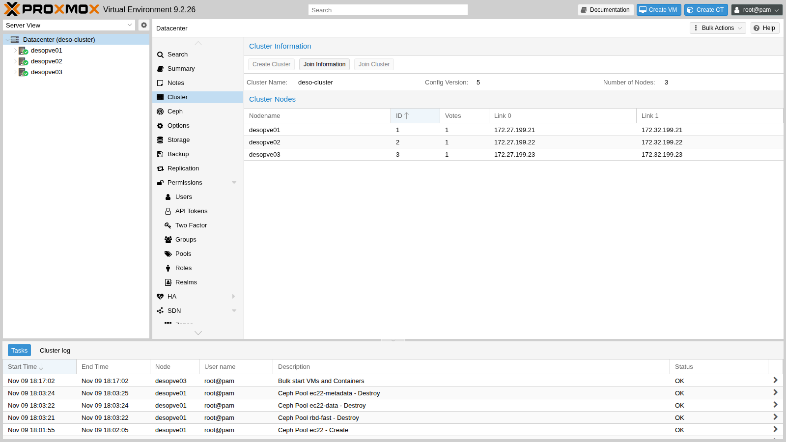

6. On `desopve04`, restore the storage configuration saved in step 4 and delete the copies of the cluster configuration that are no longer needed: other nodes and Ceph.

   ```bash title="root@desopve04"
   cp /root/storage.cfg.standalone /etc/pve/storage.cfg
   rm -rf /etc/pve/nodes/desopve01 /etc/pve/nodes/desopve02 /etc/pve/nodes/desopve03
   pveceph purge
   ```

   ``` { .text .no-copy title="Output" }
   Foreign MON address in ceph.conf. Keeping config & keyrings
   ```

   ```bash title="root@desopve04"
   rm -f /etc/pve/ceph.conf /etc/ceph/ceph.conf /etc/pve/priv/ceph.client.admin.keyring /etc/pve/priv/ceph.mon.keyring
   rm -rf /etc/pve/priv/ceph
   systemctl disable --now ceph-crash.service
   pvesm status
   ```

   ``` { .text .no-copy title="Output" }
   Name             Type     Status     Total (KiB)      Used (KiB) Available (KiB)        %
   local             dir     active        22203544         6107924        14942392   27.51%
   local-lvm     lvmthin     active        14217216               0        14217216    0.00%
   tank          zfspool     active        40265280             751        40264528    0.00%
   ```

   ```bash title="root@desopve04"
   zpool status -x tank
   ```

   ``` { .text .no-copy title="Output" }
   pool 'tank' is healthy
   ```

   - `pveceph purge` refuses to delete a configuration that points to monitors on other nodes: it is a safeguard. Here the node is already separated, so you delete those files by hand: they are local copies and do not affect the cluster.
   - The Ceph packages stay installed: they do no harm, and they would be needed if the node rejoined.

   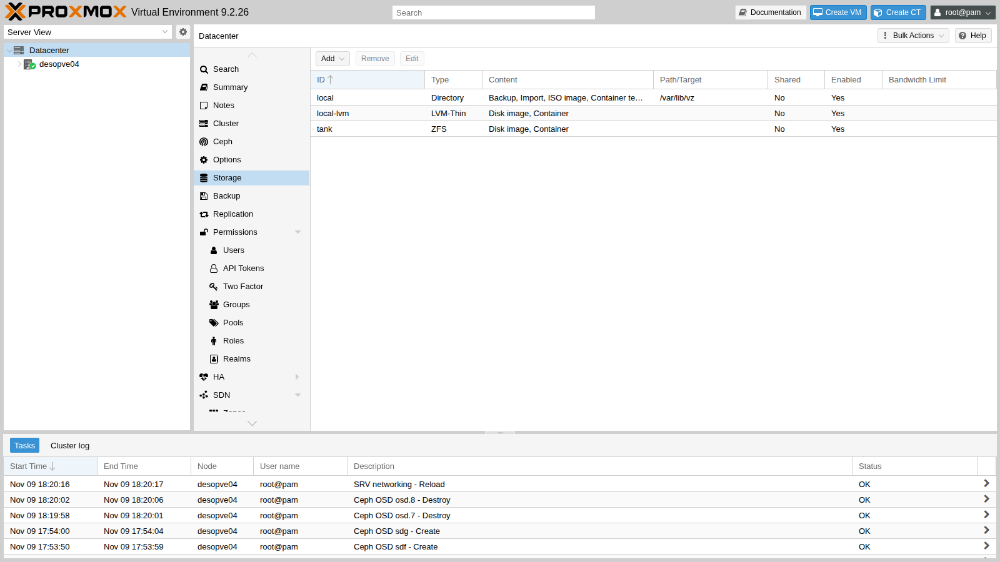

## Verification and tests

```bash title="root@desopve01"
ceph -s | sed -n "/health:/p;/mon:/p;/mgr:/p;/mds:/p;/osd:/p;/pgs:/p"
```

``` { .text .no-copy title="Output" }
    health: HEALTH_OK
    mon: 3 daemons, quorum desopve01,desopve03,desopve02 (age 4m) [leader: desopve01]
    mgr: desopve01(active, since 74m), standbys: desopve02, desopve03
    mds: 1/1 daemons up, 1 standby
    osd: 7 osds: 7 up (since 100s), 7 in (since 3m)
    pgs:     97 active+clean
```

```bash title="root@desopve01"
pvecm nodes
```

``` { .text .no-copy title="Output" }
    Nodeid      Votes Name
         1          1 desopve01 (local)
         2          1 desopve02
         3          1 desopve03
```

| Event | Longest I/O pause in the VM | Data lost |
|---|---|---|
| OSD stopped, then *out* and *in* | 4.3 s (peering) | none |
| Node reboot with `noout` | 13.5 s | none |
| Node suddenly powered off | 26.8 s (waiting for heartbeats) | none |

### Cleanup

In VM 100, stop the measurement script and delete its files:

```bash title="labuser@debian01"
pkill -f io.bin; rm -f $HOME/io.bin $HOME/io.log
```

## Final lab state

- **Proxmox cluster `deso-cluster`:** back to `desopve01-03`, 3 votes out of 3.
- **Ceph Tentacle 20.2.5, `HEALTH_OK`:**
  - 3 MONs, 3 MGRs (active on `desopve01`), 2 MDSs (active on `desopve01`, standby on `desopve02`);
  - **7 OSDs** of class `hdd`: `osd.0`-`osd.5` as in lab 17, plus `osd.6` on the new disk `/dev/sdg` of `desopve03`;
  - pools `rbd-vm` (3/2), `cephfs_data`, `cephfs_metadata` and `.mgr`; no test pools or rules.
- **Cluster storage:** `local`, `local-zfs`, `nas-iscsi` and `nas-lvm` (these three restricted to `desopve01-03`), `nas-nfs`, `nas-smb`, `rbd-vm`, `cephfs`.
- **VM 100** running on `desopve01`, disk on `rbd-vm`, home directory of `labuser` cleaned up. **CT 101** running on `desopve02`.
- **`desopve04`:** standalone again, with neither Ceph nor Corosync.
  - Storages `local`, `local-lvm` (empty) and `tank` (RAIDZ1 with a spare, empty).
  - It has the third network card `nic2` (with no addresses) and two free 40 GB disks (`sdf`, `sdg`).
  - It keeps the copy of its storage configuration in `/root/storage.cfg.standalone`.

## What you learned

- A *down* OSD triggers no data movement for 10 minutes; an *out* OSD does. `noout` avoids unnecessary rebuilds during maintenance.
- An extra disk on a single node does not increase the usable space if there are only as many hosts as copies: you need to grow evenly, or add a host.
- A new node enters the cluster through the join and enters Ceph through its OSDs. Local storages must be restricted to the nodes that actually have them.
- 3/2 replication is the safe compromise. 2/1 puts data at risk. Erasure coding saves space but requires more hosts.
- *Device classes* and CRUSH rules separate fast and slow disks into different pools.
- During failures Ceph loses no data, but the VM can stall for tens of seconds until the failure is detected. The detection time depends on `osd_heartbeat_grace` (20 s); faster hardware shortens only the peering.
- You can decommission a node without reinstalling it: drain it, destroy its OSDs, separate it with `pmxcfs -l` and clean up the configuration on both sides.

## References

- [Proxmox VE – Ceph: maintenance, replacing OSDs, pools](https://pve.proxmox.com/pve-docs/pve-admin-guide.html#pve_ceph_maintenance)
- [Proxmox VE – Erasure coded pools](https://pve.proxmox.com/pve-docs/pve-admin-guide.html#pve_ceph_ec_pools)
- [Proxmox VE – Cluster: adding and removing nodes, *Separate a Node Without Reinstalling*](https://pve.proxmox.com/pve-docs/pve-admin-guide.html#_remove_a_cluster_node)
- [Ceph – Monitoring OSDs and PGs](https://docs.ceph.com/en/latest/rados/operations/monitoring-osd-pg/)
- [Ceph – Erasure code](https://docs.ceph.com/en/latest/rados/operations/erasure-code/)
- [Ceph – CRUSH device classes](https://docs.ceph.com/en/latest/rados/operations/crush-map/#device-classes)
