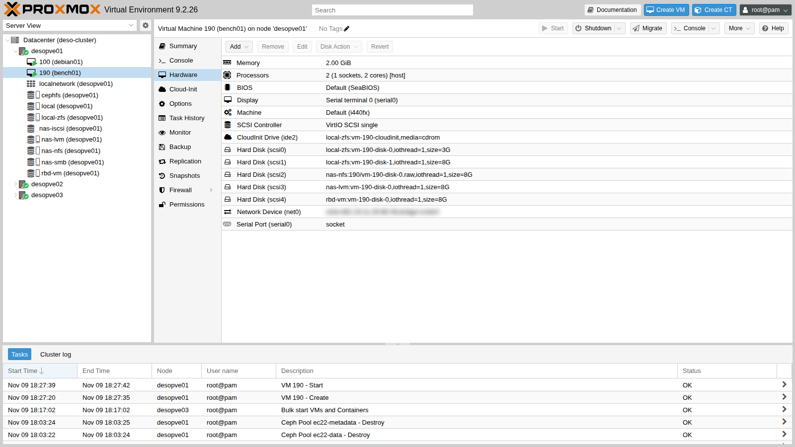
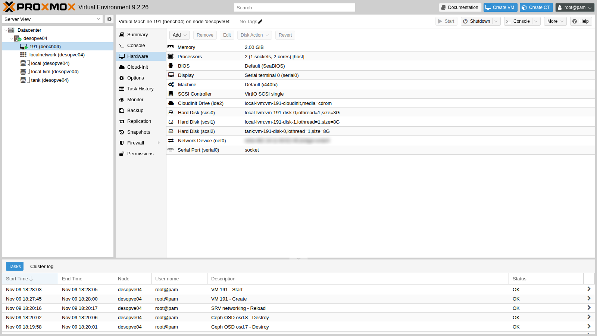

# Lab 19 – Comparative storage benchmark with fio

**Level:** advanced · **Duration:** 1 hour 30 minutes (about 45 minutes of which are spent waiting for the tests)

## Dependencies

- **Previous labs:** the storages to compare must exist:
  - `local-zfs` on the cluster ([Lab 03](03-install-proxmox-ve.md));
  - `local-lvm` and `tank` on `desopve04` ([Lab 09](09-lvm-and-lvm-thin.md), [Lab 10](10-zfs.md));
  - `nas-nfs` ([Lab 13](13-nfs.md));
  - `nas-lvm` on iSCSI ([Lab 15](15-iscsi-lvm-multipath.md));
  - `rbd-vm` on Ceph ([Lab 17](17-ceph-installation.md)).
- **Free space:** 8 GiB on each of these storages; 3 GiB on `local-zfs` and `local-lvm` for the system disks of the two test VMs.
- **Internet:** the lab proxy must allow `cloud.debian.org` (with its mirror `*.acc.umu.se`) and `deb.debian.org`.
- **Credentials:** `root` / `<lab-password>` on the nodes → [Appendix B](b-credentials-and-addresses.md). To log in to the test VMs you use an SSH key created for the occasion (step 1).

## Objectives

- Measure the same workload, with the same tool and the same VM, on six different storages.
- Understand what IOPS, bandwidth and latency measure, and why the *queue depth* changes everything.
- Recognize "fake" numbers: reads from cache, never-written blocks, writes acknowledged from RAM.
- Read the lab results for what they are, and know what to measure in production.

## How it works

### The three measurements

| Measurement | What it tells you | Typical test |
|---|---|---|
| **IOPS** | how many operations per second | small blocks (4 KiB) at random positions: databases, operating systems |
| **Bandwidth** (MB/s) | how much data per second | large blocks (1 MiB) in sequence: backups, copies, video |
| **Latency** (ms) | how long a single operation waits | one operation at a time (*QD1*) |

The **queue depth** (QD) is how many operations are "in flight" at the same time. With QD32 the storage can work on many of them in parallel and the IOPS go up. With QD1 each operation waits for the previous one: you measure pure latency, which is what an application feels when it writes and waits for the acknowledgment.

### The three benchmark pitfalls

1. **Caches.** There are several layers of cache between the VM and the disk:
   - the VM's own cache, which `fio --direct=1` bypasses;
   - the QEMU cache, absent when the disk uses `cache=none`, the Proxmox default;
   - the **ZFS ARC** on the host or on the NAS, which you **cannot** bypass.

   A read served from RAM is worth tens of thousands of IOPS even if the disk underneath is slow.

2. **Never-written blocks.** On *thin* storage (ZFS, LVM-thin, Ceph), reading a block that was never written does not touch the disk: the storage answers with "zeros" on its own. Before measuring reads you must **fill** the test area (*preconditioning*).
3. **Writes acknowledged from RAM.** Many storages acknowledge a write as soon as it is in memory and flush it to disk later, unless the system explicitly asks for an `fsync`. "Normal" writes and writes with `fsync` therefore have very different costs: you need to measure both.

### The method used

- **Same VM, same jobs:** a Debian 13 VM with an 8 GiB disk for each storage, all on `VirtIO SCSI single` with `iothread=1` and `cache=none`. The cluster needs one VM (`bench01`); `local-lvm` and `tank`, which live on `desopve04`, need a second, identical VM (`bench04`).
- **Raw device:** fio writes directly to `/dev/disk/by-id/...`, with no file system, using `--direct=1` and `libaio`.
- **Preconditioning:** before the tests, the whole test area of each disk (2 GiB) is written once.
- **Five 20-second jobs** (plus 3 seconds of warm-up), repeated **twice**. The table shows the average and, in parentheses, how far apart the two runs are.
- **One extra job with an `fsync` after every write**, to measure the cost of a write that is truly safe on disk.
- The tests run on **one storage at a time**, never in parallel.

## Procedure

### 1. The test VMs from a cloud image

Instead of installing Debian from the ISO, use the official *cloud* image: a ready-made disk that configures itself at first boot with cloud-init (cloud-init and templates are the subject of lab 40).

1. On `desopve01` and on `desopve04` create an SSH key without a passphrase, used only to log in to the two test VMs (you will delete it at the end):

   ```console
   root@desopve01:~# ssh-keygen -q -t ed25519 -N '' -f /root/bench
   root@desopve04:~# ssh-keygen -q -t ed25519 -N '' -f /root/bench
   ```

   Then download the image into the `local` storage (content **import**) of `desopve01` and of `desopve04`. The Debian site redirects to a mirror, so you need `-L`:

   ```console
   root@desopve01:~# curl -sL -x http://proxy.proxmox.community:3128 \
       -o /var/lib/vz/import/debian-13-genericcloud-amd64.qcow2 \
       https://cloud.debian.org/images/cloud/trixie/latest/debian-13-genericcloud-amd64.qcow2
   root@desopve01:~# qemu-img info /var/lib/vz/import/debian-13-genericcloud-amd64.qcow2 | grep -E "format|virtual"
   file format: qcow2
   virtual size: 3 GiB (3221225472 bytes)
   root@desopve04:~# curl -sL -x http://proxy.proxmox.community:3128 \
       -o /var/lib/vz/import/debian-13-genericcloud-amd64.qcow2 \
       https://cloud.debian.org/images/cloud/trixie/latest/debian-13-genericcloud-amd64.qcow2
   ```

2. Create `bench01` on `desopve01`. The system disk is imported from the image (`import-from`); cloud-init sets up the user, the SSH key and the network. Then add an 8 GiB disk for each storage to measure:

   ```console
   root@desopve01:~# qm create 190 --name bench01 --memory 2048 --cores 2 --cpu host \
       --scsihw virtio-scsi-single --net0 virtio,bridge=vmbr0 --boot order=scsi0 \
       --serial0 socket --vga serial0 \
       --scsi0 local-zfs:0,import-from=local:import/debian-13-genericcloud-amd64.qcow2,iothread=1 \
       --ide2 local-zfs:cloudinit --ciuser labuser --sshkeys /root/bench.pub \
       --ipconfig0 ip=172.27.199.190/24,gw=172.27.199.1 \
       --nameserver 172.27.199.20 --searchdomain proxmox.community
   root@desopve01:~# qm set 190 --scsi1 local-zfs:8,iothread=1 --scsi2 nas-nfs:8,format=raw,iothread=1 \
       --scsi3 nas-lvm:8,iothread=1 --scsi4 rbd-vm:8,iothread=1
   root@desopve01:~# qm start 190
   ```

   

   `bench04` (VMID 191, 172.27.199.191) is identical, on `desopve04`, with the system disk on `local-lvm` and the test disks on `local-lvm` and `tank`:

   ```console
   root@desopve04:~# qm create 191 --name bench04 --memory 2048 --cores 2 --cpu host \
       --scsihw virtio-scsi-single --net0 virtio,bridge=vmbr0 --boot order=scsi0 \
       --serial0 socket --vga serial0 \
       --scsi0 local-lvm:0,import-from=local:import/debian-13-genericcloud-amd64.qcow2,iothread=1 \
       --ide2 local-lvm:cloudinit --ciuser labuser --sshkeys /root/bench.pub \
       --ipconfig0 ip=172.27.199.191/24,gw=172.27.199.1 \
       --nameserver 172.27.199.20 --searchdomain proxmox.community
   root@desopve04:~# qm set 191 --scsi1 local-lvm:8,iothread=1 --scsi2 tank:8,iothread=1
   root@desopve04:~# qm start 191
   ```

   

   The SMB storage (`nas-smb`) is not part of the comparison: Proxmox can use it for VM disks, but in lab 14 we configured it only for ISOs and backups, which is the recommended use.

3. Log in to the VMs with the key created in step 1 (`bench04` the same way, from `desopve04` to `.191`):

   ```console
   root@desopve01:~# ssh -i /root/bench labuser@172.27.199.190
   ```

   Install fio. The cloud image uses the Debian repositories over **HTTPS**, so the proxy must be declared for `https` as well:

   ```console
   labuser@bench01:~$ printf 'Acquire::http::Proxy "http://proxy.proxmox.community:3128";\nAcquire::https::Proxy "http://proxy.proxmox.community:3128";\n' | sudo tee /etc/apt/apt.conf.d/80proxy
   labuser@bench01:~$ sudo apt-get update && sudo apt-get install -y fio
   labuser@bench01:~$ fio --version
   fio-3.39
   labuser@bench01:~$ ls -l /dev/disk/by-id/ | grep drive-scsi | awk '{print $9, $11}'
   scsi-0QEMU_QEMU_HARDDISK_drive-scsi0 ../../sdb
   ...
   scsi-0QEMU_QEMU_HARDDISK_drive-scsi1 ../../sda
   scsi-0QEMU_QEMU_HARDDISK_drive-scsi2 ../../sdc
   scsi-0QEMU_QEMU_HARDDISK_drive-scsi3 ../../sdd
   scsi-0QEMU_QEMU_HARDDISK_drive-scsi4 ../../sde
   ```

   The `sdX` names do **not** follow the order of the disks: here `scsi1` is `sda` and the system disk is `sdb`. To avoid writing to the wrong disk, the script uses the stable `drive-scsiN` names in `/dev/disk/by-id`.

### 2. The test script

The script is published in [`files/19/bench.sh`](../files/19/bench.sh). Create it in both VMs, for example by pasting it with a *here document*, and make it executable:

```console
labuser@bench01:~$ cat > ~/bench.sh <<'FINE'
(paste the contents of bench.sh here)
FINE
labuser@bench01:~$ chmod +x ~/bench.sh
```

Its contents:

```bash
#!/bin/bash
# bench.sh label:scsiN ... : same fio jobs on every disk, 2 runs, JSON results in ~/res
set -u
mkdir -p ~/res
for pair in "$@"; do
  lab=${pair%%:*}; dev=/dev/disk/by-id/scsi-0QEMU_QEMU_HARDDISK_drive-${pair##*:}
  # preconditioning: write the whole test area, so that reads never hit unallocated blocks
  sudo fio --name=fill --filename=$dev --rw=write --bs=1M --size=2G --direct=1 --ioengine=libaio --iodepth=16 --output-format=json --output=$HOME/res/$lab-fill.json >/dev/null
  for run in 1 2; do
    for job in "rr4k randread 4k 32" "rw4k randwrite 4k 32" "rw4kqd1 randwrite 4k 1" "sr1m read 1M 16" "sw1m write 1M 16"; do
      set -- $job
      sudo fio --name=$1 --filename=$dev --rw=$2 --bs=$3 --iodepth=$4 --size=2G --direct=1 --ioengine=libaio \
        --time_based --runtime=20 --ramp_time=3 --output-format=json --output=$HOME/res/$lab-$1-$run.json >/dev/null
    done
  done
  echo "$(date +%T) $lab finito"
done
touch ~/res/DONE
```

Start it in the background on `bench01` and, only when it has finished, on `bench04`:

```console
labuser@bench01:~$ nohup ./bench.sh local-zfs:scsi1 nas-nfs:scsi2 nas-lvm:scsi3 rbd-vm:scsi4 > bench.log 2>&1 &
labuser@bench01:~$ cat bench.log
17:36:30 local-zfs finito
17:41:39 nas-nfs finito
17:46:13 nas-lvm finito
17:51:30 rbd-vm finito
labuser@bench04:~$ nohup ./bench.sh local-lvm:scsi1 tank:scsi2 > bench.log 2>&1 &
```

Then one last job for each disk, with an `fsync` after **every** write:

```console
labuser@bench01:~$ sudo fio --name=sync --filename=/dev/disk/by-id/scsi-0QEMU_QEMU_HARDDISK_drive-scsi1 \
    --rw=randwrite --bs=4k --iodepth=1 --fsync=1 --size=2G --direct=1 --ioengine=libaio \
    --time_based --runtime=15 --ramp_time=2 --output-format=json
```

The fio JSON files contain everything (IOPS, bandwidth, mean latencies and percentiles). The table for the normal workload is produced by the [`files/19/riassunto.py`](../files/19/riassunto.py) script, which reads `jobs[0].read` and `jobs[0].write` from each file and computes the average and the spread of the two runs:

```console
labuser@bench01:~$ python3 riassunto.py ~/res
```

For the `fsync` table, just read `jobs[0].write.iops`, `jobs[0].write.lat_ns.mean` and `jobs[0].sync.lat_ns.mean` in the JSON of the last job.

## Verification and tests: the results

### Normal workload (without fsync)

| Storage | 4k random read QD32 (IOPS) | 4k random write QD32 (IOPS) | 4k write QD1 (mean latency, ms) | 1M sequential read (MB/s) | 1M sequential write (MB/s) |
|---|---|---|---|---|---|
| `local-zfs` (ZFS mirror, local) | 44,289 (±3%) | 2,336 (±50%) | 0.21 (±6%) | 3,289 (±0%) | 42 (±19%) |
| `local-lvm` (LVM-thin, local) | 29,414 (±2%) | 9,347 (±20%) | 1.70 (±4%) | 291 (±3%) | 540 (±9%) |
| `tank` (ZFS RAIDZ1, local) | 27,866 (±3%) | 3,398 (±15%) | 0.79 (±30%) | 1,036 (±3%) | 44 (±35%) |
| `nas-nfs` (NFS 4.2) | 25,069 (±9%) | 181 (±6%) | 4.47 (±3%) | 1,208 (±1%) | 21 (±23%) |
| `nas-lvm` (iSCSI + LVM, multipath) | 20,424 (±5%) | 4,182 (±15%) | 0.74 (±17%) | 1,082 (±2%) | 15 (±36%) |
| `rbd-vm` (Ceph, 3-way replication) | 10,357 (±17%) | 306 (±11%) | 8.31 (±25%) | 983 (±1%) | 20 (±27%) |

### Safe writes (fsync after every write, QD1)

| Storage | IOPS | Write latency (ms) | fsync latency (ms) | 99th percentile of QD1 latency without fsync (ms) |
|---|---|---|---|---|
| `local-zfs` | 288 | 0.52 | 3.39 | 1.06 |
| `local-lvm` | 534 | 1.46 | 1.80 | 3.95 |
| `tank` | 145 | 0.48 | 6.79 | 3.06 |
| `nas-nfs` | 194 | 4.82 | 4.63 | 55.31 |
| `nas-lvm` | 138 | 0.83 | 7.12 | 2.54 |
| `rbd-vm` | 26 | 38.21 | 38.53 | 42.21 |

### How to read these numbers

1. **ZFS reads come from RAM.** `local-zfs` reads 3.3 GB/s sequentially and `tank` 1 GB/s: these are reads from the **ARC**, the ZFS cache in the node's RAM. The data just written by the preconditioning is still in memory. `local-lvm`, which has no cache in the node's RAM, reads "only" 291 MB/s, that is, the real speed of its disk. The same applies to NFS and iSCSI, which are served from the RAM of the NAS (also running ZFS).
2. **Ceph pays for the network and the replication.** Every write to `rbd-vm` goes to the primary OSD and from there to two more copies, across the network. The QD1 latency is 8 ms, against 0.2-1.7 ms for the local disks. With `fsync` it rises to 38 ms, hence 26 IOPS. With Ceph, performance comes from **parallelism** (many VMs, many OSDs, deep queues), not from the single operation.
3. **NFS versus iSCSI.** On the same NAS, QD32 random writes reach 181 IOPS over NFS and 4,182 over iSCSI:
   - with `O_DIRECT`, the NFS client sends writes that the server acknowledges only after committing them to stable storage;
   - over iSCSI, the NAS acknowledges from RAM and writes later, unless the client asks for a flush.

   With an `fsync` after every write the two technologies come close: 194 and 138 IOPS.

4. **Variability matters.** Sequential writes and QD32 random writes vary by up to ±50% between two runs: the rest of the lab (Ceph, NAS, shared network) is never idle. A single run is not enough to draw conclusions.
5. **The numbers describe this lab, not the technologies.** The lab has inexpensive disks, controllers with their own cache, a network shared by all the services and nodes with few CPUs. The 540 MB/s that `local-lvm` writes sequentially mostly measure its controller's write cache. In production, with NVMe SSDs and 25 Gbit/s networks, the ratios between the storages are very different.

### What to measure in production

- Always on a **preconditioned** area larger than the RAM of the nodes (and of the NAS), so that the caches do not skew the reads.
- Several runs, longer ones (at least 60 s), at different times of day. Report the median and percentiles (p99), not just the average.
- Both the "normal" workload and the one with `fsync`: a database lives on `fsync`.
- For Ceph: several VMs or several jobs in parallel (`--numjobs`), because Ceph's strength is scalability. `rados bench` and `rbd bench` measure the cluster without the VM in between.
- Write everything down: Proxmox version, disk options (`cache`, `iothread`, `discard`), block size and queue depth.

### Cleanup

Destroy the test VMs along with their disks and delete the test SSH key:

```console
root@desopve01:~# qm stop 190 && qm destroy 190 --purge && rm -f /root/bench /root/bench.pub
root@desopve04:~# qm stop 191 && qm destroy 191 --purge && rm -f /root/bench /root/bench.pub
```

## Final lab state

- The state of the cluster, of Ceph and of `desopve04` is the one left by [Lab 18](18-ceph-growth-maintenance-failures.md): no test VMs, and the storages as empty as before.
- The `debian-13-genericcloud-amd64.qcow2` image stays in the `local` storage (content **import**) of `desopve01` and `desopve04`: it will be used for the templates in lab 40.

## What you learned

- IOPS, bandwidth and latency are three different things. The queue depth determines which one you are measuring.
- Before measuring reads you must write the test area, otherwise you are measuring empty blocks. ZFS reads often come from RAM.
- A write acknowledged from RAM and a write with `fsync` differ in cost by an order of magnitude: a serious benchmark measures both.
- Ceph has high latency on a single operation and gives its best in parallel. Local storages have low latency but are not shared.
- The same NAS behaves differently over NFS and over iSCSI, because of the way each one acknowledges writes.
- A benchmark in the lab teaches the **method**. The numbers to base decisions on are measured on production hardware.

## References

- [fio – documentation](https://fio.readthedocs.io/en/latest/fio_doc.html)
- [Proxmox VE – Virtual disk options (cache, iothread)](https://pve.proxmox.com/pve-docs/pve-admin-guide.html#qm_hard_disk)
- [Proxmox VE – Cloud-init support](https://pve.proxmox.com/pve-docs/pve-admin-guide.html#qm_cloud_init)
- [Proxmox VE – Importing disk images (`import-from`)](https://pve.proxmox.com/pve-docs/qm.1.html)
- [Ceph – Benchmarking a cluster](https://docs.ceph.com/en/latest/start/hardware-recommendations/)
