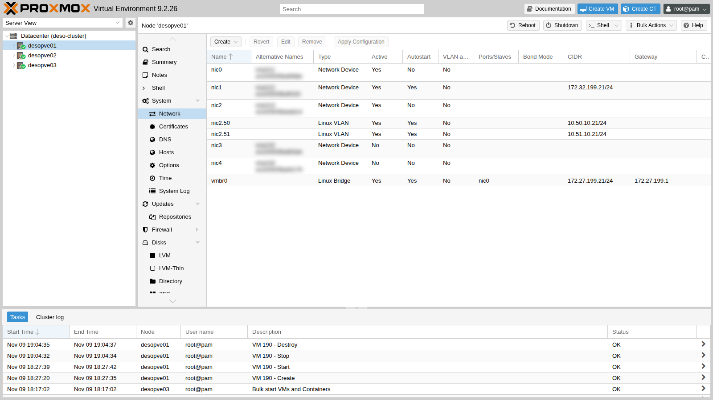
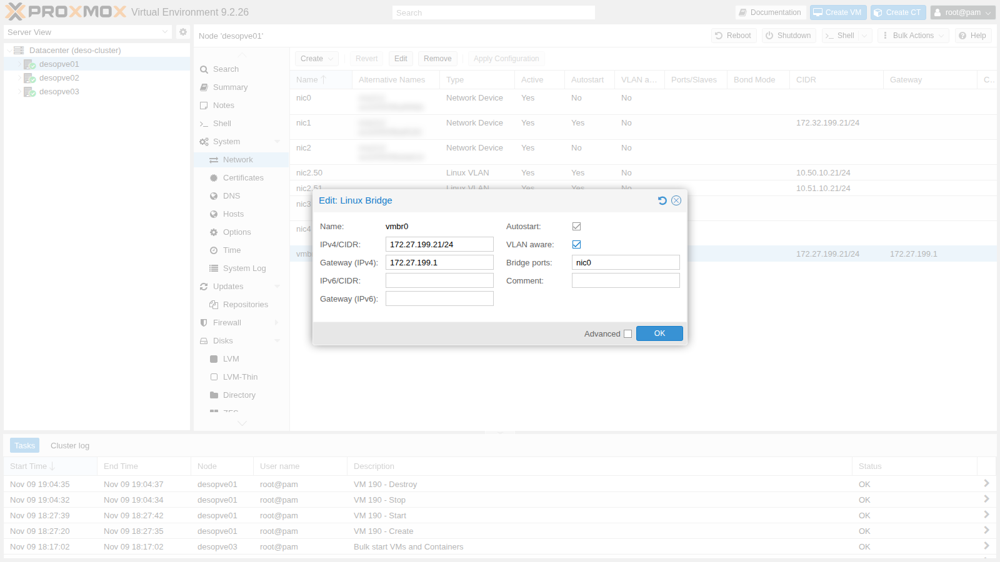
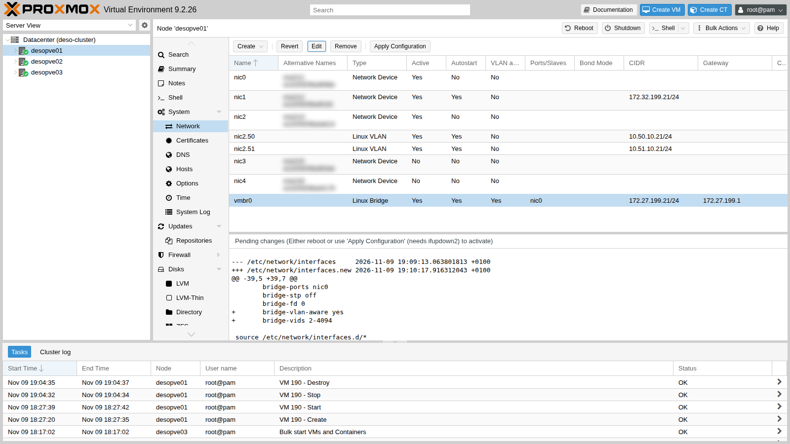
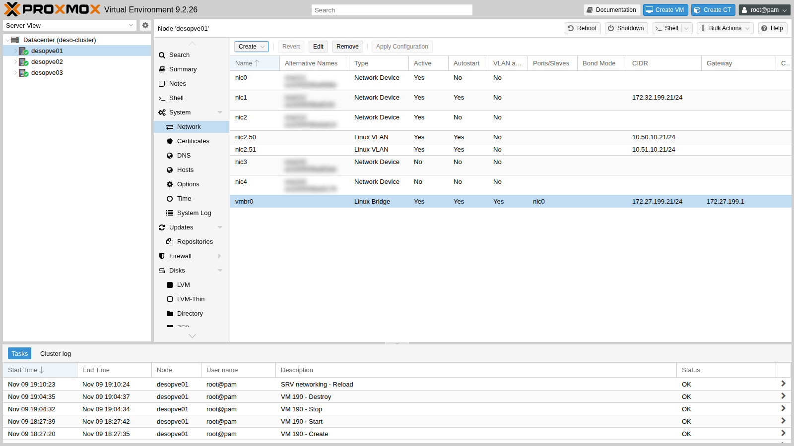
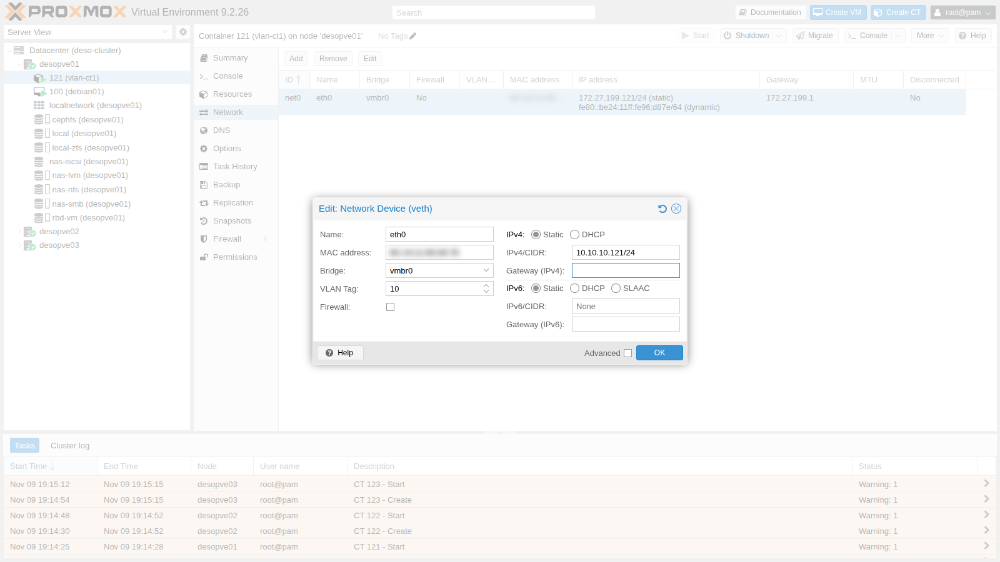
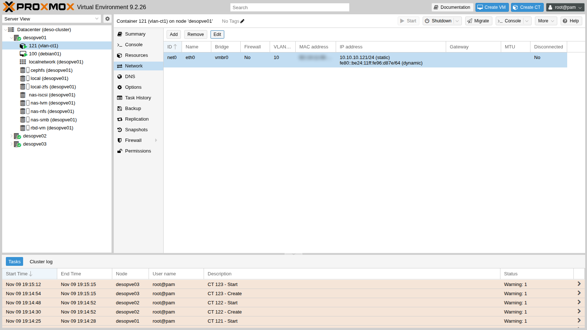
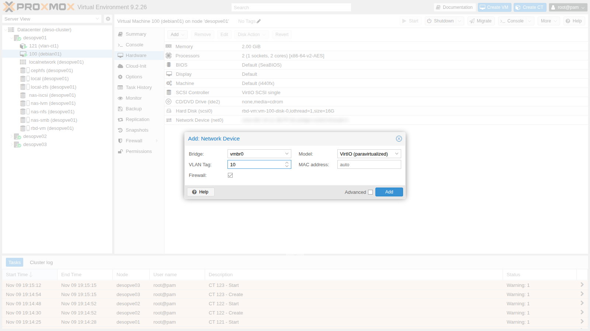
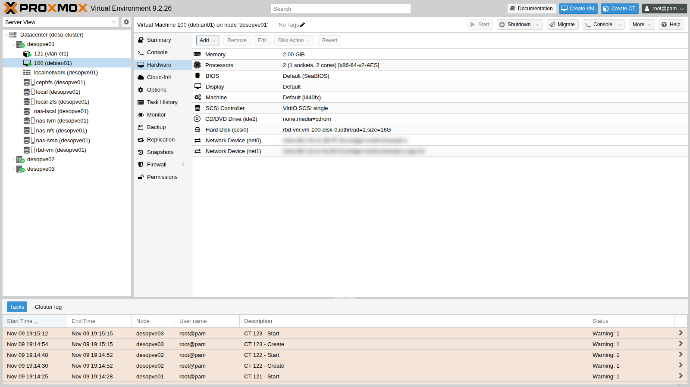

# Lab 20 – Linux bridges, stable network interface names and VLAN-aware bridges

**Level:** intermediate · **Duration:** 1 hour 30 minutes

## Dependencies

- **Previous labs:** [Lab 06](06-cluster-corosync.md) (cluster `deso-cluster`), [Lab 07](07-first-vm-and-container.md) (VM 100 and the first containers), [Lab 17](17-ceph-installation.md) (CephFS for the templates and `rbd-vm` for the disks of the test containers), [Lab 18](18-ceph-growth-maintenance-failures.md) (the `noout` flag, to power off a node that hosts OSDs).
- **Hardware:** a dual-port network card for each node `desopve01-03`, to install with the server powered off (step 1) and to cable to the switch, on the same network as the other cards. In this lab you pin its names; in [Lab 21](21-bonding.md) the two ports become a bond.
- **Network:** the switch the node cards are connected to must carry VLAN-tagged frames (*trunk* ports), as described in [Lab 01](01-lab-architecture.md).
- **Template:** `debian-13-standard` (you download it to CephFS during the lab).
- **Credentials:** `root` / `<lab-password>` on the nodes and in the containers → [Appendix B](b-credentials-and-addresses.md).

## Objectives

- Understand how Proxmox VE connects VMs to the network: physical NICs, Linux bridges, virtual ports.
- Give new network cards a stable name, with the *pinning* introduced in Proxmox VE 9.
- Read and edit `/etc/network/interfaces`, from the GUI and from the command line, and apply the changes without rebooting.
- Make `vmbr0` *VLAN-aware* and put VMs and containers on different VLANs with a simple number (*tag*).
- Verify with real tests that the same VLAN communicates across different nodes and that different VLANs stay isolated.

## How it works

### The Linux bridge is a switch inside the node

A **Linux bridge** (`vmbr0`, `vmbr1`, …) is a software Ethernet switch. Its ports are:

- one or more **physical NICs** (`bridge-ports nic0`): the uplink to the datacenter switch;
- the **virtual ports** of the VMs (`tap100i0` = VM 100, interface `net0`) and of the containers (`veth121i0` = CT 121, `net0`), which Proxmox VE creates and attaches when the guest starts.

The node's IP address is on the bridge (`vmbr0`), not on the physical NIC: the node itself is just another "port" of the switch.

A bridge **without** physical NICs is an isolated switch: the VMs attached to it can only talk to each other, on the same node. Isolated networks that span several nodes are built with SDN (labs 27-31).

### Stable network interface names

Linux gives network cards a name that depends on where they are connected (PCI slot, position on the bus: `ens…`, `enp…s…`). If the hardware changes, or a kernel or systemd update changes the naming rules, the name changes. At that point `/etc/network/interfaces` points to an interface that no longer exists and the node is left without a network.

Proxmox VE 9 solves the problem with **pinning**: a `systemd.link` file for each card maps its **MAC address** to a fixed name, `nic0`, `nic1`, …

- The installer does this for the cards present at installation time: it is the *Pin network interface names* option, enabled by default (see [Lab 03](03-install-proxmox-ve.md)).
- For cards added later you use `pve-network-interface-pinning generate`. The tool creates the `.link` files in `/usr/local/lib/systemd/network/` and also updates the configurations that reference the old name: network, node firewall, SDN.

The old names remain available as **alternative names** (*altname*): in the GUI you see them in the **Alternative Names** column.

### `/etc/network/interfaces` and ifupdown2

The node's network configuration lives in `/etc/network/interfaces`, in **ifupdown2** format:

- `iface <name> inet manual` – interface without an address (a card used as a port of a bridge or a bond);
- `iface <name> inet static` + `address` / `gateway` – interface with an address;
- `auto <name>` – brought up at boot;
- `bridge-ports`, `bridge-stp`, `bridge-fd`, `bridge-vlan-aware`, `bridge-vids` – bridge options.

The GUI does not edit the file directly: it writes `/etc/network/interfaces.new` and shows the difference as **Pending changes**. **Apply Configuration** moves the file into place and runs `ifreload -a`, which applies only the differences, without rebooting the node and without interrupting the interfaces that do not change.

### VLAN-aware bridges

A VLAN (802.1Q) splits a switch into several logical networks: every frame carries a **tag** with the VLAN number (1-4094). On a **VLAN-aware** bridge:

| Element | Behavior |
|---|---|
| Physical NIC (`nic0`) | *trunk* port: carries the VLANs in `bridge-vids` (here `2-4094`) tagged, plus VLAN 1 untagged |
| Virtual NIC **without** a tag | sits in VLAN 1 untagged (PVID), like the management network; but Proxmox VE also adds it, **tagged**, to all the VLANs in `bridge-vids` (2-4094). In practice it is a *trunk*: the guest can receive and send frames on any VLAN. To restrict it you use `tag=` (a single VLAN) or `trunks=` (only the listed VLANs) |
| Virtual NIC with **VLAN Tag** `10` | *access* port of VLAN 10: the guest sees normal frames, the bridge adds and removes the tag |

A single VLAN-aware bridge can therefore serve all the VLANs: to move a VM from one network to another you just change the tag, even while it is running. The lab switch must have the node ports configured as *trunks* with the same VLANs.

When the Proxmox VE **firewall** is enabled on the guest's network device, it inserts an extra small bridge (`fwbr100i0`) between the VM and `vmbr0`: in that case the VLAN tag is applied on the `fwpr…` port attached to `vmbr0`, not on `tap…`.

## Procedure

### 1. A new card: from the system name to `nic3` and `nic4`

1. Install the dual-port card in `desopve01-03`, **one node at a time, with the server powered off**:
   - set the Ceph `noout` flag (`ceph osd set noout`, as in [Lab 18](18-ceph-growth-maintenance-failures.md)), so that the OSDs of the powered-off node are not rebuilt elsewhere;
   - migrate the node's guests to another node (or shut them down), then power off the node;
   - install the card, cable the two ports to the switch and power the node back on;
   - when the node is back in the cluster and Ceph is healthy, clear the flag with `ceph osd unset noout` and move on to the next node.

   At boot, Linux sees the two new ports with names derived from their position on the PCI bus, and leaves them down:

   ```console
   root@desopve01:~# ip -br link | grep -E "ens|nic"
   nic0             UP             <MAC> <BROADCAST,MULTICAST,UP,LOWER_UP>
   nic1             UP             <MAC> <BROADCAST,MULTICAST,UP,LOWER_UP>
   nic2             UP             <MAC> <BROADCAST,MULTICAST,UP,LOWER_UP>
   nic2.50@nic2     UP             <MAC> <BROADCAST,MULTICAST,UP,LOWER_UP>
   nic2.51@nic2     UP             <MAC> <BROADCAST,MULTICAST,UP,LOWER_UP>
   ens<N1>          DOWN           <MAC> <BROADCAST,MULTICAST>
   ens<N2>          DOWN           <MAC> <BROADCAST,MULTICAST>
   ```

   > `ens<N1>` and `ens<N2>` are the names assigned by udev (systemd's "predictable" names): the number depends on the card's slot and varies from one machine to another.

2. Pin the names `nic3` and `nic4` (same command on the three nodes, with the names you see on yours):

   ```console
   root@desopve01:~# pve-network-interface-pinning generate --interface ens<N1> --target-name nic3
   Name for link 'ens<N1>' (enp<B>s<S>f<F>, enx<MAC>) will change to 'nic3'
   Generating link files
   Successfully generated .link files in '/usr/local/lib/systemd/network/'
   Updating /etc/pve/nodes/desopve01/host.fw.new
   Updating /etc/network/interfaces.new
   Updating /etc/pve/sdn/controllers.cfg
   Updating /etc/pve/sdn/fabrics.cfg
   Successfully updated Proxmox VE configuration files.

   Please reboot to apply the changes to your configuration
   root@desopve01:~# pve-network-interface-pinning generate --interface ens<N2> --target-name nic4
   ...
   root@desopve01:~# cat /usr/local/lib/systemd/network/50-pmx-nic3.link
   [Match]
   MACAddress=<NIC MAC address>
   Type=ether

   [Link]
   Name=nic3
   ```

   Without `--target-name` the tool picks the first free name on its own (`nic3`, `nic4`, …); without `--interface` it pins all the cards that do not have a stable name yet.

3. The new name takes effect at the next reboot. The two ports, however, are not in use yet (they are down), so you can apply it right away, without another reboot: udev rereads the `.link` files and renames the interfaces.

   ```console
   root@desopve01:~# udevadm trigger -c add /sys/class/net/ens<N1> /sys/class/net/ens<N2>
   root@desopve01:~# udevadm settle
   root@desopve01:~# ip -br link | grep -E "nic3|nic4"
   nic3             DOWN           <MAC> <BROADCAST,MULTICAST>
   nic4             DOWN           <MAC> <BROADCAST,MULTICAST>
   ```

   > An interface that is already in use (with an address, in a bridge or in a bond) cannot be renamed on the fly: in that case reboot the node, with the Ceph `noout` flag set if the node hosts OSDs ([Lab 18](18-ceph-growth-maintenance-failures.md)).

4. The tool has prepared the lines for the new cards in `/etc/network/interfaces.new`. Apply them (this is what the **Apply Configuration** button does):

   ```console
   root@desopve01:~# diff -u /etc/network/interfaces /etc/network/interfaces.new | grep "^[+-]"
   --- /etc/network/interfaces	2026-11-09 17:02:13.533049346 +0100
   +++ /etc/network/interfaces.new	2026-11-09 19:09:13.063801813 +0100
   +iface nic4 inet manual
   +
   +iface nic3 inet manual
   +
   root@desopve01:~# mv /etc/network/interfaces.new /etc/network/interfaces && ifreload -a
   ```

   Repeat steps 2-4 on `desopve02` and `desopve03`.

### 2. VLAN-aware vmbr0 from the GUI (desopve01)

1. Node **desopve01** → **System** → **Network**. The `nic3` and `nic4` cards are inactive *Network Device* entries; `vmbr0` has **VLAN aware** set to `No`. The **Alternative Names** column shows the old names of the cards.

   

   Before the change, the bridge does not filter VLANs:

   ```console
   root@desopve01:~# cat /sys/class/net/vmbr0/bridge/vlan_filtering
   0
   root@desopve01:~# bridge vlan show dev nic0
   port              vlan-id
   nic0              1 PVID Egress Untagged
   ```

2. Select `vmbr0` → **Edit** and check **VLAN aware**. The other fields stay unchanged.

   

3. **OK**. The **Pending changes** appear in the lower part of the page: the two lines that will be added to the file. `bridge-vids 2-4094` is the default value, that is, all VLANs.

   

4. **Apply Configuration** → **Yes**. After a few seconds `vmbr0` is VLAN-aware, with no interruption for the GUI, the cluster or the VMs.

   

   ```console
   root@desopve01:~# cat /sys/class/net/vmbr0/bridge/vlan_filtering
   1
   root@desopve01:~# bridge vlan show dev nic0 | head -4
   port              vlan-id
   nic0              1 PVID Egress Untagged
                     2
                     3
   root@desopve01:~# ifquery --check vmbr0
   auto vmbr0
   iface vmbr0 inet static                                             [pass]
   	bridge-ports nic0 (veth121i0) (fwpr100p0)                   [pass]
   	bridge-fd 0                                                 [pass]
   	bridge-stp no                                               [pass]
   	bridge-vlan-aware yes                                       [pass]
   	bridge-vids 2-4094                                              []
   	address 172.27.199.21/24                                    [pass]
   ```

   `ifquery --check` compares the file with the actual state of the interfaces: `[pass]` means they match. The guests' virtual ports, which Proxmox VE attaches without them being in the file, appear in parentheses. This output was captured at the end of the lab: it already includes the port of CT 121, which you create in step 4.

### 3. The same change from the command line (desopve02 and desopve03)

The GUI is convenient; on many nodes, or from a script, you edit the file. Here is the file of `desopve01` after the change: the layout is the same on all nodes.

```text
auto lo
iface lo inet loopback

iface nic0 inet manual

auto nic1
iface nic1 inet static
	address 172.32.199.21/24

iface nic2 inet manual

auto nic2.50
iface nic2.50 inet static
	address 10.50.10.21/24

auto nic2.51
iface nic2.51 inet static
	address 10.51.10.21/24

iface nic4 inet manual

iface nic3 inet manual

auto vmbr0
iface vmbr0 inet static
	address 172.27.199.21/24
	gateway 172.27.199.1
	bridge-ports nic0
	bridge-stp off
	bridge-fd 0
	bridge-vlan-aware yes
	bridge-vids 2-4094

source /etc/network/interfaces.d/*
```

1. On `desopve02` make a copy of the file and add the two lines to the `vmbr0` block (with an editor, or with `sed` as shown here):

   ```console
   root@desopve02:~# cp /etc/network/interfaces /root/interfaces.bak-lab20
   root@desopve02:~# sed -i "/^iface vmbr0 /,/^$/ s/^\tbridge-fd 0$/\tbridge-fd 0\n\tbridge-vlan-aware yes\n\tbridge-vids 2-4094/" /etc/network/interfaces
   root@desopve02:~# sed -n "/auto vmbr0/,/^$/p" /etc/network/interfaces
   auto vmbr0
   iface vmbr0 inet static
   	address 172.27.199.22/24
   	gateway 172.27.199.1
   	bridge-ports nic0
   	bridge-stp off
   	bridge-fd 0
   	bridge-vlan-aware yes
   	bridge-vids 2-4094
   ```

2. Apply the change and immediately check that the node can still reach the gateway. If something goes wrong, the rollback plan is to put the copy back and run `ifreload -a` again from the node's console.

   ```console
   root@desopve02:~# ifreload -a && cat /sys/class/net/vmbr0/bridge/vlan_filtering
   1
   root@desopve02:~# ping -c2 -W1 172.27.199.1 | tail -1
   rtt min/avg/max/mdev = 0.460/1.174/1.889/0.714 ms
   ```

3. Repeat on `desopve03`. At the end, check that the cluster and Ceph did not notice anything:

   ```console
   root@desopve01:~# pvecm status | grep Quorate
   Quorate:          Yes
   root@desopve01:~# ceph -s | grep health
       health: HEALTH_OK
   ```

> **Why one node at a time?** A wrong change to the management network can isolate the node. If it happens on a single node, the cluster stays quorate and you fix the node from its console; if it happens on all nodes at once, the cluster loses quorum.

### 4. Three test containers on different VLANs

1. Download the Debian 13 template to CephFS, so that it is available on all nodes:

   ```console
   root@desopve01:~# pveam update
   root@desopve01:~# pveam download cephfs debian-13-standard_13.6-1_amd64.tar.zst
   ...
   download of 'http://download.proxmox.com/images/system/debian-13-standard_13.6-1_amd64.tar.zst' to '/mnt/pve/cephfs/template/cache/debian-13-standard_13.6-1_amd64.tar.zst' finished
   ```

   > The `pveam available` command lists the templates for all architectures: choose the `amd64` one.

2. Create one container per node: CT 121 on `desopve01`, 122 on `desopve02`, 123 on `desopve03`. For now they are on the management network, so they can install the test tools (`ping`, `tcpdump`, `iperf3`) through the proxy:

   ```console
   root@desopve01:~# pct create 121 cephfs:vztmpl/debian-13-standard_13.6-1_amd64.tar.zst \
       --hostname vlan-ct1 --unprivileged 1 --cores 1 --memory 512 --swap 0 \
       --rootfs rbd-vm:4 --net0 name=eth0,bridge=vmbr0,ip=172.27.199.121/24,gw=172.27.199.1 \
       --nameserver 172.27.199.20 --searchdomain proxmox.community --features nesting=1 \
       --password '<lab-password>' --start 1
   root@desopve01:~# pct exec 121 -- bash -c 'echo "Acquire::http::Proxy \"http://proxy.proxmox.community:3128\";" > /etc/apt/apt.conf.d/90proxy
       apt-get -qq update && DEBIAN_FRONTEND=noninteractive apt-get -qq install -y iperf3 tcpdump iputils-ping'
   ```

   Same commands for 122 (`vlan-ct2`, `.122`) on `desopve02` and 123 (`vlan-ct3`, `.123`) on `desopve03`.

   > Unprivileged Debian 13 containers need the `--features nesting=1` option: without it, the start task reports `WARN: Systemd 257 detected. You may need to enable nesting.`. Containers are the subject of lab 41.

3. Move CT 121 to VLAN 10: **121** → **Network** → `net0` → **Edit**. **VLAN Tag** `10`, **IPv4/CIDR** `10.10.10.121/24`, **Gateway** empty: the test network has no router.

   

   **OK**: the container keeps running, and Proxmox VE moves its `veth121i0` port to VLAN 10.

   

4. Configure the other two from the command line, again while they are running. CT 123 goes on **VLAN 20**, but with an address in the **same subnet** as the other two:

   ```console
   root@desopve02:~# pct set 122 -net0 name=eth0,bridge=vmbr0,tag=10,ip=10.10.10.122/24
   root@desopve03:~# pct set 123 -net0 name=eth0,bridge=vmbr0,tag=20,ip=10.10.10.123/24
   ```

### 5. Tests: same VLAN, different VLANs

1. **Same VLAN, different nodes.** CT 121 (on `desopve01`) reaches CT 122 (on `desopve02`): the frame leaves `nic0` with tag 10, crosses the network and enters `vmbr0` on the other node.

   ```console
   root@desopve01:~# pct exec 121 -- ping -c3 -W1 10.10.10.122
   PING 10.10.10.122 (10.10.10.122) 56(84) bytes of data.
   64 bytes from 10.10.10.122: icmp_seq=1 ttl=64 time=1.53 ms
   64 bytes from 10.10.10.122: icmp_seq=2 ttl=64 time=0.631 ms
   64 bytes from 10.10.10.122: icmp_seq=3 ttl=64 time=0.402 ms

   --- 10.10.10.122 ping statistics ---
   3 packets transmitted, 3 received, 0% packet loss, time 2018ms
   ```

2. **The tag on the wire.** A capture on the node's `nic0` while the ping is running shows the 802.1Q header with VLAN 10:

   ```console
   root@desopve01:~# tcpdump -i nic0 -e -nn -c 4 "vlan 10 and icmp"
   19:18:43.123268 <MAC> > <MAC>, ethertype 802.1Q (0x8100), length 102: vlan 10, p 0, ethertype IPv4 (0x0800), 10.10.10.121 > 10.10.10.122: ICMP echo request, id 538, seq 1, length 64
   19:18:43.123781 <MAC> > <MAC>, ethertype 802.1Q (0x8100), length 102: vlan 10, p 0, ethertype IPv4 (0x0800), 10.10.10.122 > 10.10.10.121: ICMP echo reply, id 538, seq 1, length 64
   ...
   4 packets captured
   ```

   Inside the container, on the other hand, the frames are untagged: it is the bridge that adds and removes the tag. The bridge's VLAN table confirms it: the port of CT 121 is an *access* port of VLAN 10 (PVID, egress untagged), while the port of VM 100, which has no tag, is in VLAN 1 untagged **and** in all VLANs 2-4094 tagged:

   ```console
   root@desopve01:~# bridge -compressvlans vlan show dev veth121i0
   port              vlan-id
   veth121i0         10 PVID Egress Untagged
   root@desopve01:~# bridge -compressvlans vlan show dev tap100i0
   port              vlan-id
   tap100i0          1 PVID Egress Untagged
                     2-4094
   ```

   With the firewall enabled on the network device and the default `iptables` engine, the port of VM 100 attached to `vmbr0` is `fwpr100p0` instead of `tap100i0` (see *How it works*): the table is the same. An untagged virtual NIC therefore also receives the tagged traffic of all the VLANs: if a guest must be on a single network, always give it a tag (or restrict the VLANs with `trunks=`).

3. **Different VLANs, same subnet.** CT 123 is in VLAN 20 with an address in the same subnet: it does not answer, because the ARP requests from VLAN 10 never reach VLAN 20.

   ```console
   root@desopve01:~# pct exec 121 -- ping -c3 -W1 10.10.10.123
   PING 10.10.10.123 (10.10.10.123) 56(84) bytes of data.

   --- 10.10.10.123 ping statistics ---
   3 packets transmitted, 0 received, 100% packet loss, time 2065ms
   ```

4. **Changing VLAN on the fly.** Move CT 123 to VLAN 10: it communicates immediately, without any restart.

   ```console
   root@desopve03:~# pct set 123 -net0 name=eth0,bridge=vmbr0,tag=10,ip=10.10.10.123/24
   root@desopve03:~# pct exec 123 -- ping -c2 -W1 10.10.10.121 | tail -2
   2 packets transmitted, 2 received, 0% packet loss, time 1002ms
   rtt min/avg/max/mdev = 0.431/1.181/1.931/0.750 ms
   ```

5. **Each VLAN gets its own subnet.** Put CT 123 back in VLAN 20 with a subnet of its own, `10.20.20.0/24`. Now CT 121 does not even know how to reach it: it has no route to that network.

   ```console
   root@desopve03:~# pct set 123 -net0 name=eth0,bridge=vmbr0,tag=20,ip=10.20.20.123/24
   root@desopve01:~# pct exec 121 -- ping -c1 -W1 10.20.20.123
   ping: connect: Network is unreachable
   root@desopve01:~# pct exec 121 -- ip route
   10.10.10.0/24 dev eth0 proto kernel scope link src 10.10.10.121
   ```

   This is the usual design: one VLAN per subnet, and between the VLANs a router that decides what may pass. You will build it in lab 26.

### 6. An extra network device on a VM

VMs work the same way. Add a second network device on VLAN 10 to VM 100:

1. **100 (debian01)** → **Hardware** → **Add** → **Network Device**. **Bridge** `vmbr0`, **VLAN Tag** `10`, **Model** `VirtIO (paravirtualized)`, **Firewall** enabled.

   

2. **Add**: the `net1` device appears in the hardware list with `tag=10` and the guest sees it immediately (hotplug).

   

   With the firewall enabled, the `tap100i1` port is attached to the firewall bridge: that is why `tap100i1` appears in VLAN 1, while tag 10 is on the `fwpr100p1` port of `vmbr0`.

   ```console
   root@desopve01:~# qm config 100 | grep ^net
   net0: virtio=<MAC>,bridge=vmbr0,firewall=1
   net1: virtio=<MAC>,bridge=vmbr0,firewall=1,tag=10
   root@desopve01:~# bridge vlan show | grep -E "100i1|100p1"
   tap100i1          1 PVID Egress Untagged
   fwbr100i1         1 PVID Egress Untagged
   fwpr100p1         10 PVID Egress Untagged
   fwln100i1         1 PVID Egress Untagged
   ```

3. Remove it: from the GUI with **Remove** on the `net1` row, or from the CLI.

   ```console
   root@desopve01:~# qm set 100 --delete net1
   update VM 100: -delete net1
   ```

## Verification and tests

| Test | Expected result | Actual result |
|---|---|---|
| New cards with a stable name | `nic3` and `nic4` on `desopve01-03`, files `50-pmx-nic3/4.link` | ✔ |
| `vmbr0` VLAN-aware on all nodes | `vlan_filtering` = 1, management and cluster without interruptions | ✔ (`Quorate: Yes`, `HEALTH_OK`) |
| Same VLAN, different nodes (121 → 122) | answers | 0% loss, ~0.5 ms |
| Different VLANs, same subnet (121 → 123) | no answer | 100% loss |
| VLAN change on the fly (123 → VLAN 10) | answers immediately | 0% loss |
| Different VLANs, different subnets | a router is needed | `Network is unreachable` |

## Final lab state

- **`desopve01-03`:**
  - `vmbr0` VLAN-aware (`bridge-vids 2-4094`), still with the management address `172.27.199.2x/24` on untagged VLAN 1;
  - new cards `nic3` and `nic4` with stable names, not configured yet (`inet manual`), ready for the bond in lab 21;
  - `nic1` (172.32.199.2x, second Corosync link and second iSCSI path) and `nic2.50`/`nic2.51` (Ceph) unchanged.
- **Test containers**, running, with `ping`, `tcpdump` and `iperf3`:
  - CT 121 `vlan-ct1` on `desopve01`, VLAN 10, `10.10.10.121/24`;
  - CT 122 `vlan-ct2` on `desopve02`, VLAN 10, `10.10.10.122/24`;
  - CT 123 `vlan-ct3` on `desopve03`, VLAN 20, `10.20.20.123/24`.

  All with their disk on `rbd-vm` and without a gateway: they are also used in labs 21 and 22.

- **CephFS:** template `debian-13-standard_13.6-1_amd64`.
- **VM 100** unchanged (only `net0`). `desopve04` was not touched.

## What you learned

- A Linux bridge is a software switch: the physical NICs are its ports to the outside, the VM and container network devices its internal ports.
- Stable names (`nic0`, `nic1`, …) protect the configuration from changes in the hardware or in the naming rules; for cards added after installation you use `pve-network-interface-pinning`.
- The GUI prepares `interfaces.new` and shows the differences; **Apply Configuration** (or `ifreload -a`) applies only what changes, without rebooting.
- With a VLAN-aware bridge, a number on the virtual NIC is all it takes to choose the VLAN, even while the guest is running.
- VLANs separate traffic at layer 2: two guests in the same subnet but in different VLANs cannot see each other. Between different VLANs you need a router.

## References

- [Proxmox VE – Network Configuration](https://pve.proxmox.com/pve-docs/pve-admin-guide.html#sysadmin_network_configuration)
- [Proxmox VE – Overriding network device names](https://pve.proxmox.com/pve-docs/pve-admin-guide.html#network_override_device_names) and [the pve-network-interface-pinning tool](https://pve.proxmox.com/pve-docs/pve-admin-guide.html#_using_the_pve_network_interface_pinning_tool)
- [Proxmox VE – VLAN 802.1Q](https://pve.proxmox.com/pve-docs/pve-admin-guide.html#sysadmin_network_vlan)
- [systemd.link – network device naming configuration](https://www.freedesktop.org/software/systemd/man/latest/systemd.link.html)
- [ifupdown2 – documentation](https://github.com/CumulusNetworks/ifupdown2)
