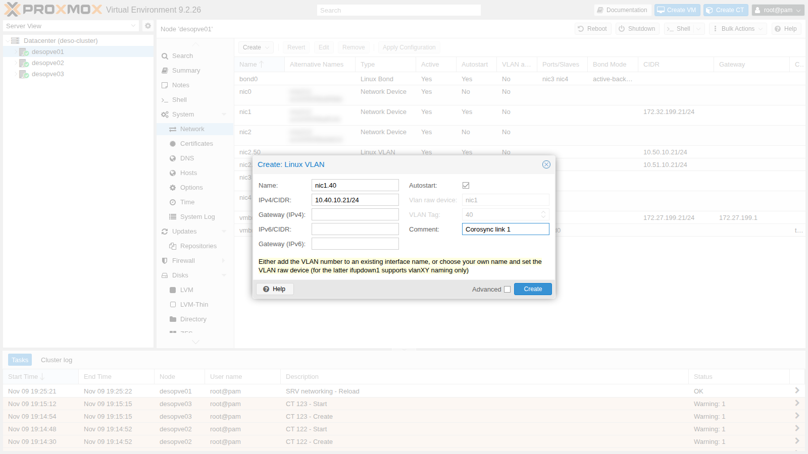
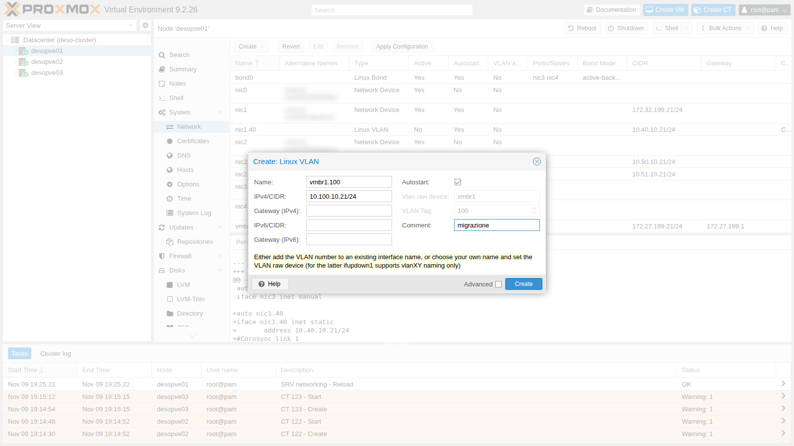
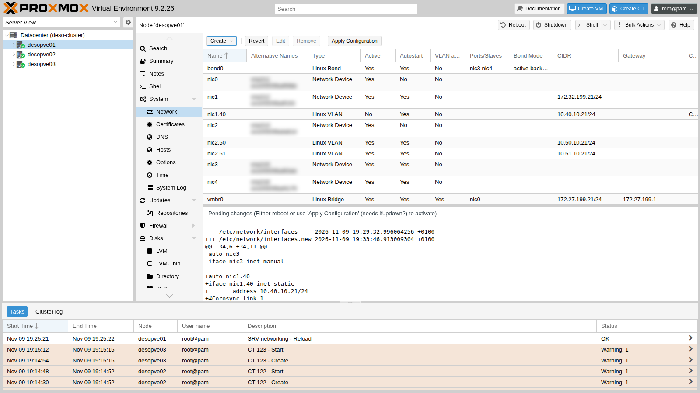
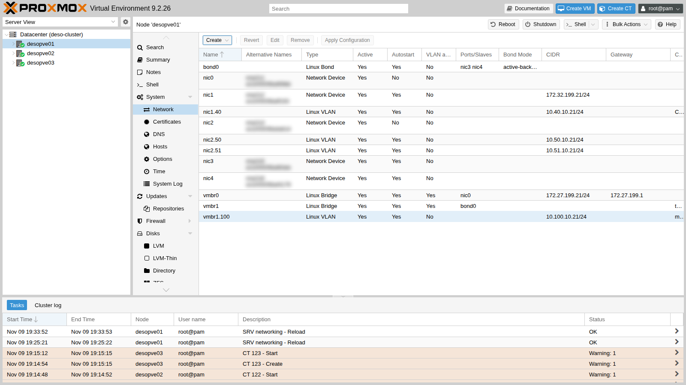
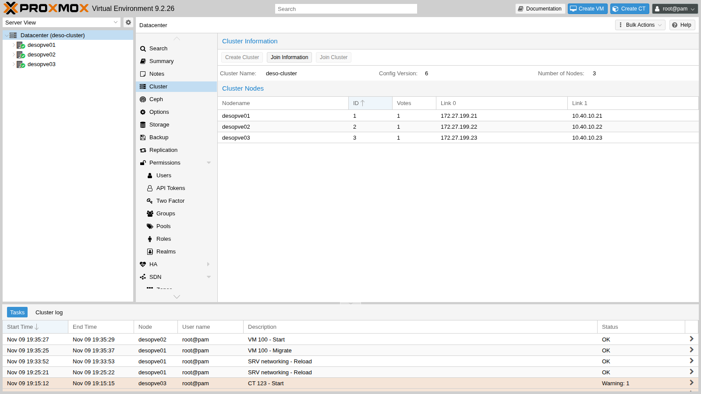
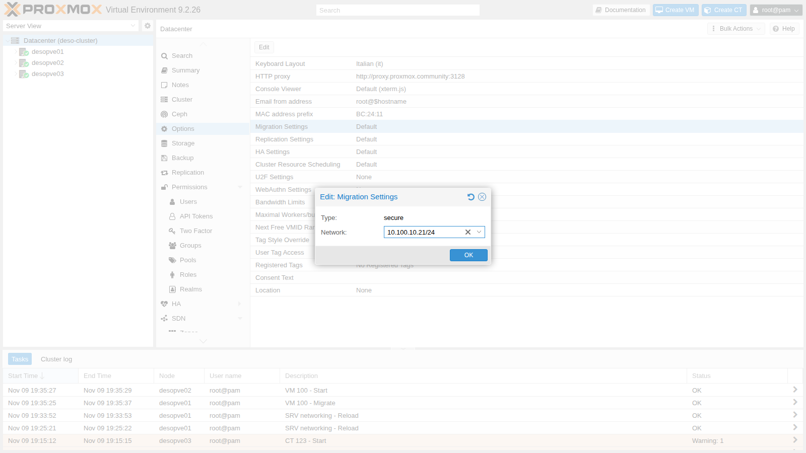
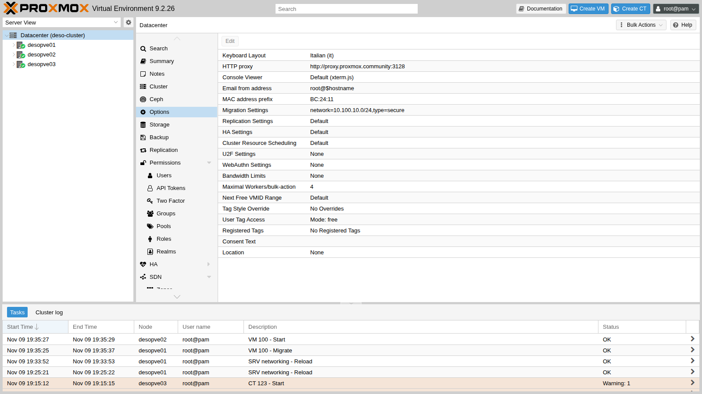
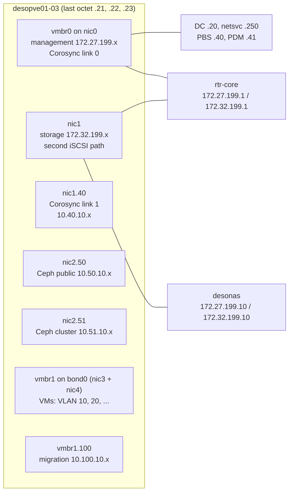

# Lab 22 – Dedicated networks: Corosync, migration and storage

**Level:** advanced · **Duration:** 1 hour 30 minutes

## Dependencies

- **Previous labs:**
  - [Lab 06](06-cluster-corosync.md): cluster with two Corosync links;
  - [Lab 15](15-iscsi-lvm-multipath.md): second iSCSI path on `nic1`;
  - [Lab 17](17-ceph-installation.md): Ceph networks on VLANs 50 and 51;
  - [Lab 20](20-bridges-stable-names-vlans.md) and [Lab 21](21-bonding.md): VLAN-aware bridges, `bond0` and `vmbr1`.
- **VM:** VM 100 `debian01` with its disk on `rbd-vm`, running on `desopve01`: you need it to measure the migration.
- **Network:** the lab switch carries the VLANs on the node ports (trunk). The new VLANs 40 and 100 have **no** router.
- **Credentials:** `root` / `<lab-password>` on the nodes → [Appendix B](b-credentials-and-addresses.md).

## Objectives

- Understand why a cluster separates the different types of traffic, and why Corosync is the most sensitive one.
- Move the second Corosync link to a dedicated, non-routed VLAN, without ever losing quorum.
- Dedicate a network to migrations and verify with the counters that the traffic really goes through it.
- Simulate the failure of the dedicated Corosync link.
- Get the complete picture of the lab networks.

## How it works

### Different types of traffic, different needs

| Traffic | What matters | What happens when it suffers |
|---|---|---|
| **Corosync** (cluster) | low, steady latency, little bandwidth | if packets arrive late the node loses quorum; with high availability enabled it is isolated and rebooted (*fencing*) |
| **Storage** (NFS, iSCSI) | bandwidth and latency | slow VMs, I/O waiting |
| **Ceph** public and cluster | bandwidth and latency; the *cluster network* carries replication between the OSDs | slow writes, *slow ops* |
| **Migration** | lots of bandwidth, in bursts | slow migrations; if it shares the link with Corosync, it can disrupt it |
| **VMs** | depends on the services | |
| **Management** | little bandwidth | GUI and SSH unreachable |

The typical risk is a migration or a backup that saturates the link shared with Corosync: the cluster packets arrive late and a healthy node gets excluded. That is why the Proxmox VE documentation recommends **at least one Corosync link on a separate physical network**, plus a second link as a fallback.

### Corosync with two links

Corosync (*knet* transport) monitors all the links, but in `passive` mode it transmits on only one of them, the working link with the highest priority, and switches to the other as soon as the first one fails. In the lab:

- **link 0**: management network (`vmbr0`);
- **link 1**: so far on `172.32.199.0/24` on `nic1`, the same network as the second iSCSI path, routed by `rtr-core`. In this lab it moves to a **dedicated VLAN, VLAN 40**, without a gateway.

### VLAN interfaces on a NIC and on a bridge

| Interface | What it is | Use in the lab |
|---|---|---|
| `nic1.40` | VLAN 40 on top of the `nic1` card: frames tagged 40 on the same cable as the untagged traffic | Corosync link 1 |
| `vmbr1.100` | the **node's** address in VLAN 100 of the VLAN-aware bridge `vmbr1` (on top of the bond) | migration network |

The two networks have no router: traffic cannot go through `rtr-core` and keep "working" over some indirect route when the dedicated link fails. And the ARP problem from lab 15 cannot happen again, because each VLAN is a separate broadcast domain.

### The migration network

In **Datacenter** → **Options** → **Migration Settings** you choose:

- **Network**: the network (CIDR) over which the nodes exchange memory and disks during migrations;
- **Type**: `secure` (the default: traffic goes through an encrypted SSH tunnel) or `insecure` (plain TCP, faster, acceptable only on a dedicated, isolated network).

## Procedure

### 1. The VLAN interfaces from the GUI (desopve01)

1. Node **desopve01** → **System** → **Network** → **Create** → **Linux VLAN**. **Name** `nic1.40` (the GUI derives the card and the VLAN from the name on its own), **IPv4/CIDR** `10.40.10.21/24`, no gateway, **Autostart** checked, comment `Corosync link 1`.

   

2. **Create** → **Linux VLAN**. **Name** `vmbr1.100`, **IPv4/CIDR** `10.100.10.21/24`, comment `migrazione`.

   

3. Check the pending changes and apply them with **Apply Configuration**.

   

   

   ```text
   auto nic1.40
   iface nic1.40 inet static
   	address 10.40.10.21/24
   #Corosync link 1

   auto vmbr1.100
   iface vmbr1.100 inet static
   	address 10.100.10.21/24
   #migrazione
   ```

### 2. The same interfaces on the other nodes (CLI)

On `desopve02` and `desopve03` add the same two blocks (with `.22` and `.23`) before the `source` line, after making a copy of the file (`/root/interfaces.bak-lab22`), then run `ifreload -a`. Check from `desopve01`:

```console
root@desopve01:~# for ip in 10.40.10.22 10.40.10.23 10.100.10.22 10.100.10.23; do printf "%s " $ip; ping -c2 -W1 $ip >/dev/null && echo ok || echo NO; done
10.40.10.22 ok
10.40.10.23 ok
10.100.10.22 ok
10.100.10.23 ok
root@desopve01:~# ip route get 10.40.10.22
10.40.10.22 dev nic1.40 src 10.40.10.21 uid 0
    cache
root@desopve01:~# ping -c1 -W1 10.40.10.1 >/dev/null 2>&1 || echo "nessun router su 10.40.10.0/24"
nessun router su 10.40.10.0/24
```

### 3. Moving Corosync link 1 to VLAN 40

1. The starting point:

   ```console
   root@desopve01:~# corosync-cfgtool -n
   Local node ID 1, transport knet
   nodeid: 2 reachable
      LINK: 0 udp (172.27.199.21->172.27.199.22) enabled connected mtu: 1397
      LINK: 1 udp (172.32.199.21->172.32.199.22) enabled connected mtu: 1397

   nodeid: 3 reachable
      LINK: 0 udp (172.27.199.21->172.27.199.23) enabled connected mtu: 1397
      LINK: 1 udp (172.32.199.21->172.32.199.23) enabled connected mtu: 1397
   ```

2. **Always** edit a copy of `/etc/pve/corosync.conf`, check it, and then move it into place with a single `mv`. A half-written or wrong file would be distributed to all nodes immediately. Besides the addresses you must increment **`config_version`**, otherwise the nodes ignore the change. The value depends on the cluster's history (here it is 5, after `desopve04` joined and left in lab 18): the `perl` command reads it and increases it by one, whatever it is.

   ```console
   root@desopve01:~# cp /etc/pve/corosync.conf /root/corosync.conf.bak-lab22
   root@desopve01:~# cp /etc/pve/corosync.conf /etc/pve/corosync.conf.new
   root@desopve01:~# grep config_version /etc/pve/corosync.conf.new
     config_version: 5
   root@desopve01:~# sed -i "s/ring1_addr: 172.32.199.2/ring1_addr: 10.40.10.2/" /etc/pve/corosync.conf.new
   root@desopve01:~# perl -pi -e 's/(config_version: )(\d+)/$1.($2+1)/e' /etc/pve/corosync.conf.new
   root@desopve01:~# diff -u /etc/pve/corosync.conf /etc/pve/corosync.conf.new
   @@ -9,21 +9,21 @@
        nodeid: 1
        quorum_votes: 1
        ring0_addr: 172.27.199.21
   -    ring1_addr: 172.32.199.21
   +    ring1_addr: 10.40.10.21
      }
   ...
   -    ring1_addr: 172.32.199.23
   +    ring1_addr: 10.40.10.23
      }
    }
   @@ -33,7 +33,7 @@
    totem {
      cluster_name: deso-cluster
   -  config_version: 5
   +  config_version: 6
      interface {
        linknumber: 0
      }
   root@desopve01:~# mv /etc/pve/corosync.conf.new /etc/pve/corosync.conf
   ```

3. Corosync rereads the file, but **does not change the address of a link that is already active**, and says so clearly in the log:

   ```console
   root@desopve01:~# journalctl -u corosync --since "-1min" --no-pager
   ... [CFG   ] Config reload requested by node 1
   ... [TOTEM ] new config has different address for link 1 (addr changed from 172.32.199.21 to 10.40.10.21). Internal value was NOT changed.
   ...
   ... [CFG   ] Cannot configure new interface definitions: To reconfigure an interface it must be deleted and recreated. A working interface needs to be available to corosync at all times
   ```

   The new address takes effect when you restart Corosync, **one node at a time**: while one node restarts, link 0 keeps the other two together and quorum is maintained.

   ```console
   root@desopve03:~# systemctl restart corosync; sleep 6; pvecm status | grep ^Quorate
   Quorate:          Yes
   root@desopve02:~# systemctl restart corosync; sleep 6; pvecm status | grep ^Quorate
   Quorate:          Yes
   root@desopve01:~# systemctl restart corosync; sleep 6; pvecm status | grep ^Quorate
   Quorate:          Yes
   ```

   > Restarting Corosync is safe only if the cluster has quorum even without that node and if no high-availability resources are in a critical state. With HA active (lab 49) you put the cluster into maintenance first.

4. Link 1 now uses VLAN 40:

   ```console
   root@desopve01:~# corosync-cfgtool -n
   Local node ID 1, transport knet
   nodeid: 2 reachable
      LINK: 0 udp (172.27.199.21->172.27.199.22) enabled connected mtu: 1397
      LINK: 1 udp (10.40.10.21->10.40.10.22) enabled connected mtu: 1397

   nodeid: 3 reachable
      LINK: 0 udp (172.27.199.21->172.27.199.23) enabled connected mtu: 1397
      LINK: 1 udp (10.40.10.21->10.40.10.23) enabled connected mtu: 1397
   ```

   The GUI shows it too, in **Datacenter** → **Cluster**, with **Config Version** `6`:

   

### 4. The migration network

1. **Before:** VM 100 (disk on Ceph, 2 GiB of RAM) migrates from `desopve01` to `desopve02` with the default settings, that is, over the management network:

   ```console
   root@desopve01:~# qm migrate 100 desopve02 --online
   ...
   2026-11-09 19:35:29 start remote tunnel
   2026-11-09 19:35:30 ssh tunnel ver 1
   2026-11-09 19:35:30 migration downtime limit: 100 ms
   2026-11-09 19:35:30 start migrate command to unix:/run/qemu-server/100.migrate
   2026-11-09 19:35:31 migration active, transferred 221.0 MiB of 2.0 GiB VM-state, 9.8 GiB/s
   2026-11-09 19:35:32 average migration speed: 1.0 GiB/s - downtime 53 ms
   2026-11-09 19:35:32 migration completed, transferred 289.1 MiB VM-state
   2026-11-09 19:35:37 migration finished successfully (duration 00:00:12)
   ```

2. **Datacenter** → **Options** → **Migration Settings** → **Edit**. The **Network** field offers the node's addresses: choose the one on `vmbr1.100`. **Type** stays `secure`.

   

   The GUI saves the node's address (`10.100.10.21/24`): this works, because it applies to the whole network that contains it. For clarity it is better to write the network address:

   ```console
   root@desopve01:~# pvesh set /cluster/options --migration network=10.100.10.0/24,type=secure
   root@desopve01:~# grep migration /etc/pve/datacenter.cfg
   migration: network=10.100.10.0/24,type=secure
   ```

   

3. **After:** the VM goes back to `desopve01`. By counting the bytes received by the interfaces of `desopve01` before and after the migration, you can see which way it went:

   ```console
   root@desopve01:~# cat /sys/class/net/vmbr1.100/statistics/rx_bytes /sys/class/net/vmbr0/statistics/rx_bytes
   root@desopve02:~# qm migrate 100 desopve01 --online
   ...
   2026-11-09 19:38:19 average migration speed: 1.0 GiB/s - downtime 9 ms
   2026-11-09 19:38:19 migration completed, transferred 290.4 MiB VM-state
   2026-11-09 19:38:24 migration finished successfully (duration 00:00:11)
   root@desopve01:~# cat /sys/class/net/vmbr1.100/statistics/rx_bytes /sys/class/net/vmbr0/statistics/rx_bytes
   ```

   The difference between the two readings:

   | Interface of `desopve01` | Bytes received during the migration |
   |---|---|
   | `vmbr1.100` (migration) | 291 MiB |
   | `vmbr0` (management) | 0 MiB |

   All of the VM's memory went through VLAN 100.

   The times are almost the same (12 s versus 11 s): both networks have 10 Gbit/s cards and the VM uses little memory (290 MiB out of 2 GiB). The advantage of the dedicated network, here, is that the migration **no longer goes through the management and Corosync network**. In production, on a dedicated 10 or 25 Gbit/s network, a VM with a lot of RAM also migrates much faster.

### 5. Failure of the dedicated Corosync link

On `desopve03` bring down only VLAN 40 (the `nic1` card stays up, with the iSCSI path):

```console
root@desopve03:~# ip link set nic1.40 down
root@desopve01:~# corosync-cfgtool -n | sed -n "/nodeid: 3/,\$p"
nodeid: 3 reachable
   LINK: 0 udp (172.27.199.21->172.27.199.23) enabled connected mtu: 1397
   LINK: 1 udp (10.40.10.21->10.40.10.23) enabled mtu: 1397
root@desopve01:~# pvecm status | grep -E "^Quorate|Total votes"
Quorate:          Yes
Total votes:      3
root@desopve03:~# multipath -ll | grep -c "active ready"
2
```

Link 1 to `desopve03` is no longer `connected`, but the node is still reachable over link 0 and the cluster has all three votes. Storage does not notice: both iSCSI paths are active. Bring the VLAN back up and Corosync picks it up again on its own:

```console
root@desopve03:~# ip link set nic1.40 up
root@desopve01:~# journalctl -u corosync --since "-2min" --no-pager | grep "host: 3 link: 1"
Nov 09 19:38:34 desopve01 corosync[120106]:   [KNET  ] link: host: 3 link: 1 is down
Nov 09 19:38:44 desopve01 corosync[120106]:   [KNET  ] rx: host: 3 link: 1 is up
```

### 6. The overall picture of the lab networks



| Network | VLAN | Subnet | Interface on the nodes | Gateway | Use |
|---|---|---|---|---|---|
| Management | untagged | 172.27.199.0/24 | `vmbr0` (`nic0`) | `rtr-core` .1 | GUI, SSH, DNS, NTP, proxy, Corosync link 0 |
| Storage | untagged | 172.32.199.0/24 | `nic1` | `rtr-core` .1 | second iSCSI path to the NAS |
| Corosync link 1 | 40 | 10.40.10.0/24 | `nic1.40` | none | cluster |
| Ceph public | 50 | 10.50.10.0/24 | `nic2.50` | none | clients, MONs |
| Ceph cluster | 51 | 10.51.10.0/24 | `nic2.51` | none | replication between the OSDs |
| Migration | 100 | 10.100.10.0/24 | `vmbr1.100` (`bond0`) | none | migrations |
| VMs (test) | 10, 20 | 10.10.10.0/24, 10.20.20.0/24 | `vmbr1` (`bond0`) | none (until lab 26) | containers 121-123 |

In production the most critical networks would have their own physical cards: Corosync at least on a dedicated port, Ceph and storage on fast cards separate from VM traffic. In the lab they are separated with VLANs, and the principle is the same.

## Verification and tests

| Test | Result |
|---|---|
| VLAN 40 and 100 interfaces on `desopve01-03` | reachable between the nodes, no router on either network |
| Reload of `corosync.conf` with new addresses | rejected for the active link: a Corosync restart is needed |
| Corosync restart, one node at a time | quorum always present, link 1 on 10.40.10.0/24 |
| Migration before and after | 12 s / 53 ms downtime over management, 11 s / 9 ms downtime over VLAN 100 |
| Path taken by the migration | 291 MiB on `vmbr1.100`, 0 on `vmbr0` |
| Failure of link 1 on `desopve03` | link 1 not connected, quorum 3/3, iSCSI with 2 active paths, automatic recovery |

## Final lab state

- **Corosync:** link 0 on 172.27.199.21-23, **link 1 on 10.40.10.21-23 (VLAN 40, `nic1.40`)**, `config_version` 6. A copy of the previous file is in `/root/corosync.conf.bak-lab22` on `desopve01`.
- **Migration:** `migration: network=10.100.10.0/24,type=secure` in `datacenter.cfg`, with the `vmbr1.100` interfaces 10.100.10.21-23.
- **`nic1`:** with 172.32.199.0/24 it remains the storage network (second iSCSI path).
- **Ceph:** unchanged on `nic2.50`/`nic2.51`, `HEALTH_OK`.
- **VM 100** running on `desopve01`. **CT 121-123** unchanged on `vmbr1` (VLANs 10 and 20).
- Copies of the previous network configuration in `/root/interfaces.bak-lab22` on `desopve02` and `desopve03`.

## What you learned

- Corosync needs low, steady latency: protect it from heavy traffic with a dedicated link, plus a second link as a fallback.
- You edit `corosync.conf` on a copy, incrementing `config_version`. The address of an active link changes only when you restart Corosync, one node at a time.
- A VLAN on a card (`nic1.40`) or on a VLAN-aware bridge (`vmbr1.100`) gives the node an extra network without extra cables.
- Networks without a router stay truly isolated: if they fail, traffic does not find alternative routes.
- The migration network is chosen for the whole datacenter, and the interface counters tell you which way the traffic really goes.

## References

- [Proxmox VE – Cluster Network](https://pve.proxmox.com/pve-docs/pve-admin-guide.html#pvecm_cluster_network)
- [Proxmox VE – Corosync Redundancy](https://pve.proxmox.com/pve-docs/pve-admin-guide.html#pvecm_redundancy)
- [Proxmox VE – Edit corosync.conf](https://pve.proxmox.com/pve-docs/pve-admin-guide.html#pvecm_edit_corosync_conf)
- [Proxmox VE – Migration Network](https://pve.proxmox.com/pve-docs/pve-admin-guide.html#pvecm_migration_network)
