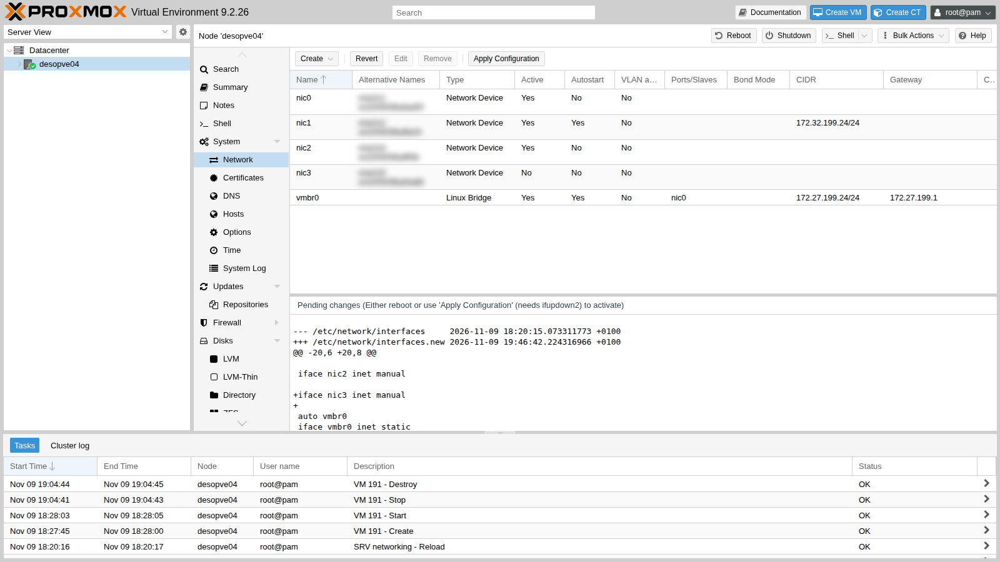
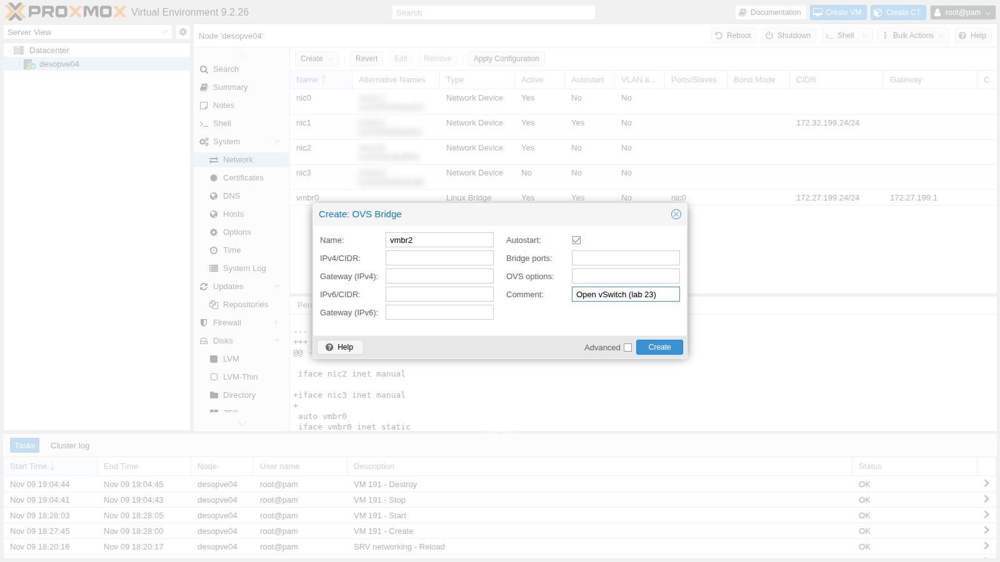
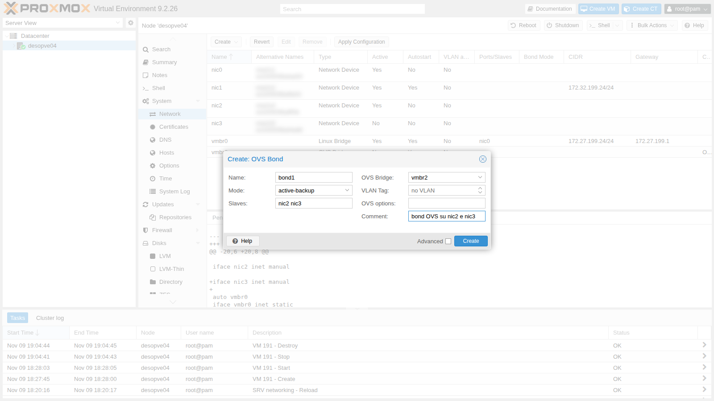
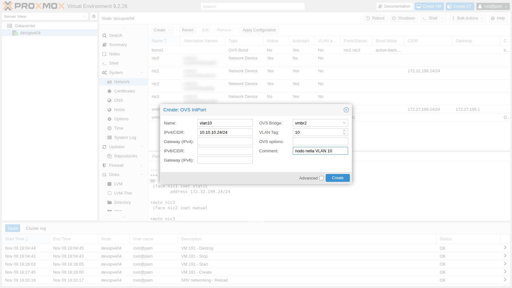
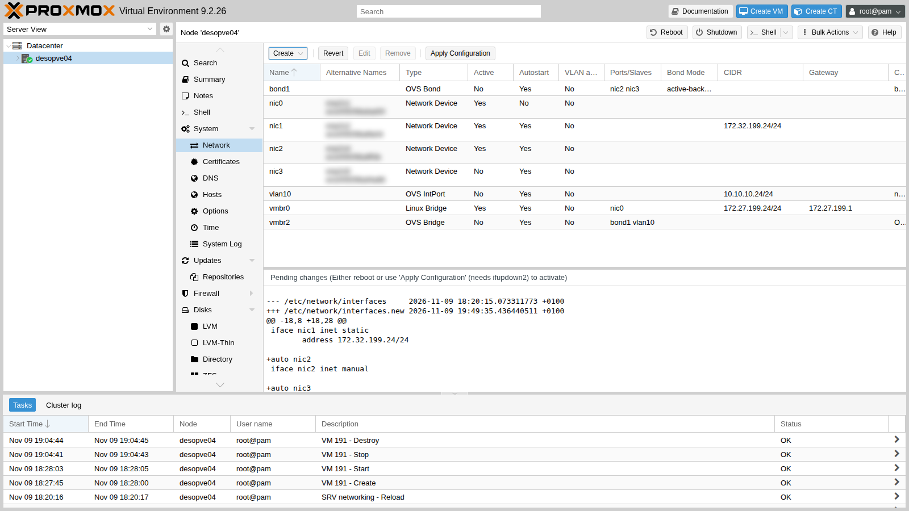
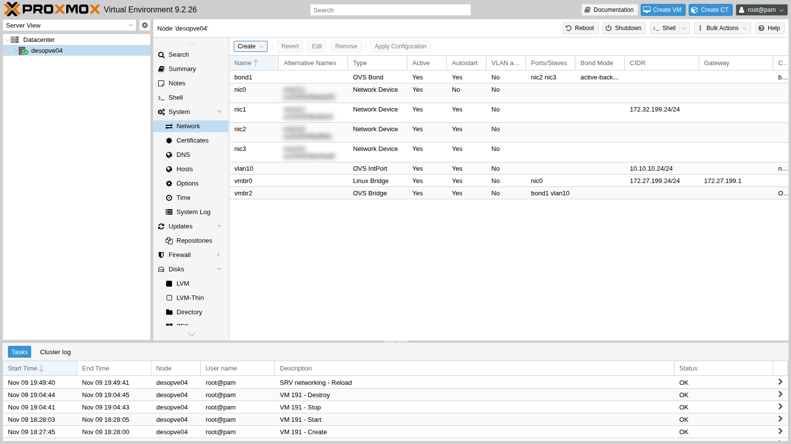
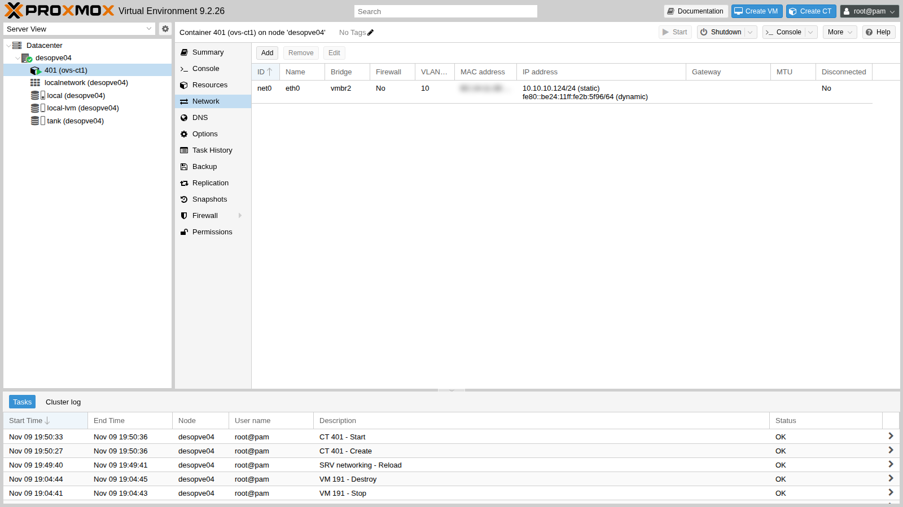

# Lab 23 – Open vSwitch: bridges, bonds and VLANs with OVS

**Level:** advanced · **Duration:** 1 hour

## Dependencies

- **Previous labs:**
  - [Lab 20](20-bridges-stable-names-vlans.md): stable NIC names (`pve-network-interface-pinning`) and VLANs with the Linux bridge;
  - [Lab 21](21-bonding.md): bond modes and the LACP test without a partner;
  - [Lab 18](18-ceph-growth-maintenance-failures.md): the `nic2` port of `desopve04`, installed in that lab;
  - [Lab 09](09-lvm-and-lvm-thin.md): the Debian template on `desopve04`.
- **Node:** `desopve04`, the standalone node. The OVS tests do not touch the cluster network.
- **Network cards:** on `desopve04`, two free ports connected to the switch trunk: `nic2` (lab 18) and the port of a second single-port card, to install with the server powered off in step 1, which becomes `nic3`.
- **Test guest:** CT 122 `vlan-ct2` (VLAN 10, 10.10.10.122) on `desopve02`, created in lab 20 on a Linux bridge.
- **Template:** `debian-13-standard_13.6-1_amd64.tar.zst` in the `local` storage of `desopve04` (lab 09, or `pveam download local debian-13-standard_13.6-1_amd64.tar.zst`).
- **Proxy:** to download the packages, `proxy.proxmox.community:3128` (lab 04).
- **Credentials:** `root` / `<lab-password>` → [Appendix B](b-credentials-and-addresses.md).

## Objectives

- Understand what Open vSwitch is and how it differs from the Linux bridge.
- Install OVS and build, from the GUI, an OVS bridge with an OVS bond and an internal port on a VLAN.
- Connect a container to a VLAN of the OVS bridge and have it talk to a guest that sits on a Linux bridge on another node.
- Try out the OVS bond modes: active-backup, balance-slb and LACP, including without a partner.
- Read the OVS state with `ovs-vsctl`, `ovs-appctl` and `ovs-ofctl`.

## How it works

### Two software switches for the same job

Proxmox VE connects VMs to the network with a software switch inside the node. There are two kinds:

| | Linux bridge | Open vSwitch (OVS) |
|---|---|---|
| Where it lives | in the kernel, built in from the start | kernel module (*datapath*) plus two user-space services: `ovsdb-server` (the configuration) and `ovs-vswitchd` (the logic) |
| Installation | already present | `openvswitch-switch` package |
| VLANs | VLAN-aware bridge, tag on the virtual NIC | tag on the port (`tag`), *trunk* for the ports that carry several VLANs |
| Bonds | kernel bond (`bond0`) below the bridge | bond **inside** OVS (`OVSBond`): active-backup, balance-slb, LACP (`balance-tcp`) |
| Node address on a VLAN | VLAN interface (`vmbr1.100`) | internal port (`OVSIntPort`) with a tag |
| Extra features | — | OpenFlow flows, port mirroring, tunnels, per-port statistics |
| Tools | `ip`, `bridge`, `/proc/net/bonding` | `ovs-vsctl`, `ovs-appctl`, `ovs-ofctl` |

For most Proxmox clusters the Linux bridge is enough, and it is the default choice. OVS is worth it when you need its extra features, or when the network is already managed with OVS. VMs, containers and Proxmox SDN work with both.

### OVS objects in the Proxmox GUI

Once the package is installed, three entries appear in **System** → **Network** → **Create**:

- **OVS Bridge**: the switch (`vmbr2`). Its ports are bonds, NICs and internal ports.
- **OVS Bond**: a bond of two or more NICs, created **inside** an OVS bridge.
- **OVS IntPort**: an internal port, that is, an interface of the node connected to the switch. With a VLAN tag it gives the node an address on that VLAN.

The NICs that join an OVS bond stay configured as `inet manual`, with no other options: OVS manages them.

### The OVS bond

| Mode | How it works | Switch configuration needed? |
|---|---|---|
| `active-backup` | only one member transmits, the other takes over if the first one fails | no |
| `balance-slb` | distributes the source MACs among the members and rebalances them every 10 s | no |
| `balance-tcp` | distributes per flow (L3/L4) | yes: it requires LACP |

With `lacp=active` OVS negotiates LACP (802.3ad) with the switch. If nobody answers on the other side, the members stay disabled. The `lacp-fallback-ab` option makes the bond fall back to active-backup when the negotiation fails.

## Procedure

### 1. An extra card and the OVS package

1. Power off `desopve04` (its guests are shut down, or there are none), install the second single-port card, cable it to the switch and power the node back on. The new port shows up with its system name (`ens<N>`, assigned by udev). Pin the name as in lab 20:

   ```bash title="root@desopve04"
   cp /etc/network/interfaces /root/interfaces.bak-lab23
   pve-network-interface-pinning generate --interface ens<N> --target-name nic3
   ```

   ``` { .text .no-copy title="Output" }
   Name for link 'ens<N>' (enp<B>s<S>f<F>, enx<MAC>) will change to 'nic3'
   Generating link files
   Successfully generated .link files in '/usr/local/lib/systemd/network/'
   ...
   ```

   ```bash title="root@desopve04"
   udevadm trigger -c add /sys/class/net/ens<N>; udevadm settle
   ip -br link | grep -E "^nic"
   ```

   ``` { .text .no-copy title="Output" }
   nic0             UP             <MAC> <BROADCAST,MULTICAST,UP,LOWER_UP>
   nic1             UP             <MAC> <BROADCAST,MULTICAST,UP,LOWER_UP>
   nic2             UP             <MAC> <BROADCAST,MULTICAST,UP,LOWER_UP>
   nic3             DOWN           <MAC> <BROADCAST,MULTICAST>
   ```

2. Install Open vSwitch (downloaded through the proxy):

   ```bash title="root@desopve04"
   apt install openvswitch-switch
   ```

   ``` { .text .no-copy title="Output" }
   ...
   Setting up openvswitch-switch (3.5.0-1+b1) ...
   ```

   ```bash title="root@desopve04"
   systemctl is-active openvswitch-switch
   ```

   ``` { .text .no-copy title="Output" }
   active
   ```

   ```bash title="root@desopve04"
   ovs-vsctl show
   ```

   ``` { .text .no-copy title="Output" }
   6704ca2b-e02a-493d-a7bc-582606dafa2e
       ovs_version: "3.5.0"
   ```

   The node's network before the lab: `vmbr0` for management, `nic1` for storage, `nic2` and `nic3` free.

   

### 2. Bridge, bond and internal port from the GUI

1. Node **desopve04** → **System** → **Network** → **Create** → **OVS Bridge**. **Name** `vmbr2`, no ports for now (the bond is added later), comment `Open vSwitch (lab 23)`.

   

2. **Create** → **OVS Bond**. **Name** `bond1` (the `bond0` on the other nodes is a Linux bond), **Mode** `active-backup`, **Slaves** `nic2 nic3`, **OVS Bridge** `vmbr2`.

   

3. **Create** → **OVS IntPort**. **Name** `vlan10`, **OVS Bridge** `vmbr2`, **VLAN Tag** `10`, **IPv4/CIDR** `10.10.10.24/24`, no gateway. The node will have an address in VLAN 10, the same VLAN as the test containers from lab 20.

   

4. The changes are pending: the GUI shows the differences from the file currently in use.

   

5. **Apply Configuration** → **Yes**.

   

   In `/etc/network/interfaces` the OVS objects have the `ovs_type`, `ovs_bridge`, `ovs_ports`, `ovs_bonds` and `ovs_options` lines:

   ```text
   auto nic3
   iface nic3 inet manual

   auto vlan10
   iface vlan10 inet static
   	address 10.10.10.24/24
   	ovs_type OVSIntPort
   	ovs_bridge vmbr2
   	ovs_options tag=10
   #nodo nella VLAN 10

   auto bond1
   iface bond1 inet manual
   	ovs_bonds nic2 nic3
   	ovs_type OVSBond
   	ovs_bridge vmbr2
   	ovs_options bond_mode=active-backup
   #bond OVS su nic2 e nic3

   auto vmbr2
   iface vmbr2 inet manual
   	ovs_type OVSBridge
   	ovs_ports bond1 vlan10
   #Open vSwitch (lab 23)
   ```

### 3. A container on VLAN 10 of the OVS bridge

1. Create CT 401 with its network interface on `vmbr2` and tag 10. In the GUI you choose **Bridge** `vmbr2` and **VLAN Tag** `10`, as with a Linux bridge; from the command line:

   ```bash title="root@desopve04"
   pct create 401 local:vztmpl/debian-13-standard_13.6-1_amd64.tar.zst \
       --hostname ovs-ct1 --memory 512 --cores 1 --rootfs local-lvm:4 \
       --net0 name=eth0,bridge=vmbr2,tag=10,ip=10.10.10.124/24 \
       --unprivileged 1 --features nesting=1 --password '<lab-password>' --start 1
   pct config 401 | grep net0
   ```

   ``` { .text .no-copy title="Output" }
   net0: name=eth0,bridge=vmbr2,hwaddr=BC:24:11:2B:5F:96,ip=10.10.10.124/24,tag=10,type=veth
   ```

   

2. The container reaches CT 122, which sits on a **Linux bridge** on `desopve02`, and the node's internal port. The 802.1Q tag is the same standard: the network does not care which kind of software switch added it.

   ```bash title="root@desopve04"
   pct exec 401 -- ping -c3 -W1 10.10.10.122
   ```

   ``` { .text .no-copy title="Output" }
   64 bytes from 10.10.10.122: icmp_seq=1 ttl=64 time=2.21 ms
   64 bytes from 10.10.10.122: icmp_seq=2 ttl=64 time=0.606 ms
   64 bytes from 10.10.10.122: icmp_seq=3 ttl=64 time=0.572 ms
   3 packets transmitted, 3 received, 0% packet loss, time 2061ms
   ```

   ```bash title="root@desopve04"
   pct exec 401 -- ping -c3 -W1 10.10.10.24 | tail -2
   ```

   ``` { .text .no-copy title="Output" }
   3 packets transmitted, 3 received, 0% packet loss, time 2015ms
   rtt min/avg/max/mdev = 0.164/0.454/1.029/0.406 ms
   ```

   ```bash title="root@desopve04"
   pct exec 401 -- ping -c2 -W1 10.20.20.123
   ```

   ``` { .text .no-copy title="Output" }
   ping: connect: Network is unreachable
   ```

   VLAN 20 remains unreachable: between different VLANs you need a router (lab 26).

### 4. Reading the OVS state

1. **The switch structure:** ports, bond members, tags.

   ```bash title="root@desopve04"
   ovs-vsctl show
   ```

   ``` { .text .no-copy title="Output" }
   6704ca2b-e02a-493d-a7bc-582606dafa2e
       Bridge vmbr2
           Port bond1
               Interface nic2
               Interface nic3
           Port veth401i0
               tag: 10
               Interface veth401i0
           Port vlan10
               tag: 10
               Interface vlan10
                   type: internal
           Port vmbr2
               Interface vmbr2
                   type: internal
       ovs_version: "3.5.0"
   ```

   The container's port (`veth401i0`) has `tag: 10`: Proxmox added it to the switch when the CT started. The `bond1` port has no tag, so it is a trunk and carries all the VLANs.

2. **The table of learned MAC addresses**, with the VLAN of each one:

   ```bash title="root@desopve04"
   ovs-appctl fdb/show vmbr2
   ```

   ``` { .text .no-copy title="Output" }
    port  VLAN  MAC                Age
   LOCAL     0  de:b1:d7:6e:4e:4f   71
       2    10  bc:24:11:af:bc:fc   47
       2     0  <MAC>               42
       2     0  <MAC>               30
       1    10  86:93:65:12:34:7e    2
       2    10  bc:24:11:10:9a:74    2
       5    10  bc:24:11:2b:5f:96    1
   ```

   The `bc:24:11:…` MAC addresses belong to the container interfaces: the remote ones (CT 121 and 122) come in from port 2, that is, from the bond. On VLAN 0 (untagged) OVS also sees the traffic of the management network, which runs on the same trunk.

3. **The OpenFlow flows:** without a controller there is a single rule, `NORMAL`, which means "behave like a MAC-learning switch".

   ```bash title="root@desopve04"
   ovs-ofctl dump-flows vmbr2
   ```

   ``` { .text .no-copy title="Output" }
   NXST_FLOW reply (xid=0x4):
    cookie=0x0, duration=71.116s, table=0, n_packets=16563, n_bytes=1310428, idle_age=0, priority=0 actions=NORMAL
   ```

### 5. Putting the OVS bond to the test

1. **active-backup, failure of the active member.** The active member is `nic3`. While the container sends 5 pings per second to CT 122, `nic3` is brought down:

   ```bash title="root@desopve04"
   ovs-appctl bond/show bond1 | grep -E "active member|^member"
   ```

   ``` { .text .no-copy title="Output" }
   active member mac: <MAC>(nic3)
   member nic2: enabled
   member nic3: enabled
   ```

   ```bash title="root@desopve04"
   pct exec 401 -- ping -i 0.2 -c 75 -W1 10.10.10.122 > /tmp/p1.txt &
   ip link set nic3 down
   tail -2 /tmp/p1.txt
   ```

   ``` { .text .no-copy title="Output" }
   75 packets transmitted, 75 received, 0% packet loss, time 15335ms
   rtt min/avg/max/mdev = 0.436/0.658/1.016/0.118 ms
   ```

   ```bash title="root@desopve04"
   ovs-appctl bond/show bond1 | sed -n "/active-backup primary/,\$p"
   ```

   ``` { .text .no-copy title="Output" }
   active-backup primary: <none>
   active member mac: <MAC>(nic2)

   member nic2: enabled
     active member
     may_enable: true

   member nic3: disabled
     may_enable: false
   ```

   No packets lost: OVS moved the traffic to `nic2`. When `nic3` comes back (`ip link set nic3 up`) the traffic **stays** on `nic2`: without a primary member (`active-backup primary: <none>`), OVS does not switch back, which avoids a second move.

2. **balance-slb.** You can change the mode on the fly too:

   ```bash title="root@desopve04"
   ovs-vsctl set port bond1 bond_mode=balance-slb
   ovs-appctl bond/show bond1
   ```

   ``` { .text .no-copy title="Output" }
   ---- bond1 ----
   bond_mode: balance-slb
   ...
   next rebalance: 522 ms
   lacp_status: off
   ...
   member nic2: enabled
     active member
     may_enable: true

   member nic3: enabled
     may_enable: true
     hash 122: 1 kB load
   ```

   Now both members transmit: OVS assigns the source addresses (the *hashes*) to the members and periodically rebalances them according to the load. It works without any configuration on the switch, like `balance-alb` on the Linux bond (lab 21).

3. **LACP without a partner.** `balance-tcp` requires LACP:

   ```bash title="root@desopve04"
   ovs-vsctl set port bond1 lacp=active bond_mode=balance-tcp
   ovs-appctl bond/show bond1 | grep -E "bond_mode|lacp_status|lacp_fallback|^member|may_enable"
   ```

   ``` { .text .no-copy title="Output" }
   bond_mode: balance-tcp
   lacp_status: configured
   lacp_fallback_ab: false
   member nic2: disabled
     may_enable: false
   member nic3: disabled
     may_enable: false
   ```

   ```bash title="root@desopve04"
   ovs-appctl lacp/show bond1 | grep -E "actor sys_id|partner sys_id" | head -2
   ```

   ``` { .text .no-copy title="Output" }
     actor sys_id: <MAC>
     partner sys_id: 00:00:00:00:00:00
   ```

   ```bash title="root@desopve04"
   pct exec 401 -- ping -c3 -W1 10.10.10.122 | tail -1
   ```

   ``` { .text .no-copy title="Output" }
   3 packets transmitted, 0 received, 100% packet loss, time 2083ms
   ```

   The lab switch does not answer LACP (`partner sys_id` all zeros): OVS **disables both members** and the network goes down. In the same situation, the Linux bond in `802.3ad` mode kept one link up (lab 21): OVS is stricter.

4. **Falling back to active-backup.** With `lacp-fallback-ab` the bond works again even without a partner:

   ```bash title="root@desopve04"
   ovs-vsctl set port bond1 other_config:lacp-fallback-ab=true
   ovs-appctl bond/show bond1 | grep -E "lacp_status|lacp_fallback|active member$"
   ```

   ``` { .text .no-copy title="Output" }
   lacp_status: configured
   lacp_fallback_ab: true
     active member
   ```

   ```bash title="root@desopve04"
   pct exec 401 -- ping -c3 -W1 10.10.10.122 | tail -2
   ```

   ``` { .text .no-copy title="Output" }
   3 packets transmitted, 3 received, 0% packet loss, time 2065ms
   rtt min/avg/max/mdev = 0.639/0.684/0.753/0.049 ms
   ```

5. **Back to the configuration in the file.** The changes made with `ovs-vsctl` live in the OVS database, not in `/etc/network/interfaces`: you must undo them by hand, or write them into the file with `ovs_options` (for example `ovs_options bond_mode=balance-tcp lacp=active other_config:lacp-fallback-ab=true`).

   ```bash title="root@desopve04"
   ovs-vsctl set port bond1 lacp=off bond_mode=active-backup -- remove port bond1 other_config lacp-fallback-ab
   ovs-vsctl get port bond1 bond_mode lacp other_config
   ```

   ``` { .text .no-copy title="Output" }
   active-backup
   off
   {}
   ```

### 6. Linux bridge and OVS, command by command

| What you want to see | Linux bridge | Open vSwitch |
|---|---|---|
| Switch structure and ports | `bridge link`, `ip -d link` | `ovs-vsctl show` |
| Port VLANs | `bridge vlan show` | `ovs-vsctl show` (`tag` field), `ovs-vsctl list port` |
| Learned MAC addresses | `bridge fdb show br vmbr1` | `ovs-appctl fdb/show vmbr2` |
| Bond status | `cat /proc/net/bonding/bond0` | `ovs-appctl bond/show bond1` |
| LACP | `/proc/net/bonding/bond0` (802.3ad section) | `ovs-appctl lacp/show bond1` |
| Forwarding rules | (none: the bridge learns and forwards) | `ovs-ofctl dump-flows vmbr2` |

## Verification and tests

| Test | Result |
|---|---|
| OVS bridge, bond and internal port created from the GUI | `vmbr2` with `bond1` (nic2 + nic3) and `vlan10` 10.10.10.24/24 |
| CT on `vmbr2` with tag 10 to a CT on a Linux bridge on another node | reachable, 0% loss |
| VLAN 20 from the CT in VLAN 10 | unreachable without a router |
| Failure of the active member in active-backup | 75 pings out of 75, no loss, traffic on `nic2` |
| Return of `nic3` | traffic stays on `nic2` (no primary member) |
| balance-slb | both members active, hashes distributed |
| LACP without a partner | both members disabled, 100% loss |
| LACP with `lacp-fallback-ab` | fallback to active-backup, 0% loss |

## Final lab state

- **`desopve04`:** Open vSwitch 3.5 installed.
  - `vmbr2` (OVS) with `bond1` (OVS, active-backup, `nic2` + `nic3`);
  - internal port `vlan10` 10.10.10.24/24 (VLAN 10);
  - `vmbr0` and `nic1` unchanged;
  - copy of the previous network configuration in `/root/interfaces.bak-lab23`.
- **CT 401 `ovs-ct1`** on `desopve04`, running: `vmbr2` VLAN 10, 10.10.10.124/24, disk on `local-lvm`.
- The cluster (`desopve01-03`) was not touched.

## What you learned

- Open vSwitch is an alternative to the Linux bridge, with bonds, internal ports and flows managed inside the switch; Proxmox configures it from the GUI and through `/etc/network/interfaces`.
- A VLAN tag added by OVS and one added by a Linux bridge are the same 802.1Q tag: the two switches coexist on the same network.
- The OVS bond in active-backup fails over to the other member without losses and does not switch back if there is no primary.
- `balance-tcp` requires LACP: without a partner OVS shuts the bond down, unless `lacp-fallback-ab` is set.
- `ovs-vsctl` changes the OVS database immediately, but permanent changes belong in the network file.

## References

- [Proxmox VE – Open vSwitch](https://pve.proxmox.com/wiki/Open_vSwitch)
- [Proxmox VE – Network Configuration](https://pve.proxmox.com/pve-docs/pve-admin-guide.html#sysadmin_network_configuration)
- [Open vSwitch – documentation](https://docs.openvswitch.org/)
- [ovs-vswitchd.conf.db – bond and LACP options](https://www.openvswitch.org/support/dist-docs/ovs-vswitchd.conf.db.5.html)
