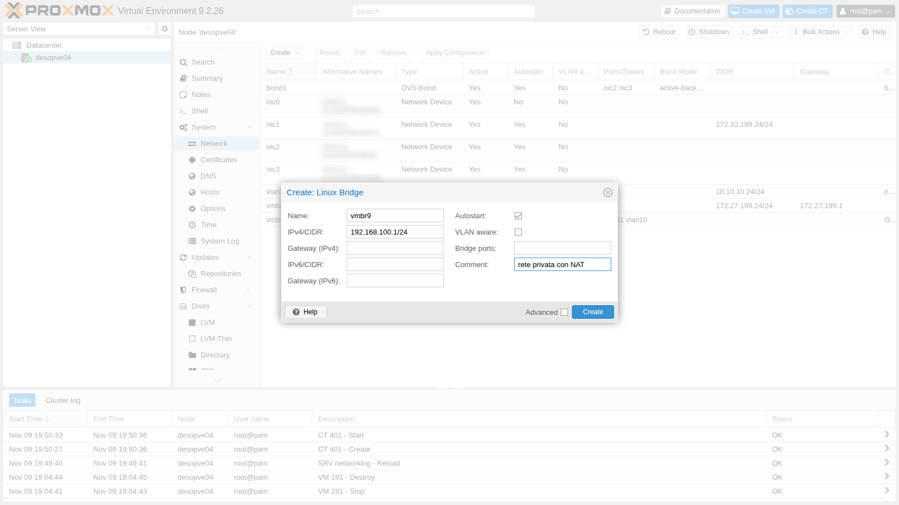
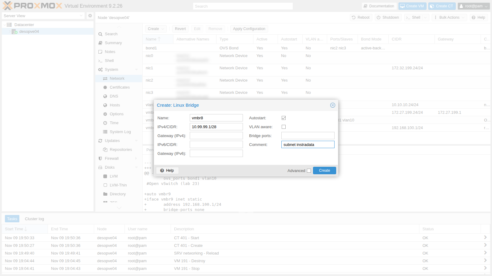
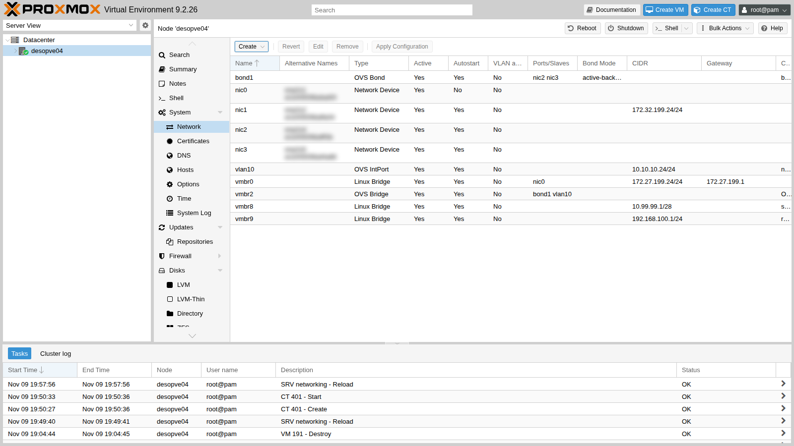

# Lab 24 – Routing and NAT on the host: masquerading, port forwarding and routed configuration

**Level:** advanced · **Duration:** 1 hour 15 minutes

## Dependencies

- **Previous labs:**
  - [Lab 20](20-bridges-stable-names-vlans.md): Linux bridges and the anatomy of `/etc/network/interfaces`;
  - [Lab 23](23-open-vswitch.md): starting state of `desopve04`.
- **Node:** `desopve04`, the standalone node: the tests do not touch the cluster.
- **Router:** `rtr-core` (172.27.199.1), the lab's MikroTik RouterOS router and the gateway of the management network: its basic configuration is in [Lab 01](01-lab-architecture.md) and you access it with `ssh admin@172.27.199.1`. In this lab it plays the part of the provider's router.
- **Template:** `debian-13-standard_13.6-1_amd64.tar.zst` in the `local` storage of `desopve04` ([Lab 09](09-lvm-and-lvm-thin.md), or `pveam download local debian-13-standard_13.6-1_amd64.tar.zst`).
- **Test clients:** `desopve01` and the DC `desopve-dc01` (172.27.199.20).
- **Proxy:** `proxy.proxmox.community:3128` for the packages in the containers.
- **Credentials:** `root` / `<lab-password>` on the nodes, `admin` / `<lab-password>` on `rtr-core` → [Appendix B](b-credentials-and-addresses.md).

## Objectives

- Give the guests a private network that reaches the rest of the network with the node's address (masquerading).
- Publish a service of a private guest on a port of the node (port forwarding).
- Route an "additional" subnet to the node, as providers do with dedicated servers, and give the guests their own addresses without NAT.
- Write `post-up` rules that do not get duplicated when the network is reloaded.

## How it works

### Three ways to connect the guests

| Mode | How the guests see the others | How the others see the guests | When to use it |
|---|---|---|---|
| **Bridged** (lab 20) | the guests are on the same physical network as the node | with their own address | almost always: datacenters, corporate LANs |
| **Masquerading (NAT)** | they go out with the node's address | they do not see them (only through port forwarding) | a single available address, labs, test networks |
| **Routed** | the node acts as a router between their subnet and the outside network | with their own address, if someone routes the subnet to the node | dedicated servers at a provider that does not accept unknown MAC addresses on its network |

### The node as a router

To forward packets between its interfaces, the node must have **IP forwarding** enabled (`net.ipv4.ip_forward = 1`). A bridge **without ports** (`bridge-ports none`) is a network that exists only inside the node: the guests attached to it can get out only through the node, which routes their traffic.

### Masquerading and port forwarding

**Masquerading** is a form of source NAT: the guests' packets leave through `vmbr0` with the node's address instead of their own. The kernel's *conntrack* table remembers every connection and delivers the replies to the right guest. The other hosts do not see the private network and do not need to know about it.

**Port forwarding** is destination NAT (DNAT): a connection that arrives at a port of the node is redirected to an address and a port on the private network.

### Routed configuration

A provider assigns the server a main address and, often, an additional subnet routed **to the main address**. The node puts the subnet on an internal bridge and routes it: the guests have their own addresses, reachable from outside, without NAT. In the lab we add the route that would live on the provider's router ourselves, on `rtr-core`.

A variant in the Proxmox documentation uses **proxy ARP** (`proxy_arp` on the external interface): the node answers the ARP requests for the guests' addresses, so the provider's router reaches them even without a dedicated route. This lab uses the static route, which is the clearest approach.

### The rules in the network file

The GUI does not manage NAT: you add the rules by hand in `/etc/network/interfaces` with `post-up` (run when the interface comes up) and `post-down` (run when it goes down). Proxmox keeps these lines even when you later change the network from the GUI.

> If you enable the Proxmox firewall (lab 32), the documentation asks you to separate the connection tracking of the guests with *conntrack* zones (`iptables -t raw -I PREROUTING -i fwbr+ -j CT --zone 1`), otherwise NAT and the firewall interfere with each other. In this lab the firewall is disabled.

## Procedure

### 1. The two internal bridges from the GUI

1. Make a backup copy of the network configuration:

   ```bash title="root@desopve04"
   cp /etc/network/interfaces /root/interfaces.bak-lab24
   ```

2. Node **desopve04** → **System** → **Network** → **Create** → **Linux Bridge**. **Name** `vmbr9`, **IPv4/CIDR** `192.168.100.1/24`, **Bridge ports** empty, no gateway. Comment `rete privata con NAT`.

   

3. A second bridge for the routed configuration: **Name** `vmbr8`, **IPv4/CIDR** `10.99.99.1/28` (the provider's "additional subnet"), **Bridge ports** empty, comment `subnet instradata`.

   

4. **Apply Configuration**:

   

5. Enable IP forwarding permanently:

   ```bash title="root@desopve04"
   echo "net.ipv4.ip_forward = 1" > /etc/sysctl.d/80-ip-forward.conf
   sysctl -p /etc/sysctl.d/80-ip-forward.conf
   ```

   ``` { .text .no-copy title="Output" }
   net.ipv4.ip_forward = 1
   ```

### 2. Masquerading

1. Add the two NAT lines to the `vmbr9` block in `/etc/network/interfaces` and reload the network:

   ```text
   auto vmbr9
   iface vmbr9 inet static
   	address 192.168.100.1/24
   	bridge-ports none
   	bridge-stp off
   	bridge-fd 0
   	post-up   iptables -t nat -A POSTROUTING -s 192.168.100.0/24 -o vmbr0 -j MASQUERADE
   	post-down iptables -t nat -D POSTROUTING -s 192.168.100.0/24 -o vmbr0 -j MASQUERADE
   #rete privata con NAT
   ```

   ```bash title="root@desopve04"
   ifreload -a
   iptables -t nat -S POSTROUTING
   ```

   ``` { .text .no-copy title="Output" }
   -P POSTROUTING ACCEPT
   -A POSTROUTING -s 192.168.100.0/24 -o vmbr0 -j MASQUERADE
   ```

2. Create CT 402 on the private network, with the node as its gateway:

   ```bash title="root@desopve04"
   pct create 402 local:vztmpl/debian-13-standard_13.6-1_amd64.tar.zst \
       --hostname nat-ct1 --memory 512 --cores 1 --rootfs local-lvm:4 \
       --net0 name=eth0,bridge=vmbr9,ip=192.168.100.10/24,gw=192.168.100.1 \
       --nameserver 172.27.199.20 --searchdomain proxmox.community \
       --unprivileged 1 --features nesting=1 --password '<lab-password>' --start 1
   ```

3. The container reaches the DC and resolves names:

   ```bash title="root@desopve04"
   pct exec 402 -- ip route
   ```

   ``` { .text .no-copy title="Output" }
   default via 192.168.100.1 dev eth0 proto kernel onlink
   192.168.100.0/24 dev eth0 proto kernel scope link src 192.168.100.10
   ```

   ```bash title="root@desopve04"
   pct exec 402 -- ping -c3 -W1 172.27.199.20 | tail -2
   ```

   ``` { .text .no-copy title="Output" }
   3 packets transmitted, 3 received, 0% packet loss, time 2074ms
   rtt min/avg/max/mdev = 0.743/0.820/0.862/0.054 ms
   ```

   ```bash title="root@desopve04"
   pct exec 402 -- getent hosts desopve-dc01.proxmox.community
   ```

   ``` { .text .no-copy title="Output" }
   172.27.199.20   desopve-dc01.proxmox.community
   172.32.199.20   desopve-dc01.proxmox.community
   ```

4. On `vmbr0` the packets leave with the **node's** address, and the conntrack table remembers whom to send the reply back to:

   ```bash title="root@desopve04"
   tcpdump -ni vmbr0 icmp and host 172.27.199.20
   ```

   ``` { .text .no-copy title="Output" }
   19:59:00.253879 IP 172.27.199.24 > 172.27.199.20: ICMP echo request, id 347, seq 1, length 64
   19:59:00.254872 IP 172.27.199.20 > 172.27.199.24: ICMP echo reply, id 347, seq 1, length 64
   ```

   ```bash title="root@desopve04"
   conntrack -L -p icmp
   ```

   ``` { .text .no-copy title="Output" }
   icmp     1 24 src=192.168.100.10 dst=172.27.199.20 type=8 code=0 id=347 src=172.27.199.20 dst=172.27.199.24 type=0 code=0 id=347 mark=0 use=1
   ```

   The conntrack entry has two halves: the request as the container sent it (`src=192.168.100.10`) and the reply as it arrives from the DC (`dst=172.27.199.24`).

5. **Test without masquerading.** Remove the rule and try again:

   ```bash title="root@desopve04"
   iptables -t nat -D POSTROUTING -s 192.168.100.0/24 -o vmbr0 -j MASQUERADE
   pct exec 402 -- ping -c3 -W1 172.27.199.20 | tail -1
   ```

   ``` { .text .no-copy title="Output" }
   3 packets transmitted, 0 received, 100% packet loss, time 2055ms
   ```

   ```bash title="root@desopve04"
   tcpdump -ni vmbr0 icmp and host 172.27.199.20
   ```

   ``` { .text .no-copy title="Output" }
   19:59:08.670035 IP 192.168.100.10 > 172.27.199.20: ICMP echo request, id 348, seq 1, length 64
   19:59:09.700834 IP 192.168.100.10 > 172.27.199.20: ICMP echo request, id 348, seq 2, length 64
   19:59:10.725095 IP 192.168.100.10 > 172.27.199.20: ICMP echo request, id 348, seq 3, length 64
   ```

   The node forwards the requests with the private address: the DC does not know where `192.168.100.0/24` is, sends the replies to its gateway, and they get lost. Put the rule back (`iptables -t nat -A ...`) and the ping works again.

6. The container installs packages through the NAT and the lab proxy:

   ```bash title="root@desopve04"
   pct exec 402 -- sh -c 'echo "Acquire::http::Proxy \"http://proxy.proxmox.community:3128\";" > /etc/apt/apt.conf.d/80proxy'
   pct exec 402 -- apt-get update
   pct exec 402 -- apt-get install -y nginx
   pct exec 402 -- sh -c 'echo "nat-ct1: servizio raggiunto con il port forwarding" > /var/www/html/index.html'
   ```

### 3. Port forwarding

1. Add the DNAT lines to `vmbr9`: port 8080 of the node goes to port 80 of the container.

   ```text
   	post-up   iptables -t nat -A PREROUTING -i vmbr0 -p tcp --dport 8080 -j DNAT --to-destination 192.168.100.10:80
   	post-down iptables -t nat -D PREROUTING -i vmbr0 -p tcp --dport 8080 -j DNAT --to-destination 192.168.100.10:80
   ```

2. **Watch out for `ifreload`.** When you reload the network after the change, ifupdown2 runs the `post-up` commands of `vmbr9` again: the masquerading rule that was already there gets added a second time too.

   ```bash title="root@desopve04"
   ifreload -a
   iptables -t nat -S | grep -E "DNAT|MASQ"
   ```

   ``` { .text .no-copy title="Output" }
   -A PREROUTING -i vmbr0 -p tcp -m tcp --dport 8080 -j DNAT --to-destination 192.168.100.10:80
   -A POSTROUTING -s 192.168.100.0/24 -o vmbr0 -j MASQUERADE
   -A POSTROUTING -s 192.168.100.0/24 -o vmbr0 -j MASQUERADE
   ```

   The DNAT rule, just added to the file, appears once; the masquerading rule, which was already there, appears twice. `ifreload -a` reruns **all** the `post-up` commands of the bridge at every reload, even if the file has not changed: with one more reload there would be two DNAT rules and three MASQUERADE rules. Duplicate rules do not break anything right away, but they pile up, and a `post-down` removes only one of them. The solution is to add a rule **only if it is missing**: `iptables -C` (*check*) fails if the rule is not there, and only then does `-A` add it. The final `vmbr9` block:

   ```text
   auto vmbr9
   iface vmbr9 inet static
   	address 192.168.100.1/24
   	bridge-ports none
   	bridge-stp off
   	bridge-fd 0
   	post-up   iptables -t nat -C POSTROUTING -s 192.168.100.0/24 -o vmbr0 -j MASQUERADE 2>/dev/null || iptables -t nat -A POSTROUTING -s 192.168.100.0/24 -o vmbr0 -j MASQUERADE
   	post-down iptables -t nat -D POSTROUTING -s 192.168.100.0/24 -o vmbr0 -j MASQUERADE
   	post-up   iptables -t nat -C PREROUTING -i vmbr0 -p tcp --dport 8080 -j DNAT --to-destination 192.168.100.10:80 2>/dev/null || iptables -t nat -A PREROUTING -i vmbr0 -p tcp --dport 8080 -j DNAT --to-destination 192.168.100.10:80
   	post-down iptables -t nat -D PREROUTING -i vmbr0 -p tcp --dport 8080 -j DNAT --to-destination 192.168.100.10:80
   #rete privata con NAT
   ```

   Once you have removed the extra copies by hand (`iptables -t nat -D ...` once per rule), two reloads in a row no longer duplicate anything:

   ```bash title="root@desopve04"
   ifreload -a; ifreload -a
   iptables -t nat -S | grep -E "DNAT|MASQ"
   ```

   ``` { .text .no-copy title="Output" }
   -A PREROUTING -i vmbr0 -p tcp -m tcp --dport 8080 -j DNAT --to-destination 192.168.100.10:80
   -A POSTROUTING -s 192.168.100.0/24 -o vmbr0 -j MASQUERADE
   ```

3. The container's service is reachable from the management network on port 8080 of the node:

   ```bash title="root@desopve01"
   curl -s http://172.27.199.24:8080/
   ```

   ``` { .text .no-copy title="Output" }
   nat-ct1: servizio raggiunto con il port forwarding
   ```

   ```bash title="root@desopve01"
   curl -s -i http://172.27.199.24:8080/ | head -3
   ```

   ``` { .text .no-copy title="Output" }
   HTTP/1.1 200 OK
   Server: nginx
   Date: Mon, 09 Nov 2026 18:59:43 GMT
   ```

4. From the node itself, however, it does not work:

   ```bash title="root@desopve04"
   curl -s -m 5 http://172.27.199.24:8080/ || echo "nessuna risposta (codice $?)"
   ```

   ``` { .text .no-copy title="Output" }
   nessuna risposta (codice 7)
   ```

   ```bash title="root@desopve04"
   iptables -t nat -L PREROUTING -n -v
   ```

   ``` { .text .no-copy title="Output" }
   Chain PREROUTING (policy ACCEPT 41 packets, 2952 bytes)
    pkts bytes target     prot opt in     out     source               destination
       2   120 DNAT       tcp  --  vmbr0  *       0.0.0.0/0            0.0.0.0/0            tcp dpt:8080 to:192.168.100.10:80
   ```

   Connections that originate on the node do not go through the `PREROUTING` chain (they go through `OUTPUT`), and the rule matches packets coming in from `vmbr0`. The counters show the 2 packets that arrived from the other hosts.

### 4. Routed configuration

1. Create CT 403 on the routed subnet, with the node as its gateway:

   ```bash title="root@desopve04"
   pct create 403 local:vztmpl/debian-13-standard_13.6-1_amd64.tar.zst \
       --hostname routed-ct1 --memory 512 --cores 1 --rootfs local-lvm:4 \
       --net0 name=eth0,bridge=vmbr8,ip=10.99.99.2/28,gw=10.99.99.1 \
       --nameserver 172.27.199.20 --searchdomain proxmox.community \
       --unprivileged 1 --features nesting=1 --password '<lab-password>' --start 1
   ```

2. As long as the router does not know that the subnet is behind `desopve04`, the container is unreachable:

   ```bash title="root@desopve01"
   ping -c2 -W1 10.99.99.2 | tail -1
   ```

   ``` { .text .no-copy title="Output" }
   2 packets transmitted, 0 received, +2 errors, 100% packet loss, time 1001ms
   ```

3. On the router (`rtr-core` here, the provider's router in production) route the subnet to the node's main address:

   ```text title="RouterOS — rtr-core"
   /ip route add dst-address=10.99.99.0/28 gateway=172.27.199.24 comment="subnet instradata verso desopve04 (lab 24)"
   /ip route print where dst-address=10.99.99.0/28
   ```

   ``` { .text .no-copy title="Output" }
   Flags: A - ACTIVE; s - STATIC
   Columns: DST-ADDRESS, GATEWAY, ROUTING-TABLE, DISTANCE
   #    DST-ADDRESS    GATEWAY        ROUTING-TABLE  DISTANCE
   ;;; subnet instradata verso desopve04 (lab 24)
   0 As 10.99.99.0/28  172.27.199.24  main                  1
   ```

4. Now the container is reachable at **its own** address, and `traceroute` shows the path: router, node, container.

   ```bash title="root@desopve01"
   ping -c3 -W1 10.99.99.2 | tail -2
   ```

   ``` { .text .no-copy title="Output" }
   3 packets transmitted, 3 received, 0% packet loss, time 2052ms
   rtt min/avg/max/mdev = 0.633/0.776/0.907/0.112 ms
   ```

   ```bash title="root@desopve01"
   traceroute -n -w1 -q1 10.99.99.2
   ```

   ``` { .text .no-copy title="Output" }
   traceroute to 10.99.99.2 (10.99.99.2), 30 hops max, 60 byte packets
    1  172.27.199.1  0.440 ms
    2  172.27.199.24  0.684 ms
    3  10.99.99.2  0.783 ms
   ```

5. Unlike with masquerading, whoever receives the traffic sees the container's real address. Start the capture on `vmbr0` and, from a second terminal, send a ping from the container (`pct exec 403 -- ping -c1 172.27.199.20`):

   ```bash title="root@desopve04"
   tcpdump -ni vmbr0 icmp and host 172.27.199.20
   ```

   ``` { .text .no-copy title="Output" }
   20:00:13.717794 IP 10.99.99.2 > 172.27.199.20: ICMP echo request, id 344, seq 1, length 64
   20:00:13.718992 IP 172.27.199.20 > 10.99.99.2: ICMP echo reply, id 344, seq 1, length 64
   ```

   ```bash title="root@desopve04"
   ip route | grep -E "vmbr8|vmbr9"
   ```

   ``` { .text .no-copy title="Output" }
   10.99.99.0/28 dev vmbr8 proto kernel scope link src 10.99.99.1
   192.168.100.0/24 dev vmbr9 proto kernel scope link src 192.168.100.1
   ```

   The node has no NAT rules for `10.99.99.0/28`: it simply routes, because both networks are attached to its interfaces.

## Verification and tests

| Test | Result |
|---|---|
| CT on the private network to the DC, with masquerading | 0% loss; on `vmbr0` you see the node's address |
| Same test without the MASQUERADE rule | 100% loss: the DC does not know where to reply |
| `apt` in the private container | works through the NAT and the proxy |
| Port forwarding 8080 → CT 402:80 from `desopve01` | container page, HTTP 200 |
| Port forwarding from the node itself | does not work: local traffic does not go through `PREROUTING` |
| `ifreload` with `post-up iptables -A` | duplicate rules; with `-C ... \|\| -A` no duplicates |
| Routed subnet without a route on the router | unreachable |
| Routed subnet with the route on `rtr-core` | reachable in 3 hops, without NAT |

## Final lab state

- **`desopve04`:**
  - `vmbr9` 192.168.100.1/24 without ports, with masquerading towards `vmbr0` and DNAT `172.27.199.24:8080` → `192.168.100.10:80`;
  - `vmbr8` 10.99.99.1/28 without ports, routed subnet;
  - IP forwarding enabled (`/etc/sysctl.d/80-ip-forward.conf`);
  - copy of the previous network configuration in `/root/interfaces.bak-lab24`;
  - OVS (`vmbr2`, `bond1`, `vlan10`) unchanged since lab 23.
- **Containers on `desopve04`, all running:**
  - CT 401 `ovs-ct1` (lab 23);
  - CT 402 `nat-ct1` on `vmbr9`, 192.168.100.10, with nginx;
  - CT 403 `routed-ct1` on `vmbr8`, 10.99.99.2/28.
- **`rtr-core`:** static route `10.99.99.0/28` via `172.27.199.24`.

## What you learned

- A bridge without ports is a network internal to the node; with IP forwarding the node routes it.
- Masquerading hides the guests behind the node's address: conntrack delivers the replies, and the other hosts do not see the private network.
- Port forwarding publishes a private service on a port of the node, but it does not apply to connections that originate on the node itself.
- With the routed configuration the guests have their own addresses without NAT: the upstream router must route the subnet to the node.
- `post-up` rules are rerun at every `ifreload`: with `iptables -C ... || iptables -A ...` they do not get duplicated.

## References

- [Proxmox VE – Masquerading (NAT) with iptables](https://pve.proxmox.com/pve-docs/pve-admin-guide.html#sysadmin_network_masquerading)
- [Proxmox VE – Routed Configuration](https://pve.proxmox.com/pve-docs/pve-admin-guide.html#sysadmin_network_routed)
- [iptables-extensions – MASQUERADE and DNAT](https://manpages.debian.org/trixie/iptables/iptables-extensions.8.en.html)
- [RouterOS – IP routing](https://help.mikrotik.com/docs/spaces/ROS/pages/328084/IP+Routing)
