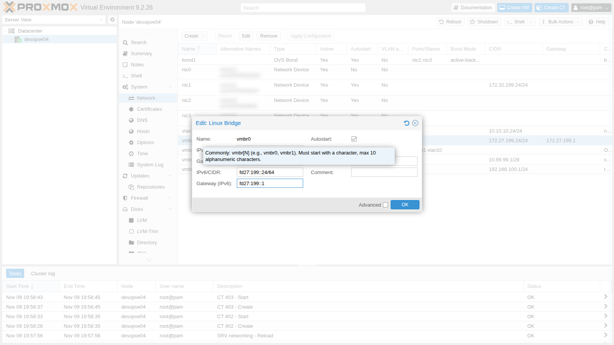
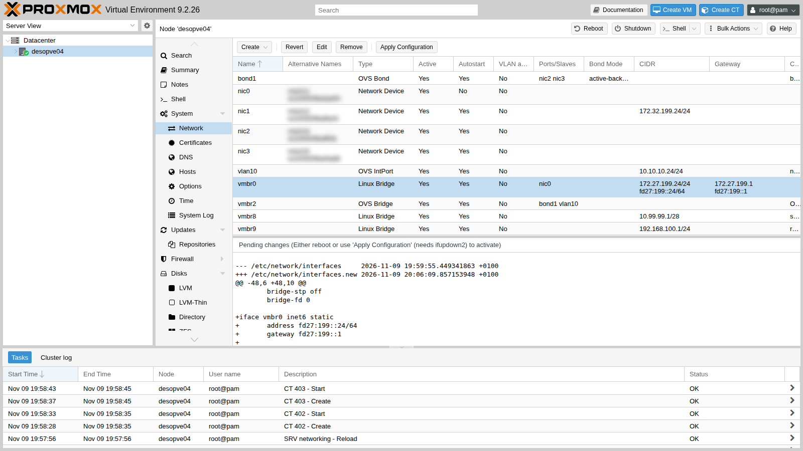
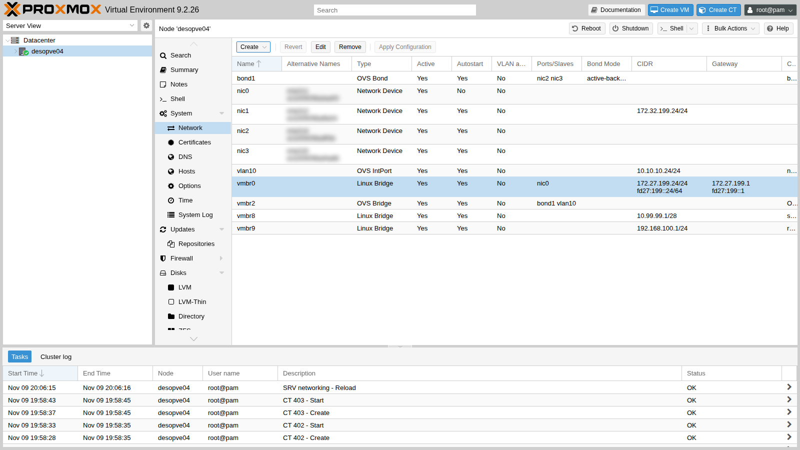
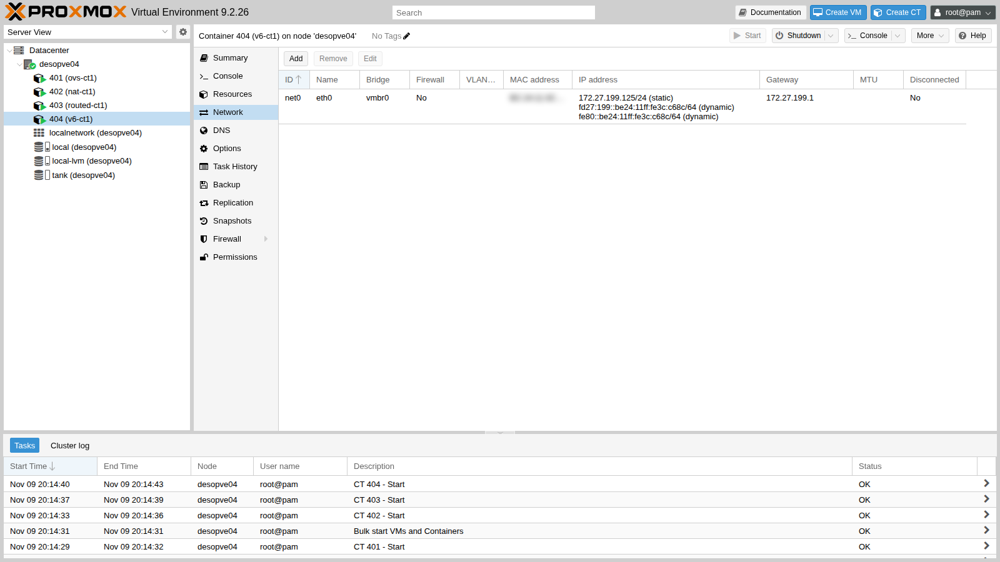

# Lab 25 – IPv6: dual stack, RA and SLAAC

**Level:** advanced · **Duration:** 1 hour 15 minutes

## Dependencies

- **Previous labs:**
  - [Lab 02](02-domain-controller.md): DC and DNS for `proxmox.community`;
  - [Lab 17](17-ceph-installation.md): Ceph, for the health checks after the network changes;
  - [Lab 20](20-bridges-stable-names-vlans.md) and [Lab 21](21-bonding.md): node networking, with `vmbr0` and `vmbr1`;
  - [Lab 24](24-routing-nat.md): starting state of `desopve04`.
- **Nodes:** `desopve01-04` for the static addresses; `desopve04` (standalone) for the test reboot and the dual-stack container.
- **Router:** `rtr-core`, the lab's MikroTik RouterOS router ([Lab 01](01-lab-architecture.md), access with `ssh admin@172.27.199.1`), which also becomes the IPv6 gateway of the management network and advertises the prefix.
- **Template:** `debian-13-standard_13.6-1_amd64.tar.zst` in the `local` storage of `desopve04` ([Lab 09](09-lvm-and-lvm-thin.md), or `pveam download local debian-13-standard_13.6-1_amd64.tar.zst`).
- **Credentials:** `root` / `<lab-password>` on the nodes, `admin` / `<lab-password>` on `rtr-core`, `Administrator` on the DC → [Appendix B](b-credentials-and-addresses.md).

## Objectives

- Understand how a host gets an IPv6 address: static addresses, *Router Advertisement* (RA) and SLAAC.
- Put the management network in **dual stack** (IPv4 and IPv6) with a private prefix (ULA).
- Give the nodes static addresses and prevent them from autoconfiguring, with link-local addresses not derived from the MAC.
- Give the guests automatic addresses (SLAAC) from the lab router.
- Add the IPv6 names to DNS and access the Proxmox GUI over IPv6.

## How it works

### IPv6 addresses in brief

| Type | Example | Use |
|---|---|---|
| **Link-local** | `fe80::…/64` | always present on every interface, valid only on the link (the local network); used by Neighbor Discovery and as the gateway |
| **ULA** (*Unique Local Address*) | `fd27:199::/64` | private, like the 10.x or 192.168.x networks in IPv4: not routed on the Internet |
| **GUA** (*Global Unicast*) | `2001:db8::/32` (documentation) | public, assigned by the provider |

A host network in IPv6 is almost always a `/64`. In the lab the management network becomes `fd27:199::/64`, keeping the same last number as in IPv4 where possible: node `172.27.199.21` becomes `fd27:199::21`.

### Neighbor Discovery, RA and SLAAC

IPv6 has no ARP: it has **Neighbor Discovery** (ND), made of ICMPv6 messages. Two of these messages are used for automatic configuration:

- the router periodically sends a **Router Advertisement** (RA), or sends one on request (*Router Solicitation*): "I am the gateway, the prefix of this network is `fd27:199::/64`";
- a host that accepts RAs builds its own address in the prefix (**SLAAC**, *Stateless Address Autoconfiguration*) and uses the router's link-local address as its gateway.

| Who | How it is configured | Why |
|---|---|---|
| **Proxmox nodes, DC, servers** | static address, RAs ignored | the address must not change: DNS, cluster, firewall and access all rely on it |
| **Guests** (VMs, containers) | SLAAC from the router's RAs | no configuration in the guest, like DHCP in IPv4 |

### Addresses derived from the MAC

With the classic method (EUI-64) the host builds the second half of the address from the NIC's **MAC**, with `ff:fe` in the middle. The MAC thus ends up in the link-local and SLAAC addresses and reveals the NIC's manufacturer. The Linux kernel can instead generate **stable privacy** addresses (RFC 7217) with `addr_gen_mode`, not tied to the MAC. With `addr_gen_mode = 3` the secret they are derived from is random and chosen at every boot: the addresses stay the same while the node is running, but change after a reboot. To keep them the same across reboots, you set a fixed secret (`stable_secret`) with `addr_gen_mode = 2`. Either way, it is good privacy practice for the nodes.

In Proxmox guests the MAC is random, with the Proxmox prefix `BC:24:11`: a container's SLAAC address (`fd27:199::be24:11ff:fe…`) only reveals that it is a Proxmox guest.

### RAs and switches

Many switches have a protection (*RA Guard*) that drops RAs not coming from authorized ports, to prevent an arbitrary host from advertising itself as a router. If the guests do not receive the router's RAs, check the switch first.

### IPv6 and the firewall

IPv6 does not use NAT the way IPv4 does: with reachable addresses, the firewall becomes even more important. Neighbor Discovery is ICMPv6, so a firewall that blocks all ICMPv6 breaks the network. The Proxmox firewall (labs 32-33) has rules that apply to both address families and a dedicated option, **NDP**, enabled by default, that lets Neighbor Discovery through.

## Procedure

### 1. Before the RAs: the nodes ignore them

1. **Before** enabling RAs on the router, tell the nodes to ignore them: otherwise every interface connected to the network builds itself a SLAAC address and a default gateway that nobody chose (and that stay even after you change your mind). The file `/etc/sysctl.d/90-ipv6-host.conf`, identical on all nodes:

   ```text
   # Static IPv6 addresses only on the node: no interface accepts RAs or autoconfigures itself (SLAAC).
   # The * wildcard also covers NICs that appear after boot (systemd applies the settings to every new interface).
   net.ipv6.conf.*.accept_ra = 0
   net.ipv6.conf.*.autoconf = 0
   # Link-local addresses not derived from the MAC (RFC 7217, "stable privacy" with a random secret)
   net.ipv6.conf.all.addr_gen_mode = 3
   net.ipv6.conf.default.addr_gen_mode = 3
   ```

   ```console
   root@desopve01:~# /usr/lib/systemd/systemd-sysctl /etc/sysctl.d/90-ipv6-host.conf
   root@desopve01:~# grep -l 1 /proc/sys/net/ipv6/conf/*/accept_ra | wc -l
   0
   ```

   > **Why the `*` wildcard.** With only the `all` and `default` keys, after a reboot the `nic1` NIC, which exists before the file is read, would again have `accept_ra = 1` and would take an IPv6 default gateway from the RA (`default via fe80::1 dev nic1 proto ra`). `default` only applies to interfaces created later, and `all` does not change existing ones. With `*`, systemd applies the setting to **every** interface, including those that appear during boot.

   If a node has already received RAs (for example because the router was already sending them), remove the addresses and routes it picked up:

   ```console
   root@desopve01:~# ip -6 addr flush scope global dynamic
   root@desopve01:~# ip -6 route flush proto ra
   ```

### 2. The prefix and the RAs on the router

1. On `rtr-core`, assign the address `fd27:199::1/64` to the management network port with `advertise=yes`, so the router advertises the prefix in its RAs. In the lab the RA interval is shortened to 20-60 seconds:

   ```console
   [admin@rtr-core] > /ipv6 address add address=fd27:199::1/64 interface=ether1 advertise=yes comment="lab 25: rete di gestione"
   [admin@rtr-core] > /ipv6 nd set [find default=yes] ra-interval=20s-60s
   ```

2. A fixed, easy-to-remember link-local address for the gateway, `fe80::1`, instead of the one generated from the MAC. Disable automatic generation and add the address manually:

   ```console
   [admin@rtr-core] > /ipv6 settings set disable-link-local-address=yes
   [admin@rtr-core] > /ipv6 address add address=fe80::1/64 interface=ether1 advertise=no comment="link-local fisso del gateway"
   ```

   The generated link-local address disappears the next time the router port (or the router itself) restarts. From the router **console**, not from an SSH session that goes through that port, disable `ether1` and re-enable it after 2 seconds; the management network is interrupted for that time:

   ```console
   [admin@rtr-core] > /interface disable ether1; :delay 2s; /interface enable ether1
   ```

   ```console
   [admin@rtr-core] > /ipv6 address print
   Flags: D - DYNAMIC; G - GLOBAL, L - LINK-LOCAL
   Columns: ADDRESS, INTERFACE, VRF, ADVERTISE, VALID, PREFERRED
   #    ADDRESS         INTERFACE  VRF   ADVERTISE  VALID    PREFERRED
   0 D  ::1/128         lo         main  no
   ;;; lab 25: rete di gestione
   1  G fd27:199::1/64  ether1     main  yes        forever  forever
   ;;; link-local fisso del gateway
   2  L fe80::1/64      ether1     main  no         forever  forever
   ```

3. From a node, check that the RA arrives, with `rdisc6` (package `ndisc6`). `rdisc6` solicits and shows RAs even if the node is configured to ignore them:

   ```console
   root@desopve04:~# apt install ndisc6
   root@desopve04:~# rdisc6 vmbr0
   Soliciting ff02::2 (ff02::2) on vmbr0...

   Hop limit                 :    undefined (      0x00)
   Stateful address conf.    :           No
   Stateful other conf.      :           No
   Mobile home agent         :           No
   Router preference         :       medium
   Neighbor discovery proxy  :           No
   Router lifetime           :         1800 (0x00000708) seconds
   Reachable time            :  unspecified (0x00000000)
   Retransmit time           :  unspecified (0x00000000)
    Source link-layer address: <MAC del router>
    Prefix                   : fd27:199::/64
     On-link                 :          Yes
     Autonomous address conf.:          Yes
     Valid time              :     infinite (0xffffffff)
     Pref. time              :     infinite (0xffffffff)
    from fe80::1
   ```

   `Autonomous address conf.: Yes` means "build yourselves an address with SLAAC". `Stateful … No` means there is no DHCPv6.

### 3. The nodes: static addresses and link-local addresses not derived from the MAC

Before changing the network, save a copy of the file on every node:

```console
root@desopve01:~# cp /etc/network/interfaces /root/interfaces.bak-lab25
```

1. **desopve04 from the GUI.** **System** → **Network** → **vmbr0** → **Edit**: **IPv6/CIDR** `fd27:199::24/64`, **Gateway (IPv6)** `fd27:199::1`.

   

   

   **Apply Configuration**:

   

   A second block for `vmbr0` appears in `/etc/network/interfaces`, with the `inet6` family:

   ```text
   iface vmbr0 inet6 static
   	address fd27:199::24/64
   	gateway fd27:199::1
   ```

2. **desopve01-03 from the command line.** The same block (`fd27:199::21`, `::22`, `::23`) right after the `iface vmbr0 inet static` block, then `ifreload -a`. Adding an address to `vmbr0` does not interrupt Corosync or Ceph:

   ```console
   root@desopve01:~# ifreload -a
   root@desopve01:~# ip -6 addr show dev vmbr0 scope global | grep inet6
       inet6 fd27:199::21/64 scope global
   root@desopve01:~# ip -6 route | grep default
   default via fd27:199::1 dev vmbr0 proto kernel metric 1024 onlink pref medium
   root@desopve01:~# ping -6 -c2 -W1 fd27:199::24 | tail -1
   rtt min/avg/max/mdev = 0.502/1.256/2.010/0.754 ms
   root@desopve01:~# pvecm status | grep ^Quorate; ceph -s | grep health
   Quorate:          Yes
       health: HEALTH_OK
   ```

3. **The test reboot** on `desopve04` confirms three things: the settings persist, no interface accepts RAs, and the link-local addresses no longer contain the MAC.

   ```console
   root@desopve04:~# ip -6 addr show dev vmbr0 scope link | grep inet6     # before
       inet6 fe80::<derivato dal MAC, con ff:fe in mezzo>/64 scope link proto kernel_ll
   root@desopve04:~# systemctl reboot
   ...
   root@desopve04:~# grep -l 1 /proc/sys/net/ipv6/conf/*/accept_ra | wc -l
   0
   root@desopve04:~# ip -6 route | grep default
   default via fd27:199::1 dev vmbr0 proto kernel metric 1024 onlink pref medium
   root@desopve04:~# ip -6 addr show dev nic1 scope link | grep inet6
       inet6 fe80::3aea:589e:ff57:62eb/64 scope link stable-privacy proto kernel_ll
   ```

   The link-local address is now `stable-privacy`, without `ff:fe` and without the MAC (and, with `addr_gen_mode = 3`, it will change at every reboot). On the cluster nodes the file is already in effect for RAs; the new link-local addresses will apply at the next reboot, which there is no need to do now.

   The configurations of labs 23 and 24 (OVS, NAT and port forwarding) also come back after the reboot: they are all in the network files. The containers are not set to start at boot and must be started again with `pct start`.

### 4. A dual-stack guest with SLAAC

1. CT 404 on `vmbr0`, with static IPv4 and automatic IPv6 (`ip6=auto`, that is, SLAAC):

   ```console
   root@desopve04:~# pct create 404 local:vztmpl/debian-13-standard_13.6-1_amd64.tar.zst \
       --hostname v6-ct1 --memory 512 --cores 1 --rootfs local-lvm:4 \
       --net0 name=eth0,bridge=vmbr0,ip=172.27.199.125/24,gw=172.27.199.1,ip6=auto \
       --nameserver 172.27.199.20 --searchdomain proxmox.community \
       --unprivileged 1 --features nesting=1 --password '<lab-password>' --start 1
   ```

   From the GUI: the container's network interface → **IPv6** → **SLAAC**.

   

2. The container built its address from the advertised prefix and uses the router's link-local address as its gateway:

   ```console
   root@desopve04:~# pct exec 404 -- ip -6 addr show dev eth0
   2: eth0@if19: <BROADCAST,MULTICAST,UP,LOWER_UP> mtu 1500 qdisc noqueue state UP group default qlen 1000 link-netnsid 0
       inet6 fd27:199::be24:11ff:fe3c:c68c/64 scope global dynamic mngtmpaddr proto kernel_ra
          valid_lft forever preferred_lft forever
       inet6 fe80::be24:11ff:fe3c:c68c/64 scope link proto kernel_ll
          valid_lft forever preferred_lft forever
   root@desopve04:~# pct exec 404 -- ip -6 route
   fd27:199::/64 dev eth0 proto kernel metric 256 pref medium
   fe80::/64 dev eth0 proto kernel metric 256 pref medium
   default via fe80::1 dev eth0 proto ra metric 1024 expires 1791sec pref medium
   root@desopve04:~# pct exec 404 -- ping -6 -c2 -W1 fd27:199::21 | tail -1
   rtt min/avg/max/mdev = 0.320/0.579/0.838/0.259 ms
   root@desopve04:~# pct exec 404 -- ping -c2 -W1 172.27.199.20 | tail -1
   rtt min/avg/max/mdev = 0.903/1.349/1.795/0.446 ms
   ```

   `proto kernel_ra` and `proto ra` indicate an address and a gateway learned from the RA; `expires` is the lifetime advertised by the router (1800 s), renewed with every RA.

### 5. The DC: an unexpected effect of the RAs

Windows accepts RAs by default. As soon as the router started advertising the prefix, the DC gave itself a SLAAC address **on both NICs**, and the DNS service registered it for the domain:

```console
PS C:\> Get-NetIPAddress -AddressFamily IPv6 | Where-Object { $_.IPAddress -notlike 'fe80*' -and $_.IPAddress -ne '::1' } | Format-Table InterfaceAlias,IPAddress,PrefixOrigin,SuffixOrigin
InterfaceAlias IPAddress                            PrefixOrigin SuffixOrigin
-------------- ---------                            ------------ ------------
MGMT           fd27:199::e3db:db3d:17e2:9d9a RouterAdvertisement         Link
CLUSTER        fd27:199::3a51:9d70:251b:f8a3 RouterAdvertisement         Link
PS C:\> Get-DnsServerResourceRecord -ZoneName proxmox.community -RRType AAAA | Format-Table HostName,@{n='IPv6';e={$_.RecordData.IPv6Address}}
HostName       IPv6
--------       ----
@              fd27:199::e3db:db3d:17e2:9d9a
desopve-dc01   fd27:199::e3db:db3d:17e2:9d9a
DomainDnsZones fd27:199::e3db:db3d:17e2:9d9a
ForestDnsZones fd27:199::e3db:db3d:17e2:9d9a
```

A DC with an address that depends on a router is not acceptable: let's give it a static address, disable RAs on both NICs and clean up the old records. The PowerShell commands, on the DC:

```powershell
foreach ($i in 'MGMT','CLUSTER') { Set-NetIPInterface -InterfaceAlias $i -AddressFamily IPv6 -RouterDiscovery Disabled -Dhcp Disabled }
New-NetIPAddress -InterfaceAlias MGMT -IPAddress fd27:199::20 -PrefixLength 64 -DefaultGateway fd27:199::1
Set-DnsClientServerAddress -InterfaceAlias MGMT -ServerAddresses 127.0.0.1,::1
ipconfig /registerdns
foreach ($z in 'proxmox.community','_msdcs.proxmox.community') {
  Get-DnsServerResourceRecord -ZoneName $z -RRType AAAA |
    Where-Object { $_.RecordData.IPv6Address.IPAddressToString -notmatch '^fd27:199::(20|21|22|23|24)$' } |
    Remove-DnsServerResourceRecord -ZoneName $z -Force
}
```

In [Lab 02](02-domain-controller.md) the DNS server listens only on `172.27.199.20`. To make it answer over IPv6 too, add the new address to the listening list:

```powershell
$s = Get-DnsServerSetting -All
$s.ListeningIPAddress = @('172.27.199.20','fd27:199::20')
Set-DnsServerSetting -InputObject $s
Restart-Service DNS
(Get-DnsServerSetting -All).ListeningIPAddress
```

```text
172.27.199.20
fd27:199::20
```

Then the AAAA records of the nodes, like the A records of lab 02:

```powershell
foreach ($n in 21,22,23,24) {
  Add-DnsServerResourceRecordAAAA -ZoneName proxmox.community -Name ("desopve0" + ($n-20)) -IPv6Address ("fd27:199::" + $n)
}
```

The result:

```console
PS C:\> Get-NetIPAddress -AddressFamily IPv6 | Where-Object { $_.IPAddress -notlike 'fe80*' -and $_.IPAddress -ne '::1' } | Format-Table InterfaceAlias,IPAddress,PrefixOrigin
InterfaceAlias IPAddress    PrefixOrigin
-------------- ---------    ------------
MGMT           fd27:199::20       Manual
PS C:\> Get-DnsServerResourceRecord -ZoneName proxmox.community -RRType AAAA | Format-Table HostName,@{n='IPv6';e={$_.RecordData.IPv6Address}}
HostName       IPv6
--------       ----
@              fd27:199::20
desopve-dc01   fd27:199::20
desopve01      fd27:199::21
desopve02      fd27:199::22
desopve03      fd27:199::23
desopve04      fd27:199::24
DomainDnsZones fd27:199::20
ForestDnsZones fd27:199::20
```

The DNS server now also answers when queried on its IPv6 address:

```console
PS C:\> Resolve-DnsName desopve01.proxmox.community -Type AAAA -Server fd27:199::20 -DnsOnly | Format-Table Name,Type,IPAddress -AutoSize
Name                        Type IPAddress
----                        ---- ---------
desopve01.proxmox.community AAAA fd27:199::21
```

### 6. The Proxmox GUI over IPv6

`pveproxy` listens on all addresses, IPv4 and IPv6 (`*`):

```console
root@desopve01:~# ss -ltn '( sport = :8006 )'
State  Recv-Q Send-Q Local Address:Port Peer Address:Port
LISTEN 0      4096               *:8006            *:*
```

From the dual-stack container, by name (DNS now also returns the AAAA record, which takes precedence):

```console
root@desopve04:~# pct exec 404 -- getent ahosts desopve01.proxmox.community | sort -u -k1,1
172.27.199.21   STREAM
fd27:199::21    STREAM desopve01.proxmox.community
root@desopve04:~# pct exec 404 -- wget -6 --no-check-certificate -S -O /dev/null https://desopve01.proxmox.community:8006/ 2>&1 | grep -E "Connecting|HTTP/"
Connecting to desopve01.proxmox.community (desopve01.proxmox.community)|fd27:199::21|:8006... connected.
  HTTP/1.1 200 OK
```

In a browser the IPv6 address is written in square brackets: `https://[fd27:199::21]:8006`.

## Verification and tests

| Test | Result |
|---|---|
| Router RA on the management network | received, prefix `fd27:199::/64`, SLAAC yes, DHCPv6 no, sender `fe80::1` |
| Nodes with a static address | `fd27:199::21-24`, default gateway `fd27:199::1`, no dynamic addresses |
| Node interfaces that accept RAs | 0, even after a reboot (with the `*` keys) |
| Link-local after the reboot | `stable-privacy`, no MAC |
| Container with `ip6=auto` | SLAAC address and gateway `fe80::1`, reaches the nodes over IPv6 and the DC over IPv4 |
| DC with RAs enabled | SLAAC addresses on two NICs, registered in the domain DNS |
| DC after the fix | only the static `fd27:199::20`, AAAA records cleaned up |
| `desopve01` GUI by name from the container | IPv6 connection, HTTP 200 |
| Cluster after the changes | quorum 3/3, Ceph `HEALTH_OK`, iSCSI with 2 paths |

## Final lab state

- **Dual-stack management network:** `172.27.199.0/24` and `fd27:199::/64`.
- **`rtr-core`:** `fd27:199::1/64` on `ether1` with RAs (20-60 s interval), fixed link-local `fe80::1`, automatic link-local addresses disabled.
- **Nodes `desopve01-04`:** static `fd27:199::21-24/64` on `vmbr0`, gateway `fd27:199::1`; `/etc/sysctl.d/90-ipv6-host.conf` (RAs ignored, `addr_gen_mode` 3). Copies of the previous network configuration in `/root/interfaces.bak-lab25`. On `desopve01-03` the stable privacy link-local addresses will apply at the next reboot.
- **DC:** static `fd27:199::20` on `MGMT`, RAs disabled on `MGMT` and `CLUSTER`, DNS `127.0.0.1` and `::1`; DNS server listening on `172.27.199.20` and `fd27:199::20`; AAAA records for `desopve-dc01` and `desopve01-04`.
- **Containers on `desopve04`, running:**
  - CT 404 `v6-ct1` on `vmbr0`, 172.27.199.125/24 and SLAAC;
  - CT 401-403 unchanged from labs 23-24.

## What you learned

- In IPv6 the router advertises the prefix with RAs, and the guests configure themselves with SLAAC.
- Nodes and servers need static addresses: RAs must be explicitly ignored on **all** interfaces, including those that exist at boot.
- With `addr_gen_mode` the addresses no longer contain the NIC's MAC.
- Enabling RAs on an existing network affects everyone: Windows accepts them by default, and a DC immediately registers the new address in DNS.
- The Proxmox GUI answers over IPv6 without any special configuration; all it takes is the address on the node and, for names, the AAAA record.

## References

- [Proxmox VE – Network Configuration](https://pve.proxmox.com/pve-docs/pve-admin-guide.html#sysadmin_network_configuration)
- [Proxmox VE – Firewall, IPv6 and NDP](https://pve.proxmox.com/pve-docs/pve-admin-guide.html#pve_firewall_ipv6)
- [RFC 4862 – IPv6 Stateless Address Autoconfiguration](https://www.rfc-editor.org/rfc/rfc4862)
- [RFC 7217 – Stable and opaque IPv6 interface identifiers](https://www.rfc-editor.org/rfc/rfc7217)
- [Linux – ip-sysctl, IPv6 parameters](https://docs.kernel.org/networking/ip-sysctl.html)
- [RouterOS – IPv6 Neighbor Discovery](https://help.mikrotik.com/docs/spaces/ROS/pages/328118/IPv6+Neighbor+Discovery)
