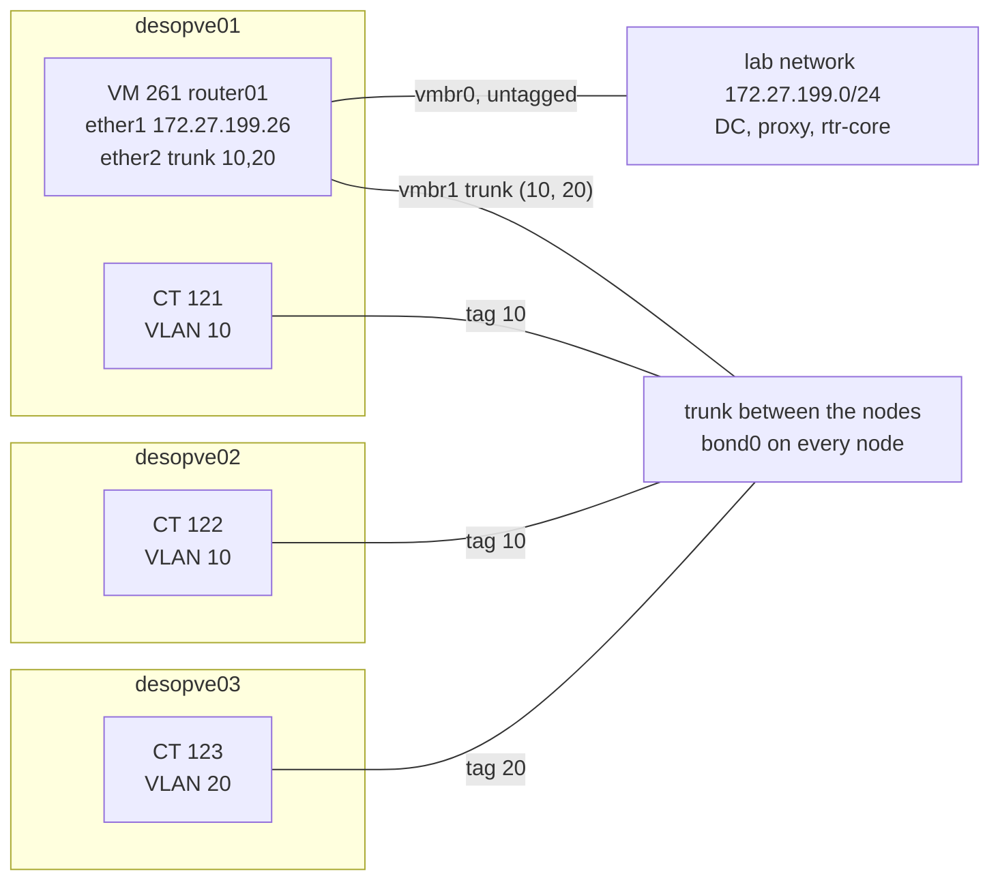
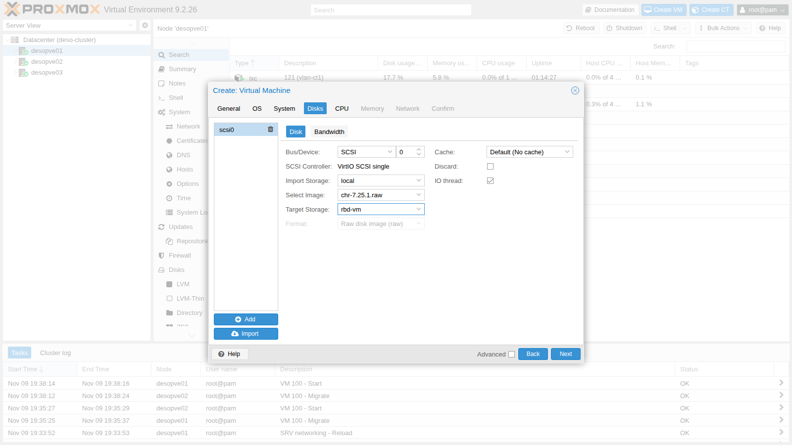
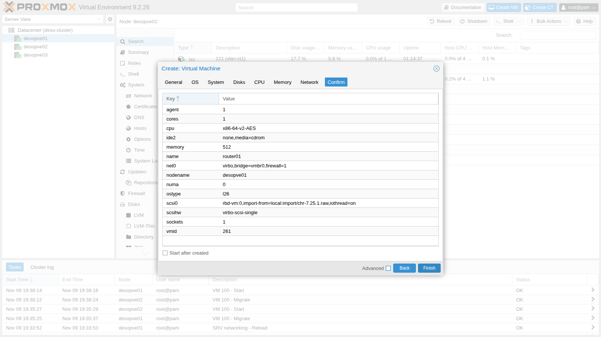
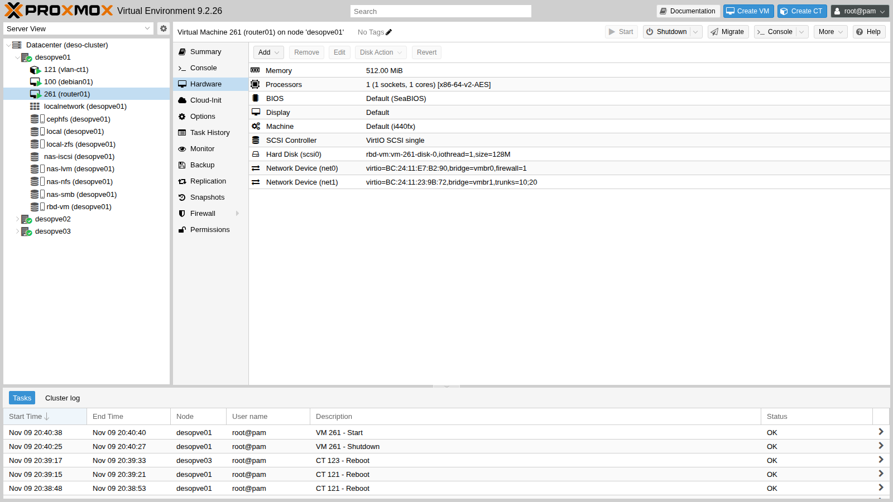
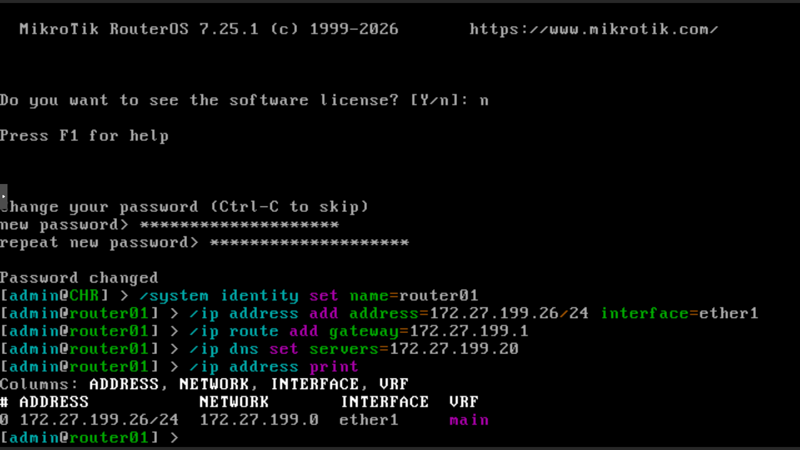
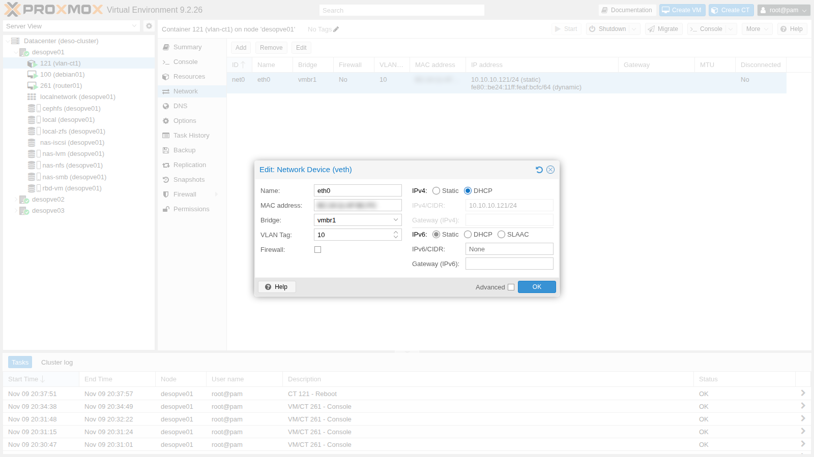
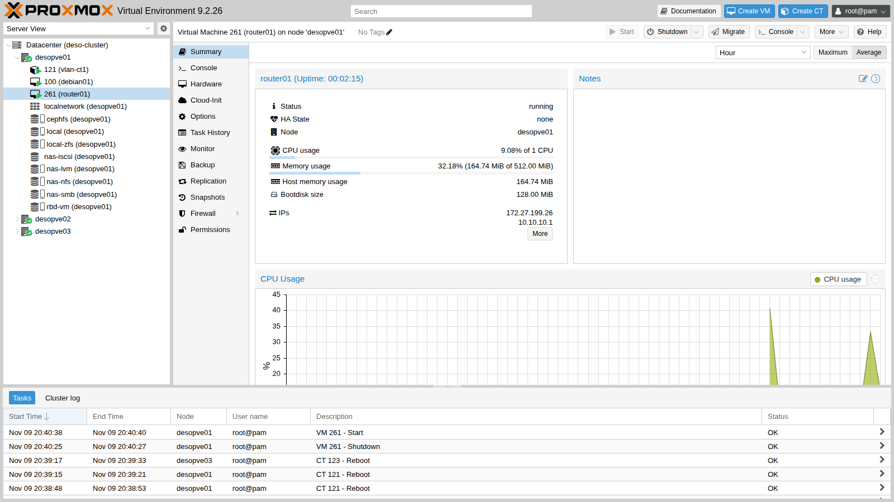

# Lab 26 – Virtual router and firewall between VLANs: MikroTik CHR (OPNsense as an alternative)

**Level:** advanced · **Duration:** 1 hour 15 minutes

## Dependencies

- **Previous labs:**
  - [Lab 20](20-bridges-stable-names-vlans.md) and [Lab 21](21-bonding.md): VLAN-aware `vmbr1` on `bond0` and the test containers in VLANs 10 and 20;
  - [Lab 17](17-ceph-installation.md): `rbd-vm` storage for the router's disk.
- **Nodes:** `desopve01` (where the router runs), `desopve02` and `desopve03` (where the test containers run).
- **Test containers:**
  - CT 121 `vlan-ct1` on `desopve01` and CT 122 `vlan-ct2` on `desopve02`, VLAN 10;
  - CT 123 `vlan-ct3` on `desopve03`, VLAN 20;
  - all on `vmbr1`, with `iperf3` and `tcpdump`.
- **Software:** raw image of MikroTik **Cloud Hosted Router (CHR) 7.25.1**, downloaded from the MikroTik website through the proxy: the lab proxy must allow `download.mikrotik.com`.
- **Services:** DNS on the DC (172.27.199.20), proxy `proxy.proxmox.community:3128`.
- **Router address on the management network:** 172.27.199.26 (`router01.proxmox.community`).
- **Credentials:** `root` / `<lab-password>` on the nodes, `admin` / `<lab-password>` on the router → [Appendix B](b-credentials-and-addresses.md).

## Objectives

- Import a ready-made disk image into Proxmox VE and create an "appliance" VM.
- Carry several VLANs into a single VM network device (trunk) and restrict them with the `trunks` option.
- Configure an inter-VLAN router with DHCP, NAT toward the lab network and a stateful firewall.
- See what happens to the guests when the router stops.
- Learn the limits of the free CHR license and the OPNsense alternative.

## How it works

### Router-on-a-stick

In lab 20 the guests in VLAN 10 and VLAN 20 were isolated: the bridge does not route, it separates. To let them talk you need a **router** with a leg in each VLAN. Instead of giving it one network device per VLAN, you give it **a single trunk device**: frames arrive with their 802.1Q tag and the router creates a logical interface for each VLAN. This is the classic *router-on-a-stick* configuration.



### `trunks` and the bridge VLAN filter

A VM network device on a VLAN-aware bridge **without** `tag` and without `trunks` sits untagged in VLAN 1 (PVID), but Proxmox VE also adds it, tagged, to all the VLANs in `bridge-vids` (2-4094, see [Lab 20](20-bridges-stable-names-vlans.md)). With the option `trunks=10;20` the port stays untagged in VLAN 1 and receives, tagged, **only** VLANs 10 and 20: the router receives both of them, and no others. The option is set from the command line (`qm set`): the GUI dialog only has the *VLAN Tag* field.

### NAT and firewall on the router

- **NAT:** the router goes out to the lab network with its own address (masquerading). The DC, the proxy and `rtr-core` do not need to know about the 10.10.10.0/24 and 10.20.20.0/24 networks.
- **Stateful firewall:** RouterOS has two main chains. `input` protects the router itself, `forward` decides what passes *through* the router. The `established,related` rule lets through the replies to connections that were already allowed: you only need to authorize whoever *opens* the connection.

In this lab the policy is:

| From → to | Allowed |
|---|---|
| VLAN 10 → anywhere | yes |
| VLAN 20 → lab network (DC, proxy) | yes |
| VLAN 20 → VLAN 10 | **no**, except replies to connections opened from VLAN 10 |
| Lab network → router (SSH) | yes, only from 172.27.199.0/24 |

### CHR licensing

CHR can be downloaded and used for free, but with the **free** license every interface is limited to **1 Mbit/s** of outbound traffic. With an account on mikrotik.com you can activate a 60-day trial license with no limits; in production you buy a permanent license. The free version is enough to learn the configuration, but bandwidth tests reveal it right away, as we will see.

### OPNsense as an alternative

The same design (router-on-a-stick, DHCP, NAT, firewall) can be built with **OPNsense**, an open source firewall based on FreeBSD. It was not installed in this lab; the comparison sums up the differences that matter on Proxmox VE.

| Aspect | MikroTik CHR | OPNsense |
|---|---|---|
| Installation | ready-made disk image to import (128 MiB) | ISO with installer |
| Resources | in the lab: 1 vCPU, 512 MiB of RAM | a few GiB of RAM and more vCPUs (see the official requirements) |
| Management | CLI, WinBox, web interface | full web interface |
| License | free, limited to 1 Mbit/s per interface; 60-day trial; paid licenses | open source, no limits |
| Security features | firewall, VPN, dynamic routing | firewall, VPN, IDS/IPS (Suricata), proxy, plugins |
| VirtIO NICs | supported | supported (`vtnet`); the documentation recommends disabling hardware offloading on the virtual NICs |
| Guest agent | built in | `os-qemu-guest-agent` plugin |

For learning routing and VLANs, CHR is lighter and quicker to set up; for a perimeter firewall with a graphical interface and advanced security features, OPNsense is the more common choice.

## Procedure

### 1. Download the image into the import storage

1. On node `desopve01`, download the CHR raw image into the `import` folder of the `local` storage and unzip it:

   ```console
   root@desopve01:~# cd /var/lib/vz/import
   root@desopve01:/var/lib/vz/import# export https_proxy=http://proxy.proxmox.community:3128
   root@desopve01:/var/lib/vz/import# curl -s https://download.mikrotik.com/routeros/NEWESTa7.stable
   7.25.1 1793623193
   root@desopve01:/var/lib/vz/import# curl -s -O https://download.mikrotik.com/routeros/7.25.1/chr-7.25.1.img.zip
   root@desopve01:/var/lib/vz/import# unzip chr-7.25.1.img.zip
   Archive:  chr-7.25.1.img.zip
     inflating: chr-7.25.1.img
   ```

2. In the import storage, Proxmox VE only recognizes the extensions of the formats it knows (`.raw`, `.qcow2`, `.vmdk`, `.ova`). An `.img` file does not show up: rename it to `.raw`, which is the same format:

   ```console
   root@desopve01:/var/lib/vz/import# pvesm list local --content import
   Volid                                           Format  Type           Size VMID
   local:import/debian-13-genericcloud-amd64.qcow2 qcow2   import    341180416
   root@desopve01:/var/lib/vz/import# mv chr-7.25.1.img chr-7.25.1.raw && rm chr-7.25.1.img.zip
   root@desopve01:/var/lib/vz/import# pvesm list local --content import
   Volid                                           Format  Type           Size VMID
   local:import/debian-13-genericcloud-amd64.qcow2 qcow2   import    341180416
   local:import/chr-7.25.1.raw                     raw     import    134217728
   ```

### 2. Create the VM with the imported disk

1. **Create VM** on `desopve01`:
   - **General:** VM ID `261`, name `router01`;
   - **OS:** *Do not use any media*;
   - **System:** default values, with **Qemu Agent** enabled: RouterOS CHR includes the guest agent.
2. **Disks:** delete the proposed disk (`scsi0`, trash can icon) and click **Import**. In the new disk set **Bus/Device** `SCSI 0`, **Import Storage** `local`, **Select Image** `chr-7.25.1.raw`, **Target Storage** `rbd-vm`. With its disk on Ceph, the router can be migrated between nodes.

   

3. **CPU** 1 core, **Memory** 512 MiB, **Network** `vmbr0` with the VirtIO model: it will be `ether1`, the uplink to the lab network. In the summary the disk appears as `rbd-vm:0,import-from=local:import/chr-7.25.1.raw`:

   

   Click **Finish** without starting the VM.

### 3. The trunk device

1. Add the second network device on `vmbr1` with only VLANs 10 and 20, remove the unneeded CD drive and make the router start with the node:

   ```console
   root@desopve01:~# qm set 261 --net1 virtio,bridge=vmbr1,trunks='10;20' --boot order=scsi0 --delete ide2 --onboot 1
   update VM 261: -boot order=scsi0 -delete ide2 -net1 virtio,bridge=vmbr1,trunks=10;20 -onboot 1
   root@desopve01:~# qm start 261
   ```

   

2. With the VM running, the bridge VLAN filter shows what enters the port of the second network device (`tap261i1`): VLANs 10 and 20 tagged, plus the untagged PVID 1 that the bridge assigns by default:

   ```console
   root@desopve01:~# bridge vlan show dev tap261i1
   port              vlan-id  
   tap261i1          1 PVID Egress Untagged
                     10
                     20
   ```

### 4. First login from the console

1. Open **Console** on the VM. At the `CHR Login:` prompt log in as `admin` with an empty password, answer `n` to the license question and set the new password (`<lab-password>`). Then give the router its name, the management address on `ether1`, the gateway and the DNS server:

   ```text
   /system identity set name=router01
   /ip address add address=172.27.199.26/24 interface=ether1
   /ip route add gateway=172.27.199.1
   /ip dns set servers=172.27.199.20
   ```

   

   > **Mind the keyboard.** The VM console uses the guest's keyboard layout, which in RouterOS is the US layout: if the password contains symbols, check what you are typing. If the first SSH login with the right password is rejected, log back in from the console and reset the password with `/user set admin password=...`.

2. From the DC, register the router's name in DNS (A and PTR records):

   ```powershell
   PS C:\> Add-DnsServerResourceRecordA -ZoneName proxmox.community -Name router01 -IPv4Address 172.27.199.26 -CreatePtr
   ```

3. From here on you work over SSH (`ssh admin@router01.proxmox.community`). The interfaces appear in the order of the VM's network devices: `ether1` is `net0` (`vmbr0`), `ether2` is `net1` (the trunk). The MACs match those in Proxmox:

   ```console
   [admin@router01] > /interface ethernet print
   Flags: R - RUNNING
   Columns: NAME, MTU, MAC-ADDRESS, ARP
   #   NAME     MTU  MAC-ADDRESS        ARP    
   0 R ether1  1500  BC:24:11:E7:B2:90  enabled
   1 R ether2  1500  BC:24:11:23:9B:72  enabled
   ```

   > In scripts, use a single SSH session with several commands separated by `;`: many logins in a row within a few seconds can cause even the right password to be rejected for a few tens of seconds.

### 5. VLANs and addresses

1. Create a VLAN interface for each network on the trunk and group the interfaces into two lists, `LAN` and `WAN`, which the firewall will use:

   ```text
   /interface vlan add name=vlan10 vlan-id=10 interface=ether2 comment="VLAN 10 sul trunk"
   /interface vlan add name=vlan20 vlan-id=20 interface=ether2 comment="VLAN 20 sul trunk"
   /interface list add name=LAN
   /interface list add name=WAN
   /interface list member add list=WAN interface=ether1
   /interface list member add list=LAN interface=vlan10
   /interface list member add list=LAN interface=vlan20
   /ip address add address=10.10.10.1/24 interface=vlan10
   /ip address add address=10.20.20.1/24 interface=vlan20
   ```

2. Check:

   ```console
   [admin@router01] > /interface print where type~"ether|vlan"
   Flags: R - RUNNING
   Columns: NAME, TYPE, ACTUAL-MTU, MAC-ADDRESS
   #   NAME    TYPE   ACTUAL-MTU  MAC-ADDRESS      
   0 R ether1  ether        1500  BC:24:11:E7:B2:90
   1 R ether2  ether        1500  BC:24:11:23:9B:72
   ;;; VLAN 10 sul trunk
   2 R vlan10  vlan         1500  BC:24:11:23:9B:72
   ;;; VLAN 20 sul trunk
   3 R vlan20  vlan         1500  BC:24:11:23:9B:72
   [admin@router01] > /ip address print
   Columns: ADDRESS, NETWORK, INTERFACE, VRF
   # ADDRESS           NETWORK       INTERFACE  VRF 
   0 172.27.199.26/24  172.27.199.0  ether1     main
   1 10.10.10.1/24     10.10.10.0    vlan10     main
   2 10.20.20.1/24     10.20.20.0    vlan20     main
   ```

### 6. DHCP for each VLAN

1. One address pool and one DHCP server per VLAN; in the DHCP network the gateway is the router and the DNS server is the DC:

   ```text
   /ip pool add name=pool-vlan10 ranges=10.10.10.150-10.10.10.199
   /ip pool add name=pool-vlan20 ranges=10.20.20.150-10.20.20.199
   /ip dhcp-server add name=dhcp-vlan10 interface=vlan10 address-pool=pool-vlan10 lease-time=1h
   /ip dhcp-server add name=dhcp-vlan20 interface=vlan20 address-pool=pool-vlan20 lease-time=1h
   /ip dhcp-server network add address=10.10.10.0/24 gateway=10.10.10.1 dns-server=172.27.199.20 domain=proxmox.community
   /ip dhcp-server network add address=10.20.20.0/24 gateway=10.20.20.1 dns-server=172.27.199.20 domain=proxmox.community
   ```

2. Check:

   ```console
   [admin@router01] > /ip dhcp-server print
   Columns: NAME, INTERFACE, ADDRESS-POOL, LEASE-TIME
   # NAME         INTERFACE  ADDRESS-POOL  LEASE-TIME
   0 dhcp-vlan10  vlan10     pool-vlan10   1h        
   1 dhcp-vlan20  vlan20     pool-vlan20   1h        
   [admin@router01] > /ip dhcp-server network print
   Columns: ADDRESS, GATEWAY, DNS-SERVER, DOMAIN
   # ADDRESS        GATEWAY     DNS-SERVER     DOMAIN           
   0 10.10.10.0/24  10.10.10.1  172.27.199.20  proxmox.community
   1 10.20.20.0/24  10.20.20.1  172.27.199.20  proxmox.community
   ```

### 7. NAT and firewall

1. NAT toward the lab network:

   ```text
   /ip firewall nat add chain=srcnat out-interface-list=WAN action=masquerade comment="NAT verso la rete del lab"
   ```

2. The firewall rules, in the order in which they are evaluated. The rule that allows SSH from the lab network comes before the final `drop` of the `input` chain: the current SSH session stays open thanks to the first rule (`established,related`).

   ```text
   /ip firewall filter add chain=input action=accept connection-state=established,related comment="input: risposte"
   /ip firewall filter add chain=input action=drop connection-state=invalid comment="input: pacchetti non validi"
   /ip firewall filter add chain=input action=accept protocol=icmp comment="input: ping"
   /ip firewall filter add chain=input action=accept in-interface-list=LAN protocol=udp dst-port=67 comment="input: DHCP dalle VLAN"
   /ip firewall filter add chain=input action=accept in-interface=ether1 src-address=172.27.199.0/24 protocol=tcp dst-port=22 comment="input: SSH solo dalla rete del lab"
   /ip firewall filter add chain=input action=drop comment="input: tutto il resto"
   /ip firewall filter add chain=forward action=accept connection-state=established,related comment="forward: risposte"
   /ip firewall filter add chain=forward action=drop connection-state=invalid comment="forward: pacchetti non validi"
   /ip firewall filter add chain=forward action=accept in-interface=vlan10 comment="forward: VLAN 10 verso tutti"
   /ip firewall filter add chain=forward action=accept in-interface=vlan20 out-interface-list=WAN comment="forward: VLAN 20 solo verso la rete del lab"
   /ip firewall filter add chain=forward action=drop comment="forward: tutto il resto"
   ```

### 8. The containers use the router

1. **CT 121, from the GUI:** container **121** → **Network** → `net0` → **Edit** → **IPv4: DHCP**. The VLAN 10 tag stays as it is.

   

2. After the container restarts, the router assigns it the first free address in the pool, starting from the top, together with the gateway and the DNS server:

   ```console
   root@desopve01:~# pct reboot 121
   root@desopve01:~# pct exec 121 -- ip route
   default via 10.10.10.1 dev eth0 
   10.10.10.0/24 dev eth0 proto kernel scope link src 10.10.10.199 
   root@desopve01:~# pct exec 121 -- cat /etc/resolv.conf
   domain proxmox.community
   search proxmox.community
   nameserver 172.27.199.20
   ```

   ```console
   [admin@router01] > /ip dhcp-server lease print
   Flags: D - DYNAMIC
   Columns: ADDRESS, MAC-ADDRESS, HOST-NAME, SERVER, STATUS, LAST-SEEN
   #   ADDRESS       MAC-ADDRESS        HOST-NAME  SERVER       STATUS  LAST-SEEN
   0 D 10.10.10.199  BC:24:11:AF:BC:FC  vlan-ct1   dhcp-vlan10  bound   5s
   ```

3. Servers are better off with a fixed address even with DHCP: make the lease static and assign it the desired address. For CT 123 the static lease is created in advance, from the container's MAC. The MACs of your containers differ from those in the examples: read them with `pct config 121 | grep hwaddr` (and the same for 122 and 123) and put them in place of the placeholders:

   ```text
   /ip dhcp-server lease make-static [find mac-address=<MAC del CT 121>]
   /ip dhcp-server lease set [find mac-address=<MAC del CT 121>] address=10.10.10.121 comment="vlan-ct1 (CT 121)"
   /ip dhcp-server lease add server=dhcp-vlan20 mac-address=<MAC del CT 123> address=10.20.20.123 comment="vlan-ct3 (CT 123)"
   ```

4. **CT 123** switches to DHCP from the command line; **CT 122** keeps its static address, but with the router as its gateway. In `pct set` repeat the current MAC (`hwaddr`), otherwise Proxmox generates a new one:

   ```console
   root@desopve03:~# pct set 123 -net0 name=eth0,bridge=vmbr1,hwaddr=<MAC del CT 123>,ip=dhcp,tag=20,type=veth
   root@desopve03:~# pct reboot 123
   root@desopve02:~# pct set 122 -net0 name=eth0,bridge=vmbr1,hwaddr=<MAC del CT 122>,ip=10.10.10.122/24,gw=10.10.10.1,tag=10,type=veth
   ```

   After restarting CT 121 and CT 123:

   ```console
   [admin@router01] > /ip dhcp-server lease print
   Columns: ADDRESS, MAC-ADDRESS, HOST-NAME, SERVER, STATUS, LAST-SEEN
   # ADDRESS       MAC-ADDRESS        HOST-NAME  SERVER       STATUS  LAST-SEEN
   ;;; vlan-ct1 (CT 121)
   0 10.10.10.121  BC:24:11:AF:BC:FC  vlan-ct1   dhcp-vlan10  bound   17s      
   ;;; vlan-ct3 (CT 123)
   1 10.20.20.123  BC:24:11:F4:8A:80  vlan-ct3   dhcp-vlan20  bound   5s
   ```

### 9. The RouterOS guest agent

The CHR guest agent reports the router's addresses to Proxmox VE: they appear in the VM's **Summary** and can be read from the command line:



```console
root@desopve01:~# qm guest cmd 261 network-get-interfaces | python3 -c "import sys,json; [print(i['name'], [a['ip-address'] for a in i.get('ip-addresses',[]) if a['ip-address-type']=='ipv4']) for i in json.load(sys.stdin)]"
ether1 ['172.27.199.26']
ether2 []
vlan10 ['10.10.10.1']
vlan20 ['10.20.20.1']
```

## Verification and tests

1. **Inter-VLAN routing:** CT 121 (VLAN 10) reaches CT 123 (VLAN 20). With TTL 1 the first hop answers: it is the router.

   ```console
   root@desopve01:~# pct exec 121 -- ping -c3 -W1 10.20.20.123
   3 packets transmitted, 3 received, 0% packet loss, time 2002ms
   rtt min/avg/max/mdev = 0.897/1.231/1.568/0.273 ms
   root@desopve01:~# pct exec 121 -- ping -c1 -t1 -W1 10.20.20.123
   From 10.10.10.1 icmp_seq=1 Time to live exceeded
   ```

2. **Firewall:** VLAN 10 cannot be reached from VLAN 20, while the lab network can:

   ```console
   root@desopve03:~# pct exec 123 -- ping -c3 -W1 10.10.10.121
   3 packets transmitted, 0 received, 100% packet loss, time 2030ms
   root@desopve03:~# pct exec 123 -- ping -c3 -W1 172.27.199.20
   3 packets transmitted, 3 received, 0% packet loss, time 2003ms
   ```

   The rule counters show where the traffic ended up: the 3 pings toward VLAN 10 were dropped by the last rule.

   ```console
   [admin@router01] > /ip firewall filter print stats where chain=forward
   Columns: CHAIN, ACTION, BYTES, PACKETS
    # CHAIN    ACTION   BYTES  PACKETS
   ;;; forward: risposte
    6 forward  accept  50 319       79
   ;;; forward: pacchetti non validi
    7 forward  drop         0        0
   ;;; forward: VLAN 10 verso tutti
    8 forward  accept      84        1
   ;;; forward: VLAN 20 solo verso la rete del lab
    9 forward  accept     784       11
   ;;; forward: tutto il resto
   10 forward  drop       252        3
   ```

3. **NAT:** on the lab network, the container's traffic arrives with the router's address:

   ```console
   root@desopve01:~# tcpdump -lni vmbr0 -c4 icmp and host 172.27.199.20
   20:40:10.925277 IP 172.27.199.26 > 172.27.199.20: ICMP echo request, id 301, seq 1, length 64
   20:40:10.925907 IP 172.27.199.20 > 172.27.199.26: ICMP echo reply, id 301, seq 1, length 64
   ```

4. **Proxy:** from CT 123, `apt` reaches the proxy through the router:

   ```console
   root@desopve03:~# pct exec 123 -- apt-get update
   ...
   Fetched 43.4 kB in 0s (158 kB/s)
   Reading package lists...
   ```

5. **The free license shows:** `iperf3` from VLAN 10 to VLAN 20, through the router, versus the same test within VLAN 10, without the router:

   ```console
   [admin@router01] > /system license print
     system-id: <id-del-router>
         level: free
   root@desopve03:~# pct exec 123 -- iperf3 -s -D
   root@desopve01:~# pct exec 121 -- iperf3 -c 10.20.20.123 -t 8 -f m
   [  5]   0.00-8.00   sec  4.50 MBytes  4.72 Mbits/sec    3            sender
   [  5]   0.00-15.61  sec  2.00 MBytes  1.07 Mbits/sec                  receiver
   root@desopve01:~# pct exec 121 -- iperf3 -c 10.10.10.122 -t 5 -f m
   [  5]   0.00-5.00   sec  3.13 GBytes  5371 Mbits/sec  221            sender
   [  5]   0.00-5.00   sec  3.13 GBytes  5367 Mbits/sec                  receiver
   ```

   Through the router you get about **1 Mbit/s**, the free license limit; within the same VLAN, where the router plays no part, over 5 Gbit/s.

6. **Router down:** with the router stopped, the same VLAN still works (it is a bridge), routing does not:

   ```console
   root@desopve01:~# qm shutdown 261 --timeout 60 && qm status 261
   status: stopped
   root@desopve01:~# pct exec 121 -- ping -c3 -W1 10.10.10.122
   64 bytes from 10.10.10.122: icmp_seq=3 ttl=64 time=0.714 ms
   root@desopve01:~# pct exec 121 -- ping -c3 -W1 10.20.20.123
   3 packets transmitted, 0 received, 100% packet loss, time 2039ms
   root@desopve01:~# qm start 261
   ```

   About 28 seconds pass between the start command and the first successful ping between the VLANs: the RouterOS boot time. A virtual router is a *single point of failure*: in production you run two of them (VRRP) or protect it with Proxmox VE high availability (lab 49).

| Test | Result |
|---|---|
| VLAN 10 → VLAN 20 through the router | 0% loss, first hop 10.10.10.1 |
| VLAN 20 → VLAN 10 | 100% loss: blocked by the firewall |
| VLAN 20 → DC and proxy | 0% loss, with the router's address (NAT) |
| Dynamic, then static DHCP lease | .199 dynamic, then .121 fixed |
| Bandwidth through the router (free license) | 1.07 Mbit/s |
| Bandwidth within the same VLAN, without the router | 5.4 Gbit/s |
| Router down | same VLAN ok, no routing; recovery in about 28 s |

## Final lab state

- **VM 261 `router01`** on `desopve01`, running, with start at boot enabled (`onboot=1`):
  - RouterOS CHR 7.25.1, free license, disk `rbd-vm:vm-261-disk-0` (128 MiB), 512 MiB of RAM, guest agent enabled;
  - `net0` on `vmbr0`: `ether1` 172.27.199.26/24, gateway `rtr-core`, DNS 172.27.199.20;
  - `net1` on `vmbr1` with `trunks=10;20`: `vlan10` 10.10.10.1/24 and `vlan20` 10.20.20.1/24;
  - DHCP on both VLANs (pool .150-.199), static leases for CT 121 and CT 123;
  - NAT toward the lab network, firewall as in the table;
  - DNS records for `router01.proxmox.community` (A and PTR) on the DC.
- **Containers:**
  - CT 121 `vlan-ct1`: DHCP, 10.10.10.121 (static lease), gateway 10.10.10.1;
  - CT 122 `vlan-ct2`: static 10.10.10.122, gateway 10.10.10.1;
  - CT 123 `vlan-ct3`: DHCP, 10.20.20.123 (static lease), gateway 10.20.20.1.
- **Storage:** the image `local:import/chr-7.25.1.raw` stays on `desopve01`.
- `rtr-core` and the node networks have not changed.

## What you learned

- A ready-made disk image is imported from a storage with the *Import* content type; `.img` files must be renamed to `.raw`.
- With `trunks` a single VM network device carries several tagged VLANs, and the bridge lets only those through.
- A router-on-a-stick joins the VLANs: VLAN interfaces on the trunk, one DHCP server per network, NAT toward the outside.
- The stateful firewall allows the replies to authorized connections: you only need to decide who can open a connection.
- A static DHCP lease gives hosts a fixed address while keeping the configuration centralized.
- The virtual router is a single point of failure; the free CHR license limits bandwidth to 1 Mbit/s per interface.

## References

- [Proxmox VE – Import of disk images (*Import* storage)](https://pve.proxmox.com/pve-docs/pve-admin-guide.html#_import_of_disk_images)
- [Proxmox VE – qm, network options (`trunks`)](https://pve.proxmox.com/pve-docs/qm.1.html)
- [MikroTik – Cloud Hosted Router (CHR)](https://help.mikrotik.com/docs/spaces/ROS/pages/18350234/Cloud+Hosted+Router+CHR)
- [MikroTik – DHCP server](https://help.mikrotik.com/docs/spaces/ROS/pages/24805500/DHCP)
- [MikroTik – Filter rules](https://help.mikrotik.com/docs/spaces/ROS/pages/48660574/Filter)
- [OPNsense – Virtual & Cloud based Installation](https://docs.opnsense.org/manual/virtuals.html)
