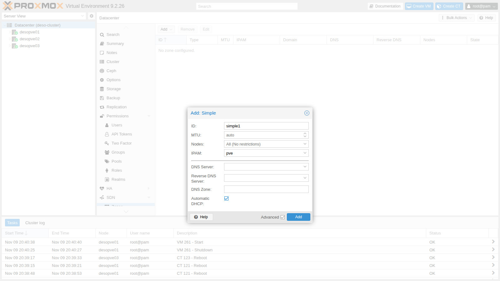
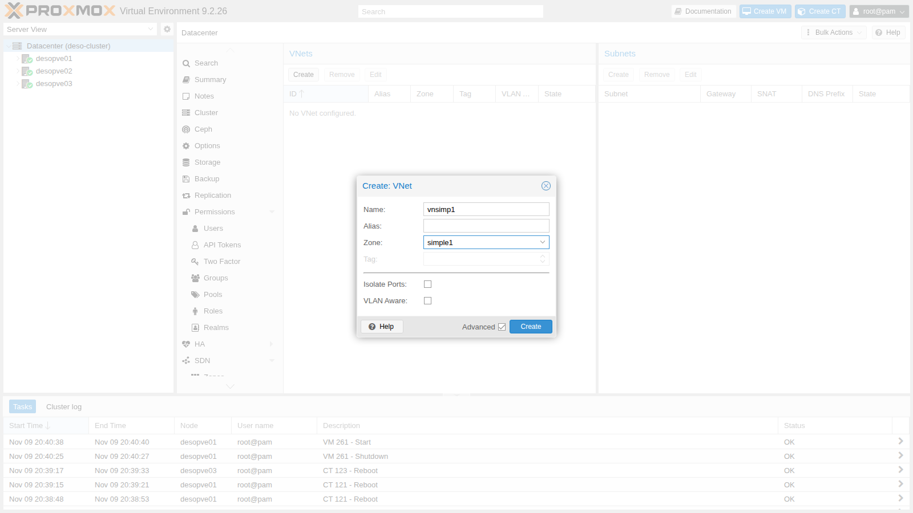
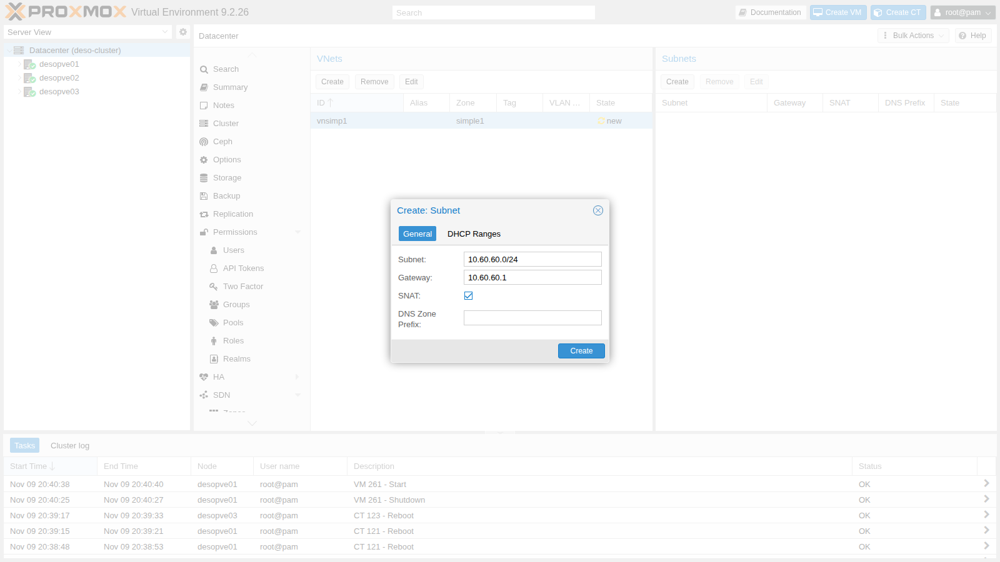
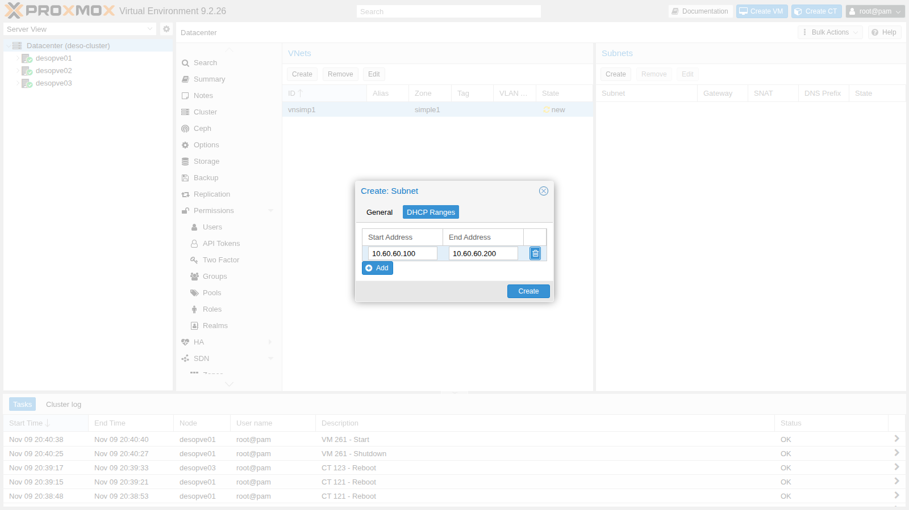
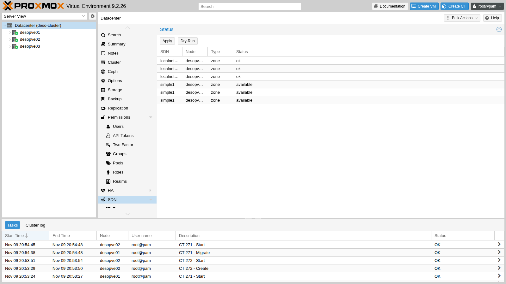
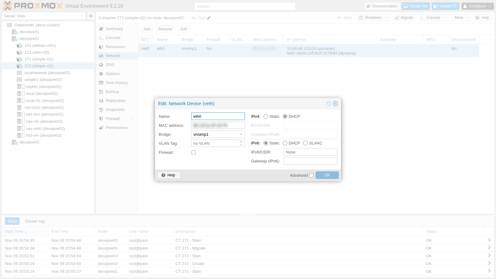
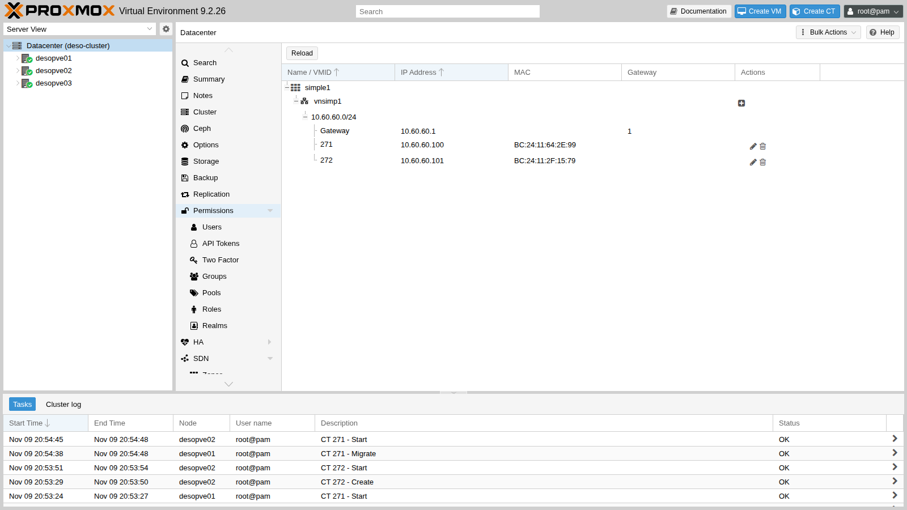

# Lab 27 – SDN 1: Simple zone with SNAT, DHCP and IPAM

**Level:** advanced · **Duration:** 1 hour

## Dependencies

- **Previous labs:**
  - [Lab 06](06-cluster-corosync.md): cluster `deso-cluster` with `desopve01`-`desopve03`;
  - [Lab 17](17-ceph-installation.md): `rbd-vm` storage for the container disks, and `cephfs`;
  - [Lab 20](20-bridges-stable-names-vlans.md): the Debian template on `cephfs`;
  - [Lab 21](21-bonding.md) and [Lab 22](22-dedicated-networks.md): `vmbr1` on `bond0` and the dedicated Corosync networks, mentioned in the checks;
  - [Lab 24](24-routing-nat.md): routing and NAT on the host, to compare with what the SDN generates.
- **Nodes:** `desopve01`, `desopve02` and `desopve03`. `desopve04` is outside the cluster and does not receive the SDN configuration.
- **Template:** `cephfs:vztmpl/debian-13-standard_13.6-1_amd64.tar.zst`.
- **Proxy:** `proxy.proxmox.community:3128` for packages.
- **Credentials:** `root` / `<lab-password>` on the nodes and in the containers → [Appendix B](b-credentials-and-addresses.md).

## Objectives

- Learn the building blocks of the Proxmox VE SDN: zone, VNet, subnet, IPAM and DHCP.
- Create from the GUI a private network present on all nodes, without editing the network files by hand.
- Give the guests automatic addresses with the SDN DHCP and see them in the IPAM.
- Understand the limit of the Simple zone: the network exists on every node, but the nodes are not connected to each other.

## How it works

### The SDN building blocks

| Object | What it is | Where it is configured |
|---|---|---|
| **Zone** | the *type* of separation: Simple, VLAN, QinQ, VXLAN, EVPN. It decides how the VNets reach the nodes | Datacenter → SDN → Zones |
| **VNet** | a virtual network. On every node it becomes a Linux bridge with the same name, which you choose as the *Bridge* in the guests' network interfaces | Datacenter → SDN → VNets |
| **Subnet** | the VNet addressing: network, gateway, SNAT, DHCP ranges | Datacenter → SDN → VNets → Subnets |
| **IPAM** | the register of assigned addresses. `pve` is the built-in one; NetBox or phpIPAM can also be used | Datacenter → SDN → IPAM |
| **DHCP** | an automatic DHCP server for the zone, based on `dnsmasq` | the zone's *Automatic DHCP* option |

The configuration lives in the cluster file system (`/etc/pve/sdn/*.cfg`) and **is not active until you click Apply**. With Apply every node generates `/etc/network/interfaces.d/sdn` and reloads its network; the status of each zone on each node appears on the **SDN** page.

### The Simple zone

The Simple zone creates an **isolated** bridge on every node, with no physical ports. The node holds the gateway address on the bridge and routes the guests' traffic; with **SNAT** it sends that traffic out with its own address, like the masquerading of lab 24, but without writing rules by hand.

Every node has **the same gateway** (10.60.60.1 in this lab) on **its own** bridge. Guests on different nodes are in the same subnet but cannot see each other: there is no layer 2 connection between the nodes. For a network that spans the nodes you need the VLAN, QinQ, VXLAN or EVPN zones (labs 28-30).

### DHCP and IPAM

With *Automatic DHCP*, Proxmox VE starts an instance of `dnsmasq` for the zone on the nodes (`dnsmasq@simple1`). It is not a "classic" DHCP server with a free pool:

1. when you add a network interface on a VNet with DHCP to a guest, Proxmox VE **reserves an address in the IPAM** and binds it to the interface's MAC;
2. on the node where the guest runs, `dnsmasq` receives the MAC → address pair and answers **only known MACs**, with a lease that never expires;
3. `dnsmasq` also acts as the DNS server for the guests: it forwards queries to the node's DNS servers.

The `dnsmasq` package must be installed on all nodes, with its default service disabled: Proxmox VE starts the per-zone instances itself.

## Procedure

### 1. `dnsmasq` on the nodes

On `desopve01`, `desopve02` and `desopve03`:

```console
root@desopve01:~# apt-get install -y dnsmasq
...
Setting up dnsmasq-base (2.91-1+deb13u2) ...
Setting up dns-root-data (2025080400~deb13u1) ...
Setting up dnsmasq (2.91-1+deb13u2) ...
root@desopve01:~# systemctl disable --now dnsmasq
Removed '/etc/systemd/system/multi-user.target.wants/dnsmasq.service'.
root@desopve01:~# systemctl is-enabled dnsmasq; systemctl is-active dnsmasq
disabled
inactive
```

### 2. The zone

**Datacenter** → **SDN** → **Zones** → **Add** → **Simple**. **ID** `simple1`, **IPAM** `pve`. Check **Advanced** and enable **Automatic DHCP**:



### 3. The VNet

**SDN** → **VNets** → **Create**. **Name** `vnsimp1`, **Zone** `simple1`. The VNet name becomes the name of the Linux bridge on the nodes, so it must be short.



### 4. The subnet with SNAT and DHCP

1. Select `vnsimp1` and, in the **Subnets** panel, click **Create**. **Subnet** `10.60.60.0/24`, **Gateway** `10.60.60.1`, **SNAT** enabled:

   

2. **DHCP Ranges** tab → **Add**: from `10.60.60.100` to `10.60.60.200`.

   

3. The result in the cluster files:

   ```console
   root@desopve01:~# cat /etc/pve/sdn/zones.cfg /etc/pve/sdn/vnets.cfg /etc/pve/sdn/subnets.cfg
   simple: simple1
   	dhcp dnsmasq
   	ipam pve

   vnet: vnsimp1
   	zone simple1

   subnet: simple1-10.60.60.0-24
   	vnet vnsimp1
   	dhcp-range start-address=10.60.60.100,end-address=10.60.60.200
   	gateway 10.60.60.1
   	snat 1
   ```

### 5. Apply

**SDN** → **Apply**. Every node reloads its network (task *SRV networking - Reload*) and the zone changes to `available`:



The `localnetwork` zone, always present, represents the bridges already configured on the nodes (`vmbr0`, `vmbr1`).

```console
root@desopve01:~# for n in desopve01 desopve02 desopve03; do echo "$n $(pvesh get /nodes/$n/sdn/zones --output-format json | python3 -c 'import sys,json; print([(z["zone"], z["status"]) for z in json.load(sys.stdin)])')"; done
desopve01 [('simple1', 'available')]
desopve02 [('simple1', 'available')]
desopve03 [('simple1', 'available')]
```

### 6. What the SDN generated

1. The bridge, with the gateway, IP forwarding and the SNAT rule to the node's address. This is what we wrote by hand in lab 24:

   ```console
   root@desopve01:~# cat /etc/network/interfaces.d/sdn
   #version:1

   auto vnsimp1
   iface vnsimp1
   	address 10.60.60.1/24
   	post-up iptables -t nat -A POSTROUTING -s '10.60.60.0/24' -o vmbr0 -j SNAT --to-source 172.27.199.21
   	post-down iptables -t nat -D POSTROUTING -s '10.60.60.0/24' -o vmbr0 -j SNAT --to-source 172.27.199.21
   	post-up iptables -t raw -I PREROUTING -i fwbr+ -j CT --zone 1
   	post-down iptables -t raw -D PREROUTING -i fwbr+ -j CT --zone 1
   	bridge_ports none
   	bridge_stp off
   	bridge_fd 0
   	ip-forward on
   root@desopve01:~# iptables -t nat -S | grep 10.60.60
   -A POSTROUTING -s 10.60.60.0/24 -o vmbr0 -j SNAT --to-source 172.27.199.21
   ```

   The rule in the `raw` table separates the connection tracking of guests with a firewall (the *conntrack zones* mentioned in lab 24).

2. The `dnsmasq` instance for the zone. The range is `static`: only the MACs registered in the `ethers` file get an answer.

   ```console
   root@desopve01:~# systemctl is-active dnsmasq@simple1
   active
   root@desopve01:~# ls /etc/dnsmasq.d/simple1/
   00-default.conf  10-vnsimp1.conf
   root@desopve01:~# cat /etc/dnsmasq.d/simple1/10-vnsimp1.conf
   dhcp-range=set:simple1-10.60.60.0-24,10.60.60.0,static,255.255.255.0,infinite
   dhcp-option=tag:simple1-10.60.60.0-24,option:router,10.60.60.1
   interface=vnsimp1
   root@desopve01:~# grep -E "hostsfile|ignore=tag" /etc/dnsmasq.d/simple1/00-default.conf
   dhcp-hostsfile=/etc/dnsmasq.d/simple1/ethers
   dhcp-ignore=tag:!known
   ```

### 7. Two containers on the VNet

1. One container on `desopve01` and one on `desopve02`, with the network interface on `vnsimp1` using DHCP:

   ```console
   root@desopve01:~# pct create 271 cephfs:vztmpl/debian-13-standard_13.6-1_amd64.tar.zst --hostname simple-ct1 \
     --unprivileged 1 --features nesting=1 --cores 1 --memory 512 --rootfs rbd-vm:4 \
     --net0 name=eth0,bridge=vnsimp1,ip=dhcp --password
   root@desopve01:~# pct start 271
   root@desopve02:~# pct create 272 cephfs:vztmpl/debian-13-standard_13.6-1_amd64.tar.zst --hostname simple-ct2 \
     --unprivileged 1 --features nesting=1 --cores 1 --memory 512 --rootfs rbd-vm:4 \
     --net0 name=eth0,bridge=vnsimp1,ip=dhcp --password
   root@desopve02:~# pct start 272
   ```

   In the GUI the VNet appears among the selectable bridges:

   

2. The containers receive the first and second addresses of the range, with the node as their gateway:

   ```console
   root@desopve01:~# pct exec 271 -- ip -4 -brief addr show eth0
   eth0@if72        UP             10.60.60.100/24 
   root@desopve01:~# pct exec 271 -- ip route
   default via 10.60.60.1 dev eth0 
   10.60.60.0/24 dev eth0 proto kernel scope link src 10.60.60.100 
   root@desopve02:~# pct exec 272 -- ip -4 -brief addr show eth0
   eth0@if28        UP             10.60.60.101/24 
   ```

### 8. The IPAM

**SDN** → **IPAM** shows, by zone, VNet and subnet, the gateway and the assigned addresses with VMID and MAC:



The same from the command line. The `ethers` file of each node contains only the guests running on that node:

```console
root@desopve01:~# pvesh get /cluster/sdn/ipams/pve/status --output-format json | python3 -c "import sys,json; [print(e.get('ip'), e.get('mac',''), e.get('vmid',''), e.get('hostname',''), 'gateway' if e.get('gateway') else '') for e in json.load(sys.stdin)]"
10.60.60.1    gateway
10.60.60.100 BC:24:11:64:2E:99 271 simple-ct1 
10.60.60.101 BC:24:11:2F:15:79 272 simple-ct2 
root@desopve01:~# cat /etc/dnsmasq.d/simple1/ethers
BC:24:11:64:2E:99,10.60.60.100
```

## Verification and tests

1. **Gateway, DNS and SNAT.** The container reaches the gateway and the DC; the DNS server is the gateway itself, that is, `dnsmasq`:

   ```console
   root@desopve01:~# pct exec 271 -- ping -c2 -W1 10.60.60.1
   2 packets transmitted, 2 received, 0% packet loss, time 1026ms
   root@desopve01:~# pct exec 271 -- grep nameserver /etc/resolv.conf
   nameserver 10.60.60.1
   root@desopve01:~# pct exec 271 -- ping -c3 -W1 172.27.199.20
   3 packets transmitted, 3 received, 0% packet loss, time 2047ms
   ```

   On the management network the traffic goes out with the node's address:

   ```console
   root@desopve01:~# tcpdump -lni vmbr0 -c2 icmp and host 172.27.199.20
   20:54:22.383353 IP 172.27.199.21 > 172.27.199.20: ICMP echo request, id 372, seq 1, length 64
   20:54:22.384284 IP 172.27.199.20 > 172.27.199.21: ICMP echo reply, id 372, seq 1, length 64
   ```

2. **Packages through the proxy:** the proxy name resolves via `dnsmasq` and `apt` works:

   ```console
   root@desopve01:~# pct exec 271 -- sh -c 'echo "Acquire::http::Proxy \"http://proxy.proxmox.community:3128\";" > /etc/apt/apt.conf.d/80proxy && apt-get update'
   ...
   Reading package lists...
   ```

3. **The nodes are not connected.** Container 271 on `desopve01` does not reach 272 on `desopve02`, even though they are in the same subnet:

   ```console
   root@desopve01:~# pct exec 271 -- ping -c3 -W1 10.60.60.101
   3 packets transmitted, 0 received, 100% packet loss, time 2043ms
   ```

4. **Migration.** Moved to `desopve02` (restart migration, disk on Ceph), the container keeps its address, because the IPAM belongs to the cluster, and now sees 272:

   ```console
   root@desopve01:~# pct migrate 271 desopve02 --restart
   ...
   2026-11-09 20:54:48 migration finished successfully (duration 00:00:09)
   root@desopve02:~# cat /etc/dnsmasq.d/simple1/ethers
   BC:24:11:2F:15:79,10.60.60.101
   BC:24:11:64:2E:99,10.60.60.100
   root@desopve02:~# pct exec 271 -- ip -4 -brief addr show eth0
   eth0@if29        UP             10.60.60.100/24 
   root@desopve02:~# pct exec 271 -- ping -c3 -W1 10.60.60.101
   3 packets transmitted, 3 received, 0% packet loss, time 2068ms
   root@desopve02:~# pct exec 271 -- getent hosts proxy.proxmox.community
   172.27.199.250  netsvc.proxmox.community proxy.proxmox.community
   ```

   On the new node too, the container's DNS server is the local `dnsmasq`, which forwards to the DC.

| Test | Result |
|---|---|
| Zone Apply | `available` on `desopve01`-`desopve03` |
| DHCP addresses | .100 and .101 from the IPAM, gateway 10.60.60.1 |
| Container → DC | 0% loss, with the node's address (SNAT) |
| DNS and `apt` via `dnsmasq` and the proxy | working |
| Containers on different nodes | 100% loss: no connection between the nodes |
| Migration to `desopve02` | 9 s, same address; the two containers now see each other |

## Final lab state

- **Packages:** `dnsmasq` installed on `desopve01`-`desopve03`, default service disabled.
- **SDN:**
  - zone `simple1` (Simple, DHCP `dnsmasq`, IPAM `pve`);
  - VNet `vnsimp1` with subnet `10.60.60.0/24`, gateway `10.60.60.1`, SNAT, DHCP `.100`-`.200`;
  - applied on `desopve01`-`desopve03`, with the `dnsmasq@simple1` instance active.
- **Containers on `desopve02`**, both running, not set to start at boot, disk on `rbd-vm`:
  - CT 271 `simple-ct1`, 10.60.60.100 (migrated from `desopve01`), with the `apt` proxy configured;
  - CT 272 `simple-ct2`, 10.60.60.101.
- The node networking (`vmbr0`, `vmbr1`, Corosync, Ceph) has not changed: the SDN only adds the `interfaces.d/sdn` file.

## What you learned

- The SDN separates *how* the network is transported (zone) from *which* network it is (VNet) and from how it is addressed (subnet).
- The SDN configuration belongs to the cluster but becomes active only with Apply, which generates the network files on every node.
- The Simple zone gives every node the same isolated network, with gateway, SNAT and DHCP and no hand-written rules.
- The SDN DHCP assigns addresses from the IPAM, bound to the guest's MAC; `dnsmasq` answers only known MACs.
- In a Simple zone, guests on different nodes cannot see each other: for a network that spans the nodes you need the other zone types.

## References

- [Proxmox VE – Software-Defined Network](https://pve.proxmox.com/pve-docs/chapter-pvesdn.html)
- [Proxmox VE – SDN: Simple Zones](https://pve.proxmox.com/pve-docs/chapter-pvesdn.html#pvesdn_zone_plugin_simple)
- [Proxmox VE – SDN: DHCP](https://pve.proxmox.com/pve-docs/chapter-pvesdn.html#pvesdn_config_dhcp)
- [dnsmasq – man page](https://manpages.debian.org/trixie/dnsmasq-base/dnsmasq.8.en.html)
