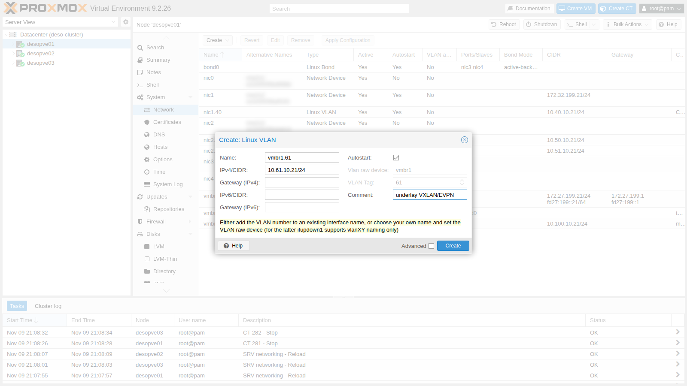
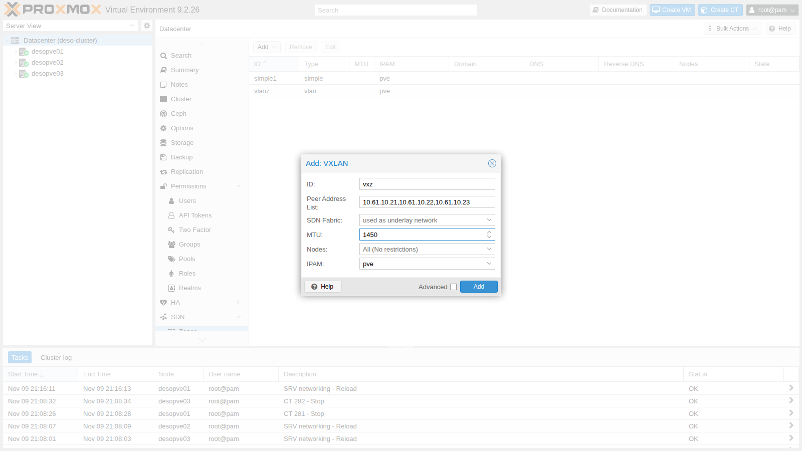
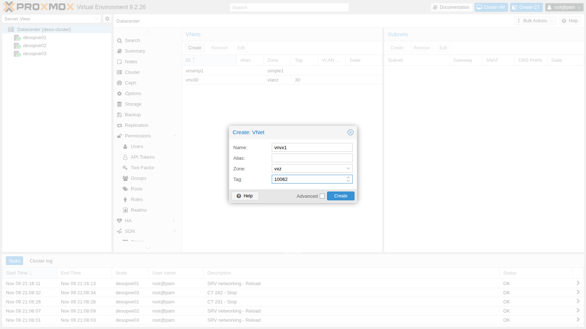
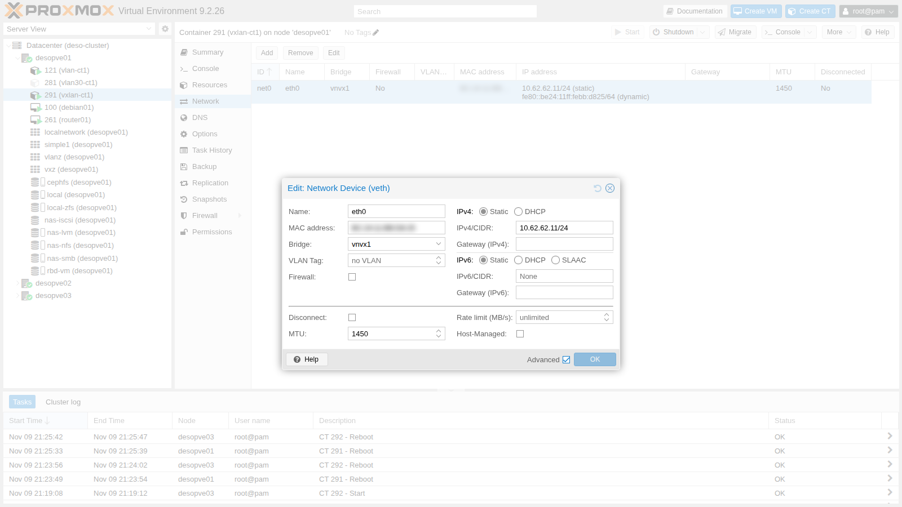

# Lab 29 – SDN 3: VXLAN zone

**Level:** advanced · **Duration:** 1 hour

## Dependencies

- **Previous labs:**
  - [Lab 28](28-sdn-vlan-qinq.md): SDN zones, VNets, Dry-Run and Apply;
  - [Lab 20](20-bridges-stable-names-vlans.md) and [Lab 21](21-bonding.md): VLAN-aware `vmbr1` on `bond0`, which will carry the underlay network on a VLAN;
  - [Lab 22](22-dedicated-networks.md): dedicated networks as VLAN subinterfaces;
  - [Lab 17](17-ceph-installation.md): `rbd-vm` storage for the container disks, and `cephfs`; the Debian template on `cephfs` comes from [Lab 20](20-bridges-stable-names-vlans.md).
- **Physical network:** the node ports are a trunk; this lab uses **VLAN 61** for the underlay network `10.61.10.0/24`.
- **Nodes:** `desopve01`, `desopve02`, `desopve03`.
- **Template:** `cephfs:vztmpl/debian-13-standard_13.6-1_amd64.tar.zst`.
- **Credentials:** `root` / `<lab-password>` on the nodes and in the containers → [Appendix B](b-credentials-and-addresses.md).

## Objectives

- Understand how VXLAN carries a layer 2 network over an IP network.
- Prepare a dedicated underlay network and measure its MTU.
- Create a VXLAN zone with a VNet present on all nodes and connect guests on different nodes to it.
- See the VXLAN packets between the nodes with `tcpdump`.
- Understand what happens when the guests' MTU is wrong and how to set it correctly.

## How it works

### Overlay and underlay

**VXLAN** (RFC 7348) takes a guest's Ethernet frame, adds an 8-byte VXLAN header to it and sends it inside a **UDP** packet (port **4789**) from one node to another. The node that encapsulates and decapsulates is called a **VTEP** (*VXLAN Tunnel End Point*).

- The network between the VTEPs is the **underlay**: a normal IP network between the nodes.
- The network the guests see is the **overlay**: a single layer 2 segment that exists on all nodes, even if the underlay went through a router.
- Each overlay network has a 24-bit **VNI** (*VXLAN Network Identifier*): up to 16 million networks, versus 4094 VLANs.

### The Proxmox VE VXLAN zone

In the VXLAN zone you list the underlay addresses of all nodes (*Peer Address List*). There is no control protocol:

- broadcast, multicast and unknown destinations (for example ARP requests) are **copied to every peer** (*head-end replication*);
- each node learns behind which VTEP a MAC lives by observing the traffic (*flood and learn*), like a switch.

For large networks, or to get distributed routing and gateways, there is the EVPN zone, which uses BGP as its control plane (lab 30).

### The cost in bytes: the MTU

| Added header | Bytes |
|---|---|
| Guest Ethernet (carried inside the tunnel) | 14 |
| VXLAN | 8 |
| UDP | 8 |
| Outer IPv4 | 20 |
| **Total** | **50** |

With a 1500-byte underlay, the guest is left with an MTU of **1450** bytes. In production you raise the underlay MTU (at least 1550, usually 9000-byte jumbo frames), so the guests keep 1500.

### Why a dedicated VLAN for the underlay

- **Isolation:** VXLAN is neither encrypted nor authenticated. Anyone who can reach UDP port 4789 on the nodes can inject frames into the guest networks, so the underlay must be kept away from networks that others can reach.
- **No router in between:** on the same VLAN the VTEPs talk to each other directly, without going through the lab gateway.
- **Separate performance and MTU:** guest traffic does not mix with management and Corosync, and the underlay MTU can be raised without touching the other networks.

## Procedure

### 1. The underlay network on VLAN 61

1. On `desopve01`: **System** → **Network** → **Create** → **Linux VLAN**. **Name** `vmbr1.61` (VLAN 61 on the bond's bridge), **IPv4/CIDR** `10.61.10.21/24`, no gateway. Then **Apply Configuration**.

   

2. On `desopve02` and `desopve03`, the same block in `/etc/network/interfaces`, with addresses .22 and .23, before the `source` line:

   ```text
   auto vmbr1.61
   iface vmbr1.61 inet static
   	address 10.61.10.22/24
   #underlay VXLAN/EVPN
   ```

   ```console
   root@desopve02:~# ifreload -a
   root@desopve02:~# ip -br -4 addr show vmbr1.61
   vmbr1.61@vmbr1   UP             10.61.10.22/24
   ```

3. Measure the underlay MTU with the *don't fragment* bit: a 1500-byte IP packet (1472 bytes of data + 28 of headers) goes through, a 1501-byte one does not even leave the node.

   ```console
   root@desopve01:~# ping -c2 -W1 -M do -s 1472 10.61.10.23
   2 packets transmitted, 2 received, 0% packet loss, time 1024ms
   root@desopve01:~# ping -c1 -W1 -M do -s 1473 10.61.10.23
   PING 10.61.10.23 (10.61.10.23) 1473(1501) bytes of data.
   ping: sendmsg: Message too long
   ```

   The underlay has an MTU of 1500: the VXLAN VNet will need an MTU of 1450.

### 2. VXLAN zone and VNet

1. **Datacenter** → **SDN** → **Zones** → **Add** → **VXLAN**:
   - **ID** `vxz`;
   - **Peer Address List** `10.61.10.21,10.61.10.22,10.61.10.23`: the underlay addresses of **all** nodes, including the local one;
   - **MTU** `1450`.

   The **SDN Fabric** field is the alternative to the peer list: it uses a fabric as the underlay (lab 31).

   

2. **VNets** → **Create**: **Name** `vnvx1`, **Zone** `vxz`, **Tag** `10062`. In a VXLAN zone the tag is the VNI.

   

3. Apply and zone status; the same result on all three nodes:

   ```console
   root@desopve01:~# pvesh set /cluster/sdn
   root@desopve01:~# pvesh get /nodes/desopve03/sdn/zones
   ┌───────────┬─────────┐
   │ status    │ zone    │
   ╞═══════════╪═════════╡
   │ available │ simple1 │
   ├───────────┼─────────┤
   │ available │ vlanz   │
   ├───────────┼─────────┤
   │ available │ vxz     │
   └───────────┴─────────┘
   ```

### 3. What the SDN generates on every node

1. A VXLAN interface with the VNI, the local address and the other two nodes as destinations, and the VNet bridge that uses it as its port, both with an MTU of 1450:

   ```text
   # excerpt of /etc/network/interfaces.d/sdn on desopve01
   auto vnvx1
   iface vnvx1
   	bridge_ports vxlan_vnvx1
   	bridge_stp off
   	bridge_fd 0
   	mtu 1450

   auto vxlan_vnvx1
   iface vxlan_vnvx1
   	vxlan-id 10062
   	vxlan-local-tunnelip 10.61.10.21
   	vxlan_remoteip 10.61.10.22
   	vxlan_remoteip 10.61.10.23
   	mtu 1450
   ```

2. The kernel confirms the VNI, the local address and the UDP port:

   ```console
   root@desopve01:~# ip -d link show vxlan_vnvx1 | grep -o "vxlan id .* dstport [0-9]*"
   vxlan id 10062 local 10.61.10.21 srcport 0 0 dstport 4789
   ```

3. The two all-zero MAC entries are the *head-end replication*: every broadcast frame, or frame addressed to an unknown MAC, is copied to both other nodes.

   ```console
   root@desopve01:~# bridge fdb show dev vxlan_vnvx1 | grep 00:00:00:00:00:00
   00:00:00:00:00:00 dst 10.61.10.22 self permanent
   00:00:00:00:00:00 dst 10.61.10.23 self permanent
   ```

### 4. Two guests on different nodes

1. One container on `desopve01` and one on `desopve03` in the `vnvx1` VNet, with a static address:

   ```console
   root@desopve01:~# pct create 291 cephfs:vztmpl/debian-13-standard_13.6-1_amd64.tar.zst --hostname vxlan-ct1 \
     --unprivileged 1 --features nesting=1 --cores 1 --memory 512 --rootfs rbd-vm:4 \
     --net0 name=eth0,bridge=vnvx1,ip=10.62.62.11/24 --password
   root@desopve01:~# pct start 291
   root@desopve03:~# pct create 292 cephfs:vztmpl/debian-13-standard_13.6-1_amd64.tar.zst --hostname vxlan-ct2 \
     --unprivileged 1 --features nesting=1 --cores 1 --memory 512 --rootfs rbd-vm:4 \
     --net0 name=eth0,bridge=vnvx1,ip=10.62.62.12/24 --password
   root@desopve03:~# pct start 292
   root@desopve01:~# pct exec 291 -- ping -c3 -W1 10.62.62.12
   3 packets transmitted, 3 received, 0% packet loss, time 2042ms
   ```

2. On the underlay you can see the tunnel: UDP packets to port 4789 with VNI 10062 and, inside, the guest's ARP request.

   ```console
   root@desopve01:~# tcpdump -lnni vmbr1.61 -c2 udp port 4789
   21:19:27.662568 IP 10.61.10.23.38568 > 10.61.10.21.4789: VXLAN, flags [I] (0x08), vni 10062
   ARP, Request who-has 10.62.62.11 tell 10.62.62.12, length 28
   21:19:27.662669 IP 10.61.10.21.52130 > 10.61.10.23.4789: VXLAN, flags [I] (0x08), vni 10062
   ARP, Reply 10.62.62.11 is-at bc:24:11:bb:d8:25, length 28
   ```

### 5. What happens with the wrong MTU

1. The VNet has an MTU of 1450, and the host has also set its side of the container's `veth` pair to 1450. Inside the container, however, the network interface stayed at **1500**:

   ```console
   root@desopve01:~# ip link show veth291i0 | grep -o "mtu [0-9]*"
   mtu 1450
   root@desopve01:~# pct exec 291 -- ip link show eth0 | grep -o "mtu [0-9]*"
   mtu 1500
   ```

2. Up to 1450 bytes everything goes through; the guest sends a 1500-byte packet, but the host drops it:

   ```console
   root@desopve01:~# pct exec 291 -- ping -c3 -W1 -M do -s 1422 10.62.62.12
   3 packets transmitted, 3 received, 0% packet loss, time 2034ms
   root@desopve01:~# pct exec 291 -- ping -c3 -W1 -M do -s 1472 10.62.62.12
   ping: sendmsg: No buffer space available
   ping: sendmsg: No buffer space available
   ping: sendmsg: No buffer space available
   3 packets transmitted, 0 received, 100% packet loss, time 3081ms
   ```

   Here the container at least gets an error, because it shares the host's kernel. With other guests the drop can be completely silent: small pings work, large ones vanish.

3. TCP, on the other hand, seems to work. The reason becomes clear when capturing on the host side of the container: at the first oversized segment, the host itself replies with an ICMP *fragmentation needed* (MTU 1450) on behalf of the tunnel. The guest caches it and from then on uses smaller segments.

   ```console
   root@desopve01:~# pct exec 291 -- ip route flush cache
   root@desopve01:~# tcpdump -lnni veth291i0 -c3 "icmp or (tcp port 5001 and tcp[tcpflags] & tcp-syn != 0)"
   21:22:50.971022 IP 10.62.62.11.47094 > 10.62.62.12.5001: Flags [S], seq 2687240530, win 64240, options [mss 1460,sackOK,TS val 566963034 ecr 0,nop,wscale 10], length 0
   21:22:50.971630 IP 10.62.62.12.5001 > 10.62.62.11.47094: Flags [S.], seq 1554622400, ack 2687240531, win 65160, options [mss 1460,sackOK,TS val 2751837441 ecr 566963034,nop,wscale 10], length 0
   21:22:50.971801 IP 10.62.62.12 > 10.62.62.11: ICMP 10.62.62.12 unreachable - need to frag (mtu 1450), length 556
   root@desopve01:~# pct exec 291 -- ip route get 10.62.62.12
   10.62.62.12 dev eth0 src 10.62.62.11 uid 0
       cache expires 591sec mtu 1450
   ```

   Start the capture before the transfer that triggers it: 2 MB with `nc` from CT 291 to CT 292, which arrived complete. `nc` is already in the Debian template:

   ```console
   root@desopve03:~# pct exec 292 -- sh -c 'nc -l -p 5001 > /dev/null'
   root@desopve01:~# pct exec 291 -- sh -c 'head -c 2M /dev/urandom | nc -q1 10.62.62.12 5001'
   ```

   This is *Path MTU Discovery*: it works as long as the ICMP reaches the guest. A firewall that blocks ICMP (labs 32-33), or a UDP application that sends large packets, is enough for connections to hang without a clear error. That is why the MTU is set on the guests instead of relying on ICMP.

### 6. Setting the correct MTU on the guests

1. In the container's network interface, with **Advanced** checked, set the **MTU** field to `1450`. From the command line: `pct set 291 --net0 name=eth0,bridge=vnvx1,hwaddr=BC:24:11:BB:D8:25,ip=10.62.62.11/24,mtu=1450`.

   

2. **A trap with Debian 13 containers:** even after a reboot the interface inside the container stays at 1500. Proxmox VE creates the `veth` with the right MTU, but does not write it into the container's network file, and at boot `ifupdown2` (included in the template) resets interfaces without an explicit MTU to 1500.

   ```console
   root@desopve01:~# grep mtu /var/lib/lxc/291/config
   lxc.net.0.mtu = 1450
   root@desopve01:~# pct exec 291 -- ip link show eth0 | grep -o "mtu [0-9]*"
   mtu 1500
   ```

   The fix is to add `mtu 1450` to the interface in the container's file. Proxmox VE keeps the line when it rewrites the file at every start:

   ```console
   root@desopve01:~# pct exec 291 -- sed -i '/address 10.62.62.11/a\	mtu 1450' /etc/network/interfaces
   root@desopve01:~# pct reboot 291
   root@desopve01:~# pct exec 291 -- cat /etc/network/interfaces | sed -n '/eth0/,$p'
   auto eth0
   iface eth0 inet static
   	address 10.62.62.11/24
   	mtu 1450
   root@desopve01:~# pct exec 291 -- ip link show eth0 | grep -o "mtu [0-9]*"
   mtu 1450
   ```

   The same for CT 292 on `desopve03`.

3. Now the oversized packet is rejected right away by the guest, and TCP advertises an MSS of 1410 bytes (1450 − 40) on its own in both directions, with no need for ICMP:

   ```console
   root@desopve01:~# pct exec 291 -- ping -c1 -W1 -M do -s 1423 10.62.62.12
   PING 10.62.62.12 (10.62.62.12) 1423(1451) bytes of data.
   ping: sendmsg: Message too long
   root@desopve01:~# pct exec 291 -- ping -c3 -W1 -M do -s 1422 10.62.62.12
   3 packets transmitted, 3 received, 0% packet loss, time 2038ms
   root@desopve01:~# tcpdump -lnni veth291i0 -c2 "icmp or (tcp port 5001 and tcp[tcpflags] & tcp-syn != 0)"
   21:27:11.768115 IP 10.62.62.11.45450 > 10.62.62.12.5001: Flags [S], seq 4032040915, win 64860, options [mss 1410,sackOK,TS val 3643972739 ecr 0,nop,wscale 10], length 0
   21:27:11.768786 IP 10.62.62.12.5001 > 10.62.62.11.45450: Flags [S.], seq 3506410363, ack 4032040916, win 64308, options [mss 1410,sackOK,TS val 4258233405 ecr 3643972739,nop,wscale 10], length 0
   ```

   A 200 MB transfer between the two containers over the VXLAN takes about 2 seconds, including the startup of `pct exec` (with the receiver listening again on CT 292):

   ```console
   root@desopve01:~# time pct exec 291 -- sh -c 'head -c 200M /dev/zero | nc -q1 10.62.62.12 5001'
   real	0m2.497s
   ```

4. **For VMs** the field is the same, in the VirtIO network device. According to the Proxmox VE documentation, the value `1` makes the device inherit the bridge MTU, hence 1450 on this VNet.

### 7. The rest of the network has not changed

```console
root@desopve01:~# ceph health
HEALTH_OK
root@desopve01:~# pct exec 121 -- ping -c2 -W1 10.10.10.122
2 packets transmitted, 2 received, 0% packet loss, time 1001ms
root@desopve01:~# ping -c2 -W1 10.100.10.23
2 packets transmitted, 2 received, 0% packet loss, time 1058ms
```

## Verification and tests

| Test | Result |
|---|---|
| Underlay VLAN 61, 1500-byte ping with DF | goes through; 1501 bytes: `Message too long` |
| Zone `vxz` on 3 nodes | `available` on all |
| CT 291 (`desopve01`) → CT 292 (`desopve03`) | 0% loss, VXLAN with VNI 10062 on the underlay |
| Guest at MTU 1500, 1500-byte ping | 100% loss |
| Guest at MTU 1500, TCP | works only thanks to the host's ICMP *need to frag* |
| Guest at MTU 1450 | 1423 bytes rejected by the guest, MSS 1410, 200 MB in 1.6 s |
| Ceph, guest VLAN 10, migration network | unchanged |

## Final lab state

- **Underlay network:** `vmbr1.61` on `desopve01`-`desopve03`, 10.61.10.21-23/24, VLAN 61, no gateway.
- **SDN:**
  - zone `vxz` (VXLAN, peers 10.61.10.21-23, MTU 1450) with VNet `vnvx1`, VNI 10062, no subnet;
  - zones `simple1` and `vlanz` unchanged.
- **Containers on the VXLAN**, running, not set to start at boot, disk on `rbd-vm`, MTU 1450 also in the container's network file:
  - CT 291 `vxlan-ct1` on `desopve01`, 10.62.62.11/24;
  - CT 292 `vxlan-ct2` on `desopve03`, 10.62.62.12/24.

## What you learned

- VXLAN carries a layer 2 network inside UDP packets between the nodes: the VNI identifies the network, and the underlay is a normal IP network.
- The Proxmox VE VXLAN zone uses a static peer list and replicates broadcasts to every peer; EVPN adds a control plane.
- Encapsulation costs 50 bytes: with the underlay at 1500 the overlay goes to 1450, or you raise the underlay MTU.
- A guest with the wrong MTU loses large packets, and TCP survives only as long as the ICMP *fragmentation needed* gets through.
- In Debian 13 containers the MTU must also be written into the container's network file, otherwise `ifupdown2` resets it to 1500.

## References

- [Proxmox VE – SDN: VXLAN Zones](https://pve.proxmox.com/pve-docs/chapter-pvesdn.html#pvesdn_zone_plugin_vxlan)
- [Proxmox VE – Container network](https://pve.proxmox.com/pve-docs/chapter-pct.html#pct_container_network)
- [RFC 7348 – Virtual eXtensible Local Area Network (VXLAN)](https://www.rfc-editor.org/rfc/rfc7348)
- [Linux kernel – VXLAN](https://docs.kernel.org/networking/vxlan.html)
