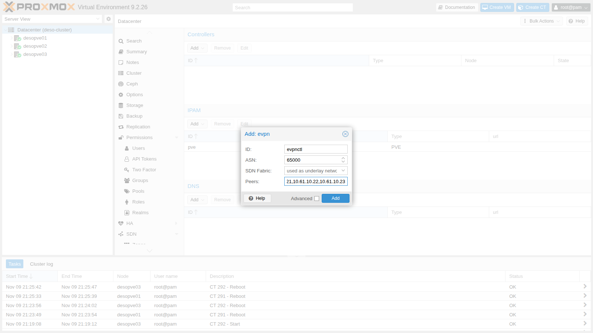
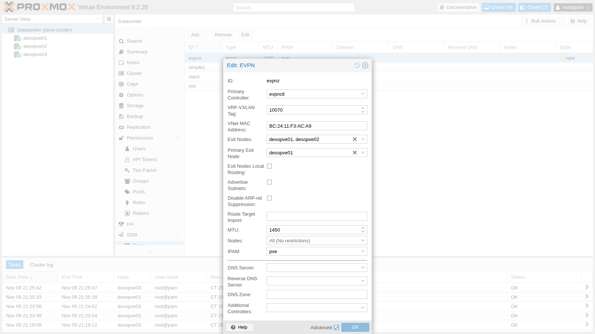
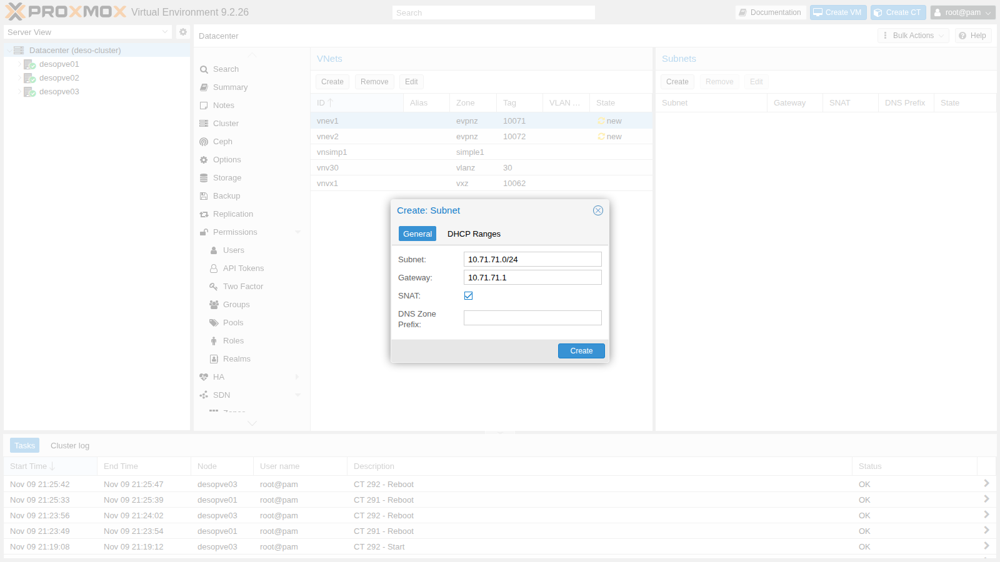

# Lab 30 – SDN 4: EVPN with BGP, exit nodes and anycast gateway

**Level:** expert · **Duration:** 1 hour 30 minutes

## Dependencies

- **Previous labs:**
  - [Lab 29](29-sdn-vxlan.md): VXLAN, underlay network `vmbr1.61` (10.61.10.0/24) and guest MTU;
  - [Lab 27](27-sdn-simple.md): SDN subnets, gateway, SNAT and IPAM;
  - [Lab 22](22-dedicated-networks.md): dedicated migration network;
  - [Lab 17](17-ceph-installation.md): `rbd-vm` storage for the guest disks.
- **Packages:** `frr` and `frr-pythontools` are installed by the Proxmox VE ISO; the SDN enables the service and writes `/etc/frr/frr.conf` on Apply. Check with `dpkg -l frr frr-pythontools` and `systemctl is-enabled frr`:

  ```text
  ii  frr             10.6.1-1+pve3 amd64        FRRouting suite of internet protocols (BGP, OSPF, IS-IS, ...)
  ii  frr-pythontools 10.6.1-1+pve3 all          FRRouting suite - Python tools
  enabled
  ```

- **Nodes:** `desopve01`, `desopve02`, `desopve03`.
- **Images:** template `cephfs:vztmpl/debian-13-standard_13.6-1_amd64.tar.zst` ([Lab 20](20-bridges-stable-names-vlans.md)) and cloud image `local:import/debian-13-genericcloud-amd64.qcow2` on `desopve01`, downloaded in [Lab 19](19-fio-benchmark.md).
- **Credentials:** `root` / `<lab-password>` → [Appendix B](b-credentials-and-addresses.md).

## Objectives

- Understand what EVPN adds to VXLAN: a BGP control plane instead of broadcast replication.
- Create an EVPN controller, a zone with a VRF and two VNets with a distributed gateway (*anycast gateway*).
- Route between VNets on different nodes and let the guests out through the *exit nodes* with SNAT.
- Read the BGP and EVPN state with `vtysh`.
- Live-migrate a VM without its gateway changing, and simulate the failure of the primary exit node.

## How it works

### The control plane

In the VXLAN zone of lab 29 each node learned MACs from the traffic and copied broadcasts to every peer. With **EVPN** (RFC 7432 and 8365) the nodes exchange this information over **BGP** (address family `l2vpn evpn`): when a guest starts, its node advertises the guest's MAC and IP to the others.

| Route type | What it advertises | Example in the lab |
|---|---|---|
| Type 2 (MAC/IP) | a guest's MAC and IP and the VTEP it sits behind | `bc:24:11:ca:34:84` / 10.71.71.11 behind 10.61.10.21 |
| Type 3 (multicast) | which VTEPs participate in a VNI | the three nodes for each VNet |
| Type 5 (IP prefix) | a routable network, for example an exit node's default route | 0.0.0.0/0 from `desopve01` |

The nodes form **iBGP** sessions with each other using a private ASN (65000) on the underlay network addresses. Proxmox VE also enables **BFD**, which detects within less than a second when a neighbor disappears.

### VRF, anycast gateway and distributed routing

- **EVPN zone = VRF.** Each zone is a separate routing table (`vrf_evpnz`), that is, a tenant: its networks do not mix with those of the host or of other zones.
- **Anycast gateway.** The gateway of each VNet exists on **all** nodes, with the same IP and the same MAC. A guest always talks to the gateway of the node it runs on, and if it migrates it finds the same gateway.
- **Symmetric routing.** Traffic between two VNets is routed by the source node and crosses the network between the nodes inside the zone's layer 3 VNI (**VRF-VXLAN tag**). The destination node delivers it into the target VNet.

### Exit nodes

To leave the zone you need one or more **exit nodes**: nodes that advertise a default route into the zone and connect the VRF to the host network. With **SNAT** on the subnet, the guests go out with the exit node's IP. With a **Primary Exit Node**, all outgoing traffic uses that node and the others stay on standby.

## Procedure

### 1. The EVPN controller

**Datacenter** → **SDN** → **Options** → **Controllers** → **Add** → **EVPN**:

- **ID** `evpnctl`;
- **ASN** `65000`, private;
- **Peers** `10.61.10.21,10.61.10.22,10.61.10.23`: the underlay addresses of the nodes.

Here too, **SDN Fabric** is the alternative to the peer list (lab 31).



### 2. The EVPN zone

1. **Zones** → **Add** → **EVPN**, with **Advanced** checked:
   - **ID** `evpnz`, **Controller** `evpnctl`;
   - **VRF-VXLAN Tag** `10070`: the zone's layer 3 VNI;
   - **Exit Nodes** `desopve01`, `desopve02`; **Primary Exit Node** `desopve01`;
   - **MTU** `1450`, as in lab 29.

   The **VNet MAC Address** is generated by Proxmox VE: it is the MAC of the anycast gateway, the same on all nodes.

   

   The primary node can also be set from the command line:

   ```console
   root@desopve01:~# pvesh set /cluster/sdn/zones/evpnz --exitnodes-primary desopve01
   ```

### 3. Two VNets with subnet and SNAT

1. **VNets** → **Create**: `vnev1`, zone `evpnz`, **Tag** (VNI) `10071`. In the **Subnets** panel → **Create**: **Subnet** `10.71.71.0/24`, **Gateway** `10.71.71.1`, **SNAT** enabled:

   

2. The second VNet from the command line, then Apply:

   ```console
   root@desopve01:~# pvesh create /cluster/sdn/vnets --vnet vnev2 --zone evpnz --tag 10072
   root@desopve01:~# pvesh create /cluster/sdn/vnets/vnev2/subnets --subnet 10.72.72.0/24 --type subnet --gateway 10.72.72.1 --snat 1
   root@desopve01:~# pvesh set /cluster/sdn
   ```

### 4. What the SDN generates: FRR, VRF and gateway

1. In `/etc/frr/frr.conf` the SDN writes the VRF with its VNI, the iBGP sessions between the nodes with BFD, and the advertisement of all VNIs. On the exit nodes it adds the default route advertised into the zone:

   ```text
   # excerpt of /etc/frr/frr.conf on desopve01 (exit node)
   vrf vrf_evpnz
    vni 10070
   exit-vrf
   !
   router bgp 65000
    bgp router-id 10.61.10.21
    neighbor VTEP peer-group
    neighbor VTEP remote-as 65000
    neighbor VTEP bfd
    neighbor 10.61.10.22 peer-group VTEP
    neighbor 10.61.10.23 peer-group VTEP
    !
    address-family l2vpn evpn
     neighbor VTEP activate
     neighbor VTEP route-map MAP_VTEP_IN in
     neighbor VTEP route-map MAP_VTEP_OUT out
     advertise-all-vni
    exit-address-family
   exit
   !
   router bgp 65000 vrf vrf_evpnz
    !
    address-family l2vpn evpn
     default-originate ipv4
     default-originate ipv6
    exit-address-family
   exit
   ```

2. The BGP sessions with the other two nodes and the known VNIs:

   ```console
   root@desopve01:~# vtysh -c "show bgp l2vpn evpn summary"
   BGP router identifier 10.61.10.21, local AS number 65000 VRF default vrf-id 0
   ...
   Neighbor               V         AS   MsgRcvd   MsgSent   TblVer  InQ OutQ  Up/Down State/PfxRcd   PfxSnt Desc
   desopve02(10.61.10.22) 4      65000        25        31        3    0    0 00:00:37            3        7 FRRouting/10.6.1
   desopve03(10.61.10.23) 4      65000        25        24        3    0    0 00:00:30            5        7 FRRouting/10.6.1
   root@desopve01:~# vtysh -c "show evpn vni"
   VNI        Type VxLAN IF              # MACs   # ARPs   # Remote VTEPs  Tenant VRF      VLAN       BRIDGE
   10072      L2   vxlan_vnev2           0        0        2               vrf_evpnz       1          vnev2
   10071      L2   vxlan_vnev1           0        0        2               vrf_evpnz       1          vnev1
   10062      L2   vxlan_vnvx1           2        2        2               default         1          vnvx1
   10070      L3   vrfvx_evpnz           0        0        n/a             vrf_evpnz       1          vrfbr_evpnz
   ```

   The two L2 VNIs are the VNets, the L3 VNI belongs to the VRF. VNI 10062 of the lab 29 VXLAN zone also shows up: with `advertise-all-vni`, FRR advertises every VXLAN interface on the node.

3. The anycast gateway: same IP and same MAC on `desopve01` and `desopve03`:

   ```console
   root@desopve01:~# ip -br link show vnev1
   vnev1            UP             bc:24:11:f3:ac:a9 <BROADCAST,MULTICAST,UP,LOWER_UP>
   root@desopve03:~# ip -br link show vnev1
   vnev1            UP             bc:24:11:f3:ac:a9 <BROADCAST,MULTICAST,UP,LOWER_UP>
   root@desopve03:~# ip -br -4 addr show vnev1
   vnev1            UP             10.71.71.1/24
   ```

### 5. Guests in different VNets on different nodes

1. CT 301 on `desopve01` in the `vnev1` VNet and CT 302 on `desopve03` in the `vnev2` VNet, with the subnet gateway and an MTU of 1450. As in lab 29, the MTU must also be written into the container's network file, then the container is restarted:

   ```console
   root@desopve01:~# pct create 301 cephfs:vztmpl/debian-13-standard_13.6-1_amd64.tar.zst --hostname evpn-ct1 \
     --unprivileged 1 --features nesting=1 --cores 1 --memory 512 --rootfs rbd-vm:4 \
     --net0 name=eth0,bridge=vnev1,ip=10.71.71.11/24,gw=10.71.71.1,mtu=1450 --password
   root@desopve01:~# pct start 301
   root@desopve01:~# pct exec 301 -- sed -i '/address 10.71.71.11/a\	mtu 1450' /etc/network/interfaces
   root@desopve01:~# pct reboot 301
   root@desopve03:~# pct create 302 cephfs:vztmpl/debian-13-standard_13.6-1_amd64.tar.zst --hostname evpn-ct2 \
     --unprivileged 1 --features nesting=1 --cores 1 --memory 512 --rootfs rbd-vm:4 \
     --net0 name=eth0,bridge=vnev2,ip=10.72.72.12/24,gw=10.72.72.1,mtu=1450 --password
   root@desopve03:~# pct start 302
   root@desopve03:~# pct exec 302 -- sed -i '/address 10.72.72.12/a\	mtu 1450' /etc/network/interfaces
   root@desopve03:~# pct reboot 302
   ```

2. CT 302 reaches CT 301 in another VNet and on another node. The first hop is the anycast gateway on the local node; the second, the remote node, does not answer traceroute:

   ```console
   root@desopve03:~# pct exec 302 -- ping -c3 -W1 10.71.71.11
   3 packets transmitted, 3 received, 0% packet loss, time 2031ms
   root@desopve03:~# pct exec 302 -- apt-get install -y traceroute    # the CT goes out through the exit node; apt proxy set as in the other guests
   root@desopve03:~# pct exec 302 -- traceroute -n -w1 -q1 10.71.71.11
   traceroute to 10.71.71.11 (10.71.71.11), 30 hops max, 60 byte packets
    1  10.72.72.1  0.130 ms
    2  *
    3  10.71.71.11  1.096 ms
   root@desopve03:~# pct exec 302 -- ip neigh show 10.72.72.1
   10.72.72.1 dev eth0 lladdr bc:24:11:f3:ac:a9 REACHABLE
   ```

3. On node `desopve03`, which is not an exit node, the VRF table contains the default route toward the primary exit node and a /32 route for each remote guest, learned from BGP:

   ```console
   root@desopve03:~# vtysh -c "show ip route vrf vrf_evpnz"
   ...
   B>* 0.0.0.0/0 [200/0] via 10.61.10.21, vrfbr_evpnz onlink, weight 1, 00:02:34
   K * 0.0.0.0/0 [255/8192] unreachable (ICMP unreachable), weight 1, 00:02:39
   C>* 10.71.71.0/24 is directly connected, vnev1, weight 1, 00:02:39
   L>* 10.71.71.1/32 is directly connected, vnev1, weight 1, 00:02:39
   B>* 10.71.71.11/32 [200/0] via 10.61.10.21, vrfbr_evpnz onlink, weight 1, 00:00:19
   C>* 10.72.72.0/24 is directly connected, vnev2, weight 1, 00:00:30
   L>* 10.72.72.1/32 is directly connected, vnev2, weight 1, 00:00:30
   ```

4. The type 2 routes with the guests' MACs and IPs:

   ```console
   root@desopve01:~# vtysh -c "show bgp l2vpn evpn route type macip"
   ...
   Route Distinguisher: 10.61.10.21:4
    *>  [2]:[0]:[48]:[bc:24:11:ca:34:84]:[32]:[10.71.71.11] RD 10.61.10.21:4
   Route Distinguisher: 10.61.10.23:5
    *>i [2]:[0]:[48]:[bc:24:11:46:74:e2]:[32]:[10.72.72.12] RD 10.61.10.23:5
   ```

### 6. Leaving through the exit node with SNAT

1. CT 302 reaches the domain controller, outside the zone. On the management network of `desopve01`, the primary exit node, the traffic goes out with the node's address:

   ```console
   root@desopve03:~# pct exec 302 -- ping -c3 -W1 172.27.199.20
   3 packets transmitted, 3 received, 0% packet loss, time 2003ms
   root@desopve01:~# tcpdump -lnni vmbr0 -c2 "icmp[icmptype]=icmp-echo and dst host 172.27.199.20"
   21:40:37.078886 IP 172.27.199.21 > 172.27.199.20: ICMP echo request, id 282, seq 1, length 64
   21:40:38.080689 IP 172.27.199.21 > 172.27.199.20: ICMP echo request, id 282, seq 2, length 64
   ```

2. The SNAT rules were written by the SDN, on each exit node with its own address:

   ```console
   root@desopve01:~# iptables -t nat -S POSTROUTING | grep -E "10.7[12]"
   -A POSTROUTING -s 10.71.71.0/24 -o vmbr0 -j SNAT --to-source 172.27.199.21
   -A POSTROUTING -s 10.72.72.0/24 -o vmbr0 -j SNAT --to-source 172.27.199.21
   root@desopve02:~# iptables -t nat -S POSTROUTING | grep -E "10.7[12]"
   -A POSTROUTING -s 10.71.71.0/24 -o vmbr0 -j SNAT --to-source 172.27.199.22
   -A POSTROUTING -s 10.72.72.0/24 -o vmbr0 -j SNAT --to-source 172.27.199.22
   ```

### 7. Live migration with the anycast gateway

1. A VM from the Debian cloud image, with cloud-init (covered in depth in lab 40) and a network device that inherits the VNet MTU (`mtu=1`):

   ```console
   root@desopve01:~# qm create 303 --name evpn-vm1 --ostype l26 --memory 1024 --cores 1 \
     --net0 virtio,bridge=vnev1,mtu=1 --scsihw virtio-scsi-single \
     --scsi0 rbd-vm:0,import-from=local:import/debian-13-genericcloud-amd64.qcow2 \
     --ide2 rbd-vm:cloudinit --ipconfig0 ip=10.71.71.30/24,gw=10.71.71.1 \
     --ciuser labuser --cipassword '<lab-password>' --boot order=scsi0 --serial0 socket --vga serial0
   root@desopve01:~# qm start 303
   root@desopve01:~# qm showcmd 303 | grep -o 'host_mtu=[0-9]*'
   host_mtu=1450
   ```

   `host_mtu=1450` confirms that with `mtu=1` Proxmox VE passes the bridge MTU to the VirtIO device.

2. Before the migration, `desopve03` sees the VM's MAC (`bc:24:11:45:63:6d`) behind the VTEP of `desopve01`:

   ```console
   root@desopve03:~# vtysh -c "show evpn mac vni 10071"
   MAC               Type   Flags Intf/Remote ES/VTEP                     VLAN  Seq #'s
   bc:24:11:ca:34:84 remote       10.61.10.21                                   0/0
   bc:24:11:45:63:6d remote       10.61.10.21                                   1/0
   ```

3. From CT 302, a ping every 100 ms toward the VM, while the VM live-migrates from `desopve01` to `desopve02`:

   ```console
   root@desopve03:~# pct exec 302 -- ping -i 0.1 -c 450 -q 10.71.71.30
   root@desopve01:~# qm migrate 303 desopve02 --online
   ...
   2026-11-09 21:42:03 average migration speed: 512.4 MiB/s - downtime 45 ms
   2026-11-09 21:42:03 migration status: completed
   2026-11-09 21:42:07 migration finished successfully (duration 00:00:10)
   ```

   ```text
   450 packets transmitted, 440 received, 2.22222% packet loss, time 45465ms
   ```

   The VM was paused for 45 ms. 10 pings are lost, about one second: the time it takes for the MAC's new location to reach all nodes via BGP. The VM did not have to change anything: the gateway 10.71.71.1, with the same MAC, also exists on `desopve02`.

4. After the migration the MAC is behind the VTEP of `desopve02` and the sequence number has increased: this is the EVPN *MAC mobility* mechanism.

   ```console
   root@desopve03:~# vtysh -c "show evpn mac vni 10071"
   MAC               Type   Flags Intf/Remote ES/VTEP                     VLAN  Seq #'s
   bc:24:11:ca:34:84 remote       10.61.10.21                                   0/0
   bc:24:11:45:63:6d remote       10.61.10.22                                   2/1
   ```

5. The VM was only needed for this test: `qm stop 303 && qm destroy 303 --purge`.

### 8. Failure of the primary exit node

1. From CT 302, a continuous ping toward the domain controller. On `desopve01`, bring down the underlay interface, as if the node disappeared from the network between the nodes:

   ```console
   root@desopve03:~# pct exec 302 -- ping -i 0.1 -c 300 -q 172.27.199.20
   root@desopve01:~# ip link set vmbr1.61 down
   ```

2. Within moments BFD tears down the sessions: on `desopve03` the default route switches to the backup exit node, and on `desopve02` the traffic goes out with that node's address:

   ```console
   root@desopve03:~# vtysh -c "show ip route vrf vrf_evpnz 0.0.0.0/0"
   Routing entry for 0.0.0.0/0
     Known via "bgp", distance 200, metric 200, vrf vrf_evpnz, best
     * 10.61.10.22, via vrfbr_evpnz onlink, weight 1
   root@desopve02:~# tcpdump -lnni vmbr0 -c2 "icmp and host 172.27.199.20"
   21:44:53.644292 IP 172.27.199.22 > 172.27.199.20: ICMP echo request, id 294, seq 37, length 64
   21:44:53.644875 IP 172.27.199.20 > 172.27.199.22: ICMP echo reply, id 294, seq 37, length 64
   ```

3. The result was **not** the same in every test. Over four attempts:

   | Test | Lost pings | Interruption of the running ping |
   |---|---|---|
   | 1 | 152 of 400 (every 100 ms) | for the whole failure, about 15 s |
   | 2 | 4 of 150 (every 200 ms) | about 0.8 s |
   | 3 | 132 of 300 (every 100 ms) | for the whole failure, about 13 s |
   | 4 | 9 of 200 (every 100 ms) | about 0.9 s |

   In tests 1 and 3 the connection tracking of `desopve02` had recorded the flow **without NAT**: the replies went back toward 10.72.72.12, an address that nobody outside the zone knows how to reach.

   ```console
   root@desopve02:~# conntrack -L -p icmp | grep 10.72.72.12
   icmp     1 29 src=10.72.72.12 dst=172.27.199.20 type=8 code=0 id=295 [UNREPLIED] src=172.27.199.20 dst=10.72.72.12 type=0 code=0 id=295 mark=0 use=1
   ```

   The first packets had reached `desopve02` while it still had its default route toward `desopve01`, so they did not go through the SNAT rule on `vmbr0`. That entry stayed valid as long as the ping kept it alive. A **new** ping, started during the failure, worked with no loss:

   ```console
   root@desopve03:~# pct exec 302 -- ping -c5 -W1 172.27.199.20
   5 packets transmitted, 5 received, 0% packet loss, time 4006ms
   ```

4. Restore the link, and the BGP sessions come back up:

   ```console
   root@desopve01:~# ip link set vmbr1.61 up
   root@desopve01:~# vtysh -c "show bgp l2vpn evpn summary" | grep ^desopve
   desopve02(10.61.10.22) 4      65000       231       253       40    0    0 00:00:46            3        8 FRRouting/10.6.1
   desopve03(10.61.10.23) 4      65000       231       247       40    0    0 00:00:46            8        8 FRRouting/10.6.1
   ```

**The lesson:** SNAT is *stateful*. When the exit moves to another exit node, connections that are already open change their source address and drop anyway, and a flow that keeps going can get stuck. In production, for an exit without interruptions you avoid SNAT: the exit nodes advertise the zone's subnets via BGP to the network routers, which then know how to route the replies toward any exit node. In this lab the upstream router `rtr-core` stays out of BGP, so as not to touch the infrastructure.

## Verification and tests

| Test | Result |
|---|---|
| EVPN iBGP sessions between the 3 nodes | established, with BFD |
| Anycast gateway | same IP and MAC (`bc:24:11:f3:ac:a9`) on every node |
| CT 302 (`vnev2`, `desopve03`) → CT 301 (`vnev1`, `desopve01`) | 0% loss, routed in the VRF |
| Exit toward the DC | SNAT with the primary exit node's address |
| Live migration of a VM | 45 ms of VM downtime, about 1 s of lost pings, MAC moved via BGP |
| Failure of the primary exit node | exit via `desopve02` in about 1 s; in 2 tests out of 4 the flow that was already open got stuck because of the SNAT state |

## Final lab state

- **SDN:**
  - controller `evpnctl` (EVPN, ASN 65000, peers 10.61.10.21-23 on VLAN 61);
  - zone `evpnz` (VRF `vrf_evpnz`, VRF-VXLAN 10070, MTU 1450, exit nodes `desopve01` as primary and `desopve02`);
  - VNet `vnev1` (VNI 10071, 10.71.71.0/24, gateway .1, SNAT) and `vnev2` (VNI 10072, 10.72.72.0/24, gateway .1, SNAT);
  - zones `simple1`, `vlanz` and `vxz` unchanged.
- **Containers**, running, not set to start at boot, MTU 1450:
  - CT 301 `evpn-ct1` on `desopve01`, 10.71.71.11/24;
  - CT 302 `evpn-ct2` on `desopve03`, 10.72.72.12/24.
- VM 303 deleted. `vmbr1.61` is up again on `desopve01`.

## What you learned

- EVPN uses BGP to distribute MACs, IPs and networks between the nodes: no more *flood and learn* on the underlay.
- An EVPN zone is a VRF; the anycast gateway brings routing to every node and makes migration transparent to the guests.
- Exit nodes connect the zone to the rest of the network; with SNAT the guests go out with the node's IP.
- `vtysh` shows BGP sessions, VNIs, type 2 and type 5 routes and the location of every MAC.
- Failover between exit nodes is fast, but the SNAT state can block flows that are already open: for a robust exit, route without SNAT.

## References

- [Proxmox VE – SDN: EVPN Zones](https://pve.proxmox.com/pve-docs/chapter-pvesdn.html#pvesdn_zone_plugin_evpn)
- [Proxmox VE – SDN: EVPN Controller](https://pve.proxmox.com/pve-docs/chapter-pvesdn.html#pvesdn_controller_plugin_evpn)
- [RFC 7432 – BGP MPLS-Based Ethernet VPN](https://www.rfc-editor.org/rfc/rfc7432)
- [RFC 8365 – A Network Virtualization Overlay Solution Using EVPN](https://www.rfc-editor.org/rfc/rfc8365)
- [FRRouting – EVPN](https://docs.frrouting.org/en/latest/evpn.html)
