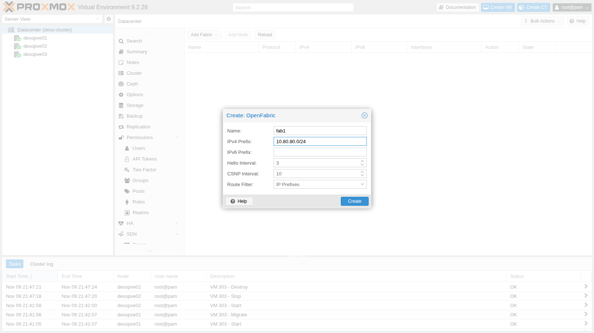
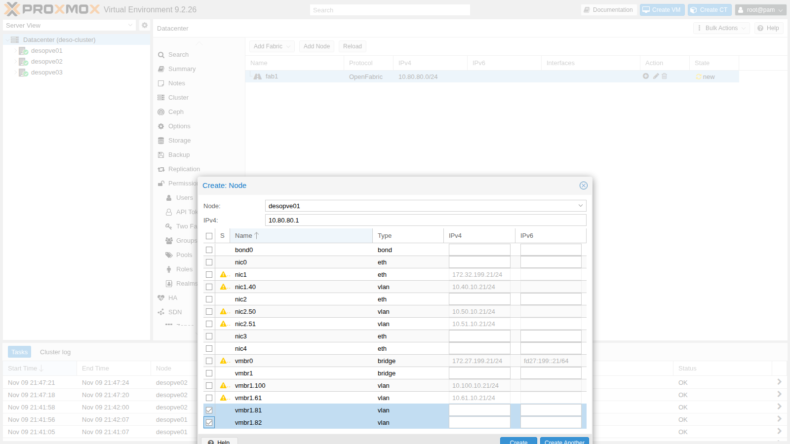
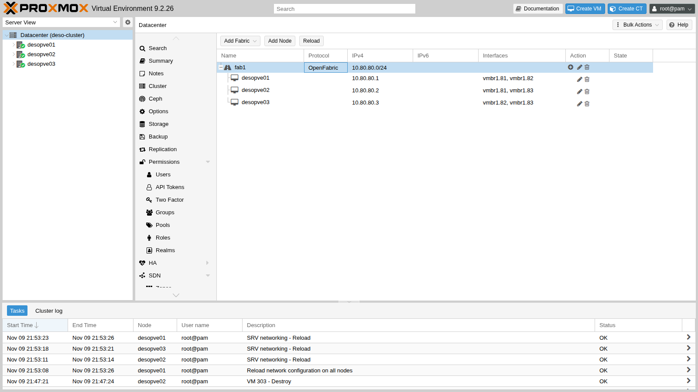
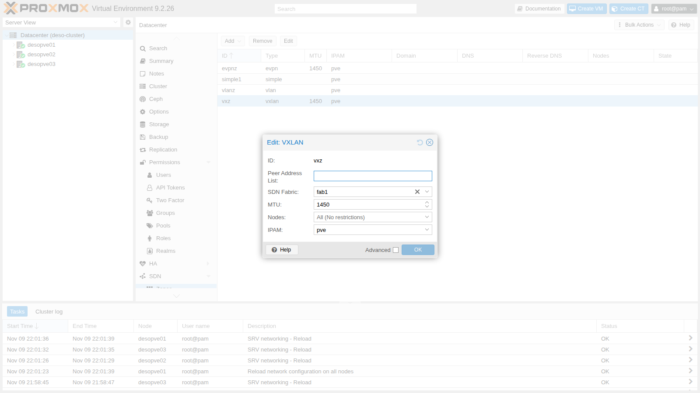

# Lab 31 – SDN 5: Fabrics (OpenFabric) and routed full mesh

**Level:** expert · **Duration:** 1 hour 30 minutes

## Dependencies

- **Previous labs:**
  - [Lab 29](29-sdn-vxlan.md): VXLAN zone `vxz` with CT 291 and 292;
  - [Lab 30](30-sdn-evpn.md): FRR managed by the SDN, BGP sessions and reading the state with `vtysh`;
  - [Lab 20](20-bridges-stable-names-vlans.md) and [Lab 21](21-bonding.md): VLAN-aware `vmbr1` on `bond0`, on which the point-to-point links are created.
- **Physical network:** the node trunk carries **VLANs 81, 82 and 83**, one for each link between two nodes.
- **Nodes:** `desopve01`, `desopve02`, `desopve03`.
- **Credentials:** `root` / `<lab-password>` → [Appendix B](b-credentials-and-addresses.md).

## Objectives

- Understand what a *fabric* is: a routed network between the nodes, with one address per node and a routing protocol that finds the paths on its own.
- Create an OpenFabric fabric from the GUI on point-to-point links that have no addresses of their own.
- Check adjacencies, database and routes with `vtysh` and `ip route`.
- Measure reconvergence when a link fails, and understand the role of the timers.
- Use the fabric as the underlay of the VXLAN zone.

## How it works

### What a fabric is

A fabric connects the nodes with a **routed** network instead of a single layer 2 network:

- each node has a `/32` address of its own, the equivalent of a *router ID* (here 10.80.80.1-3), on a loopback interface;
- the links between the nodes are **point-to-point** and have no subnet of their own (*unnumbered*): the node uses its `/32` there too;
- a dynamic routing protocol exchanges the node addresses and the link state, and installs the routes; if a link fails, traffic goes through another node.

The typical case is the **full mesh**: three nodes connected directly to each other, two cables per node, no switch. It is the configuration the Proxmox VE guide proposes for the Ceph network in small clusters. The same fabric is used as the underlay for VXLAN and EVPN.

### The fabric types in Proxmox VE 9.2

The **Add Fabric** menu offers four protocols; this lab uses OpenFabric.

| Protocol | In brief |
|---|---|
| **OpenFabric** | a variant of IS-IS designed for data center fabrics: you only configure the prefix, the nodes and the interfaces |
| **OSPF** | the classic link-state protocol, with the concept of *area* |
| **BGP** | BGP sessions between the fabric nodes |
| **WireGuard** | encrypted tunnels between the nodes, also toward external nodes |

### The lab: three VLANs as three cables

```text
            VLAN 81
 desopve01 ───────── desopve02
 10.80.80.1          10.80.80.2
      \                 /
   VLAN 82          VLAN 83
        \             /
         desopve03
         10.80.80.3
```

Each VLAN has only two members, so it behaves like a direct cable. With one important difference: bringing down the interface on one node does **not** unplug the cable at the other end. The other end notices the failure only when it stops receiving the neighbor's messages, as when a transceiver or a switch in between fails.

## Procedure

### 1. The point-to-point links

On each node, two VLAN subinterfaces of `vmbr1`, without an address, before the `source` line of `/etc/network/interfaces`. Before editing the file, make a copy of it on each node: `cp /etc/network/interfaces /root/interfaces.bak-lab31`. For `desopve01` (links to 02 and 03):

```text
auto vmbr1.81
iface vmbr1.81 inet manual
#point-to-point fabric

auto vmbr1.82
iface vmbr1.82 inet manual
#point-to-point fabric
```

On `desopve02` VLANs 81 and 83, on `desopve03` VLANs 82 and 83. Then `ifreload -a` on each node.

On the nodes with the EVPN zone of lab 30, `ifreload` prints a harmless warning: it tries to delete a VRF route that no longer exists.

```text
warning: vrf_evpnz: post-up cmd 'ip route del vrf vrf_evpnz unreachable default metric 4278198272' failed: returned 2 (RTNETLINK answers: No such process
)
```

### 2. The OpenFabric fabric

**Datacenter** → **SDN** → **Fabrics** → **Add Fabric** → **OpenFabric**: **Name** `fab1`, **IPv4 Prefix** `10.80.80.0/24`, the range the node addresses will come from. Hello and CSNP interval stay at their default values (they are changed in step 6).



### 3. The fabric nodes

1. With the fabric selected, **Add Node**: **Node** `desopve01`, **IPv4** `10.80.80.1` and, in the table, the two point-to-point interfaces `vmbr1.81` and `vmbr1.82`. Interfaces that already have an address configured are flagged with a warning: an unnumbered interface uses the node's address.

   

2. The other two nodes from the command line:

   ```console
   root@desopve01:~# pvesh create /cluster/sdn/fabrics/node/fab1 --node_id desopve02 --protocol openfabric \
     --ip 10.80.80.2 --interfaces name=vmbr1.81 --interfaces name=vmbr1.83
   root@desopve01:~# pvesh create /cluster/sdn/fabrics/node/fab1 --node_id desopve03 --protocol openfabric \
     --ip 10.80.80.3 --interfaces name=vmbr1.82 --interfaces name=vmbr1.83
   root@desopve01:~# cat /etc/pve/sdn/fabrics.cfg
   openfabric_fabric: fab1
   	ip_prefix 10.80.80.0/24

   openfabric_node: fab1_desopve01
   	interfaces name=vmbr1.81
   	interfaces name=vmbr1.82
   	ip 10.80.80.1

   openfabric_node: fab1_desopve02
   	interfaces name=vmbr1.81
   	interfaces name=vmbr1.83
   	ip 10.80.80.2

   openfabric_node: fab1_desopve03
   	interfaces name=vmbr1.82
   	interfaces name=vmbr1.83
   	ip 10.80.80.3
   root@desopve01:~# pvesh set /cluster/sdn
   ```

3. The fabric with the three nodes and their interfaces:

   

### 4. What the SDN generates

1. The node address sits on a `dummy_fab1` interface, the fabric loopback, and the same `/32` appears on the point-to-point interfaces:

   ```console
   root@desopve01:~# ip -br -4 addr show dummy_fab1
   dummy_fab1       UNKNOWN        10.80.80.1/32
   root@desopve01:~# ip -br -4 addr show vmbr1.81
   vmbr1.81@vmbr1   UP             10.80.80.1/32
   ```

2. In FRR there is a `router openfabric` instance with the node identifier (NET) derived from the address. The loopback is *passive*: advertised, but without adjacencies. A route-map makes the node's `/32` the source address for the fabric routes.

   ```text
   # excerpt of /etc/frr/frr.conf on desopve01
   router openfabric fab1
    net 49.0001.0100.8008.0001.00
   exit
   !
   interface dummy_fab1
    ip router openfabric fab1
    openfabric passive
   exit
   !
   interface vmbr1.81
    ip router openfabric fab1
   exit
   !
   interface vmbr1.82
    ip router openfabric fab1
   exit
   !
   access-list pve_openfabric_fab1_ips permit 10.80.80.0/24
   !
   route-map pve_openfabric permit 100
    match ip address pve_openfabric_fab1_ips
    set src 10.80.80.1
   exit
   !
   ip protocol openfabric route-map pve_openfabric
   ```

3. To act as a transit node, a node must forward packets. The SDN enables forwarding **only** on the fabric interfaces and leaves global forwarding off:

   ```console
   root@desopve02:~# sysctl -n net.ipv4.ip_forward net.ipv4.conf.vmbr1/81.forwarding net.ipv4.conf.vmbr1/83.forwarding
   0
   1
   1
   ```

### 5. Adjacencies, database and routes

1. Each node sees its two neighbors. *Holdtime* is the time after which a silent neighbor is considered lost:

   ```console
   root@desopve01:~# vtysh -c "show openfabric neighbor"
   Area fab1:
    System Id           Interface   L  State         Holdtime SNPA
    desopve02           vmbr1.81    2  Up            29       2020.2020.2020
    desopve03           vmbr1.82    2  Up            30       2020.2020.2020
   ```

2. The database contains the description (LSP) of each of the three nodes; from it, each node computes the best paths:

   ```console
   root@desopve01:~# vtysh -c "show openfabric database"
   Area fab1:
   IS-IS Level-2 link-state database:
   LSP ID                  PduLen  SeqNumber   Chksum  Holdtime  ATT/P/OL
   desopve01.00-00      *    123   0x00000002  0x13b8    1183    0/0/0
   desopve02.00-00           123   0x00000002  0x7c48    1172    0/0/0
   desopve03.00-00           123   0x00000002  0xdae2    1128    0/0/0
       3 LSPs
   root@desopve01:~# ip route | grep 10.80.80
   10.80.80.2 nhid 72 via 10.80.80.2 dev vmbr1.81 proto openfabric src 10.80.80.1 metric 20 onlink
   10.80.80.3 nhid 73 via 10.80.80.3 dev vmbr1.82 proto openfabric src 10.80.80.1 metric 20 onlink
   ```

3. The node addresses are reached directly, in a single hop:

   ```console
   root@desopve01:~# ping -c3 -W1 -I 10.80.80.1 10.80.80.3
   3 packets transmitted, 3 received, 0% packet loss, time 2065ms
   root@desopve01:~# traceroute -n -w1 -q1 -s 10.80.80.1 10.80.80.3
    1  10.80.80.3  0.396 ms
   ```

### 6. Failures and reconvergence

For each test, a ping every 100 ms from `desopve01` (source 10.80.80.1) to `desopve03` (10.80.80.3), in a second terminal: `ping -i 0.1 -c 400 -q -I 10.80.80.1 10.80.80.3`. Then bring down the VLAN 82 link between the two and bring it back up after a few tens of seconds with `ip link set vmbr1.82 up`, on the node (or nodes) where it was brought down.

1. **One-sided failure, default timers.** Bring down `vmbr1.82` only on `desopve03`, while on `desopve01` it stays up:

   ```console
   root@desopve03:~# ip link set vmbr1.82 down
   ```

   ```text
   600 packets transmitted, 335 received, 44.1667% packet loss, time 61696ms
   ```

   265 pings are lost, about 26 seconds: `desopve01` keeps sending toward `desopve03` over VLAN 82 until the neighbor expires (*holdtime* of about 30 s). The same happens to the replies if you bring down the interface only on `desopve01`: then it is `desopve03` that does not notice.

2. **Tighter timers.** The holdtime is a multiple of the *hello interval*. Setting the hello to 1 second in the fabric configuration brings the holdtime down to 10 s:

   ```console
   root@desopve01:~# pvesh set /cluster/sdn/fabrics/fabric/fab1 --protocol openfabric --hello_interval 1
   root@desopve01:~# pvesh set /cluster/sdn
   root@desopve01:~# grep -A3 "^interface vmbr1.81" /etc/frr/frr.conf
   interface vmbr1.81
    ip router openfabric fab1
    openfabric hello-interval 1
   exit
   root@desopve01:~# vtysh -c "show openfabric neighbor" | grep Up
    desopve02           vmbr1.81    2  Up            10       2020.2020.2020
    desopve03           vmbr1.82    2  Up            10       2020.2020.2020
   ```

   The same one-sided test:

   ```text
   400 packets transmitted, 338 received, +27 errors, 15.5% packet loss, time 53488ms
   ```

   Now 62 pings are lost, about 6 seconds. The *errors* are the ICMP destination unreachable messages received in the meantime.

3. **Link cut on both sides**, as when a cable is really unplugged. Each node sees the interface go down and immediately recomputes the paths; after one second `desopve03` is reached through `desopve02`:

   ```console
   root@desopve01:~# ip link set vmbr1.82 down
   root@desopve03:~# ip link set vmbr1.82 down
   root@desopve01:~# ip route get 10.80.80.3
   10.80.80.3 via 10.80.80.2 dev vmbr1.81 src 10.80.80.1 uid 0
   ```

   ```text
   400 packets transmitted, 384 received, 4% packet loss, time 40516ms
   ```

   16 pings lost: 1.6 seconds.

   A first test of this kind, run right after recovering from another failure, had lost 9 seconds, with the route briefly ending up on the default gateway: the fabric had not settled yet. Repeat the measurements once the fabric is stable.

### 7. The fabric as the VXLAN underlay

1. The `vxz` zone of lab 29 switches from the peer list on VLAN 61 to the fabric:

   ```console
   root@desopve01:~# pvesh set /cluster/sdn/zones/vxz --fabric fab1 --delete peers
   root@desopve01:~# pvesh set /cluster/sdn
   ```

   

2. Now the tunnel starts from the fabric loopback and goes to those of the other nodes:

   ```text
   # excerpt of /etc/network/interfaces.d/sdn on desopve01
   auto vxlan_vnvx1
   iface vxlan_vnvx1
   	vxlan-id 10062
   	vxlan-local-tunnelip 10.80.80.1
   	vxlan_remoteip 10.80.80.2
   	vxlan_remoteip 10.80.80.3
   	mtu 1450
   ```

   ```console
   root@desopve01:~# pct exec 291 -- ping -c3 -W1 10.62.62.12
   3 packets transmitted, 3 received, 0% packet loss, time 2056ms
   root@desopve01:~# tcpdump -lnni vmbr1.82 -c2 udp port 4789
   22:02:00.587760 IP 10.80.80.1.47640 > 10.80.80.3.4789: VXLAN, flags [I] (0x08), vni 10062
   IP 10.62.62.11 > 10.62.62.12: ICMP echo request, id 382, seq 1, length 64
   22:02:00.588181 IP 10.80.80.3.48661 > 10.80.80.1.4789: VXLAN, flags [I] (0x08), vni 10062
   IP 10.62.62.12 > 10.62.62.11: ICMP echo reply, id 382, seq 1, length 64
   ```

3. With the 01-03 link cut on both sides, the tunnel between the two containers goes through `desopve02` (visible on `vmbr1.81`) and the ping between the guests continues:

   ```console
   root@desopve01:~# tcpdump -lnni vmbr1.81 -c2 "udp port 4789 and host 10.80.80.3"
   22:02:17.378878 IP 10.80.80.1.47640 > 10.80.80.3.4789: VXLAN, flags [I] (0x08), vni 10062
   IP 10.62.62.11 > 10.62.62.12: ICMP echo request, id 383, seq 75, length 64
   22:02:17.380197 IP 10.80.80.3.48661 > 10.80.80.1.4789: VXLAN, flags [I] (0x08), vni 10062
   IP 10.62.62.12 > 10.62.62.11: ICMP echo reply, id 383, seq 75, length 64
   ```

   ```text
   250 packets transmitted, 246 received, 1.6% packet loss, time 25188ms
   ```

   4 pings were lost, 0.4 seconds, without touching anything in the guests or in the zone. After the test, bring the link back up on both nodes and check that all the neighbors are up again:

   ```console
   root@desopve01:~# ip link set vmbr1.82 up
   root@desopve03:~# ip link set vmbr1.82 up
   root@desopve01:~# vtysh -c "show openfabric neighbor"
   ```

4. The EVPN controller also has the **SDN Fabric** field. In this lab it stays on the VLAN 61 peer list, so the `evpnz` zone of lab 30 does not change.

### 8. What about Ceph?

With a physical full mesh, the Proxmox VE guide *Full Mesh Network for Ceph Server* uses exactly this kind of fabric: the Ceph public and cluster networks become the fabric prefix, and each monitor and OSD uses the `/32` of its node. If a cable breaks, Ceph keeps going through the third node. In this lab Ceph stays on VLANs 50 and 51 from lab 17: moving a Ceph network in use requires recreating the monitors, which is beyond the scope of this lab.

### 9. The rest of the network has not changed

```console
root@desopve01:~# ceph health
HEALTH_OK
root@desopve01:~# pvecm status | grep Quorate:
Quorate:          Yes
root@desopve01:~# pct exec 121 -- ping -c2 -W1 10.10.10.122
2 packets transmitted, 2 received, 0% packet loss, time 1001ms
root@desopve01:~# ping -c2 -W1 10.100.10.23
2 packets transmitted, 2 received, 0% packet loss, time 1004ms
root@desopve03:~# pct exec 302 -- ping -c2 -W1 10.71.71.11
2 packets transmitted, 2 received, 0% packet loss, time 1044ms
```

## Verification and tests

| Test | Hello | Lost pings (every 100 ms) |
|---|---|---|
| Link down on one side only | 3 s (default) | 265 of 600, about 26 s |
| Link down on one side only | 1 s | 62 of 400, about 6 s |
| Link cut on both sides | 1 s | 16 of 400, about 1.6 s |
| VXLAN over the fabric, link cut | 1 s | 4 of 250, about 0.4 s |
| Ceph, Corosync, guest VLANs, migration, EVPN | – | unchanged |

## Final lab state

- **Point-to-point links** on `vmbr1`, without an address: VLAN 81 (01-02), 82 (01-03), 83 (02-03).
- **Fabric** `fab1` (OpenFabric, prefix 10.80.80.0/24, hello 1 s): `desopve01` 10.80.80.1, `desopve02` 10.80.80.2, `desopve03` 10.80.80.3, on the `dummy_fab1` interfaces.
- **Zone `vxz`:** now uses the `fab1` fabric as the underlay, instead of the peer list. CT 291 and 292 unchanged.
- **Zone `evpnz`:** unchanged, with the controller on the VLAN 61 peers (`vmbr1.61`).
- Backups of the node network configurations in `/root/interfaces.bak-lab31`.

## What you learned

- A fabric gives each node a `/32` address and routes between the nodes over point-to-point links, finding alternative paths on its own.
- Proxmox VE 9.2 creates OpenFabric, OSPF, BGP and WireGuard fabrics from the GUI and generates the interfaces, the FRR configuration and the forwarding settings.
- A failure seen by both ends recovers in about one second; one seen by only one end lasts as long as the holdtime, which you reduce by lowering the hello interval.
- VXLAN zones and EVPN controllers can use a fabric as the underlay, and the guest traffic inherits its redundancy.
- The full mesh for Ceph is a typical use of a fabric.

## References

- [Proxmox VE – SDN: Fabrics](https://pve.proxmox.com/pve-docs/chapter-pvesdn.html#pvesdn_config_fabrics)
- [Proxmox VE Wiki – Full Mesh Network for Ceph Server](https://pve.proxmox.com/wiki/Full_Mesh_Network_for_Ceph_Server)
- [FRRouting – OpenFabric (fabricd)](https://docs.frrouting.org/en/latest/fabricd.html)
- [IETF draft – OpenFabric](https://datatracker.ietf.org/doc/html/draft-white-openfabric)
