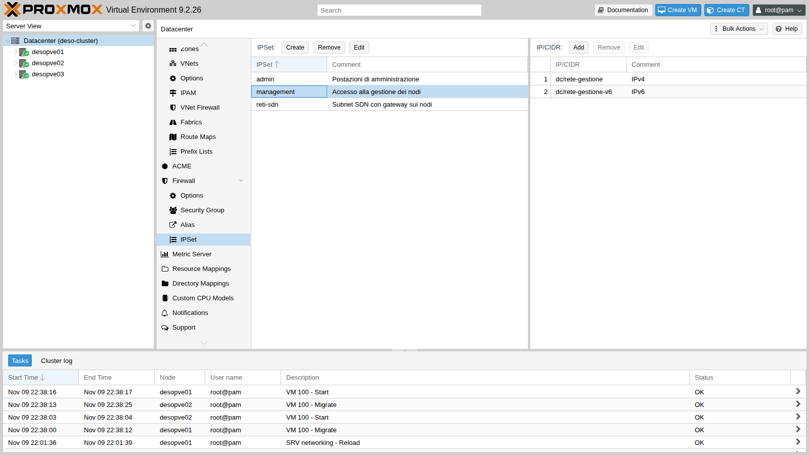
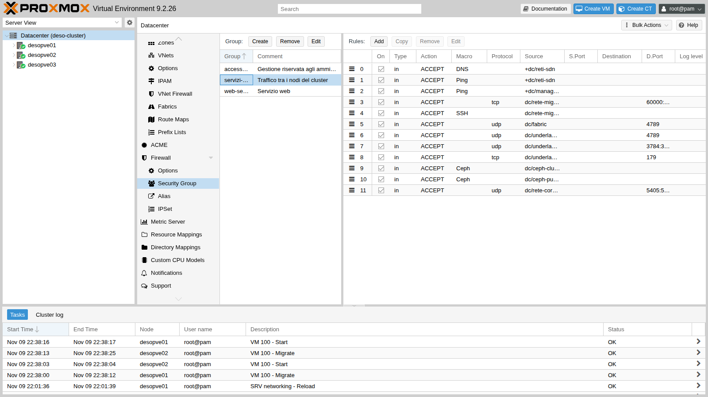
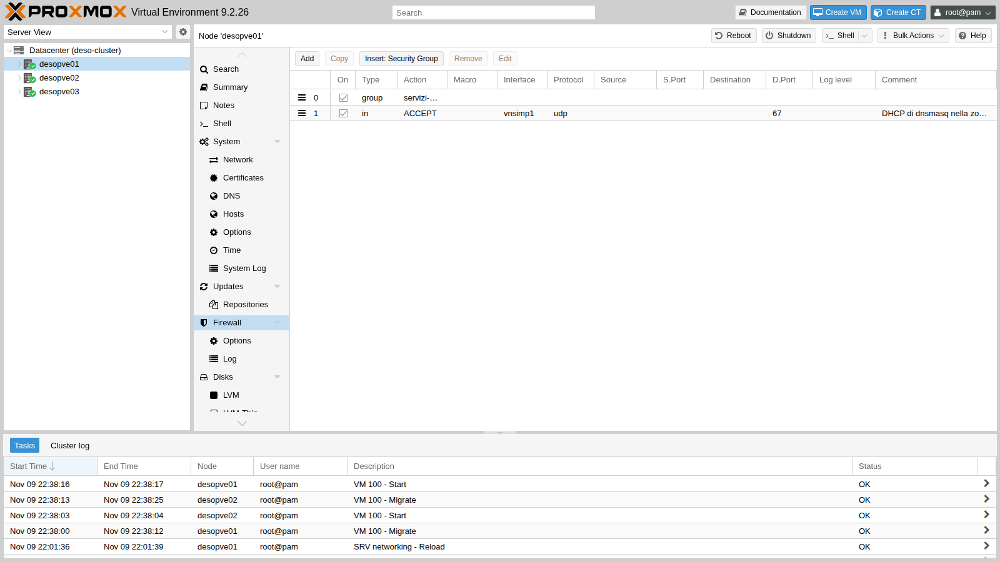
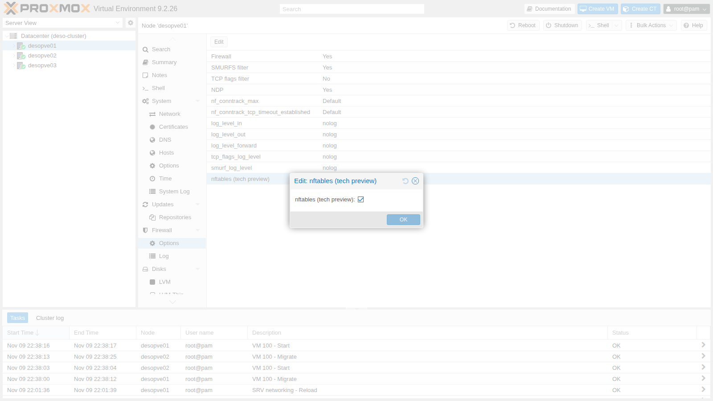
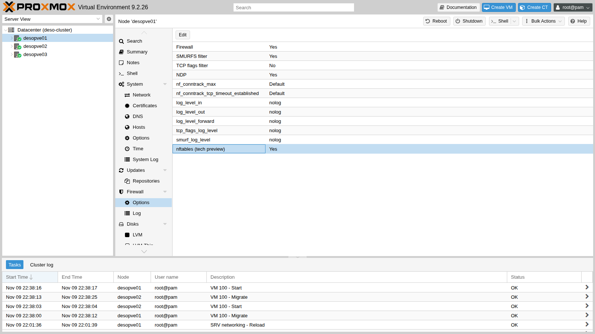
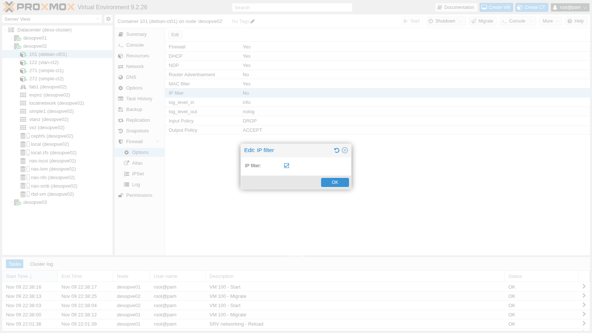
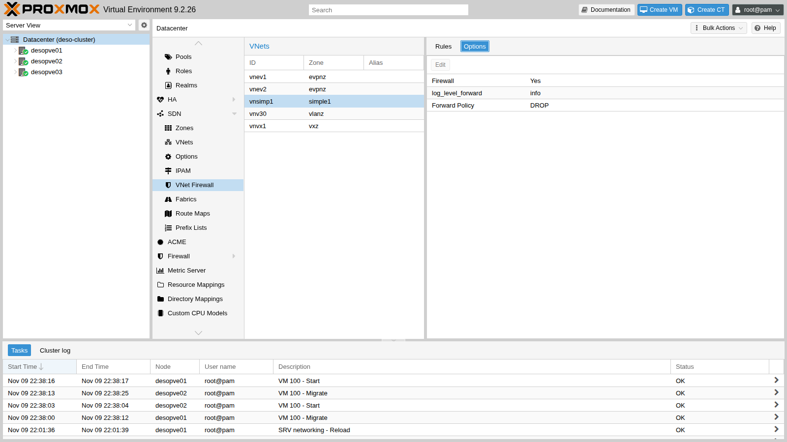
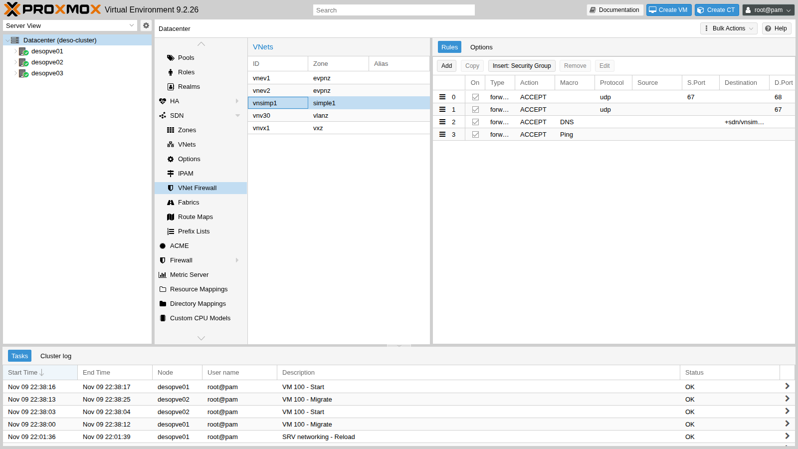

# Lab 33 – Firewall 2: nftables, host firewall, anti-spoofing, VNets and conntrack

**Level:** expert · **Duration:** 2 hours

## Dependencies

- **Previous labs:**
  - [Lab 32](32-firewall-1.md): Datacenter firewall enabled, host firewall disabled on the cluster nodes, CT 101 protected, test script `fwtest.ps1` on the DC;
  - [Lab 07](07-first-vm-and-container.md): VM 100, live-migrated to check the migration network;
  - [Lab 15](15-iscsi-lvm-multipath.md): iSCSI paths with multipath, checked after enabling the firewall;
  - [Lab 17](17-ceph-installation.md) and [Lab 22](22-dedicated-networks.md): Ceph (VLAN 50/51), Corosync (VLAN 40) and migration (VLAN 100) networks;
  - [Lab 27](27-sdn-simple.md): zone `simple1` with `dnsmasq` DHCP and DNS, CT 271 and 272;
  - [Lab 29](29-sdn-vxlan.md), [Lab 30](30-sdn-evpn.md) and [Lab 31](31-sdn-fabrics.md): VXLAN, BGP/BFD on VLAN 61 and the `fab1` fabric;
  - [Lab 25](25-ipv6.md): management over IPv6 too (`fd27:199::/64`).
- **Nodes:** `desopve01`, `desopve02`, `desopve03`. `desopve04` does not change.
- **Credentials:** `root` / `<lab-password>` → [Appendix B](b-credentials-and-addresses.md).

## Objectives

- Learn the two Proxmox VE firewall engines and switch to the one based on **nftables**.
- Turn on the **host** firewall of a cluster with services on many networks, without interrupting anything and with an automatic rollback plan.
- Prevent a guest from using an IP or MAC address other than the one assigned to it.
- Filter traffic inside a VNet with the VNet firewall.
- Read the connection state (conntrack) and recognize when it is conntrack that drops the packets.

## How it works

### Two engines for the same rules

Rules are always written the same way (GUI, `pvesh`, `.fw` files); what changes is the program that translates them for the kernel. The engine is chosen **per node**, with the `nftables` option of the node firewall.

| | `pve-firewall` (default) | `proxmox-firewall` (nftables) |
|---|---|---|
| Technology | iptables, ip6tables, ebtables, ipset | nftables |
| Guests with a firewall | one `fwbr` bridge per network interface | no extra bridges: the rules live in a `bridge` table |
| Where to read the rules | `iptables -S`, `ipset list` | `nft list ruleset` |
| SDN VNet firewall | not available | available |
| Status in Proxmox VE 9.2 | stable | still marked *tech preview* in the GUI |

With nftables, two tables appear on the node:

- `inet proxmox-firewall`: host and routed traffic;
- `bridge proxmox-firewall-guests`: guests and VNets.

### The host firewall in a real cluster

In [Lab 32](32-firewall-1.md) we saw that the host's automatic rules cover:

- management (GUI, SSH, console) from the `management` set, to which the cluster network is added automatically;
- Corosync between the nodes.

Everything else hits the `DROP` policy. In this cluster there are many more services between the nodes:

| Service | Network | Ports |
|---|---|---|
| Corosync, second link | VLAN 40, 10.40.10.0/24 | UDP 5405-5412 |
| Ceph public and cluster | VLAN 50/51, 10.50.10.0/24 and 10.51.10.0/24 | `Ceph` macro (TCP 6789, 3300, 6800-7300) |
| BGP of the EVPN controller | VLAN 61, 10.61.10.0/24 | TCP 179 |
| BFD | VLAN 61 | UDP 3784-3785 |
| VXLAN of zone `evpnz` | VLAN 61 | UDP 4789 |
| VXLAN of zone `vxz` | fabric, 10.80.80.0/24 | UDP 4789 |
| Migration | VLAN 100, 10.100.10.0/24 | SSH and TCP 60000-60050 |
| `dnsmasq` DHCP and DNS | VNet `vnsimp1` | UDP 67, DNS |
| Ping to the SDN gateway | SDN subnets | ICMP echo |
| Management over IPv6 | `fd27:199::/64` | same as IPv4 |

OpenFabric is not listed: it uses layer 2 IS-IS packets, not IP, and the firewall does not touch them.

### The "dead man's switch"

Before turning on a node's firewall remotely, schedule an **automatic rollback**: a timer that turns the firewall off again after 4 minutes. If everything works, you disarm the timer. If instead the change locks out the operator or a service, the timer puts things back as they were, with no need to go to the console.

### Anti-spoofing

Every guest with the firewall enabled has two protections against using someone else's addresses:

- **MAC filter** (the `MAC filter` option, enabled by default): the guest can only transmit with the MAC configured on its network interface.
- **IP filter** (the `IP filter` option, disabled by default): the guest can only use the addresses in the `ipfilter-net<n>` set as source. If the set is not created by hand, Proxmox VE fills it with the addresses configured on the network interface and with the IPv6 link-local address derived from the MAC.

### The VNet firewall

A VNet's rules have the `forward` direction and a policy of their own (`policy_forward`). The ruleset generated in this lab shows **where** they apply:

- to traffic **between guests in the same VNet** (bridge, `forward` chain of the `bridge` table);
- to traffic **between the VNet and the node itself** (`host-bridge-input` and `host-bridge-output` chains): gateway, DHCP, DNS.

Traffic **routed from the VNet to other networks** does not go through these rules. To filter it you need the guests' (outbound) rules or the host's rules.

### conntrack

The firewall is *stateful*: for each connection the kernel keeps an entry in the conntrack table (`NEW`, `ESTABLISHED`, `RELATED`, `INVALID`). The replies of an allowed connection get through without needing any rules. A packet that conntrack cannot link to any valid state is `INVALID` and is dropped.

## Procedure

### 1. The rules for the cluster services

First, the aliases of the cluster networks:

```bash
A() { pvesh create /cluster/firewall/aliases --name "$1" --cidr "$2" --comment "$3"; }
A rete-corosync-2 10.40.10.0/24 "Corosync, secondo collegamento (VLAN 40)"
A ceph-public 10.50.10.0/24 "Ceph public network (VLAN 50)"
A ceph-cluster 10.51.10.0/24 "Ceph cluster network (VLAN 51)"
A underlay-evpn 10.61.10.0/24 "Underlay EVPN: BGP, BFD, VXLAN (VLAN 61)"
A fabric 10.80.80.0/24 "Indirizzi dei nodi nella fabric fab1"
A rete-migrazione 10.100.10.0/24 "Rete di migrazione (VLAN 100)"
A rete-gestione-v6 fd27:199::/64 "Rete di gestione IPv6"
```

Then two IPSets:

- `management`, with the IPv4 and IPv6 management networks. Without this set, IPv6 access would be blocked, as seen on `desopve04` in [Lab 32](32-firewall-1.md).
- `reti-sdn`, with the SDN subnets that have their gateway on the nodes.



```bash
pvesh create /cluster/firewall/ipset --name management --comment "Accesso alla gestione dei nodi"
pvesh create /cluster/firewall/ipset/management --cidr dc/rete-gestione --comment "IPv4"
pvesh create /cluster/firewall/ipset/management --cidr dc/rete-gestione-v6 --comment "IPv6"
pvesh create /cluster/firewall/ipset --name reti-sdn --comment "Subnet SDN con gateway sui nodi"
for c in 10.60.60.0/24 10.71.71.0/24 10.72.72.0/24; do
  pvesh create /cluster/firewall/ipset/reti-sdn --cidr $c
done
```

Finally the `servizi-cluster` security group, with one rule for each row of the table above:



From the command line, on any node. Each rule created with `pvesh` goes to the top of the group, so to get the order of the table you start from the last one:

```bash
G=/cluster/firewall/groups/servizi-cluster
pvesh create /cluster/firewall/groups --group servizi-cluster --comment "Traffico tra i nodi del cluster"
# each new rule goes to the top: create them from the last one to the first
pvesh create $G --type in --action ACCEPT --source dc/rete-corosync-2 --proto udp --dport 5405:5412 --enable 1 --comment "Corosync link 1"
pvesh create $G --type in --action ACCEPT --macro Ceph --source dc/ceph-public --enable 1 --comment "Ceph public"
pvesh create $G --type in --action ACCEPT --macro Ceph --source dc/ceph-cluster --enable 1 --comment "Ceph cluster"
pvesh create $G --type in --action ACCEPT --source dc/underlay-evpn --proto tcp --dport 179 --enable 1 --comment "BGP (controller EVPN)"
pvesh create $G --type in --action ACCEPT --source dc/underlay-evpn --proto udp --dport 3784:3785 --enable 1 --comment "BFD"
pvesh create $G --type in --action ACCEPT --source dc/underlay-evpn --proto udp --dport 4789 --enable 1 --comment "VXLAN zona evpnz"
pvesh create $G --type in --action ACCEPT --source dc/fabric --proto udp --dport 4789 --enable 1 --comment "VXLAN zona vxz sulla fabric"
pvesh create $G --type in --action ACCEPT --macro SSH --source dc/rete-migrazione --enable 1 --comment "Migrazione: tunnel SSH"
pvesh create $G --type in --action ACCEPT --source dc/rete-migrazione --proto tcp --dport 60000:60050 --enable 1 --comment "Migrazione: porte dati"
pvesh create $G --type in --action ACCEPT --macro Ping --source +dc/management --enable 1 --comment "Ping dalla gestione"
pvesh create $G --type in --action ACCEPT --macro Ping --source +dc/reti-sdn --enable 1 --comment "Ping dei guest verso il gateway SDN"
pvesh create $G --type in --action ACCEPT --macro DNS --source +dc/reti-sdn --enable 1 --comment "DNS di dnsmasq per le zone SDN"
```

```text
[group servizi-cluster] # Traffico tra i nodi del cluster

IN DNS(ACCEPT) -source +dc/reti-sdn # DNS di dnsmasq per le zone SDN
IN Ping(ACCEPT) -source +dc/reti-sdn # Ping dei guest verso il gateway SDN
IN Ping(ACCEPT) -source +dc/management # Ping dalla gestione
IN ACCEPT -source dc/rete-migrazione -p tcp -dport 60000:60050 # Migrazione: porte dati
IN SSH(ACCEPT) -source dc/rete-migrazione # Migrazione: tunnel SSH
IN ACCEPT -source dc/fabric -p udp -dport 4789 # VXLAN zona vxz sulla fabric
IN ACCEPT -source dc/underlay-evpn -p udp -dport 4789 # VXLAN zona evpnz
IN ACCEPT -source dc/underlay-evpn -p udp -dport 3784:3785 # BFD
IN ACCEPT -source dc/underlay-evpn -p tcp -dport 179 # BGP (controller EVPN)
IN Ceph(ACCEPT) -source dc/ceph-cluster # Ceph cluster
IN Ceph(ACCEPT) -source dc/ceph-public # Ceph public
IN ACCEPT -source dc/rete-corosync-2 -p udp -dport 5405:5412 # Corosync link 1
```

The rule for `dnsmasq` DHCP must specify the `vnsimp1` interface, because the DHCP request arrives with source `0.0.0.0`. In a security group the interface is not allowed:

```text
400 Parameter verification failed.
type: parameter -i not allowed for this rule type
```

So it goes into the rules of each node, together with the group:

```bash
for n in desopve01 desopve02 desopve03; do
  pvesh create /nodes/$n/firewall/rules --type in --action ACCEPT --proto udp --dport 67 \
    --iface vnsimp1 --enable 1 --comment "DHCP di dnsmasq nella zona simple1"
  pvesh create /nodes/$n/firewall/rules --type group --action servizi-cluster --enable 1
done
```



So far no rule is active: the nodes' firewall is still off.

### 2. Turning on nftables and the firewall, one node at a time

In the GUI the switch is in **Node → Firewall → Options**: double-click `nftables (tech preview)` and then `Firewall`.



In this lab the switch is done from the command line, one node at a time, with the script [`fwenable.sh`](../files/33/fwenable.sh). Copy it to the node and run it as root, for example from the DC:

```powershell
scp fwenable.sh root@desopve03.proxmox.community:
ssh root@desopve03.proxmox.community ./fwenable.sh
```

The script:

1. schedules the automatic rollback with `systemd-run`: after 4 minutes it stops `proxmox-firewall`, deletes its tables and only at the end tries to disable the firewall in the configuration;
2. enables the firewall and nftables together and starts `proxmox-firewall`;
3. after 25 seconds checks all the services: firewall, quorum, Corosync, Ceph, BGP, fabric and multipath.

The rollback works locally for a specific reason. If enabling the firewall cuts off Corosync and the node loses quorum, `/etc/pve` becomes read-only and `pvesh set` fails. By stopping the service first and deleting the tables, the node becomes reachable again anyway, and a stopped `proxmox-firewall` does not recreate the rules at the next cycle:

```bash
systemd-run --unit=fw-dms --on-active=240 /bin/sh -c "\
  systemctl stop proxmox-firewall; \
  nft delete table inet proxmox-firewall; \
  nft delete table bridge proxmox-firewall-guests; \
  pvesh set /nodes/$N/firewall/options --enable 0 --nftables 0 || true"
```

The rollback was tested on `desopve03` with a delay of 15 seconds instead of 240. After it fired, the node has no firewall tables left, the service is stopped and the options are back to `No`:

```bash
nft list tables | grep -c proxmox
systemctl is-active proxmox-firewall
pvesh get /nodes/desopve03/firewall/options --output-format json
```

```text
0
inactive
{"digest":"e6af7727c9dfe3d89839c54416cd1ca62764752f","enable":0,"nftables":0}
```

To turn the firewall back on after a rollback, both commands are needed:

```bash
pvesh set /nodes/desopve03/firewall/options --enable 1 --nftables 1
systemctl start proxmox-firewall
```

The first node is `desopve03`:

```text
attivato: 22:34:24
== desopve03: 22:34:50
Status: enabled/running (pending changes)
table inet proxmox-firewall
Quorate:          Yes
4
    health: HEALTH_OK
    osd: 7 osds: 7 up (since 4h), 7 in (since 4h)
desopve01(10.61.10.21) FRRouting/10.6.1 3
desopve02(10.61.10.22) FRRouting/10.6.1 3
2
2
```

Corosync has 4 `connected` links (2 for each of the other nodes), Ceph is healthy with all OSDs, the two BGP sessions are up, and the 2 OpenFabric neighbors and the 2 iSCSI paths are active. The guest tests on the zones that go through `desopve03`:

```text
# CT 292 (vxz, on desopve03) → CT 291 (vxz, on desopve01)
2 packets transmitted, 2 received, 0% packet loss, time 1001ms
# CT 302 (evpnz) → its anycast gateway
2 packets transmitted, 2 received, 0% packet loss, time 1051ms
# CT 302 → CT 301 (other VNet, other node) and → DC via the exit node
5 packets transmitted, 5 received, 0% packet loss, time 4062ms
3 packets transmitted, 3 received, 0% packet loss, time 2003ms
```

Everything is in order, so disarm the automatic rollback:

```bash
systemctl stop fw-dms.timer
```

> `(pending changes)` in `pve-firewall status` is normal with nftables: the old service compares the iptables rules, which are no longer generated on this node.

Next comes `desopve02`, which hosts CT 101, the CTs of the `simple1` zone and the `dnsmasq` DHCP server. Besides the cluster services, which all turn out to be in order as on `desopve03`, check the DHCP renewal of CT 271 and the rules of CT 101, which are now in nftables. On `desopve02`:

```bash
nft list tables
pct exec 271 -- dhclient -v eth0 2>&1 | grep -E "DHCPACK|bound"
pct exec 271 -- ping -c2 10.60.60.1 | grep transmitted
```

and from the DC the Lab 32 script, `.\fwtest.ps1`:

```text
table inet proxmox-firewall
table bridge proxmox-firewall-guests
DHCPACK of 10.60.60.100 from 10.60.60.1
bound to 10.60.60.100 -- renewal in 2147483648 seconds.
2 packets transmitted, 2 received, 0% packet loss, time 1021ms
DC 172.27.199.20 (admin)           HTTP ok        SSH ok        ping ok
CT 121 VLAN 10 (via router01, NAT) HTTP ok        SSH BLOCCATO  ping BLOCCATO
CT 403 10.99.99.2 (rete instradata) HTTP BLOCCATO  SSH BLOCCATO  ping BLOCCATO
```

The CT 101 matrix is identical to that of [Lab 32](32-firewall-1.md): changing the engine did not change the behavior. Last node, `desopve01`, then the live migration of VM 100 back and forth, which uses VLAN 100: `qm migrate 100 desopve02 --online` on `desopve01` and, for the way back, `qm migrate 100 desopve01 --online` on `desopve02`:

```text
2026-11-09 22:38:01 use dedicated network address for sending migration traffic (10.100.10.22)
2026-11-09 22:38:02 starting migration of VM 100 to node 'desopve02' (10.100.10.22)
2026-11-09 22:38:08 migration status: completed
2026-11-09 22:38:12 migration finished successfully (duration 00:00:11)
2026-11-09 22:38:25 migration finished successfully (duration 00:00:11)
```

And management access from the DC over IPv6:

```powershell
foreach ($h in 'fd27:199::21', 'fd27:199::22', 'fd27:199::23') {
  "$h ssh/22 -> " + (Test-NetConnection $h -Port 22 -InformationLevel Quiet)
}
'desopve02 (per nome) 8006 -> ' + (Test-NetConnection desopve02.proxmox.community -Port 8006 -InformationLevel Quiet)
```

```text
fd27:199::21 ssh/22 -> True
fd27:199::22 ssh/22 -> True
fd27:199::23 ssh/22 -> True
desopve02 (per nome) 8006 -> True
```



### 3. What stays out

The host firewall is there to **block** something: a new service that no rule provides for. For the test, start a temporary web server on port 8080 of `desopve01` and turn on the host log:

```bash
# on desopve01
pvesh set /nodes/desopve01/firewall/options --log_level_in info
python3 -m http.server 8080 &
```

The tests come from three directions: from `desopve02` on the management network and on the migration network, and from CT 403 on the routed network:

```bash
# on desopve02
echo "== da desopve02 sulla rete di gestione verso 172.27.199.21:8080"
nc -zw3 172.27.199.21 8080 && echo ok || echo BLOCCATO
echo "== da desopve02 sulla rete di migrazione verso 10.100.10.21:8080"
nc -zw3 10.100.10.21 8080 && echo ok || echo BLOCCATO
nc -zw3 10.100.10.21 22 && echo "ssh sulla rete di migrazione: ok" || echo "ssh sulla rete di migrazione: BLOCCATO"
# on desopve04
echo "== dal CT 403 verso SSH di desopve01"
pct exec 403 -- nc -zw3 172.27.199.21 22 && echo ok || echo BLOCCATO
```

```text
== da desopve02 sulla rete di gestione verso 172.27.199.21:8080
BLOCCATO
== da desopve02 sulla rete di migrazione verso 10.100.10.21:8080
BLOCCATO
ssh sulla rete di migrazione: ok
== dal CT 403 verso SSH di desopve01
BLOCCATO
```

In the host log (`/var/log/pve-firewall.log` on `desopve01`) there is one line for each attempt. Here is one per source, with the `MAC` field abbreviated:

```text
0 6 cluster-in 10/Nov/2026:11:24:30 +0100 DROP: IN=vmbr0 PHYSIN=nic0 MAC=… SRC=172.27.199.22 DST=172.27.199.21 LEN=60 TOS=0x00 PREC=0x00 TTL=64 ID=45701 DF PROTO=TCP SPT=46276 DPT=8080 SEQ=2350225254 ACK=0 WINDOW=64240 SYN
0 6 cluster-in 10/Nov/2026:11:24:31 +0100 DROP: IN=vmbr1.100 MAC=… SRC=10.100.10.22 DST=10.100.10.21 LEN=60 TOS=0x00 PREC=0x00 TTL=64 ID=19649 DF PROTO=TCP SPT=35884 DPT=8080 SEQ=3357649525 ACK=0 WINDOW=64240 SYN
0 6 cluster-in 10/Nov/2026:11:24:36 +0100 DROP: IN=vmbr0 PHYSIN=nic0 MAC=… SRC=10.99.99.2 DST=172.27.199.21 LEN=60 TOS=0x00 PREC=0x00 TTL=63 ID=10176 DF PROTO=TCP SPT=49136 DPT=22 SEQ=3228452114 ACK=0 WINDOW=64240 SYN
```

On the migration network only what migration needs (SSH) gets through; port 8080 does not, not even from the management network. After the test, stop the server and set the host log back to `nolog`:

```bash
kill %1
pvesh set /nodes/desopve01/firewall/options --delete log_level_in
```

### 4. The nftables ruleset

The security group becomes a chain of the `inet proxmox-firewall` table:

```bash
nft list chain inet proxmox-firewall group-servizi-cluster-in
```

```text
table inet proxmox-firewall {
	chain group-servizi-cluster-in {
		udp dport 53 ip saddr @v4-dc/reti-sdn ip saddr != @v4-dc/reti-sdn-nomatch accept
		udp dport 53 ip6 saddr @v6-dc/reti-sdn ip6 saddr != @v6-dc/reti-sdn-nomatch accept
		tcp dport 53 ip saddr @v4-dc/reti-sdn ip saddr != @v4-dc/reti-sdn-nomatch accept
		tcp dport 53 ip6 saddr @v6-dc/reti-sdn ip6 saddr != @v6-dc/reti-sdn-nomatch accept
		icmp type echo-request ip saddr @v4-dc/reti-sdn ip saddr != @v4-dc/reti-sdn-nomatch accept
		icmpv6 type echo-request ip6 saddr @v6-dc/reti-sdn ip6 saddr != @v6-dc/reti-sdn-nomatch accept
		icmp type echo-request ip saddr @v4-dc/management ip saddr != @v4-dc/management-nomatch accept
		icmpv6 type echo-request ip6 saddr @v6-dc/management ip6 saddr != @v6-dc/management-nomatch accept
		tcp dport 60000-60050 ip saddr 10.100.10.0/24 accept
		tcp dport 22 ip saddr 10.100.10.0/24 accept
		udp dport 4789 ip saddr 10.80.80.0/24 accept
		udp dport 4789 ip saddr 10.61.10.0/24 accept
		udp dport 3784-3785 ip saddr 10.61.10.0/24 accept
		tcp dport 179 ip saddr 10.61.10.0/24 accept
		tcp dport 6789 ip saddr 10.51.10.0/24 accept
		tcp dport 3300 ip saddr 10.51.10.0/24 accept
		tcp dport 6800-7300 ip saddr 10.51.10.0/24 accept
		tcp dport 6789 ip saddr 10.50.10.0/24 accept
		tcp dport 3300 ip saddr 10.50.10.0/24 accept
		tcp dport 6800-7300 ip saddr 10.50.10.0/24 accept
		udp dport 5405-5412 ip saddr 10.40.10.0/24 accept
	}
}
```

Macros expand into the individual ports (`Ceph` becomes three rules), aliases become addresses, and IPSets become nftables *sets* (`@v4-dc/management`), with a `-nomatch` set for the exceptions.

### 5. Anti-spoofing on CT 101

**CT 101 → Firewall → Options**, double-click `IP filter`, check the box and click **OK**.



The `ipfilter-net0` set was not created by hand, so Proxmox VE generates it from the network interface configuration:

```text
	set v4-guest-101/ipfilter-net0 {
		type ipv4_addr
		flags interval
		auto-merge
		elements = { 172.27.199.101 }
	}

	set v6-guest-101/ipfilter-net0 {
		type ipv6_addr
		flags interval
		auto-merge
		elements = { fe80::be24:11ff:fe0c:3184 }
	}
```

And the guest's outbound rules:

```text
	chain guest-101-out {
		jump pre-vm-out
		iifname "veth101i0" ip saddr != @v4-guest-101/ipfilter-net0 drop
		iifname "veth101i0" ip saddr @v4-guest-101/ipfilter-net0-nomatch drop
		iifname "veth101i0" ip6 saddr != @v6-guest-101/ipfilter-net0 drop
		iifname "veth101i0" ip6 saddr @v6-guest-101/ipfilter-net0-nomatch drop
		iifname "veth101i0" arp saddr ip != @v4-guest-101/ipfilter-net0 drop
		iifname . ether saddr != { "veth101i0" . bc:24:11:0c:31:84 } drop
		iifname . arp saddr ether != { "veth101i0" . bc:24:11:0c:31:84 } drop
```

The last two lines are the MAC filter, ARP replies included. The tests, from inside CT 101, where the container's `root` user can change addresses at will:

```bash
pct exec 101 -- bash -c '
  ip addr add 172.27.199.199/24 dev eth0
  ping -c2 -W2 172.27.199.20                      # from its own address .101
  ping -c2 -W2 -I 172.27.199.199 172.27.199.20    # with an address that is not its own
  ip addr del 172.27.199.199/24 dev eth0'
```

```text
-- ping dal suo indirizzo (.101):
2 packets transmitted, 2 received, 0% packet loss, time 1024ms
-- ping con sorgente falsa (.199):
2 packets transmitted, 0 received, 100% packet loss, time 1020ms
```

```bash
pct exec 101 -- bash -c '
  M=$(cat /sys/class/net/eth0/address)
  ip link set eth0 address 02:11:22:33:44:55; ip neigh flush dev eth0
  ping -c2 -W2 172.27.199.20
  ip link set eth0 address $M; ip neigh flush dev eth0
  ping -c2 -W2 172.27.199.20'
```

```text
-- MAC cambiato in 02:11:22:33:44:55:
2 packets transmitted, 0 received, 100% packet loss, time 1028ms
-- MAC originale bc:24:11:0c:31:84:
2 packets transmitted, 2 received, 0% packet loss, time 1002ms
```

> **Careful with IPv6:** the generated set contains the configured IPv4 address and the link-local address, not the addresses obtained with SLAAC. CT 101 sits on `vmbr0`, where `rtr-core` advertises `fd27:199::/64` ([Lab 25](25-ipv6.md)), and it picked up `fd27:199::be24:11ff:fe0c:3184`. With the IP filter enabled, its global IPv6 traffic is dropped, while link-local works:
>
> ```bash
> pct exec 101 -- ping -6 -c2 -W2 fd27:199::20    # the DC
> pct exec 101 -- ping -6 -c2 -W2 fe80::1%eth0    # the router, link-local
> ```
>
> ```text
> 2 packets transmitted, 0 received, 100% packet loss, time 1002ms
> rtt min/avg/max/mdev = 0.741/0.746/0.751/0.005 ms
> ```
>
> If the guest needs IPv6, create the `ipfilter-net0` set by hand with all the allowed addresses: IPv4, IPv6 prefix and link-local.

### 6. The firewall of the `vnsimp1` VNet

**Datacenter → SDN → VNet Firewall**, choose `vnsimp1`. In the **Options** tab:

- `Firewall`: `Yes`;
- `Forward Policy`: `DROP`;
- `log_level_forward`: `info`.



With only the rule that allows ping between the VNet guests, the tests from CT 271 immediately show a side effect: the ping to the gateway gets through, but the node's DNS and DHCP do not. The log:

```text
0 6 bridge-vnsimp1 09/Nov/2026:22:47:33 +0100 DROP: IN=vnsimp1 PHYSIN=veth271i0 MAC=… SRC=10.60.60.100 DST=10.60.60.1 LEN=76 TOS=0x00 PREC=0x00 TTL=64 ID=1033 DF PROTO=UDP SPT=56538 DPT=53 LEN=56
0 6 bridge-vnsimp1 09/Nov/2026:22:48:19 +0100 DROP: OUT=vnsimp1 SRC=10.60.60.1 DST=10.60.60.100 LEN=328 TOS=0x00 PREC=0xC0 TTL=64 ID=58206 PROTO=UDP SPT=67 DPT=68 LEN=308
```

The VNet's `DROP` policy also applies to traffic between the guests and the **node**, in both directions: the DNS query to `10.60.60.1` and the node's DHCP reply (`OUT=vnsimp1`, port 67 → 68). Three more rules are needed. For DNS, use the `+sdn/vnsimp1-gateway` set, which Proxmox VE generates automatically for each VNet.



```bash
V=/cluster/sdn/vnets/vnsimp1/firewall
pvesh create $V/rules --type forward --action ACCEPT --macro Ping --enable 1 \
  --comment "Ping tra i guest della VNet"
pvesh create $V/rules --type forward --action ACCEPT --macro DNS --dest +sdn/vnsimp1-gateway \
  --enable 1 --comment "DNS verso il gateway (dnsmasq)"
pvesh create $V/rules --type forward --action ACCEPT --proto udp --dport 67 --enable 1 \
  --comment "DHCP verso dnsmasq"
pvesh create $V/rules --type forward --action ACCEPT --proto udp --sport 67 --dport 68 --enable 1 \
  --comment "Risposte DHCP di dnsmasq"
pvesh set $V/options --enable 1 --policy_forward DROP --log_level_forward info
cat /etc/pve/sdn/firewall/vnsimp1.fw
```

```text
[OPTIONS]

log_level_forward: info
enable: 1
policy_forward: DROP

[RULES]

FORWARD ACCEPT -p udp -dport 68 -sport 67 # Risposte DHCP di dnsmasq
FORWARD ACCEPT -p udp -dport 67 # DHCP verso dnsmasq
FORWARD DNS(ACCEPT) -dest +sdn/vnsimp1-gateway # DNS verso il gateway (dnsmasq)
FORWARD Ping(ACCEPT) # Ping tra i guest della VNet
```

The tests from CT 271, with a test service listening on port 9000 of CT 272:

```text
DHCPACK of 10.60.60.100 from 10.60.60.1
bound to 10.60.60.100 -- renewal in 2147483648 seconds.
2 packets transmitted, 2 received, 0% packet loss, time 1008ms
tcp9000-BLOCCATO
fd27:199::20    desopve-dc01.proxmox.community
```

In order:

- DHCP renewal works;
- the ping from CT 271 to CT 272 gets through;
- TCP to port 9000 of CT 272 is blocked by the policy;
- DNS through the gateway answers.

Traffic **routed out** of the VNet, on the other hand, does not change:

```text
-- instradato fuori dalla VNet:
DC tcp/445: ok
```

The reason is in the ruleset. The map that links the VNet to its rules is used in only three places: node input and output (`inet` table) and forwarding inside the bridge (`bridge` table), not in the routing `forward` chain.

```text
	chain host-bridge-input {
		type filter hook input priority filter - 1; policy accept;
		iifname vmap @bridge-map
	}

	chain host-bridge-output {
		type filter hook output priority filter + 1; policy accept;
		oifname vmap @bridge-map
	}
...
	chain forward {
		type filter hook forward priority 0; policy accept;
		meta ibrname . meta obrname vmap @bridge-map
	}
```

The last chain belongs to the `bridge` table: the key `meta ibrname . meta obrname` equals `"vnsimp1" . "vnsimp1"` only for traffic that enters and leaves the same bridge, that is, traffic between the VNet guests.

### 7. conntrack

An SSH connection from the DC to CT 101, seen on the node:

```bash
conntrack -L -d 172.27.199.101 | grep "dport=22 "
sysctl net.netfilter.nf_conntrack_count net.netfilter.nf_conntrack_max \
       net.netfilter.nf_conntrack_tcp_timeout_established
```

```text
tcp      6 431994 ESTABLISHED src=172.27.199.20 dst=172.27.199.101 sport=51596 dport=22 src=172.27.199.101 dst=172.27.199.20 sport=22 dport=51596 [ASSURED] mark=101 use=1
net.netfilter.nf_conntrack_count = 235
net.netfilter.nf_conntrack_max = 262144
net.netfilter.nf_conntrack_tcp_timeout_established = 432000
```

How to read it:

- **State:** `ESTABLISHED` and `[ASSURED]` (traffic seen in both directions).
- **The two tuples:** the original and the reply direction of the connection.
- **`mark=101`:** the firewall marked the connection with the guest's ID.
- **Timeout:** 431994 seconds remaining, because in Proxmox VE an established TCP connection stays in the table for **5 days** if idle.

`nf_conntrack_max` and `nf_conntrack_tcp_timeout_established` are tuned per node in **Node → Firewall → Options**: in the screenshot of step 2 they appear with the value `Default`. On a node with many guests and many short connections, a full table causes new connections to be dropped (`nf_conntrack: table full, dropping packet` in the kernel log).

**A real case: "hairpin" traffic on the same node.** CT 271 (zone `simple1`, going out via SNAT with the node address 172.27.199.22) tries to reach the web server on CT 101, which sits on the **same node** and has its firewall enabled. HTTP from the management network is allowed, and yet:

```text
FW CT101 spento: HTTP ok
FW CT101 acceso: BLOCCATO
```

There is no DROP in the firewall log, and `tcpdump` on the CT 101 network interface sees no packet arriving. The conntrack table shows the translation that was done but never completed:

```text
tcp      6 95 SYN_SENT src=10.60.60.100 dst=172.27.199.101 sport=55280 dport=80 [UNREPLIED] src=172.27.199.101 dst=172.27.199.22 sport=80 dport=55280 mark=0 use=1
```

The conntrack counters grow by 2 at each attempt, that is, the SYN and its retransmission:

```text
prima:  insert_failed=39 drop=39
dopo 1 tentativo: insert_failed=41 drop=41
```

The packet is tracked a first time when the node routes it and applies SNAT, and a second time when it delivers it to the guest through the bridge firewall. The second insertion collides with the first (`insert_failed`) and conntrack drops the packet (`drop`). At the time, not even `nf_conntrack_allow_invalid: 1` on the node changed this; the option was then set back to its default.

The most likely explanation lies in the rule that the SDN adds for the Simple zone ([Lab 27](27-sdn-simple.md)). With the iptables engine, the traffic of guests with a firewall goes through the `fwbr…` bridges and this rule tracks it in a separate zone, so the two tracking entries do not collide. With nftables the `fwbr` bridges do not exist, the rule never applies and the two tracking entries end up in the same zone:

```bash
iptables -t raw -S | grep zone | sort -u
```

```text
-A PREROUTING -i fwbr+ -j CT --zone 1
```

The behavior is not systematic, though. Repeating the test later, with the same configuration and still with nftables, the connection succeeded:

```bash
pct exec 271 -- bash -c 'exec 3<>/dev/tcp/172.27.199.101/80; printf "GET / HTTP/1.0\r\n\r\n" >&3; head -1 <&3'
```

```text
HTTP/1.1 200 OK
```

In practice:

- "hairpin" traffic between a guest behind SNAT and a guest with a firewall on the **same** node is a delicate case: it can fail without leaving any trace in the firewall log;
- from another node, or without SNAT, the same service is reachable, as the tests in the previous steps show;
- when something "vanishes" without leaving any trace in the firewall log, `conntrack -S` is the first place to look.

## Verification and tests

| Test | Expected | Result |
|---|---|---|
| Firewall and nftables enabled on `desopve01`-`03` | `inet proxmox-firewall` tables (+ `bridge` where there are guests with a firewall) | ok |
| Quorum, Corosync on 2 links, Ceph `HEALTH_OK`, 7 OSDs | unchanged after each node | ok |
| BGP, OpenFabric neighbors, iSCSI paths | unchanged | ok |
| VXLAN `vxz`, EVPN between VNets and toward the outside | pings with no loss | ok |
| `dnsmasq` DHCP and DNS in zone `simple1` | `DHCPACK` | ok |
| Live migration on VLAN 100 | completed, there and back | ok |
| Management via IPv6 from the DC | SSH and GUI reachable | ok |
| Unexpected port 8080, SSH from a non-management network | blocked and logged | ok |
| Spoofed IP and spoofed MAC from CT 101 | 100% loss; 0% with the right values | ok |
| VNet `vnsimp1`: ping and DHCP/DNS yes, TCP between guests no | as expected after the rules | ok |
| Traffic routed out of the VNet | not filtered by the VNet rules | verified |
| SNAT toward a guest with a firewall on the same node | dropped by conntrack (`insert_failed`) during the tests, successful when the test was repeated | verified |

## Final lab state

- **Nodes `desopve01`, `desopve02`, `desopve03`:**
  - firewall **enabled** with **nftables**;
  - rules: `GROUP servizi-cluster` and `IN ACCEPT -i vnsimp1 -p udp -dport 67`;
  - host log `nolog`; no rollback timer active.
- **Datacenter:**
  - aliases `rete-corosync-2`, `ceph-public`, `ceph-cluster`, `underlay-evpn`, `fabric`, `rete-migrazione`, `rete-gestione-v6`;
  - IPSets `management` (IPv4 + IPv6) and `reti-sdn`;
  - security group `servizi-cluster`;
  - the aliases, IPSets and groups of [Lab 32](32-firewall-1.md) remain.
- **CT 101:** as in Lab 32, plus `IP filter: Yes`; its IPv6 address obtained with SLAAC remains blocked by the IP filter.
- **VNet `vnsimp1`:** firewall enabled, `policy_forward: DROP`, log `info`, four rules (DHCP ×2, DNS to the gateway, Ping).
- **`desopve04`:** unchanged since [Lab 32](32-firewall-1.md), with the iptables engine.
- **Script:** [`fwenable.sh`](../files/33/fwenable.sh) for enabling the firewall with automatic rollback.

## What you learned

- The rules are the same with iptables and with nftables; with nftables the guest firewall uses no additional bridges and the VNet firewall becomes available.
- In a real cluster the host's automatic rules are not enough: every dedicated network (Ceph, Corosync, SDN underlay, migration) must be accounted for before turning on the firewall, IPv6 included.
- A scheduled automatic rollback makes it safe to apply a change that could lock out the operator.
- `IP filter` and `MAC filter` prevent a guest from presenting itself with someone else's addresses.
- A VNet firewall filters traffic between the guests and toward the node, including the gateway's DHCP and DNS, but not traffic routed toward other networks.
- When a packet vanishes without a log entry, `conntrack -L` and `conntrack -S` show whether conntrack dropped it.

## References

- [Proxmox VE – Firewall: nftables](https://pve.proxmox.com/pve-docs/chapter-pve-firewall.html#pve_firewall_nft)
- [Proxmox VE – Firewall: IP Address Filtering / ipfilter](https://pve.proxmox.com/pve-docs/chapter-pve-firewall.html#pve_firewall_ipfilter_section)
- [Proxmox VE – SDN: Firewall Integration](https://pve.proxmox.com/pve-docs/chapter-pvesdn.html#pvesdn_firewall_integration)
- [Proxmox VE – Firewall: Ports used by Proxmox VE](https://pve.proxmox.com/pve-docs/chapter-pve-firewall.html#_ports_used_by_proxmox_ve)
- [conntrack-tools – conntrack(8) manual](https://conntrack-tools.netfilter.org/manual.html)
