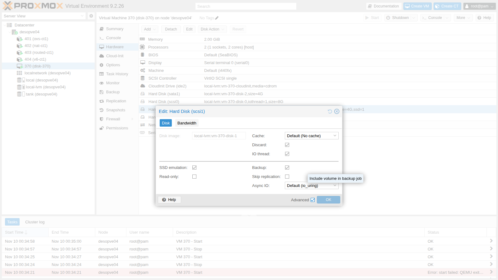
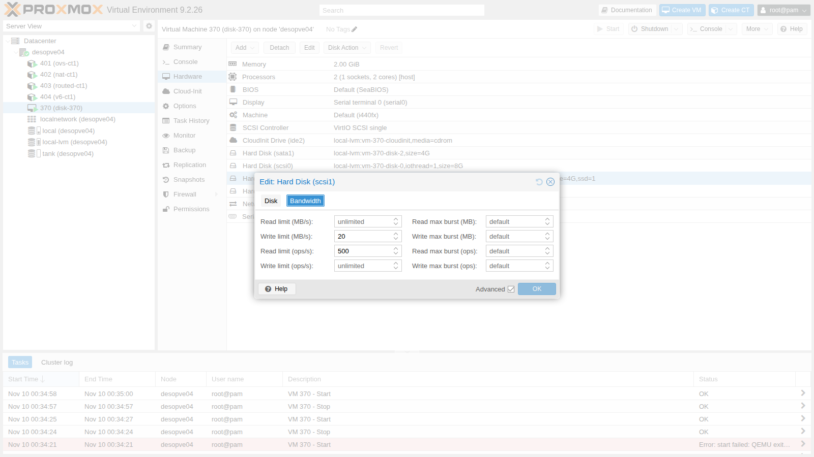

# Lab 37 – Virtual disks and controllers: VirtIO SCSI and Block, cache, aio, discard and limits

**Level:** advanced · **Duration:** 1 hour 30 minutes

## Dependencies

- **Previous labs:**
  - [Lab 35](35-kvm-qemu.md): QEMU process, `qm showcmd` and monitor;
  - [Lab 09](09-lvm-and-lvm-thin.md): LVM thin pool and how it fills up;
  - [Lab 19](19-fio-benchmark.md): measurement method with `fio`.
- **Node and storage:** `desopve04`, standalone node, with the `local-lvm` storage (thin pool `pve/data`), so that the tests do not weigh on the cluster.
- **Resources:** the cloud image `debian-13-genericcloud-amd64.qcow2` in `local:import` on `desopve04`, downloaded in [Lab 19](19-fio-benchmark.md), and the DC's SSH key ([Lab 05](05-ssh-shell-cli.md)). The image is used to create a VM with cloud-init (covered in depth in Lab 40).
- **Addresses:** test VM 370 on 172.27.199.170.
- **Credentials:** `root` / `<lab-password>` → [Appendix B](b-credentials-and-addresses.md).

## Objectives

- Compare **VirtIO SCSI**, **VirtIO Block** and **SATA** on the same storage.
- Understand the five **cache** modes and what each one risks if the node crashes.
- Know what changes between the **Async IO** modes (`io_uring`, `native`, `threads`).
- Return space to the thin pool with **discard** and **fstrim**, and expose the disk as an SSD.
- Limit the bandwidth and IOPS of a disk, even while the VM is running.

## How it works

A virtual disk goes through three layers:

```text
guest: disk driver ──► virtual controller (SCSI / VirtIO Block / SATA)
QEMU:  blockdev ──► cache (node page cache yes/no, flush yes/no) ──► aio (io_uring / native / threads)
node:  volume on the storage (here an LVM thin LV)
```

**Controllers.**

- **VirtIO SCSI:** paravirtualized controller; with **VirtIO SCSI single** each disk has its own controller and can have a dedicated **IO thread**. It supports discard, many disks and hotplug. It is the recommended default.
- **VirtIO Block:** also paravirtualized, and simpler: one PCI device per disk (`/dev/vdX`), without the SCSI layer.
- **SATA (and IDE):** emulated controllers, recognized by every operating system without drivers. Each operation costs the QEMU process more. They are used to install systems without VirtIO drivers or for compatibility.

**IO thread.** With `iothread=1` the disk I/O runs in a dedicated thread instead of QEMU's main thread. With multiple disks the threads work in parallel, and I/O does not slow down the management of the VM.

**Cache.** It decides whether QEMU uses the node's page cache and whether it honors the *flushes* the guest sends to make its data safe:

| Mode | Node page cache | Guest flushes | Risk if the node crashes |
|---|---|---|---|
| `none` (default) | no (O_DIRECT) | honored | none beyond the guest itself |
| `writethrough` | yes, reads only | every write is synchronous | none, but slow writes |
| `writeback` | yes | honored | only what the guest has not yet confirmed with a flush is lost |
| `directsync` | no | every write is synchronous | none, even slower writes |
| `unsafe` | yes | **ignored** | data that the guest believes already written can be lost |

**Async IO.**

- **`io_uring`:** the default, the modern asynchronous Linux interface.
- **`native`:** the classic kernel AIO; it works only with O_DIRECT, that is, with `cache=none` or `directsync`.
- **`threads`:** a thread pool that performs synchronous I/O, the most compatible option.

**Discard.** When the guest deletes data, it can tell the disk "these blocks are free" (TRIM/UNMAP). With `discard=on` QEMU passes the request on to the storage, and a thin pool releases the space. With the default `discard=ignore` the guest believes it has freed the space, but the node does not notice.

## Procedure

### 1. The test VM

A VM with the system disk and three 4 GiB disks on the same storage, each on a different controller:

```bash
qm create 370 --name disk-370 --memory 2048 --cores 2 --cpu host --ostype l26 \
  --net0 virtio,bridge=vmbr0 --scsihw virtio-scsi-single \
  --scsi0 local-lvm:0,import-from=local:import/debian-13-genericcloud-amd64.qcow2,iothread=1 \
  --ide2 local-lvm:cloudinit --boot order=scsi0 \
  --ipconfig0 ip=172.27.199.170/24,gw=172.27.199.1 --nameserver 172.27.199.20 \
  --ciuser labuser --sshkeys /root/.ssh/authorized_keys --serial0 socket --vga serial0
qm resize 370 scsi0 8G
qm set 370 --scsi1 local-lvm:4,iothread=1 --virtio1 local-lvm:4,iothread=1 --sata1 local-lvm:4
qm start 370
```

``` { .text .no-copy title="Output" }
  WARNING: Sum of all thin volume sizes (36.00 GiB) exceeds the size of thin pool pve/data and the amount of free space in volume group (<6.13 GiB).
scsi1: local-lvm:vm-370-disk-1,iothread=1,size=4G
virtio1: local-lvm:vm-370-disk-3,iothread=1,size=4G
sata1: local-lvm:vm-370-disk-2,size=4G
```

The warning is the overprovisioning seen in [Lab 09](09-lvm-and-lvm-thin.md): the volumes add up to 36 GiB on a 14 GiB pool. During the lab, at most a part of each disk is written, and the pool is checked with `lvs`.

In the guest:

```text
NAME SIZE ROTA TRAN   MODEL         DISC-MAX
sda    8G    1        QEMU HARDDISK       1G
sdb    4G    1 sata   QEMU HARDDISK       2G
sdc    4G    1        QEMU HARDDISK       1G
vda    4G    1 virtio                     2G
```

`ROTA 1`: all the disks present themselves as rotational disks.

> **Watch out for disk names in the guest.** After a VM restart, in the lab `sdb` and `sdc` swapped places: the SCSI disk and the SATA disk are detected in a different order at each boot. A test run on `/dev/sdX` can thus end up on the wrong disk without any error. In tests and in `/etc/fstab`, use the stable names in `/dev/disk/by-id`: Proxmox VE gives each SCSI disk the identifier `drive-scsiN`.
>
> ```text
> ata-QEMU_HARDDISK_QM00007 -> ../../sdc
> scsi-0QEMU_QEMU_HARDDISK_drive-scsi1 -> ../../sdb
> ```

The measurements use `fio` with O_DIRECT in the guest, on a 2 GiB area of each disk filled before the test. Each test lasts 12-20 seconds. The tests are run by the script [`fiorun.sh`](../files/37/fiorun.sh), to be copied into the guest (for example with `scp` from the DC, which logs in with `ssh labuser@172.27.199.170`). It runs `fio` with `--direct=1 --ioengine=libaio --size=2G --time_based --ramp_time=2` and prints one line with IOPS, MB/s, average latency (`lat media`) and 99th percentile latency. Install `fio` in the guest through the lab proxy, configured as in [Lab 36](36-memory.md):

```bash
sudo apt-get install -y fio
./fiorun.sh disk/by-id/scsi-0QEMU_QEMU_HARDDISK_drive-scsi1 r4k randread 4k 32 15
```

### 2. Controllers: VirtIO SCSI, VirtIO Block and SATA

Two consecutive rounds:

```text
== giro 1
VirtIO-SCSI+iothread randread4k IOPS=   26867  MB/s=  105.0  lat media=   1161 us  p99=   2998 us
VirtIO-SCSI+iothread randwrite4k IOPS=    8247  MB/s=   32.2  lat media=   3865 us  p99=  45351 us
VirtIO-SCSI+iothread write1M IOPS=     284  MB/s=  284.9  lat media=  27874 us  p99= 379585 us
VirtIO-Block+iothread randread4k IOPS=   30766  MB/s=  120.2  lat media=   1014 us  p99=   2736 us
VirtIO-Block+iothread randwrite4k IOPS=    7546  MB/s=   29.5  lat media=   4220 us  p99=  32637 us
VirtIO-Block+iothread write1M IOPS=     563  MB/s=  563.1  lat media=  14024 us  p99=  71827 us
SATA randread4k              IOPS=    8155  MB/s=   31.9  lat media=   3804 us  p99=   6193 us
SATA randwrite4k             IOPS=    5767  MB/s=   22.5  lat media=   5436 us  p99=  32375 us
SATA write1M                 IOPS=     468  MB/s=  468.7  lat media=  17126 us  p99= 114819 us
== giro 2
VirtIO-SCSI+iothread randread4k IOPS=   29085  MB/s=  113.6  lat media=   1072 us  p99=   2671 us
VirtIO-SCSI+iothread randwrite4k IOPS=   10540  MB/s=   41.2  lat media=   3007 us  p99=  23200 us
VirtIO-SCSI+iothread write1M IOPS=     652  MB/s=  652.1  lat media=  12245 us  p99=  78119 us
VirtIO-Block+iothread randread4k IOPS=   29454  MB/s=  115.1  lat media=   1060 us  p99=   2736 us
VirtIO-Block+iothread randwrite4k IOPS=    7146  MB/s=   27.9  lat media=   4451 us  p99=  28705 us
VirtIO-Block+iothread write1M IOPS=     628  MB/s=  628.9  lat media=  12534 us  p99=  63701 us
SATA randread4k              IOPS=    7748  MB/s=   30.3  lat media=   4003 us  p99=   6128 us
SATA randwrite4k             IOPS=    2646  MB/s=   10.3  lat media=  11972 us  p99= 304087 us
SATA write1M                 IOPS=     344  MB/s=  344.2  lat media=  22930 us  p99= 214958 us
```

| Controller | 4k random reads | 4k random writes | 1M sequential write |
|---|---|---|---|
| VirtIO SCSI + iothread | 26,900-29,100 IOPS | 8,200-10,500 IOPS | 285-652 MB/s |
| VirtIO Block + iothread | 29,500-30,800 IOPS | 7,100-7,500 IOPS | 563-629 MB/s |
| SATA | 7,700-8,200 IOPS | 2,600-5,800 IOPS | 344-469 MB/s |

- **VirtIO SCSI and VirtIO Block** are equivalent: the differences are within the variability between one round and the next.
- **SATA** delivers about **a quarter** of the random reads, with three times the latency: it is the cost of emulating a physical controller.
- **Sequential writes** vary a lot between the two rounds on the same disk: the speed of the node's disk changes over time (disk and controller cache, background writes). In a lab, only compare tests run close together, and repeat them.

### 3. Cache modes

**Hardware → Hard Disk → Edit**, with **Advanced** enabled, shows all the disk options:



On `scsi1`, test the five modes. Each change requires stopping and starting the VM:

```bash
qm set 370 --scsi1 local-lvm:vm-370-disk-1,iothread=1,cache=writeback
qm stop 370 && qm start 370
```

Four tests per mode on the disk `/dev/disk/by-id/scsi-0QEMU_QEMU_HARDDISK_drive-scsi1`. The first one is one write at a time, each followed by an `fsync`: this is how a database committing transactions behaves.

```text
== cache=none
fsync ogni scrittura QD1     IOPS=     545  MB/s=    2.1  lat media=   1418 us  p99=   4014 us
randwrite 4k QD32            IOPS=    8693  MB/s=   34.0  lat media=   3654 us  p99=  22938 us
randread 4k QD32             IOPS=   26063  MB/s=  101.8  lat media=   1200 us  p99=   3097 us
write 1M QD8                 IOPS=     317  MB/s=  317.5  lat media=  24870 us  p99= 160432 us
== cache=writeback
fsync ogni scrittura QD1     IOPS=     575  MB/s=    2.2  lat media=    182 us  p99=    692 us
randwrite 4k QD32            IOPS=   30334  MB/s=  118.5  lat media=   1025 us  p99=   1679 us
randread 4k QD32             IOPS=   32097  MB/s=  125.4  lat media=    971 us  p99=   2867 us
write 1M QD8                 IOPS=    2508  MB/s= 2508.7  lat media=   3018 us  p99=   9241 us
== cache=writethrough
fsync ogni scrittura QD1     IOPS=     501  MB/s=    2.0  lat media=   1901 us  p99=  13042 us
randwrite 4k QD32            IOPS=    9728  MB/s=   38.0  lat media=   3366 us  p99=  17695 us
randread 4k QD32             IOPS=   27700  MB/s=  108.2  lat media=   1129 us  p99=   4686 us
write 1M QD8                 IOPS=     537  MB/s=  537.4  lat media=  15002 us  p99=  56361 us
== cache=directsync
fsync ogni scrittura QD1     IOPS=     717  MB/s=    2.8  lat media=   1315 us  p99=   3686 us
randwrite 4k QD32            IOPS=    5583  MB/s=   21.8  lat media=   5725 us  p99=  41157 us
randread 4k QD32             IOPS=   29685  MB/s=  116.0  lat media=   1054 us  p99=   2966 us
write 1M QD8                 IOPS=     430  MB/s=  430.6  lat media=  18228 us  p99=  57934 us
== cache=unsafe
fsync ogni scrittura QD1     IOPS=    4399  MB/s=   17.2  lat media=    101 us  p99=    387 us
randwrite 4k QD32            IOPS=   30261  MB/s=  118.2  lat media=   1028 us  p99=   1876 us
randread 4k QD32             IOPS=   30653  MB/s=  119.7  lat media=   1015 us  p99=   2310 us
write 1M QD8                 IOPS=    2386  MB/s= 2386.9  lat media=   3172 us  p99=   9241 us
```

| Cache | Write + fsync (QD1) | 4k random writes QD32 | 1M sequential write |
|---|---|---|---|
| `none` | 545 IOPS | 8,700 IOPS | 318 MB/s |
| `writethrough` | 501 IOPS | 9,700 IOPS | 537 MB/s |
| `directsync` | 717 IOPS | 5,600 IOPS | 431 MB/s |
| `writeback` | 575 IOPS | 30,300 IOPS | 2,509 MB/s |
| `unsafe` | **4,399 IOPS** | 30,300 IOPS | 2,387 MB/s |

- **`writeback` and `unsafe`:** the writes end up in the node's RAM, hence the "impossible" speeds (2.5 GB/s on this storage).
- **With an `fsync` after every write**, `writeback` becomes as slow as `none`, because every guest flush forces the node to actually write. Only `unsafe` stays fast: the flush is **ignored**.
- **`none`, `writethrough` and `directsync`** stay at the speed of the storage. Reads are equivalent because the test area is small and the underlying storage has its own cache.

The monitor confirms that with `unsafe` the flushes are discarded:

```text title="qm monitor"
info block -n
```

``` { .text .no-copy title="Output" }
    Cache mode:       writeback
    Cache mode:       writeback, ignore flushes
    Cache mode:       writeback, ignore flushes
```

**Where the data is when the guest believes it has written it.** In the guest, write 1 GiB directly to the disk, with a final `fsync` (`conv=fsync`), and right afterwards look at the "dirty" memory on the node, that is, the data still to be written to disk:

```bash
dd if=/dev/urandom of=/dev/disk/by-id/scsi-0QEMU_QEMU_HARDDISK_drive-scsi1 bs=1M count=1024 oflag=direct conv=fsync   # in the guest
grep ^Dirty: /proc/meminfo                                                                                         # on the node
```

``` { .text .no-copy title="Output" }
== cache=writeback
1073741824 bytes (1.1 GB, 1.0 GiB) copied, 6.10631 s, 176 MB/s
  nodo subito dopo: Dirty: 1456 kB
== cache=unsafe
1073741824 bytes (1.1 GB, 1.0 GiB) copied, 4.60421 s, 233 MB/s
  nodo subito dopo: Dirty: 1050036 kB
```

- **`writeback`:** when the guest's `fsync` returns, the data is on the node's disk.
- **`unsafe`:** the guest has finished and believes its GiB is safe, but it is all still in the node's RAM. A power failure at that moment would wipe it out, and the guest would never know.

`unsafe` is fine only for throwaway data, for example while installing a template VM. `writeback` is acceptable with a node protected by a UPS and operating systems that use flushes correctly. The default `none` is the safe choice.

### 4. Async IO

`scsi1` with `cache=none`, two rounds per mode:

```text
== aio=io_uring
randread 4k QD32             IOPS=   27460  MB/s=  107.3  lat media=   1137 us  p99=   3064 us
randwrite 4k QD32            IOPS=   13340  MB/s=   52.1  lat media=   2385 us  p99=  13959 us
randread 4k QD32             IOPS=   27121  MB/s=  106.0  lat media=   1155 us  p99=   3293 us
randwrite 4k QD32            IOPS=   14864  MB/s=   58.1  lat media=   2179 us  p99=  11600 us
== aio=native
randread 4k QD32             IOPS=   32438  MB/s=  126.7  lat media=    967 us  p99=   2933 us
randwrite 4k QD32            IOPS=    6043  MB/s=   23.6  lat media=   5268 us  p99=  50594 us
randread 4k QD32             IOPS=   33112  MB/s=  129.4  lat media=    948 us  p99=   3031 us
randwrite 4k QD32            IOPS=   12222  MB/s=   47.8  lat media=   2594 us  p99=  16908 us
== aio=threads
randread 4k QD32             IOPS=   31479  MB/s=  123.0  lat media=    996 us  p99=   2769 us
randwrite 4k QD32            IOPS=    6368  MB/s=   24.9  lat media=   4995 us  p99=  31326 us
randread 4k QD32             IOPS=   30716  MB/s=  120.0  lat media=   1021 us  p99=   3064 us
randwrite 4k QD32            IOPS=    7674  MB/s=   30.0  lat media=   4142 us  p99=  57410 us
```

Reads stay between 27,000 and 33,000 IOPS with all three modes. Writes vary more from one round to the next (from 6,000 to 12,200 with `native`) than from one mode to another: in this lab there is no measurable winner. `io_uring` remains the sensible default. `threads` is for storage types with which the other modes cause problems.

`native` has a constraint, and Proxmox VE does not check it before startup:

```bash
qm stop 370
qm set 370 --scsi1 local-lvm:vm-370-disk-1,iothread=1,aio=native,cache=writeback
qm start 370
```

``` { .text .no-copy title="Output" }
kvm: -blockdev {...,"file":{"aio":"native","cache":{"direct":false,"no-flush":false},...,"driver":"host_device","filename":"/dev/pve/vm-370-disk-1",...}: aio=native was specified, but it requires cache.direct=on, which was not specified.
start failed: QEMU exited with code 1
```

The configuration is accepted, but the VM does not start: `native` requires `cache=none` or `directsync`.

### 5. Discard, fstrim and SSD emulation

Create an ext4 filesystem on `scsi1`. Write a 1 GiB file, delete it and ask the guest to report the free blocks with `fstrim`. On the node, look at the usage of the thin volume:

```bash
# in the guest
D=/dev/disk/by-id/scsi-0QEMU_QEMU_HARDDISK_drive-scsi1
sudo mkfs.ext4 -F $D && sudo mkdir -p /mnt/t && sudo mount $D /mnt/t
sudo dd if=/dev/urandom of=/mnt/t/prova bs=1M count=1024 conv=fsync
sudo rm /mnt/t/prova && sudo fstrim -v /mnt/t
# on the node, before and after
lvs pve/vm-370-disk-1
```

**With the default `discard=ignore`:**

```text
 vm-370-disk-1 50.00          ← before (area filled for the tests)
file-1GiB-scritto
 vm-370-disk-1 50.79
/mnt/t: 2.9 GiB (3068858368 bytes) trimmed
 vm-370-disk-1 50.79          ← after fstrim: no change
```

The guest reports having freed 2.9 GiB, but the node receives nothing: QEMU discards the requests.

**With `discard=on` and `ssd=1`** (stopping and starting the VM):

```bash
qm set 370 --scsi1 local-lvm:vm-370-disk-1,iothread=1,discard=on,ssd=1
```

``` { .text .no-copy title="Output" }
sdb rotational=0
/mnt/t: 3.9 GiB (4142604288 bytes) trimmed
 vm-370-disk-1 3.46           ← the volume returns 1.9 GiB to the pool
file-1GiB-scritto
 vm-370-disk-1 28.46
/mnt/t: 6 MiB (6283264 bytes) trimmed
 vm-370-disk-1 28.46          ← fstrim run right after rm
/mnt/t: 1.1 GiB (1197453312 bytes) trimmed
 vm-370-disk-1 3.46           ← fstrim after sync and a few seconds
 data 65.69                   ← thin pool of the node: it was at 79%
```

- **`ssd=1`:** the guest sees a non-rotational disk (`rotational=0`) and adapts the I/O scheduler and the filesystem behavior.
- **`discard=on`:** the space freed in the guest actually goes back to the thin pool.
- The `fstrim` run right after `rm` frees only 6 MiB: ext4 releases the blocks of the deleted file only at the journal commit, after a few seconds. Debian runs `fstrim` every week with `fstrim.timer` (`enabled`), so the space comes back on its own.

With thin storage (LVM-thin, ZFS, Ceph, qcow2), without `discard=on` the VM disks grow and never shrink again. It is the leading cause of the thin pools that fill up "for no reason" seen in [Lab 09](09-lvm-and-lvm-thin.md).

### 6. Bandwidth and IOPS limits

In the **Bandwidth** tab of the same window you limit reads and writes, in MB/s and in operations per second, with an optional temporary *burst*:



The limits are applied **live**, without restarting the VM:

```bash
qm set 370 --scsi1 local-lvm:vm-370-disk-1,iothread=1,discard=on,ssd=1,mbps_wr=20,iops_rd=500
```

``` { .text .no-copy title="Output" }
== senza limiti
write 1M QD8                 IOPS=     723  MB/s=  724.0  lat media=  10849 us  p99=  67633 us
randread 4k QD32             IOPS=   27229  MB/s=  106.4  lat media=   1148 us  p99=   3031 us
update VM 370: -scsi1 local-lvm:vm-370-disk-1,iothread=1,discard=on,ssd=1,mbps_wr=20,iops_rd=500
status: running
== con limiti (applicati a caldo)
write 1M QD8                 IOPS=      19  MB/s=   20.0  lat media= 403898 us  p99= 599785 us
randread 4k QD32             IOPS=     497  MB/s=    2.0  lat media=  64070 us  p99=  66322 us
```

The limit is accurate: 20.0 MB/s and 497 IOPS. The guest gets no errors: its requests wait in the queue, and in fact latency rises to 400 ms for writes and 64 ms for reads. This prevents a noisy VM from saturating a storage shared with the others; CPU limits and the rest are covered in Lab 42.

## Verification and tests

- VirtIO SCSI and VirtIO Block give equivalent results; SATA has about a quarter of the random reads.
- `unsafe` ignores flushes (`ignore flushes` in the monitor) and leaves 1 GiB in the node's RAM after a guest `fsync`; `writeback` does not.
- `aio=native` with a cache mode other than `none`/`directsync` prevents the VM from starting.
- With `discard=on`, the guest's `fstrim` returns the space to the thin pool; with the default it does not.
- The bandwidth and IOPS limits are applied live and are respected.

## Final lab state

- **VM 370 `disk-370`:** deleted along with its four disks (`qm stop 370 && qm destroy 370 --purge`).
- **Thin pool `pve/data` on `desopve04`:** back to 23.7%, as before the lab.
- No changes to the cluster nodes.

## What you learned

- Paravirtualized disks (VirtIO SCSI single or VirtIO Block) with an IO thread give the best performance; use SATA only when the guest lacks the drivers.
- The `writeback` cache speeds up writes using the node's RAM but honors flushes; `unsafe` ignores them and can lose data that the guest considers written.
- `aio=native` works only with O_DIRECT; `io_uring` is the right default.
- Without `discard=on`, the space freed in the guests never goes back to thin storage.
- I/O limits can be changed live and protect shared storage from the noisiest VMs.
- In the guests, identify disks by `/dev/disk/by-id`, not by `sdX`.

## References

- [Proxmox VE – Virtual Machines: Hard Disk](https://pve.proxmox.com/pve-docs/chapter-qm.html#qm_hard_disk)
- [Proxmox VE wiki – Performance Tweaks (cache modes)](https://pve.proxmox.com/wiki/Performance_Tweaks)
- [QEMU – Block device options (cache, aio, discard)](https://www.qemu.org/docs/master/system/qemu-block-drivers.html)
- [fio – Flexible I/O Tester](https://fio.readthedocs.io/)
