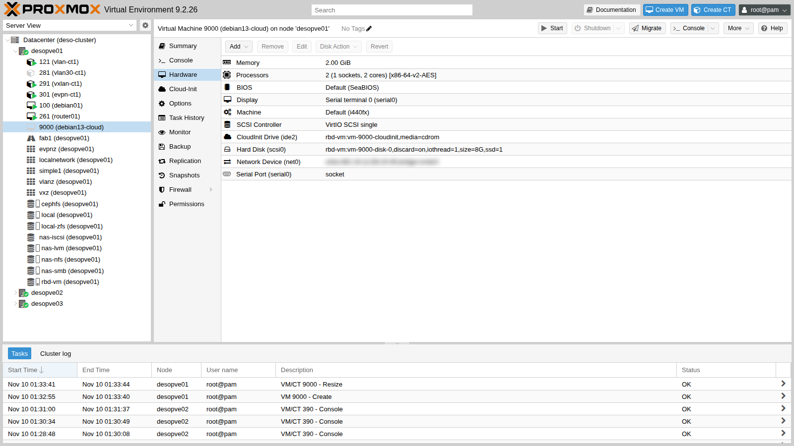
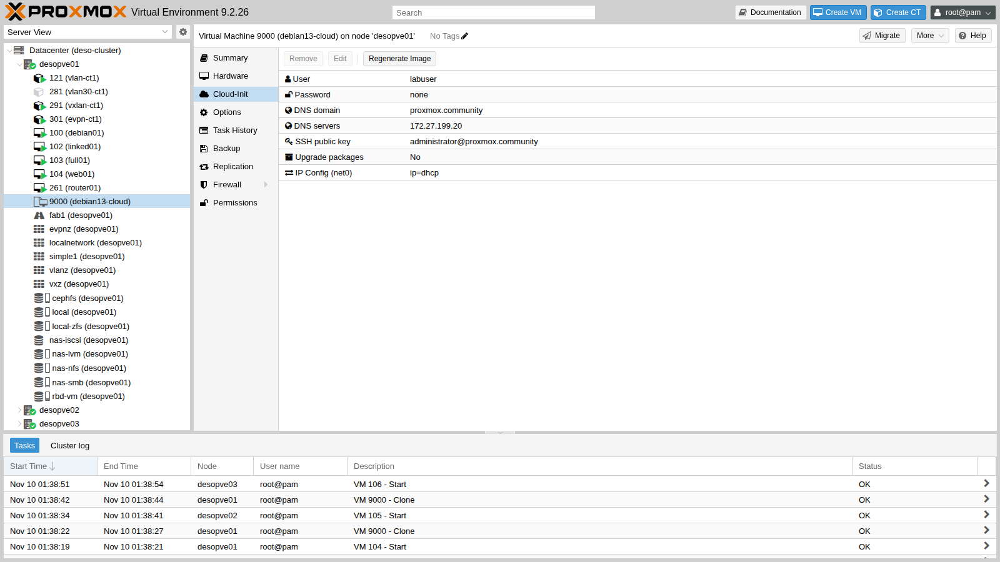
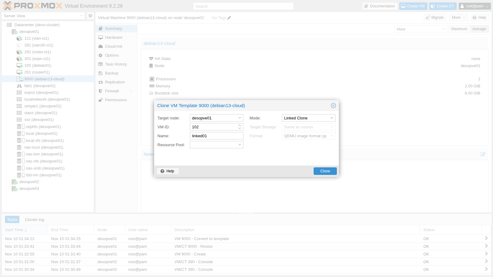

# Lab 40 – Templates, cloud-init and clones: linked and full, snippets and deployment from the CLI

**Level:** intermediate · **Duration:** 1 hour 15 minutes

## Dependencies

- **Previous labs:**
  - [Lab 19](19-fio-benchmark.md): the Debian 13 cloud image in `local:import` on `desopve01`;
  - [Lab 05](05-ssh-shell-cli.md): the SSH key of the `administrator` user on the DC;
  - [Lab 17](17-ceph-installation.md): the shared storage `rbd-vm` and CephFS;
  - [Lab 27](27-sdn-simple.md): the VNet `vnsimp1` with DHCP and IPAM;
  - [Lab 38](38-linux-vm-guest-agent.md): QEMU Guest Agent.
- **Nodes and storage:** cluster `desopve01`-`03`; template on `rbd-vm`; snippets on `cephfs`.
- **Network:** the proxy `proxy.proxmox.community:3128` for the guests' packages.
- **Addresses:** VM 102 on 172.27.199.102; VM 103 with DHCP on the VNet `vnsimp1`; VMs 104-106 on 172.27.199.104-106.
- **Credentials:** user `labuser` with an SSH key, no password → [Appendix B](b-credentials-and-addresses.md).

## Objectives

- Turn a cloud image into a **template** with **cloud-init**.
- Understand the difference between a **linked clone** and a **full clone**, with measured times and space.
- Configure user, keys, static IP and **DHCP** from the Cloud-Init tab.
- Read what Proxmox VE passes to the guest with `qm cloudinit dump`.
- Add custom configuration with **snippets** (`cicustom`).
- Create three ready-to-use VMs, on three nodes, with a command loop.

## How it works

**Template.** A template is a read-only VM: it cannot be started and its disks become **base disks** (`base-9000-disk-0`). It is used only as a source for clones.

**Linked clone and full clone.**

| | Linked clone | Full clone |
|---|---|---|
| Disk | copy-on-write on the template's base disk | complete, independent copy |
| Time | a few seconds | proportional to the data to copy |
| Initial space | almost zero | as much as the data on the disk |
| Constraints | same storage as the template; the template cannot be deleted while clones exist | none: it can go to another storage |

The storage must support disk-level clones: Ceph RBD (clone of a snapshot), ZFS, LVM-thin, qcow2 (backing file).

**Cloud-init.** Cloud images have no installer: at first boot, `cloud-init` reads the configuration from a **datasource**. Proxmox VE uses the *NoCloud* datasource: it generates a small CD (the **CloudInit** drive) with three files:

- `user-data`: user, SSH keys, hostname, packages;
- `network-config`: addresses, gateway, DNS;
- `meta-data`: the `instance-id`.

When you change a Cloud-Init parameter, Proxmox VE regenerates the CD with a new `instance-id`, and at the next boot cloud-init applies the configuration again.

**Snippets.** With `cicustom` you can replace or extend the generated files with your own files, saved in a storage with the **Snippets** content type. The `vendor` type is *added* to the Proxmox VE user-data instead of replacing it: user, keys and network remain those of the Cloud-Init tab.

## Procedure

### 1. The cloud image

The image `debian-13-genericcloud-amd64.qcow2` was downloaded in [Lab 19](19-fio-benchmark.md) to the `local` storage, content type **Import**:

```text
image: /var/lib/vz/import/debian-13-genericcloud-amd64.qcow2
file format: qcow2
virtual size: 3 GiB (3221225472 bytes)
disk size: 324 MiB
```

It is an already installed system: 3 GiB of virtual disk, 324 MiB of actual data.

### 2. The base VM with the Cloud-Init drive

The disk is imported directly during creation, with `import-from`:

```bash
qm create 9000 --name debian13-cloud --ostype l26 --memory 2048 --cores 2 --cpu x86-64-v2-AES \
  --scsihw virtio-scsi-single \
  --scsi0 rbd-vm:0,import-from=local:import/debian-13-genericcloud-amd64.qcow2,discard=on,ssd=1,iothread=1 \
  --ide2 rbd-vm:cloudinit --boot order=scsi0 --serial0 socket --vga serial0 \
  --net0 virtio,bridge=vmbr0 --agent enabled=1
qm resize 9000 scsi0 8G
```

``` { .text .no-copy title="Output" }
transferred 3.0 GiB of 3.0 GiB (100.00%)
scsi0: successfully created disk 'rbd-vm:vm-9000-disk-0,discard=on,iothread=1,size=3G,ssd=1'
Resizing image: 100% complete...done.
```

- **`--ide2 rbd-vm:cloudinit`** creates the Cloud-Init drive. It sits on `rbd-vm` like the disk, so the clones work on every node.
- **`--serial0 socket --vga serial0`:** Debian cloud images use the serial console; the VM console becomes xterm.js ([Lab 38](38-linux-vm-guest-agent.md)).
- **`qm resize`:** the disk grows from 3 to 8 GiB. At first boot cloud-init grows the partition and the filesystem on its own.

The Cloud-Init parameters. The DC's public key is already among those authorized on the node ([Lab 05](05-ssh-shell-cli.md)); for the template, extract just that one:

```bash
grep administrator@proxmox.community /root/.ssh/authorized_keys > /root/lab40-dc.pub
qm set 9000 --ciuser labuser --sshkeys /root/lab40-dc.pub --ipconfig0 ip=dhcp \
  --nameserver 172.27.199.20 --searchdomain proxmox.community --ciupgrade 0
```

- **`--sshkeys`:** a file with the public key of the DC's `administrator` user ([Lab 05](05-ssh-shell-cli.md)). No password: login is possible only with the key.
- **`--ipconfig0 ip=dhcp`:** in the template; each clone will get its own address.
- **`--ciupgrade 0`:** the **Upgrade packages** option is enabled by default and runs a package upgrade at first boot. In the lab the guest does not have the proxy configured yet, so the option is disabled in the template: the proxy is set by the snippet in section 8.

The **Hardware** view shows the **CloudInit Drive (ide2)**:



and the **Cloud-Init** tab shows the configuration, which can also be edited from here:



### 3. Converting to a template

**More → Convert to template** (or `qm template 9000`). The disk is renamed to `base-9000-disk-0` and Ceph creates its protected snapshot `__base__`, the source of all linked clones.

### 4. Linked clone

**More → Clone** on the template. **Mode** is **Linked Clone** and **Target Storage** is locked to "Same as source":



The task takes **2 seconds**. The clone's disk is an RBD clone of the template snapshot:

```bash
rbd info rbd-vm/vm-102-disk-0 | grep -E "parent|size"
rbd du -p rbd-vm
```

``` { .text .no-copy title="Output" }
	size 8 GiB in 2048 objects
	parent: rbd-vm/base-9000-disk-0@__base__
NAME                       PROVISIONED  USED
base-9000-disk-0@__base__        8 GiB  1.1 GiB
base-9000-disk-0                 8 GiB      0 B
vm-102-cloudinit                 4 MiB    4 MiB
vm-102-disk-0                    8 GiB   12 MiB
```

The clone takes up **12 MiB**: it reads the common data from the base disk and writes only the differences.

A static IP, then start it:

```bash
qm set 102 --ipconfig0 ip=172.27.199.102/24,gw=172.27.199.1
qm start 102
```

After less than a minute you can log in with the DC's key:

```bash title="labuser@linked01"
hostname -f
```

``` { .text .no-copy title="Output" }
linked01.proxmox.community
```

```bash title="labuser@linked01"
cloud-init status --long
```

``` { .text .no-copy title="Output" }
status: done
extended_status: degraded done
...
recoverable_errors:
DEPRECATED:
	- 'user' of type string is deprecated in 22.2 and scheduled to be removed in 27.2. Use 'users' list instead.
```

```bash title="labuser@linked01"
ip -br -4 a | grep -v "^lo"
```

``` { .text .no-copy title="Output" }
eth0             UP             172.27.199.102/24
```

```bash title="labuser@linked01"
df -h / | tail -1
```

``` { .text .no-copy title="Output" }
/dev/sda1       7.7G  596M  6.8G   8% /
```

```bash title="labuser@linked01"
sudo -n true && echo "sudo senza password: ok"
```

``` { .text .no-copy title="Output" }
sudo senza password: ok
```

- The **hostname** is the name of the clone: Proxmox VE passes it to cloud-init.
- The filesystem has already grown to **7.7 GiB**.
- **`degraded done`** does not indicate an error: cloud-init only reports a deprecation warning about the format of the user-data generated by Proxmox VE (the `user` key). The configuration is applied.
- The user created by cloud-init has passwordless `sudo`, the usual practice for cloud images.

### 5. Full clone and its constraints

A full clone to another node, on local storage:

```bash
qm clone 9000 103 --name full01 --full --storage local-zfs --target desopve02
```

``` { .text .no-copy title="Output" }
can't clone to non-shared storage 'local-zfs'
```

To clone **to another node**, the target storage must be **shared**. On the same node, the full clone on `local-zfs` works:

```bash
time qm clone 9000 103 --name full01 --full --storage local-zfs
```

``` { .text .no-copy title="Output" }
transferred 8.0 GiB of 8.0 GiB (100.00%)

real	0m11.967s
```

``` { .text .no-copy title="Output" }
NAME                       USED  REFER
rpool/data/vm-103-disk-0   542M   542M
```

**12 seconds** versus 2, and 542 MiB used right away. The disk is independent: the template could be deleted with no consequences for this VM.

### 6. DHCP with the SDN VNet

VM 103 goes on the VNet `vnsimp1` from [Lab 27](27-sdn-simple.md), which has DHCP and IPAM, and gets its IP via DHCP:

```bash
qm set 103 --net0 virtio,bridge=vnsimp1 --ipconfig0 ip=dhcp
qm cloudinit dump 103 network
```

``` { .text .no-copy title="Output" }
version: 1
config:
    - type: physical
      name: eth0
      mac_address: 'bc:24:11:06:db:69'
      subnets:
      - type: dhcp4
    - type: nameserver
      address:
      - '172.27.199.20'
      search:
      - 'proxmox.community'
```

At startup, the Proxmox VE IPAM assigns the address and the zone's DHCP server hands it out:

```text
{'hostname': 'full01', 'ip': '10.60.60.102', 'mac': 'BC:24:11:06:DB:69', 'subnet': '10.60.60.0/24', 'vmid': 103, 'vnet': 'vnsimp1', 'zone': 'simple1'}
0 bc:24:11:06:db:69 10.60.60.102 * ff:ca:53:09:5a:00:02:00:00:ab:11:cf:d3:17:39:9a:c9:d3:ff
2 packets transmitted, 2 received, 0% packet loss, time 1056ms
```

The first line comes from the IPAM (`pvesh get /cluster/sdn/ipams/pve/status`), the second from the DHCP lease file on the node, the third is a ping from the node.

### 7. What the guest receives: `qm cloudinit dump`

The user-data that Proxmox VE generates for the template:

```bash
qm cloudinit dump 9000 user
```

``` { .text .no-copy title="Output" }
#cloud-config
hostname: debian13-cloud
manage_etc_hosts: true
fqdn: debian13-cloud.proxmox.community
user: labuser
ssh_authorized_keys:
  - ssh-ed25519 AAAAC3NzaC1lZDI1NTE5AAAAIC7iIUcNX6/zxPH06HIwBM0Txccu3wAqjjIBFBmR1rCo administrator@proxmox.community
chpasswd:
  expire: False
users:
  - default
```

Here is the `user` key that cloud-init reports as deprecated. When a clone does not behave as expected, `qm cloudinit dump <vmid> user|network|meta` is the first thing to check.

### 8. Snippets: additional configuration

The `cephfs` storage is shared among the nodes: enable the **Snippets** content type and save a *vendor-data* file there:

```bash
pvesm set cephfs --content iso,backup,vztmpl,snippets
```

`/mnt/pve/cephfs/snippets/web-vendor.yaml`:

```yaml
#cloud-config
# vendor-data: added to the user-data generated by Proxmox VE (user, SSH keys, network)
apt:
  http_proxy: http://proxy.proxmox.community:3128
  https_proxy: http://proxy.proxmox.community:3128
package_update: true
packages:
  - qemu-guest-agent
  - nginx
runcmd:
  - systemctl enable --now qemu-guest-agent
  - echo "<h1>$(hostname) - creata dal template 9000</h1>" > /var/www/html/index.html
```

```text
Volid                           Format  Type      Size VMID
cephfs:snippets/web-vendor.yaml snippet snippets  408
```

The snippet configures the proxy for apt, installs the guest agent and nginx, and writes a page with the VM name.

### 9. Three VMs from a template, on three nodes, from the CLI

`qm` acts only on the VMs of the node where it runs; to work on the whole cluster from a single node, use the API with `pvesh`:

```bash
for i in 1 2 3; do
  id=$((103+i)); n=desopve0$i
  pvesh create /nodes/desopve01/qemu/9000/clone --newid $id --name web0$i --target $n
  pvesh set /nodes/$n/qemu/$id/config --ipconfig0 ip=172.27.199.$id/24,gw=172.27.199.1 \
    --cicustom vendor=cephfs:snippets/web-vendor.yaml
  pvesh create /nodes/$n/qemu/$id/status/start
done
```

Time of each clone, measured with `date` before and after the command:

```text
clone 9000 -> 104 su desopve01: 2.5 s
clone 9000 -> 105 su desopve02: 5.7 s
clone 9000 -> 106 su desopve03: 2.9 s
```

The linked clone to another node works because `rbd-vm` is shared. After about a minute, the time needed to install the packages, the three VMs respond:

```bash
for id in 104 105 106; do curl -s http://172.27.199.$id/; done
```

``` { .text .no-copy title="Output" }
<h1>web01 - creata dal template 9000</h1>
<h1>web02 - creata dal template 9000</h1>
<h1>web03 - creata dal template 9000</h1>
```

The guest agent responds on all three nodes:

```bash
for p in "desopve01 104" "desopve02 105" "desopve03 106"; do set -- $p
  pvesh create /nodes/$1/qemu/$2/agent/ping && echo "agent VM $2 su $1: ok"; done
```

``` { .text .no-copy title="Output" }
agent VM 104 su desopve01: ok
agent VM 105 su desopve02: ok
agent VM 106 su desopve03: ok
```

and cloud-init has finished:

```bash
# on desopve02, which hosts VM 105
qm guest exec 105 -- cloud-init status
```

``` { .text .no-copy title="Output" }
status: done
```

## Verification and tests

- Template 9000 has the base disk `base-9000-disk-0` with the `__base__` snapshot on Ceph.
- A linked clone is created in 2 seconds and takes up 12 MiB; a full clone of the same disk on ZFS takes 12 seconds and 542 MiB.
- A clone to another node on local storage is refused: shared storage is required.
- With `ip=dhcp` on a VNet with IPAM, the clone receives the address assigned by the IPAM.
- A vendor snippet on shared storage installs packages and services at first boot, on any node.
- Three complete VMs start from the template with a `pvesh` loop, and within a minute they serve a web page and respond to the guest agent.

## Final lab state

- **Template 9000 `debian13-cloud`** on `desopve01`, disk on `rbd-vm`: user `labuser`, the DC's key, `ipconfig0 ip=dhcp`, `ciupgrade 0`.
- **VMs 104-106 `web01`-`web03`**, linked clones of the template, running on `desopve01`, `02` and `03`, addresses 172.27.199.104-106: nginx and guest agent, snippet `vendor=cephfs:snippets/web-vendor.yaml`. They serve as workload for the backup, migration and HA labs.
- **Storage `cephfs`:** `snippets` content enabled, with `web-vendor.yaml`.
- **VMs 102 and 103:** deleted with `qm stop <id> && qm destroy <id> --purge`, together with their disks and their address in the IPAM.

## What you learned

- A cloud image with a Cloud-Init drive becomes a reusable template in a few commands; `import-from` imports the disk in one step.
- Linked clones are instant and lightweight but tied to the template and its storage; full clones are independent and slower.
- Cloning to another node requires shared storage.
- Cloud-init applies name, user, keys and network at first boot, and grows the disk on its own.
- `qm cloudinit dump` shows exactly what the guest receives.
- With a vendor snippet you add packages and commands without losing the configuration of the Cloud-Init tab.
- To automate across the whole cluster use `pvesh`, because `qm` sees only the VMs of the local node.

## References

- [Proxmox VE – Cloud-Init Support](https://pve.proxmox.com/pve-docs/chapter-qm.html#qm_cloud_init)
- [Proxmox VE wiki – Cloud-Init Support](https://pve.proxmox.com/wiki/Cloud-Init_Support)
- [Proxmox VE – Templates and Clones](https://pve.proxmox.com/pve-docs/chapter-qm.html#qm_copy_and_clone)
- [cloud-init – NoCloud datasource](https://cloudinit.readthedocs.io/en/latest/reference/datasources/nocloud.html)
- [Debian Cloud Images](https://cloud.debian.org/images/cloud/)
