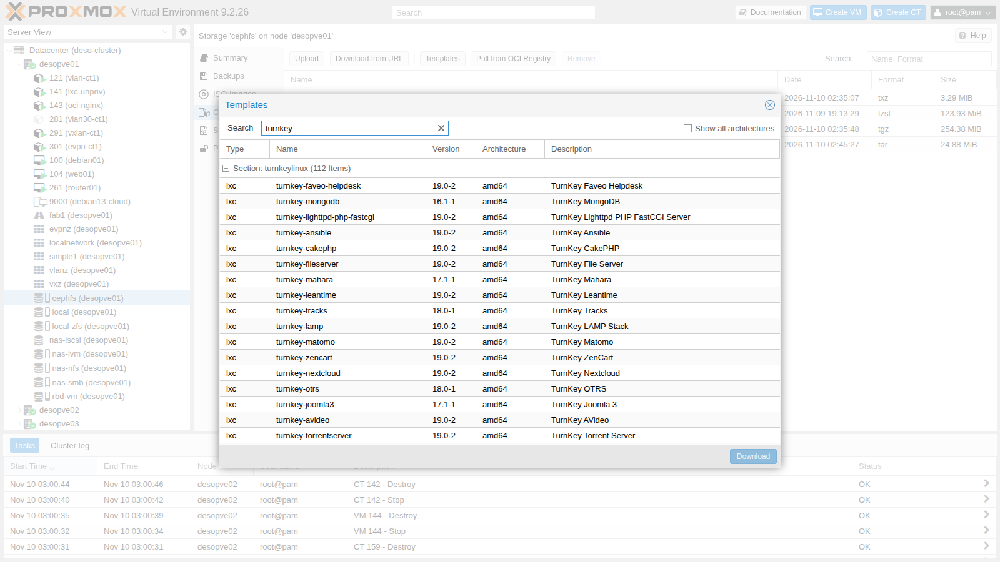
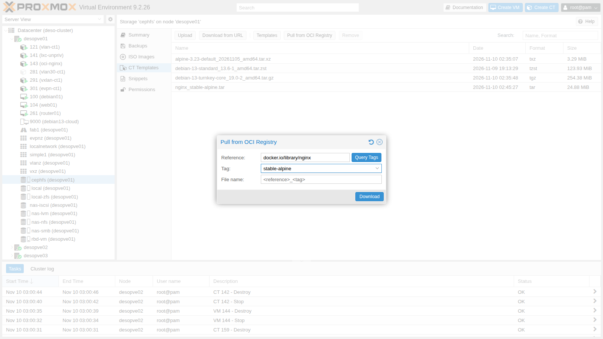
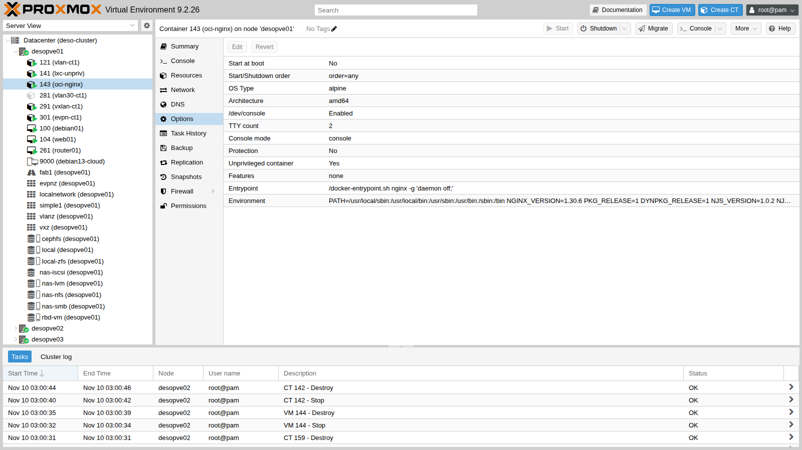
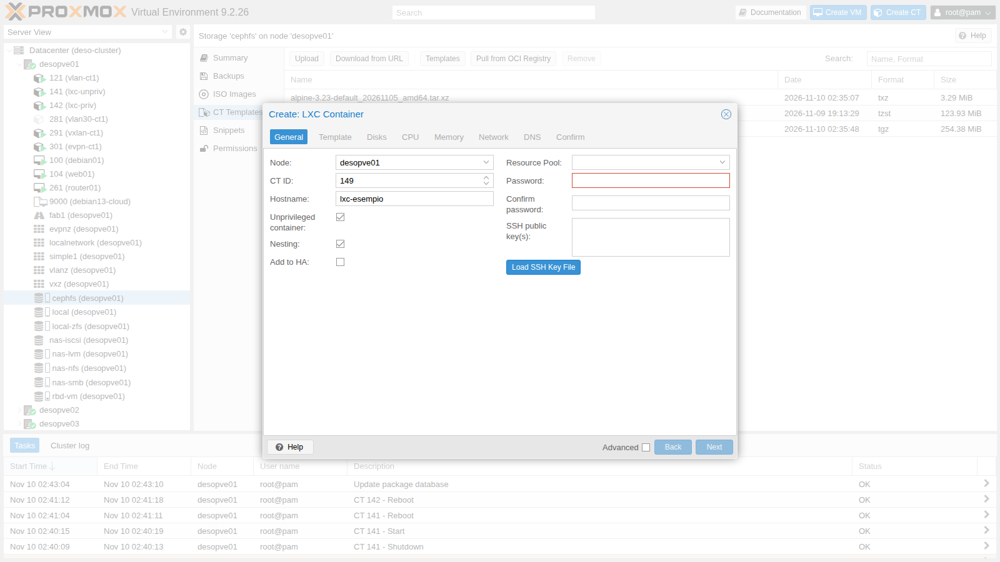
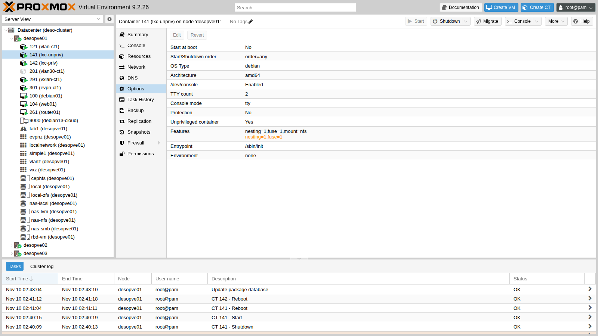
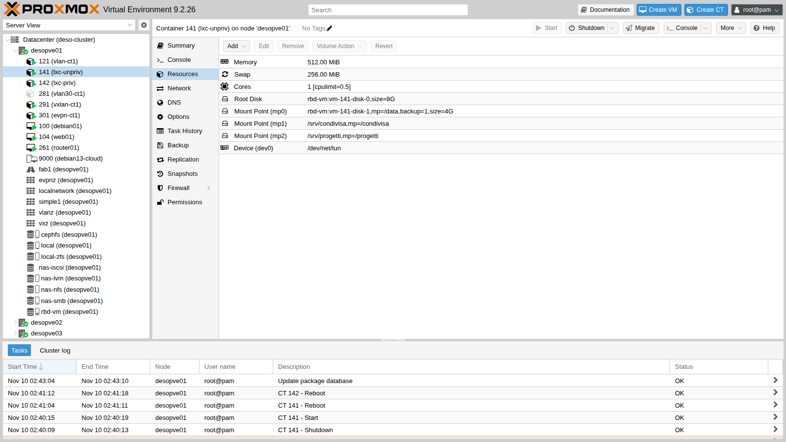

# Lab 41 – LXC containers: privileged and unprivileged, mount points, features, limits and comparison with VMs

**Level:** intermediate · **Duration:** 1 hour 30 minutes

## Dependencies

- **Previous labs:**
  - [Lab 07](07-first-vm-and-container.md): the first container (here the `debian-13-standard` template is also downloaded to `cephfs`, in step 3);
  - [Lab 13](13-nfs.md): the NFS export of the NAS `172.27.199.10:/mnt/dati/nfs`;
  - [Lab 17](17-ceph-installation.md): the shared storages `rbd-vm` and `cephfs`;
  - [Lab 22](22-dedicated-networks.md): the migration network on VLAN 100;
  - [Lab 40](40-templates-cloud-init-clones.md): template `9000`, for the comparison with a VM.
- **Nodes and storage:** cluster `desopve01`-`03`; templates on `cephfs`, container disks on `rbd-vm` and `local-zfs`.
- **Network:** the proxy `proxy.proxmox.community:3128` for templates, images and packages.
- **Addresses:** CT 141 on 172.27.199.141, CT 142 on .142, CT 143 on .143, VM 144 on .144, CTs 150-159 on .150-.159.
- **Credentials:** container `root` with `<lab-password>` → [Appendix B](b-credentials-and-addresses.md).

## Objectives

- Download system templates, TurnKey templates and OCI images, and understand what to do when the download goes through a proxy.
- Understand the difference between **privileged** and **unprivileged** containers by looking at the UIDs from the node.
- Use **mount points** on storage and **bind mounts** from the node, solving permission issues with UID mapping.
- Enable the `nesting`, `fuse` and `mount` features and pass a device to the container.
- Apply **CPU and RAM limits** and measure their effect.
- Migrate a container and compare it with a VM: boot times, RAM and density.

## How it works

**A container is not a VM.** The processes of an LXC container run on the node's kernel, isolated with *namespaces* (PID, network, mount, user) and limited with *cgroup v2*. There is no virtualized operating system: this is why a container starts in a few seconds and takes up only a few MiB.

**Privileged or unprivileged.**

| | Unprivileged (default) | Privileged |
|---|---|---|
| Container `root` on the node | UID 100000 (no privileges) | UID 0, that is, the node's `root` |
| Mapping | `/etc/subuid` and `/etc/subgid`: 65536 UIDs starting from 100000 | none |
| If a process escapes from the container | it is an ordinary user on the node | it is the node's `root` |
| Limitations | cannot mount NFS/CIFS, some devices require configuration | can do almost anything, hence more risk |

**Mount points.**

- `mpX: storage:size` creates a volume on the storage, managed by Proxmox VE: included in backups (`backup=1`), migratable if the storage is shared.
- `mpX: /path/on/the/node` is a **bind mount**: a node folder seen inside the container. It is not included in backups and it blocks migration.

**Templates.** Three sources, all in a storage with the *CT Templates* content type:

- Proxmox system images (`pveam`, `system` section);
- TurnKey Linux appliances (`turnkeylinux` section);
- since Proxmox VE 9.1, **OCI images** (the same formats as Docker/Podman) from a registry: they become *application containers* with their own entrypoint.

## Procedure

### 1. System and TurnKey templates

Update the index and search it:

```bash
pveam update
pveam available --section turnkeylinux | wc -l
pveam available --section system | grep -E "debian-13|alpine-3.23|ubuntu-2[46]"
```

``` { .text .no-copy title="Output" }
update successful
112
system          alpine-3.23-default_20261105_amd64.tar.xz                    amd64
system          debian-13-standard_13.6-1_amd64.tar.zst                      amd64
system          debian-13-standard_13.6-1_arm64.tar.zst                      arm64
system          ubuntu-24.04-standard_24.04-2_amd64.tar.zst                  amd64
system          ubuntu-26.04-standard_26.04-1_amd64.tar.zst                  amd64
system          ubuntu-26.10-standard_26.10-1_amd64.tar.zst                  amd64
```

The same list can be seen from the GUI: storage `cephfs` → **CT Templates** → **Templates**, searching for `turnkey`:



Download Alpine and TurnKey Core:

```bash
pveam download cephfs alpine-3.23-default_20261105_amd64.tar.xz
pveam download cephfs debian-13-turnkey-core_19.0-2_amd64.tar.gz
```

``` { .text .no-copy title="Output" }
Proxy request sent, awaiting response... 200 OK
calculating checksum...OK, checksum verified
Resolving mirror.turnkeylinux.org (mirror.turnkeylinux.org)... failed: Temporary failure in name resolution.
download failed: wget: unable to resolve host address 'mirror.turnkeylinux.org'
```

Alpine arrives in 2 seconds, TurnKey does not. The reason is in the index: TurnKey appliances are downloaded over **HTTPS** (`Location: https://mirror.turnkeylinux.org/...`), and `pveam` sends only HTTP requests through the proxy. In a network without direct Internet access, the HTTPS download attempts direct DNS resolution and fails.

**Workaround:** the storage's **Download from URL** button, which uses the proxy for HTTPS too. The URL and the SHA512 checksum can be read in the index (`/var/lib/pve-manager/apl-info/releases.turnkeylinux.org`):

```bash
pvesh create /nodes/desopve01/storage/cephfs/download-url --content vztmpl \
  --filename debian-13-turnkey-core_19.0-2_amd64.tar.gz \
  --url https://mirror.turnkeylinux.org/turnkeylinux/images/proxmox/debian-13-turnkey-core_19.0-2_amd64.tar.gz \
  --checksum f70345d6b1d5…ba7f11 --checksum-algorithm sha512
```

``` { .text .no-copy title="Output" }
2026-11-10 02:35:47 (76.0 MB/s) - '/mnt/pve/cephfs/template/cache/debian-13-turnkey-core_19.0-2_amd64.tar.gz.tmp_dwnl.407164' saved [266734332/266734332]
calculating checksum...OK, checksum verified
```

254 MB in 7 seconds, with SHA512 verification.

### 2. An OCI image as an application container

The **Pull from OCI Registry** button downloads an image from a registry such as Docker Hub. The *Reference* field is automatically split into image and tag:



In the lab, the download from the GUI fails:

```text
time="2026-11-10T02:44:57+01:00" level=fatal msg="initializing source docker://nginx:stable-alpine: pinging container registry registry-1.docker.io: Get \"https://registry-1.docker.io/v2/\": dial tcp: lookup registry-1.docker.io on 172.27.199.20:53: read udp 172.27.199.21:43629->172.27.199.20:53: i/o timeout"
command 'skopeo copy docker://docker.io/library/nginx:stable-alpine oci-archive:/mnt/pve/cephfs/template/cache/nginx_stable-alpine.tar.tmp.418582' failed: exit code 1
```

Proxmox VE uses `skopeo`, which does not read the Datacenter proxy setting. The same command with the `HTTPS_PROXY` variable works; the lab proxy must allow the domains `docker.io`, `production.cloudflare.docker.com` and `production.cloudfront.docker.com`:

```bash
HTTPS_PROXY=http://proxy.proxmox.community:3128 skopeo copy \
  docker://docker.io/library/nginx:stable-alpine \
  oci-archive:/mnt/pve/cephfs/template/cache/nginx_stable-alpine.tar
```

``` { .text .no-copy title="Output" }
Copying config sha256:1390db6b01a8b0c865b157c7f036b0772534418b1701f598737de546d208b6e4
Writing manifest to image destination
```

The file shows up among the templates (25 MiB) and is used like a normal template:

```bash
pct create 143 cephfs:vztmpl/nginx_stable-alpine.tar --hostname oci-nginx --unprivileged 1 \
  --memory 256 --rootfs rbd-vm:2 --net0 name=eth0,bridge=vmbr0,ip=172.27.199.143/24,gw=172.27.199.1
pct start 143
curl -s -o /dev/null -w "HTTP %{http_code}\n" http://172.27.199.143/
```

``` { .text .no-copy title="Output" }
Detected OCI archive
Auto-Enabling host-managed network for network device net0.
Detected container architecture: amd64
HTTP 200
```

Proxmox VE recognizes the OCI image, takes the **entrypoint** and the **environment variables** from the image, and manages the container's network itself (`host-managed=1`), because an application image has no networking setup of its own:

```text
cmode: console
entrypoint: /docker-entrypoint.sh nginx -g 'daemon off;'
env: PATH=/usr/local/sbin:/usr/local/bin:/usr/sbin:/usr/bin:/sbin:/bin NGINX_VERSION=1.30.6 PKG_RELEASE=1 …
net0: name=eth0,bridge=vmbr0,gw=172.27.199.1,host-managed=1,ip=172.27.199.143/24,type=veth
ostype: alpine
lxc.signal.halt: SIGQUIT
```

Inside the container there is no `systemd`: process 1 is nginx itself.

```text
PID   USER     TIME  COMMAND
    1 root      0:00 nginx: master process nginx -g daemon off;
   47 nginx     0:00 nginx: worker process
```



### 3. Unprivileged and privileged containers

In the **Create CT** wizard, the *Unprivileged container* and *Nesting* checkboxes are already checked:



To compare them, create the two containers from the CLI, identical except for `--unprivileged`:

```bash
pveam download cephfs debian-13-standard_13.6-1_amd64.tar.zst   # if it is not already on cephfs
T=cephfs:vztmpl/debian-13-standard_13.6-1_amd64.tar.zst
pct create 141 $T --hostname lxc-unpriv --unprivileged 1 --features nesting=1 --cores 2 --memory 1024 --swap 512 \
  --rootfs rbd-vm:8 --net0 name=eth0,bridge=vmbr0,ip=172.27.199.141/24,gw=172.27.199.1 \
  --nameserver 172.27.199.20 --searchdomain proxmox.community --password '<lab-password>'
pct create 142 $T --hostname lxc-priv --unprivileged 0 --cores 2 --memory 1024 --swap 512 \
  --rootfs rbd-vm:8 --net0 name=eth0,bridge=vmbr0,ip=172.27.199.142/24,gw=172.27.199.1 \
  --nameserver 172.27.199.20 --searchdomain proxmox.community --password '<lab-password>'
```

For 142, created without `nesting`, Proxmox VE warns:

```text
WARN: Systemd 257 detected. You may need to enable nesting.
```

With recent systemd versions, some service features (private namespaces, sandboxing) require `nesting=1`, which the wizard already enables.

Start the two containers, configure the `apt` proxy and install the packages needed later (the NFS client and `stress-ng`, which the template does not include):

```bash
pct start 141 && pct start 142
for c in 141 142; do
  pct exec $c -- sh -c 'echo "Acquire::http::Proxy \"http://proxy.proxmox.community:3128\";" > /etc/apt/apt.conf.d/80proxy && apt-get update -qq && apt-get install -y -qq nfs-common stress-ng'
done
```

**UID mapping.** The node reserves 65536 UIDs for `root`, starting from 100000:

```text
# /etc/subuid and /etc/subgid
root:100000:65536
root:100000:65536
```

Inside the two containers:

```bash
pct exec 141 -- cat /proc/self/uid_map
pct exec 142 -- cat /proc/self/uid_map
```

``` { .text .no-copy title="Output" }
CT 141:          0     100000      65536
CT 142:          0          0 4294967295
```

141 sees UIDs 0-65535 as the node's 100000-165535; 142 uses the node's UIDs without translation. From the node, process 1 of the two containers:

```bash
P=$(lxc-info -n 141 -p -H); ps -o uid=,user=,pid=,cmd= -p $P
P=$(lxc-info -n 142 -p -H); ps -o uid=,user=,pid=,cmd= -p $P
```

``` { .text .no-copy title="Output" }
100000 100000   408967 /sbin/init
    0 root      409389 /sbin/init
```

A file created by `root` inside each container, seen from the node through `/proc/<PID>/root`:

```bash
pct exec 141 -- touch /root/prova-lxc-unpriv
pct exec 142 -- touch /root/prova-lxc-priv
P=$(lxc-info -n 141 -p -H); ls -ln /proc/$P/root/root/prova-lxc-unpriv
P=$(lxc-info -n 142 -p -H); ls -ln /proc/$P/root/root/prova-lxc-priv
```

``` { .text .no-copy title="Output" }
## CT 141
-rw-r--r-- 1 100000 100000 0 Nov 10 02:39 prova-lxc-unpriv
## CT 142
-rw-r--r-- 1 0 0 0 Nov 10 02:39 prova-lxc-priv
```

This is why unprivileged containers are more secure: if a process managed to escape from 141, on the node it would be user 100000, which owns nothing. From 142 it would be `root`.

### 4. Mount points and bind mounts

A volume on `rbd-vm`, added live and included in backups:

```bash
pct set 141 -mp0 rbd-vm:4,mp=/data,backup=1
pct exec 141 -- df -h /data
```

``` { .text .no-copy title="Output" }
/dev/rbd5       3.9G  1.1M  3.7G   1% /data
```

A **bind mount** of a node folder:

```bash
mkdir -p /srv/condivisa && echo 'file creato sul nodo' > /srv/condivisa/leggimi.txt
pct set 141 -mp1 /srv/condivisa,mp=/condivisa
pct exec 141 -- ls -ln /condivisa
pct exec 141 -- touch /condivisa/scrivo-io
```

``` { .text .no-copy title="Output" }
-rw-r--r-- 1 65534 65534 21 Nov 10 01:39 leggimi.txt
touch: cannot touch '/condivisa/scrivo-io': Permission denied
```

The file belongs to the node's `root` (UID 0), which is **not mapped** in the container: inside, it appears as `nobody` (65534) and the container's `root` cannot write. The simplest solution is to give the folder to the UID that corresponds to the container's `root`:

```bash
chown -R 100000:100000 /srv/condivisa
pct exec 141 -- touch /condivisa/scrivo-io && ls -ln /srv/condivisa
```

``` { .text .no-copy title="Output" }
-rw-r--r-- 1 100000 100000 21 Nov 10 02:39 leggimi.txt
-rw-r--r-- 1 100000 100000  0 Nov 10 02:39 scrivo-io
```

**Mapping a specific UID.** If the folder on the node belongs to a real user (UID 1000) and the same UID must use it inside the container, you open a "hole" in the mapping. To also see a common mistake, first create the user `ana` in the container, as if it already existed (it gets UID 1000):

```bash
pct exec 141 -- useradd -m -s /bin/bash ana
```

On the node:

```bash
mkdir -p /srv/progetti && echo 'documento di ana' > /srv/progetti/progetto.txt && chown -R 1000:1000 /srv/progetti
echo 'root:1000:1' >> /etc/subuid
echo 'root:1000:1' >> /etc/subgid
```

Shut down the container (`pct shutdown 141`) and add the mapping, split into three ranges, to `/etc/pve/lxc/141.conf`: 0-999 as before, 1000 to 1000, 1001-65535 as before:

```text
lxc.idmap: u 0 100000 1000
lxc.idmap: g 0 100000 1000
lxc.idmap: u 1000 1000 1
lxc.idmap: g 1000 1000 1
lxc.idmap: u 1001 101001 64535
lxc.idmap: g 1001 101001 64535
```

```bash
pct set 141 -mp2 /srv/progetti,mp=/progetti
pct start 141
pct exec 141 -- cat /proc/self/uid_map
pct exec 141 -- su - ana -c 'echo modifica di ana >> /progetti/progetto.txt && touch /progetti/nuovo-da-ana'
ls -ln /srv/progetti
```

``` { .text .no-copy title="Output" }
         0     100000       1000
      1000       1000          1
      1001     101001      64535
-rw-rw-r-- 1 1000 1000  0 Nov 10 02:40 nuovo-da-ana
-rw-r--r-- 1 1000 1000 33 Nov 10 02:40 progetto.txt
```

The user `ana` (UID 1000) writes to the node folder with its own UID.

**Pitfall:** the user `ana` was created *before* changing the mapping, so its home directory on the node belongs to 101000, which with the new mapping no longer corresponds to any UID in the container:

```text
su: warning: cannot change directory to /home/ana: Permission denied
drwx------ 2 65534 65534 4096 Nov 10 01:40 /home/ana
chown: cannot read directory '/home/ana': Permission denied
```

The container's `root` cannot fix it, because the file does not belong to any mapped UID. Fix it from the node:

```bash
P=$(lxc-info -n 141 -p -H); chown -R 1000:1000 /proc/$P/root/home/ana
```

Rule of thumb: define the mapping **before** creating the users in the container.

### 5. Features and devices

**Device: `/dev/net/tun`**, needed for VPNs such as userspace WireGuard or OpenVPN:

```bash
pct exec 141 -- ip tuntap add mode tun dev tun0
pct set 141 -dev0 /dev/net/tun
pct exec 141 -- ip tuntap add mode tun dev tun0 && pct exec 141 -- ip -br link show tun0
```

``` { .text .no-copy title="Output" }
open: No such file or directory
tun0             DOWN           <POINTOPOINT,MULTICAST,NOARP>
```

The device is added live.

**FUSE** (filesystem in userspace, for example `sshfs`): it is enabled with the `fuse=1` feature and a container reboot, after which the device appears:

```bash
pct set 141 -features nesting=1,fuse=1 && pct reboot 141 && pct exec 141 -- ls -l /dev/fuse
```

``` { .text .no-copy title="Output" }
crw-rw-rw- 1 nobody nogroup 10, 229 Nov  9 13:31 /dev/fuse
```

**Mounting NFS inside the container.** The `mount=nfs` feature can be set on both, but the result differs:

```bash
pct set 142 -features nesting=1,mount=nfs     # privileged
pct set 141 -features nesting=1,fuse=1,mount=nfs   # unprivileged
pct reboot 142 && pct reboot 141
pct exec 142 -- mkdir -p /mnt/nas && pct exec 141 -- mkdir -p /mnt/nas
pct exec 142 -- mount -t nfs -o vers=4.2 172.27.199.10:/mnt/dati/nfs /mnt/nas
pct exec 141 -- mount -t nfs -o vers=4.2 172.27.199.10:/mnt/dati/nfs /mnt/nas
```

``` { .text .no-copy title="Output" }
CT 142: 172.27.199.10:/mnt/dati/nfs   54G     0   54G   0% /mnt/nas
CT 141: mount.nfs: Operation not permitted for 172.27.199.10:/mnt/dati/nfs on /mnt/nas
```

The kernel does not allow mounting NFS from a user namespace. For an unprivileged container, the right way is to mount the share on the node, or use a Proxmox VE storage, and pass it in with a mount point. Then remove `mount=nfs` from 141, where it is not needed: `pct set 141 -features nesting=1,fuse=1` and `pct reboot 141`.

The enabled features are shown in **Options**:



Other useful features:

- **`keyctl=1`**: the system calls for kernel keys, needed by Docker inside an unprivileged container;
- **`nesting=1`**: nested namespaces, for recent systemd and for containers inside the container.

### 6. CPU and RAM limits

Give 141 one core, a cap of half a core, 512 MiB of RAM and 256 MiB of swap:

```bash
pct set 141 -cores 1 -cpulimit 0.5 -memory 512 -swap 256
```

Proxmox VE translates them into the files of the cgroup `/sys/fs/cgroup/lxc/141/`:

```text
cpu.max: 50000 100000
memory.max: 536870912
memory.swap.max: 268435456
```

`cpu.max` means "50 ms of CPU every 100 ms", that is, half a core. The number of cores, on the other hand, is a `cpuset`: right after the command it was still `0,3`, a few seconds later it was `0`, and inside the container `nproc` returned 1.

Inside the container, `free` shows the RAM of the limit, not that of the node:

```text
               total        used        free      shared  buff/cache   available
Mem:             512          16         262           0         232         495
Swap:              0           0           0
```

**Measured CPU.** `stress-ng` with 2 processes for 20 seconds; the usage is read from the node in the cgroup's `cpu.stat`, before and after. The script [`misure.sh`](../files/41/misure.sh), to be copied to the node, does the math (here together with the `stress-ng` metrics line):

```bash
./misure.sh cpu 141 pct exec 141 -- stress-ng --cpu 2 --timeout 20s --metrics-brief
```

``` { .text .no-copy title="Output" }
stress-ng: metrc: [1381] cpu               12146     20.05     10.00      0.02       605.90        1211.82
CPU usata dal cgroup: 10.1 s su 21.3 s di orologio = 47% di un core
```

The half-core cap is respected.

**Measured RAM.** `stress-ng` tries to allocate 900 MiB:

```bash
pct exec 141 -- stress-ng --vm 1 --vm-bytes 900M --vm-keep --timeout 20s >/dev/null &
./misure.sh mem 141 12
journalctl -k --since "-2min" | grep -m1 "Memory cgroup out of memory" | sed 's/^.*kernel: //'
```

``` { .text .no-copy title="Output" }
t+3s memory.current=506 MiB swap.current=0 MiB
t+6s memory.current=290 MiB swap.current=0 MiB
t+9s memory.current=511 MiB swap.current=0 MiB
t+12s memory.current=512 MiB swap.current=0 MiB
oom_kill: 11 -> 16
Memory cgroup out of memory: Killed process 826768 (stress-ng-vm) total-vm:1001468kB, anon-rss:475832kB, file-rss:4kB, shmem-rss:64kB, UID:100000 pgtables:1024kB oom_score_adj:1000
```

The cgroup's `oom_kill` counter goes up with every killed process (here it started from 11 because of the previous tests).

At the 512 MiB limit the kernel kills the process **inside the container's cgroup** (`UID:100000`): the node and the other guests do not notice. The container's swap is not used because `desopve01` **has no swap**: the installation on ZFS does not create it (`swapon --show` is empty). The swap limit only has an effect on a node that has swap.

The final resources of 141:



### 7. Migrating a container

A running container cannot be migrated "live":

```bash
pct migrate 141 desopve02
pct migrate 141 desopve02 --restart
pct migrate 142 desopve02 --online
```

``` { .text .no-copy title="Output" }
can't migrate running container without --online or --restart
ERROR: migration aborted (duration 00:00:00): cannot migrate local bind mount point 'mp1'
ERROR: migration aborted (duration 00:00:00): lxc live migration is currently not implemented
```

- Live migration of containers **does not exist**: Proxmox VE accepts `--online` but refuses the operation.
- **Restart** migration shuts down the container, moves it and starts it again.
- A local bind mount blocks migration: the folder exists only on that node.

CT 142 has no bind mounts and its disk is on `rbd-vm`. While it migrates, a ping every 0.2 seconds from another terminal on the node counts the lost replies:

```bash
./misure.sh pinggap 172.27.199.142 30     # second terminal
pct migrate 142 desopve02 --restart
```

``` { .text .no-copy title="Output" }
shutdown CT 142
starting migration of CT 142 to node 'desopve02' (10.100.10.22)
start container on target node
migration finished successfully (duration 00:00:10)
buco nei ping: 17 risposte perse, circa 3.4 s
```

The disk is shared, so nothing is copied: 10 seconds in total, 3.4 seconds without replies. The migration uses the dedicated network from [Lab 22](22-dedicated-networks.md) (`10.100.10.22`).

### 8. Containers versus VMs

**Boot time.** CT 142 (Debian 13) and VM 144, a linked clone of template 9000, with 1 GiB of RAM each. Create the VM on `desopve01`:

```bash
qm clone 9000 144 --name vm144 && qm set 144 --memory 1024 --ipconfig0 ip=172.27.199.144/24,gw=172.27.199.1
```

The time between the start command and the first reply is measured with a loop on the node, twice per guest (for the VM, `qm start 144` and IP .144):

```bash
t0=$(date +%s.%N); pct start 142
until ping -c1 -W1 172.27.199.142 >/dev/null; do :; done; echo "$(date +%s.%N) - $t0" | bc
```


| Guest | First ping | SSH ready |
|---|---|---|
| CT 142 | 7.2-7.3 s | 7.2-7.3 s |
| VM 144 | 22.1-22.6 s | 24.5-24.8 s |
| VM 144, first boot with cloud-init | – | 63 s |

The container has no firmware, bootloader or kernel to boot: systemd starts directly.

**RAM at idle**, from the cgroup on the node after 40 seconds (`memory.current` in `/sys/fs/cgroup/lxc/142/` and in `/sys/fs/cgroup/qemu.slice/144.scope/`), in summary:

```text
CT 142: 113 MiB
VM 144: 308 MiB (assigned memory 1024 MiB)
```

The VM keeps a complete kernel and the guest's cache in RAM; the container shares the node's kernel.

**Density.** Ten 64 MiB Alpine containers on `desopve02`, rootfs on `local-zfs`:

```bash
for i in $(seq 150 159); do
  pct create $i cephfs:vztmpl/alpine-3.23-default_20261105_amd64.tar.xz --hostname alp$i --unprivileged 1 \
    --memory 64 --swap 0 --cores 1 --rootfs local-zfs:1 \
    --net0 name=eth0,bridge=vmbr0,ip=172.27.199.$i/24,gw=172.27.199.1 --password '<lab-password>'
done
for i in $(seq 150 159); do pct start $i; done
```

Summary of the measurements (`time` on the two loops, the node's available memory before and after with `free -m`, sum of the cgroups' `memory.current`):

```text
creazione di 10 CT: 23.5 s; avvio di 10 CT: 39.8 s; rispondono al ping: 10/10
memoria disponibile del nodo: -158 MiB; somma memory.current dei 10 CT: 24 MiB
CT 150: 2560 KiB
```

Each Alpine container uses **2.5 MiB** of RAM and **7.7 MB** of disk (`zfs list`). The node's available memory drops more (158 MiB) because of kernel structures and filesystem caches. With VMs, the same test would require at least ten kernels and ten times the minimum RAM of an operating system.

At the end, delete the test guests:

```bash
# on desopve02
pct stop 142 && pct destroy 142 --purge
for i in $(seq 150 159); do pct stop $i; pct destroy $i --purge; done
# on desopve01
qm stop 144 && qm destroy 144 --purge
```

## Verification and tests

- A TurnKey appliance over HTTPS can be downloaded with **Download from URL** even behind a proxy; `pveam download` fails without direct Internet access.
- An OCI image becomes an application container with the image's entrypoint and variables; with skopeo and `HTTPS_PROXY` the download also works behind a proxy.
- The `root` of the unprivileged container is UID 100000 on the node; that of the privileged one is UID 0.
- A bind mount belongs to `nobody` in the container until the owner is aligned (100000) or the UID is mapped.
- The `/dev/net/tun` device is added live; FUSE requires a reboot; NFS can be mounted only in the privileged container.
- The half-core cap brings usage to 47% of a core; the 512 MiB limit triggers the OOM killer in the container only.
- The restart migration of a container on shared storage takes 10 seconds with 3.4 seconds of interruption; live migration is not available.
- A container starts in about 7 seconds versus 22-25 for a VM, and at idle uses 113 MiB versus 308.

## Final lab state

- **CT 141 `lxc-unpriv`** on `desopve01`, running, unprivileged, 172.27.199.141:
  - 1 core with `cpulimit 0.5`, 512 MiB of RAM, 256 MiB of swap;
  - `mp0` on `rbd-vm` (4 GiB, `/data`, `backup=1`);
  - bind mounts `mp1` `/srv/condivisa` → `/condivisa` and `mp2` `/srv/progetti` → `/progetti`: for this reason 141 **cannot be migrated** until they are removed;
  - `dev0: /dev/net/tun`, features `nesting=1,fuse=1`;
  - UID mapping with UID 1000 passed through, user `ana` (UID 1000) in the container; on the node, `/etc/subuid` and `/etc/subgid` also contain `root:1000:1`.
- **CT 143 `oci-nginx`** on `desopve01`, running: application container from the OCI image `nginx:stable-alpine`, 172.27.199.143, responds over HTTP.
- **Templates on `cephfs`:** `debian-13-standard`, `alpine-3.23-default`, `debian-13-turnkey-core` and the OCI archive `nginx_stable-alpine.tar`.
- **Deleted:** CT 142, CTs 150-159, VM 144.
- **Lab proxy:** `docker.io`, `production.cloudflare.docker.com` and `production.cloudfront.docker.com` added to the whitelist.

## What you learned

- Containers share the node's kernel: they start in a few seconds and take up a few MiB, but they cannot be live-migrated.
- An unprivileged container shifts UIDs by 100000: it is the default and the safe choice.
- Mount points on storage follow the migration and, with `backup=1`, the backup; bind mounts do not, and they require aligning the owners.
- With `lxc.idmap` and `/etc/subuid`, a specific UID can pass unchanged between node and container; do it before creating the users.
- Devices, FUSE and mounts are enabled with `devX` and `features`; NFS inside the container works only if it is privileged.
- CPU and RAM limits are cgroup v2: they can be read and measured directly from the node.
- Behind a proxy, TurnKey (HTTPS) and OCI images (skopeo) require an extra step.

## References

- [Proxmox VE – Linux Container](https://pve.proxmox.com/pve-docs/chapter-pct.html)
- [Proxmox VE wiki – Unprivileged LXC containers](https://pve.proxmox.com/wiki/Unprivileged_LXC_containers)
- [LXC – lxc.container.conf (lxc.idmap)](https://linuxcontainers.org/lxc/manpages/man5/lxc.container.conf.5.html)
- [TurnKey Linux – Proxmox VE](https://www.turnkeylinux.org/docs/proxmox)
