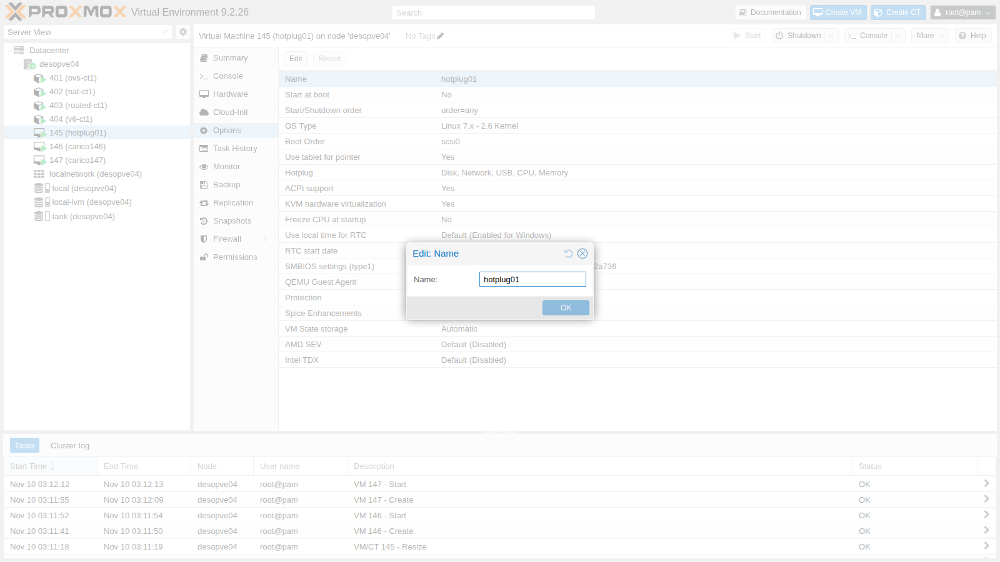
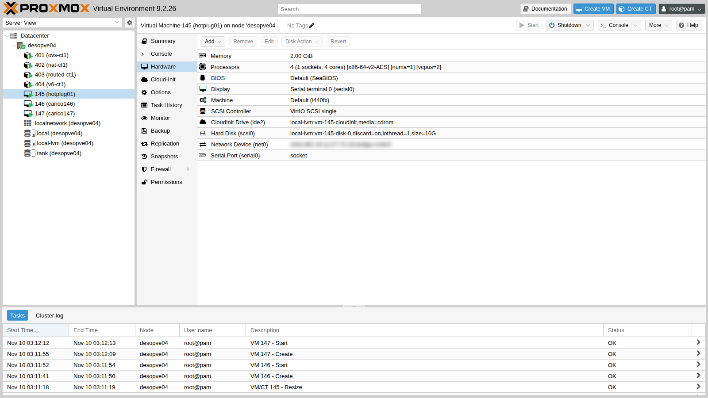
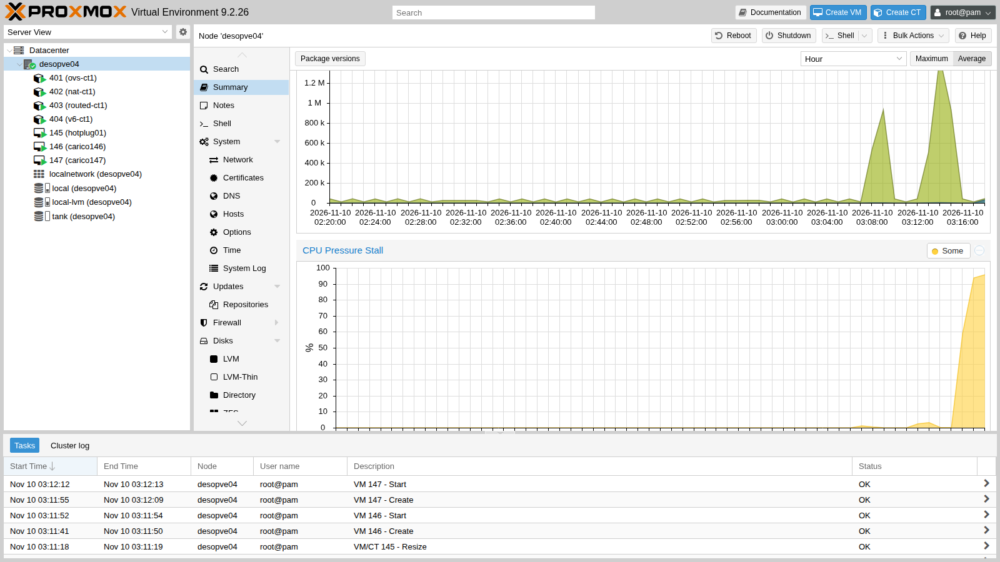
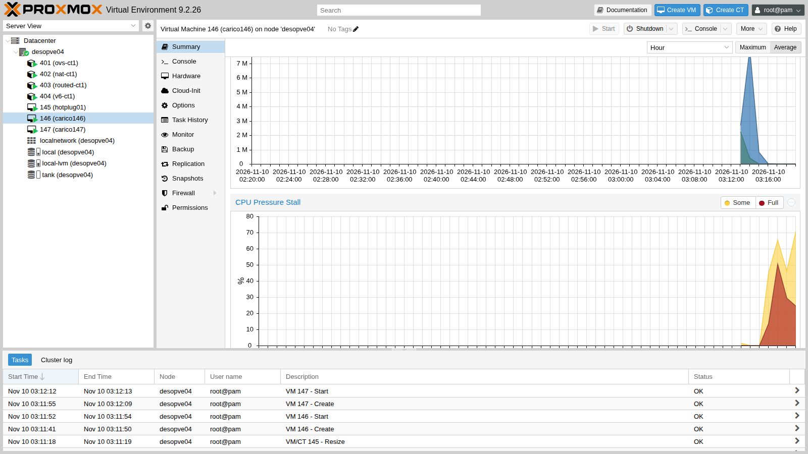

# Lab 42 – Hotplug, live resize, CPU weight and cap, pressure (PSI)

**Level:** intermediate · **Duration:** 1 hour

## Dependencies

- **Previous labs:**
  - [Lab 19](19-fio-benchmark.md): the Debian 13 cloud image in `local:import` on `desopve04`;
  - [Lab 36](36-memory.md): NUMA and VM memory;
  - [Lab 37](37-virtual-disks-controllers.md): VirtIO SCSI controller and disk I/O limits;
  - [Lab 40](40-templates-cloud-init-clones.md): cloud-init.
- **Node:** `desopve04`, the standalone node with 4 CPUs: the contention tests saturate the node, so they are not run on the cluster nodes with Ceph.
- **Storage:** `local-lvm` on `desopve04`.
- **Addresses:** VM 145 on 172.27.199.145, VMs 146 and 147 on .146 and .147.
- **Credentials:** the VMs' `labuser` user with the SSH key of the node's `root` → [Appendix B](b-credentials-and-addresses.md).

## Objectives

- Add and remove CPUs, memory, disks and network devices **live**, and verify what the guest sees.
- Grow a disk **without shutting down** the VM, all the way up to the filesystem.
- Share the CPU among competing VMs with the **weight** (`cpuunits`) and the **cap** (`cpulimit`), measuring the result.
- Read the **pressure** (Pressure Stall Information) of nodes and VMs in the Proxmox VE 9 GUI.

## How it works

**Hotplug.** The **Hotplug** option of a VM tells Proxmox VE which components it can plug and unplug while the VM is running. The default is `disk,network,usb`. CPU and memory must be added explicitly and have some requirements:

| Component | Requirements | What happens in the guest |
|---|---|---|
| Disk | SCSI or VirtIO controller | the disk appears as a new device |
| Network device | none | a new interface appears, to be configured |
| CPU | `vcpus` lower than `sockets × cores` | the new processors arrive **offline**: a udev rule is needed to bring them online |
| Memory | `numa: 1` | beyond the first 1024 MiB, memory arrives in 512 MiB DIMM modules (`dimm0`, `dimm1`…); the kernel sees it in 128 MiB blocks and brings it online |

**`cores` and `vcpus`.** `cores` is the maximum number of processors the VM can have; `vcpus` is how many it uses at startup. The difference is the room for hotplug.

**CPU weight and cap.** Each VM is a cgroup v2 in `/sys/fs/cgroup/qemu.slice/<VMID>.scope`:

- **`cpuunits`** becomes `cpu.weight` (default 100): it matters only when the node's CPU is contended, and it splits the CPU in proportion to the weights;
- **`cpulimit`** becomes `cpu.max`: a hard cap in "cores", applied even when the node is idle.

**PSI.** The kernel's *Pressure Stall Information* measures the percentage of time in which processes wait for a resource (CPU, I/O, memory): *some* = at least one process waiting, *full* = all of them waiting. Proxmox VE 9 collects it per node and per guest and shows it in the **Summary** graphs.

## Procedure

### 1. The test VM

A VM from the cloud image, with a maximum of 4 cores but 2 active, NUMA enabled, and CPU and memory hotplug:

```bash
qm create 145 --name hotplug01 --ostype l26 --memory 2048 --cores 4 --vcpus 2 --numa 1 --cpu x86-64-v2-AES \
  --scsihw virtio-scsi-single \
  --scsi0 local-lvm:0,import-from=local:import/debian-13-genericcloud-amd64.qcow2,discard=on,iothread=1 \
  --ide2 local-lvm:cloudinit --boot order=scsi0 --serial0 socket --vga serial0 \
  --net0 virtio,bridge=vmbr0 --agent enabled=1 --hotplug disk,network,usb,cpu,memory
qm resize 145 scsi0 6G
qm set 145 --ciuser labuser --sshkeys /root/.ssh/id_rsa.pub \
  --ipconfig0 ip=172.27.199.145/24,gw=172.27.199.1 --nameserver 172.27.199.20 --searchdomain proxmox.community --ciupgrade 0
qm start 145
```

After the first boot, from the node, configure the `apt` proxy in the guest and install the agent and `stress-ng` (the cloud image does not include them):

```bash
ssh labuser@172.27.199.145 "echo 'Acquire::http::Proxy \"http://proxy.proxmox.community:3128\";' | sudo tee /etc/apt/apt.conf.d/80proxy \
  && sudo apt-get update && sudo apt-get install -y qemu-guest-agent stress-ng && sudo systemctl start qemu-guest-agent"
qm agent 145 ping && echo agent-ok
```

From here on, the checks in the guest are run from the node with `qm guest exec 145 -- <command>`.

The same option from the GUI: **Options** → **Hotplug**:



The initial state in the guest:

```text
nproc: 2
/sys/devices/system/cpu/online: 0-1
Mem:            1926         338        1089           0         708        1588
Memory block size:                     134217728
Total online memory:                  2147483648
sda    6G disk
eth0             UP             <BROADCAST,MULTICAST,UP,LOWER_UP>
```

### 2. CPU hotplug

```bash
qm set 145 --vcpus 4
qm guest exec 145 -- bash -c 'nproc; cat /sys/devices/system/cpu/online; dmesg | grep hot-added'
```

```text
2
0-1
[  137.463337] ACPI: CPU2 has been hot-added
[  137.465248] ACPI: CPU3 has been hot-added
```

The kernel has received the two processors, but leaves them **offline**: `nproc` stays at 2. The udev rule that brings them online as soon as they arrive, in the guest:

```bash
echo 'SUBSYSTEM=="cpu", ACTION=="add", TEST=="online", ATTR{online}=="0", ATTR{online}="1"' \
  > /etc/udev/rules.d/80-hotplug-cpu.rules
udevadm control --reload
```

After removing and re-adding the processors:

```bash
qm set 145 --vcpus 2   # back to 2
qm set 145 --vcpus 4
```

```text
nproc: 4
/sys/devices/system/cpu/online: 0-3
```

And the hot unplug:

```text
qm set 145 --vcpus 2
nproc: 2
/sys/devices/system/cpu/online: 0-1
```

### 3. Memory hotplug

```bash
qm set 145 --memory 4096
qm guest exec 145 -- bash -c 'free -m | sed -n 2p; lsmem --summary=only'
```

```text
Mem:            3974         368        3122           0         708        3606
Memory block size:                128M
Total online memory:                4G
Total offline memory:               0B
```

The extra 2 GiB arrive as DIMM modules and the Debian 13 kernel brings them online on its own: no rule needed. The VM monitor (`qm monitor 145`, command `info memory-devices`) shows six modules, from `dimm0` to `dimm5`, each of 536870912 bytes: with hotplug, Proxmox VE keeps 1024 MiB static and adds **512 MiB** DIMMs (1024 MiB with 1 GiB hugepages). The 128 MiB of `lsmem`, on the other hand, are the blocks the kernel uses to manage memory. Shrinking also works, because the added memory is free:

```bash
qm set 145 --memory 2048
```

```text
update VM 145: -memory 2048
try to unplug memory dimm dimm5
try to unplug memory dimm dimm4
try to unplug memory dimm dimm3
try to unplug memory dimm dimm2
Mem:            1926         301        1126           0         708        1624
```

The four added modules are removed in reverse order.

Removal works only if the guest manages to free the modules to be removed: with memory full of unmovable data, the kernel refuses the unplug.

### 4. Disk and network device hotplug

```bash
qm set 145 --scsi1 local-lvm:4,iothread=1,discard=on
qm guest exec 145 -- bash -c 'lsblk -dno NAME,SIZE,TYPE; ls -l /dev/disk/by-id/ | grep drive-scsi1'
```

```text
WARNING: Sum of all thin volume sizes (26.00 GiB) exceeds the size of thin pool pve/data and the amount of free space in volume group (<6.13 GiB).
scsi1: successfully created disk 'local-lvm:vm-145-disk-1,discard=on,iothread=1,size=4G'
sda    6G disk
sdb    4G disk
scsi-0QEMU_QEMU_HARDDISK_drive-scsi1 -> ../../sdb
```

The disk appears as `sdb`; the link in `/dev/disk/by-id` carries the Proxmox drive name (`drive-scsi1`), and it is the safe way to identify it ([Lab 37](37-virtual-disks-controllers.md)). The LVM warning is a reminder of the thin pool overprovisioning seen in [Lab 09](09-lvm-and-lvm-thin.md).

```bash
qm set 145 --net1 virtio,bridge=vmbr0
qm guest exec 145 -- ip -br link
```

```text
eth0             UP             <BROADCAST,MULTICAST,UP,LOWER_UP>
ens19            DOWN           <BROADCAST,MULTICAST>
```

The network device arrives **down and without an address**: it must be configured in the guest.

Hot unplug:

```bash
qm set 145 --delete net1
qm set 145 --delete scsi1
qm config 145 | grep unused
```

```text
unused0: local-lvm:vm-145-disk-1
```

The network device disappears; the disk is detached from the guest but **not deleted**: it becomes `unused0`, with its data intact. To really delete it:

```bash
qm disk unlink 145 --idlist unused0 --force
```

```text
Logical volume "vm-145-disk-1" successfully removed.
```

### 5. Growing the disk live

Before:

```text
sda        6G
├─sda1   5.9G
├─sda14    3M
└─sda15  124M
/dev/sda1       5.8G  1.2G  4.4G  21% /
```

```bash
qm resize 145 scsi0 +4G
```

The guest immediately sees the larger disk, but the partition and the filesystem remain as before:

```text
sda       10G
├─sda1   5.9G
```

In the guest:

```bash
growpart /dev/sda 1
resize2fs /dev/sda1
df -h /
```

```text
CHANGED: partition=1 start=262144 old: size=12320735 end=12582878 new: size=20709343 end=20971486
/dev/sda1       9.7G  1.2G  8.2G  13% /
```

Three layers: the disk (Proxmox VE), the partition (`growpart`), the filesystem (`resize2fs` for ext4, `xfs_growfs` for XFS). Shrinking a disk, on the other hand, is **not** possible with `qm resize`. The same command is available in the GUI: **Hardware** → disk → **Disk Action** → **Resize**.



### 6. CPU weight and cap under contention

Two identical VMs, 146 and 147, with 4 cores each on the same 4-CPU node, created like 145 but without `vcpus` and without hotplug:

```bash
for v in 146 147; do
  qm create $v --name contesa$v --ostype l26 --memory 2048 --cores 4 --cpu x86-64-v2-AES --scsihw virtio-scsi-single \
    --scsi0 local-lvm:0,import-from=local:import/debian-13-genericcloud-amd64.qcow2,discard=on,iothread=1 \
    --ide2 local-lvm:cloudinit --boot order=scsi0 --serial0 socket --vga serial0 --net0 virtio,bridge=vmbr0 --agent enabled=1
  qm set $v --ciuser labuser --sshkeys /root/.ssh/id_rsa.pub --ipconfig0 ip=172.27.199.$v/24,gw=172.27.199.1 \
    --nameserver 172.27.199.20 --searchdomain proxmox.community --ciupgrade 0
  qm start $v
done
```

Install the agent and `stress-ng` in both, as in 145. The load is `stress-ng --cpu 4` in both: the demand is 8 cores out of 4 available. The script [`contesa.sh`](../files/42/contesa.sh), on the node, measures the CPU time of each cgroup for 30 seconds (`usage_usec` in `cpu.stat`), shows weight and cap and reads the pressure (PSI). Each test:

```bash
for v in 146 147; do ssh labuser@172.27.199.$v "nohup stress-ng --cpu 4 --timeout 60s >/dev/null 2>&1 &"; done
sleep 15; ./contesa.sh 146 147 30
```

**A. Equal weights (default).**

```text
VM 146: 1.97 core   VM 147: 1.95 core   totale 3.93 core   rapporto 147/146 = 0.99
cpu.weight 146=100  cpu.max 146=max 100000
cpu.weight 147=100  cpu.max 147=max 100000
PSI cpu some avg10: VM 146 61.38 %  VM 147 63.20 %  nodo 95.26 %
```

**B. `cpuunits` 100 and 300.**

```bash
qm set 146 --cpuunits 100
qm set 147 --cpuunits 300
```

```text
VM 146: 1.01 core   VM 147: 2.93 core   totale 3.94 core   rapporto 147/146 = 2.91
cpu.weight 146=100  cpu.max 146=max 100000
cpu.weight 147=300  cpu.max 147=max 100000
PSI cpu some avg10: VM 146 71.53 %  VM 147 27.25 %  nodo 95.00 %
```

The CPU is split 1:3, like the weights. The weight takes nothing away when the node has idle CPU: it comes into play only under contention.

**C. Default weights and `cpulimit 1` on 147.**

```bash
qm set 146 --delete cpuunits; qm set 147 --delete cpuunits
qm set 147 --cpulimit 1
```

```text
VM 146: 2.92 core   VM 147: 1.00 core   totale 3.92 core   rapporto 147/146 = 0.34
cpu.weight 146=100  cpu.max 146=max 100000
cpu.weight 147=100  cpu.max 147=100000 100000
PSI cpu some avg10: VM 146 26.96 %  VM 147 72.40 %  nodo 96.78 %
```

147 is capped at 1 core (100 ms every 100 ms) even though it asks for 4, and the rest goes to 146. The cap always applies, even when the node is idle.

### 7. Pressure (PSI)

During the tests, the CPU pressure read from the cgroup of each VM (`cpu.pressure`, average over the last 10 seconds, last line of `contesa.sh`):

| Test | PSI VM 146 | PSI VM 147 | Node PSI |
|---|---|---|---|
| A, equal weights | 61 % | 63 % | 95 % |
| B, 146 weight 100 / 147 weight 300 | 72 % | 27 % | 95 % |
| C, 147 with cpulimit 1 | 27 % | 72 % | 97 % |

The penalized VM, whether by weight or by cap, spends more time waiting for the CPU. It is the right indicator to understand whether a VM is slow *because it is waiting* rather than because it is doing a lot of work. Proxmox VE 9 shows the same values in the **Summary**: for the node, the *CPU*, *IO* and *Memory Pressure Stall* graphs:



and for each guest, with the two curves *some* and *full*:



At the end, delete the test VMs:

```bash
for v in 145 146 147; do qm stop $v; qm destroy $v --purge; done
```

## Verification and tests

- With `vcpus` lower than `cores`, processors can be hot-added, but in the guest they stay offline until a udev rule brings them online; with the rule they appear immediately, and they can also be hot-removed.
- With NUMA enabled, memory is added in 512 MiB DIMM modules, the kernel brings it online on its own, and it can be removed if it is free.
- A hot-added disk appears as a new device, identifiable in `/dev/disk/by-id/...drive-scsiN`; once removed, it becomes `unused` without losing its data.
- A hot-added network device appears down and without an address.
- `qm resize` grows the disk live; `growpart` and `resize2fs` extend partition and filesystem without a reboot.
- Under contention, `cpuunits` 100 and 300 split the CPU 1:2.9; `cpulimit 1` caps the VM at 1.00 core.
- CPU pressure rises on the penalized VM and is visible in the Summary graphs.

## Final lab state

- Test VMs 145, 146 and 147 deleted from `desopve04`, together with their disks.
- `desopve04` as before the lab: CTs 401-404 running, `local-lvm` and `tank` unchanged.
- No changes to the cluster `desopve01`-`03`.

## What you learned

- CPU and memory hotplug must be enabled in the **Hotplug** option; memory hotplug requires NUMA.
- Hot-added CPUs must be brought online in the guest, with a udev rule or by hand.
- Detached disks remain as `unused` until you explicitly delete them.
- Growing a disk live works at three levels: disk, partition, filesystem.
- `cpuunits` is a relative weight that matters only under contention; `cpulimit` is a hard cap.
- PSI tells how long a VM waits for CPU, I/O or memory: since Proxmox VE 9 it is in the node and guest graphs.

## References

- [Proxmox VE – Hotplug](https://pve.proxmox.com/pve-docs/chapter-qm.html#qm_hotplug)
- [Proxmox VE wiki – Hotplug (qemu disk,nic,cpu,memory)](https://pve.proxmox.com/wiki/Hotplug_(qemu_disk,nic,cpu,memory))
- [Proxmox VE – CPU (cpuunits, cpulimit)](https://pve.proxmox.com/pve-docs/chapter-qm.html#qm_cpu)
- [Linux kernel – PSI, Pressure Stall Information](https://docs.kernel.org/accounting/psi.html)
- [Linux kernel – Control Group v2](https://docs.kernel.org/admin-guide/cgroup-v2.html)
