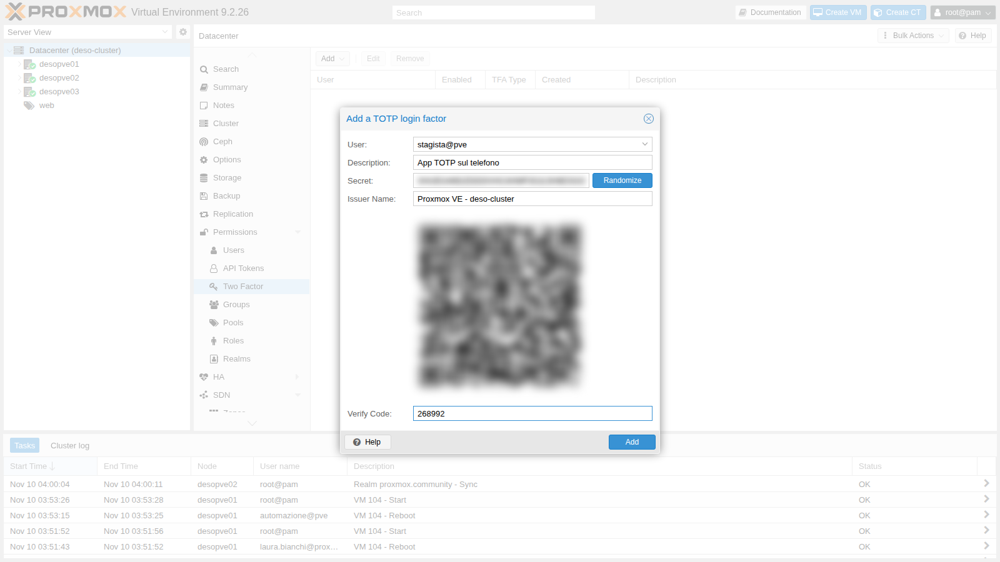
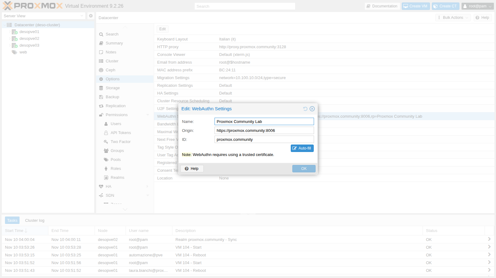
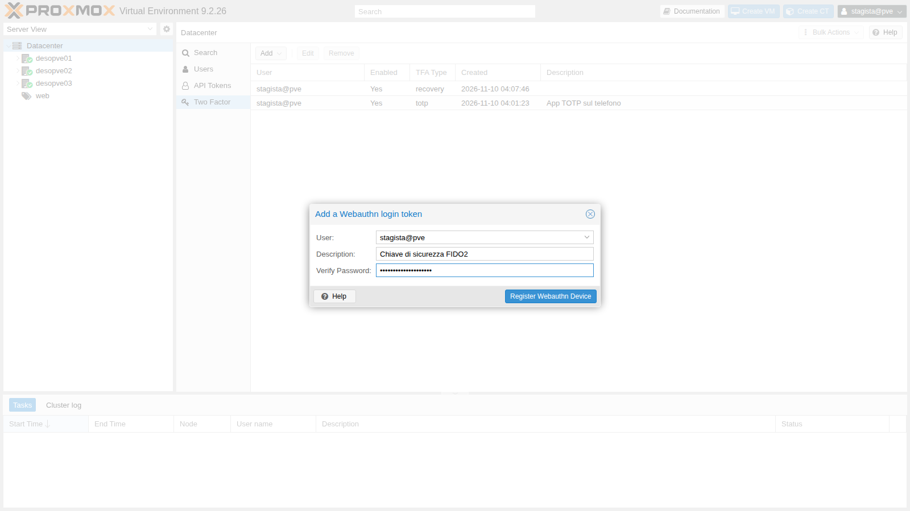
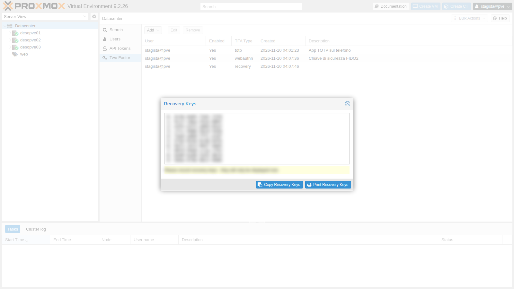
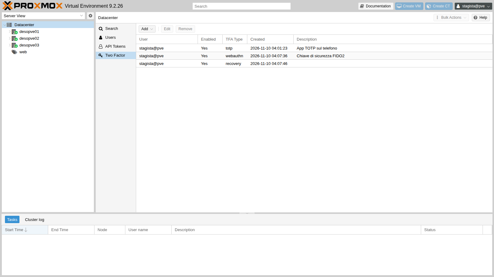
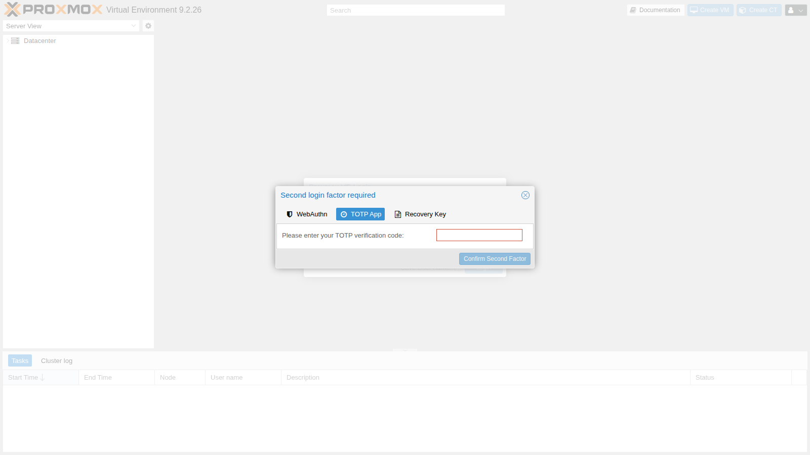
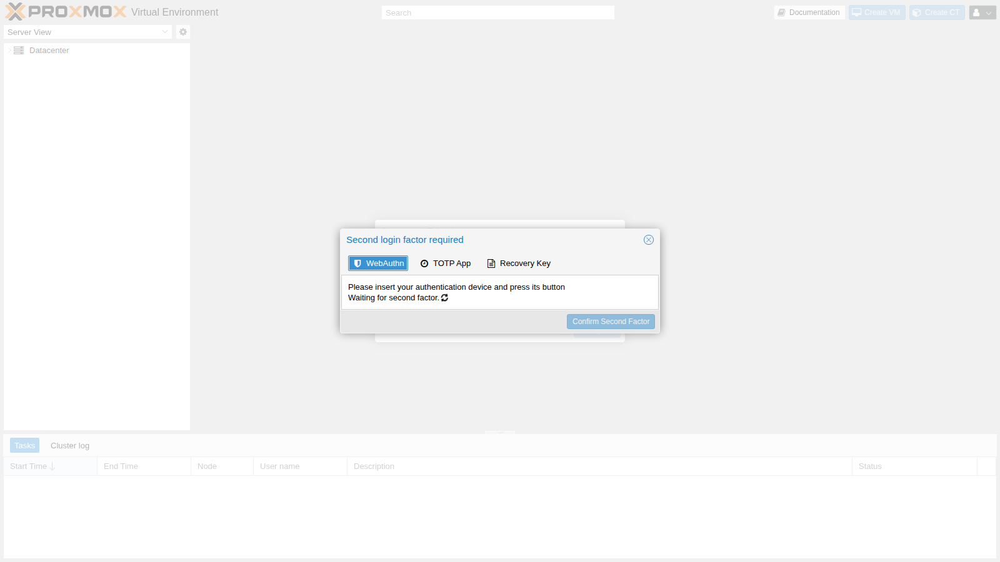
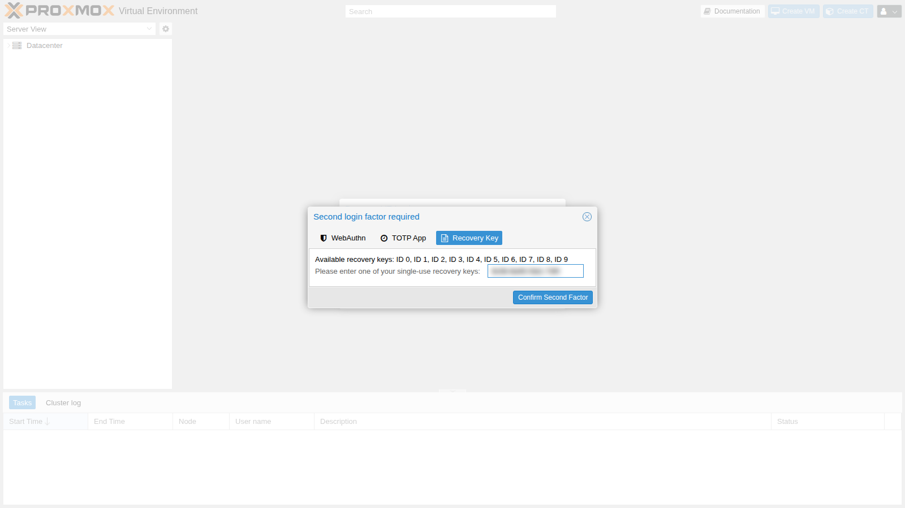
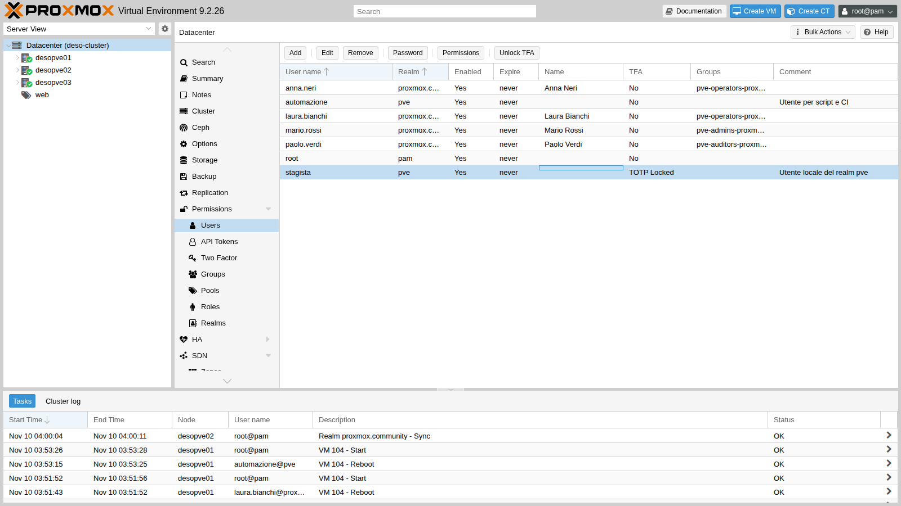
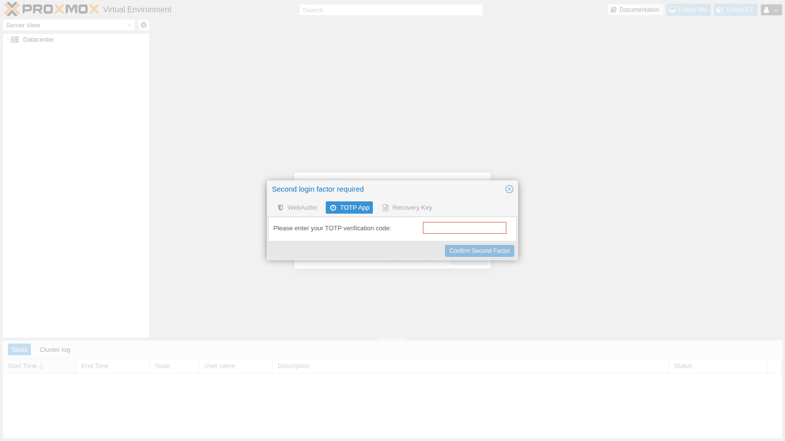

# Lab 45 – Two-factor authentication: TOTP, WebAuthn, recovery keys

**Level:** intermediate · **Duration:** 1 hour

## Dependencies

- **Previous labs:**
  - [Lab 44](44-users-groups-roles-pools-tokens.md): the local user `stagista@pve` and the API tokens;
  - [Lab 43](43-active-directory-realm-ldaps.md): the `proxmox.community` realm and the user `mario.rossi`;
  - [Lab 04](04-first-access-repositories-updates.md): the DNS names of the nodes (`desopveNN.proxmox.community`).
- **Systems:** nodes `desopve01`-`03`; an admin PC with a browser, a TOTP app (on a phone, or a program such as `oathtool`) and a FIDO2 security key (or a platform authenticator, for example Windows Hello).
- **Credentials:** `root@pam`, `stagista@pve`, `mario.rossi`, all with `<lab-password>` → [Appendix B](b-credentials-and-addresses.md).

## Objectives

- Enable **TOTP** for a user and log in with the second factor.
- Configure **WebAuthn** for the whole cluster and register a FIDO2 security key.
- Generate and use **recovery keys**.
- See the **lockout** after too many wrong codes and unlock the user.
- Make 2FA **mandatory for an entire realm**.
- Understand what changes for the **API**, for **tokens** and for **root@pam**.

## How it works

With 2FA, logging in requires two proofs: the password (something you know) and a second factor (something you have). Proxmox VE supports four types, which can be configured together on the same user:

| Type | What it is | Notes |
|---|---|---|
| **TOTP** | 6-digit code that changes every 30 seconds, generated by an app | the secret is shared once, through a QR code |
| **WebAuthn** | FIDO2 security key (USB/NFC) or platform authenticator | phishing-resistant: the signature is bound to the domain |
| **Recovery keys** | 10 single-use codes | for when you lose your phone or your key |
| **Yubico OTP** | YubiKey codes verified by a Yubico server | requires a validation server |

Each user's factors are stored in `/etc/pve/priv/tfa.cfg`, which is shared across the cluster. Users manage their own factors from the user menu → **TFA**; administrators manage them from **Datacenter → Permissions → Two Factor**.

2FA protects the **password login** (GUI and the `/access/ticket` API). **API tokens** and **SSH/console** access to the node are not affected.

**WebAuthn and the domain.** The browser signs the challenge only if the site address matches the configured *ID* (the domain, here `proxmox.community`), and only over a connection **with a valid certificate**: with the "untrusted certificate" warning, WebAuthn does not work.

## Procedure

### 1. TOTP for a user

In **Datacenter → Permissions → Two Factor → Add → TOTP**, choose the user `stagista@pve` and enter a description. Proxmox VE generates a secret and the QR code: scan it with the app (or copy the secret) and enter the first code in *Verify Code*, which proves that the app is set up correctly.



In the lab, the code comes from `oathtool`, which performs the same calculation as a TOTP app:

```bash
oathtool --totp -b <segreto-base32>
```

```text
268992
```

After the password, the login asks for the second factor:


### 2. WebAuthn for the cluster

WebAuthn is configured once for the whole datacenter in **Datacenter → Options → WebAuthn Settings**: *Name* (the name the browser shows), *Origin* (the address from which you use the GUI) and *ID* (the domain). *Auto-fill* fills them in with the current address.



**First test: the origin of a single node.** Let's configure the origin of `desopve01` and the domain as the ID:

```bash
pvesh set /cluster/options --webauthn "rp=Proxmox Community Lab,origin=https://desopve01.proxmox.community:8006,id=proxmox.community,allow-subdomains=1"
```

From `https://desopve01.proxmox.community:8006`, logging in with the key works; from `https://desopve02.proxmox.community:8006`, the same key is rejected:

```text
Login failed: authentication failure (401)
```

The origin `desopve02.…` is not a subdomain of the configured origin (`desopve01.…`). **Second test:** an origin at the domain level, with `allow-subdomains=1` (an option that the GUI does not offer: you set it from the CLI or in `/etc/pve/datacenter.cfg`):

```bash
pvesh set /cluster/options --webauthn "rp=Proxmox Community Lab,origin=https://proxmox.community:8006,id=proxmox.community,allow-subdomains=1"
grep webauthn /etc/pve/datacenter.cfg
```

```text
webauthn: rp=Proxmox Community Lab,origin=https://proxmox.community:8006,id=proxmox.community,allow-subdomains=1
```

Now the same key works on all nodes: logging in with the key succeeds both from `https://desopve01.proxmox.community:8006` and from `https://desopve02.proxmox.community:8006`.

> **Certificate.** WebAuthn works only if the browser trusts the node's certificate. On the admin PC (the DC), import the cluster CA into the trusted root certification authorities, which Edge and Chrome use on Windows:
>
> ```powershell
> scp root@desopve01.proxmox.community:/etc/pve/pve-root-ca.pem C:\
> certutil -addstore Root C:\pve-root-ca.pem
> ```
>
> Then reopen the browser and always connect with the node **name**, never with the IP. In production, use certificates from a corporate CA or from ACME.

### 3. Registering the security key

The user, from the user menu → **TFA → Add → WebAuthn**, enters a description, confirms their password (required because they already have another factor) and clicks *Register Webauthn Device*: the browser asks to touch the key.



> The key answers the challenge by signing it with a private key that never leaves the device. If you do not have a FIDO2 key, you can try the lab with the virtual authenticator of Chrome or Edge: **DevTools → More tools → WebAuthn → Enable virtual authenticator environment**.

### 4. Recovery keys

Again from **TFA → Add → Recovery Keys**, you generate 10 single-use codes. Print them or save them in a safe place **right away**: they will not be shown again.



The user now has three factors:



### 5. Logging in with multiple factors

After the password, the dialog offers all of the user's factors; choose the one you have at hand:



With *WebAuthn*, the GUI waits for the key:



With *Recovery Key*, the GUI shows which keys are still available (here all of them, IDs 0-9):



After the login, the key you used is no longer valid.

### 6. Lockout after too many wrong codes

2FA applies to the API as well. The first step of the login returns a "half" ticket, which asks for the second factor:

```bash
N=https://172.27.199.21:8006/api2/json
curl -sk --data-urlencode "username=stagista@pve" --data-urlencode "password=<lab-password>" $N/access/ticket
```

```text
{"data":{"NeedTFA":1,"username":"stagista@pve","ticket":"PVE:!tfa!{\"totp\"%3Atrue}:6AF2F3BC::…","CSRFPreventionToken":"…"}}
```

The second step sends the ticket as `tfa-challenge` and the code as `password=totp:<codice>`. Let's simulate an attack: 10 wrong codes, then the right one.

```bash
T=<ticket del passo 1>
for i in $(seq 10); do printf 'tentativo %s: ' $i
  curl -sk -w ' HTTP %{http_code}\n' --data-urlencode "username=stagista@pve" --data-urlencode "tfa-challenge=$T" \
    --data-urlencode "password=totp:000000" $N/access/ticket; done
curl -sk -o /dev/null -w 'HTTP %{http_code}\n' --data-urlencode "username=stagista@pve" --data-urlencode "tfa-challenge=$T" \
  --data-urlencode "password=totp:$(oathtool --totp -b <segreto-base32>)" $N/access/ticket
```

```text
tentativo 1: {"message":"authentication failure\n","data":null} HTTP 401
…
tentativo 10: {"message":"authentication failure\n","data":null} HTTP 401
HTTP 401
```

Even the right code is rejected: after 8 failed attempts, the user's TOTP is **locked**.

```bash
pvesh get /access/users --full 1 --output-format json | python3 -c 'import sys,json; [print(u["userid"], {k:u[k] for k in u if "lock" in k}) for u in json.load(sys.stdin) if u["userid"]=="stagista@pve"]'
```

```text
stagista@pve {'totp-locked': 1}
```

In the GUI, the *TFA* column shows *TOTP Locked* and the **Unlock TFA** button unlocks the user; from the CLI:



```bash
pveum user tfa unlock stagista@pve
```

After the unlock (and with a new code), the login succeeds: `HTTP 200`. Logging in with a recovery key also unlocks TOTP. The lockout protects against brute-force attacks on the 6 digits of the code.

### 7. Tokens, API and root@pam

**Tokens bypass 2FA.** Let's create a token for `stagista@pve` (without privilege separation, so with the user's permissions) and read the `web` pool:

```bash
V=$(pveum user token add stagista@pve lettura --privsep 0 --output-format json | python3 -c 'import sys,json;print(json.load(sys.stdin)["value"])')
curl -sk -w ' HTTP %{http_code}\n' -H 'Authorization: PVEAPIToken=stagista@pve!lettura='"$V" $N/pools/web \
  | python3 -c 'import sys,json; t=sys.stdin.read(); j,c=t.rsplit(" HTTP ",1); print(sorted(m["vmid"] for m in json.loads(j)["data"]["members"] if "vmid" in m), "HTTP"+c.strip())'
```

```text
[104, 105, 106] HTTP200
```

The token reads the resources without any second factor. At the end we remove it: `pveum user token remove stagista@pve lettura`.

Scripts should therefore use **tokens** with minimal permissions (Lab 44), not a user's password: with 2FA enabled, a password login through the API is no longer enough (`NeedTFA: 1`).

**TOTP on root@pam.** Let's enable it as a test:

```bash
pvesh create /access/tfa/root@pam --type totp --description 'Prova TOTP su root' \
  --totp 'otpauth://totp/root?secret=<segreto>' --value <codice>
```

```text
{"id":"a3071529-f096-4fdb-9680-da3a11afa22e"}
```

The API login with the password alone now stops halfway, with `"NeedTFA":1` as for `stagista@pve`; SSH and the node's local CLI, on the other hand, work as before:

```text
ssh root su desopve02: ok
      VMID NAME                 STATUS     MEM(MB)    BOOTDISK(GB) PID
       105 web02                running    2048               8.00 289894
pvesh locale: 9.2.26
```

> **Security advice.** Enabling 2FA on `root@pam` is recommended, but with care: generate the **recovery keys** and keep them offline, and keep emergency access to the server console. If all the factors are lost, you can recover from SSH or the console with `pvesh delete /access/tfa/root@pam/<id>`. Even better: do not use `root@pam` for daily work, but personal users with 2FA and the permissions from Lab 44.

Finally, let's remove the test TOTP from root:

```bash
for id in $(pvesh get /access/tfa/root@pam --output-format json | python3 -c 'import sys,json; [print(e["id"]) for e in json.load(sys.stdin)]'); do pvesh delete /access/tfa/root@pam/$id; done
```

### 8. Mandatory 2FA for a realm

A realm can **enforce** a second factor for all its users (**Datacenter → Permissions → Realms → Edit → Require TFA**). Let's try OATH/TOTP on the AD realm:

```bash
pveum realm modify proxmox.community --tfa type=oath
pveum realm list --noborder 1 | grep proxmox
```

```text
proxmox.community ad   Active Directory del laboratorio (LDAPS) oath
```

A domain user without a configured key can no longer log in, not even with the right password. In the node log:

```text
authentication failure; rhost=<IP del client> user=mario.rossi@proxmox.community msg=missing required 2nd keys
```

With realm TFA, the user's key is set in the user's *Key IDs* field (`pveum user modify … --keys`). Mind the format:

```bash
pveum user modify mario.rossi@proxmox.community --keys v2-<segreto-32-caratteri>
```

```text
400 Parameter verification failed.
keys: value does not match the regex pattern
```

`pveum` accepts a 32-character base32 secret without a prefix, but at login the node discards it (`bad otp response` in the log). A **16-character** base32 secret works (or a 40-character hexadecimal one):

```bash
MS=$(head -c 10 /dev/urandom | base32 | tr -d '=')   # 16 characters
pveum user modify mario.rossi@proxmox.community --keys $MS
```

Now Mario's login asks for the TOTP code, and with the right code he gets in:



Let's remove the test factors of `stagista@pve` (TOTP, WebAuthn and recovery keys), from the GUI (**Datacenter → Permissions → Two Factor → Remove**) or from the CLI:

```bash
for id in $(pvesh get /access/tfa/stagista@pve --output-format json | python3 -c 'import sys,json; [print(e["id"]) for e in json.load(sys.stdin)]'); do
  pvesh delete /access/tfa/stagista@pve/$id
done
pvesh get /access/tfa/stagista@pve --output-format json
```

```text
[]
```

Let's set the realm back to how it was. Mario's key, however, remains listed among the factors as `<old userconfig key 0>` even after the field has been cleared: it must be removed from there as well.

```bash
pveum realm modify proxmox.community --delete tfa
pveum user modify mario.rossi@proxmox.community --keys ''
pvesh get /access/tfa --output-format json
pvesh delete /access/tfa/mario.rossi@proxmox.community/<id>
pvesh get /access/tfa --output-format json
```

```text
[{"entries":[{"created":1794281054,"description":"<old userconfig key 0>","id":"dee874ef-ef5f-45fa-9468-165f95517c49","type":"totp"}],"userid":"mario.rossi@proxmox.community"}]
[]
```

> Realm-enforced TFA is the older mechanism. In most cases it is simpler to ask every user to register their own factors (TOTP or WebAuthn) and to check in the **Two Factor** list who has not done it yet.

## Verification and tests

| Test | Expected result | Outcome |
|---|---|---|
| Login of `stagista@pve` with password + TOTP | access granted | ok |
| WebAuthn key with the origin of a single node, login from another node | `401` | ok |
| Domain origin + `allow-subdomains=1` | the same key works on `desopve01` and `desopve02` | ok |
| Login with a recovery key | access granted; the key is no longer valid | ok |
| 10 wrong TOTP codes, then the right one | rejected, `totp-locked: 1` | ok |
| `pveum user tfa unlock` | login possible again | ok |
| API token of a user with 2FA | `HTTP 200` without a second factor | ok |
| TOTP on `root@pam` | API login returns `NeedTFA`, SSH and local CLI keep working | ok |
| Realm with OATH TFA, user without a key | `missing required 2nd keys` | ok |

## Final lab state

- **Datacenter WebAuthn:** `rp=Proxmox Community Lab,origin=https://proxmox.community:8006,id=proxmox.community,allow-subdomains=1`.
- **Registered factors:** none. The test factors of `stagista@pve` (TOTP, WebAuthn, recovery keys), the test TOTP of `root@pam` and the key of `mario.rossi` have been removed.
- **Realm `proxmox.community`:** no enforced TFA, as in Lab 43.
- Permissions and users from Lab 44 unchanged.

## What you learned

- TOTP, WebAuthn and recovery keys can be used together; at login you choose the factor you have at hand.
- WebAuthn requires a trusted certificate and the DNS name; with a domain origin and `allow-subdomains`, a single key works for all nodes.
- Recovery keys are shown only once, and each one can be used only once.
- Too many wrong TOTP codes lock the user's TOTP; you unlock it with **Unlock TFA** or `pveum user tfa unlock`.
- 2FA protects the password login, not API tokens, SSH or the console: scripts use tokens with minimal permissions.
- 2FA on `root@pam` is useful, but it must come with recovery keys and emergency access.
- Realm-enforced TFA uses the user's *Key IDs* field, with a precise key format; when you remove it, the key stays among the factors and must be removed separately.

## References

- [Proxmox VE – Two-Factor Authentication](https://pve.proxmox.com/pve-docs/chapter-pveum.html#pveum_tfa_auth)
- [Proxmox VE – WebAuthn](https://pve.proxmox.com/pve-docs/chapter-pveum.html#pveum_configure_webauthn)
- [Proxmox VE – Recovery Keys](https://pve.proxmox.com/pve-docs/chapter-pveum.html#pveum_recovery_keys)
- [Proxmox VE – Realm enforced TFA](https://pve.proxmox.com/pve-docs/chapter-pveum.html#pveum_tfa_auth)
- [W3C – Web Authentication](https://www.w3.org/TR/webauthn-3/)
