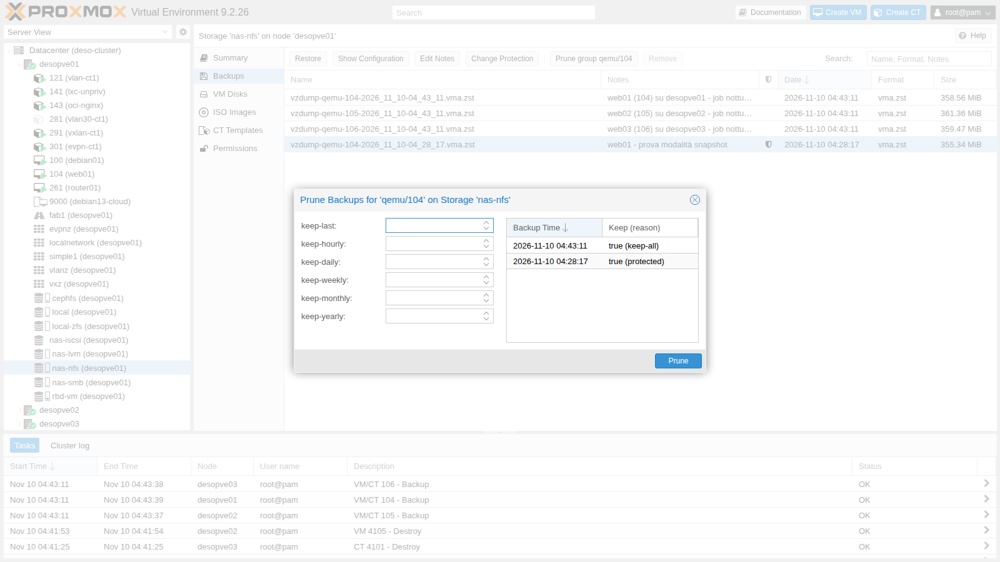
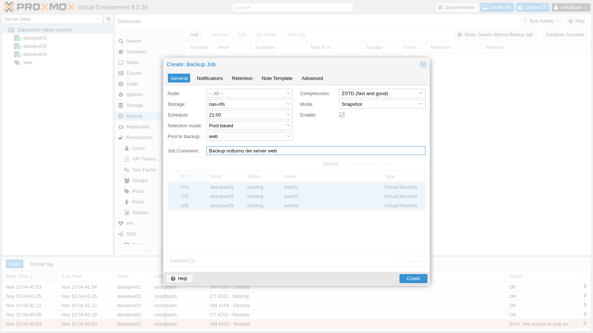
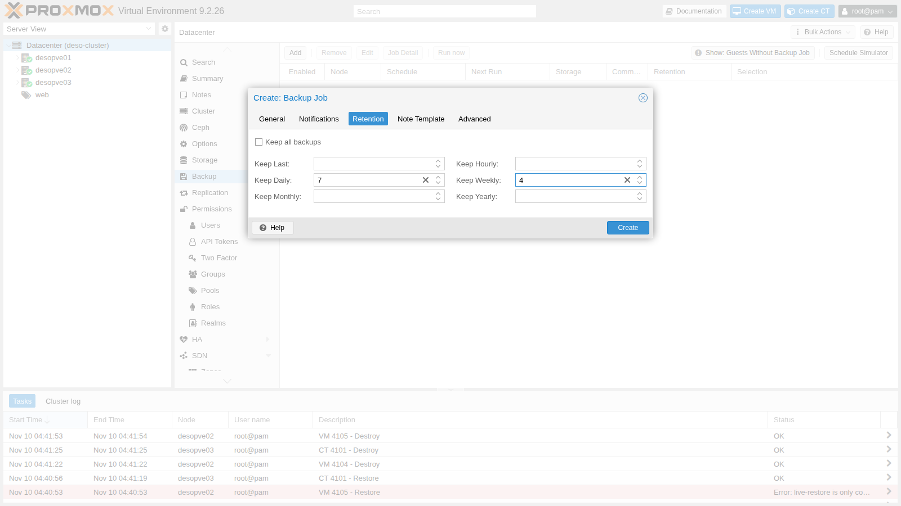
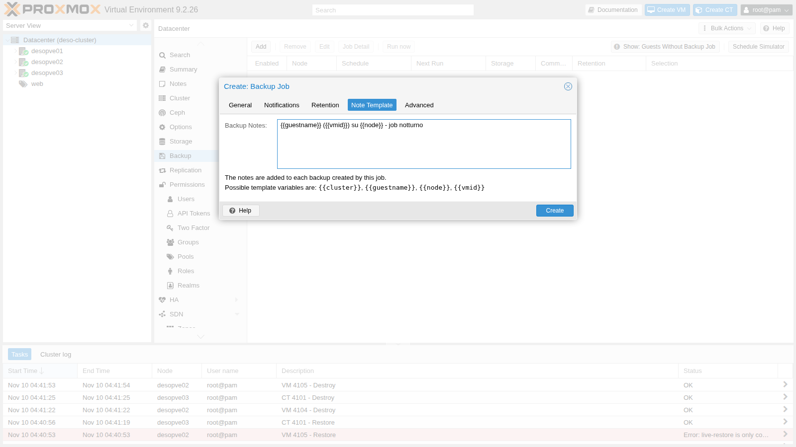
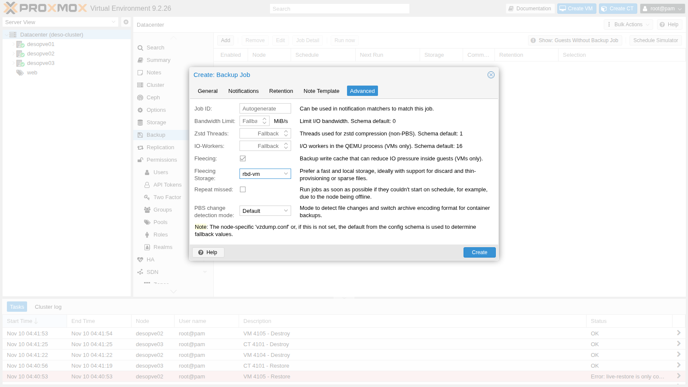
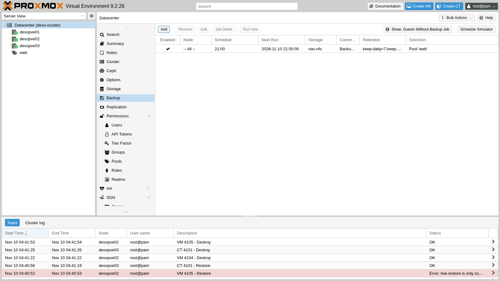
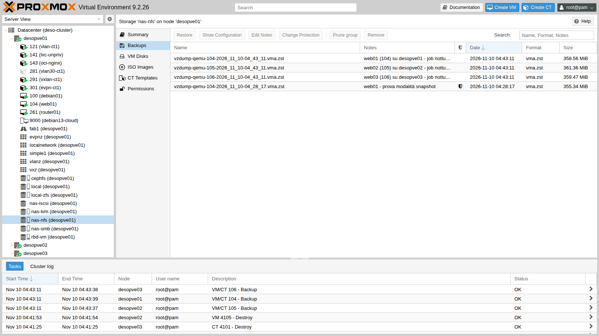

# Lab 46 – Backup with vzdump: modes, compression, fleecing, retention and restore

**Level:** intermediate · **Duration:** 1 hour 30 minutes

## Dependencies

- **Previous labs:**
  - [Lab 13](13-nfs.md), [Lab 14](14-smb-cifs.md) and [Lab 17](17-ceph-installation.md): the `nas-nfs`, `nas-smb` and `cephfs` storages, which accept the *VZDump backup file* content type;
  - [Lab 38](38-linux-vm-guest-agent.md) and [Lab 40](40-templates-cloud-init-clones.md): the VMs with the guest agent (`debian01`, `web01`-`web03`);
  - [Lab 07](07-first-vm-and-container.md) and [Lab 41](41-lxc-containers.md): containers 101 and 141;
  - [Lab 44](44-users-groups-roles-pools-tokens.md): the `web` pool, used to select what to back up.
- **Systems:** nodes `desopve01`-`03`, NAS `desonas`. The downtime measurements use a `ping` from the management network.
- **Credentials:** `root@pam` → [Appendix B](b-credentials-and-addresses.md).

## Objectives

- Understand and measure the three backup **modes**: *snapshot*, *suspend*, *stop*.
- Compare the **compression** algorithms.
- Back up to different storages (NFS, CephFS, SMB) and use **fleecing**.
- Exclude disks from the backup and understand what happens to container **bind mounts**.
- Protect a backup and apply a **retention** policy (prune), first simulated and then for real.
- Create a **scheduled job** with automatic notes.
- **Restore** a VM and a container to another node and another storage.

## How it works

`vzdump` is the built-in backup tool. It produces **one file per guest** (`vzdump-qemu-<vmid>-<data>.vma.zst` for VMs, `vzdump-lxc-<vmid>-<data>.tar.zst` for containers) on a storage that accepts the *backup* content type. Each file contains everything: configuration and disks. There are no incremental backups: every run saves the entire content, compressed. For incremental backups with deduplication you need Proxmox Backup Server ([Lab 47](47-proxmox-backup-server.md)).

**Modes.**

| Mode | VM | Container |
|---|---|---|
| **snapshot** | the VM keeps running; QEMU tracks the blocks while it copies them, so the backup is consistent with the moment it started. With the guest agent, the file systems are "frozen" for an instant (`fs-freeze`/`fs-thaw`) | storage snapshot (ZFS, Ceph, LVM-thin), then a copy from the snapshot |
| **suspend** | the VM is paused to start the backup, then resumes | `rsync` while running, pause, second `rsync` |
| **stop** | clean shutdown; the VM restarts as soon as the backup has started, and the copy continues in the background | the container stays stopped for the **entire** duration of the backup and restarts at the end: potentially long downtime |

**Fleecing.** During a *snapshot* backup, when the guest wants to write to a block that has not been copied yet, QEMU must first copy that block to the backup. If the target is slow, the guest slows down. With fleecing, the old block goes instead to a **temporary image on a fast storage** (ideally local, thin-provisioned and with discard) and the guest writes immediately.

**Retention (prune).** The `keep-last`, `keep-hourly`, `keep-daily`, `keep-weekly`, `keep-monthly`, `keep-yearly` options define how many backups to keep for each interval. After each backup of the job, the backups not covered are deleted. A **protected** backup is never deleted by prune.

## Procedure

### 1. The target storages

```bash
pvesm status --content backup
```

``` { .text .no-copy title="Output" }
Name           Type     Status     Total (KiB)      Used (KiB) Available (KiB)        %
cephfs       cephfs     active       100483072         7921664        92561408    7.88%
local           dir     active        45995008         1143936        44851072    2.49%
nas-nfs         nfs     active        56481792               0        56481792    0.00%
nas-smb        cifs     active        57458048          977024        56481024    1.70%
```

`local` is on the node's disk: if you lose the node, you lose the backups too. In production, backups belong **off** the node.

### 2. The three modes, measured

We take three backups of VM 104 (`web01`, 8 GiB disk on Ceph, guest agent enabled) to `nas-nfs`, while a `ping` from another machine to the VM every 0.2 seconds measures the interruptions:

```bash
vzdump 104 --mode snapshot --storage nas-nfs --compress zstd --notes-template '{{guestname}} - prova modalità snapshot'
```

``` { .text .no-copy title="Output" }
INFO: backup mode: snapshot
INFO: creating vzdump archive '/mnt/pve/nas-nfs/dump/vzdump-qemu-104-2026_11_10-04_28_17.vma.zst'
INFO: issuing guest-agent 'fs-freeze' command
INFO: starting backup via QMP command
INFO: issuing guest-agent 'fs-thaw' command
INFO: started backup task '461881ef-c1a7-4b5e-9526-4a451d72f0a8'
INFO: resuming VM again
INFO: archive file size: 355MB
INFO: Finished Backup of VM 104 (00:00:17)
```

The same with `--mode suspend` and `--mode stop`:

```text
INFO: backup mode: suspend
INFO: suspending guest
INFO: resuming VM again after 4 seconds
INFO: Finished Backup of VM 104 (00:00:31)
```

```text
INFO: backup mode: stop
INFO: stopping virtual guest
INFO: starting kvm to execute backup task
INFO: resuming VM again after 13 seconds
INFO: Finished Backup of VM 104 (00:00:38)
```

| Mode | Duration | What the ping saw |
|---|---|---|
| snapshot | 17 s | 144 replies out of 144, no interruption |
| suspend | 29-31 s | no replies lost, but delayed by up to **3.0 s** (the VM was paused and replied when it resumed) |
| stop | 38 s | 106 replies out of 219: **about 23 seconds** without network, between the shutdown and the restart of the operating system |

*snapshot* is the mode to use almost always: no downtime and, with the guest agent, consistent file systems. *stop* gives maximum consistency for applications that cannot tolerate the pause, but it costs a reboot.

### 3. Compression

The same backup of VM 104 with the four algorithms:

```bash
for C in 0 lzo gzip zstd; do vzdump 104 --mode snapshot --storage nas-nfs --compress $C; done
```

| Compression | File | Size | Duration |
|---|---|---|---|
| none (`0`) | `.vma` | 1.15 GB | 33 s |
| `lzo` | `.vma.lzo` | 521 MB | 41 s |
| `gzip` | `.vma.gz` | 381 MB | 1 min 10 s |
| `zstd` (1 thread, the GUI default) | `.vma.zst` | 353 MB | 25 s (17 s in a second run) |
| `zstd` with `--zstd 0` (half of the cores) | `.vma.zst` | 354 MB | 14 s |

The 8 GiB disk contains about 1.2 GB of data: empty blocks do not end up in the backup. **zstd** is the best trade-off and is the GUI default; on the CLI the default of `--compress` is `0` (no compression), so you have to specify `--compress zstd` or set it in `/etc/vzdump.conf`. `--zstd 0` uses half of the node's cores for compression. Durations on a shared network storage vary from one run to the next: compare the order of magnitude, not the exact seconds.

### 4. Containers and a CephFS target

Container 101 (rootfs on `local-zfs`) in snapshot mode to `cephfs`:

```bash
vzdump 101 --mode snapshot --storage cephfs --compress zstd
```

``` { .text .no-copy title="Output" }
INFO: filesystem type on dumpdir is 'ceph' -using /var/tmp/vzdumptmp430726_101 for temporary files
INFO: including mount point rootfs ('/') in backup
INFO: backup mode: snapshot
INFO: create storage snapshot 'vzdump'
INFO: creating vzdump archive '/mnt/pve/cephfs/dump/vzdump-lxc-101-2026_11_10-04_34_41.tar.zst'
INFO: archive file size: 208MB
INFO: Finished Backup of VM 101 (00:00:28)
```

For containers, vzdump creates a **storage snapshot** (`vzdump` on ZFS) and archives it. On CephFS, the temporary files go to the node's `/var/tmp`.

### 5. Excluding disks; bind mounts

We add a second disk to VM 100 with the `backup=0` option (in the GUI: *Hardware → Edit → Advanced → Backup* unchecked) and run the backup:

```bash
qm set 100 --scsi1 rbd-vm:1,backup=0
vzdump 100 --mode snapshot --storage cephfs --compress zstd
```

``` { .text .no-copy title="Output" }
INFO: include disk 'scsi0' 'rbd-vm:vm-100-disk-0' 16G
INFO: exclude disk 'scsi1' 'rbd-vm:vm-100-disk-1' (backup=no)
INFO: archive file size: 5.53GB
INFO: Finished Backup of VM 100 (00:02:25)
```

This is how you exclude, for example, cache disks or data disks that are backed up in some other way. Be careful: on restore, that disk is **not** there. When the test is over, detach and delete the added disk:

```bash
qm disk unlink 100 --idlist scsi1 --force
```

In containers, **bind mounts** (node directories mounted into the CT) are always excluded; mount points on a storage are excluded by default and included only with `backup=1`, like `mp0` of CT 141:

```bash
vzdump 141 --mode snapshot --storage cephfs --compress zstd
```

``` { .text .no-copy title="Output" }
INFO: including mount point mp0 ('/data') in backup
INFO: excluding bind mount point mp1 ('/condivisa') from backup (not a volume)
INFO: excluding bind mount point mp2 ('/progetti') from backup (not a volume)
```

The data of bind mounts must be backed up separately, on the node or on the storage that hosts them.

### 6. Fleecing to a slow storage

We back up VM 104 to the SMB share, with fleecing on Ceph:

```bash
vzdump 104 --mode snapshot --storage nas-smb --compress zstd --fleecing enabled=1,storage=rbd-vm
```

``` { .text .no-copy title="Output" }
INFO: starting new backup job: vzdump 104 --storage nas-smb --mode snapshot --fleecing '1,storage=rbd-vm' --compress zstd
INFO: drive-scsi0: attaching fleecing image rbd-vm:vm-104-fleece-0 to QEMU
INFO: archive file size: 354MB
INFO: removing (old) fleecing image 'rbd-vm:vm-104-fleece-0'
INFO: Finished Backup of VM 104 (00:00:19)
```

For each disk, vzdump creates a `vm-<vmid>-fleece-N` image on the specified storage and deletes it at the end. The fleecing storage must be **fast** and have room for the blocks rewritten during the backup: ideally local, thin-provisioned and with discard (ZFS, LVM-thin); here we use Ceph RBD, which is shared but fast.

### 7. Protected backups and retention

After the tests, VM 104 has at least eight backups on `nas-nfs`. We protect the first one (in the GUI: *Change Protection*):

```bash
pvesh set /nodes/desopve01/storage/nas-nfs/content/nas-nfs:backup/vzdump-qemu-104-2026_11_10-04_28_17.vma.zst --protected 1
```

In the storage view, the backup now shows the protection shield.

We simulate a `keep-last=2` retention:

```bash
pvesm prune-backups nas-nfs --vmid 104 --keep-last 2 --dry-run 1
```

``` { .text .no-copy title="Output" }
NOTE: this is only a preview and might not be what a subsequent
prune call does if backups are removed/added in the meantime.

Backup                                                            Backup-ID Prune-Mark
vzdump-qemu-104-2026_11_10-04_28_17.vma.zst         qemu/104  protected
vzdump-qemu-104-2026_11_10-04_28_48.vma.zst         qemu/104     remove
vzdump-qemu-104-2026_11_10-04_29_36.vma.zst         qemu/104     remove
vzdump-qemu-104-2026_11_10-04_30_50.vma.zst         qemu/104     remove
vzdump-qemu-104-2026_11_10-04_31_25.vma             qemu/104     remove
vzdump-qemu-104-2026_11_10-04_31_59.vma.lzo         qemu/104     remove
vzdump-qemu-104-2026_11_10-04_32_42.vma.gz          qemu/104     remove
vzdump-qemu-104-2026_11_10-04_33_54.vma.zst         qemu/104     remove
vzdump-qemu-104-2026_11_10-04_34_21.vma.zst         qemu/104       keep
vzdump-qemu-104-2026_11_10-04_39_45.vma.zst         qemu/104       keep
```

Then a real `keep-last=3` retention:

```bash
pvesm prune-backups nas-nfs --vmid 104 --keep-last 3
pvesm list nas-nfs --vmid 104
```

``` { .text .no-copy title="Output" }
vzdump-qemu-104-2026_11_10-04_28_17.vma.zst
vzdump-qemu-104-2026_11_10-04_33_54.vma.zst
vzdump-qemu-104-2026_11_10-04_34_21.vma.zst
vzdump-qemu-104-2026_11_10-04_39_45.vma.zst
```

The last three remain, plus the protected one. In the GUI you do the same with **Prune group**, which shows for each backup whether it is kept and why:



### 8. A scheduled job

In **Datacenter → Backup → Add** we create the nightly job for the `web` pool. In the *General* tab: storage `nas-nfs`, *Schedule* `21:00`, *Selection mode* **Pool based** with the `web` pool, mode *Snapshot*, compression *ZSTD*:



*Retention:* `keep-daily=7`, `keep-weekly=4`, that is, one backup per day for a week and one per week for a month.



*Note Template:* the notes of each backup are built from the variables `{{guestname}}`, `{{vmid}}`, `{{node}}`, `{{cluster}}`:



*Advanced:* fleecing enabled on `rbd-vm`. The panel also shows the defaults you can change (zstd threads, bandwidth, I/O workers):



The job is saved in `/etc/pve/jobs.cfg`:

```text
vzdump: backup-c5fdd165-9aa0
	comment Backup notturno dei server web
	schedule 21:00
	compress zstd
	enabled 1
	fleecing 1,storage=rbd-vm
	mode snapshot
	notes-template {{guestname}} ({{vmid}}) su {{node}} - job notturno
	notification-mode notification-system
	pool web
	prune-backups keep-daily=7,keep-weekly=4
	repeat-missed 0
	storage nas-nfs
```



With **Run now** we run it immediately: a `vzdump` task starts on every node that hosts a VM of the pool. The log of VM 104 also shows the retention:

```text
INFO: drive-scsi0: attaching fleecing image rbd-vm:vm-104-fleece-0 to QEMU
INFO: prune older backups with retention: keep-daily=7, keep-weekly=4
INFO: removing backup 'nas-nfs:backup/vzdump-qemu-104-2026_11_10-04_33_54.vma.zst'
INFO: removing backup 'nas-nfs:backup/vzdump-qemu-104-2026_11_10-04_34_21.vma.zst'
INFO: removing backup 'nas-nfs:backup/vzdump-qemu-104-2026_11_10-04_39_45.vma.zst'
INFO: pruned 3 backup(s) not covered by keep-retention policy
INFO: removing (old) fleecing image 'rbd-vm:vm-104-fleece-0'
INFO: Finished Backup of VM 104 (00:00:28)
```

`keep-daily=7` keeps **one** backup per day, the most recent one: the three backups taken earlier today have been deleted. The protected one is still there. The storage view shows the notes generated from the template and the shield of the protected backups:



> You can set the retention on the **job** (as here) or on the **storage** (*Datacenter → Storage → Edit → Backup Retention*): the job's retention takes precedence.

### 9. Restore to another node and another storage

We restore the latest backup of VM 104 as a new VM 4104 on `desopve02`, on the local storage `local-zfs`. With `--unique`, new MAC addresses are generated, so that no duplicate appears on the network:

```bash
V=$(pvesm list nas-nfs --vmid 104 | awk 'NR>1 {v=$1} END {print v}')   # the most recent backup
time qmrestore $V 4104 --storage local-zfs --unique 1
qm config 4104 | grep -E '^(name|scsi0|net0|agent)'
```

``` { .text .no-copy title="Output" }
new volume ID is 'local-zfs:vm-4104-cloudinit'
new volume ID is 'local-zfs:vm-4104-disk-0'
progress 100% (read 8589934592 bytes, duration 8 sec)
total bytes read 8589934592, sparse bytes 7360720896 (85.7%)
space reduction due to 4K zero blocks 4.29%

real	0m18.836s
agent: enabled=1
name: web01
net0: virtio=BC:24:11:22:EA:5E,bridge=vmbr0
scsi0: local-zfs:vm-4104-disk-0,discard=on,iothread=1,size=8G,ssd=1
```

The original had its disk on Ceph; the restore placed it on local ZFS. **Do not start** the copy while it has the same IP as the original.

**Live-restore** (the VM starts immediately while the data arrives in the background) is not available with vzdump files:

```bash
qmrestore $V 4105 --storage local-zfs --live-restore 1
```

``` { .text .no-copy title="Output" }
error before or during data restore, some or all disks were not completely restored. VM 4105 state is NOT cleaned up.
live-restore is only compatible with backup images from a Proxmox Backup Server
```

We will see it in [Lab 47](47-proxmox-backup-server.md) with Proxmox Backup Server.

Restoring container 101 as CT 4101 on `desopve03`:

```bash
time pct restore 4101 cephfs:backup/vzdump-lxc-101-2026_11_10-04_34_41.tar.zst --storage local-zfs --unique 1
pct config 4101 | grep -E '^(hostname|rootfs|net0|unprivileged)'
```

``` { .text .no-copy title="Output" }
extracting archive '/mnt/pve/cephfs/dump/vzdump-lxc-101-2026_11_10-04_34_41.tar.zst'
Total bytes read: 715776000 (683MiB, 31MiB/s)
merging backed-up and given configuration..

real	0m24.179s
hostname: debian-ct01
net0: name=eth0,bridge=vmbr0,firewall=1,gw=172.27.199.1,hwaddr=BC:24:11:1D:C4:48,ip=172.27.199.101/24,type=veth
rootfs: local-zfs:subvol-4101-disk-0,size=8G
unprivileged: 1
```

The restored container stays **unprivileged**, like the original. In the GUI, you restore by selecting the backup in the storage and clicking **Restore**, or from the guest's *Backup* tab.

We clean up the test copies:

```bash
qm destroy 4104 --purge 1
qm destroy 4105 --purge 1    # the VM left behind by the failed live-restore
pct destroy 4101 --purge 1
```

### 10. Hook scripts

To run actions before and after backups (stopping an application, copying the file elsewhere, sending a message), vzdump calls a script at each phase (`job-start`, `backup-start`, `pre-stop`, `post-restart`, `backup-end`, `job-end`…). Proxmox VE ships a commented example:

```bash
ls /usr/share/doc/pve-manager/examples/ | grep -i hook
```

``` { .text .no-copy title="Output" }
vzdump-hook-script.pl
```

You enable the script with the job's `script` option or in `/etc/vzdump.conf`.

## Verification and tests

| Test | Expected result | Outcome |
|---|---|---|
| *snapshot* backup with the guest agent | `fs-freeze`/`fs-thaw`, no interruption | ok |
| *suspend* backup | 4 s pause, replies delayed by up to 3 s | ok |
| *stop* backup | about 23 s without network, VM restarted on its own | ok |
| Compression | zstd the smallest and among the fastest | ok |
| Disk with `backup=0` | `exclude disk 'scsi1'` | ok |
| Bind mount of a CT | `excluding bind mount point … (not a volume)` | ok |
| Fleecing | image `vm-104-fleece-0` created and removed | ok |
| Protected backup | marked `protected` and never deleted by prune | ok |
| Scheduled job | backup of the `web` pool on three nodes, notes from the template, retention applied | ok |
| Restore of a VM and a CT to another node and storage | VM 4104 and CT 4101 created, new MACs | ok |
| Live-restore from a vzdump file | refused: requires PBS | ok |

## Final lab state

- **Scheduled job** `backup-c5fdd165-9aa0`: pool `web` (VMs 104-106) every day at 21:00 to `nas-nfs`, snapshot, zstd, fleecing on `rbd-vm`, retention `keep-daily=7,keep-weekly=4`, notes `{{guestname}} ({{vmid}}) su {{node}} - job notturno`.
- **Existing backups:**
  - `nas-nfs`: VMs 104, 105, 106 from the job; VM 104 from the *snapshot* test, **protected**;
  - `cephfs`: CT 101, CT 141, VM 100;
  - `nas-smb`: VM 104 (fleecing test) and the backup of CT 101 from Lab 14.
- VM 100 again with only the `scsi0` disk; VMs 4104 and 4105 and CT 4101 deleted.

## What you learned

- vzdump saves one complete file per guest; for incremental backups and deduplication you need PBS.
- *snapshot* does not stop the guest and, with the guest agent, freezes the file systems; *suspend* pauses it; *stop* shuts down the VM only to start the backup, but keeps the container stopped for the whole backup.
- zstd (the GUI default, to be specified on the CLI) is the right choice; `--zstd 0` uses more cores.
- You can exclude disks (`backup=0`); container mount points are included only with `backup=1`, bind mounts never.
- Fleecing protects guest performance when the target is slow.
- Retention keeps one backup per interval and does not touch protected backups; simulate it first with `--dry-run`.
- A scheduled job based on a pool automatically backs up also the VMs added to the pool later.
- A restore can change node and storage; `--unique` avoids duplicate MACs; live-restore requires PBS.

## References

- [Proxmox VE – Backup and Restore](https://pve.proxmox.com/pve-docs/chapter-vzdump.html)
- [Proxmox VE – Backup Modes](https://pve.proxmox.com/pve-docs/chapter-vzdump.html#_backup_modes)
- [Proxmox VE – Backup Retention](https://pve.proxmox.com/pve-docs/chapter-vzdump.html#vzdump_retention)
- [Proxmox VE – Backup Fleecing](https://pve.proxmox.com/pve-docs/chapter-vzdump.html#_vm_backup_fleecing)
- [Proxmox VE – vzdump(1)](https://pve.proxmox.com/pve-docs/vzdump.1.html)
