# Lab 47 – Proxmox Backup Server 4: datastore, deduplication, encryption, verify, prune, file restore and sync

**Level:** advanced · **Duration:** 2 hours

## Dependencies

- **Previous labs:**
  - [Lab 25](25-ipv6.md): the IPv6 configuration of the hosts (file `90-ipv6-host.conf`);
  - [Lab 03](03-install-proxmox-ve.md): the Proxmox installer, very similar to the PBS one;
  - [Lab 38](38-linux-vm-guest-agent.md): the guest agent and *fs-freeze*;
  - [Lab 40](40-templates-cloud-init-clones.md): template 9000 and the VMs `web01`-`web03`;
  - [Lab 44](44-users-groups-roles-pools-tokens.md): the `web` pool and the API tokens;
  - [Lab 46](46-vzdump-backup.md): `vzdump`, backup modes and retention.
- **Systems:**
  - server `desopbs01` (172.27.199.40): 4 cores, 8 GB of RAM, a 32 GB system disk and **two 100 GB disks** for the datastore;
  - nodes `desopve01`-`03`;
  - VMs `web01`-`web03` (104-106) and CT 121.
- **Network:** TCP port **8007** must be open from the cluster to PBS. PBS uses the lab proxy for updates.
- **Credentials:** `root@pam` of PBS and of the cluster → [Appendix B](b-credentials-and-addresses.md).

## Objectives

- Install PBS 4, configure repositories, proxy and NTP, and update it.
- Create a **datastore on a ZFS mirror** from the GUI.
- Connect the cluster with a **user and an API token with minimal permissions**.
- Measure **deduplication** and incremental backups with the *dirty bitmap* (VMs) and *metadata mode* (CTs).
- **Encrypt** backups on the client side and understand what happens if you lose the key.
- Schedule **verify**, **prune** and **garbage collection** and read their results.
- Recover a **single file** and perform a **live-restore**.
- Copy the backups to a second datastore with a **sync job**.

## How it works

With `vzdump` on a file-based storage (Lab 46), every backup is a complete archive. PBS changes three things:

1. **Chunks and deduplication.** The client splits the data into blocks (*chunks*), computes their SHA-256 hash and stores them in the datastore's `.chunks` directory. A chunk that is already present is not stored again, whatever VM it comes from. A backup is an **index** that lists the chunks.
2. **True incrementals.** For VMs, QEMU keeps a **dirty bitmap**: it knows which blocks have changed since the last backup and reads only those. For containers, *metadata mode* compares the file metadata with the previous backup and rereads only the files that changed.
3. **Server-side services.** PBS verifies the chunks (*verify*), applies the retention (*prune*), frees the space of chunks no longer in use (*garbage collection*), copies backups elsewhere (*sync*) and lets you open a backup to extract files.

**Client-side encryption.** With an encryption key, the PVE node encrypts the chunks **before** sending them: PBS stores data it cannot read. The key stays on the cluster; if it is lost, the backups become unusable.

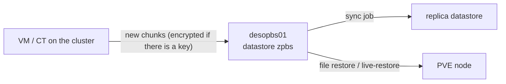

## Procedure

### 1. Installation

The installer is the same as the Proxmox VE one (Lab 03). Boot from the `proxmox-backup-server_4.2-1.iso` ISO and choose **Install Proxmox Backup Server (Graphical)**.

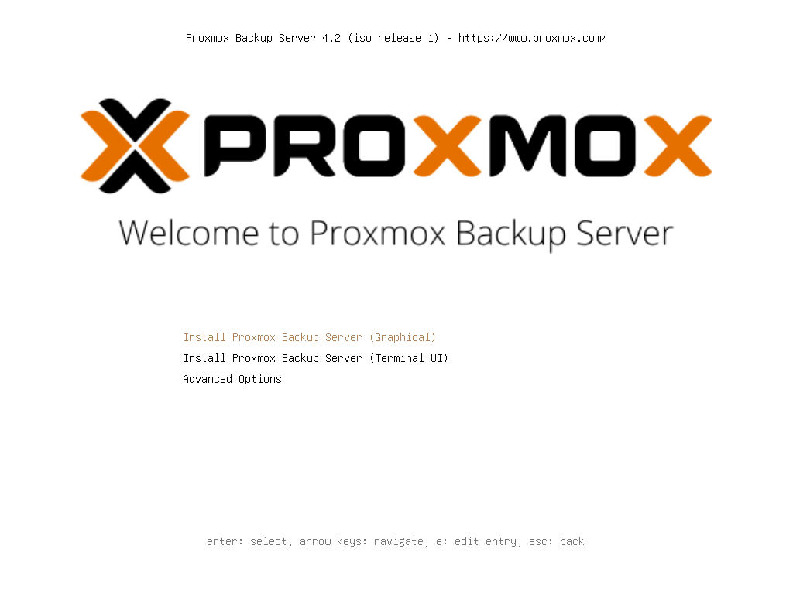

As the system disk, use **only** the 32 GB disk, `/dev/sda`. The two 100 GB disks stay free: they will become the datastore.

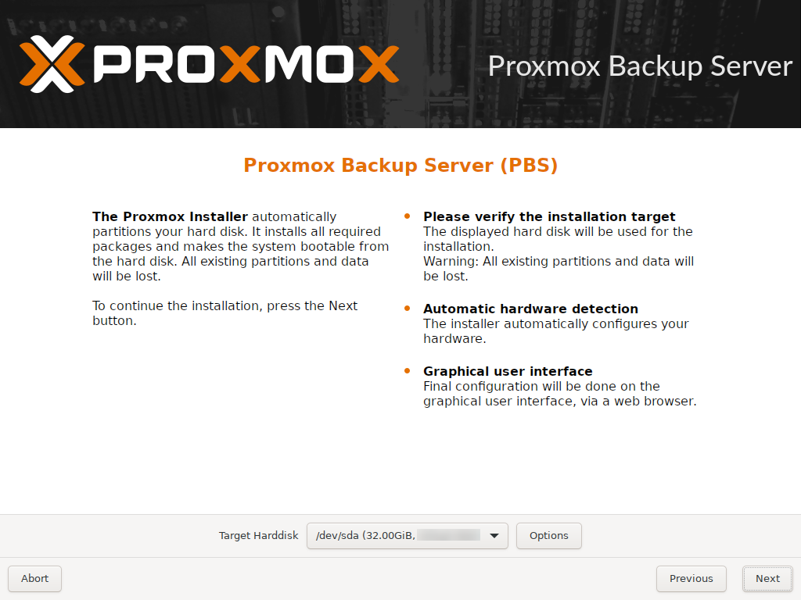

Network: `desopbs01.proxmox.community`, 172.27.199.40/24, gateway 172.27.199.1, DNS 172.27.199.20. Here too the **Pin network interface names** option is enabled by default: the network card is named `nic0`.

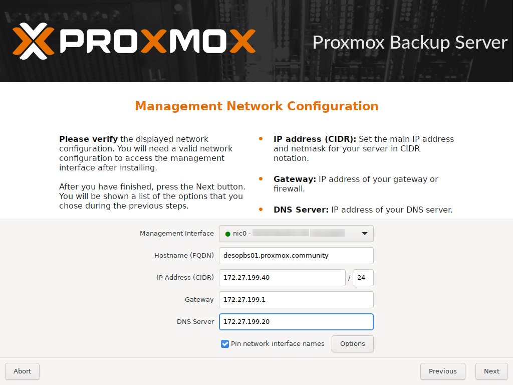

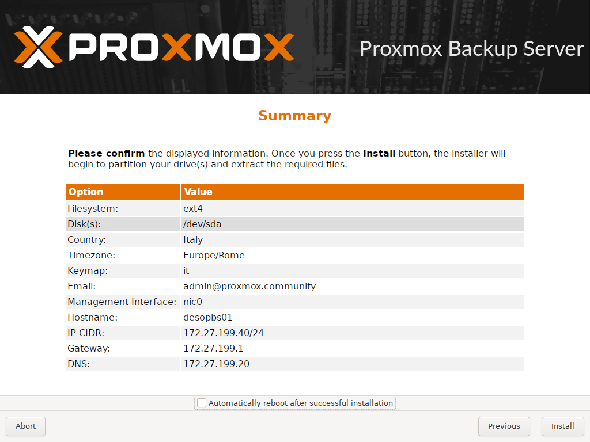

After the reboot, the console shows the address of the GUI, on port **8007**.

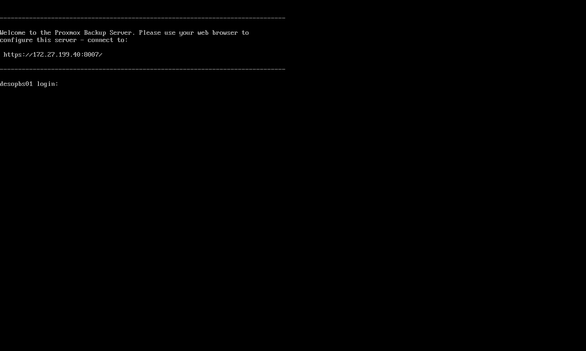

### 2. First access, repositories, proxy, NTP and update

Log in to `https://172.27.199.40:8007` as `root`, realm *Linux PAM*.

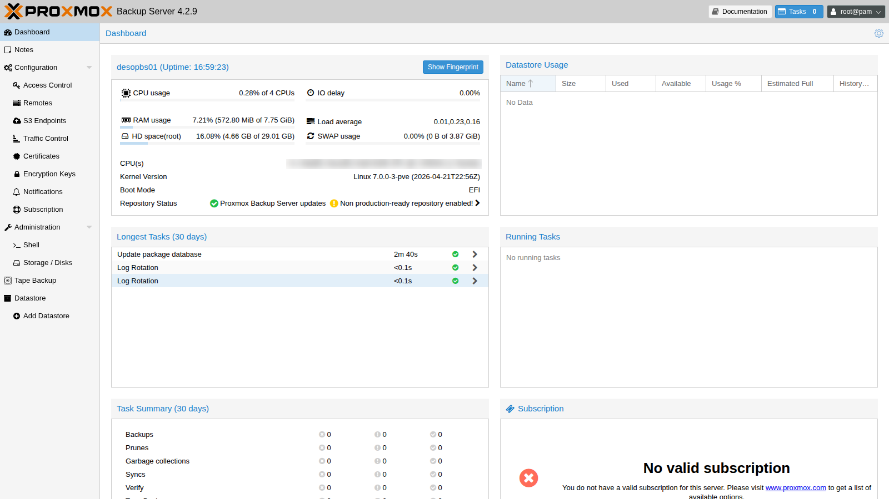

As for PVE (Lab 04): disable the *enterprise* repository and add the *no-subscription* one. Then configure the proxy for `apt` and for PBS, point NTP to the lab server and update.

```bash
# repository
sed -i "s/^Types: deb$/Types: deb\nEnabled: false/" /etc/apt/sources.list.d/pbs-enterprise.sources
cat > /etc/apt/sources.list.d/pbs-no-subscription.sources <<'EOF'
Types: deb
URIs: http://download.proxmox.com/debian/pbs
Suites: trixie
Components: pbs-no-subscription
Signed-By: /usr/share/keyrings/proxmox-archive-keyring.gpg
EOF

# proxy: for apt and for PBS (downloads, notifications)
echo 'Acquire::http::Proxy "http://proxy.proxmox.community:3128";' > /etc/apt/apt.conf.d/80proxy
proxmox-backup-manager node update --http-proxy http://proxy.proxmox.community:3128

# NTP to the lab server
sed -i 's/^pool /#pool /' /etc/chrony/chrony.conf
echo "server ntp.proxmox.community iburst" > /etc/chrony/sources.d/lab.sources
systemctl restart chrony
chronyc sources | tail -1
```

```text
^* netsvc.proxmox.community      3   6    17     1    -22us[  -71us] +/-   22ms
```

> Before this change, `timedatectl` reported `System clock synchronized: no`: on the backup server, a wrong clock confuses retention and verification.

```bash
apt update && apt full-upgrade -y
proxmox-backup-manager versions
```

```text
proxmox-backup-server 4.2.9-1 running version: 4.2.9
```

**Administration → Repositories** confirms the configuration: *enterprise* disabled, *no-subscription* enabled.

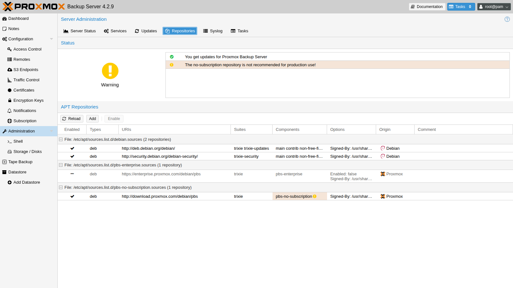

**IPv6 as on the nodes.** As for the nodes in [Lab 25](25-ipv6.md), here too there is no autoconfiguration from the router's RAs, and the link-local addresses are not derived from the MAC. Create the same `/etc/sysctl.d/90-ipv6-host.conf` file and apply it with `sysctl --system`; it takes full effect from the next reboot. On `desopbs01`:

```bash
cat /etc/sysctl.d/90-ipv6-host.conf
```

```text
# Indirizzi IPv6 del nodo solo statici: nessuna interfaccia accetta gli RA o si autoconfigura (SLAAC).
# Il carattere * vale anche per le schede che compaiono dopo l'avvio (systemd le applica a ogni nuova interfaccia).
net.ipv6.conf.*.accept_ra = 0
net.ipv6.conf.*.autoconf = 0
# Link-local non derivati dal MAC (RFC 7217, "stable privacy" con segreto casuale)
net.ipv6.conf.all.addr_gen_mode = 3
net.ipv6.conf.default.addr_gen_mode = 3
```

### 3. Datastore on a ZFS mirror

**Administration → Storage / Disks → ZFS → Create: ZFS**:

- Name `zpbs`, RAID Level **Mirror**, Compression `on`, ashift 12;
- disks `/dev/sdb` and `/dev/sdc`;
- **Add as Datastore** checked: PBS creates the pool and, on top of it, the datastore with the same name.

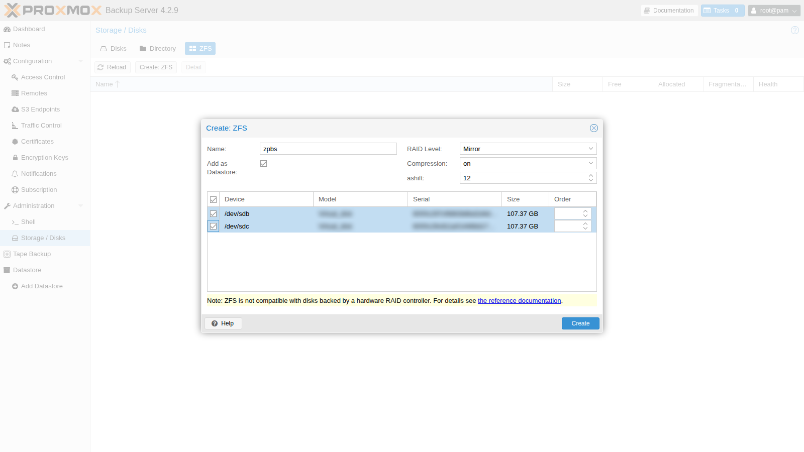

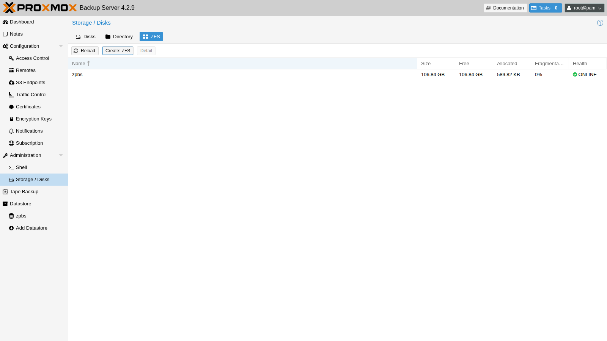

```bash
proxmox-backup-manager datastore list
```

```text
┌──────┬─────────────────────┬─────────┐
│ name │ path                │ comment │
╞══════╪═════════════════════╪═════════╡
│ zpbs │ /mnt/datastore/zpbs │         │
└──────┴─────────────────────┴─────────┘
```

The mirror protects against the failure of one disk. PBS checks the integrity of the **chunks** (verify), but that does not replace disk redundancy.

### 4. User and token for the cluster, with minimal permissions

The cluster must **not** use the PBS `root@pam`. Create a user in the PBS internal realm and a token for it, and grant the **DatastoreBackup** role on that datastore only:

```bash
proxmox-backup-manager user create pve-backup@pbs --comment "Backup dal cluster PVE"
proxmox-backup-manager user generate-token pve-backup@pbs pve --comment "token per il cluster PVE"
```

```text
Result: {
  "tokenid": "pve-backup@pbs!pve",
  "value": "<segreto>"
}
```

The secret is shown **only once**: copy it right away.

```bash
for a in 'pve-backup@pbs' 'pve-backup@pbs!pve'; do
  proxmox-backup-manager acl update /datastore/zpbs DatastoreBackup --auth-id "$a"
done
proxmox-backup-manager acl list
```

```text
┌────────────────────┬─────────────────┬───────────┬─────────────────┐
│ ugid               │ path            │ propagate │ roleid          │
╞════════════════════╪═════════════════╪═══════════╪═════════════════╡
│ pve-backup@pbs     │ /datastore/zpbs │         1 │ DatastoreBackup │
├────────────────────┼─────────────────┼───────────┼─────────────────┤
│ pve-backup@pbs!pve │ /datastore/zpbs │         1 │ DatastoreBackup │
└────────────────────┴─────────────────┴───────────┴─────────────────┘
```

The permission must be granted **both to the user and to the token**: as in PVE (Lab 44), a token with privilege separation gets the intersection of the permissions.

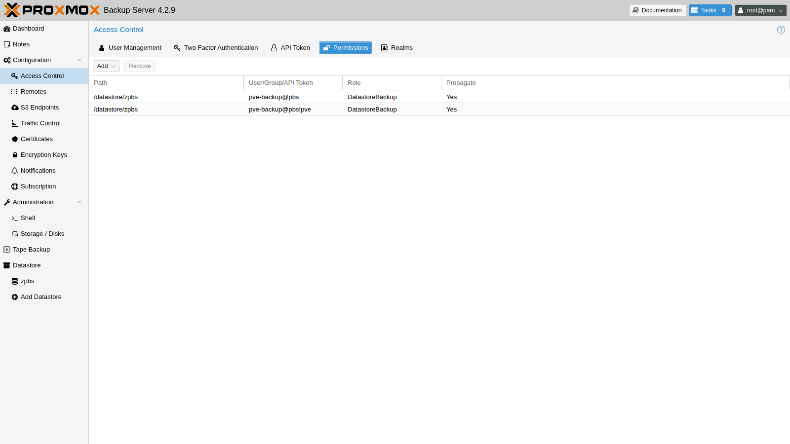

With **DatastoreBackup**, the cluster can create backups and restore the ones **it owns**, but it can neither see nor delete anyone else's backups. If a cluster is compromised, it cannot wipe the entire datastore.

### 5. The PBS storage in the cluster

You need the fingerprint of the PBS certificate. You can read it in **Dashboard → Show Fingerprint** or from the CLI:

```bash
proxmox-backup-manager cert info | grep -i fingerprint
```

```text
Fingerprint (sha256): 31:0b:24:ed:32:07:8f:84:23:bd:2d:66:4f:15:aa:66:da:55:c0:e0:26:45:8f:19:78:f5:3e:cc:a6:2f:34:18
```

On PVE: **Datacenter → Storage → Add → Proxmox Backup Server**. ID `pbs01`, Server `172.27.199.40`, Username `pve-backup@pbs!pve`, the token secret as Password, Datastore `zpbs`, Fingerprint.

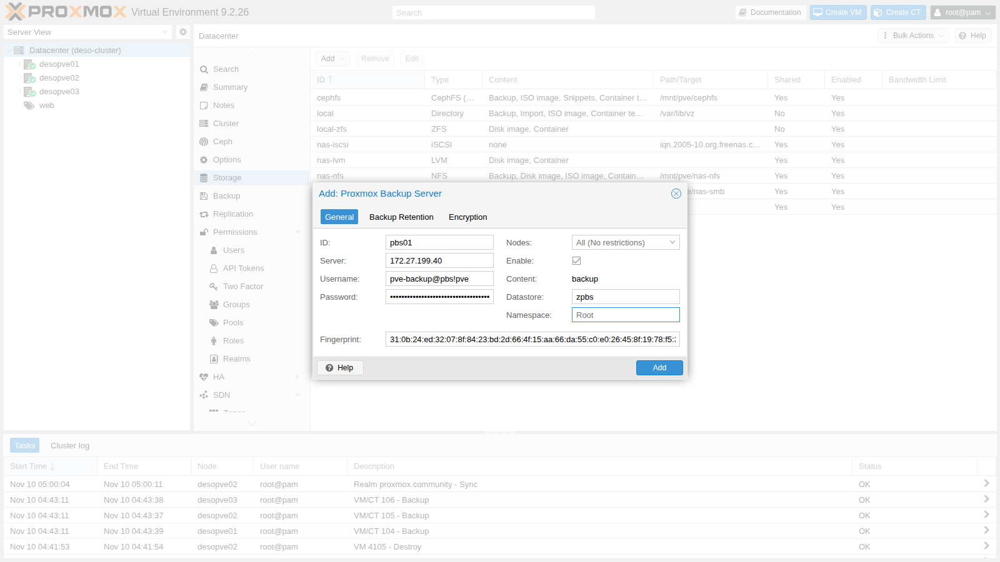

> In the lab, the *Datastore* drop-down list stayed empty; you can type the name by hand. `pvesm scan pbs 172.27.199.40 'pve-backup@pbs!pve' --password … --fingerprint …` confirms that the `zpbs` datastore is visible with that token.

```bash
pvesm status --storage pbs01
```

```text
Name         Type     Status     Total (KiB)      Used (KiB) Available (KiB)        %
pbs01         pbs     active       101088896           24960       101063936    0.02%
```

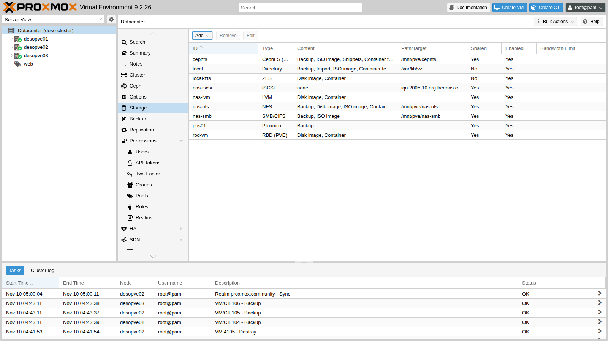

The secret ends up in `/etc/pve/priv/storage/pbs01.pw`, readable only by root and replicated to all nodes.

### 6. First backup, incremental backups and deduplication

First backup of VM 104 (`web01`, 8 GiB disk):

```bash
vzdump 104 --storage pbs01 --mode snapshot
```

```text
INFO: scsi0: dirty-bitmap status: created new
INFO: backup is sparse: 6.61 GiB (82%) total zero data
INFO: backup was done incrementally, reused 6.82 GiB (85%)
INFO: transferred 8.00 GiB in 17 seconds (481.9 MiB/s)
INFO: Finished Backup of VM 104 (00:00:18)
```

The disk is mostly empty: chunks made of zeros are all identical and are stored only once.

Second backup, right after:

```text
INFO: scsi0: dirty-bitmap status: OK (24.0 MiB of 8.0 GiB dirty)
INFO: using fast incremental mode (dirty-bitmap), 24.0 MiB dirty of 8.0 GiB total
INFO: backup was done incrementally, reused 7.98 GiB (99%)
INFO: transferred 24.00 MiB in 1 seconds (24.0 MiB/s)
INFO: Finished Backup of VM 104 (00:00:02)
```

**18 s versus 2 s.** QEMU read only the 24 MiB that changed.

> The dirty bitmap lives in QEMU's memory: after the VM is shut down, or if the previous backup is not on the server, the first backup rereads the whole disk. It is still deduplicated.

Then VMs 105 and 106, clones of the same template:

```text
== 105
INFO: backup was done incrementally, reused 6.82 GiB (85%)
INFO: transferred 8.00 GiB in 14 seconds (585.1 MiB/s)
== 106
INFO: backup was done incrementally, reused 6.83 GiB (85%)
INFO: transferred 8.00 GiB in 14 seconds (585.1 MiB/s)
```

*reused* counts only the chunks that the client knows are already present, that is, those of the previous backup **of the same group**. Identical chunks across different VMs are discarded by the server anyway: you can see it in the deduplication factor (step 8).

**Containers with metadata mode.** For CTs, the two-archive format is used (`.mpxar` for metadata + `.ppxar` for the payload):

```bash
vzdump 121 --storage pbs01 --mode snapshot --pbs-change-detection-mode metadata
```

First backup:

```text
INFO: root.ppxar: had to backup 651.636 MiB of 651.636 MiB (compressed 226.725 MiB) in 34.01 s (average 19.16 MiB/s)
INFO: Finished Backup of VM 121 (00:00:42)
```

Second backup:

```text
INFO: Change detection summary:
INFO: root.ppxar: reused 651.636 MiB from previous snapshot for unchanged files (343 chunks)
INFO: root.ppxar: had to backup 8 MiB of 659.636 MiB (compressed 257.076 KiB) in 3.14 s (average 2.55 MiB/s)
INFO: root.ppxar: backup was done incrementally, reused 651.636 MiB (98.8%)
INFO: Finished Backup of VM 121 (00:00:08)
```

**42 s versus 8 s.** The client did not reread the unchanged files.

### 7. The backup in the PVE GUI

The `pbs01` storage shows the backups with the `pbs-vm` / `pbs-ct` format and the verification state.

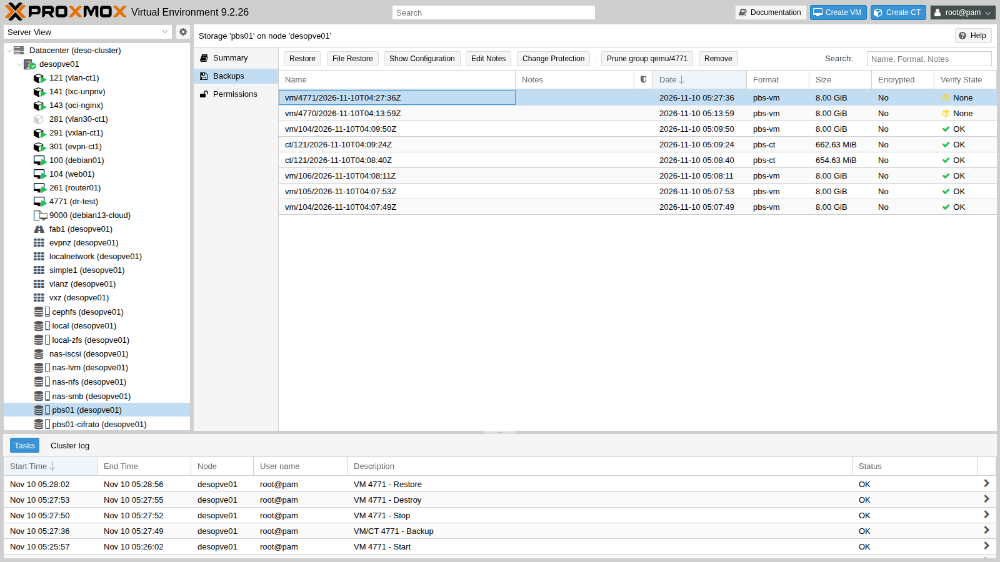

### 8. Verify, prune and garbage collection

At this point VM 104 has three backups: the two from step 6 and a third one, taken right after with the same `vzdump 104 --storage pbs01 --mode snapshot`. The prune with `keep-last 2` removes the oldest one.

```bash
proxmox-backup-manager verify-job create verify-zpbs --store zpbs --schedule "sat 03:00" \
  --ignore-verified true --outdated-after 30 --comment "verifica settimanale"
proxmox-backup-manager verify-job run verify-zpbs        # about 4 s in the lab

proxmox-backup-manager prune-job create prune-zpbs --store zpbs --schedule daily \
  --keep-last 2 --keep-daily 7 --keep-weekly 4 --comment "retention del datastore"
proxmox-backup-manager prune-job run prune-zpbs
```

```text
retention options: --keep-last 2 --keep-daily 7 --keep-weekly 4
keep ct/121/2026-11-10T04:08:40Z
keep ct/121/2026-11-10T04:09:24Z
keep vm/105/2026-11-10T04:07:53Z
keep vm/106/2026-11-10T04:08:11Z
remove vm/104/2026-11-10T04:07:23Z
keep vm/104/2026-11-10T04:07:49Z
keep vm/104/2026-11-10T04:09:50Z
```

- **Verify** rereads the chunks and checks their hash again; `--ignore-verified` with `--outdated-after 30` re-verifies each snapshot at most once a month.
- **Prune** deletes only the backup **indexes**. The chunks remain until garbage collection determines that no index uses them anymore.

```bash
proxmox-backup-manager garbage-collection start zpbs
```

```text
Removed garbage: 0 B
Removed chunks: 0
Pending removals: 1.963 MiB (in 5 chunks)
Original data usage: 33.286 GiB
On-Disk usage: 618.932 MiB (1.82%)
On-Disk chunks: 754
Deduplication factor: 55.07
Average chunk size: 840.564 KiB
TASK OK
```

Two things stand out:

- **Deduplication factor 55.07.** 33.3 GiB of backups take up 619 MiB: zeros, VMs cloned from the same template and repeated backups share the same chunks.
- **Pending removals.** The chunks of the backup just removed are **not** deleted immediately. GC removes only chunks that have not been touched for at least 24 hours and 5 minutes, so as not to delete chunks that a running backup is reusing. The space is freed by the next day's GC.

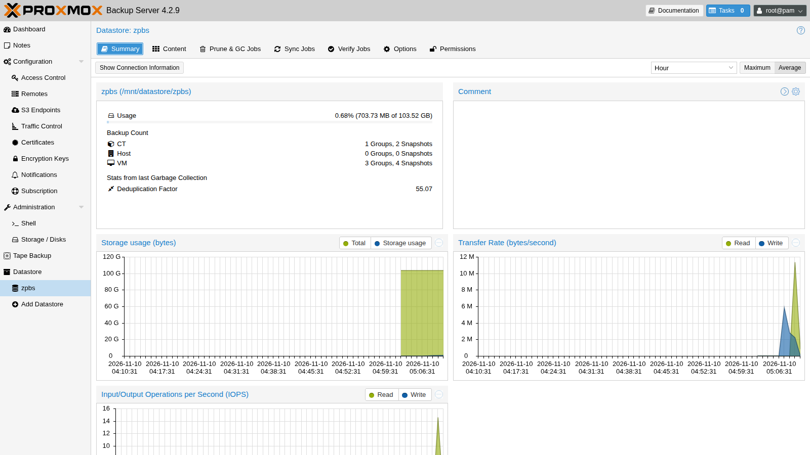

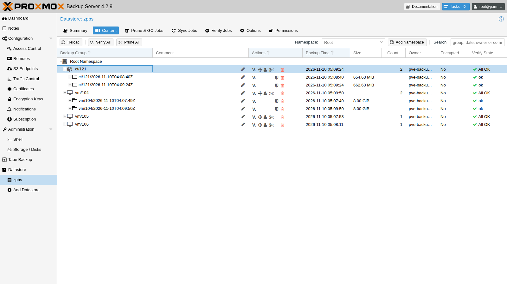

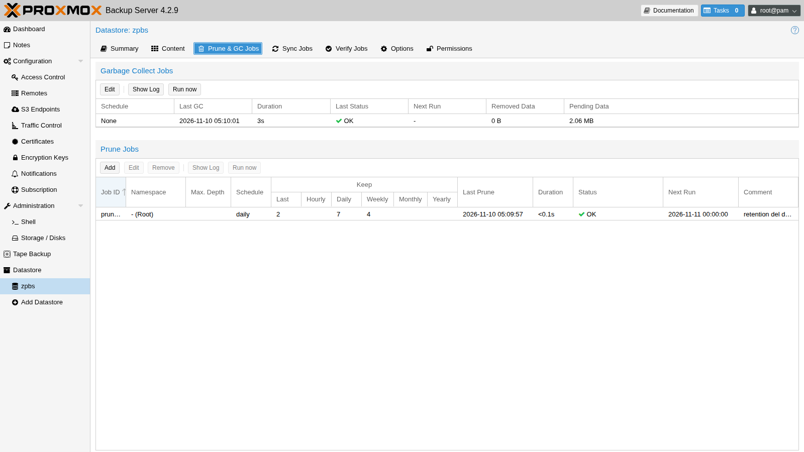

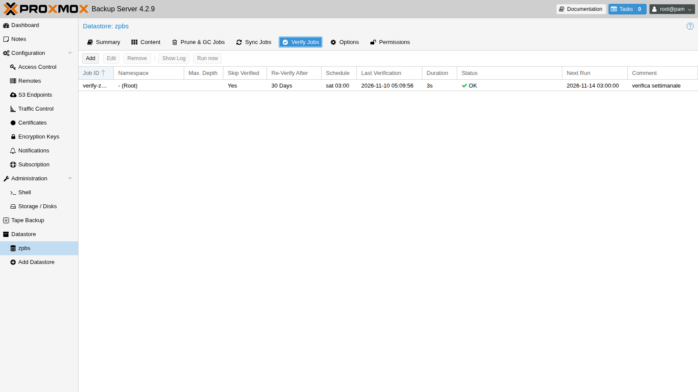

### 9. Client-side encryption and a lost key

Create a `cifrati` namespace and a second PVE storage that uses it **with an encryption key**:

```bash
# on PBS
proxmox-backup-client namespace create cifrati --repository root@pam@localhost:zpbs

# on a PVE node
pvesm add pbs pbs01-cifrato --server 172.27.199.40 --datastore zpbs --namespace cifrati \
  --username 'pve-backup@pbs!pve' --password '<segreto-del-token>' \
  --fingerprint 31:0b:24:...:34:18 --content backup --encryption-key autogen
ls -l /etc/pve/priv/storage/ | grep pbs
```

```text
-rw------- 1 root www-data 255 Nov 10 05:11 pbs01-cifrato.enc
-rw------- 1 root www-data  37 Nov 10 05:11 pbs01-cifrato.pw
-rw------- 1 root www-data  37 Nov 10 05:06 pbs01.pw
```

```bash
vzdump 105 --storage pbs01-cifrato --mode snapshot
```

```text
INFO: enabling encryption
INFO: transferred 8.00 GiB in 13 seconds (630.2 MiB/s)
INFO: Finished Backup of VM 105 (00:00:14)
```

PBS shows the backup as **Encrypted**. You cannot open it from the PBS GUI: the server does not have the key.

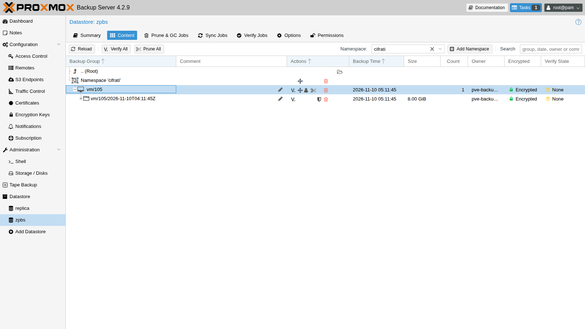

**Where the key is.** In `/etc/pve/priv/storage/pbs01-cifrato.enc`, and therefore on all the nodes of the cluster. It is also in the backups of `/etc/pve`, if there are any. If you lose the cluster, you lose the key.

```bash
proxmox-backup-client key show /etc/pve/priv/storage/pbs01-cifrato.enc
```

```text
│ path        │ "/etc/pve/priv/storage/pbs01-cifrato.enc" │
│ kdf         │ none                                      │
│ fingerprint │ ea:2f:5a:2f:aa:61:d2:14:4f:ad:39:3c:...   │
```

Copy it **outside the cluster** right after creating it:

- in a password manager or a safe, as a file;
- on paper: `proxmox-backup-client key paperkey <file.enc> --output-format text` produces printable text with a QR code.

**Test: restore without the key.** A storage that points to the same namespace, but without the key:

```bash
pvesm add pbs pbs01-senza-chiave … --namespace cifrati      # same parameters, no --encryption-key
qmrestore pbs01-senza-chiave:backup/vm/105/2026-11-10T04:11:45Z 4799 --storage rbd-vm
```

```text
Error: missing key - manifest was created with key ea:2f:5a:2f:aa:61:d2:14
error before or during data restore, some or all disks were not completely restored. VM 4799 state is NOT cleaned up.
```

Without the key, the backup is **unrecoverable**: neither Proxmox nor anyone else can open it again. The failed restore leaves a locked VM 4799: clean it up with `qm unlock 4799 && qm destroy 4799 --purge`, then remove the test storage.

### 10. File restore

For this step and the next one you need a VM with data to recover: VM 4771 `dr-test`, a clone of the template with nginx and the guest agent. Create it, write an "important" file, back it up to PBS and then **destroy** it, as in a disaster:

```bash
qm clone 9000 4771 --name dr-test
qm set 4771 --ipconfig0 ip=172.27.199.177/24,gw=172.27.199.1 --cicustom vendor=cephfs:snippets/web-vendor.yaml
qm start 4771
# after the first boot, once the agent responds (qm agent 4771 ping)
qm guest exec 4771 -- sh -c 'echo dati-importanti-$(date +%s) > /root/marker.txt'
vzdump 4771 --storage pbs01 --mode snapshot
qm stop 4771 && qm destroy 4771 --purge
```

```text
INFO: issuing guest-agent 'fs-freeze' command
INFO: issuing guest-agent 'fs-thaw' command
INFO: transferred 8.00 GiB in 12 seconds (682.7 MiB/s)
INFO: Finished Backup of VM 4771 (00:00:13)
```

Now the file restore. From the PVE GUI: storage `pbs01` → **Backups** → select the backup of 4771 → **File Restore**. PVE starts a small helper VM on the node, which reads the backup from PBS and mounts its file systems.

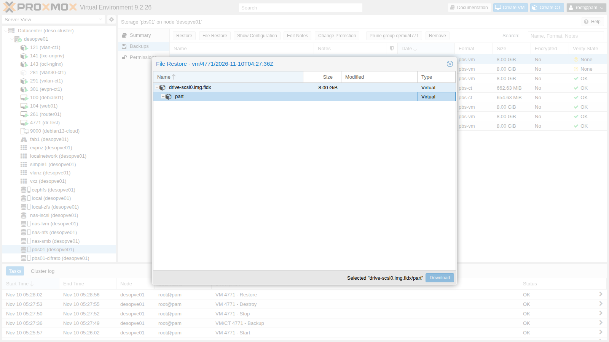

> If the window shows the disk and the `part` level but does not descend into the partitions (for example because of a timeout on the first start of the helper VM), the same operation works from the command line, and it is the one the GUI uses:

```bash
export PBS_REPOSITORY='pve-backup@pbs!pve@172.27.199.40:zpbs' PBS_PASSWORD='<segreto>' PBS_FINGERPRINT=31:0b:...:34:18
S=vm/4771/2026-11-10T04:27:36Z
proxmox-file-restore list $S /drive-scsi0.img.fidx/part
proxmox-file-restore list $S /drive-scsi0.img.fidx/part/1/root
proxmox-file-restore extract $S /drive-scsi0.img.fidx/part/1/root/marker.txt /tmp/ripristino
cat /tmp/ripristino/marker.txt
```

```text
│ d    │ 1    │               │ 8455699968 │
│ d    │ 14   │               │    3145728 │
│ d    │ 15   │               │  130023424 │
...
│ f    │ marker.txt │    1794284847 │   27 │
...
dati-importanti-1794284846
```

The file was extracted without restoring the VM. The helper VM keeps running for a few minutes after the last use; while it is active, the snapshot is locked and cannot be deleted.

### 11. Live-restore: up and running before the restore finishes

Disaster recovery scenario: VM 4771 `dr-test`, backed up and destroyed in step 10, must be put back into service as soon as possible.

```bash
qmrestore pbs01:backup/vm/4771/2026-11-10T04:27:36Z 4771 --storage rbd-vm --live-restore 1
```

```text
starting VM for live-restore
repository: 'pve-backup@pbs!pve@172.27.199.40:zpbs', snapshot: 'vm/4771/2026-11-10T04:27:36Z'
restoring 'drive-scsi0' to 'rbd-vm:vm-4771-disk-0'
restore-drive-scsi0: transferred 8.0 GiB of 8.0 GiB (100.00%) in 49s
restore-drive-scsi0: stream-job finished
restore-drive jobs finished successfully, removing all tracking block devices to disconnect from Proxmox Backup Server
```

The VM is **started at the beginning**: the blocks it needs are read from PBS on demand, the rest is copied in the background.

| Measured in the lab | Time |
|---|---|
| Full copy of the 8 GiB disk | 55 s |
| nginx page reachable | 67 s |

On a small, almost empty disk there is no advantage: the boot and the copy compete for the same bandwidth. Live-restore pays off with large disks, when the full copy would take hours and the operating system needs only a few GB to start. The `/root/marker.txt` file written before the backup is intact.

> During the live-restore the VM depends on PBS: if PBS stops before the end, the VM hangs on I/O.

When the test is over, delete the VM and its backup:

```bash
qm stop 4771 && qm destroy 4771 --purge
pvesm free pbs01:backup/vm/4771/2026-11-10T04:27:36Z
```

**A lesson from the lab: backups without the guest agent.** The first attempt at this exercise, with a clone **without** the guest agent (VM 4770) backed up about 50 s after its first boot, produced a backup in which `/etc/netplan/50-cloud-init.yaml` was **empty**. The restored VM booted, but without network. The file had been written by cloud-init a few seconds earlier: without `fs-freeze` the snapshot is only *crash-consistent* and takes the disk as it is, with the data still cached in the guest. With the guest agent, the backup freezes the file systems and the problem does not occur again (Lab 38).

### 12. Sync job to a second datastore

In production the copy goes to **another PBS**, at another site (a *remote*). In the lab, the same mechanism is shown with a second local datastore:

```bash
zfs create -o mountpoint=/mnt/datastore/replica zpbs/replica
proxmox-backup-manager datastore create replica /mnt/datastore/replica \
  --comment "copia locale (in produzione: su un altro PBS)"
proxmox-backup-manager sync-job create sync-replica --store replica --remote-store zpbs \
  --schedule hourly --remove-vanished false --comment "copia del datastore zpbs"
proxmox-backup-manager sync-job run sync-replica     # 11 s the first time, 1 s the second
```

```text
NAME           USED  REFER
zpbs          1.72G  1.02G
zpbs/replica   718M   718M
```

The sync, too, transfers only the missing chunks: the second run takes 1 s. With `--remove-vanished false`, the backups deleted by prune on the source **remain** on the copy, which has its own retention.

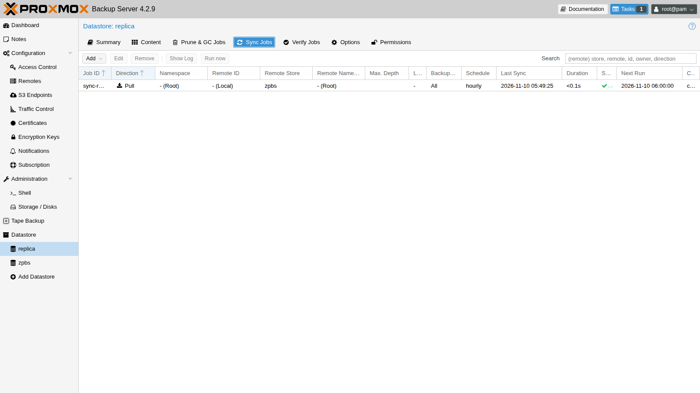

**S3 backend (PBS 4).** The **S3 Endpoints** menu lets you create datastores on S3-compatible object storage (AWS, MinIO, Ceph RGW…), with a local cache. There is no S3 endpoint in the lab, so it is not tested here.

### 13. Scheduled job to PBS

For the following labs, add a nightly job that backs up the `web` pool to PBS:

```bash
pvesh create /cluster/backup --id pbs-notturno --pool web --storage pbs01 --schedule "22:30" \
  --mode snapshot --enabled 1 --notes-template "{{guestname}} ({{vmid}}) - PBS" \
  --comment "backup notturno del pool web su PBS"
```

Retention is applied by PBS (prune job `prune-zpbs`), so the PVE job does not need it.

Notifications for GC, verify and sync are configured in **Configuration → Notifications**; that topic is covered in Lab 51.

## Verification and tests

| Test | Result in the lab |
|---|---|
| Backup of VM 104, first and second | 18 s versus 2 s (24 MiB read with the dirty bitmap) |
| Backup of CT 121, metadata mode | 42 s versus 8 s (98.8% reused) |
| Deduplication factor after GC | 55.07 (33.3 GiB in 619 MiB) |
| Datastore verify | about 4 s, all snapshots *ok* |
| Prune `keep-last 2` | oldest backup of VM 104 removed |
| Restore of an encrypted backup without the key | `missing key`: unrecoverable |
| File restore of `/root/marker.txt` | extracted from the backup |
| Live-restore of the destroyed VM | full copy in 55 s, service online at 67 s |
| Sync to `replica` | 11 s the first time, 1 s the second |

## Final lab state

- **desopbs01** (PBS 4.2.9): no-subscription repository, proxy, NTP to `ntp.proxmox.community`.
  - ZFS pool `zpbs` (mirror of `sdb` and `sdc`).
  - Datastores `zpbs` (root namespace and `cifrati`) and `replica` (dataset `zpbs/replica`).
  - User `pve-backup@pbs` with token `pve`, role DatastoreBackup on `/datastore/zpbs`.
  - Jobs: `verify-zpbs` (Saturday 03:00), `prune-zpbs` (daily: keep-last 2, daily 7, weekly 4), `sync-replica` (hourly), daily GC by default.
- **Cluster:**
  - storages `pbs01` (root namespace) and `pbs01-cifrato` (namespace `cifrati`, with the key in `/etc/pve/priv/storage/pbs01-cifrato.enc`);
  - job `pbs-notturno`: pool `web` at 22:30 to `pbs01`. The vzdump job to `nas-nfs` from Lab 46 remains.
- **Backups on PBS:** VM 104 (2), 105, 106, CT 121 (2); VM 105 also encrypted.
- **Cleanup:** test VMs 4770, 4771 and 4799 deleted, together with their backups.

## What you learned

- PBS stores **deduplicated chunks**: the same data takes up space only once, across backups and across VMs.
- The **dirty bitmap** (VMs) and **metadata mode** (CTs) make subsequent backups extremely fast.
- Connect the cluster with a **token** that has **DatastoreBackup**, not with root.
- With **client-side encryption** PBS cannot read the data; keep the key **outside** the cluster, because without the key the backup is lost.
- **Prune** deletes the indexes; **GC** frees the space after 24 hours; **verify** checks integrity.
- From PBS you can recover **single files** and perform a **live-restore**, which pays off with large disks.
- A backup without the **guest agent** is only crash-consistent: files that were just written may turn out empty.
- The **sync job** copies only the missing chunks; in production it targets another PBS.

## References

- [Proxmox Backup Server – Documentation](https://pbs.proxmox.com/docs/)
- [PBS – Backup Storage (datastore, GC, verify)](https://pbs.proxmox.com/docs/storage.html)
- [PBS – Managing Remotes & Sync](https://pbs.proxmox.com/docs/managing-remotes.html)
- [PBS – Encryption](https://pbs.proxmox.com/docs/backup-client.html#encryption)
- [PBS – User Management and API tokens](https://pbs.proxmox.com/docs/user-management.html)
- [Proxmox VE – Proxmox Backup Server storage](https://pve.proxmox.com/pve-docs/chapter-pvesm.html#storage_pbs)
- [Proxmox VE – Live-Restore](https://pve.proxmox.com/pve-docs/chapter-vzdump.html#vzdump_restore)
