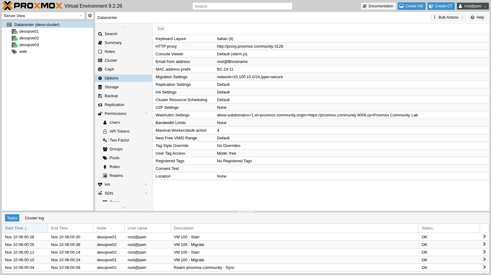
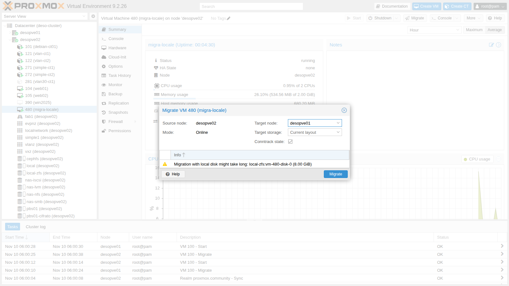
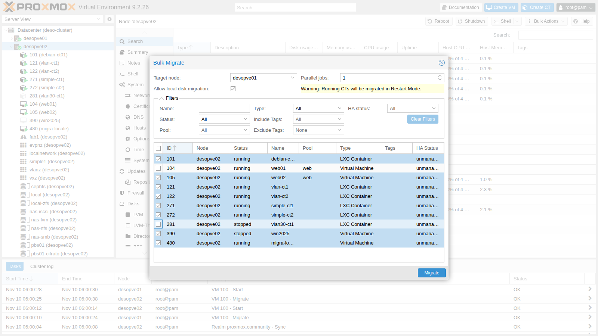
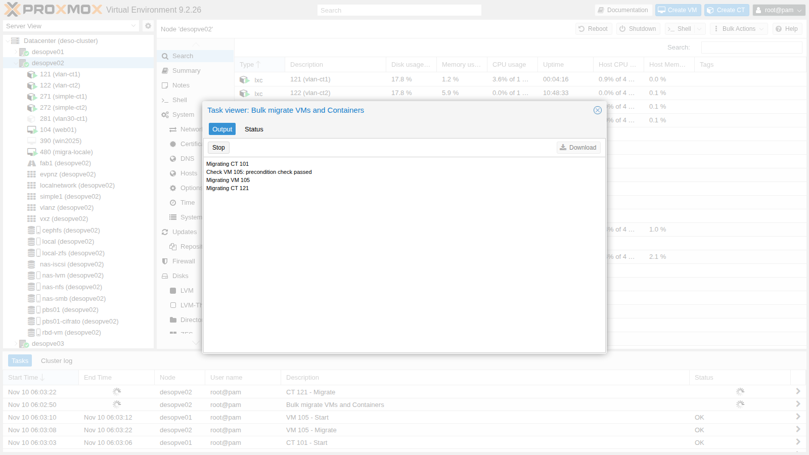

# Lab 48 – Migrations: live, offline, with local disks, containers, bulk and between clusters

**Level:** advanced · **Duration:** 1 hour 30 minutes

## Dependencies

- **Previous labs:**
  - [Lab 06](06-cluster-corosync.md): the `deso-cluster` cluster and the standalone node `desopve04`;
  - [Lab 11](11-zfs-replication.md): migration with ZFS replication;
  - [Lab 17](17-ceph-installation.md): the shared storage `rbd-vm`;
  - [Lab 22](22-dedicated-networks.md): the migration network on VLAN 100 (10.100.10.0/24);
  - [Lab 33](33-firewall-2.md): the nftables firewall, which opens ports 60000-60050 on the migration network;
  - [Lab 40](40-templates-cloud-init-clones.md): template 9000 and the VMs `web01`-`web03`.
- **Systems:**
  - nodes `desopve01`-`03` and `desopve04`;
  - VM 100 `debian01` and VM 104 `web01`, both on `rbd-vm`;
  - CT 121 and 122 on VLAN 10 ([Lab 20](20-bridges-stable-names-vlans.md)), CT 101 ([Lab 07](07-first-vm-and-container.md)), CT 271 and 272 ([Lab 27](27-sdn-simple.md)), CT 281 ([Lab 28](28-sdn-vlan-qinq.md)), VM 390 ([Lab 39](39-windows-vm-virtio.md)): they are needed for the bulk migration;
  - the ZFS pool `tank` on `desopve04` ([Lab 10](10-zfs.md)) and the `web-vendor.yaml` snippet on `cephfs` ([Lab 40](40-templates-cloud-init-clones.md));
  - a test VM on `local-zfs`, created in this lab.
- **Measurements:** a `ping` every 0.2 s to the VM, from the management network or from another CT, during each migration.
- **Credentials:** `root@pam` → [Appendix B](b-credentials-and-addresses.md).

## Objectives

- Measure a **live** migration with shared storage and an **offline** one.
- Live-migrate a VM with **local disks**.
- Understand how **containers** are migrated (restart mode).
- Use **bulk migration** and learn about its trap.
- Compare the **secure** and **insecure** modes on the dedicated network.
- Migrate a VM **between different clusters** with `qm remote-migrate`, there and back, and discover its limits.

## How it works

**Live migration of a VM.** An empty QEMU process starts on the target node. The RAM is copied while the VM keeps working; the pages that get rewritten are copied again, until so little is left that the migration can finish within a very short pause (*downtime*, default limit 100 ms). With shared storage the disks do not move.

**Local disks.** With `--with-local-disks` the disks are copied **before** the RAM, with a *drive-mirror* over NBD. Once they are in sync, the RAM is migrated as above. The time grows with the size of the disks.

**Containers.** LXC has no live migration: the CT is **shut down, moved and started again** (*restart mode*). With shared storage only the configuration moves.

**Migration network.** In **Datacenter → Options → Migration Settings** you choose the network (here VLAN 100) and the type:

- **secure**: the RAM travels through an SSH tunnel;
- **insecure**: the RAM travels unencrypted over TCP (ports 60000-60050), which is lighter on the CPU. It only makes sense on a dedicated, trusted network.



**Between clusters.** `qm remote-migrate` uses the API of the target cluster with an **API token** and the certificate fingerprint. All the traffic, disks and RAM, travels through a *websocket* tunnel on port 8006. It is still an *experimental* feature, available only from the CLI (in a GUI it is offered by Proxmox Datacenter Manager, Lab 53).

## Procedure

### 1. Live with shared storage

`web01` (VM 104) has its disk on Ceph (`rbd-vm`):

```bash
qm migrate 104 desopve02 --online
```

```text
2026-11-10 05:55:53 conntrack state migration not supported or disabled, active connections might get dropped
2026-11-10 05:55:53 use dedicated network address for sending migration traffic (10.100.10.22)
2026-11-10 05:55:58 migration downtime limit: 100 ms
2026-11-10 05:56:00 average migration speed: 1.0 GiB/s - downtime 33 ms
2026-11-10 05:56:00 migration completed, transferred 281.4 MiB VM-state
2026-11-10 05:56:03 migration finished successfully (duration 00:00:10)
```

- **10 s** in total: only 281 MiB of RAM are copied, over VLAN 100.
- **33 ms of downtime** according to QEMU.
- The `ping` every 0.2 s, from the management network, had at most **0.84 s** between two replies. After the move, the network has to learn the new location of the VM's MAC address (QEMU sends announcement packets): that time depends on the switches, not on Proxmox.

**Conntrack (new in 9.x).** The first line warns that the state of the connections tracked by the firewall is **not** migrated. With the nftables firewall (Lab 33) you can ask for it to move together with the VM:

```bash
qm migrate 104 desopve01 --online --with-conntrack-state 1     # from desopve02: this also brings the VM back to its node
```

```text
2026-11-10 06:11:33 average migration speed: 1.0 GiB/s - downtime 93 ms
2026-11-10 06:11:33 migrated 0 conntrack state entries
2026-11-10 06:11:36 flushing conntrack state for guest on source node
2026-11-10 06:11:40 migration finished successfully (duration 00:00:14)
```

0 entries are migrated because `web01` does not have the firewall enabled on its network device. The option is meant for guests with the firewall enabled: without the conntrack entries, the firewall on the target node would drop the packets of the already open connections as *invalid*. In the GUI the **Conntrack state** option is checked by default.

### 2. Offline

CT 281 is stopped and has its disk on Ceph:

```bash
time pct migrate 281 desopve02
```

```text
2026-11-10 05:56:17 volume 'rbd-vm:vm-281-disk-0' is on shared storage 'rbd-vm'
2026-11-10 05:56:18 migration finished successfully (duration 00:00:01)
real	0m3.636s
```

With shared storage a stopped guest moves in a second: only the node that owns its configuration changes.

### 3. Live with local disks

A test VM (480 `migra-locale`) cloned from the template onto `local-zfs`, so its disk exists **only** on `desopve01`:

```bash
qm clone 9000 480 --name migra-locale --full 1 --storage local-zfs
qm set 480 --ipconfig0 ip=172.27.199.148/24,gw=172.27.199.1 --agent enabled=1 --cicustom vendor=cephfs:snippets/web-vendor.yaml
qm start 480
```

In the GUI, the **Migrate** button warns that the disk has to be copied and asks for the target storage.



```bash
qm migrate 480 desopve02 --online --with-local-disks --targetstorage local-zfs
```

```text
2026-11-10 05:58:03 scsi0: start migration to nbd:unix:/run/qemu-server/480_nbd.migrate:exportname=drive-scsi0
mirror-scsi0: successfully switched to actively synced mode
2026-11-10 05:58:28 starting online/live migration on unix:/run/qemu-server/480.migrate
2026-11-10 05:58:30 average migration speed: 1.0 GiB/s - downtime 88 ms
2026-11-10 05:58:30 migration completed, transferred 611.1 MiB VM-state
mirror-scsi0: Completed successfully.
2026-11-10 05:58:37 migration finished successfully (duration 00:00:45)
```

| | Shared storage (VM 104) | Local disk (VM 480) |
|---|---|---|
| Duration | 10 s | 45 s (25 s for the disk alone) |
| QEMU downtime | 33 ms | 88 ms |
| Longest ping gap | 0.84 s | 3.73 s |

The disk used only 653 MiB (thin): a full disk of hundreds of GB takes tens of minutes accordingly. With ZFS replication (Lab 11) only the changes since the last replication are copied: in the lab, **20 s versus 1 min 13 s**.

### 4. Containers: restart mode

CT 121 (VLAN 10) is measured **from CT 122**, which is on the same VLAN:

```bash
pct exec 122 -- sh -c "ping -D -i 0.2 10.10.10.121 > /tmp/p121.log &"   # on the node of CT 122
pct migrate 121 desopve02 --restart                                    # on the node of CT 121
```

```text
2026-11-10 05:59:03 starting migration of CT 121 to node 'desopve02' (10.100.10.22)
2026-11-10 05:59:03 volume 'rbd-vm:vm-121-disk-0' is on shared storage 'rbd-vm'
2026-11-10 05:59:04 start container on target node
2026-11-10 05:59:09 migration finished successfully (duration 00:00:10)
```

Longest ping gap: **11.65 s**, that is, the shutdown, the start and the DHCP of the CT. For a CT, "moving" always means **restarting**: the services must tolerate it. Without `--restart`, the migration of a running CT is refused ("not implemented", [Lab 41](41-lxc-containers.md)).

### 5. Bulk migration (and its trap)

**Node → Bulk Actions → Bulk Migrate** moves several guests in one go, with a number of jobs running in parallel (*Parallel jobs*) and the **Allow local disk migration** option.



> **Warning:** when the window opens, **all the guests of the node are already selected**: clicking a guest **deselects** it. A guided test of the trap: on `desopve02` open **Bulk Migrate** toward `desopve01` and, as if you wanted to move only CT 281, click it. You have actually deselected it: with **Migrate**, all the other eight are migrated. The CTs are restarted on the target node, because restart mode applies here too (the yellow notice warns about it).



```text
Check VM 105: precondition check passed
Migrating VM 105
Migrating CT 121
Migrating CT 122
Migrating CT 271
Migrating CT 272
Check VM 390: precondition check passed
Migrating VM 390
Check VM 480: precondition check passed
Migrating VM 480
All jobs finished, used 8 workers in total.
TASK OK
```

8 guests in **137 s** with 1 job at a time. To put them back, use the CLI equivalent, with an explicit list and 2 parallel jobs:

```bash
pvesh create /nodes/desopve01/migrateall --target desopve02 --vms 101,105,122,271,272,390 --maxworkers 2
```

6 guests in **43 s**. Before confirming a bulk migration, check the selection column or use the filters (status, pool, tags).

### 6. Secure versus insecure

VM 100 has 2 GiB of RAM. To make the test meaningful, the RAM inside the guest is filled with 900 MiB of random, incompressible data:

```bash
qm guest exec 100 -- sh -c "dd if=/dev/urandom of=/dev/shm/riempi bs=1M count=900"
qm migrate 100 desopve02 --online --migration_type secure
qm migrate 100 desopve01 --online --migration_type insecure     # from node 02
```

```text
== insecure 100 02->01
2026-11-10 05:59:59 starting online/live migration on tcp:10.100.10.21:60000
2026-11-10 06:00:04 average migration speed: 413.0 MiB/s - downtime 21 ms
2026-11-10 06:00:04 migration completed, transferred 1.1 GiB VM-state
```

| Test | Average speed | Duration |
|---|---|---|
| secure | 413 MiB/s | 14 s |
| insecure | 413 MiB/s | 14 s |
| secure (repeated) | 413 MiB/s | 14 s |
| insecure (repeated) | 688 MiB/s | 12 s |

The values come from the `average migration speed` line of the task logs: three tests out of four gave exactly 413 MiB/s. With 1.1 GiB of RAM to copy, the difference in the lab is small: the limit is the bandwidth of the migration network, not the encryption. On 25-100 Gbit/s networks and with VMs that have hundreds of GB of RAM, SSH becomes the bottleneck, and *insecure* on the dedicated network saves minutes. In *insecure* mode the target opens port 60000: the firewall must allow it on the migration network (the `servizi-cluster` group, Lab 33).

### 7. Migration between clusters: `qm remote-migrate`

Target: `desopve04`, which is a separate "datacenter" with its own `local-lvm` and the ZFS pool `tank`.

**On the target node**, create a token and read the certificate fingerprint:

```bash
pveum user token add root@pam migra --privsep 0 --comment "migrazione remota dal cluster"
pvenode cert info | grep -B1 -A1 pve-ssl.pem
```

The token must be able to create VMs, allocate storage and use the bridge on the target. Here we use `root@pam` without privilege separation; in production a dedicated user is a better choice.

**First attempt**, to `local-lvm`:

```bash
qm remote-migrate 480 480 \
  'host=172.27.199.24,apitoken=PVEAPIToken=root@pam!migra=<segreto>,fingerprint=84:D3:F2:…' \
  --target-bridge vmbr0 --target-storage local-lvm --online
```

```text
ERROR: … failed to handle 'disk-import' command - no matching import/export format found for storage 'local-lvm'
migration aborted
```

The **cloud-init** disk (`ide2`, on `local-zfs`) is not live-migrated: it is **exported** as a ZFS stream, and LVM-thin cannot import it. The main disk, on the other hand, goes through the NBD mirror to any storage.

**Second attempt**, to `tank` (ZFS):

```text
ERROR: … failed to handle 'config' command - storage 'cephfs' does not exist
migration aborted
```

The VM configuration references a snippet on `cephfs` (`cicustom`), a storage that does not exist on the target. The snippet was needed only at first boot:

```bash
qm set 480 --delete cicustom
```

**Third attempt**, successful:

```text
2026-11-10 06:08:35 start migrate command to unix:/run/qemu-server/480.migrate
tunnel: established new WS for forwarding '/run/qemu-server/480.migrate'
2026-11-10 06:08:38 average migration speed: 682.9 MiB/s - downtime 31 ms
2026-11-10 06:08:38 migration completed, transferred 624.6 MiB VM-state
mirror-scsi0: Completed successfully.
2026-11-10 06:08:41 migration finished successfully (duration 00:00:52)
```

52 s, 31 ms of downtime, longest ping gap 3.11 s. The VM's web page kept responding from the other "datacenter".

On the cluster the VM **remains**, stopped and locked (`lock: migrate`): by default `remote-migrate` does not delete the original. Delete it by hand after checking the copy:

```bash
qm unlock 480 && qm destroy 480 --purge
```

**Return** to the cluster, run on `desopve04` with a token of the cluster and `--delete 1`, which deletes the source at the end of the migration. Prepare the token and the fingerprint on `desopve01`:

```bash
pveum user token add root@pam rientro --privsep 0 --comment "rientro dalla migrazione remota"
pvenode cert info | grep -B1 -A1 pve-ssl.pem
```

Then on `desopve04`:

```bash
qm remote-migrate 480 480 \
  'host=172.27.199.21,apitoken=PVEAPIToken=root@pam!rientro=<segreto>,fingerprint=14:32:84:…' \
  --target-bridge vmbr0 --target-storage local-zfs --online --delete 1
```

```text
2026-11-10 06:10:46 average migration speed: 682.9 MiB/s - downtime 62 ms
2026-11-10 06:10:46 migration completed, transferred 626.2 MiB VM-state
2026-11-10 06:10:50 migration finished successfully (duration 00:00:32)
```

The VM is no longer on `desopve04`.

> **Warning:** do not run `remote-migrate` in a pipe that can close before the end (for example `| head`): the command is interrupted halfway and leaves an empty VM on the target, locked with `lock: create`, which you then have to clean up with `qm unlock` and `qm destroy`. It is better to run it inside `screen` or `tmux`.

**Limits of `remote-migrate` seen in the lab:**

- CLI only, and labeled as experimental;
- it needs a token, the fingerprint and permissions on the target;
- configurations that reference storages, snippets or bridges missing on the target fail;
- disks that are not live-migrated (cloud-init, stopped VMs) require export formats that are compatible between the storages;
- the source remains by default; with `--delete 1` it is removed.

### 8. Putting everything back

At the end of the lab, put the guests back where they were. VM 104 already went back to `desopve01` with the conntrack test, and CT 121 with the bulk migration; what is left is CT 281, VM 480 that came back from the remote "datacenter", and the tokens:

```bash
pct migrate 281 desopve01                    # on desopve02 (the CT is stopped)
qm stop 480 && qm destroy 480 --purge        # on desopve01
pveum user token remove root@pam rientro     # on desopve01
pveum user token remove root@pam migra       # on desopve04
```

## Verification and tests

| Test | Result in the lab |
|---|---|
| Live, shared storage (VM 104) | 10 s, downtime 33 ms, longest ping gap 0.84 s |
| Offline, shared storage (CT 281) | 1 s |
| Live, local disk (VM 480, 8 GiB thin) | 45 s, downtime 88 ms, longest ping gap 3.73 s |
| CT in restart mode (CT 121) | 10 s, service down for 11.65 s |
| Bulk migration, 8 guests | 137 s with 1 job at a time; 6 guests in 43 s with 2 |
| secure versus insecure | 413 versus 413-688 MiB/s, 12-14 s |
| Remote-migrate to `desopve04` | 52 s, downtime 31 ms (after 2 instructive errors) |
| Remote-migrate back with `--delete 1` | 32 s, source deleted |

## Final lab state

- Guests back in their initial location:
  - VMs 100, 104 and 261 and CTs 121, 141, 143, 281, 291, 301 on `desopve01`;
  - CTs 101, 122, 271, 272 and VMs 105 and 390 on `desopve02`;
  - VM 106 and CTs 123, 282, 292, 302 on `desopve03`.
- Test VM 480 deleted; nothing left behind on `desopve04`.
- Tokens `root@pam!migra` (on `desopve04`) and `root@pam!rientro` (on the cluster) removed.
- Datacenter: `migration: secure,network=10.100.10.0/24`, unchanged.
- PBS and the jobs from Lab 47 unchanged.

## What you learned

- With shared storage, a live migration copies only the RAM: it takes seconds, with a downtime of tens of ms.
- With local disks, the disk is copied first: the time grows with the data, and ZFS replication reduces it.
- Containers can only be migrated by restarting them.
- Bulk migration preselects **all** guests: check before confirming.
- *insecure* only pays off on very fast dedicated networks with large VMs; the firewall must open ports 60000-60050.
- The **conntrack state** can be migrated with the nftables firewall (new in 9.x).
- `qm remote-migrate` moves VMs between clusters with a token; storages, snippets and formats must be compatible on the target, and the source remains unless you use `--delete 1`.

## References

- [Proxmox VE – Migration (qm)](https://pve.proxmox.com/pve-docs/chapter-qm.html#qm_migration)
- [Proxmox VE – Container Migration](https://pve.proxmox.com/pve-docs/chapter-pct.html#pct_migration)
- [Proxmox VE – Migration settings](https://pve.proxmox.com/pve-docs/chapter-pvecm.html#pvecm_migration)
- [Proxmox VE – qm(1), remote-migrate](https://pve.proxmox.com/pve-docs/qm.1.html)
- [Proxmox VE – Firewall, conntrack](https://pve.proxmox.com/pve-docs/chapter-pve-firewall.html)
