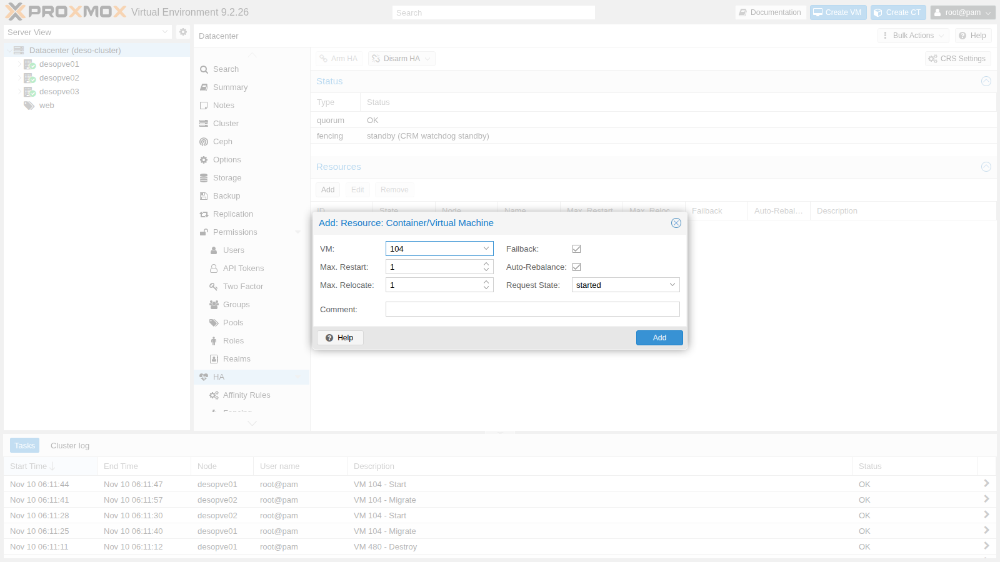
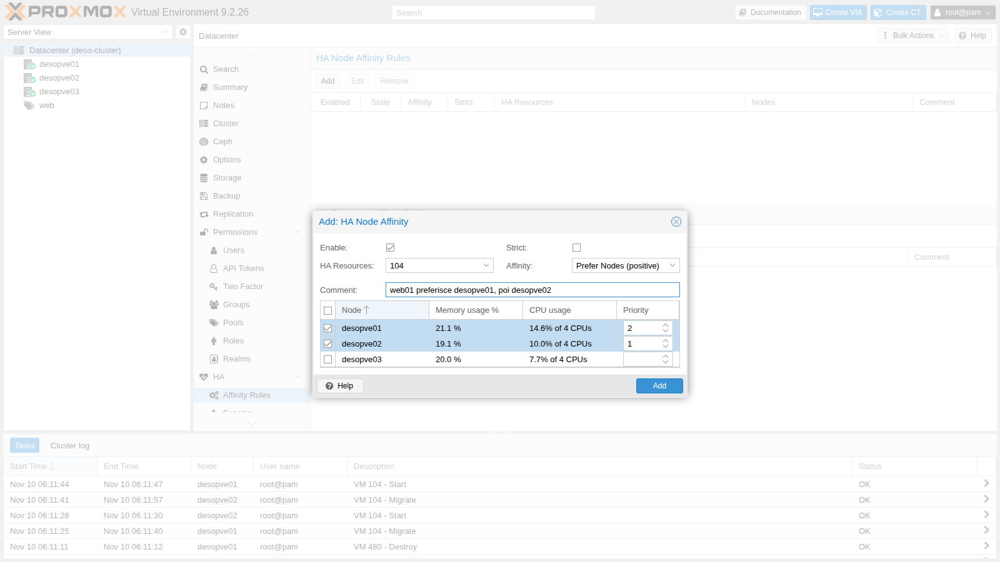
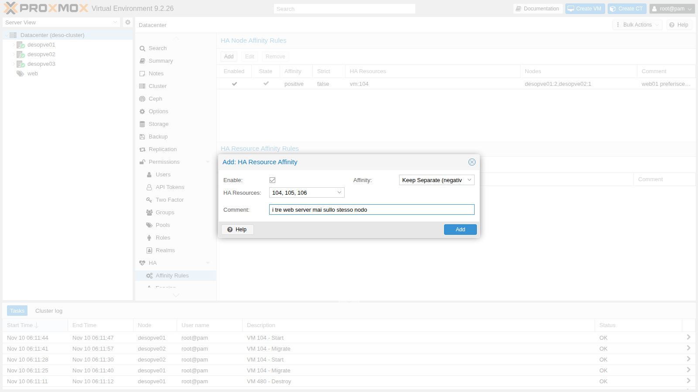
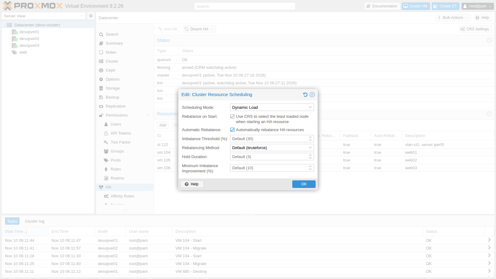
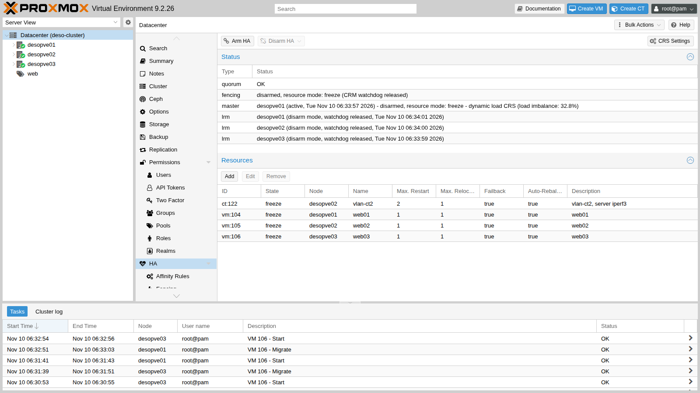
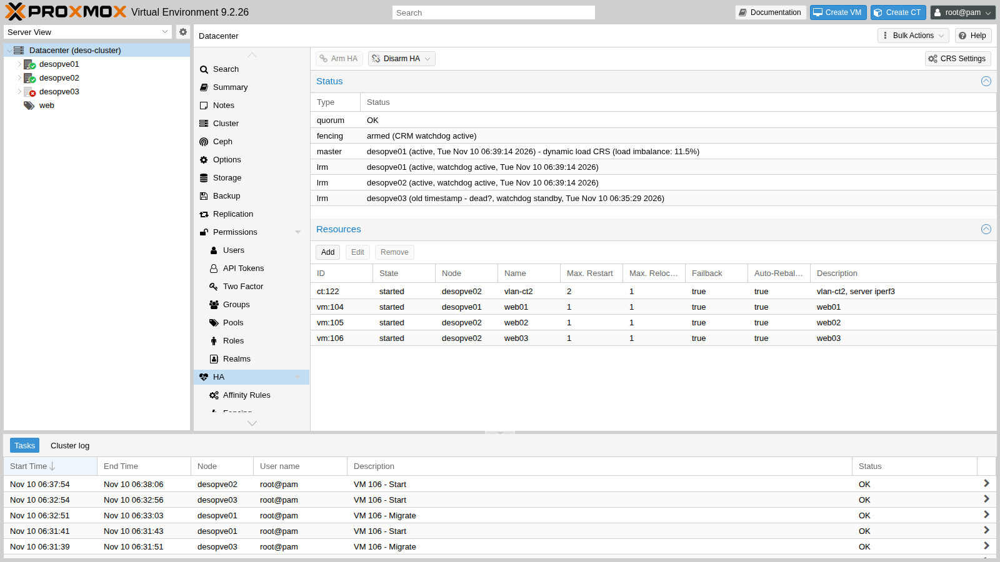

# Lab 49 – High availability: HA resources, affinity rules, dynamic CRS, maintenance, arm/disarm and a real failover

**Level:** advanced · **Duration:** 1 hour 30 minutes

## Dependencies

- **Previous labs:**
  - [Lab 06](06-cluster-corosync.md): the 3-node `deso-cluster` cluster, with Corosync on two links;
  - [Lab 17](17-ceph-installation.md): the shared storage `rbd-vm`, which holds all the disks of the HA resources;
  - [Lab 20](20-bridges-stable-names-vlans.md): CT 122 `vlan-ct2` on VLAN 10;
  - [Lab 22](22-dedicated-networks.md): the migration network on VLAN 100;
  - [Lab 40](40-templates-cloud-init-clones.md): the VMs `web01`-`web03` (104-106) with nginx;
  - [Lab 48](48-migrations.md): live migration, which HA uses to move resources.
- **Systems:**
  - nodes `desopve01`, `desopve02`, `desopve03`;
  - VMs 104 `web01`, 105 `web02`, 106 `web03` (172.27.199.104-106, nginx on port 80), all on `rbd-vm`;
  - CT 122 `vlan-ct2` (10.10.10.122 on VLAN 10), on `rbd-vm`.
- **Measurements:** from the management network, one HTTP request per second to `web03` and the `ha-manager` status every 5 s, with two loops left running in two terminals:

  ```bash
  while :; do printf '%s ' "$(date +%T)"; curl -s -m 1 -o /dev/null -w '%{http_code}\n' http://172.27.199.106/; sleep 1; done
  watch -n5 ha-manager status
  ```

  In the lab outputs, the `+N s` lines show the seconds elapsed since the start of the operation.

- **Credentials:** `root@pam` → [Appendix B](b-credentials-and-addresses.md).

## Objectives

- Understand how Proxmox VE HA makes decisions, monitors the nodes and fences them (*fencing*).
- Put VMs and containers under HA, from the GUI and from the CLI.
- Use the PVE 9 **affinity rules** (node affinity and resource affinity) instead of HA groups.
- Enable the **dynamic CRS** and watch **automatic rebalancing** move a VM on its own.
- Put a node in **maintenance mode** and find out when evacuation is not possible.
- Use HA **arm/disarm** for work on the whole cluster.
- Abruptly power off a node and measure fencing, recovery and the return of the service.

## How it works

**Two daemons.** Every node runs the *Local Resource Manager* (`pve-ha-lrm`), which starts, stops and migrates the resources of its own node. The *Cluster Resource Manager* (`pve-ha-crm`) also runs on every node, but only one of them is the **master**: it decides where each resource must run. The shared state lives in `/etc/pve/ha/` (`resources.cfg`, `rules.cfg`, `manager_status`), so it is valid only as long as the cluster has **quorum**.

**Self-fencing with the watchdog.** A node that hosts HA resources keeps a *watchdog* armed: `watchdog-mux` opens it and the LRM renews it at every cycle. If the node loses quorum it can no longer renew it, and after 60 s the watchdog reboots it: the node "fences" itself. The other nodes wait for its *lock* in the cluster file system to expire; at that point they are sure that the node is no longer writing to the shared disks, and they restart its resources elsewhere (*recovery*). The default watchdog is `softdog`, a software watchdog in the kernel; with a hardware watchdog (for example `ipmi_watchdog`) you choose the module in `/etc/default/pve-ha-manager`.

**Requirements:** at least 3 votes in the cluster (with an even number of nodes you add a *QDevice*, `pvecm qdevice setup <ip>`, which gives one extra vote to one of the two sides), shared storage for the resources, and reliable networks for Corosync.

**HA resources.** Every VM or CT under HA has a *requested state* (`started`, `stopped`, `disabled`, `ignored`), the number of attempts to restart it in place (`max_restart`) and to relocate it (`max_relocate`), `failback` and, new in 9.2, `auto-rebalance`.

**Affinity rules (PVE 9).** The old **HA groups** have been replaced by rules, and during the upgrade they are automatically converted into node affinity rules:

- **node affinity**: resources prefer (or avoid) certain nodes, with priorities; `strict` prevents them from using other nodes;
- **resource affinity**: resources stay **together** (*positive*) or **apart** (*negative*).

**CRS (Cluster Resource Scheduling).** It chooses the node for start and recovery:

- `basic`: counts only the number of resources per node;
- `static`: uses the *configured* CPU and RAM of the resources;
- `dynamic` (new in 9.2): also uses the *actual* CPU and RAM usage of the nodes.

With **Automatic Rebalance**, the CRS moves resources on its own when the imbalance between the nodes exceeds a threshold (default 30%) for a certain number of HA cycles (default 3) and the move reduces it by at least a margin (default 10%).

## Procedure

### 1. Watchdog and initial state

Before you create HA resources, the watchdog is loaded but not armed:

```bash
lsmod | grep softdog
systemctl status watchdog-mux --no-pager | head -3
grep -i watchdog /etc/default/pve-ha-manager
ha-manager status
```

``` { .text .no-copy title="Output" }
softdog                12288  2
● watchdog-mux.service - Proxmox VE watchdog multiplexer
     Loaded: loaded (/usr/lib/systemd/system/watchdog-mux.service; static)
     Active: active (running) since Mon 2026-11-09 14:31:33 CET; 16h ago
#WATCHDOG_MODULE=ipmi_watchdog
quorum OK
fencing standby (CRM watchdog standby)
```

### 2. Putting VMs and containers under HA

1. **Datacenter → HA → Resources → Add**. Choose VM 104 and keep the defaults: one restart attempt in place, one relocation attempt, `Failback` and `Auto-Rebalance` enabled, requested state `started`.

   

2. The other resources from the CLI:

   ```bash
   ha-manager set vm:104 --comment "web01"
   ha-manager add vm:105 --comment "web02"
   ha-manager add vm:106 --comment "web03"
   ha-manager add ct:122 --comment "vlan-ct2, server iperf3" --max_restart 2
   ha-manager status
   ```

   ``` { .text .no-copy title="Output" }
   quorum OK
   master desopve01 (active, Tue Nov 10 06:18:26 2026)
   fencing armed (CRM watchdog active)
   lrm desopve01 (active, watchdog active, Tue Nov 10 06:18:21 2026)
   lrm desopve02 (active, watchdog active, Tue Nov 10 06:18:29 2026)
   lrm desopve03 (active, watchdog active, Tue Nov 10 06:18:20 2026)
   service ct:122 (desopve02, started)
   service vm:104 (desopve01, started)
   service vm:105 (desopve02, started)
   service vm:106 (desopve03, started)
   ```

   From this moment on, the watchdog is **armed** on all three nodes: a node that loses quorum reboots itself.

### 3. Affinity rules

Groups can no longer be created:

```bash
ha-manager groupadd prova --nodes desopve01
```

``` { .text .no-copy title="Output" }
cannot create group: ha groups have been migrated to rules
```

1. **Datacenter → HA → Affinity Rules → HA Node Affinity Rules → Add**: `web01` prefers `desopve01` (priority 2) and then `desopve02` (priority 1), in a non-*strict* rule.

   

2. **HA Resource Affinity Rules → Add**: the three web servers must run on different nodes (*Keep Separate*).

   

   Saving fails. The same rule created from the CLI shows the reason:

   ```bash
   ha-manager rules add resource-affinity web-separati --resources vm:104,vm:105,vm:106 --affinity negative
   ```

   ``` { .text .no-copy title="Output" }
   create ha rule failed: 400 Rule 'web-separati' is invalid.
   resources: resources are in node affinity rules with multiple priorities
   ```

   A resource that is in a node affinity rule **with multiple priorities** cannot also be in a resource affinity rule. Simplify the node affinity to a single priority level and add the two resource affinity rules:

   ```bash
   # the ID of the rule created in the GUI is generated: read yours with 'ha-manager rules config'
   ha-manager rules set node-affinity ha-rule-076b9e15-d28b --nodes desopve01 --comment "web01 preferisce desopve01"
   ha-manager rules add resource-affinity web-separati --resources vm:104,vm:105,vm:106 --affinity negative --comment "i tre web server mai sullo stesso nodo"
   ha-manager rules add resource-affinity web02-con-ct122 --resources vm:105,ct:122 --affinity positive --comment "web02 e il suo backend sempre insieme"
   ha-manager rules config
   ```

   ``` { .text .no-copy title="Output" }
   ┌─────────┬────────┬───────────────────────┬───────────────────┬──────────────────────┬────────────────────────────────────────┐
   │ enabled │ state  │ rule                  │ type              │ resources            │ comment                                │
   ╞═════════╪════════╪═══════════════════════╪═══════════════════╪══════════════════════╪════════════════════════════════════════╡
   │ 1       │ in use │ ha-rule-076b9e15-d28b │ node-affinity     │ vm:104               │ web01 preferisce desopve01             │
   ├─────────┼────────┼───────────────────────┼───────────────────┼──────────────────────┼────────────────────────────────────────┤
   │ 1       │ in use │ web02-con-ct122       │ resource-affinity │ ct:122,vm:105        │ web02 e il suo backend sempre insieme  │
   ├─────────┼────────┼───────────────────────┼───────────────────┼──────────────────────┼────────────────────────────────────────┤
   │ 1       │ in use │ web-separati          │ resource-affinity │ vm:104,vm:105,vm:106 │ i tre web server mai sullo stesso nodo │
   └─────────┴────────┴───────────────────────┴───────────────────┴──────────────────────┴────────────────────────────────────────┘
   ```

### 4. Dynamic CRS

**Datacenter → HA → CRS Settings**: *Scheduling Mode* `Dynamic Load`, *Rebalance on Start* and *Automatic Rebalance* enabled, default thresholds.



In `/etc/pve/datacenter.cfg` this becomes:

```text
crs: ha-auto-rebalance=1,ha-rebalance-on-start=1,ha=dynamic
```

and the master announces it in the log:

```text
pve-ha-crm[1679]: switching scheduler mode from 'basic' to 'dynamic'
```

### 5. Node maintenance (and the anti-affinity trap)

1. With the `web-separati` rule still covering the **three** web servers, put `desopve03` in maintenance mode:

   ```bash
   ha-manager crm-command node-maintenance enable desopve03
   ```

   ``` { .text .no-copy title="Output" }
   --- +11 s
   lrm desopve03 (maintenance mode, watchdog active, Tue Nov 10 06:27:45 2026)
   service vm:106 (desopve03, started)
   ...
   --- +100 s
   lrm desopve03 (maintenance mode, watchdog active, Tue Nov 10 06:29:10 2026)
   service vm:106 (desopve03, started)
   ```

   `web03` **does not move**: `desopve01` hosts `web01`, `desopve02` hosts `web02`, and the rule forbids placing it next to them. The node is in maintenance mode, but it cannot be shut down.

   

   > A *Keep Separate* rule with as many resources as there are nodes leaves **zero** headroom: no evacuation for maintenance and no recovery after a failure. On 3 nodes, keep at most 2 resources apart.

2. Reduce the rule to two VMs. `web03` is evacuated immediately:

   ```bash
   ha-manager rules set resource-affinity web-separati --resources vm:104,vm:105
   ```

   ``` { .text .no-copy title="Output" }
   06:29:46 pve-ha-crm[1679]: migrate service 'vm:106' to node 'desopve02' (running)
   06:30:06 pve-ha-crm[1679]: service 'vm:106': state changed from 'migrate' to 'started'  (node = desopve02)
   ```

3. End of maintenance: the resources move back on their own to the node they came from.

   ```bash
   ha-manager crm-command node-maintenance disable desopve03
   ```

   ``` { .text .no-copy title="Output" }
   06:30:46 pve-ha-crm[1679]: node 'desopve03': state changed from 'maintenance' => 'online'
   06:30:46 pve-ha-crm[1679]: moving service 'vm:106' back to 'desopve03', node came back from maintenance.
   06:31:06 pve-ha-crm[1679]: service 'vm:106': state changed from 'migrate' to 'started'  (node = desopve03)
   ```

### 6. Automatic rebalancing

1. Create an imbalance. The `web-separati` rule now covers only `web01` and `web02`, so `web03` is free to move: move it to `desopve01`, where `web01` already runs, and load the CPUs of the two VMs:

   ```bash
   ha-manager crm-command migrate vm:106 desopve01
   for v in 104 106; do
     qm guest exec $v --timeout 1 -- sh -c 'for i in 1 2; do (timeout 900 sh -c "while :; do :; done") & done; wait'
   done
   ```

2. The imbalance measured by the CRS (`ha-manager status`, `master` line) and the reaction:

   ```text
   +13 s imbalance: 30.1% | service vm:106 (desopve01, started)
   +25 s imbalance: 54.8% | service vm:106 (desopve01, migrate)
   +50 s imbalance: 36.0% | service vm:106 (desopve03, starting)
   ```

   ```text
   06:32:47 pve-ha-crm[1679]: auto rebalance - migrate vm:106 to desopve03 (expected change for imbalance from 54.8% to 27.3%)
   06:32:47 pve-ha-crm[1679]: migrate service 'vm:106' to node 'desopve03'
   06:33:07 pve-ha-crm[1679]: service 'vm:106': state changed from 'migrate' to 'started'  (node = desopve03)
   ```

   After a few HA cycles above the threshold (`ha-auto-rebalance-hold-duration`, default 3), the CRS chose on its own the VM to move and the target node, with a 20 s live migration. `web01` stayed on `desopve01` because of its node affinity.

### 7. Arming and disarming HA

Maintenance mode applies to a single node. For work on the **whole cluster** (the Corosync network, updates that restart the cluster services) you **disarm** HA: the watchdogs are released everywhere and no node fences itself, not even without quorum.

```bash
ha-manager crm-command disarm-ha freeze
ha-manager status
```

``` { .text .no-copy title="Output" }
quorum OK
master desopve01 (active, Tue Nov 10 06:33:47 2026) - disarmed, resource mode: freeze - dynamic load CRS (load imbalance: 35.9%)
fencing disarmed, resource mode: freeze (CRM watchdog released)
lrm desopve01 (disarm mode, watchdog released, Tue Nov 10 06:33:46 2026)
lrm desopve02 (disarm mode, watchdog released, Tue Nov 10 06:33:50 2026)
lrm desopve03 (disarm mode, watchdog released, Tue Nov 10 06:33:49 2026)
service ct:122 (desopve02, freeze)
service vm:104 (desopve01, freeze)
service vm:105 (desopve02, freeze)
service vm:106 (desopve03, freeze)
```

``` { .text .no-copy title="Output" }
pve-ha-lrm[3086]: HA disarm requested, releasing agent lock and watchdog
pve-ha-lrm[3086]: watchdog closed (disabled)
```



- `freeze`: the resources stay under HA, but commands and state changes are not applied until HA is armed again;
- `ignore`: the resources leave HA control and are managed like normal VMs.

Arm it again with a command (or the **Arm HA** button):

```bash
ha-manager crm-command arm-ha
```

``` { .text .no-copy title="Output" }
fencing armed (CRM watchdog active)
lrm desopve01 (active, watchdog active, Tue Nov 10 06:34:51 2026)
```

### 8. A real failover: a node powered off abruptly

1. `web03` runs on `desopve03`. From the management network, one HTTP request per second is sent to 172.27.199.106, and on the master `ha-manager status` is recorded every 5 s.
2. Power off `desopve03` abruptly, as in a power failure:

   ```bash
   echo 1 > /proc/sys/kernel/sysrq
   echo o > /proc/sysrq-trigger
   ```

3. The master's log:

   ```text
   06:35:54 pve-ha-crm[1679]: node 'desopve03': state changed from 'online' => 'unknown'
   06:36:44 pve-ha-crm[1679]: service 'vm:106': state changed from 'started' to 'fence'
   06:36:44 pve-ha-crm[1679]: node 'desopve03': state changed from 'unknown' => 'fence'
   06:36:44 perl[1679]: notified via target `mail-to-root`
   06:37:44 pve-ha-crm[1679]: successfully acquired lock 'ha_agent_desopve03_lock'
   06:37:44 pve-ha-crm[1679]: fencing: acknowledged - got agent lock for node 'desopve03'
   06:37:44 pve-ha-crm[1679]: service 'vm:106': state changed from 'fence' to 'recovery'
   06:37:44 pve-ha-crm[1679]: recover service 'vm:106' from fenced node 'desopve03' to node 'desopve02'
   06:37:44 pve-ha-crm[1679]: service 'vm:106': state changed from 'recovery' to 'started'  (node = desopve02)
   ```

4. The measured sequence:

   | Time | Event | Since power-off |
   |---|---|---|
   | 06:35:36 | `desopve03` powered off | 0 s |
   | 06:35:38 | first failed HTTP request | 2 s |
   | 06:35:54 | the master sees the node as `unknown` | 18 s |
   | 06:36:44 | node and resource in `fence`, notification sent | 68 s |
   | 06:37:44 | node lock acquired: fencing confirmed, recovery on `desopve02` | 128 s |
   | 06:38:46 | the nginx of `web03` responds again | 190 s |

   About two minutes are needed to be **certain** that the lost node is no longer writing to the disks (the expiry of its lock); the rest is the boot of the VM. It is the price of data safety: no *split brain*.

   

5. The rest of the cluster during the failure:

   ```text
   Quorate:          Yes
   Total votes:      2
       health: HEALTH_WARN
               Degraded data redundancy: 11601/34803 objects degraded (33.333%), 79 pgs degraded, 97 pgs undersized
       osd: 7 osds: 4 up (since 3m), 7 in (since 12h)
   ```

   Quorum with 2 votes out of 3, and Ceph degraded but working (`min_size 2`): the VMs on the other nodes never stopped. The guests on `desopve03` that are **not** under HA (CT 123, 292, 302), on the other hand, stayed off: HA protects only what you entrust to it.

### 9. Bringing the node back and restoring the distribution

1. Power `desopve03` back on with the power button or from the remote management console (IPMI/iDRAC/iLO). In the lab it was powered on at 06:42:34 and rejoined the cluster 30 s later:

   ```text
   06:43:04 pve-ha-crm[1679]: node 'desopve03': state changed from 'unknown' => 'online'
   06:43:04 pve-ha-crm[1679]: fallback to 'basic' scheduler mode, init for 'dynamic' failed - did not get dynamic node usage information for 'desopve03'
   ```

   Until the node that has just come back publishes its load data, the CRS falls back to `basic` mode for one cycle.

2. `web03` **stays** on `desopve02`: no node affinity calls it back, and the imbalance (13.5%) is below the rebalancing threshold. The CTs that are not under HA must be started by hand (they do not have `onboot`):

   ```bash
   for c in 123 292 302; do pct start $c; done
   ha-manager crm-command migrate vm:106 desopve03
   ```

   ``` { .text .no-copy title="Output" }
   +7 s service vm:106 (desopve02, migrate)
   +38 s service vm:106 (desopve03, starting)
   +50 s service vm:106 (desopve03, started)
   ```

   Ceph rebuilds the missing copies and goes back to `HEALTH_OK`.

## Verification and tests

| Test | Result in the lab |
|---|---|
| HA groups in PVE 9 | refused: `ha groups have been migrated to rules` |
| Resource affinity on a resource with a multi-priority node affinity | refused: `resources are in node affinity rules with multiple priorities` |
| Automatic rebalancing (dynamic CRS) | imbalance 54.8% → automatic migration of `web03`, expected 27.3% |
| Maintenance with *Keep Separate* on 3 resources and 3 nodes | `web03` stuck on the node for over 100 s |
| Maintenance with the reduced rule | evacuation in 20 s, automatic return in 20 s |
| Disarm `freeze` | watchdogs released on all nodes, resources in `freeze` |
| Node powered off abruptly | fencing confirmed at 128 s, service reachable again at 190 s |
| Non-HA guests on the failed node | off until started by hand |

## Final lab state

- **HA resources**, all `started`, HA armed:
  - `vm:104` on `desopve01`, `vm:105` and `ct:122` on `desopve02`, `vm:106` on `desopve03`.
- **Rules:**
  - `ha-rule-076b9e15-d28b` (node affinity): `vm:104` prefers `desopve01`;
  - `web-separati` (negative resource affinity): `vm:104`, `vm:105`;
  - `web02-con-ct122` (positive resource affinity): `vm:105`, `ct:122`.
- **Datacenter:** `crs: ha-auto-rebalance=1,ha-rebalance-on-start=1,ha=dynamic`.
- Cluster with quorum 3/3, Ceph `HEALTH_OK`, CTs 123, 292 and 302 started again, guests in their initial locations.
- With HA active, a node that loses quorum reboots itself: before working on the Corosync network, use `disarm-ha`.

## What you learned

- Proxmox VE HA is based on quorum, shared storage and **self-fencing** with the watchdog: a node without quorum reboots itself, and the other nodes restart its resources only after its lock has expired.
- In PVE 9, groups have become **affinity rules**: node affinity for the preferred nodes, resource affinity to keep resources together or apart.
- A *Keep Separate* rule that is too tight can prevent both maintenance and recovery.
- The **dynamic CRS** with automatic rebalancing moves VMs based on the actual load.
- **Maintenance mode** drains a node and repopulates it at the end; **disarm/arm** suspends HA on the whole cluster.
- A real failover takes minutes, not seconds: two of them are needed to guarantee that the lost node has really stopped.

## References

- [Proxmox VE – High Availability](https://pve.proxmox.com/pve-docs/chapter-ha-manager.html)
- [Proxmox VE – ha-manager(1)](https://pve.proxmox.com/pve-docs/ha-manager.1.html)
- [Proxmox VE – datacenter.cfg, crs option](https://pve.proxmox.com/pve-docs/datacenter.cfg.5.html)
- [Proxmox VE – Corosync External Vote Support (QDevice)](https://pve.proxmox.com/pve-docs/chapter-pvecm.html#_corosync_external_vote_support)
