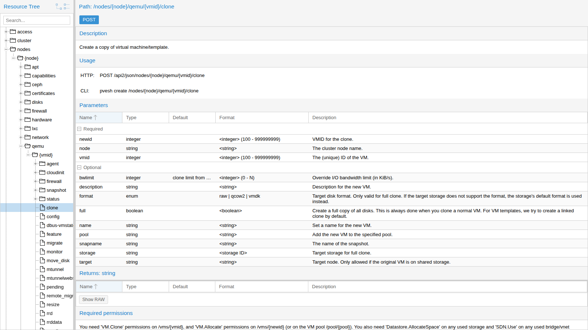
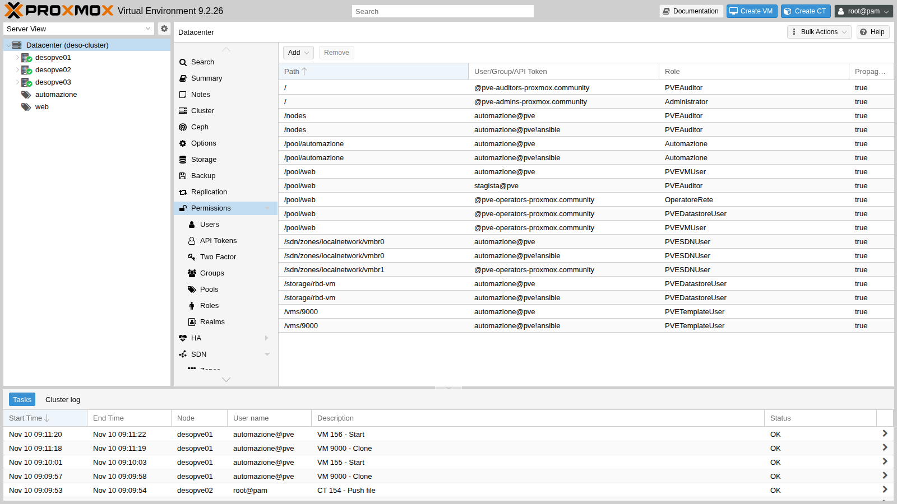
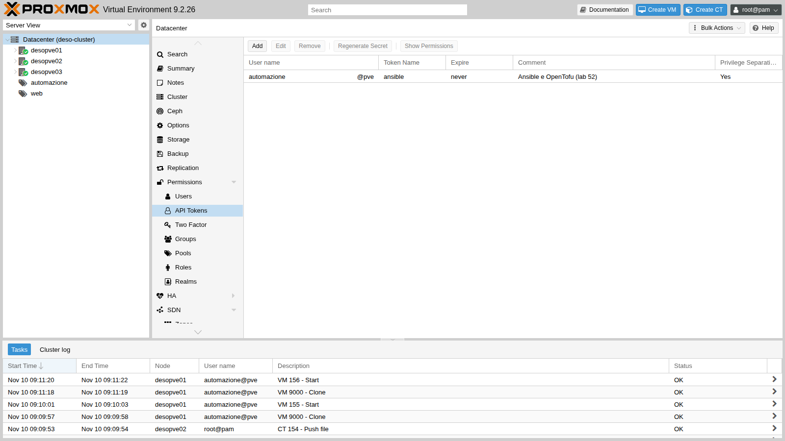
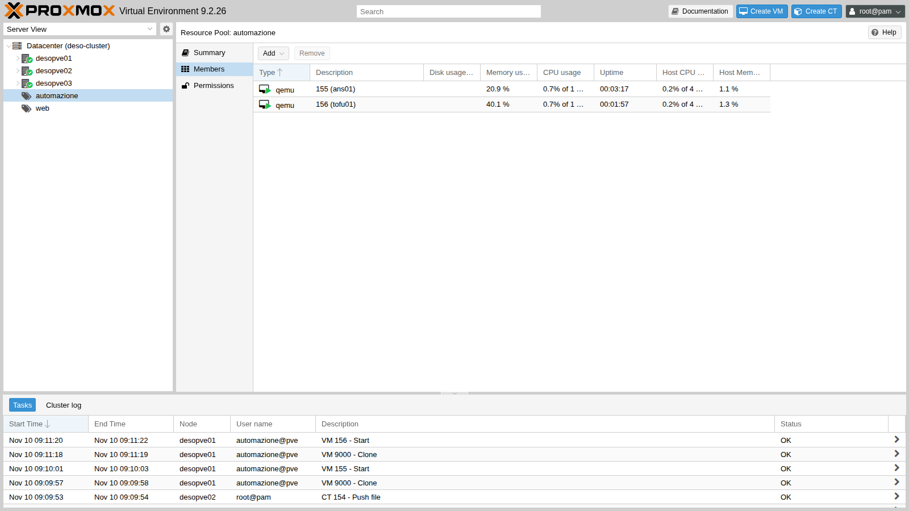
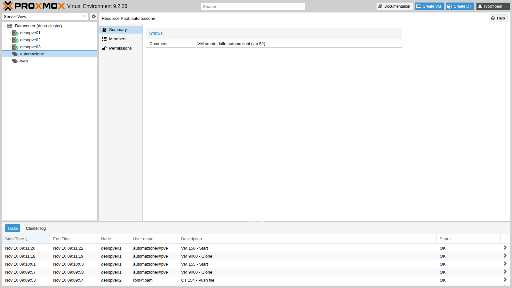

# Lab 52 – API and automation: `pvesh`, tickets and CSRF, API tokens, Ansible and OpenTofu

**Level:** advanced · **Duration:** 2 hours

## Dependencies

- **Previous labs:**
  - [Lab 05](05-ssh-shell-cli.md): `pvesh` and the command-line tools;
  - [Lab 40](40-templates-cloud-init-clones.md): the `9000` `debian13-cloud` template with cloud-init;
  - [Lab 44](44-users-groups-roles-pools-tokens.md): roles, pools, ACLs, the `automazione@pve` user and tokens with privilege separation;
  - [Lab 17](17-ceph-installation.md): the `rbd-vm` storage.
- **Systems:** the `deso-cluster` cluster; the new container `154` `automazione` (172.27.199.154) as the automation workstation.
- **Addresses for the test VMs:** 172.27.199.155 (`ans01`, Ansible) and 172.27.199.156 (`tofu01`, OpenTofu).
- **Credentials:** `root@pam` → [Appendix B](b-credentials-and-addresses.md). The token secret is shown only once, when the token is created.
- **Lab files:** [`crea-vm.yml`](../files/52/crea-vm.yml) and [`elimina-vm.yml`](../files/52/elimina-vm.yml) (Ansible playbooks), [`main.tf`](../files/52/main.tf) (OpenTofu configuration) and [`api-demo.sh`](../files/52/api-demo.sh) (script of the tests with `curl`).

## Objectives

- Understand how the Proxmox VE REST API is structured and use it with `pvesh`, with `curl` and from the API viewer.
- Authenticate with **ticket and CSRF** and with an **API token**, and understand when to use one or the other.
- Build a **minimal** role and set of ACLs for an automation, starting from the permissions each call requires.
- Create VMs from a cloud-init template with **Ansible** and with **OpenTofu**, verify idempotency and clean up.

## How it works

**A single API.** The web interface, `pvesh`, `qm`, `pct` and the external tools all use the same REST API, exposed by `pveproxy` at `https://<nodo>:8006/api2/json/`. The resources are organized as a tree (`/nodes/{node}/qemu/{vmid}/...`, `/cluster/...`, `/access/...`, `/pools`, `/storage`), and the HTTP methods map to the `pvesh` commands: `GET` = `pvesh get`, `POST` = `pvesh create`, `PUT` = `pvesh set`, `DELETE` = `pvesh delete`. Any node of the cluster answers for the whole cluster and forwards requests to the right node.

**Ticket.** With a user name and password (`POST /access/ticket`) you get a **ticket**, valid for two hours, to send as the `PVEAuthCookie` cookie, and a **CSRFPreventionToken**, mandatory in the header of every request that changes something. This is the mechanism the web interface uses. If the user has 2FA, the ticket also requires the second factor ([Lab 45](45-two-factor-authentication.md)).

**API token.** A token (`utente@realm!nome`) with its secret is sent in the `Authorization: PVEAPIToken=…` header: no ticket, no CSRF, no 2FA, and it can be revoked on its own. With **privilege separation** the token has only the permissions explicitly assigned to it, and never more than those of its user ([Lab 44](44-users-groups-roles-pools-tokens.md)). It is the right method for automation.

**Ansible and OpenTofu.** Ansible runs a sequence of tasks ("create the clone, set cloud-init, start it"), and the modules of the `community.proxmox` collection call the API through the `proxmoxer` library. OpenTofu (the open source fork of Terraform) describes the **desired state** in a file: it compares the real state with the written one and applies only the differences; the `bpg/proxmox` provider translates the resources into API calls.

## Procedure

### 1. Exploring the API with `pvesh` and the API viewer

`pvesh` navigates the tree like a file system. The letters show what you can do on each branch (`r` = GET, `c` = POST, `w` = PUT, `D` = contains other branches):

```bash
pvesh ls /nodes/desopve01 | head -8
pvesh get /cluster/resources --type node --output-format json | python3 -c 'import sys, json
for n in json.load(sys.stdin): print(n["node"], n["status"], "%.1f %%" % (n["cpu"] * 100))'
pvesh usage /nodes/{node}/qemu/{vmid}/clone
```

```text
-r-c-        aplinfo
Dr---        apt
Dr---        capabilities
Dr---        ceph
Dr---        certificates
-rw--        config
Dr---        disks
-rw--        dns
```

```text
desopve01 online 19.0 %
desopve02 online 7.8 %
desopve03 online 9.3 %
```

```text
USAGE: pvesh create /nodes/{node}/qemu/{vmid}/clone --newid <integer> [OPTIONS]
```

The complete documentation of every call is in the **API viewer**, published by every node at `https://<nodo>:8006/pve-docs/api-viewer/`. For each path it shows the parameters, the return values and, at the bottom, the **required permissions**. Cloning a VM requires `VM.Clone` on the template, `VM.Allocate` on the new VM or on its pool, `Datastore.AllocateSpace` on the storage and `SDN.Use` on the bridge:



### 2. The automation workstation

A dedicated Debian 13 container, CT 154 `automazione`, with Ansible from the distribution and OpenTofu from the official package on GitHub:

```bash
pct create 154 cephfs:vztmpl/debian-13-standard_13.6-1_amd64.tar.zst --hostname automazione \
  --unprivileged 1 --features nesting=1 --cores 2 --memory 1024 --rootfs rbd-vm:8 \
  --net0 name=eth0,bridge=vmbr0,ip=172.27.199.154/24,gw=172.27.199.1 \
  --nameserver 172.27.199.20 --searchdomain proxmox.community --password '<lab-password>'
pct start 154
pct enter 154
```

Besides the Debian repositories, the lab proxy must allow the domains `github.com`, `objects.githubusercontent.com` and `release-assets.githubusercontent.com` (downloads of OpenTofu and of the provider) and `registry.opentofu.org` (for `tofu init`). Inside the container:

```bash
echo 'Acquire::http::Proxy "http://proxy.proxmox.community:3128";' > /etc/apt/apt.conf.d/80proxy
apt-get update && apt-get install -y ansible python3-proxmoxer python3-requests curl jq
export https_proxy=http://proxy.proxmox.community:3128
V=$(curl -sI https://github.com/opentofu/opentofu/releases/latest | grep -i ^location | sed -E 's#.*/tag/v([0-9.]+).*#\1#' | tr -d '\r')
curl -fsSL -o /tmp/tofu.deb https://github.com/opentofu/opentofu/releases/download/v$V/tofu_${V}_amd64.deb
dpkg -i /tmp/tofu.deb
ssh-keygen -t ed25519 -N "" -C automazione@proxmox.community -f /root/.ssh/id_ed25519
```

```text
ansible [core 2.19.11]
ansible 12.0.0+dfsg-0+deb13u1
python3-proxmoxer 2.2.0-1
OpenTofu v1.13.9
```

The `community.proxmox` collection, which contains `proxmox_kvm`, is already included in the Debian 13 `ansible` package.

**Certificate verification.** Automation must not disable TLS verification. The certificate of the nodes is signed by the cluster CA (`/etc/pve/pve-root-ca.pem`). Just copy it into the container and add it to the system CAs, which both Python and OpenTofu use. From the node that hosts the container:

```bash
pct push 154 /etc/pve/pve-root-ca.pem /usr/local/share/ca-certificates/pve-root-ca.crt
pct exec 154 -- update-ca-certificates
pct exec 154 -- curl -s -o /dev/null -w "%{http_code} verify=%{ssl_verify_result}\n" \
  https://desopve01.proxmox.community:8006/api2/json/version
```

```text
401 verify=0
```

`verify=0` means the certificate is valid; `401` because the request is not authenticated.

### 3. Minimal permissions: role, pool and token

The VMs created by automation end up in a **dedicated pool**, and the token can do only what it needs. The `Automazione` role collects the privileges on the VMs; the rest comes from built-in roles on specific paths:

```bash
pveum pool add automazione --comment "VM create dalle automazioni (lab 52)"
pveum role add Automazione --privs "VM.Allocate VM.Clone VM.Config.CDROM VM.Config.CPU \
  VM.Config.Cloudinit VM.Config.Disk VM.Config.HWType VM.Config.Memory VM.Config.Network \
  VM.Config.Options VM.Audit VM.PowerMgmt VM.GuestAgent.Audit Pool.Audit"
pveum user token add automazione@pve ansible --privsep 1 --comment "Ansible e OpenTofu (lab 52)"

for chi in '--users automazione@pve' '--tokens automazione@pve!ansible'; do
  pveum acl modify /pool/automazione --roles Automazione $chi
  pveum acl modify /vms/9000 --roles PVETemplateUser $chi
  pveum acl modify /storage/rbd-vm --roles PVEDatastoreUser $chi
  pveum acl modify /sdn/zones/localnetwork/vmbr0 --roles PVESDNUser $chi
  pveum acl modify /nodes --roles PVEAuditor $chi
done
```

| Path | Role | What it is for |
|---|---|---|
| `/pool/automazione` | `Automazione` | create, configure and start the VMs of the pool |
| `/vms/9000` | `PVETemplateUser` | clone the template (`VM.Clone`, `VM.Audit`) |
| `/storage/rbd-vm` | `PVEDatastoreUser` | allocate the disks (`Datastore.AllocateSpace`) |
| `/sdn/zones/localnetwork/vmbr0` | `PVESDNUser` | connect the network device to `vmbr0` (`SDN.Use`) |
| `/nodes` | `PVEAuditor` | read nodes and resources (needed by OpenTofu) |

With privilege separation the ACLs must be given **both to the user and to the token**: the token gets the intersection of the two. The token secret is shown only once and must be kept in a safe place. In the lab it is stored in `/root/.pve-token` in CT 154, readable only by root. To put it there without going through intermediate files, instead of the `token add` above you can run this directly (on the node that hosts CT 154):

```bash
pveum user token add automazione@pve ansible --privsep 1 --comment "Ansible e OpenTofu (lab 52)" --output-format json \
  | python3 -c 'import sys,json; print(json.load(sys.stdin)["value"])' \
  | pct exec 154 -- sh -c 'umask 077; cat > /root/.pve-token'
```





The effective permissions of the token on the pool:

```bash
pveum user token permissions automazione@pve ansible --path /pool/automazione
```

```text
│ /pool/automazione │ Pool.Audit (*)          │
│                   │ VM.Allocate (*)         │
│                   │ VM.Audit (*)            │
│                   │ VM.Clone (*)            │
│                   │ VM.Config.CDROM (*)     │
…
│                   │ VM.PowerMgmt (*)        │
```

### 4. The API with `curl`: ticket, CSRF and token

The [`api-demo.sh`](../files/52/api-demo.sh) script, run in CT 154, shows the two authentication methods. Before running it, in the same shell, enter the `root@pam` password without leaving it in the history: `read -rs PW; export PW`.

```bash
API=https://desopve01.proxmox.community:8006/api2/json
R=$(curl -s -d "username=root@pam" --data-urlencode "password=$PW" $API/access/ticket)
TICKET=$(echo "$R" | jq -r .data.ticket); CSRF=$(echo "$R" | jq -r .data.CSRFPreventionToken)
curl -s -b "PVEAuthCookie=$TICKET" $API/nodes
curl -s -b "PVEAuthCookie=$TICKET" -X POST -d "poolid=prova-api" $API/pools
curl -s -b "PVEAuthCookie=$TICKET" -H "CSRFPreventionToken: $CSRF" -X POST -d "poolid=prova-api" $API/pools
```

```text
== 1. ticket
ticket: PVE:root@pam:6AF2D114::k… (valido 2 ore)
CSRFPreventionToken: 6AF2D114:AOl…
== 2. GET con il cookie
desopve01 online cpu=14% mem=9/31 GiB
desopve02 online cpu=8% mem=7/31 GiB
desopve03 online cpu=9% mem=6/31 GiB
== 3. scrittura senza e con CSRF
POST /pools senza CSRF: HTTP 401
POST /pools con CSRF: HTTP 200
DELETE /pools/prova-api con CSRF: HTTP 200
```

With the token there is no CSRF, but the ACLs apply:

```bash
H='Authorization: PVEAPIToken=automazione@pve!ansible='"$SECRET"     # single quotes: "!" in an interactive shell
curl -s -H "$H" "$API/cluster/resources?type=vm"
curl -s -H "$H" $API/nodes/desopve01/qemu/100/config
curl -s -H "$H" -X POST -d "poolid=prova-token" $API/pools
```

```text
== 4. API token
9000 debian13-cloud desopve01 template=1
GET config della VM 100 con il token: HTTP 403
{"data":null,"message":"Permission check failed (/pool/prova-token, Pool.Allocate)\n"}
```

The token sees **only one** VM of the cluster, the template, because it is the only one it has permissions on. Reading VM 100 or creating a pool is denied, and the message states exactly which privilege is missing on which path.

### 5. Ansible: a VM from the template

The [`crea-vm.yml`](../files/52/crea-vm.yml) playbook uses `module_defaults` so that it does not have to repeat the API connection in every task:

```yaml
- name: VM da template con cloud-init
  hosts: localhost
  gather_facts: false
  module_defaults:
    group/community.proxmox.proxmox:
      api_host: desopve01.proxmox.community
      api_user: automazione@pve
      api_token_id: ansible
      api_token_secret: "{{ lookup('file', '/root/.pve-token') }}"
      validate_certs: true
  vars:
    vm_id: 155
    vm_nome: ans01
    vm_ip: 172.27.199.155
  tasks:
    - name: Linked clone del template debian13-cloud
      community.proxmox.proxmox_kvm:
        node: desopve01
        clone: debian13-cloud
        vmid: 9000
        newid: "{{ vm_id }}"
        name: "{{ vm_nome }}"
        pool: automazione
        full: false
        timeout: 300
    - name: Cloud-init, CPU e RAM
      community.proxmox.proxmox_kvm:
        node: desopve01
        vmid: "{{ vm_id }}"
        update: true
        update_unsafe: false
        cores: 1
        memory: 1024
        ciuser: labuser
        sshkeys: "{{ lookup('file', '/root/.ssh/id_ed25519.pub') }}"
        ipconfig:
          ipconfig0: "ip={{ vm_ip }}/24,gw=172.27.199.1"
        nameservers: [172.27.199.20]
        searchdomains: [proxmox.community]
    - name: Avvio
      community.proxmox.proxmox_kvm:
        node: desopve01
        vmid: "{{ vm_id }}"
        state: started
    - name: Attesa di SSH sulla VM
      ansible.builtin.wait_for:
        host: "{{ vm_ip }}"
        port: 22
        timeout: 300
```

The lab files (`crea-vm.yml`, `elimina-vm.yml`, `main.tf` and `api-demo.sh`, listed in the [Dependencies](#dependencies)) must be copied into CT 154, from the node that hosts it:

```bash
pct exec 154 -- mkdir -p /root/ansible /root/tofu
pct push 154 crea-vm.yml /root/ansible/crea-vm.yml
pct push 154 elimina-vm.yml /root/ansible/elimina-vm.yml
pct push 154 main.tf /root/tofu/main.tf
pct push 154 api-demo.sh /root/api-demo.sh
```

Then, in CT 154:

```bash
cd /root/ansible && time ansible-playbook crea-vm.yml
```

```text
TASK [Linked clone del template debian13-cloud] ********************************
changed: [localhost]
TASK [Cloud-init, CPU e RAM] ***************************************************
changed: [localhost]
TASK [Avvio] *******************************************************************
changed: [localhost]
TASK [Attesa di SSH sulla VM] **************************************************
ok: [localhost]
PLAY RECAP *********************************************************************
localhost                  : ok=4    changed=3    unreachable=0    failed=0    skipped=0    rescued=0    ignored=0
real	0m38.381s
```

In 38 seconds the VM is cloned, configured and reachable. Cloud-init has applied the name, the IP address and the key:

```bash
ssh labuser@172.27.199.155 "hostname; ip -4 -br a show scope global; cloud-init status"
```

```text
ans01
eth0             UP             172.27.199.155/24
status: done
```

**Idempotency.** A second run without changes:

```text
TASK [Linked clone del template debian13-cloud] ********************************
ok: [localhost]
TASK [Cloud-init, CPU e RAM] ***************************************************
changed: [localhost]
TASK [Avvio] *******************************************************************
ok: [localhost]
localhost                  : ok=4    changed=1    unreachable=0    failed=0    skipped=0    rescued=0    ignored=0
```

The clone and start tasks recognize that the VM already exists and is running. The task with `update: true`, on the other hand, rewrites the configuration and always reports `changed`, even when the values are the same: it does no harm, but in a compliance report it is a false positive you should know about.

### 6. OpenTofu: the same thing as desired state

The [`main.tf`](../files/52/main.tf) file describes the `tofu01` VM:

```hcl
terraform {
  required_providers {
    proxmox = {
      source = "bpg/proxmox"
    }
  }
}

variable "token_secret" {
  type      = string
  sensitive = true
}

provider "proxmox" {
  endpoint  = "https://desopve01.proxmox.community:8006/"
  api_token = "automazione@pve!ansible=${var.token_secret}"
  insecure  = false
}

resource "proxmox_virtual_environment_vm" "tofu01" {
  name      = "tofu01"
  node_name = "desopve01"
  vm_id     = 156
  pool_id   = "automazione"
  clone {
    vm_id = 9000
    full  = false
  }
  agent { enabled = false }
  cpu { cores = 1 }
  memory { dedicated = 1024 }
  network_device { bridge = "vmbr0" }
  initialization {
    datastore_id = "rbd-vm"
    ip_config {
      ipv4 {
        address = "172.27.199.156/24"
        gateway = "172.27.199.1"
      }
    }
    dns {
      servers = ["172.27.199.20"]
      domain  = "proxmox.community"
    }
    user_account {
      username = "labuser"
      keys     = [trimspace(file("/root/.ssh/id_ed25519.pub"))]
    }
  }
}
```

The secret is not in the file: it comes from an environment variable. The provider download goes through the proxy, while the API of the nodes does not (`NO_PROXY`):

```bash
cd /root/tofu
export HTTPS_PROXY=http://proxy.proxmox.community:3128 NO_PROXY=proxmox.community,172.27.199.0/24
export TF_VAR_token_secret=$(cat /root/.pve-token)
tofu init
tofu plan
tofu apply -auto-approve
```

```text
- Installing bpg/proxmox v0.121.0...
- Installed bpg/proxmox v0.121.0 (signed, key ID 0B3405B36193A495)
OpenTofu has been successfully initialized!
  # proxmox_virtual_environment_vm.tofu01 will be created
Plan: 1 to add, 0 to change, 0 to destroy.
proxmox_virtual_environment_vm.tofu01: Creating...
proxmox_virtual_environment_vm.tofu01: Creation complete after 5s [id=156]
Apply complete! Resources: 1 added, 0 changed, 0 destroyed.
```

`agent { enabled = false }` is intentional: the template does not have the guest agent installed, and with the agent enabled the provider would wait for an IP address that never comes. The VM answers with the name and the IP address set by cloud-init:

```text
tofu01
status: done
```

A second `tofu plan`, without changes:

```text
No changes. Your infrastructure matches the configuration.
```

The two VMs in the pool, and the tasks logged under the name of the automation user:





### 7. Cleanup

With OpenTofu you destroy what the file describes; with Ansible you need a removal playbook ([`elimina-vm.yml`](../files/52/elimina-vm.yml)), with `state: stopped` and then `state: absent`:

```bash
tofu destroy -auto-approve
ansible-playbook /root/ansible/elimina-vm.yml
```

```text
proxmox_virtual_environment_vm.tofu01: Destroying... [id=156]
proxmox_virtual_environment_vm.tofu01: Destruction complete after 5s
Destroy complete! Resources: 1 destroyed.
changed: [localhost]
changed: [localhost]
localhost                  : ok=2    changed=2    unreachable=0    failed=0    skipped=0    rescued=0    ignored=0
```

The pool is empty again:

```bash
pvesh get /pools/automazione --output-format json
```

```text
{"comment":"VM create dalle automazioni (lab 52)","members":[],"poolid":"automazione"}
```

## Verification and tests

| Test | Result |
|---|---|
| Certificate of the nodes verified from CT 154 with the cluster CA | `verify=0` |
| `POST` with the ticket, without CSRF | HTTP 401 |
| `POST` with the ticket and the CSRF token | HTTP 200 |
| Token: list of the cluster VMs | only template 9000 |
| Token: configuration of VM 100 | HTTP 403 |
| Token: creation of a pool | `Permission check failed (/pool/prova-token, Pool.Allocate)` |
| Ansible, first run | VM `ans01` ready in 38 s, reachable over SSH |
| Ansible, second run | `changed=1` (only the `update` task) |
| OpenTofu `apply` | VM `tofu01` created in 5 s |
| OpenTofu, second `plan` | `No changes` |
| Cleanup | pool `automazione` empty |

## Final lab state

- **CT 154 `automazione`** on `desopve02`, running, 172.27.199.154:
  - Ansible 12 (ansible-core 2.19) with `community.proxmox` and `python3-proxmoxer`, OpenTofu 1.13.9;
  - the cluster CA among the system CAs;
  - SSH key `/root/.ssh/id_ed25519` and token secret in `/root/.pve-token`;
  - playbooks in `/root/ansible`, OpenTofu configuration in `/root/tofu` (empty state after the `destroy`).
- **Pool `automazione`**, empty.
- **Role `Automazione`** and token `automazione@pve!ansible` with privilege separation, with the ACLs of the table in step 3 (both for the user and for the token). The ACLs of [Lab 44](44-users-groups-roles-pools-tokens.md) on `/pool/web` are unchanged.
- Test VMs 155 and 156 deleted.

## What you learned

- The web interface, the CLI and the external tools use the same API: `pvesh` and the **API viewer** are the quickest way to understand a call and the permissions it requires.
- The **ticket** is meant for interactive sessions and requires the **CSRFPreventionToken** for writes; the **token** has neither CSRF nor 2FA and is the right method for automation.
- The permissions of an automation are built starting from the "Required permissions" of the calls: a dedicated pool, a tailored role, built-in roles on storage, bridge and template.
- With privilege separation the ACLs go both to the user and to the token; a 403 tells you the missing privilege and path.
- Ansible runs tasks, and not all modules are idempotent; OpenTofu compares the desired state with the real one and changes nothing if they match.
- Automation verifies the cluster certificate instead of disabling TLS verification.

## References

- [Proxmox VE – API](https://pve.proxmox.com/wiki/Proxmox_VE_API)
- [Proxmox VE – API viewer](https://pve.proxmox.com/pve-docs/api-viewer/)
- [Proxmox VE – User Management, API tokens](https://pve.proxmox.com/pve-docs/chapter-pveum.html#pveum_tokens)
- [Ansible – community.proxmox collection](https://docs.ansible.com/ansible/latest/collections/community/proxmox/)
- [OpenTofu – Installation](https://opentofu.org/docs/intro/install/)
- [bpg/proxmox provider](https://search.opentofu.org/provider/bpg/proxmox/latest)
