# Lab 53 – Proxmox Datacenter Manager: PVE and PBS remotes, dashboard, updates, migration between remotes

**Level:** intermediate · **Duration:** 1 hour 30 minutes

## Dependencies

- **Previous labs:**
  - [Lab 25](25-ipv6.md): the IPv6 configuration of the hosts (file `90-ipv6-host.conf`);
  - [Lab 03](03-install-proxmox-ve.md) and [Lab 04](04-first-access-repositories-updates.md): installer, no-subscription repository and proxy, with the same procedure;
  - [Lab 40](40-templates-cloud-init-clones.md): template 9000 `debian13-cloud`, from which the migration test VM is cloned;
  - [Lab 44](44-users-groups-roles-pools-tokens.md): users, roles and API tokens;
  - [Lab 47](47-proxmox-backup-server.md): the Proxmox Backup Server `desopbs01`;
  - [Lab 48](48-migrations.md): `qm remote-migrate` and its limits, which PDM uses behind the scenes;
  - [Lab 30](30-sdn-evpn.md): the EVPN zone `evpnz`, which PDM displays.
- **Systems:**
  - the server `desopdm01.proxmox.community` (172.27.199.41) for PDM: 2 cores, 4 GB of RAM, a 32 GB disk;
  - the cluster `deso-cluster`, the standalone node `desopve04` and the PBS `desopbs01`.
- **ISO:** `proxmox-datacenter-manager_1.1-1.iso`.
- **Credentials:** `root@pam` and the lab password → [Appendix B](b-credentials-and-addresses.md).

## Objectives

- Install Proxmox Datacenter Manager (PDM) and prepare it like a PVE node: repositories, updates, NTP.
- Connect a PVE cluster, a standalone PVE node and a PBS as **remotes**, with dedicated tokens.
- Use the dashboard, the global search, the updates view and the EVPN view.
- Migrate a VM **between two different datacenters** from the PDM GUI, and run into its limits.

## How it works

**One pane of glass over several datacenters.** A Proxmox VE cluster can be managed from any of its nodes, but each cluster (or standalone node) is a world of its own, with its own GUI and its own users. PDM is a separate application, with its own installation, that connects to several PVE clusters and several PBS instances through their APIs and shows everything in a single interface: status, resources, search, updates, tasks. It does not replace the GUI of the clusters: for detailed operations it sends you there with the **Open Web UI** button.

**Remotes and tokens.** Each connected system is a **remote**. PDM authenticates with an **API token** of the remote: it can create the token by itself from a user name and password, or use an existing one. It verifies the certificate by its fingerprint and, for a cluster, saves all the nodes as **endpoints**, so it keeps working if a node is down.

**Migration between remotes.** Between two different PVE remotes, PDM uses the same `remote-migrate` function as in [Lab 48](48-migrations.md): a websocket tunnel on port 8006 between the source node and the target node, with the token of the target remote. PDM adds the GUI, the choice of target storage and bridge, and a view of the tasks on both sides.

## Procedure

### 1. Installation

The installer is the same as the Proxmox VE one ([Lab 03](03-install-proxmox-ve.md)):

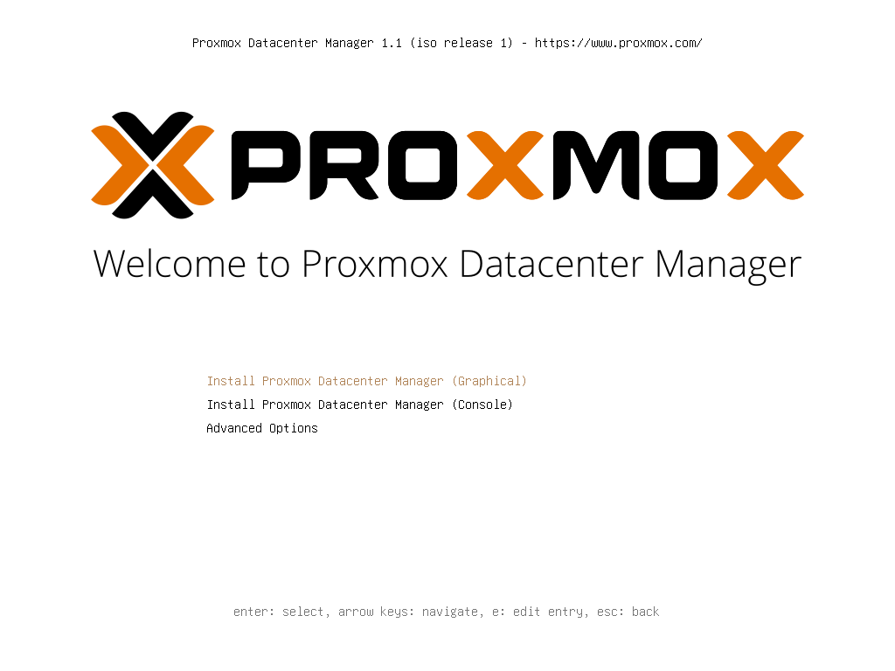

A 32 GB target disk with ext4: PDM hosts no VMs and a few GB are enough for it.

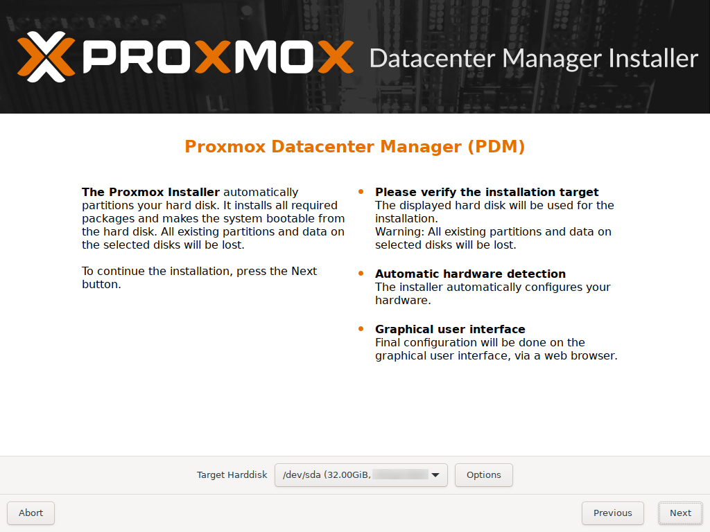

Static network with the final host name and pinned network card names (`nic0`), as for the nodes:

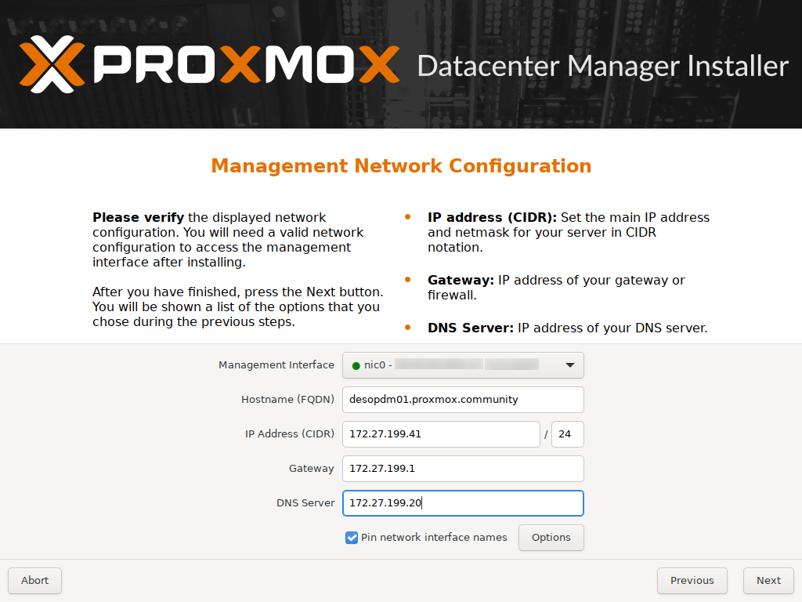

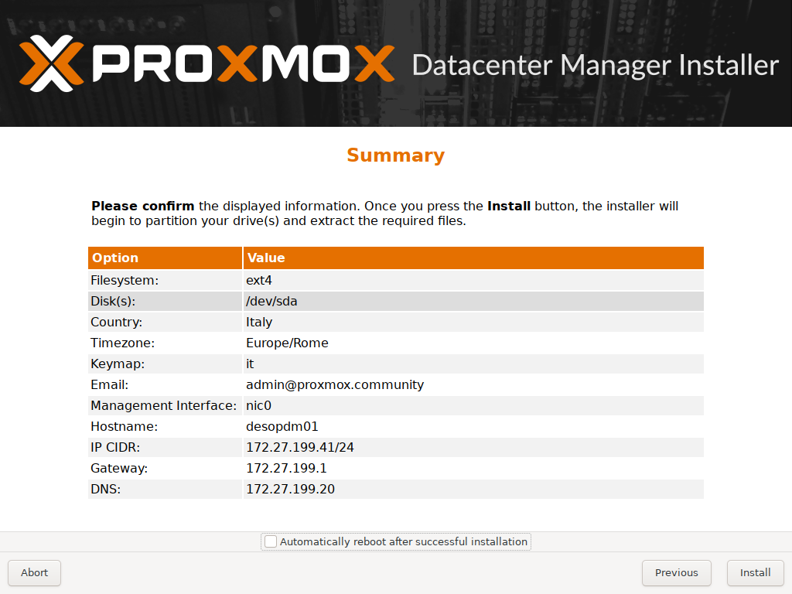

After the reboot, the console shows the address of the GUI, on port **8443** (not 8006):

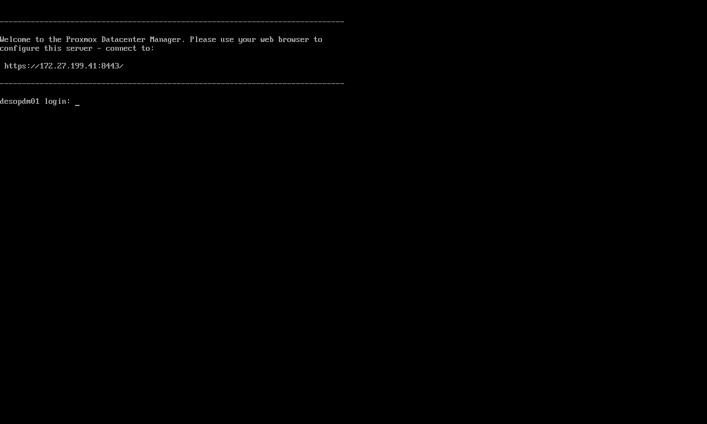

### 2. Repositories, proxy, NTP and update

As on a PVE node without a subscription, disable the enterprise repository and add `pdm-no-subscription`:

```bash
sed -i "s/^Components: pdm-enterprise/Components: pdm-enterprise\nEnabled: false/" /etc/apt/sources.list.d/pdm-enterprise.sources
cat > /etc/apt/sources.list.d/proxmox.sources <<'EOF'
Types: deb
URIs: http://download.proxmox.com/debian/pdm
Suites: trixie
Components: pdm-no-subscription
Signed-By: /usr/share/keyrings/proxmox-archive-keyring.gpg
EOF
echo 'Acquire::http::Proxy "http://proxy.proxmox.community:3128";' > /etc/apt/apt.conf.d/80proxy
sed -i "s/^pool 2.debian.pool.ntp.org iburst/server ntp.proxmox.community iburst/" /etc/chrony/chrony.conf
systemctl restart chrony
apt update && apt full-upgrade
```

The ISO installed version 1.1.1. After the update, with 111 new packages:

```text
proxmox-datacenter-manager 1.1.9 running version: 1.1.9
proxmox-datacenter-manager-ui 1.1.4
^* netsvc.proxmox.community      3   6    17    48  -9031ns[  -34us] +/-   23ms
System clock synchronized: yes
```

**IPv6 as on the nodes.** As for the nodes in [Lab 25](25-ipv6.md), here too there is no autoconfiguration from the router's RAs, and the link-local addresses are not derived from the MAC. Create the same `/etc/sysctl.d/90-ipv6-host.conf` file and apply it with `sysctl --system`; it takes full effect from the next reboot. On `desopdm01`:

```bash
cat /etc/sysctl.d/90-ipv6-host.conf
```

``` { .text .no-copy title="Output" }
# Indirizzi IPv6 del nodo solo statici: nessuna interfaccia accetta gli RA o si autoconfigura (SLAAC).
# Il carattere * vale anche per le schede che compaiono dopo l'avvio (systemd le applica a ogni nuova interfaccia).
net.ipv6.conf.*.accept_ra = 0
net.ipv6.conf.*.autoconf = 0
# Link-local non derivati dal MAC (RFC 7217, "stable privacy" con segreto casuale)
net.ipv6.conf.all.addr_gen_mode = 3
net.ipv6.conf.default.addr_gen_mode = 3
```

The first login, at `https://desopdm01.proxmox.community:8443` with `root@pam`, shows an empty PDM, which already offers to add **PVE** and **PBS** remotes:

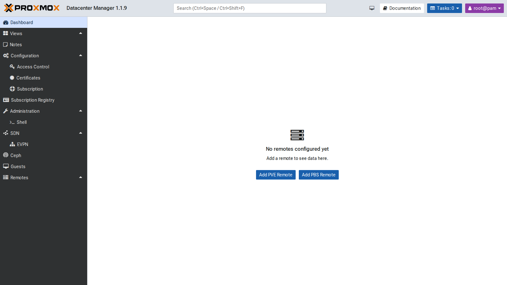

### 3. Tokens for PDM on the remotes

A dedicated user on each remote makes it clear, in the logs and in the tasks, what PDM did. On the cluster and on `desopve04` (which has its own user database):

```bash
pveum user add pdm@pve --comment "Proxmox Datacenter Manager (lab 53)"
pveum acl modify / --users pdm@pve --roles Administrator
pveum user token add pdm@pve pdm --privsep 0 --comment "PDM desopdm01"
```

The `Administrator` role is needed because PDM must be able to migrate, start and stop guests, and read the available updates. For a **read-only** PDM, `PVEAuditor` is enough. On the PBS, PDM only needs to read, hence the `Audit` role; on PBS, tokens always have their own ACLs:

```bash
proxmox-backup-manager user create pdm@pbs --comment "Proxmox Datacenter Manager (lab 53)"
proxmox-backup-manager acl update / Audit --auth-id pdm@pbs
proxmox-backup-manager user generate-token pdm@pbs pdm
proxmox-backup-manager acl update / Audit --auth-id 'pdm@pbs!pdm'
```

### 4. Adding the remotes

**Remotes → Add → Proxmox VE**. In the first step, enter any node of the cluster. PDM downloads the certificate and asks whether to trust it: compare the fingerprint with the node's one (`pvenode cert info`, `14:32:84:88:C7…` for `desopve01`):

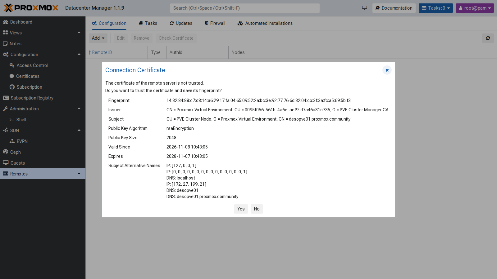

Then the remote ID and the authentication. With **Use existing Token** you use the token just created; with **Login and create Token**, PDM would create one by itself (`pdm-admin-desopdm01`) with the `root@pam` credentials:

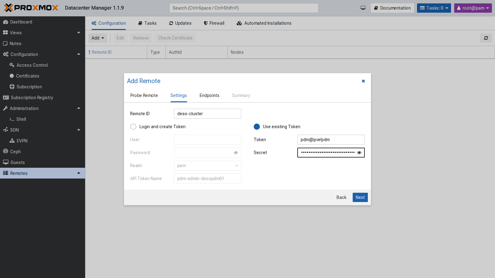

PDM reads the list of the cluster nodes and saves each one as an endpoint, with its fingerprint:

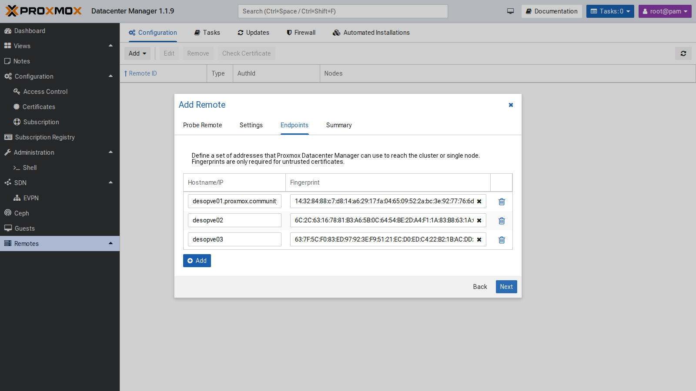

The same for `desopve04` (a single-node PVE remote) and, with **Add → Proxmox Backup Server**, for `desopbs01`. Version 1.1 also manages PBS remotes. The result:

```bash
proxmox-datacenter-manager-admin remote list
```

``` { .text .no-copy title="Output" }
Proxmox VE node deso-cluster:
    auth id: pdm@pve!pdm
    nodes:
        desopve01.proxmox.community,fingerprint=14:32:84:88:c7:d8:…
        desopve02,fingerprint=6C:2C:63:16:78:81:…
        desopve03,fingerprint=63:7F:5C:F0:83:ED:…
Proxmox VE node desopve04:
    auth id: pdm@pve!pdm
    node: desopve04.proxmox.community,fingerprint=84:d3:f2:f5:d3:4b:…
Proxmox Backup Server node desopbs01:
    auth id: pdm@pbs!pdm
    node: desopbs01.proxmox.community,fingerprint=31:0b:24:ed:32:07:…
```

From now on, a **No valid subscriptions** warning appears at every login, because no remote has a subscription. Close it with **Continue**.

### 5. Dashboard, resources and search

The dashboard summarizes all the remotes: 4 PVE nodes and 1 PBS online, VMs and containers by status, the PBS datastores and the aggregated resources. CPU, for example, shows 1.33 used out of 16 physical cores, with 44 vCPUs assigned.

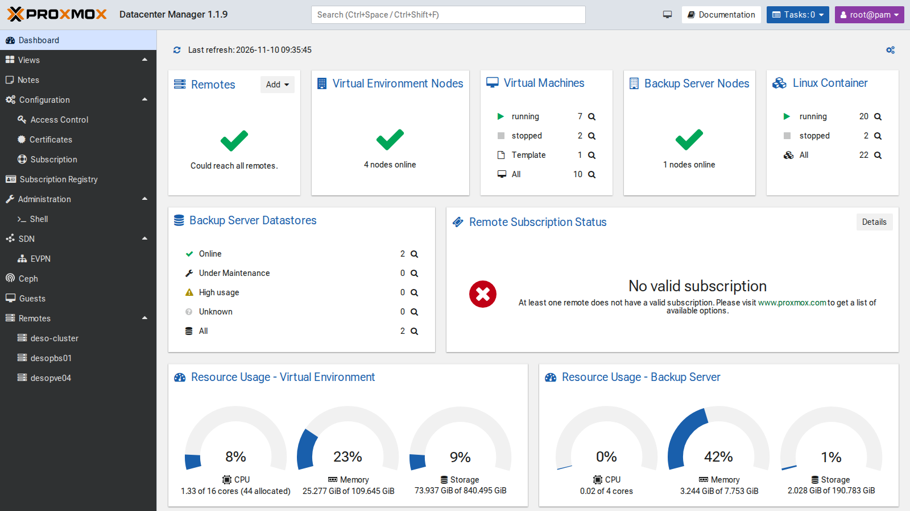

Each remote has its own view, with usage, allocation (assigned CPU and RAM versus physical) and the list of resources, with quick actions (shut down, start, **migrate**, open the remote's GUI). The **global search** at the top (`Ctrl+Space`) finds a VM in any remote and opens its view, with status, graphs, configuration and console:

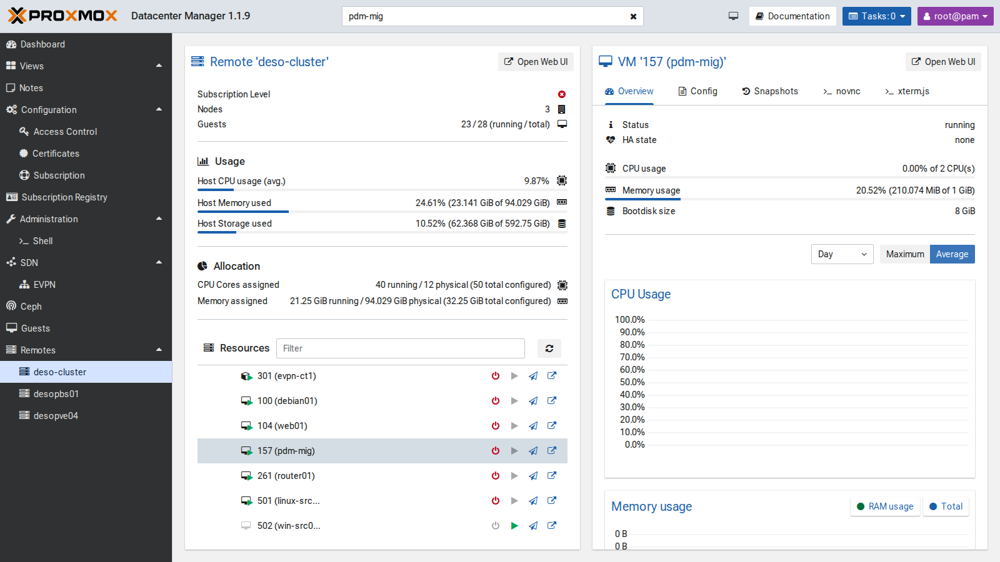

### 6. Updates of all remotes

**Remotes → Updates → Refresh all** queries all the remotes and shows, in a single table, the version, the available updates and the repository status. Selecting a node shows its packages and lets you start the update:

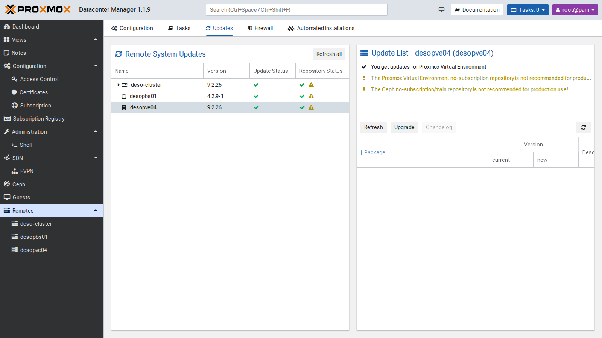

All the remotes are up to date (PVE 9.2.26, PBS 4.2.9). The yellow warnings flag the no-subscription and Ceph no-subscription repositories: fine for a lab, not recommended in production.

### 7. SDN: the EVPN view

**SDN → EVPN** collects the EVPN zones of all the remotes, with ASN, VRF (L3VNI) and VNets. Here is the `evpnz` zone from [Lab 30](30-sdn-evpn.md), with VRF VNI 10070:

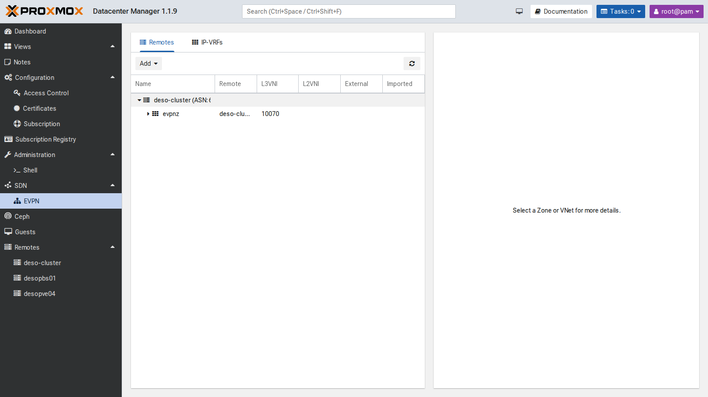

The **Add** button creates EVPN zones and VNets on several remotes at once. The lab has only one cluster with EVPN, so we did not use it.

### 8. Migrating a VM between two datacenters

The test VM `pdm-mig` (VMID 157) is a full clone of template 9000 on `local-zfs` of `desopve01`, running, with address 172.27.199.157:

```bash
qm clone 9000 157 --name pdm-mig --full 1 --storage local-zfs
qm set 157 --ipconfig0 ip=172.27.199.157/24,gw=172.27.199.1 --nameserver 172.27.199.20 --memory 1024
qm start 157
```

From the view of the `deso-cluster` remote, the VM's **Migrate** icon opens the migration dialog. When you choose `desopve04` as **Target Remote**, the remote migration options appear: endpoint, target VMID, deletion of the source, target storage and network.

**First attempt**, with the proposed storage (`local-lvm`). The task fails within 2 seconds, with the same error as in [Lab 48](48-migrations.md):

```text
2026-11-10 09:38:43 found generated disk 'local-zfs:vm-157-cloudinit' (in current VM config)
2026-11-10 09:38:43 found local disk 'local-zfs:vm-157-disk-0' (attached)
2026-11-10 09:38:43 ERROR: error - tunnel command '{…"volname":"vm-157-cloudinit","cmd":"disk-import",…"export_formats":"zfs",…"storage":"local-lvm"…}' failed - failed to handle 'disk-import' command - no matching import/export format found for storage 'local-lvm'
TASK ERROR: migration aborted
```

The cloud-init disk cannot be migrated live: it is exported as a ZFS stream, and LVM-thin cannot import it. PDM does not detect this in advance. The VM stays running and intact on the source.

**Second attempt**, to `tank` (ZFS) on `desopve04`:

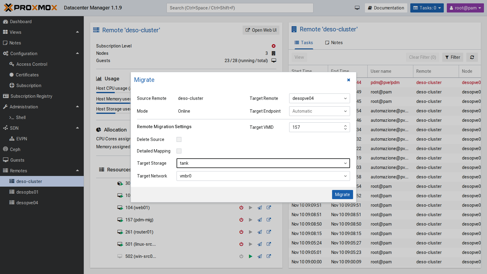

```text
2026-11-10 09:40:17 migration downtime limit: 100 ms
2026-11-10 09:40:19 average migration speed: 512.4 MiB/s - downtime 35 ms
2026-11-10 09:40:19 migration completed, transferred 290.0 MiB VM-state
mirror-scsi0: Completed successfully.
2026-11-10 09:40:23 migration finished successfully (duration 00:00:31)
```

31 seconds in total, with 35 ms of VM downtime. A ping every 0.2 seconds from the management network never had a gap longer than 0.21 seconds. The task carries the signature of the PDM token: `UPID:desopve01:…:qmigrate:157:pdm@pve!pdm:`.

The **Delete Source** option was off, so on the cluster VM 157 stays **stopped and locked** (`lock: migrate`), as with `qm remote-migrate` without `--delete`. After verifying the copy, delete it:

```bash
qm unlock 157 && qm destroy 157 --purge
```

**Return trip** from `desopve04` to `deso-cluster`, to `local-zfs`, again from the PDM GUI:

```text
2026-11-10 09:42:04 average migration speed: 512.4 MiB/s - downtime 61 ms
2026-11-10 09:42:04 migration completed, transferred 289.9 MiB VM-state
mirror-scsi0: Completed successfully.
2026-11-10 09:42:07 migration finished successfully (duration 00:00:32)
```

32 seconds, 61 ms of downtime; maximum ping gap 2.70 seconds, probably the time the network takes to learn the VM's new location. Here too the source on `desopve04` stays locked and must be deleted by hand; at the end, also remove the VM that came back to the cluster:

```bash
qm unlock 157 && qm destroy 157 --purge        # on desopve04
qm stop 157 && qm destroy 157 --purge          # on desopve01
```

**Limits observed in the lab:**

- migration between remotes inherits the limits of `remote-migrate`, and PDM does not flag them before starting the task;
- without **Delete Source**, the source stays locked and must be cleaned up by hand;
- migrating, starting and stopping require a token with broad privileges on the remote;
- detailed operations (storage, network, HA, permissions) remain in the GUI of each remote;
- without a subscription, PDM shows a warning at every login.

## Verification and tests

| Test | Result |
|---|---|
| PDM update | from 1.1.1 to 1.1.9 (UI 1.1.4) |
| NTP | synchronized with `netsvc.proxmox.community` |
| PVE remote `deso-cluster` | 3 endpoints with fingerprint, token `pdm@pve!pdm` |
| PVE remote `desopve04` and PBS `desopbs01` | added, PBS with a read-only token (`Audit`) |
| Dashboard | 4 PVE nodes and 1 PBS online, 2 datastores |
| Remote updates | versions and repositories of all remotes in one table |
| Migration to `local-lvm` | refused: the cloud-init disk cannot be imported on LVM-thin |
| Migration to `tank` | 31 s, 35 ms of downtime, ping gap 0.21 s |
| Return to `local-zfs` | 32 s, 61 ms of downtime, ping gap 2.70 s |
| Source after the migration without "Delete Source" | stopped and locked (`lock: migrate`), deleted by hand |

## Final lab state

- **PDM `desopdm01`** (172.27.199.41, GUI `:8443`), version 1.1.9:
  - `pdm-no-subscription` repository, proxy for `apt`, NTP to `ntp.proxmox.community`;
  - remotes `deso-cluster` (3 endpoints), `desopve04` and `desopbs01`.
- **On the cluster and on `desopve04`:** user `pdm@pve` with `Administrator` on `/` and token `pdm@pve!pdm` without privilege separation.
- **On the PBS:** user `pdm@pbs` and token `pdm@pbs!pdm`, both with `Audit` on `/`.
- **VM 157 `pdm-mig`:** deleted after the tests (neither on the cluster nor on `desopve04`).
- The token secrets are stored only in the PDM configuration. Good practice: paste the secret directly into the PDM wizard, without leaving it in files or in the shell history.

## What you learned

- PDM is installed and updated like a PVE node, but it listens on port **8443** and does not replace the GUI of the clusters.
- Each **remote** is a PVE cluster, a standalone node or a PBS, connected with a **token** and verified with the certificate **fingerprint**. A dedicated user makes PDM's actions recognizable in the tasks.
- The dashboard, the global search and the **updates** view are the most useful part in the day-to-day management of several datacenters.
- **Migration between remotes** from the GUI uses `remote-migrate`, so it inherits its limits: cloud-init disks and incompatible storages fail, and without "Delete Source" the source stays locked.
- The VM downtime in a migration between datacenters is of the same order as within the cluster: tens of milliseconds.

## References

- [Proxmox Datacenter Manager – documentation](https://pdm.proxmox.com/docs/)
- [Proxmox Datacenter Manager – roadmap and release notes](https://pve.proxmox.com/wiki/Proxmox_Datacenter_Manager_Roadmap)
- [Proxmox VE – qm remote-migrate](https://pve.proxmox.com/pve-docs/qm.1.html)
