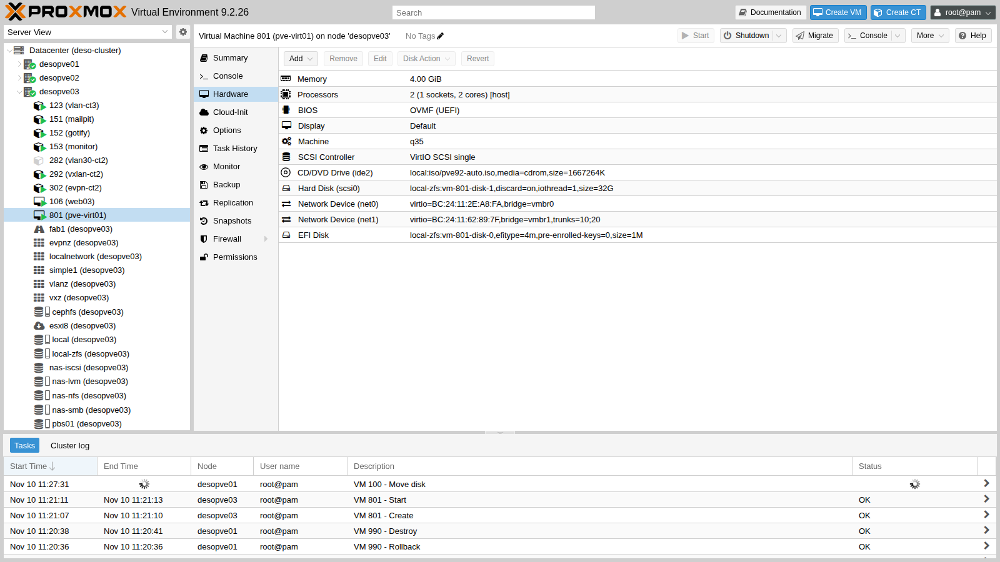
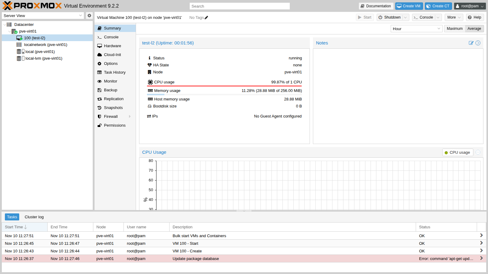

# Appendix D – Rebuilding the lab as virtual machines

**Level:** advanced · **Duration:** 1 hour for the test in this appendix, plus the time to create all the lab VMs

The manual describes a physical lab: servers, switch, router. If you don't have the hardware, you can rebuild the same lab **inside a single Proxmox VE server** with *nested virtualization*: the Proxmox VE nodes of the lab become VMs, and those VMs in turn run VMs and containers.

This appendix explains how to do it and what changes compared with physical hardware. The key steps were actually tested: a Proxmox VE 9.2 node in a VM, with a nested VM that uses KVM and a VLAN trunk that reaches the rest of the lab.

## Dependencies

- **Previous labs:** [Lab 01](01-lab-architecture.md), for the server inventory, the networks, the VLANs and the addressing plan.
- **Host server:** a Proxmox VE 9.2 server with an Intel VT-x or AMD-V CPU, and enough RAM and disk for all the VMs (see [Sizing](#sizing)).
- **ISO:** the same as in [Lab 01](01-lab-architecture.md#images-and-software), uploaded to the storage of the host server.
- **In the test for this appendix:** the host server is `desopve03` and the test VM is `pve-virt01` (VMID 801, `172.27.199.82`), deleted at the end.

## Objectives

- Understand how nested virtualization works and what the host server needs.
- Size the VMs that replace the lab servers.
- Use a VLAN-aware bridge of the host server as the lab switch, with trunks to the node VMs.
- Know which lab results change in a virtual lab.

## How it works

Nested virtualization has three levels:

1. the **host server** (level 0) runs Proxmox VE on the hardware;
2. the **node VMs** (level 1) run Proxmox VE as if they were servers: they are the `desopve01`-`04` of the lab;
3. the **VMs and containers of the labs** (level 2) run inside the node VMs.

For level 1 to be able to use KVM, the virtual processor of the node VM must expose the virtualization extensions (Intel VT-x or AMD-V). Two things are needed:

- on the host server, the KVM module with nesting enabled (`nested=Y`), which is the default value in recent kernels;
- on the node VM, the **`host`** CPU type, which passes all the processor instructions to the VM, including the virtualization ones.

The lab network becomes a **VLAN-aware bridge** of the host server, which acts as the switch. A VM network card connected to a VLAN-aware bridge **without a tag** is a trunk port: it receives the untagged traffic of the bridge and all the VLANs allowed by the bridge (`bridge-vids`, usually 2-4094). The `trunks` option of the network card limits the VLANs to the listed ones.

The nested VMs go out with their own MAC addresses, different from the one of the node VM's network card. The Linux bridge learns them as a switch would, but the **Proxmox VE firewall** on the node VM's network card, if enabled, has the MAC filter turned on by default: it lets only the MAC address of the network card through and blocks those of the nested VMs. On the network cards of the node VMs, therefore, either leave the firewall off or disable the MAC filter (*MAC filter* in the firewall options of the VM).

## Sizing

The VMs mirror the inventory of [Lab 01](01-lab-architecture.md#lab-hardware):

| VM | vCPU | RAM | Disks | Network cards | Notes |
|---|---|---|---|---|---|
| `desopve01`-`03` | 4, type `host` | 32 GB (minimum 16 GB) | 2 × 50 GB + 2 × 60 GB (+ 1 × 60 GB in Lab 18 on `desopve03`) | 3 (+ 2 in Lab 20) | VirtIO SCSI single, VirtIO net |
| `desopve04` | 4, type `host` | 16 GB | 1 × 50 GB (+ 4 × 20 GB, 1 × 20 GB and 2 × 40 GB in Labs 09, 10 and 18) | 2 (+ 1 in Lab 18, + 1 in Lab 23) | VirtIO SCSI single, VirtIO net |
| `desopve-dc01` | 4 | 8 GB | 90 GB + 300 GB | 2 | UEFI with Secure Boot and TPM, VirtIO drivers or emulated devices |
| `desonas` | 4 | 16 GB | 32 GB + 2 × 100 GB | 1 | |
| `desopbs01`, `desopdm01` | 4 and 2 | 8 GB and 4 GB | 32 GB + 2 × 100 GB, 32 GB | 1 | |
| `netsvc` | 2 | 2 GB | 20 GB | 2 | one network card on the lab bridge, one on the bridge with the Internet uplink |
| `rtr-core` | 1 | 512 MB | 128 MB | 1-2 | MikroTik CHR, imported as in [Lab 26](26-virtual-router.md) |
| `esxi8` (Lab 50 only) | 4, type `host` | 16 GB | 200 GB + 150 GB | 1 | |

In total you need about **170 GB of RAM** and **2.2 TB of disk**, which take up much less with thin provisioning. With 16 GB per node you go down to about 120 GB of RAM: enough for all the labs except Ceph and HA, which become slow with less memory.

Two tips about the disks:

- **Different serial numbers.** ZFS, Ceph and TrueNAS identify disks by their serial number. The disks of a Proxmox VE VM each have a different one (`drive-scsi0`, `drive-scsi1`…); if you want more realistic values, set the `serial=` option of each disk.
- **Disks added during the labs.** Where the manual inserts a disk into a hot-swap bay, in the virtual lab you add the disk to the node VM while it is running (`qm set <vmid> --scsiN <storage>:<GB>`). Network cards are hot-plugged too, something you don't do on a physical server.

## Procedure

### 1. The host server

1. Check that nesting is enabled in the KVM module:

   ```text
   root@desopve03:~# cat /sys/module/kvm_intel/parameters/nested
   Y
   ```

   On AMD processors the file is `/sys/module/kvm_amd/parameters/nested`. If the answer is `N`, enable it and reboot the host server:

   ```bash
   echo "options kvm_intel nested=Y" > /etc/modprobe.d/kvm-intel.conf
   ```

2. Prepare the bridges. For an isolated lab, a VLAN-aware bridge **without physical ports**, acting as the lab switch, is enough, plus the existing bridge with the uplink to your network, where only the second network card of `netsvc` goes. In `/etc/network/interfaces` of the host server:

   ```text
   auto vmbrlab
   iface vmbrlab inet manual
           bridge-ports none
           bridge-stp off
           bridge-fd 0
           bridge-vlan-aware yes
           bridge-vids 2-4094
   #switch del laboratorio
   ```

   Apply with `ifreload -a`. In the test for this appendix the host server is a lab node, and instead of `vmbrlab` its VLAN-aware bridges `vmbr0` (management) and `vmbr1` (VM VLANs) were used.

### 2. The node VM

The test uses a small node VM (2 vCPUs, 4 GB, one disk), installed automatically as in [Appendix A](a-upgrade-8-to-9.md#1-the-test-node-installed-automatically): an answer file with `fqdn = "pve-virt01.proxmox.community"`, `cidr = "172.27.199.82/24"`, gateway `172.27.199.1`, DNS `172.27.199.20`, `ext4` file system on `sda`, and the ISO prepared with `proxmox-auto-install-assistant prepare-iso`. For the nodes of the complete lab, use the resources in the [Sizing](#sizing) table and, if you prefer, the guided installation of [Lab 03](03-install-proxmox-ve.md).

1. Create the VM with the `host` CPU type and start it:

   ```text
   root@desopve03:~# qm create 801 --name pve-virt01 --memory 4096 --cores 2 --cpu host --machine q35 \
         --bios ovmf --efidisk0 local-zfs:1,efitype=4m,pre-enrolled-keys=0 --scsihw virtio-scsi-single \
         --scsi0 local-zfs:32,discard=on,iothread=1 --net0 virtio,bridge=vmbr0 \
         --ide2 local:iso/pve92-auto.iso,media=cdrom --boot "order=scsi0;ide2" --ostype l26
   root@desopve03:~# qm start 801
   ```

   About five minutes later the installation is complete and the node answers over SSH.

2. Add the trunk network card for the VM VLANs. `trunks=10;20` lets only VLANs 10 and 20 through:

   ```text
   root@desopve03:~# qm set 801 --net1 "virtio,bridge=vmbr1,trunks=10;20"
   update VM 801: -net1 virtio,bridge=vmbr1,trunks=10;20
   ```

   The configuration of the node VM:

   ```text
   root@desopve03:~# qm config 801
   bios: ovmf
   boot: order=scsi0;ide2
   cores: 2
   cpu: host
   efidisk0: local-zfs:vm-801-disk-0,efitype=4m,pre-enrolled-keys=0,size=1M
   ide2: local:iso/pve92-auto.iso,media=cdrom,size=1667264K
   machine: q35
   memory: 4096
   name: pve-virt01
   net0: virtio=BC:24:11:2E:A8:FA,bridge=vmbr0
   net1: virtio=BC:24:11:62:89:7F,bridge=vmbr1,trunks=10;20
   ostype: l26
   scsi0: local-zfs:vm-801-disk-1,discard=on,iothread=1,size=32G
   scsihw: virtio-scsi-single
   ```

   

### 3. Checks inside the node VM

1. The node runs Proxmox VE 9.2 and sees the virtualization extensions:

   ```text
   root@pve-virt01:~# hostname -f; pveversion
   pve-virt01.proxmox.community
   pve-manager/9.2.2/b9984c6d90a4bd80 (running kernel: 7.0.2-6-pve)
   root@pve-virt01:~# lscpu | grep -E "Virtualization|Hypervisor vendor"
   Virtualization:                          VT-x
   Hypervisor vendor:                       KVM
   Virtualization type:                     full
   root@pve-virt01:~# ls -l /dev/kvm
   crw-rw---- 1 root kvm 10, 232 Nov 10 11:26 /dev/kvm
   ```

   `Virtualization: VT-x` and the `/dev/kvm` device show that KVM is available at level 1 as well. The node has just been installed, so it is at the ISO version (9.2.2): [Lab 04](04-first-access-repositories-updates.md) would bring it to the latest 9.2.x.

2. A nested VM starts with KVM acceleration. The test VM has no disks: it only needs to start.

   ```text
   root@pve-virt01:~# qm create 100 --name test-l2 --memory 256 --cores 1 --net0 virtio,bridge=vmbr0
   root@pve-virt01:~# qm start 100
   root@pve-virt01:~# qm status 100
   status: running
   root@pve-virt01:~# qm monitor 100
   qm> info kvm
   kvm support: enabled
   ```

   

   Without a disk, the firmware keeps looking for a boot device forever and the VM uses 100% of its CPU: this is normal. The task list also shows an *Update package database* error: the freshly installed node does not have the APT proxy yet, which is configured in [Lab 04](04-first-access-repositories-updates.md).

3. The trunk carries the allowed VLANs to the rest of the lab. Inside the node VM the second network card is `ens19`: a temporary interface on VLAN 10 reaches the VLAN gateway (`router01`, [Lab 26](26-virtual-router.md)) and a container on another node:

   ```text
   root@pve-virt01:~# ip link set ens19 up
   root@pve-virt01:~# ip link add link ens19 name ens19.10 type vlan id 10
   root@pve-virt01:~# ip addr add 10.10.10.82/24 dev ens19.10
   root@pve-virt01:~# ip link set ens19.10 up
   root@pve-virt01:~# ping -c3 -W1 10.10.10.1
   PING 10.10.10.1 (10.10.10.1) 56(84) bytes of data.
   64 bytes from 10.10.10.1: icmp_seq=1 ttl=64 time=3.86 ms
   64 bytes from 10.10.10.1: icmp_seq=2 ttl=64 time=0.930 ms
   64 bytes from 10.10.10.1: icmp_seq=3 ttl=64 time=1.46 ms

   --- 10.10.10.1 ping statistics ---
   3 packets transmitted, 3 received, 0% packet loss, time 2003ms
   rtt min/avg/max/mdev = 0.930/2.083/3.860/1.274 ms
   root@pve-virt01:~# ping -c3 -W1 10.10.10.122
   PING 10.10.10.122 (10.10.10.122) 56(84) bytes of data.
   64 bytes from 10.10.10.122: icmp_seq=1 ttl=64 time=2.66 ms
   64 bytes from 10.10.10.122: icmp_seq=2 ttl=64 time=1.61 ms
   64 bytes from 10.10.10.122: icmp_seq=3 ttl=64 time=0.821 ms

   --- 10.10.10.122 ping statistics ---
   3 packets transmitted, 3 received, 0% packet loss, time 2005ms
   rtt min/avg/max/mdev = 0.821/1.697/2.661/0.753 ms
   ```

4. A VLAN not listed in `trunks` does not pass. VLAN 100 is the migration network of [Lab 22](22-dedicated-networks.md):

   ```text
   root@pve-virt01:~# ip link add link ens19 name ens19.100 type vlan id 100
   root@pve-virt01:~# ip addr add 10.100.10.82/24 dev ens19.100
   root@pve-virt01:~# ip link set ens19.100 up
   root@pve-virt01:~# ping -c3 -W1 10.100.10.21
   PING 10.100.10.21 (10.100.10.21) 56(84) bytes of data.

   --- 10.100.10.21 ping statistics ---
   3 packets transmitted, 0 received, 100% packet loss, time 2025ms
   ```

   For the node VMs of the complete lab, leave the network cards without `trunks`, so that all the VLANs of the bridge pass, as on the trunk ports of the physical switch.

### 4. Cleaning up the test

The test VM has done its job. The prepared ISO contains the `root` password in clear text, so it must be destroyed with `shred`:

```text
root@desopve03:~# qm stop 801 && qm destroy 801 --purge 1 --destroy-unreferenced-disks 1
purging VM 801 from related configurations..
root@desopve03:~# shred -u /var/lib/vz/template/iso/pve92-auto.iso /dev/shm/answer.toml
root@desopve03:~# rm -f /var/lib/vz/template/iso/proxmox-ve_9.2-1.iso
root@desopve03:~# apt remove proxmox-auto-install-assistant
```

## What changes compared with physical servers

Proxmox VE behaves the same way, but some lab results change:

- **Performance.** CPU, disks and network go through two levels of virtualization: the benchmark figures ([Lab 19](19-fio-benchmark.md), [Lab 34](34-network-performance-troubleshooting.md)) are lower and vary more from one test to the next. The multiqueue of VirtIO network cards, which helps on hardware, may bring no advantage in a virtual lab.
- **Ceph.** With slow disks Ceph often reports `BLUESTORE_SLOW_OP_ALERT`. The warning stays visible for 24 hours: with `ceph config set osd bluestore_slow_ops_warn_lifetime 600` it disappears 10 minutes after the last occurrence.
- **Boot times.** The first boot of a VM with UEFI firmware (OVMF) can take a few minutes, and the *Press any key to boot from CD* message times out before you see it: boot from the ISO with the firmware *Boot Manager*. Installing Windows Server takes much longer.
- **MTU and VLANs.** The bridge of the host server decides which frames pass: for the QinQ tests of [Lab 28](28-sdn-vlan-qinq.md) and for any jumbo frames, raise the MTU of the bridge and of the network cards of the node VMs.
- **Failures.** Instead of the management controller of the physical servers, to power off a node abruptly use `qm stop <vmid>` on the host server, and `qm start` to power it back on. HA fencing ([Lab 49](49-high-availability.md)) works with the software watchdog just as on hardware.
- **New hardware.** Disks and network cards are added with the VM running: on hardware, by contrast, cards are installed with the server powered off.

## Verification and tests

- [ ] On the host server `nested` is `Y`.
- [ ] Inside the node VM `lscpu` shows `Virtualization: VT-x` (or `AMD-V`) and `/dev/kvm` exists.
- [ ] A nested VM starts and `info kvm` answers `kvm support: enabled`.
- [ ] From the node VM the allowed VLANs reach the rest of the lab, while those excluded by `trunks` do not.

## Final lab state

- The test VM 801 `pve-virt01` has been **deleted**, together with its disks.
- The ISOs and the answer file have been destroyed, and the automated installation assistant has been removed from `desopve03`.

## What you learned

- Nested virtualization requires nesting to be enabled in the KVM module of the host server and the `host` CPU type in the node VMs.
- A VLAN-aware bridge acts as a switch: a network card without a tag is a trunk, and `trunks` selects the VLANs that pass.
- The MAC filter of the Proxmox VE firewall must be turned off on the network cards of the node VMs, otherwise the nested VMs stay isolated.
- In a virtual lab the labs work the same way, but performance, boot times and failure simulation change.

## References

- [Proxmox VE Wiki – Nested Virtualization](https://pve.proxmox.com/wiki/Nested_Virtualization)
- [Proxmox VE – Qemu/KVM Virtual Machines: Network Device](https://pve.proxmox.com/pve-docs/pve-admin-guide.html#qm_network_device)
- [Proxmox VE – Firewall](https://pve.proxmox.com/pve-docs/pve-admin-guide.html#chapter_pve_firewall)
- [Proxmox VE – Automated Installation](https://pve.proxmox.com/wiki/Automated_Installation)
