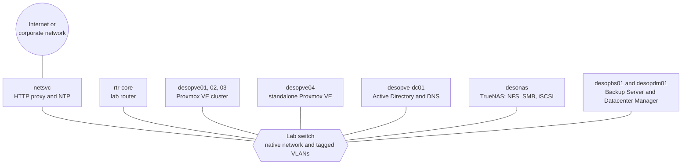

# Proxmox Community

**Proxmox VE 9 from zero to hero, on a real lab.**

53 hands-on, connected labs: you start from empty servers and end with a complete datacenter, with a cluster, shared storage, Ceph, SDN, firewalling, backup, high availability and automation. Every step was actually performed: the screenshots and the command output are the real ones.

<a class="md-button md-button--primary" href="it/01-lab-architecture/">Start with Lab 01 (Italian)</a>
<a class="md-button" href="it/the-lab/">The full path (Italian)</a>

!!! info "English edition in progress"
    The complete course is available today in **Italian**. The English edition is being published lab by lab: until a lab is translated, the links on this page open the Italian version. You can switch language at any time with the language selector at the top of the page.

## One lab, built lab after lab

These are not isolated exercises. All the labs take place on the **same lab**, which grows as you go: each lab starts from what the previous ones left configured and documents it in its **Final state** section. By the end of the path you have built, and stress-tested, a complete Proxmox VE datacenter.

Lab 01 describes the hardware, the networks, the VLANs and the addressing plan, and explains how to prepare everything before you start.

## The path

-   :material-hammer-wrench:{ .lg .middle } **Part 0 – The base lab**

    ---

    Domain controller, Proxmox VE installation, repositories and updates, SSH and the command line, a three-node cluster, the first VM and container.

    Labs 01–07 · <a href="it/01-lab-architecture/">Lab 01 →</a>

-   :material-harddisk:{ .lg .middle } **A – Storage**

    ---

    LVM, ZFS and replication, a NAS with NFS, SMB and multipath iSCSI, snapshots, Ceph from installation to failures, benchmarking with fio.

    Labs 08–19 · <a href="it/08-storage-model/">Lab 08 →</a>

-   :material-lan:{ .lg .middle } **B – Network**

    ---

    Bridges and VLANs, bonding, dedicated networks, Open vSwitch, routing and NAT, IPv6, a virtual router, SDN up to EVPN and Fabrics, the firewall.

    Labs 20–34 · <a href="it/20-bridges-stable-names-vlans/">Lab 20 →</a>

-   :material-memory:{ .lg .middle } **C – Compute**

    ---

    KVM and QEMU under the hood, memory, virtual disks and controllers, Linux and Windows VMs, templates and cloud-init, LXC containers, hotplug and limits.

    Labs 35–42 · <a href="it/35-kvm-qemu/">Lab 35 →</a>

-   :material-shield-check:{ .lg .middle } **D – Integrated services**

    ---

    Active Directory, permissions and tokens, 2FA, backup with vzdump and Proxmox Backup Server, migrations, high availability, import from ESXi, metrics, API, Datacenter Manager.

    Labs 43–53 · <a href="it/43-active-directory-realm-ldaps/">Lab 43 →</a>

-   :material-book-open-variant:{ .lg .middle } **Appendices**

    ---

    Upgrading from Proxmox VE 8 to 9, credentials and addresses, troubleshooting, rebuilding the lab as virtual machines.

    <a href="it/a-upgrade-8-to-9/">Appendix A →</a>

The four tracks are meant to be followed in the order **A → B → C → D**. Before each lab, check its **Dependencies**.

## How every lab is organised

Every lab has the same structure, so you always know where to look:

- **Dependencies**: the labs to complete first, the machines and services you need;
- **Objectives** and **How it works**: the essential theory to understand what happens;
- **Procedure**: numbered steps, every action in the web interface with its screenshot and every command with its real output;
- **Verification and tests**, often with simulated and measured failures;
- **Final state**: what stays configured for the following labs;
- **What you learned** and **References** to the official documentation.

## Getting started

1. Read Lab 01: the hardware, the networks and how to prepare the switch, the router and the network-services server.
2. Choose the **lab password**: the manual shows it as `<password-lab>` (Appendix B).
3. Continue in order with Part 0, then with tracks A, B, C and D.

No servers at hand? Appendix D explains how to rebuild the same lab as virtual machines on a single Proxmox VE server.

!!! note "Obscured hardware data"
    In the screenshots, the data that identify the lab hardware are obscured: disk serial numbers, MAC addresses of the server network cards, CPU and disk models. In the text output the same data are replaced by placeholders such as `<seriale-disco-1>`. On your hardware you will see different values.

## An open community

Proxmox Community is meant to grow with the people who use Proxmox every day. Do you have a guide, a production story, a fix or a translation? [Contribute](contributing.md): every proposal arrives as a pull request on GitHub and is reviewed before publication.
