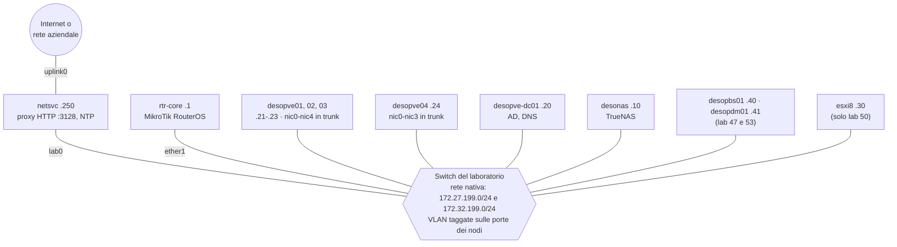

# Lab 01 – Architettura e preparazione del laboratorio

**Livello:** base · **Durata:** 1 ora di lettura, più il tempo per montare e cablare i server

## Dipendenze

- **Lab precedenti:** nessuno. Questo è il punto di partenza del manuale.
- **Hardware:** i server, lo switch e il router elencati in [Hardware del laboratorio](#hardware-del-laboratorio).
- **Software:** le immagini elencate in [Immagini e software](#immagini-e-software).
- **Credenziali:** una sola password di laboratorio, scelta da te e indicata nel manuale come `<password-lab>` → [Appendice B](b-credentials-and-addresses.md).

## Obiettivi

- Capire come è fatto il laboratorio su cui si svolgono tutti i lab del manuale.
- Conoscere il ruolo di ogni server, le reti, le VLAN e il piano degli indirizzi.
- Preparare l'hardware, lo switch, il router `rtr-core` e il server di servizi di rete `netsvc`, prima di installare Windows Server, Proxmox VE e TrueNAS nei lab successivi.

## Come funziona

Il laboratorio è un piccolo datacenter aziendale:

- **quattro server Proxmox VE (PVE)**: tre formano un cluster (`desopve01`, `desopve02`, `desopve03`); il quarto (`desopve04`) resta autonomo e serve da banco di prova per lo storage e da destinazione per le migrazioni tra cluster;
- **un domain controller Windows Server 2025** (`desopve-dc01`): Active Directory, DNS e, dal lab 43, autorità di certificazione; fa anche da postazione di amministrazione;
- **un NAS TrueNAS Community Edition** (`desonas`): storage condiviso NFS, SMB e iSCSI per il percorso Storage;
- **un server di servizi di rete** (`netsvc`): proxy HTTP verso Internet e server NTP;
- **un router MikroTik** (`rtr-core`): il gateway delle reti del laboratorio;
- **Proxmox Backup Server** (`desopbs01`, lab 47) e **Proxmox Datacenter Manager** (`desopdm01`, lab 53);
- **un server VMware ESXi** (`esxi8`), con due VM di prova: serve solo nel [Lab 50](50-import-from-esxi.md), per importare VM in Proxmox VE;
- **uno switch gestito** con porte trunk 802.1Q, che collega tutto.

### Rete isolata e accesso a Internet

Il laboratorio è una **rete isolata**: `rtr-core` instrada il traffico tra le reti del laboratorio, ma non ha un collegamento verso Internet. È una scelta voluta, frequente nelle reti aziendali:

- i server escono verso Internet **solo tramite il proxy HTTP** di `netsvc` (`proxy.proxmox.community:3128`), che lascia passare unicamente i siti necessari: repository Debian e Proxmox, Ceph, aggiornamenti Windows, immagini dei sistemi operativi;
- l'ora arriva dal **server NTP interno** (`ntp.proxmox.community`), cioè sempre `netsvc`, che a sua volta si sincronizza con i server NTP pubblici;
- `netsvc` è l'unico server con due schede: `lab0` sulla rete del laboratorio e `uplink0` verso la rete aziendale o Internet.

Nel manuale vedrai quindi come si configura Proxmox VE dietro un proxy: repository APT, download di ISO e template, aggiornamenti. Se il tuo laboratorio ha un accesso diretto a Internet, quei passi si saltano, ma alcuni comportamenti cambiano: per esempio un download senza proxy riesce invece di fallire.

### Reti e VLAN del laboratorio

Due reti IP viaggiano **senza tag** sulla stessa rete fisica: la rete nativa delle porte dello switch.

| Rete | Subnet | Uso |
|---|---|---|
| Gestione | `172.27.199.0/24` | GUI web, SSH, DNS, NTP, proxy, primo link di Corosync |
| Cluster e storage | `172.32.199.0/24` | secondo link di Corosync (lab 06) e secondo percorso iSCSI (lab 15) |

Il gateway di entrambe è `rtr-core` (`172.27.199.1` e `172.32.199.1`, sulla stessa porta del router).

> **Attenzione agli indirizzi.** `172.32.199.0/24` **non** è un indirizzo privato: lo spazio privato RFC 1918 della classe 172 va da `172.16.0.0` a `172.31.255.255`, e `172.32.x.x` appartiene a reti pubbliche su Internet. Nel laboratorio va bene perché la rete è isolata e non è instradata verso l'esterno; in produzione usa sempre reti RFC 1918 (`10.0.0.0/8`, `172.16.0.0/12`, `192.168.0.0/16`), come le VLAN dedicate `10.x` dei lab successivi.

Avere due subnet sulla stessa rete fisica è comodo, ma ha un effetto collaterale che incontrerai nel [Lab 15](15-iscsi-lvm-multipath.md) (l'*ARP flux*): per questo, dai lab 17 e 22 in poi, le reti dedicate passano su **VLAN taggate**. Lo switch deve quindi lasciar passare queste VLAN sulle porte dei nodi:

| VLAN | Uso | Introdotta nel lab |
|---|---|---|
| 10, 20 | traffico delle VM e dei container di prova | 20, 21, 23, 26 |
| 30 | zona SDN VLAN | 28 |
| 40 | secondo link di Corosync | 22 |
| 50, 51 | Ceph: rete pubblica e rete di cluster | 17 |
| 61 | underlay VXLAN ed EVPN | 29 |
| 81, 82, 83 | collegamenti punto-punto della fabric OpenFabric | 31 |
| 100 | migrazione delle VM | 22 |
| 300 (e 301 in 802.1ad) | service VLAN delle prove QinQ | 28 |

### Schema



### Piano degli indirizzi

Dominio DNS del laboratorio: **`proxmox.community`**. Il DNS è il domain controller (`172.27.199.20`), che lo diventa nel [Lab 02](02-domain-controller.md): fino ad allora i server si raggiungono per indirizzo IP.

| Nome host (FQDN) | Ruolo | Gestione | Cluster/storage | Lab |
|---|---|---|---|---|
| `rtr-core.proxmox.community` | Router del laboratorio (gateway) | 172.27.199.1 | 172.32.199.1 | 01 |
| `netsvc.proxmox.community` (alias `proxy`, `ntp`) | Proxy HTTP e NTP | 172.27.199.250 | 172.32.199.250 | 01 |
| `desopve-dc01.proxmox.community` | Domain controller, DNS | 172.27.199.20 | 172.32.199.20 | 02 |
| `desopve01.proxmox.community` | Nodo PVE del cluster | 172.27.199.21 | 172.32.199.21 | 03 |
| `desopve02.proxmox.community` | Nodo PVE del cluster | 172.27.199.22 | 172.32.199.22 | 03 |
| `desopve03.proxmox.community` | Nodo PVE del cluster | 172.27.199.23 | 172.32.199.23 | 03 |
| `desopve04.proxmox.community` | Nodo PVE autonomo | 172.27.199.24 | 172.32.199.24 | 03 |
| `desonas.proxmox.community` | NAS TrueNAS Community Edition 25.10 | 172.27.199.10 | 172.32.199.10 (dal lab 15) | 12 |
| `desopbs01.proxmox.community` | Proxmox Backup Server 4.2 | 172.27.199.40 | – | 47 |
| `desopdm01.proxmox.community` | Proxmox Datacenter Manager 1.1 | 172.27.199.41 | – | 53 |
| `esxi8.proxmox.community` | Server VMware ESXi di origine | 172.27.199.30 | – | 50 |
| `linux-src01.proxmox.community` | VM Linux sul server ESXi | 172.27.199.31 | – | 50 |
| `win-src01.proxmox.community` | VM Windows sul server ESXi | 172.27.199.32 | – | 50 |

Gli indirizzi da `172.27.199.33` a `172.27.199.39` sono riservati ad altre VM del server ESXi, quelli da `172.27.199.100` a `172.27.199.199` alle VM e ai container creati durante i lab. L'[Appendice B](b-credentials-and-addresses.md) raccoglie tutti gli indirizzi, comprese le VLAN dedicate e le reti SDN.

> **Dati hardware oscurati.** Negli screenshot sono oscurati i dati che identificano l'hardware del laboratorio: numeri di serie dei dischi, indirizzi MAC delle schede di rete dei server, modelli di CPU e di dischi. Negli output testuali gli stessi dati sono sostituiti da segnaposto come `<seriale-disco-1>`. Sul tuo hardware vedrai valori diversi: non servono per seguire i lab.

<a id="requisiti-dellhost"></a>

## Hardware del laboratorio

| Server | CPU | RAM | Dischi | Porte di rete | Note |
|---|---|---|---|---|---|
| `desopve01`, `desopve02`, `desopve03` | 4 core | 32 GB (minimo 16 GB) | 2 × 50 GB (sistema, ZFS RAID1) + 2 × 60 GB (Ceph, lab 17); su `desopve03` un vano libero per un terzo disco da 60 GB (lab 18) | 3 integrate (`nic0`-`nic2`) + scheda di espansione a 2 porte (`nic3`, `nic4`), installata nel lab 20 | porte 10 GbE |
| `desopve04` | 4 core | 16 GB | 1 × 50 GB (sistema, ext4/LVM); vani hot-swap per 4 × 20 GB (lab 09), un disco di scorta da 20 GB (lab 10) e 2 × 40 GB (lab 18) | 2 integrate (`nic0`, `nic1`) + 2 schede a una porta (`nic2` nel lab 18, `nic3` nel lab 23) | porte 10 GbE |
| `desopve-dc01` | 4 core | 8 GB | 90 GB + 300 GB | 2 (`MGMT`, `CLUSTER`) | UEFI con Secure Boot |
| `desonas` | 4 core | 16 GB | 32 GB (sistema) + 2 × 100 GB (pool in mirror) | 1 | |
| `desopbs01` (lab 47) | 4 core | 8 GB | 32 GB (sistema) + 2 × 100 GB (datastore ZFS mirror) | 1 | |
| `desopdm01` (lab 53) | 2 core | 4 GB | 32 GB | 1 | |
| `netsvc` | 2 core | 2 GB | 20 GB | 2 (`lab0`, `uplink0`) | Ubuntu Server 24.04 LTS |
| `rtr-core` | – | – | – | `ether1` (laboratorio), `ether2` (libera) | MikroTik con RouterOS 7 |
| `esxi8` (solo lab 50) | 4 core | 16 GB | 200 GB (sistema) + 150 GB NVMe (datastore) | 1 | VMware ESXi 8.0 U3 |

In totale servono circa **170 GB di RAM** e **2,2 TB di disco**. Con 16 GB per nodo il laboratorio scende a circa 120 GB di RAM: basta per tutti i lab tranne Ceph e HA, che con meno memoria diventano lenti.

I dischi e le schede segnati con un numero di lab **non servono all'inizio**: tienili da parte e installali quando il lab lo chiede. I dischi entrano a caldo nei vani hot-swap; le schede di rete si montano a server spento. Così vedrai in ogni lab come Proxmox VE riconosce l'hardware nuovo.

Prima di installare, controlla quattro punti:

1. **Firmware.** Avvio UEFI; estensioni di virtualizzazione del processore (Intel VT-x o AMD-V) e IOMMU (Intel VT-d o AMD-Vi) attive. Proxmox VE 9 si installa anche in modalità BIOS, ma UEFI è la configurazione consigliata.
2. **Dischi senza RAID hardware.** ZFS, Ceph e TrueNAS vogliono vedere i dischi singoli: usa un controller HBA in modalità IT, o le porte SATA della scheda madre, senza volumi RAID. Ogni disco ha un numero di serie diverso, ed è così che ZFS, Ceph e TrueNAS lo riconoscono.
3. **Scheda di gestione.** Una scheda di gestione remota (IPMI, iDRAC, iLO o simili) per la console e per accendere e spegnere i server: nei lab sui guasti (11, 18, 49) i nodi si spengono di colpo e si riaccendono da lì. La sua rete è separata da quella del laboratorio.
4. **Switch.** Configurato come in [Lo switch](#lo-switch), prima di accendere i server.

### Lo switch

Uno switch gestito con almeno 28 porte (o due switch in stack). Le regole:

- **rete nativa (senza tag)** su tutte le porte: la rete del laboratorio, che porta sia `172.27.199.0/24` sia `172.32.199.0/24`;
- **porte dei nodi Proxmox VE in trunk 802.1Q**, con le VLAN della tabella [Reti e VLAN](#reti-e-vlan-del-laboratorio): nel dubbio, consenti tutte le VLAN;
- **porte degli altri server in accesso**, sulla rete nativa;
- **dimensione massima del frame di almeno 1526 byte**, per il doppio tag delle prove QinQ del [Lab 28](28-sdn-vlan-qinq.md). I jumbo frame non servono: nel laboratorio del manuale non sono attivi, e il [Lab 21](21-bonding.md) mostra cosa succede quando la rete non li supporta;
- **nessun LACP e nessun port-channel** verso i nodi: i bond dei lab 21 e 23 lavorano senza partner LACP, e i lab mostrano proprio questo caso;
- **nessun filtro sui messaggi di rete del laboratorio**: niente RA Guard (il router annuncia il prefisso IPv6 nel [Lab 25](25-ipv6.md)), niente DHCP snooping (i server DHCP dei lab 26 e 27), niente limite di MAC per porta (dietro ogni porta di un nodo ci sono decine di VM);
- porte dei server in modalità *edge* (portfast) per lo spanning tree.

Cablaggio:

| Server | Porte | Porta dello switch |
|---|---|---|
| `desopve01`-`03` | `nic0`-`nic4` | trunk |
| `desopve04` | `nic0`-`nic3` | trunk |
| `desopve-dc01` | `MGMT`, `CLUSTER` | accesso |
| `desonas`, `desopbs01`, `desopdm01`, `esxi8` | unica porta | accesso |
| `netsvc` | `lab0` | accesso (`uplink0` va alla rete aziendale) |
| `rtr-core` | `ether1` | accesso |
| PC di amministrazione (facoltativo) | – | accesso |

### Postazione di amministrazione

Dal [Lab 02](02-domain-controller.md) la postazione di lavoro è il domain controller: da lì apri la GUI web dei server e, dal [Lab 05](05-ssh-shell-cli.md), l'SSH verso i nodi. Per raggiungere il DC in Desktop remoto collega un PC a una porta in accesso dello switch, con un indirizzo libero della rete di gestione (per esempio `172.27.199.9/24`, gateway `172.27.199.1`, DNS `172.27.199.20`).

## Immagini e software

| Immagine | Uso | Lab |
|---|---|---|
| Windows Server 2025 Evaluation (`26100.1742…SERVER_EVAL_x64FRE_en-us.iso`) | domain controller, VM Windows, VM di origine | 02, 39, 50 |
| `proxmox-ve_9.2-1.iso` | nodi Proxmox VE | 03 |
| `TrueNAS-SCALE-25.10.8.iso` (TrueNAS Community Edition 25.10) | NAS | 12 |
| `proxmox-backup-server_4.2-1.iso` | Proxmox Backup Server | 47 |
| `proxmox-datacenter-manager_1.1-1.iso` | Proxmox Datacenter Manager | 53 |
| VMware ESXi 8.0 U3 | server di origine | 50 |
| Ubuntu Server 24.04 LTS | `netsvc`; immagine cloud per la VM di origine `linux-src01` | 01, 50 |
| RouterOS 7 | `rtr-core` (firmware del router) | 01 |
| `proxmox-ve_8.4-1.iso` | nodo di prova dell'aggiornamento | [Appendice A](a-upgrade-8-to-9.md) |

Altre immagini si scaricano dentro i lab tramite il proxy: Debian 13 netinst (lab 07), MikroTik CHR (lab 26), `virtio-win` (lab 39), l'immagine cloud di Debian 13 (lab 40) e i template dei container (lab 07 e 41).

Scarica sempre le immagini dai siti ufficiali e verificane l'impronta SHA-256 con il file pubblicato accanto (`SHA256SUMS` o simile). Per Proxmox VE, ad esempio:

```bash
sha256sum proxmox-ve_9.2-1.iso
grep proxmox-ve_9.2-1.iso SHA256SUMS
```

Le due impronte devono coincidere. Per l'installazione usa una chiavetta USB o il *virtual media* della scheda di gestione.

## Procedura

### 1. Montaggio e cablaggio

1. Monta i server e inserisci solo i dischi che servono all'inizio: sistema e Ceph sui nodi 01-03, sistema su `desopve04`, i dischi di DC, NAS, PBS, PDM e `esxi8`.
2. Collega le porte come nella tabella [Cablaggio](#lo-switch). Su `desopve01`-`03` collega per ora `nic0`, `nic1` e `nic2`; su `desopve04` `nic0` e `nic1`.
3. Nel firmware di ogni server attiva UEFI, VT-x/AMD-V e VT-d/AMD-Vi, e verifica che i dischi siano visti singolarmente.

### 2. Lo switch

Configura lo switch come descritto in [Lo switch](#lo-switch). Le istruzioni cambiano da marca a marca: quello che conta è il risultato, cioè rete nativa ovunque, VLAN taggate sulle porte dei nodi e nessun filtro su RA, DHCP e MAC.

### 3. Il router `rtr-core`

1. Collegati al router dalla porta `ether1` (con WinBox o in SSH, all'indirizzo di fabbrica) e azzeralo **senza** la configurazione di fabbrica, che su molti modelli attiva NAT, firewall e server DHCP:

   ```text
   [admin@MikroTik] > /system reset-configuration no-defaults=yes skip-backup=yes
   ```

2. Dopo il riavvio, carica il file [`rtr-core-base.rsc`](../files/01/rtr-core-base.rsc) dalla sezione *Files* e importalo, poi imposta la password:

   ```text
   [admin@MikroTik] > /import file-name=rtr-core-base.rsc
   [admin@rtr-core] > /user set admin password=<password-lab>
   ```

   Il file assegna il nome `rtr-core` e i due indirizzi del gateway, entrambi su `ether1`: le due reti del laboratorio viaggiano sulla stessa porta.

3. Controlla gli indirizzi e le route:

   ```text
   [admin@rtr-core] > /ip address print
   Columns: ADDRESS, NETWORK, INTERFACE, VRF
   # ADDRESS          NETWORK       INTERFACE  VRF 
   ;;; rete di gestione
   0 172.27.199.1/24  172.27.199.0  ether1     main
   ;;; rete cluster/storage, sulla stessa porta della gestione
   1 172.32.199.1/24  172.32.199.0  ether1     main
   ```

   Il router non ha route di default: il laboratorio non esce verso Internet da qui. Nei lab 24 e 25 aggiungerai una route statica e l'IPv6; la configurazione completa alla fine del manuale è in [`rtr-core-finale.rsc`](../files/01/rtr-core-finale.rsc).

> **Uscita diretta (facoltativa).** Se vuoi che il laboratorio esca su Internet anche senza proxy, [`rtr-core-uplink-esempio.rsc`](../files/01/rtr-core-uplink-esempio.rsc) mostra un esempio su `ether2`, con NAT e un filtro minimo. Non è attivo nel laboratorio del manuale: se lo usi, alcuni risultati dei lab cambiano.

### 4. Il server di servizi di rete `netsvc`

`netsvc` è un piccolo server Ubuntu Server 24.04 LTS con due schede: `lab0` sulla rete del laboratorio e `uplink0` verso la rete aziendale o Internet.

1. Installa Ubuntu Server 24.04 LTS e configura la rete con netplan, adattando la parte `uplink0` alla tua rete: [`netplan-netsvc.yaml`](../files/01/netplan-netsvc.yaml) in `/etc/netplan/60-lab.yaml`, poi `sudo netplan apply`. Su `lab0` vanno entrambi gli indirizzi del laboratorio, `172.27.199.250/24` e `172.32.199.250/24`, senza gateway: il default gateway è quello della rete aziendale.

2. Installa il proxy e il server NTP:

   ```bash
   sudo apt install tinyproxy chrony
   ```

3. **Proxy.** Copia [`tinyproxy.conf`](../files/01/tinyproxy.conf) in `/etc/tinyproxy/tinyproxy.conf` e [`tinyproxy-filter`](../files/01/tinyproxy-filter) in `/etc/tinyproxy/filter`. Le righe che contano:

   | Riga | Significato |
   |---|---|
   | `Port 3128`, `Listen 172.27.199.250` | il proxy ascolta solo sulla rete di gestione del laboratorio |
   | `Allow 172.27.199.0/24` | accetta richieste solo dai server del laboratorio |
   | `Filter "/etc/tinyproxy/filter"`, `FilterExtended On`, `FilterDefaultDeny Yes` | lista bianca: passano solo i nomi che corrispondono a una riga del filtro, scritte come espressioni regolari |
   | `ConnectPort 443`, `ConnectPort 80` | per HTTPS il client apre un tunnel `CONNECT`, consentito solo verso queste porte |

   Il filtro contiene i siti usati nei lab: repository Debian, Ubuntu e Proxmox (`proxmox.com`, `deb.debian.org`, `security.debian.org`, `download.ceph.com`), le immagini (`cdimage.debian.org`, `cloud.debian.org`, `download.mikrotik.com`, `fedorapeople.org`, i domini Microsoft della ISO di Windows Server), gli aggiornamenti di Windows e TrueNAS, i registri dei container (`docker.io`), i repository di InfluxDB, Grafana, OpenTofu, Ansible e Python (lab 51 e 52), e `grafana.com` per la dashboard importata nel [Lab 51](51-notifications-metrics-logs.md). Due righe ammettono le destinazioni interne (`172.27.199.x` e `*.proxmox.community`), che servono alle notifiche del Lab 51 quando passano dal proxy.

   Il file pubblicato è il filtro **finale**, con tutti i siti che servono dal Lab 01 al Lab 53. Puoi installarlo subito così com'è, oppure partire da una lista più corta e farla crescere con i lab. In quel caso, quando un lab ha bisogno di un sito nuovo, aggiungi una riga al filtro e riavvia il servizio (`sudo systemctl restart tinyproxy`): un download bloccato dal proxy risponde `403 Filtered`.

4. **NTP.** Copia [`chrony-lab.conf`](../files/01/chrony-lab.conf) in `/etc/chrony/conf.d/lab.conf`: le righe `allow` permettono ai server delle due reti del laboratorio di sincronizzarsi con `netsvc`, che a sua volta usa i server pubblici della configurazione predefinita di Ubuntu.

5. Riavvia i due servizi:

   ```bash
   sudo systemctl restart tinyproxy chrony
   ```

I nomi `proxy.proxmox.community` e `ntp.proxmox.community` li creerai nel [Lab 02](02-domain-controller.md) come alias di `netsvc` nel DNS del domain controller.

### 5. La password del laboratorio

Annota la password che userai per tutto il laboratorio: nel manuale compare come `<password-lab>`. Le regole sono nell'[Appendice B](b-credentials-and-addresses.md#la-password-del-laboratorio).

## Verifica e test

- [ ] Il router risponde su entrambe le reti. Da `netsvc`:

  ```console
  $ ping -c3 172.27.199.1
  PING 172.27.199.1 (172.27.199.1) 56(84) bytes of data.
  64 bytes from 172.27.199.1: icmp_seq=1 ttl=64 time=0.562 ms
  64 bytes from 172.27.199.1: icmp_seq=2 ttl=64 time=0.694 ms
  64 bytes from 172.27.199.1: icmp_seq=3 ttl=64 time=1.01 ms

  --- 172.27.199.1 ping statistics ---
  3 packets transmitted, 3 received, 0% packet loss, time 2032ms
  rtt min/avg/max/mdev = 0.562/0.754/1.008/0.187 ms
  $ ping -c3 172.32.199.1
  PING 172.32.199.1 (172.32.199.1) 56(84) bytes of data.
  64 bytes from 172.32.199.1: icmp_seq=1 ttl=64 time=0.569 ms
  64 bytes from 172.32.199.1: icmp_seq=2 ttl=64 time=0.684 ms
  64 bytes from 172.32.199.1: icmp_seq=3 ttl=64 time=0.741 ms

  --- 172.32.199.1 ping statistics ---
  3 packets transmitted, 3 received, 0% packet loss, time 2042ms
  rtt min/avg/max/mdev = 0.569/0.664/0.741/0.071 ms
  ```

- [ ] Il proxy lascia passare i siti consentiti, anche in HTTPS, e blocca gli altri:

  ```console
  $ curl -s -x http://172.27.199.250:3128 -I http://deb.debian.org/debian/ | head -1
  HTTP/1.1 200 OK
  $ curl -s -x http://172.27.199.250:3128 -I https://download.proxmox.com/ | head -1
  HTTP/1.0 200 Connection established
  $ curl -s -x http://172.27.199.250:3128 -I http://www.example.com/ | head -1
  HTTP/1.1 403 Filtered
  ```

  La seconda riga è la risposta del proxy al `CONNECT`: il tunnel HTTPS verso `download.proxmox.com` è aperto.

- [ ] `netsvc` è sincronizzato con un server NTP pubblico:

  ```console
  $ chronyc tracking | head -3
  Reference ID    : B913B823 (radha.parvati.it)
  Stratum         : 3
  Ref time (UTC)  : Tue Nov 10 10:11:31 2026
  ```

  Dopo il [Lab 04](04-first-access-repositories-updates.md), `sudo chronyc clients` su `netsvc` elenca anche i nodi Proxmox VE che si sincronizzano con lui.

- [ ] Il trunk VLAN verso i nodi si verifica nel [Lab 20](20-bridges-stable-names-vlans.md), con i primi container in VLAN.

## Stato finale del lab

- Server montati e cablati, firmware configurato (UEFI, VT-x/AMD-V, VT-d/AMD-Vi, dischi senza RAID), supporti di installazione pronti.
- Switch configurato: rete nativa ovunque, VLAN taggate sulle porte dei nodi.
- `rtr-core` con gli indirizzi `172.27.199.1` e `172.32.199.1` su `ether1`, senza uscita verso Internet.
- `netsvc` attivo su `172.27.199.250` e `172.32.199.250`: proxy HTTP sulla porta 3128 con lista bianca, server NTP per le due reti.
- Dischi aggiuntivi e schede di rete dei lab 09, 10, 18, 20 e 23 ancora da parte.

## Cosa hai imparato

- Il laboratorio è un datacenter in miniatura: un cluster di tre nodi, un nodo autonomo, Active Directory, un NAS, i servizi di rete e uno switch con VLAN.
- Quali requisiti hardware servono a Proxmox VE, Ceph e ZFS: estensioni di virtualizzazione, dischi senza RAID hardware, uno switch che porti le VLAN.
- Come si dà Internet a una rete isolata con un proxy a lista bianca e un server NTP interno.
- Quali indirizzi, quali VLAN e quali nomi userai in tutto il manuale.

Per ricostruire lo stesso laboratorio in virtuale, su un unico server Proxmox VE, segui l'[Appendice D](d-rebuild-as-virtual.md).

## Riferimenti

- [Proxmox VE – System Requirements](https://pve.proxmox.com/pve-docs/pve-admin-guide.html#install_minimal_requirements)
- [Proxmox VE – Network Configuration](https://pve.proxmox.com/pve-docs/pve-admin-guide.html#sysadmin_network_configuration)
- [MikroTik RouterOS – Configuration Management (export e import)](https://help.mikrotik.com/docs/spaces/ROS/pages/328155/Configuration+Management)
- [Tinyproxy – manuale di tinyproxy.conf](https://tinyproxy.github.io/)
- [chrony – documentazione](https://chrony-project.org/documentation.html)
- [Proxmox VE – Downloads](https://www.proxmox.com/en/downloads)
