# Lab 02 – Domain controller Windows Server 2025: Active Directory, DNS e NTP

**Livello:** base · **Durata:** 60–90 minuti

## Dipendenze

- **Lab precedenti:** [Lab 01 – Architettura del laboratorio](01-lab-architecture.md).
- **Server:** `desopve-dc01` spento: 4 core, 8 GB di RAM, dischi da 90 GB e 300 GB, due schede di rete, firmware UEFI con Secure Boot (vedi l'[hardware del laboratorio](01-lab-architecture.md#hardware-del-laboratorio)).
- **ISO:** Windows Server 2025 Evaluation (`26100.1742…SERVER_EVAL_x64FRE_en-us.iso`), su chiavetta USB o sul *virtual media* della scheda di gestione.
- **Servizi:** `netsvc` attivo su `172.27.199.250`, con proxy HTTP (porta 3128) e NTP.
- **Indirizzi:** `172.27.199.20` (rete di gestione) e `172.32.199.20` (rete cluster/storage).
- **Credenziali:** `<password-lab>` per Administrator e per la modalità di ripristino (DSRM) → [Appendice B](b-credentials-and-addresses.md).

## Obiettivi

- Installare Windows Server 2025 con interfaccia grafica.
- Configurare rete, fuso orario e Desktop remoto.
- Creare la foresta Active Directory `proxmox.community` con il DNS integrato.
- Registrare nel DNS tutti i server del laboratorio, con le zone inverse.
- Sincronizzare l'ora del dominio con il server NTP del laboratorio.
- Configurare il proxy HTTP di sistema.

## Come funziona

Un cluster Proxmox VE funziona anche senza Active Directory, ma tre servizi del domain controller semplificano tutto il resto del manuale.

- **DNS.** I nodi si chiamano per nome (`desopve01.proxmox.community`), e i certificati dell'interfaccia web, il cluster e lo storage condiviso lavorano meglio con nomi risolvibili in entrambe le direzioni: nome → indirizzo e indirizzo → nome (zone inverse).
- **Active Directory.** Nel percorso D (lab 43) Proxmox VE userà gli utenti e i gruppi del dominio per l'accesso all'interfaccia web.
- **Ora esatta.** Corosync, Ceph, Kerberos e i certificati sono sensibili agli scarti di orario. Nel laboratorio l'ora segue questa catena:

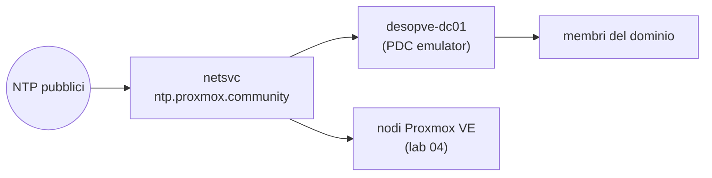

### Il DNS è autoritativo per `proxmox.community`

Il dominio del laboratorio è `proxmox.community`, lo stesso nome del sito pubblico. Il domain controller diventa **autoritativo** per quella zona: per ogni nome che finisce in `proxmox.community` risponde solo con i record che conosce.

Un nome che esiste su Internet ma non nella zona interna (ad esempio `www.proxmox.community`) risulta quindi **inesistente** per i server del laboratorio. Se ti servono nomi pubblici dello stesso dominio, aggiungili a mano nella zona interna. È la configurazione nota come *split DNS*: lo stesso nome di dominio ha contenuti diversi dentro e fuori l'azienda.

### Niente forwarder DNS

Il DNS del domain controller non inoltra le richieste verso Internet: il laboratorio non ha un'uscita diretta. I nomi pubblici (ad esempio `deb.debian.org`) li risolve il **proxy**, quando un server chiede una pagina tramite `proxy.proxmox.community:3128`.

## Procedura

### 1. Installare Windows Server 2025

1. Avvia il server dalla chiavetta USB (o dal *virtual media* della scheda di gestione). Alla richiesta *Press any key to boot from CD or DVD* premi un tasto. Nella prima schermata lascia **English (United States)** come lingua e formato, poi **Next**.

   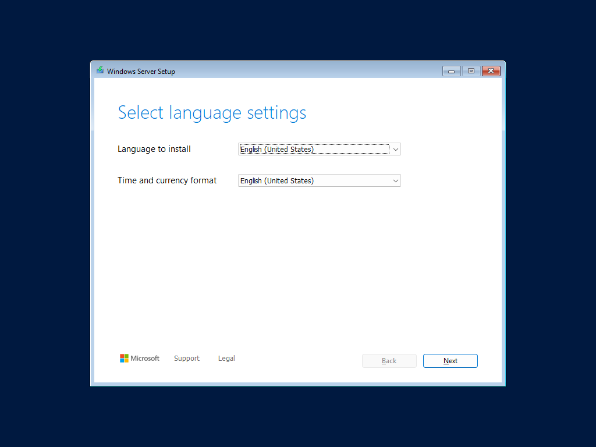

2. Scegli il layout di tastiera **Italian** e premi **Next**.

   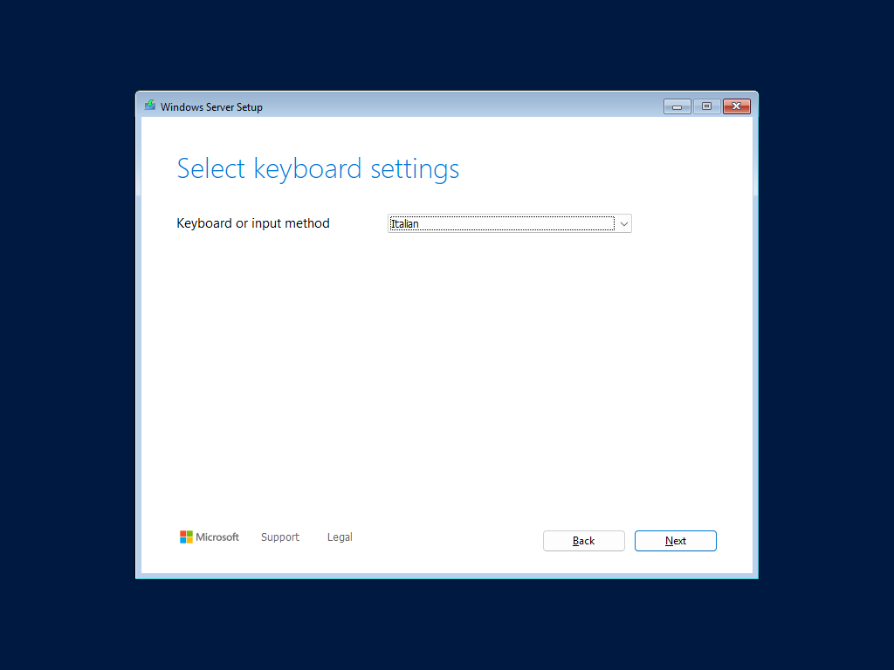

3. Seleziona **Install Windows Server**, spunta *I agree everything will be deleted including files, apps, and settings* e premi **Next**.

   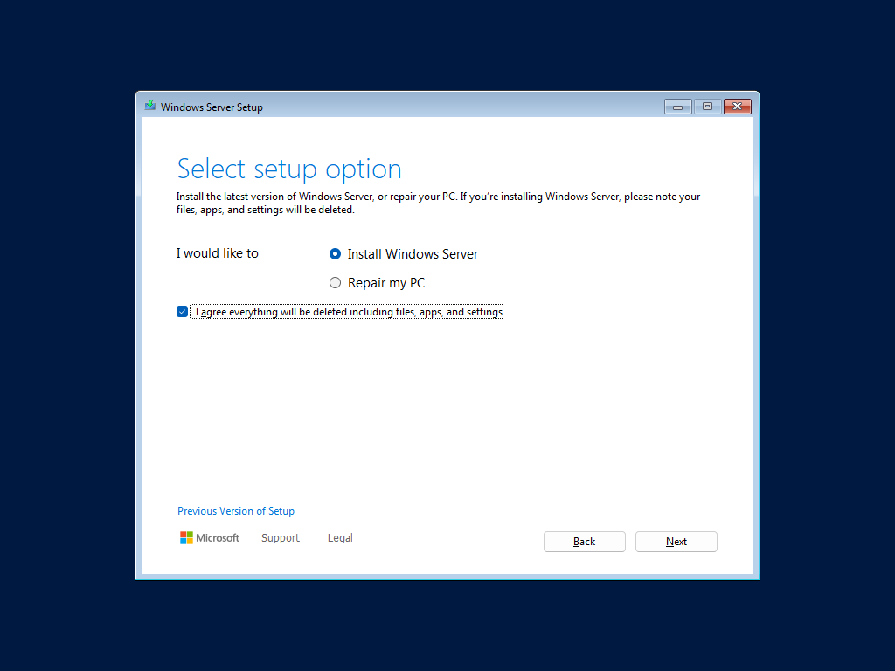

4. Scegli l'edizione **Windows Server 2025 Standard Evaluation (Desktop Experience)**. L'edizione senza *Desktop Experience* è la Server Core, senza interfaccia grafica.

   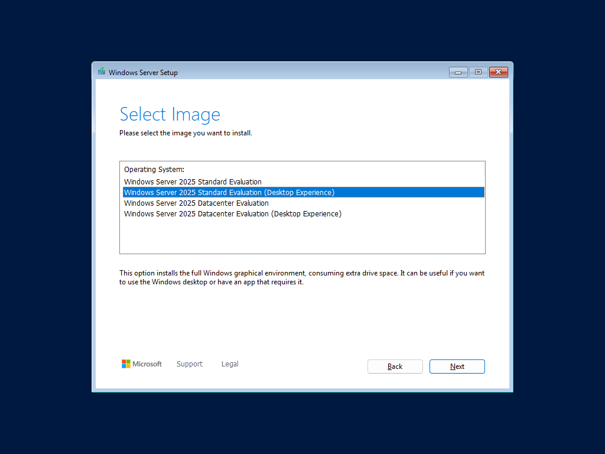

5. Accetta i termini di licenza con **Accept**.

   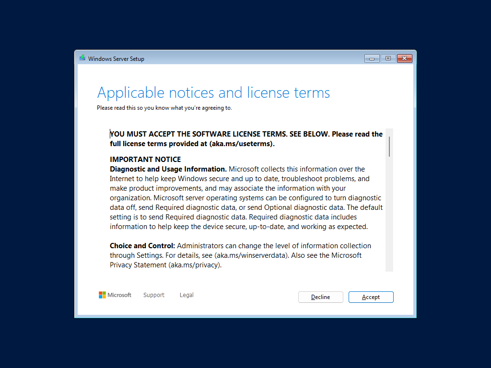

6. Seleziona **Disk 0** (90 GB) come destinazione e premi **Next**. Il disco da 300 GB resta libero: nessun lab lo usa, puoi anche ometterlo.

   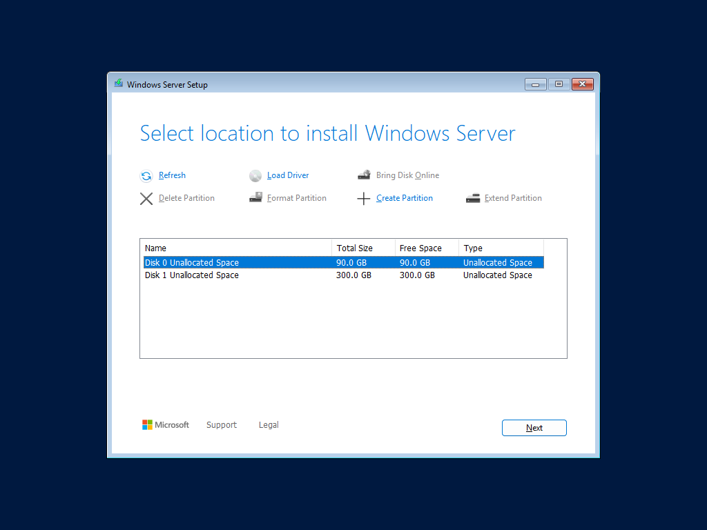

7. Controlla il riepilogo e premi **Install**.

   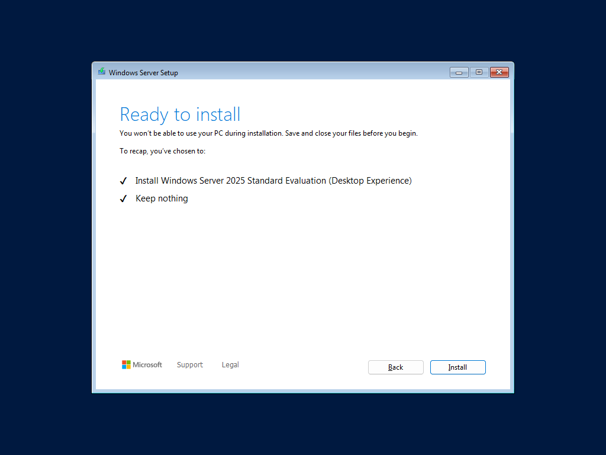

8. Attendi la fine dell'installazione: il server si riavvia da solo, anche più volte.

   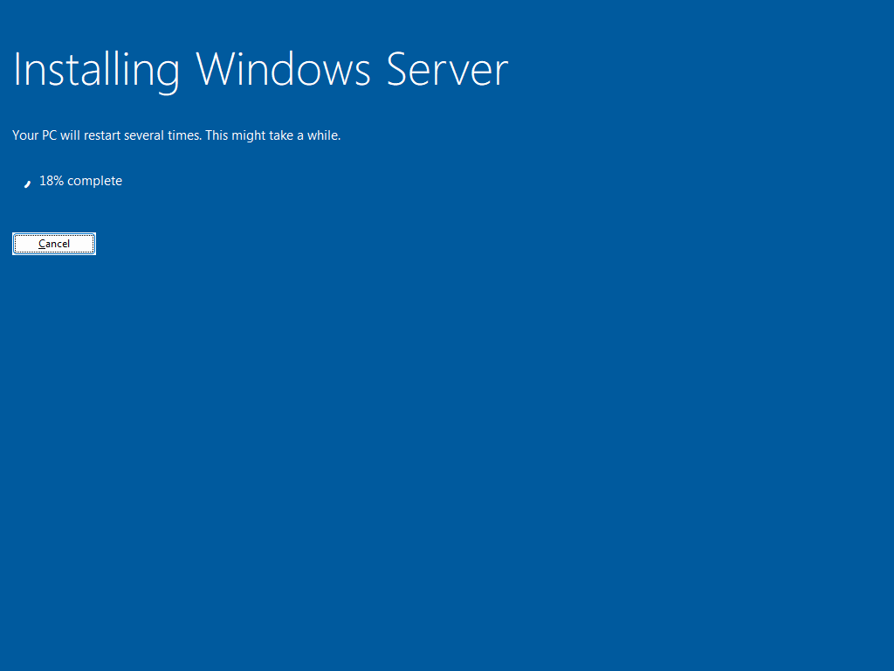

### 2. Primo accesso

1. Imposta la password di **Administrator** (`<password-lab>`) nei due campi e premi **Finish**.

   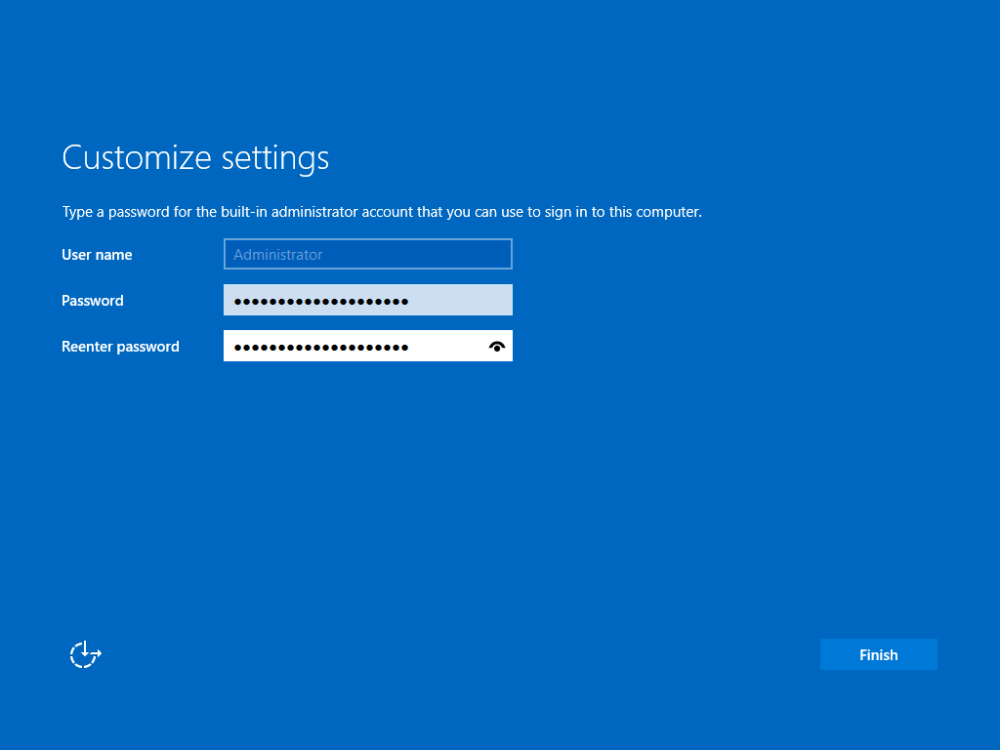

2. Accedi come Administrator (Ctrl+Alt+Canc). Alla richiesta sui dati di diagnostica scegli **Required only**.

3. Si apre **Server Manager**, la console di gestione del server. Chiudi il riquadro che propone Windows Admin Center e Azure Arc.

   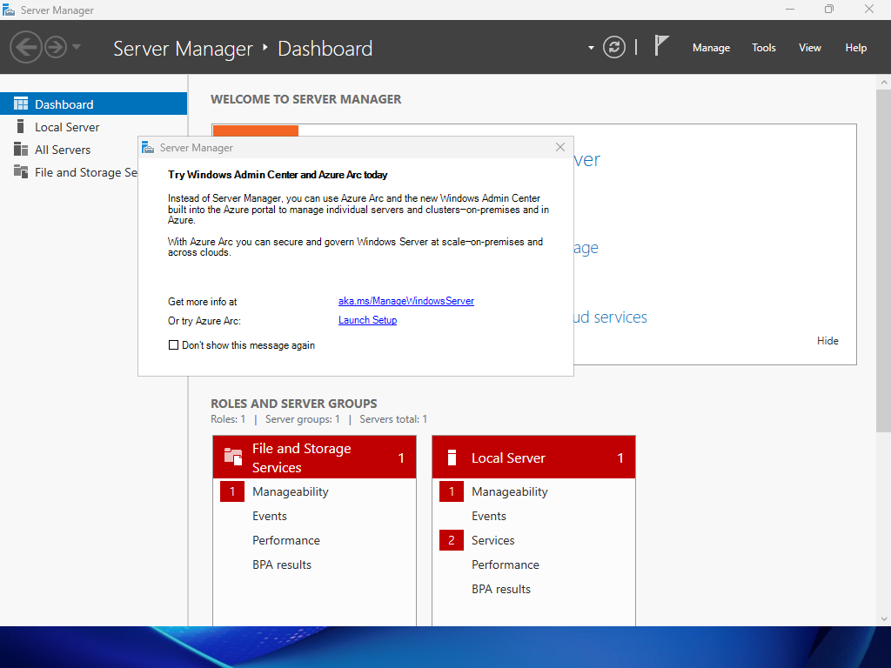

### 3. Rete, Desktop remoto e nome del server

Esegui questi comandi in una finestra di **PowerShell** aperta come amministratore (tasto destro sul pulsante Start → *Terminal (Admin)*).

1. Elenca le schede di rete:

   ```powershell
   Get-NetAdapter | Format-Table Name, InterfaceDescription, Status
   ```

   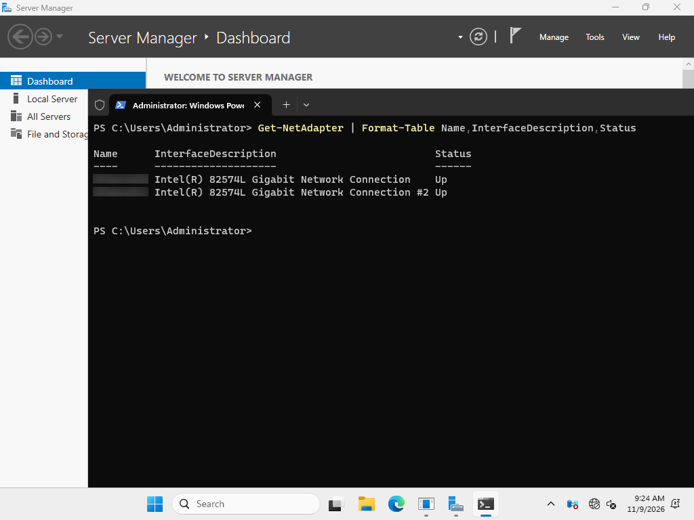

   Windows assegna alle schede nomi generici, che dipendono dall'hardware: tra poco le rinomineremo secondo il ruolo. Nel lab la prima scheda in ordine di indice è collegata alla rete di gestione, la seconda alla rete cluster/storage. Se nel tuo laboratorio l'ordine è diverso, scambia le due schede nei comandi seguenti.

2. Assegna gli indirizzi statici. La scheda di gestione usa come DNS sé stessa (`127.0.0.1`), perché tra poco questo server sarà il DNS del dominio:

   ```powershell
   $if  = (Get-NetAdapter | Sort-Object ifIndex | Select-Object -First 1).Name
   New-NetIPAddress -InterfaceAlias $if -IPAddress 172.27.199.20 -PrefixLength 24 -DefaultGateway 172.27.199.1
   Set-DnsClientServerAddress -InterfaceAlias $if -ServerAddresses 127.0.0.1

   $if2 = (Get-NetAdapter | Sort-Object ifIndex | Select-Object -Skip 1 -First 1).Name
   New-NetIPAddress -InterfaceAlias $if2 -IPAddress 172.32.199.20 -PrefixLength 24
   ```

   `New-NetIPAddress` mostra l'indirizzo appena assegnato; lo stato `Tentative` diventa `Preferred` dopo pochi secondi, quando Windows ha verificato che l'indirizzo non è già in uso.

   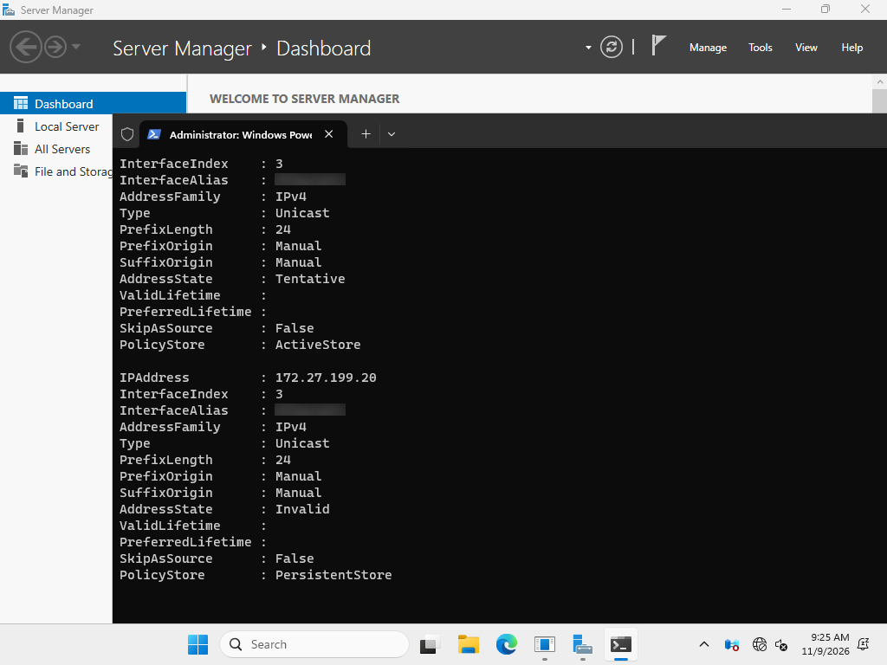

3. Abilita il Desktop remoto e la relativa regola del firewall:

   ```powershell
   Set-ItemProperty -Path "HKLM:\SYSTEM\CurrentControlSet\Control\Terminal Server" -Name fDenyTSConnections -Value 0
   Enable-NetFirewallRule -DisplayGroup "Remote Desktop"
   ```

4. Rinomina il server e riavvialo:

   ```powershell
   Rename-Computer -NewName desopve-dc01 -Restart
   ```

Da qui in avanti puoi lavorare in **Desktop remoto** (`mstsc`) verso `172.27.199.20` dal PC di amministrazione collegato alla rete di gestione (vedi [Postazione di amministrazione](01-lab-architecture.md#postazione-di-amministrazione)), più comodo della console.

5. Imposta il fuso orario italiano. L'installazione in inglese parte dal fuso del Pacifico:

   ```powershell
   Set-TimeZone -Id "W. Europe Standard Time"
   Get-TimeZone | Format-List Id, DisplayName
   ```

   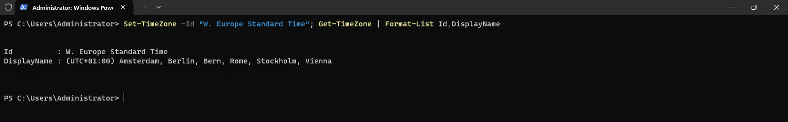

6. Rinomina le schede di rete secondo il loro ruolo: `MGMT` per la gestione, `CLUSTER` per la rete cluster/storage. Sulla scheda `CLUSTER` disattiva la registrazione nel DNS, così il nome del server risolve solo l'indirizzo di gestione:

   ```powershell
   Rename-NetAdapter -Name (Get-NetIPAddress -IPAddress 172.27.199.20).InterfaceAlias -NewName MGMT
   Rename-NetAdapter -Name (Get-NetIPAddress -IPAddress 172.32.199.20).InterfaceAlias -NewName CLUSTER
   Set-DnsClient -InterfaceAlias CLUSTER -RegisterThisConnectionsAddress $false
   ```

   Verifica il risultato:

   ```powershell
   Get-NetAdapter | Format-Table Name, InterfaceDescription, Status, LinkSpeed -AutoSize
   Get-NetIPConfiguration | Select-Object InterfaceAlias,
       @{n='IPv4';e={$_.IPv4Address.IPAddress}},
       @{n='Gateway';e={$_.IPv4DefaultGateway.NextHop}},
       @{n='DNS';e={$_.DNSServer.ServerAddresses -join ', '}} | Format-Table -AutoSize
   Get-DnsClient -InterfaceAlias MGMT, CLUSTER | Format-Table InterfaceAlias, RegisterThisConnectionsAddress -AutoSize
   ```

   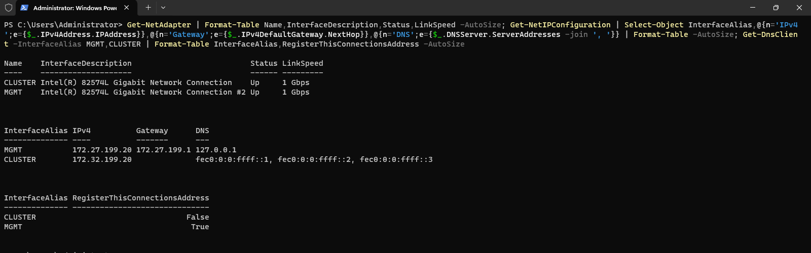

   Dare alle schede un nome che dice a cosa servono è una buona abitudine: script e documentazione restano chiari anche quando l'hardware cambia.

### 4. Installare Active Directory e creare la foresta

1. Installa il ruolo **Active Directory Domain Services** con gli strumenti di gestione:

   ```powershell
   Install-WindowsFeature -Name AD-Domain-Services -IncludeManagementTools
   ```

   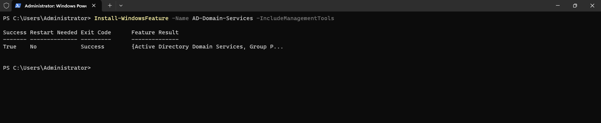

2. Crea la nuova foresta `proxmox.community` con il DNS integrato. Il nome NetBIOS (`PROXMOX`) è il nome breve del dominio, usato ad esempio in `PROXMOX\Administrator`:

   ```powershell
   Install-ADDSForest -DomainName proxmox.community -DomainNetbiosName PROXMOX -InstallDns `
       -SafeModeAdministratorPassword (Read-Host -AsSecureString -Prompt "Password DSRM") -Force
   ```

   Alla richiesta *Password DSRM* digita `<password-lab>`. È la password della **modalità di ripristino dei servizi directory**, l'account locale usato per riparare Active Directory quando il servizio non si avvia: in produzione va custodita con cura.

3. La promozione verifica i prerequisiti, crea le partizioni della directory e configura il DNS. Al termine il server si riavvia da solo.

   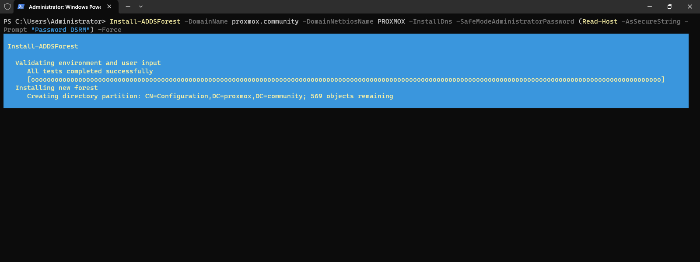

4. Dopo il riavvio accedi come `PROXMOX\Administrator`. Il primo accesso richiede qualche minuto (*Please wait for the Group Policy Client*). In Server Manager compaiono i ruoli **AD DS** e **DNS**.

   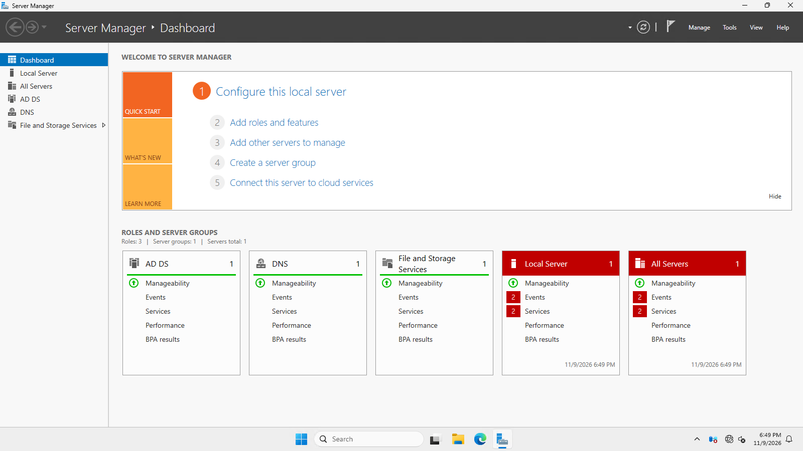

5. Verifica dominio, foresta e domain controller:

   ```powershell
   Get-ADDomain | Format-List Name, DNSRoot, NetBIOSName, DomainMode, PDCEmulator
   Get-ADForest | Format-List Name, ForestMode, SchemaMaster
   Get-ADDomainController | Format-List HostName, IPv4Address, Site, IsGlobalCatalog
   ```

   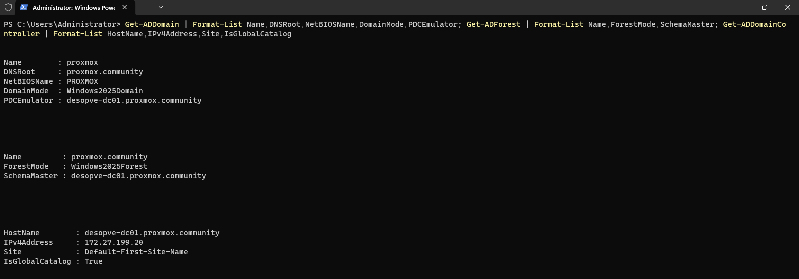

   Il livello funzionale è **Windows2025Domain** / **Windows2025Forest**, il valore predefinito per una foresta nuova su Windows Server 2025.

### 5. Preparare il DNS del laboratorio

1. Crea le **zone inverse** per le due reti del laboratorio, integrate in Active Directory e replicate in tutta la foresta:

   ```powershell
   Add-DnsServerPrimaryZone -NetworkId "172.27.199.0/24" -ReplicationScope Forest
   Add-DnsServerPrimaryZone -NetworkId "172.32.199.0/24" -ReplicationScope Forest
   Get-DnsServerZone | Format-Table ZoneName, ZoneType, IsDsIntegrated, IsReverseLookupZone -AutoSize
   ```

   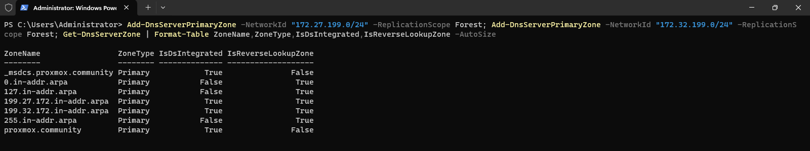

2. Registra tutti i server del laboratorio. `-CreatePtr` crea anche il record inverso (PTR). `proxy` e `ntp` sono alias (CNAME) di `netsvc`: se un giorno il servizio si sposta, basta cambiare l'alias:

   ```powershell
   $z = 'proxmox.community'
   Add-DnsServerResourceRecordA -ZoneName $z -Name desopve01 -IPv4Address 172.27.199.21 -CreatePtr
   Add-DnsServerResourceRecordA -ZoneName $z -Name desopve02 -IPv4Address 172.27.199.22 -CreatePtr
   Add-DnsServerResourceRecordA -ZoneName $z -Name desopve03 -IPv4Address 172.27.199.23 -CreatePtr
   Add-DnsServerResourceRecordA -ZoneName $z -Name desopve04 -IPv4Address 172.27.199.24 -CreatePtr
   Add-DnsServerResourceRecordA -ZoneName $z -Name desonas   -IPv4Address 172.27.199.10 -CreatePtr
   Add-DnsServerResourceRecordA -ZoneName $z -Name netsvc    -IPv4Address 172.27.199.250 -CreatePtr
   Add-DnsServerResourceRecordA -ZoneName $z -Name esxi8     -IPv4Address 172.27.199.30 -CreatePtr
   Add-DnsServerResourceRecordCName -ZoneName $z -Name proxy -HostNameAlias netsvc.proxmox.community
   Add-DnsServerResourceRecordCName -ZoneName $z -Name ntp   -HostNameAlias netsvc.proxmox.community
   ipconfig /registerdns
   ```

   `ipconfig /registerdns` registra di nuovo il domain controller stesso, così nasce anche il suo record inverso nella zona appena creata. Controlla i record:

   ```powershell
   Get-DnsServerResourceRecord -ZoneName $z | Where-Object RecordType -in 'A','CNAME' |
       Format-Table HostName, RecordType,
       @{n='Dato';e={ if ($_.RecordType -eq 'A') { $_.RecordData.IPv4Address } else { $_.RecordData.HostNameAlias } }} -AutoSize
   ```

   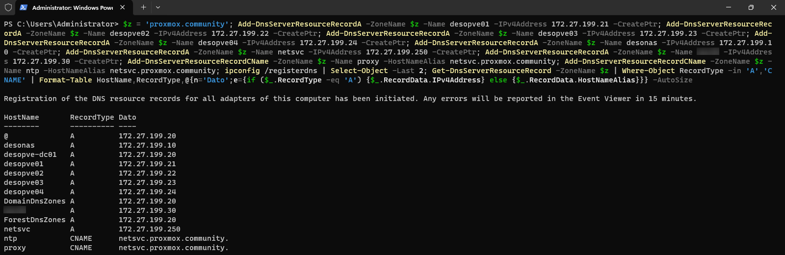

3. Registra anche il router del laboratorio e i server introdotti nei percorsi successivi (Proxmox Backup Server, Proxmox Datacenter Manager e le VM del server ESXi di origine del lab 50). Il router ha un indirizzo su entrambe le reti: il record A punta all'indirizzo di gestione, mentre per `172.32.199.1` basta il record inverso:

   ```powershell
   Add-DnsServerResourceRecordA -ZoneName $z -Name rtr-core    -IPv4Address 172.27.199.1  -CreatePtr
   Add-DnsServerResourceRecordPtr -ZoneName 199.32.172.in-addr.arpa -Name 1 -PtrDomainName rtr-core.proxmox.community
   Add-DnsServerResourceRecordA -ZoneName $z -Name desopbs01   -IPv4Address 172.27.199.40 -CreatePtr
   Add-DnsServerResourceRecordA -ZoneName $z -Name desopdm01   -IPv4Address 172.27.199.41 -CreatePtr
   Add-DnsServerResourceRecordA -ZoneName $z -Name linux-src01 -IPv4Address 172.27.199.31 -CreatePtr
   Add-DnsServerResourceRecordA -ZoneName $z -Name win-src01   -IPv4Address 172.27.199.32 -CreatePtr
   ```

   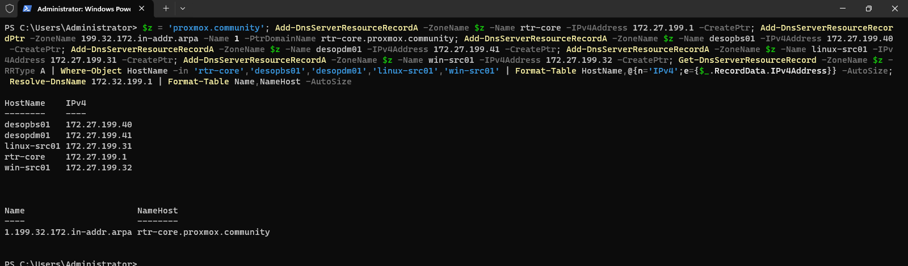

4. Il server DNS registra il nome del domain controller per **ogni** indirizzo su cui è in ascolto, compreso `172.32.199.20` della scheda `CLUSTER`: la registrazione disattivata al passo 3.6 non basta. Un client potrebbe così ricevere `172.32.199.20` come indirizzo del DC e non raggiungerlo. Cerca i record che puntano alla rete cluster:

   ```powershell
   Get-DnsServerResourceRecord -ZoneName proxmox.community -RRType A |
       Where-Object { $_.RecordData.IPv4Address -like '172.32.*' }
   ```

   Se compare `desopve-dc01` con `172.32.199.20`, limita l'ascolto del DNS al solo indirizzo di gestione (in DNS Manager è **Properties** → **Interfaces** → **Only the following IP addresses**) e riavvia il servizio. Appena cambiano gli indirizzi di ascolto, il server DNS toglie da solo il record della rete cluster:

   ```powershell
   $s = Get-DnsServerSetting -All
   $s.ListeningIPAddress = @('172.27.199.20')
   Set-DnsServerSetting -InputObject $s
   Restart-Service DNS
   Get-DnsServerResourceRecord -ZoneName proxmox.community -RRType A -Name desopve-dc01 |
       Format-Table HostName, RecordType, @{n='IPv4Address';e={$_.RecordData.IPv4Address}} -AutoSize
   ```

   ```text
   HostName     RecordType IPv4Address
   --------     ---------- -----------
   desopve-dc01 A          172.27.199.20
   ```

   La ricerca di prima, ripetuta, non restituisce più nulla. Lo stesso risultato si vede risolvendo il nome:

   ```powershell
   Resolve-DnsName desopve-dc01.proxmox.community -DnsOnly | Format-Table Name, Type, IPAddress -AutoSize
   ```

   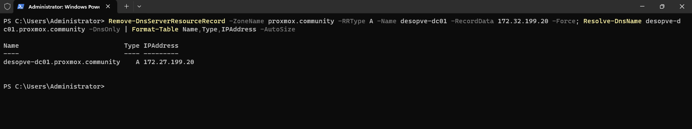

   Nel [Lab 25](25-ipv6.md), con IPv6, all'elenco degli indirizzi di ascolto si aggiunge `fd27:199::20`.

5. Gli stessi record si vedono anche in forma grafica in **DNS Manager** (`dnsmgmt.msc`) → *Forward Lookup Zones* → `proxmox.community`.

### 6. Sincronizzare l'ora

Il primo domain controller della foresta ha il ruolo di **PDC emulator** ed è la fonte dell'ora per tutto il dominio. Configuralo per sincronizzarsi con il server NTP del laboratorio:

```powershell
w32tm /config /manualpeerlist:"ntp.proxmox.community,0x8" /syncfromflags:manual /reliable:yes /update
Restart-Service w32time
w32tm /resync /force
w32tm /query /status
Get-Date
```

`0x8` indica di interrogare il server in modalità client, `/reliable:yes` annuncia il DC come fonte affidabile per i membri del dominio.

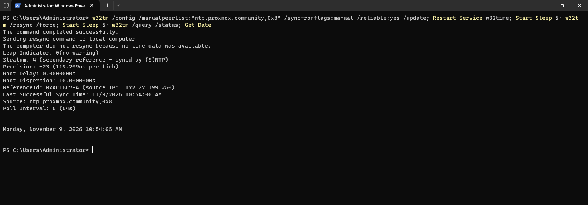

Subito dopo il riavvio del servizio `w32tm /resync` può rispondere *no time data was available*: il servizio non ha ancora ricevuto la prima risposta. Conta `w32tm /query /status`: **Source** deve essere `ntp.proxmox.community,0x8`, **Last Successful Sync Time** recente e **ReferenceId** con l'indirizzo `172.27.199.250`.

### 7. Configurare il proxy di sistema

I servizi di Windows che scaricano dati (ad esempio gli aggiornamenti dei certificati radice) usano il proxy **WinHTTP**, distinto da quello del browser. Impostalo e verifica che il proxy risponda:

```powershell
netsh winhttp set proxy proxy-server="proxy.proxmox.community:3128" bypass-list="*.proxmox.community;172.27.199.*;172.32.199.*;<local>"
netsh winhttp show proxy
(Invoke-WebRequest -Uri http://deb.debian.org/debian/ -Proxy http://proxy.proxmox.community:3128 -UseBasicParsing).StatusCode
```

La *bypass-list* fa sì che il traffico verso i server del laboratorio non passi dal proxy.

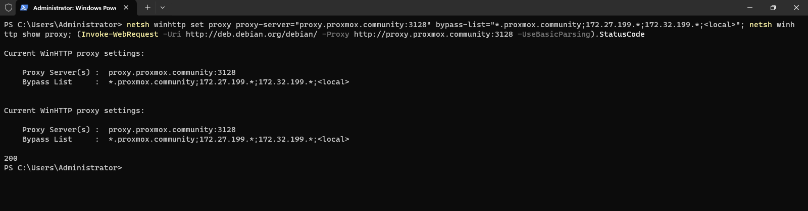

> **Aggiornamenti di Windows.** In questo laboratorio il proxy lascia passare solo una lista ristretta di siti, e Windows Update usa molti servizi Microsoft diversi: per questo il domain controller del lab non viene aggiornato. In un ambiente reale aggiorna sempre il server prima di metterlo in servizio, consentendo nel proxy gli indirizzi di Windows Update o usando un server WSUS interno.

## Verifica e test

Dal domain controller:

```powershell
Resolve-DnsName desopve01.proxmox.community | Format-Table Name, Type, IPAddress -AutoSize
Resolve-DnsName 172.27.199.21 | Format-Table Name, Type, NameHost -AutoSize
Resolve-DnsName proxy.proxmox.community | Format-Table Name, Type, NameHost, IPAddress -AutoSize
Resolve-DnsName www.proxmox.community -ErrorAction SilentlyContinue -ErrorVariable e | Out-Null; $e[0].Exception.Message
w32tm /query /source
```

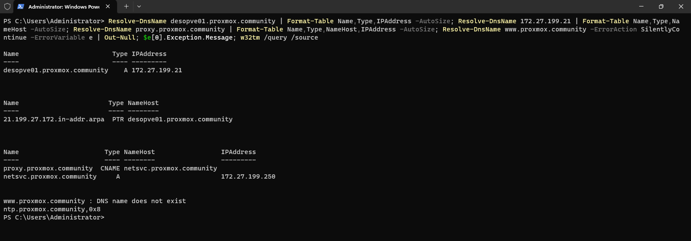

Risultati attesi:

- [ ] `desopve01.proxmox.community` → `172.27.199.21`, e `172.27.199.21` → `desopve01.proxmox.community`.
- [ ] `proxy.proxmox.community` è un alias di `netsvc.proxmox.community` → `172.27.199.250`.
- [ ] `www.proxmox.community` → *DNS name does not exist*: è l'effetto della zona autoritativa descritto in [Come funziona](#il-dns-è-autoritativo-per-proxmoxcommunity).
- [ ] La fonte dell'ora è `ntp.proxmox.community,0x8`.

## Stato finale del lab

- `desopve-dc01.proxmox.community` (172.27.199.20) è domain controller della foresta `proxmox.community` (NetBIOS `PROXMOX`), con DNS integrato in ascolto solo sull'indirizzo di gestione.
- Zone diretta e inverse popolate con tutti i server del laboratorio; alias `proxy` e `ntp` verso `netsvc`.
- Ora sincronizzata con `ntp.proxmox.community`; proxy WinHTTP configurato.
- Desktop remoto attivo.

## Cosa hai imparato

- Come installare Windows Server 2025 e promuoverlo a domain controller da PowerShell.
- Perché DNS diretto e inverso e ora esatta sono prerequisiti di un cluster.
- Cosa significa avere un DNS autoritativo per un dominio che esiste anche su Internet (*split DNS*).
- Come un server raggiunge Internet tramite proxy, senza DNS pubblico e senza un gateway verso Internet.

## Riferimenti

- [Proxmox VE – Time Synchronization](https://pve.proxmox.com/pve-docs/pve-admin-guide.html#_time_synchronization)
- [Microsoft Learn – Install-ADDSForest](https://learn.microsoft.com/powershell/module/addsdeployment/install-addsforest)
- [Microsoft Learn – Configurare il servizio Ora di Windows (w32tm)](https://learn.microsoft.com/windows-server/networking/windows-time-service/windows-time-service-tools-and-settings)
- [Microsoft Learn – Add-DnsServerResourceRecordA](https://learn.microsoft.com/powershell/module/dnsserver/add-dnsserverresourcerecorda)
