# Lab 03 – Installazione di Proxmox VE 9.2 (ZFS RAID1 ed ext4)

**Livello:** base · **Durata:** 20 minuti per nodo

## Dipendenze

- **Lab precedenti:** [Lab 01](01-lab-architecture.md), [Lab 02](02-domain-controller.md). Il DNS deve già contenere i record di `desopve01`…`desopve04`.
- **Server:** `desopve01`, `desopve02` e `desopve03` (4 core, 32 GB, dischi 2 × 50 GB + 2 × 60 GB, 3 schede di rete) e `desopve04` (4 core, 16 GB, il solo disco di sistema da 50 GB, 2 schede di rete), con VT-x/AMD-V attivo nel firmware. È l'[hardware del laboratorio](01-lab-architecture.md#hardware-del-laboratorio) all'inizio del corso: gli altri dischi e le altre schede arrivano nei lab che li usano.
- **ISO:** `proxmox-ve_9.2-1.iso`, con l'impronta SHA-256 verificata, su chiavetta USB o sul *virtual media* della scheda di gestione.
- **Indirizzi:** da `172.27.199.21` a `172.27.199.24`, gateway `172.27.199.1`, DNS `172.27.199.20`.
- **Credenziali:** `<password-lab>` per `root` → [Appendice B](b-credentials-and-addresses.md).

## Obiettivi

- Installare Proxmox VE 9.2 su tre nodi con il sistema su **ZFS RAID1** (mirror).
- Installare il quarto nodo su **ext4 con LVM-thin**, per confrontare i due layout.
- Capire cosa crea l'installer: pool ZFS o gruppo LVM, storage `local`, bridge `vmbr0`, nomi delle schede di rete.
- Verificare l'installazione da riga di comando.

## Come funziona

Proxmox VE è una distribuzione **Debian** (la 9.2 si basa su Debian 13 "Trixie") con il proprio kernel, QEMU/KVM per le VM, LXC per i container e un'interfaccia web sulla porta **8006**. L'installer fa in pochi minuti quello che a mano richiederebbe ore: partiziona i dischi, crea il file system, installa i pacchetti e configura rete e bootloader.

### Quale file system per il sistema

L'installer propone **ext4**, **xfs**, **ZFS** e **Btrfs**. Le due scelte più comuni sono queste:

| | ZFS (RAID1) | ext4 + LVM-thin |
|---|---|---|
| Dischi | almeno 2 | anche 1 |
| Ridondanza del sistema | sì (mirror) | no, a meno di un RAID hardware |
| Snapshot delle VM | sì, nativi (zvol) | sì, con LVM-thin |
| Memoria | usa la RAM come cache (ARC) | consumo minimo |
| Storage creati | `local` (directory) + `local-zfs` | `local` (directory) + `local-lvm` (LVM-thin) |
| Compatibilità con RAID hardware | no: ZFS vuole i dischi "nudi" | sì |

Nel laboratorio i nodi del cluster usano **ZFS RAID1** sui due dischi da 50 GB: se un disco si guasta, il nodo continua a funzionare (il guasto di un disco in un pool ridondante lo proverai nel lab 10). I due dischi da 60 GB restano liberi per Ceph (lab 17). `desopve04` usa **ext4**: è la configurazione di un server con un solo disco o con un controller RAID hardware.

### Nomi delle schede di rete fissati (novità 9.x)

Su Linux i nomi delle schede (ad esempio `enp65s0f0`) derivano dalla loro posizione sul bus PCI e possono cambiare dopo un aggiornamento del kernel o del firmware, rompendo la configurazione di rete. L'installer di Proxmox VE 9.2 ha l'opzione **Pin network interface names**, **attiva di default**: assegna nomi stabili `nic0`, `nic1`, `nic2`… legati all'indirizzo MAC della scheda, tramite file `.link` di systemd in `/usr/local/lib/systemd/network/`.

## Procedura

### 1. Installare `desopve01` su ZFS RAID1

1. Avvia il server dalla chiavetta USB con la ISO (o dal *virtual media* della scheda di gestione) e scegli **Install Proxmox VE (Graphical)**.

   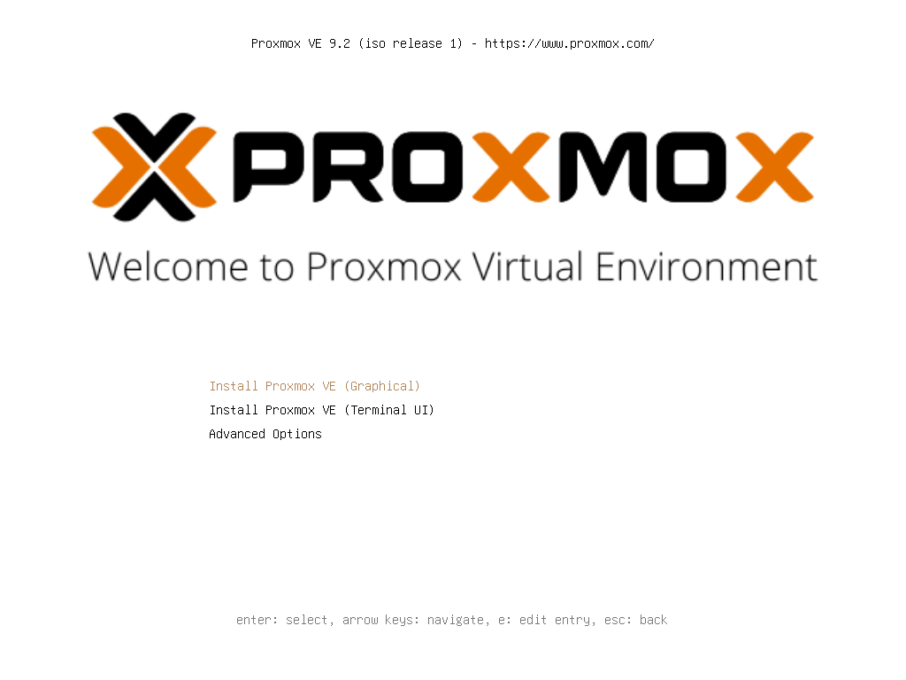

2. Accetta la licenza con **I agree**.

   

3. Nella schermata del disco di destinazione premi **Options**: per una configurazione con più dischi la scelta va fatta lì.

   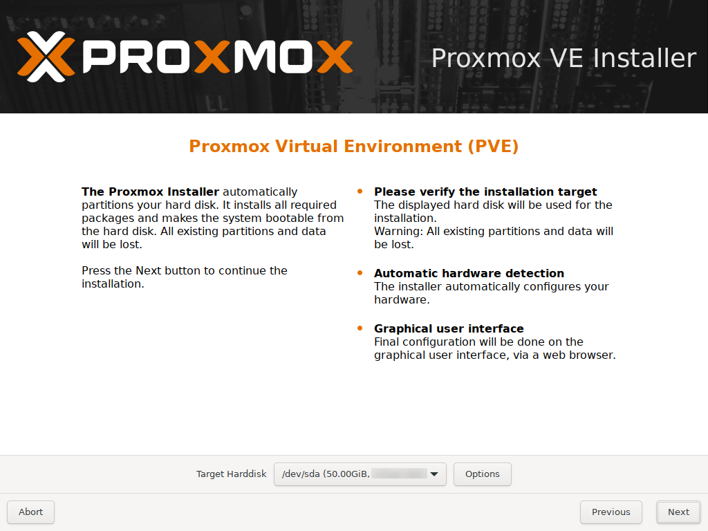

4. Il file system predefinito è **ext4** su un solo disco.

   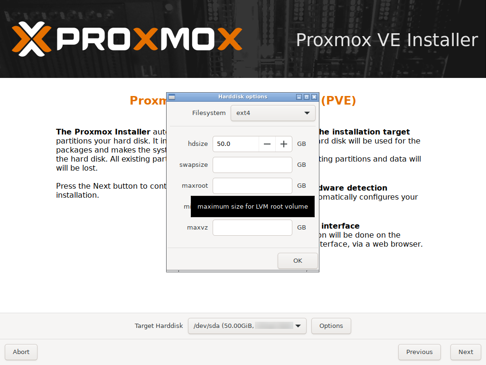

5. Imposta **Filesystem** su `zfs (RAID1)`. Lascia selezionati **Harddisk 0** e **Harddisk 1** (i due dischi da 50 GB) e imposta gli altri due su `-- do not use --`: i dischi da 60 GB servono a Ceph. Premi **OK** e poi **Next**.

   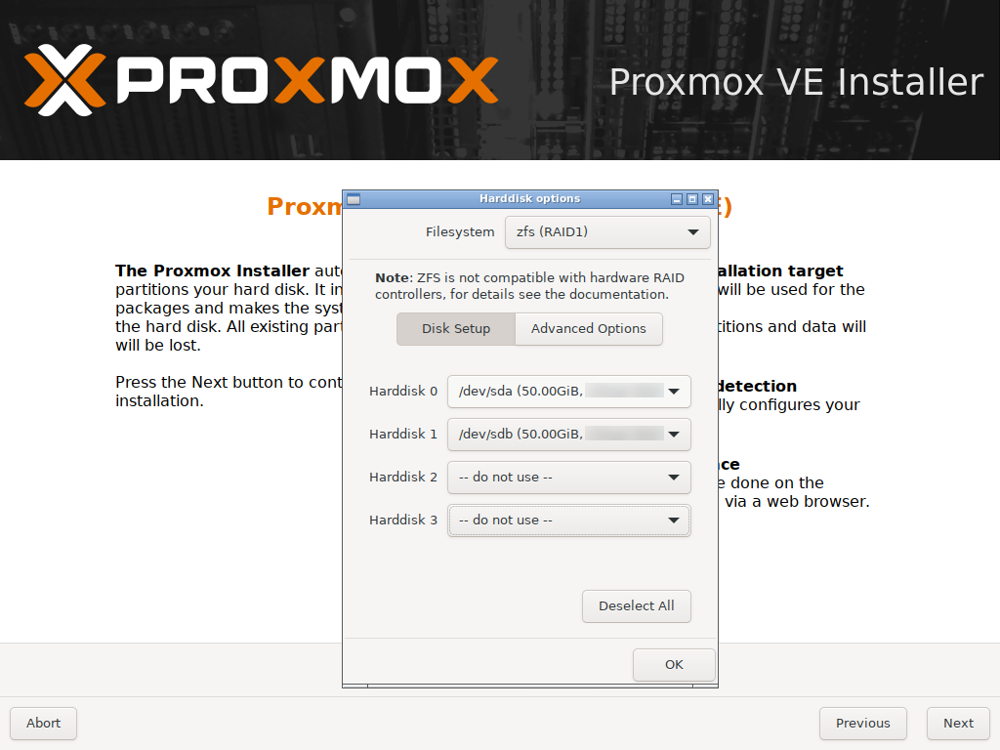

   > La nota nella finestra ricorda che ZFS non è compatibile con i controller RAID hardware: deve vedere i singoli dischi per gestire lui la ridondanza e l'integrità dei dati.

6. Imposta **Country** `Italy`, **Time zone** `Europe/Rome` e **Keyboard Layout** `Italian`.

   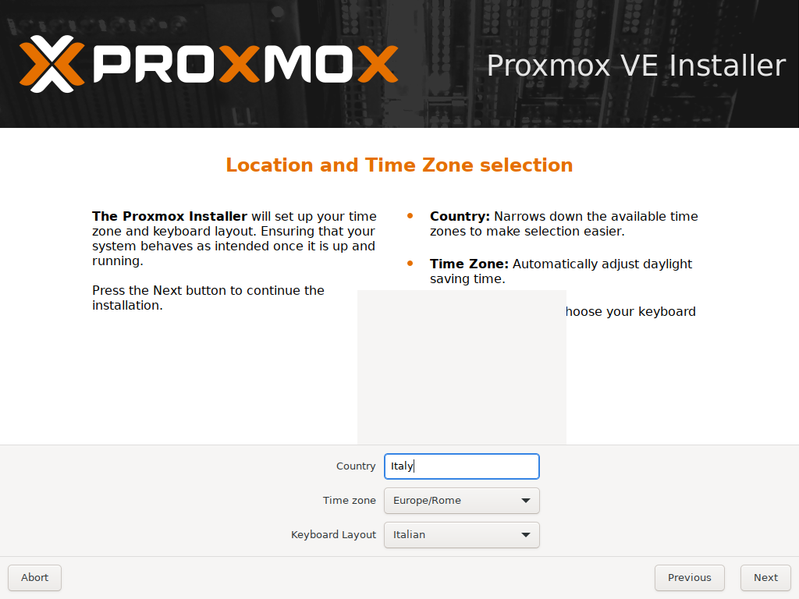

7. Inserisci la password di `root` (`<password-lab>`) due volte e l'indirizzo e-mail a cui il nodo invierà gli avvisi (`admin@proxmox.community`).

   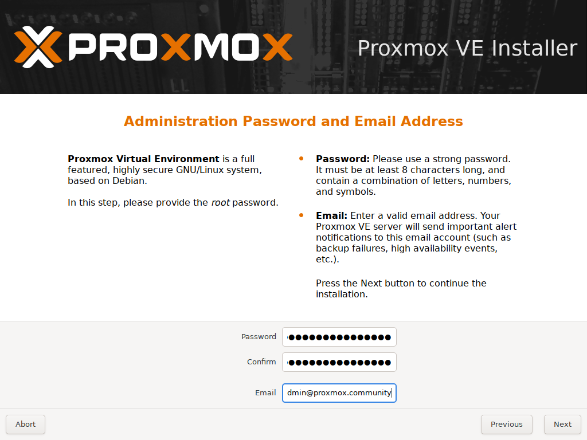

8. Configura la rete di gestione:

   | Campo | Valore |
   |---|---|
   | Management Interface | `nic0` |
   | Hostname (FQDN) | `desopve01.proxmox.community` |
   | IP Address (CIDR) | `172.27.199.21` / `24` |
   | Gateway | `172.27.199.1` |
   | DNS Server | `172.27.199.20` |

   Lascia spuntato **Pin network interface names**.

   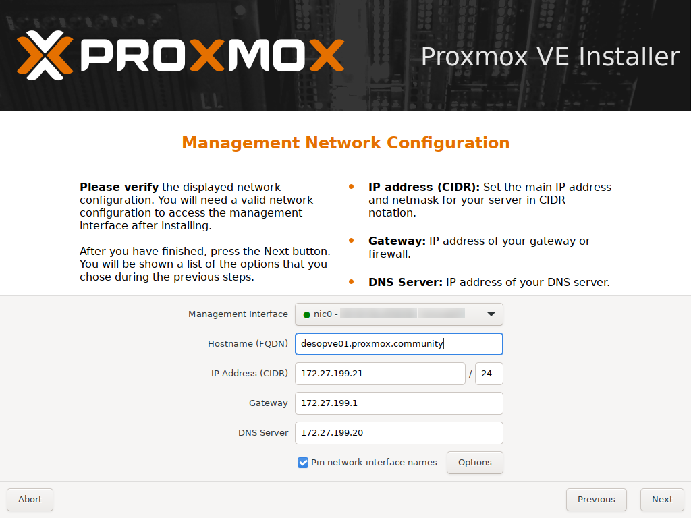

   > Scrivi il nome **completo** (FQDN): l'installer ne ricava sia il nome del nodo (`desopve01`) sia il dominio di ricerca DNS.

9. Controlla il riepilogo. Togli la spunta **Automatically reboot after successful installation** se devi rimuovere la chiavetta (o smontare il *virtual media*) prima del riavvio, poi premi **Install**.

   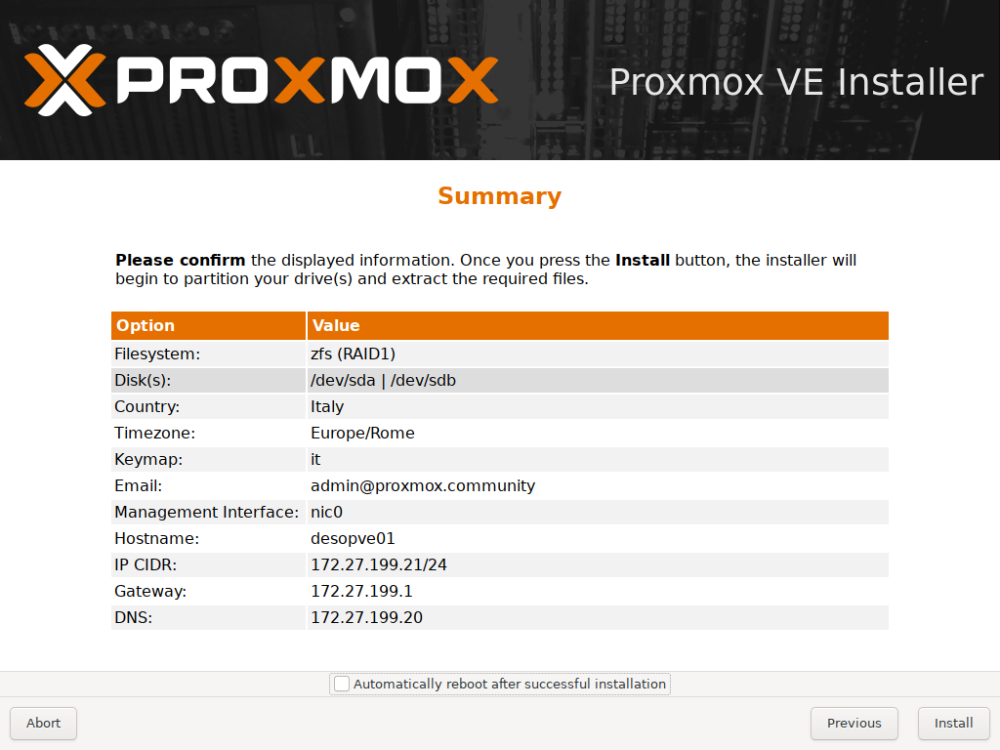

10. L'installazione dura pochi minuti.

    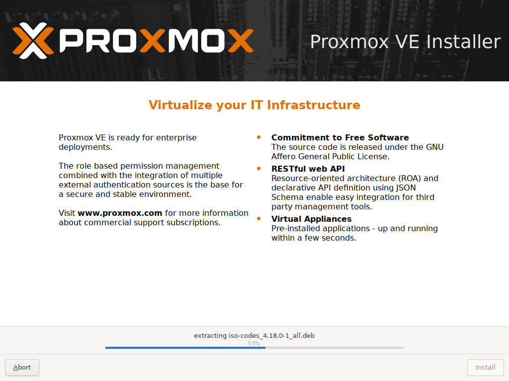

11. Al termine l'installer indica l'indirizzo dell'interfaccia web. Rimuovi la chiavetta (o smonta il *virtual media*) e premi **Reboot**.

    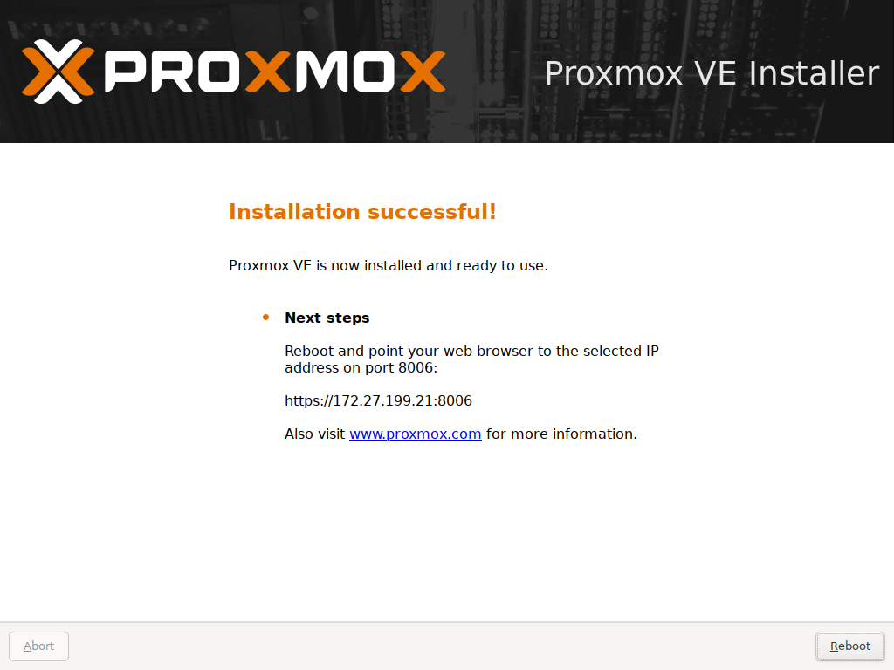

12. Dopo il riavvio la console mostra l'indirizzo dell'interfaccia web e la richiesta di login.

    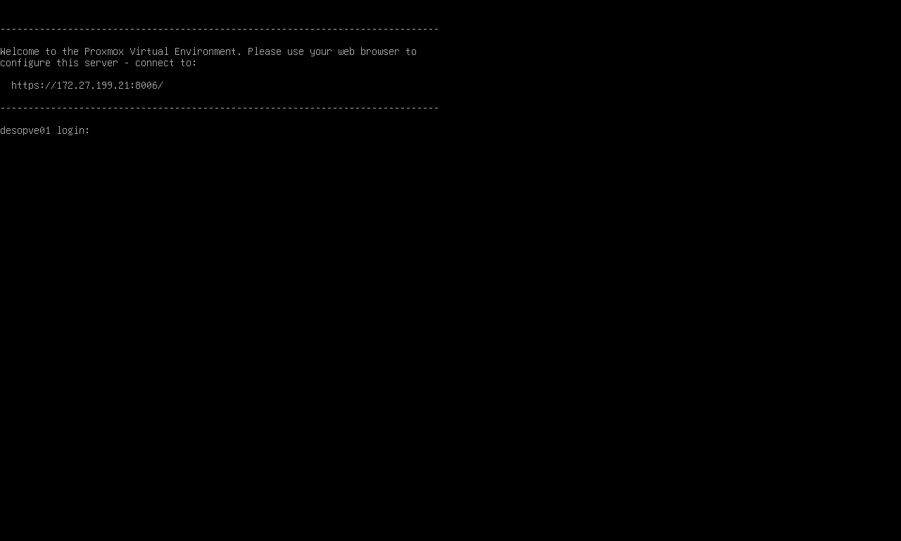

### 2. Installare `desopve02` e `desopve03`

Ripeti la procedura del passo 1 cambiando solo nome e indirizzo:

| Nodo | Hostname (FQDN) | IP Address (CIDR) |
|---|---|---|
| desopve02 | `desopve02.proxmox.community` | `172.27.199.22/24` |
| desopve03 | `desopve03.proxmox.community` | `172.27.199.23/24` |

### 3. Installare `desopve04` su ext4

Ripeti la procedura con queste differenze:

1. In **Options** lascia **Filesystem** `ext4` sull'unico disco da 50 GB (`/dev/sda`): i vani hot-swap restano vuoti, i dischi da 20 GB arrivano nel lab 09. I campi `hdsize`, `swapsize`, `maxroot`, `minfree` e `maxvz` (nella schermata un suggerimento copre l'etichetta `minfree`) restano vuoti: l'installer calcola le dimensioni da solo.

   

2. Hostname `desopve04.proxmox.community`, indirizzo `172.27.199.24/24`.

### 4. Controllare il nome di ogni nodo

Dopo il riavvio accedi in console come `root` e controlla il nome completo con `hostname -f`: deve contenere il dominio `proxmox.community`. Ad esempio su `desopve02`:

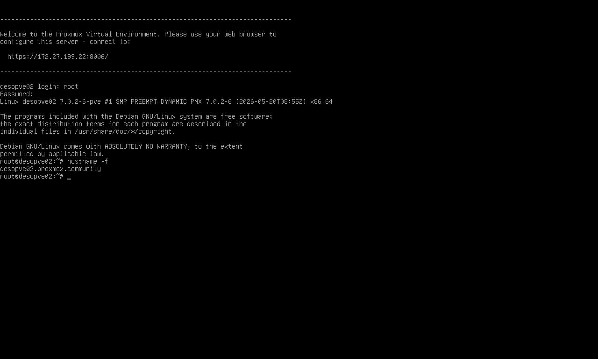

## Verifica e test

Collegati a ogni nodo in SSH come `root` (o dalla console) e controlla quanto segue.

**Nome e versione:**

```console
root@desopve01:~# hostname -f
desopve01.proxmox.community
root@desopve01:~# pveversion
pve-manager/9.2.2/b9984c6d90a4bd80 (running kernel: 7.0.2-6-pve)
```

**Pool ZFS del sistema** (`-L` mostra i nomi dei dischi invece degli identificativi lunghi):

```console
root@desopve01:~# zpool status -L rpool
  pool: rpool
 state: ONLINE
config:

	NAME        STATE     READ WRITE CKSUM
	rpool       ONLINE       0     0     0
	  mirror-0  ONLINE       0     0     0
	    sda3    ONLINE       0     0     0
	    sdb3    ONLINE       0     0     0

errors: No known data errors
root@desopve01:~# zfs list
NAME               USED  AVAIL  REFER  MOUNTPOINT
rpool             2.00G  45.5G    96K  /rpool
rpool/ROOT        2.00G  45.5G    96K  /rpool/ROOT
rpool/ROOT/pve-1  2.00G  45.5G  2.00G  /
rpool/data          96K  45.5G    96K  /rpool/data
rpool/var-lib-vz    96K  45.5G    96K  /var/lib/vz
```

`rpool/ROOT/pve-1` è il sistema, `rpool/data` ospita i dischi delle VM (storage `local-zfs`) e `rpool/var-lib-vz` contiene ISO, template e backup (storage `local`).

**Avvio da entrambi i dischi.** Con ZFS RAID1 l'installer crea una partizione di avvio EFI su **ogni** disco e le tiene allineate con `proxmox-boot-tool`: il nodo si avvia anche se si guasta il primo disco.

```console
root@desopve01:~# proxmox-boot-tool status
Re-executing '/usr/sbin/proxmox-boot-tool' in new private mount namespace..
System currently booted with uefi
F98D-1B42 is configured with: uefi (versions: 7.0.2-6-pve)
F990-B56D is configured with: uefi (versions: 7.0.2-6-pve)
```

**Storage creati dall'installer:**

```console
root@desopve01:~# pvesm status
Name             Type     Status     Total (KiB)      Used (KiB) Available (KiB)        %
local             dir     active        47723008             128        47722880    0.00%
local-zfs     zfspool     active        47723048              96        47722952    0.00%
```

Su `desopve04` (ext4) gli storage sono `local` e `local-lvm`, cioè il thin pool `data` del gruppo LVM `pve`:

```console
root@desopve04:~# pvesm status
Name             Type     Status     Total (KiB)      Used (KiB) Available (KiB)        %
local             dir     active        22203544         4193740        16856576   18.89%
local-lvm     lvmthin     active        14217216               0        14217216    0.00%
root@desopve04:~# lvs
  LV   VG  Attr       LSize   Pool Origin Data%  Meta%  Move Log Cpy%Sync Convert
  data pve twi-a-tz-- <13.56g             0.00   1.58
  root pve -wi-ao----  21.68g
  swap pve -wi-ao----   6.12g
```

Nota la differenza: su ZFS lo spazio è condiviso tra sistema e VM, mentre con LVM l'installer divide il disco in partizioni fisse (`root`, `swap`, `data`).

**Rete.** L'indirizzo di gestione non è sulla scheda fisica ma sul bridge `vmbr0`, a cui è collegata `nic0`: le VM collegate a `vmbr0` escono sulla stessa rete del nodo.

```console
root@desopve01:~# ip -br -4 addr
lo               UNKNOWN        127.0.0.1/8
vmbr0            UP             172.27.199.21/24
root@desopve01:~# cat /etc/network/interfaces
auto lo
iface lo inet loopback

iface nic0 inet manual

auto vmbr0
iface vmbr0 inet static
	address 172.27.199.21/24
	gateway 172.27.199.1
	bridge-ports nic0
	bridge-stp off
	bridge-fd 0

iface nic1 inet manual

iface nic2 inet manual


source /etc/network/interfaces.d/*
root@desopve01:~# ls /usr/local/lib/systemd/network/
50-pmx-nic0.link  50-pmx-nic1.link  50-pmx-nic2.link
```

I tre file `.link` legano i nomi `nic0`…`nic2` all'indirizzo MAC delle schede.

**Estensioni di virtualizzazione.** Il nodo deve vedere le estensioni di virtualizzazione del processore e il dispositivo `/dev/kvm`, altrimenti non potrà avviare VM:

```console
root@desopve01:~# grep -c -E 'vmx|svm' /proc/cpuinfo
8
root@desopve01:~# ls -la /dev/kvm
crw-rw---- 1 root kvm 10, 232 Nov  9 10:33 /dev/kvm
```

Un risultato `0` indica che VT-x/AMD-V è disattivato nel firmware (BIOS/UEFI) del server: attivalo e riavvia, come indicato nel [Lab 01](01-lab-architecture.md#hardware-del-laboratorio).

### Se `hostname -f` mostra un dominio diverso

Può capitare se nell'installer torni indietro e cambi il nome dopo averlo già confermato. Correggi `/etc/hosts` **prima** di creare il cluster e rigenera il certificato dell'interfaccia web:

```console
root@desopve01:~# sed -i 's/vecchio-dominio/proxmox.community/g' /etc/hosts /etc/resolv.conf /etc/postfix/main.cf
root@desopve01:~# pvecm updatecerts --force
(re)generate node files
generate new node certificate
root@desopve01:~# systemctl restart pveproxy
root@desopve01:~# openssl x509 -in /etc/pve/local/pve-ssl.pem -noout -ext subjectAltName
X509v3 Subject Alternative Name:
    IP Address:127.0.0.1, IP Address:0:0:0:0:0:0:0:1, DNS:localhost, IP Address:172.27.199.21, DNS:desopve01, DNS:desopve01.proxmox.community
```

Riepilogo dei controlli:

- [ ] `hostname -f` restituisce il nome completo in `proxmox.community` su tutti e quattro i nodi.
- [ ] `pveversion` mostra `pve-manager/9.2.x`.
- [ ] Su `desopve01`…`03` `rpool` è `ONLINE` in mirror su due dischi; su `desopve04` esiste `local-lvm`.
- [ ] L'indirizzo di gestione è su `vmbr0`, le schede si chiamano `nic0`, `nic1`, …
- [ ] `/dev/kvm` esiste.

## Stato finale del lab

- Quattro nodi Proxmox VE 9.2 indipendenti (non ancora in cluster), raggiungibili su `https://desopve0N.proxmox.community:8006`.
- `desopve01`…`03`: sistema su ZFS RAID1 (`rpool`), dischi da 60 GB liberi.
- `desopve04`: sistema su ext4 con LVM-thin.
- Solo `nic0` è configurata (bridge `vmbr0`); le altre schede sono libere per i lab successivi.

## Cosa hai imparato

- Come installare Proxmox VE e cosa decide l'installer al posto tuo.
- Le differenze pratiche tra ZFS RAID1 ed ext4/LVM-thin per il disco di sistema.
- Perché Proxmox VE 9 fissa i nomi delle schede di rete e dove salva questa associazione.
- Che l'indirizzo di gestione vive su un bridge, non sulla scheda fisica.

## Riferimenti

- [Proxmox VE – Installation](https://pve.proxmox.com/pve-docs/pve-admin-guide.html#chapter_installation)
- [Proxmox VE – ZFS on Linux](https://pve.proxmox.com/pve-docs/pve-admin-guide.html#chapter_zfs)
- [Proxmox VE – Host Bootloader (proxmox-boot-tool)](https://pve.proxmox.com/pve-docs/pve-admin-guide.html#sysboot)
- [Proxmox VE – Network Configuration](https://pve.proxmox.com/pve-docs/pve-admin-guide.html#sysadmin_network_configuration)
