# Lab 04 – Primo accesso, repository e aggiornamenti

**Livello:** base · **Durata:** 45 minuti

## Dipendenze

- **Lab precedenti:** [Lab 02](02-domain-controller.md) (DNS con i record dei nodi e gli alias `proxy` e `ntp`), [Lab 03](03-install-proxmox-ve.md) (quattro nodi installati).
- **Servizi:** proxy `proxy.proxmox.community:3128` e NTP `ntp.proxmox.community`.
- **Credenziali:** `root` / `<password-lab>` → [Appendice B](b-credentials-and-addresses.md).

## Obiettivi

- Accedere all'interfaccia web e orientarsi tra **Datacenter** e **nodi**.
- Capire i repository di Proxmox VE e configurare quello **no-subscription**, dalla GUI e da riga di comando.
- Far passare dal proxy aziendale gli aggiornamenti e i download.
- Aggiornare i nodi all'ultima versione 9.2 e riavviarli sul nuovo kernel.
- Sincronizzare l'ora dei nodi con il server NTP del laboratorio.

## Come funziona

### I repository di Proxmox VE

Proxmox VE è software libero (licenza AGPLv3): tutte le funzioni sono disponibili senza abbonamento. La **subscription** a pagamento dà accesso al supporto e al repository **enterprise**, che riceve gli aggiornamenti solo dopo un periodo di test più lungo.

| Repository | Per chi | Note |
|---|---|---|
| `pve-enterprise` | server con subscription | il più stabile; senza chiave l'aggiornamento fallisce (errore 401) |
| `pve-no-subscription` | laboratori, test, uso senza supporto | stessi pacchetti, pubblicati prima dell'enterprise |
| `pve-test` | chi prova le novità in anteprima | da non usare in produzione |

Dopo l'installazione è attivo solo il repository **enterprise**, sia per Proxmox VE sia per Ceph. Senza subscription bisogna disattivarlo e attivare `no-subscription`, altrimenti `apt update` fallisce e il nodo non riceve aggiornamenti di sicurezza.

Da Debian 13 i repository si descrivono nel formato **deb822**: un file `.sources` in `/etc/apt/sources.list.d/` con campi `Types`, `URIs`, `Suites`, `Components`, `Signed-By` ed eventualmente `Enabled: no` per disattivarli.

### L'avviso "No valid subscription"

A ogni accesso, e prima di alcune operazioni (aggiungere un repository, aggiornare), l'interfaccia mostra l'avviso *No valid subscription*. È solo informativo: chiudilo con **OK**. Le modifiche che lo nascondono vengono annullate a ogni aggiornamento e non sono consigliate.

### Il proxy

In un'azienda i server raramente escono su Internet direttamente. Proxmox VE ha un'impostazione unica, **Datacenter → Options → HTTP proxy**, salvata in `/etc/pve/datacenter.cfg`. La usano:

- l'aggiornamento della lista pacchetti da interfaccia web e il servizio giornaliero `pveupdate`, che scrivono il proxy in `/etc/apt/apt.conf.d/76pveproxy`, così anche `apt` da riga di comando lo usa;
- il download di ISO e template dall'interfaccia (*Download from URL*, lab 07).

In un cluster `datacenter.cfg` è condiviso: basta impostarlo una volta.

## Procedura

### 1. Primo accesso all'interfaccia web

1. Dal browser del domain controller, in Desktop remoto (lab 02), apri `https://desopve01.proxmox.community:8006`. Il certificato è firmato dalla CA del cluster, che il browser non conosce: accetta l'eccezione (nel [Lab 45](45-two-factor-authentication.md) importerai la CA del cluster nel browser).
2. Accedi con **User name** `root`, **Password** `<password-lab>`, **Realm** *Linux PAM standard authentication*. Conviene lasciare la lingua **English**: i nomi dei menu coincidono con la documentazione e con i forum.

   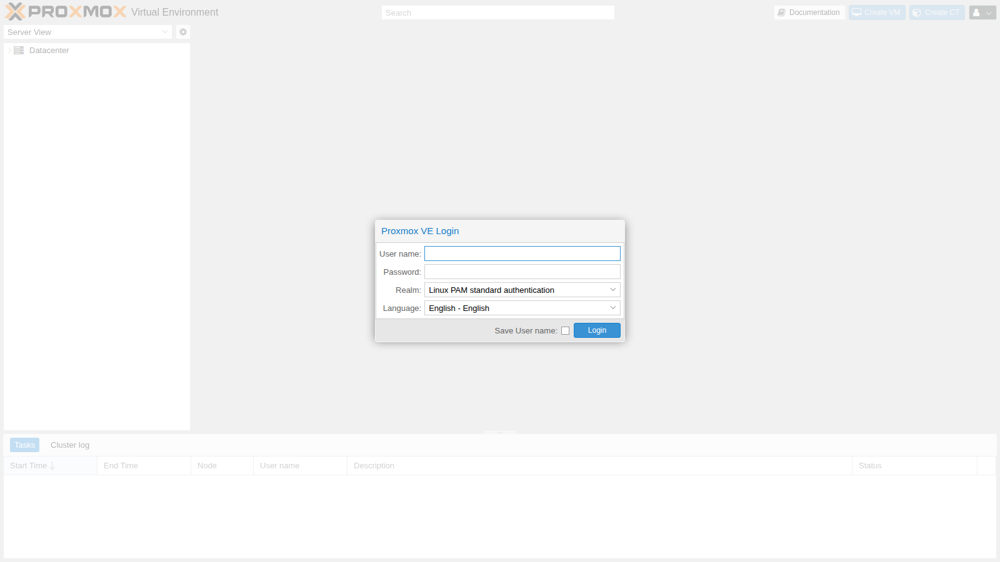

3. Chiudi l'avviso *No valid subscription* con **OK**.

   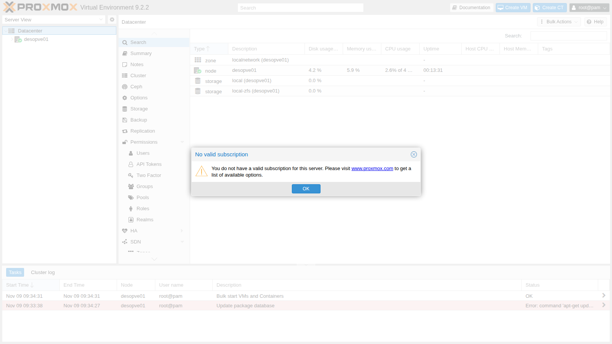

4. A sinistra c'è l'**albero delle risorse**. **Datacenter** raccoglie le impostazioni comuni a tutti i nodi (permessi, storage condivisi, backup, firewall, opzioni), mentre ogni **nodo** ha le sue risorse locali (rete, dischi, aggiornamenti, shell). Sotto il nodo compaiono gli storage e, più avanti, VM e container.

   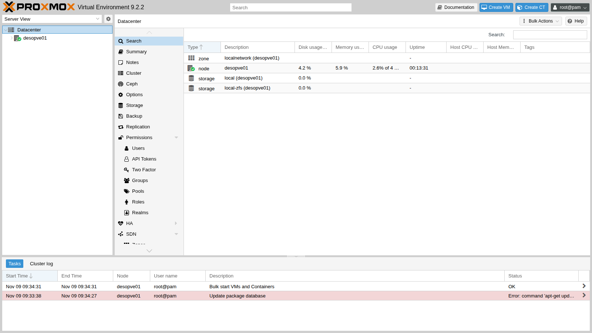

5. Seleziona il nodo `desopve01` → **Summary**: utilizzo di CPU, memoria e disco, versione del kernel e di Proxmox VE, stato dei repository.

   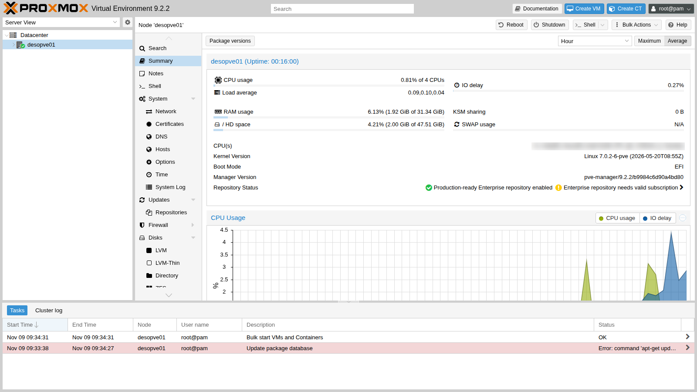

### 2. Configurare i repository dall'interfaccia web

1. Vai su `desopve01` → **Updates** → **Repositories**. Lo stato segnala *The enterprise repository is enabled, but there is no active subscription!*: sono attivi solo `pve-enterprise` e `ceph-squid` *enterprise*, più i repository di Debian.

   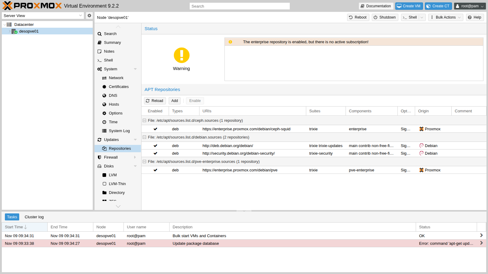

2. Premi **Add** (chiudi l'avviso di subscription) e apri l'elenco **Repository**: oltre a quelli di Proxmox VE ci sono i repository di Ceph nelle varianti Enterprise, No-Subscription e Test.

   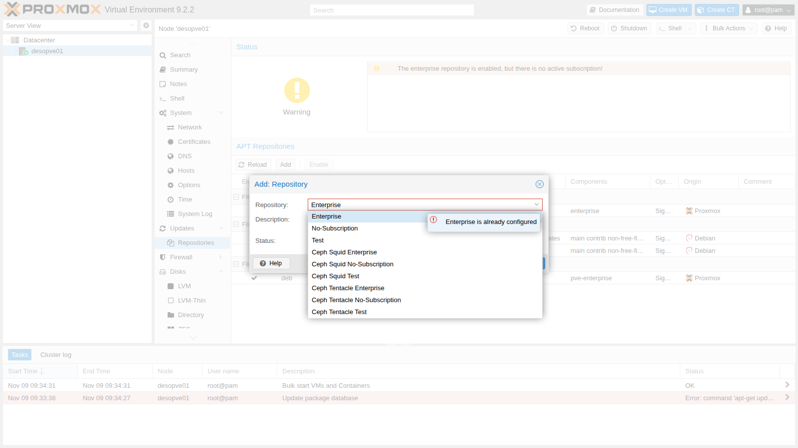

3. Scegli **No-Subscription** e premi **Add**. La finestra ricorda che il repository è consigliato per test e uso non produttivo.

   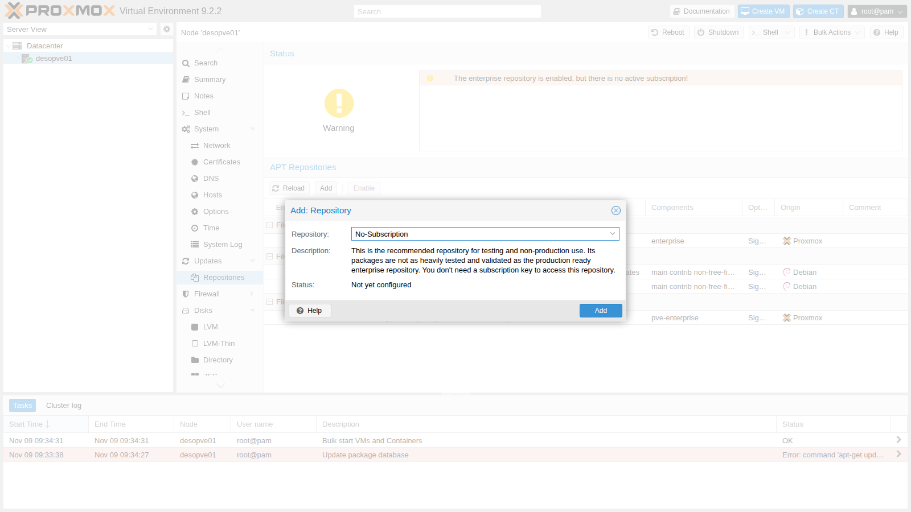

4. Seleziona la riga `pve-enterprise` e premi **Disable**; fai lo stesso con la riga `ceph-squid` *enterprise*. Lo stato diventa *You get updates for Proxmox VE*. L'avviso residuo *The no-subscription repository is not recommended for production use!* è atteso.

   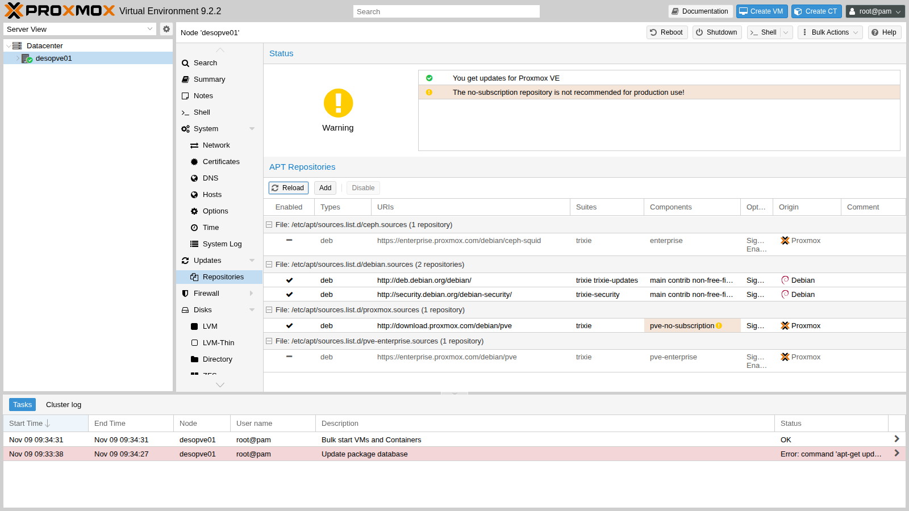

   La GUI ha creato il file `/etc/apt/sources.list.d/proxmox.sources` e aggiunto `Enabled: no` ai file enterprise.

### 3. Impostare il proxy

Vai su **Datacenter** → **Options**, fai doppio clic su **HTTP proxy** e inserisci `http://proxy.proxmox.community:3128`.

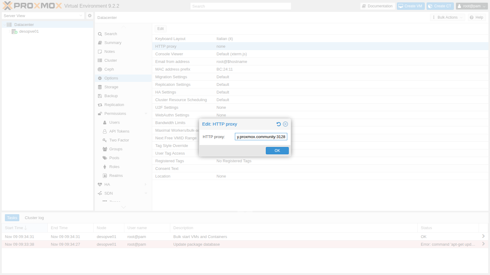

### 4. Aggiornare dall'interfaccia web

1. Torna su `desopve01` → **Updates** e premi **Refresh**. Il task esegue `apt-get update` tramite il proxy e termina con **TASK OK**.

   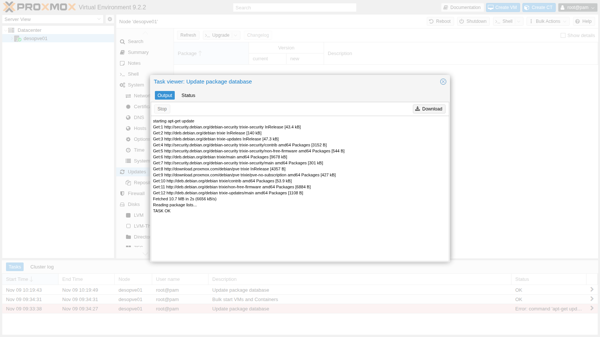

2. L'elenco mostra i pacchetti aggiornabili, con versione installata e nuova. Subito dopo l'installazione dalla ISO 9.2-1 erano più di duecento.

   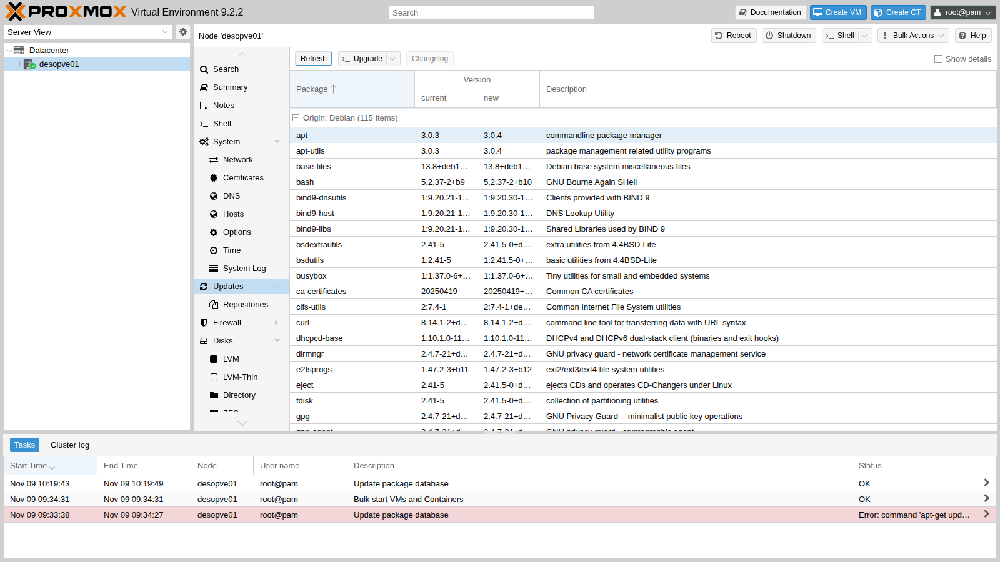

3. Premi **Upgrade**: si apre una console che esegue `apt-get dist-upgrade`. Controlla il riepilogo e conferma con `y`.

   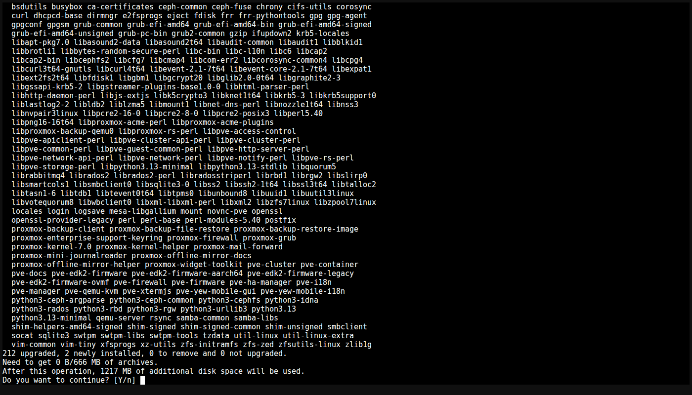

   > Durante l'aggiornamento `apt-listchanges` può mostrare le note di versione dei pacchetti in un visualizzatore a pagine: l'aggiornamento resta fermo finché non premi `q`.

4. Al termine la console riporta *Your System is up-to-date* e apre una shell.

   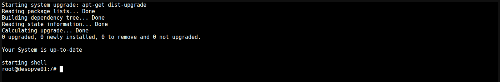

5. L'aggiornamento ha installato un nuovo kernel: riavvia il nodo con **Reboot** in alto a destra. Dopo il riavvio il **Summary** mostra la nuova versione (`pve-manager/9.2.26`) e il kernel `7.0.14-28-pve`.

   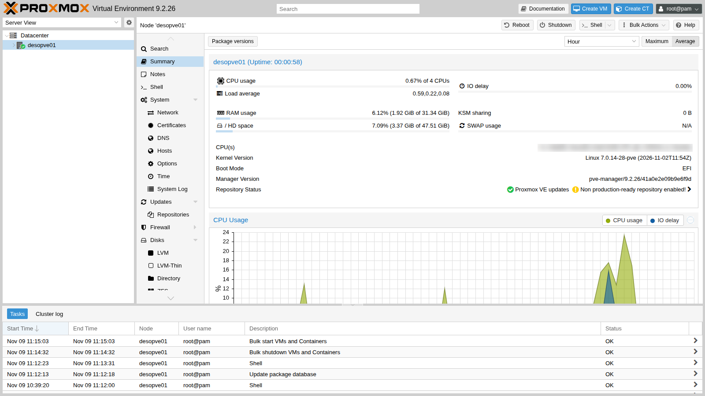

### 5. Fare lo stesso da riga di comando

Sugli altri nodi (`desopve02`, `desopve03` e `desopve04`) esegui gli stessi passi da riga di comando, nella **Shell** di ciascun nodo dell'interfaccia web (dal [Lab 05](05-ssh-shell-cli.md) userai SSH): sono gli stessi comandi che userai negli script.

1. Guarda i repository presenti e disattiva quelli enterprise aggiungendo `Enabled: no`:

   ```bash title="root@desopve02"
   ls /etc/apt/sources.list.d/
   ```

   ``` { .text .no-copy title="Output" }
   ceph.sources  debian.sources  pve-enterprise.sources
   ```

   ```bash title="root@desopve02"
   echo 'Enabled: no' >> /etc/apt/sources.list.d/pve-enterprise.sources
   echo 'Enabled: no' >> /etc/apt/sources.list.d/ceph.sources
   cat /etc/apt/sources.list.d/pve-enterprise.sources
   ```

   ``` { .text .no-copy title="Output" }
   Types: deb
   URIs: https://enterprise.proxmox.com/debian/pve
   Suites: trixie
   Components: pve-enterprise
   Signed-By: /usr/share/keyrings/proxmox-archive-keyring.gpg
   Enabled: no
   ```

2. Crea il repository no-subscription:

   ```bash title="root@desopve02"
   cat > /etc/apt/sources.list.d/proxmox.sources <<'EOF'
   Types: deb
   URIs: http://download.proxmox.com/debian/pve
   Suites: trixie
   Components: pve-no-subscription
   Signed-By: /usr/share/keyrings/proxmox-archive-keyring.gpg
   EOF
   ```

3. Imposta il proxy del datacenter con `pvesh`, il client da riga di comando dell'API (lab 05), e lancia `pveupdate`, che scrive la configurazione del proxy per `apt` e aggiorna la lista dei pacchetti:

   ```bash title="root@desopve02"
   pvesh set /cluster/options --http_proxy http://proxy.proxmox.community:3128
   cat /etc/pve/datacenter.cfg
   ```

   ``` { .text .no-copy title="Output" }
   http_proxy: http://proxy.proxmox.community:3128
   keyboard: it
   ```

   ```bash title="root@desopve02"
   pveupdate
   ```

   ``` { .text .no-copy title="Output" }
   error reading cached package status in '/var/lib/pve-manager/pkgupdates' - can't open '/var/lib/pve-manager/pkgupdates' - No such file or directory
   ```

   ```bash title="root@desopve02"
   cat /etc/apt/apt.conf.d/76pveproxy
   ```

   ``` { .text .no-copy title="Output" }
   Acquire::http::Proxy "http://proxy.proxmox.community:3128";
   ```

   Il messaggio di `pveupdate` compare solo la prima volta: il file con l'elenco degli aggiornamenti non esiste ancora e viene creato in quel momento.

4. Aggiorna. Con `apt` usa sempre **`full-upgrade`** (o `dist-upgrade`), mai il semplice `upgrade`: un aggiornamento di Proxmox VE può dover installare pacchetti nuovi, come un kernel, che `upgrade` lascerebbe indietro.

   ```bash title="root@desopve02"
   apt update
   ```

   ``` { .text .no-copy title="Output" }
   …
   212 packages can be upgraded. Run 'apt list --upgradable' to see them.
   ```

   ```bash title="root@desopve02"
   apt full-upgrade
   ```

   ``` { .text .no-copy title="Output" }
   …
   Summary:
     Upgrading: 212, Installing: 2, Removing: 0, Not Upgrading: 0
     Download size: 666 MB
     Space needed: 1,217 MB / 48.8 GB available
   …
   ```

   ```bash title="root@desopve02"
   systemctl reboot
   ```

### 6. Sincronizzare l'ora

Proxmox VE usa **chrony**. Dopo l'installazione punta ai server pubblici `2.debian.pool.ntp.org`, che dal laboratorio non sono raggiungibili: `chronyc sources` non mostra nessuna fonte. Su **ogni** nodo sostituisci il pool con il server NTP del laboratorio:

```bash title="root@desopve02"
sed -i 's/^pool 2.debian.pool.ntp.org iburst/#pool 2.debian.pool.ntp.org iburst/' /etc/chrony/chrony.conf
echo 'server ntp.proxmox.community iburst' > /etc/chrony/sources.d/lab.sources
systemctl restart chrony
chronyc sources
```

``` { .text .no-copy title="Output" }
MS Name/IP address         Stratum Poll Reach LastRx Last sample
===============================================================================
^* netsvc.proxmox.community      3   6    17     6  +5191ns[  -60us] +/-   23ms
```

```bash title="root@desopve02"
timedatectl | grep -E 'synchronized|NTP service'
```

``` { .text .no-copy title="Output" }
System clock synchronized: yes
              NTP service: active
```

L'asterisco (`^*`) indica la fonte scelta da chrony. `sources.d` è la directory che il `chrony.conf` di Debian legge con la direttiva `sourcedir`: tenere la propria configurazione in un file separato evita conflitti quando un aggiornamento del pacchetto porta un nuovo `chrony.conf`.

### 7. Controllare il DNS del nodo

`desopve01` → **System** → **DNS** mostra il dominio di ricerca (`proxmox.community`) e il server DNS (`172.27.199.20`) impostati dall'installer, salvati in `/etc/resolv.conf`.

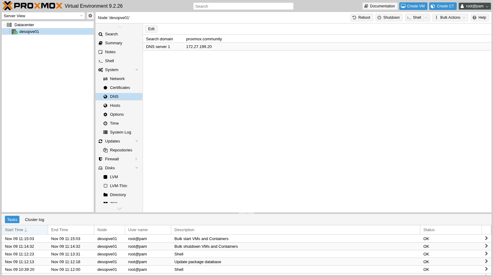

## Verifica e test

Su tutti e quattro i nodi:

```bash title="root@desopve01"
pveversion
```

``` { .text .no-copy title="Output" }
pve-manager/9.2.26/41a0e2e09b9e6f9d (running kernel: 7.0.14-28-pve)
```

```bash title="root@desopve01"
pveversion -v | head -4
```

``` { .text .no-copy title="Output" }
proxmox-ve: 9.2.0 (running kernel: 7.0.14-28-pve)
pve-manager: 9.2.26 (running version: 9.2.26/41a0e2e09b9e6f9d)
proxmox-kernel-helper: 9.2.1
proxmox-kernel-7.0: 7.0.14-28
```

```bash title="root@desopve02"
apt update
```

``` { .text .no-copy title="Output" }
…
All packages are up to date.
```

```bash title="root@desopve02"
cat /etc/apt/sources.list.d/ceph.sources
```

``` { .text .no-copy title="Output" }
Types: deb
URIs: https://enterprise.proxmox.com/debian/ceph-squid
Suites: trixie
Components: enterprise
Signed-By: /usr/share/keyrings/proxmox-archive-keyring.gpg
Enabled: no
```

- [ ] `pveversion` mostra `pve-manager/9.2.26` e il kernel `7.0.14-28-pve` (quindi il nodo è stato riavviato).
- [ ] `apt update` termina senza errori e *All packages are up to date*.
- [ ] I repository enterprise di Proxmox VE e Ceph sono disattivati, `pve-no-subscription` è attivo.
- [ ] `chronyc sources` mostra `^* netsvc.proxmox.community`.

## Stato finale del lab

- Quattro nodi Proxmox VE **9.2.26** con kernel `7.0.14-28-pve`, non ancora in cluster.
- Repository: `pve-no-subscription` attivo, enterprise di Proxmox VE e Ceph disattivati.
- Proxy `http://proxy.proxmox.community:3128` nel `datacenter.cfg` di ogni nodo e in `/etc/apt/apt.conf.d/76pveproxy`.
- Ora sincronizzata con `ntp.proxmox.community` su tutti i nodi.

## Cosa hai imparato

- La differenza tra impostazioni del **Datacenter** e risorse del **nodo**.
- Cosa offrono i repository enterprise, no-subscription e test, e come si gestiscono nel formato deb822.
- Come Proxmox VE usa un proxy HTTP per aggiornamenti e download.
- Perché si aggiorna con `full-upgrade` e quando serve riavviare.
- Come puntare chrony a un server NTP interno.

## Riferimenti

- [Proxmox VE – Package Repositories](https://pve.proxmox.com/pve-docs/pve-admin-guide.html#sysadmin_package_repositories)
- [Proxmox VE – System Software Updates](https://pve.proxmox.com/pve-docs/pve-admin-guide.html#system_software_updates)
- [Proxmox VE – Datacenter configuration (datacenter.cfg)](https://pve.proxmox.com/pve-docs/datacenter.cfg.5.html)
- [Proxmox VE – Time Synchronization](https://pve.proxmox.com/pve-docs/pve-admin-guide.html#_time_synchronization)
