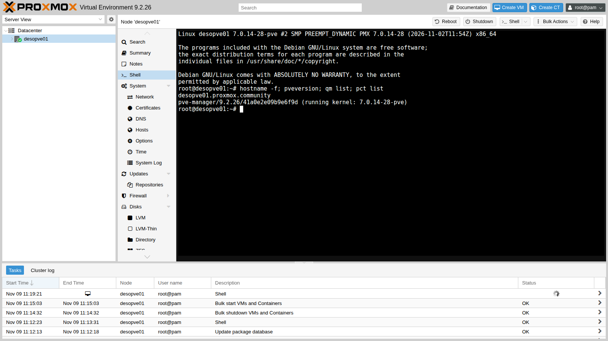
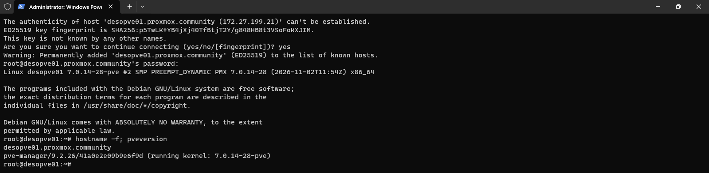
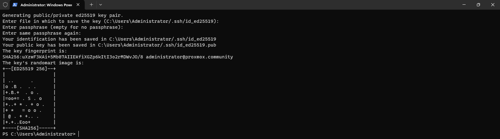
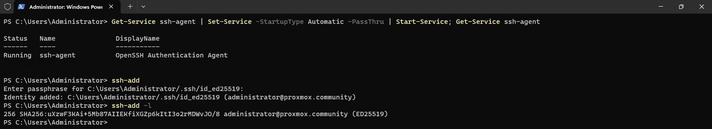
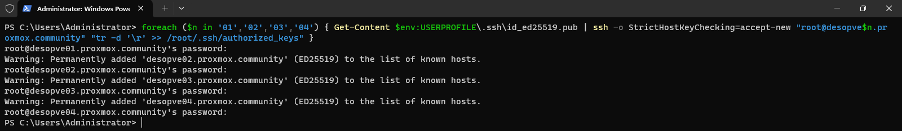
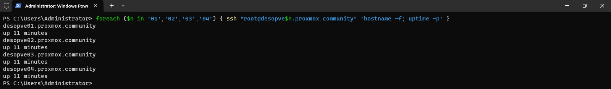

# Lab 05 – SSH, shell e strumenti da riga di comando

**Livello:** base · **Durata:** 45 minuti

## Dipendenze

- **Lab precedenti:** [Lab 02](02-domain-controller.md), per usare il domain controller `desopve-dc01` come postazione di amministrazione, e [Lab 04](04-first-access-repositories-updates.md), con i quattro nodi aggiornati.
- **Software:** il client OpenSSH, già incluso in Windows Server 2025: non va installato niente.
- **Credenziali:** `root` / `<password-lab>` sui nodi, `PROXMOX\Administrator` sul DC → [Appendice B](b-credentials-and-addresses.md).

## Obiettivi

- Aprire una shell su un nodo direttamente dall'interfaccia web.
- Collegarsi in SSH dalla postazione di amministrazione, verificando l'impronta della chiave del server.
- Creare una coppia di chiavi ED25519 protetta da passphrase, caricarla nell'agente SSH di Windows e distribuirla sui quattro nodi.
- Conoscere gli strumenti da riga di comando di Proxmox VE: `pvesh`, `qm`, `pct`, `pvesm`, `pveum`, `pvenode` e `pvecm`.

## Come funziona

### Tre strade per la riga di comando

| Strada | Come si apre | Quando usarla |
|---|---|---|
| **Shell della GUI** | nodo → **Shell** | interventi veloci, senza altri programmi: è un terminale nel browser (xterm.js), collegato al nodo tramite la porta 8006 |
| **SSH** | client `ssh` verso la porta 22 del nodo | lavoro quotidiano, script, copia di file (`scp`) |
| **Console del server** | monitor e tastiera, o la console remota della scheda di gestione | quando la rete del nodo non funziona |

La shell della GUI apre una sessione di `root` sul nodo selezionato. Per questo è riservata agli utenti con il privilegio `Sys.Console`, come vedrai nel lab 44.

### Chiavi del server e chiavi dell'utente

SSH usa due tipi di chiavi, con scopi diversi:

- la **chiave del server** (*host key*) dimostra al client che sta parlando con il server giusto. Alla prima connessione il client ne mostra l'impronta (*fingerprint*). Se l'accetti, la salva in `known_hosts` e da quel momento rifiuta di collegarsi se la chiave cambia: è la protezione contro chi si finge il server;
- la **coppia di chiavi dell'utente** sostituisce la password. La chiave **privata** resta sulla tua postazione; la chiave **pubblica** va copiata sul server, nel file `authorized_keys` dell'utente.

Una chiave privata senza protezione vale quanto una password scritta in un file. Per questo la proteggiamo con una **passphrase** e usiamo l'**agente SSH** (`ssh-agent`): la passphrase si digita una sola volta, quando la chiave viene caricata nell'agente. Su Windows l'agente è un servizio, che conserva le chiavi protette dall'account dell'utente anche dopo un riavvio.

Su Proxmox VE il file `/root/.ssh/authorized_keys` è un collegamento a `/etc/pve/priv/authorized_keys`, dentro il file system del cluster. Finché i nodi sono separati, ognuno ha il suo file. Quando formerai il cluster (lab 06), il file diventerà uno solo, condiviso da tutti i nodi.

### Tutto passa dall'API

Proxmox VE è costruito attorno a un'**API REST**, raggiungibile su `https://<nodo>:8006/api2/json/`. L'interfaccia web è solo uno dei suoi client: ogni clic diventa una chiamata all'API, e ogni operazione lunga diventa un **task** che trovi nel pannello in basso.

Gli strumenti da riga di comando usano la stessa API:

| Comando | A cosa serve |
|---|---|
| `pvesh` | accesso diretto all'API: `get`, `create`, `set`, `delete`, `ls` su qualsiasi percorso |
| `qm` | macchine virtuali (QEMU/KVM) |
| `pct` | container (LXC) |
| `pvesm` | storage |
| `pveum` | utenti, gruppi, ruoli, permessi e token |
| `pvecm` | cluster |
| `pvenode` | impostazioni e task del nodo |
| `pveversion` | versioni installate |

Eseguiti come `root` sul nodo, non chiedono credenziali. Ogni comando ha la sua pagina di manuale (`man qm`) e, senza argomenti, mostra l'elenco dei sottocomandi.

## Procedura

### 1. La shell dall'interfaccia web

1. Nell'interfaccia web seleziona il nodo `desopve01` e premi **Shell**.
2. Nel terminale esegui `hostname -f; pveversion; qm list; pct list`. Le due liste sono vuote, perché non esistono ancora VM e container. Nel pannello **Tasks** in basso compare il task **Shell**, in esecuzione finché il terminale resta aperto.

   

3. Lascia il terminale aperto: ti serve al passo successivo per leggere l'impronta della chiave del nodo.

   ```console
   root@desopve01:~# ssh-keygen -lf /etc/ssh/ssh_host_ed25519_key.pub
   256 SHA256:p5TwLK+YB4jXj40TfBtjT2Y/g848HB8t3VSoFoKXJIM root@desopve01 (ED25519)
   ```

### 2. Primo accesso SSH dalla postazione di amministrazione

1. Collegati in Desktop remoto a `desopve-dc01` come `PROXMOX\Administrator` e apri **Terminal** (PowerShell) come amministratore.
2. Collegati al nodo:

   ```powershell
   ssh root@desopve01.proxmox.community
   ```

3. Il client non conosce il server e ne mostra l'impronta. Confrontala con quella letta al passo 1: devono coincidere. Rispondi `yes`, poi inserisci la password di `root`.

   

   La chiave del nodo ora è salvata in `C:\Users\Administrator\.ssh\known_hosts`.

4. Chiudi la sessione con `exit`.

### 3. Creare la coppia di chiavi

1. Genera una chiave ED25519. Il commento serve a riconoscerla quando la ritrovi in `authorized_keys`:

   ```powershell
   ssh-keygen -t ed25519 -C "administrator@proxmox.community"
   ```

2. Premi **Invio** per accettare il percorso proposto (`C:\Users\Administrator/.ssh/id_ed25519`), poi scegli come passphrase `<password-lab>` e ripetila (in produzione usa una passphrase diversa dalle password dei server).

   

   Sono nati due file: `id_ed25519`, la chiave privata da non copiare mai altrove, e `id_ed25519.pub`, la chiave pubblica da distribuire.

### 4. Caricare la chiave nell'agente SSH

Il servizio `ssh-agent` di Windows è installato ma disattivato. Impostalo in avvio automatico, avvialo e caricaci la chiave: la passphrase viene chiesta una sola volta.

```powershell
Get-Service ssh-agent | Set-Service -StartupType Automatic -PassThru | Start-Service; Get-Service ssh-agent
ssh-add
ssh-add -l
```



### 5. Distribuire la chiave pubblica sui nodi

Copia la chiave pubblica in `authorized_keys` su tutti e quattro i nodi con un solo ciclo. La password di `root` viene chiesta una volta per nodo:

```powershell
foreach ($n in '01','02','03','04') { Get-Content $env:USERPROFILE\.ssh\id_ed25519.pub | ssh -o StrictHostKeyChecking=accept-new "root@desopve$n.proxmox.community" "tr -d '\r' >> /root/.ssh/authorized_keys" }
```



Due dettagli del comando:

- `StrictHostKeyChecking=accept-new` salva senza chiedere la chiave dei nodi mai visti. Una chiave **cambiata** viene comunque rifiutata. Nel laboratorio è comodo; in produzione verifica l'impronta di ogni server come al passo 2.
- Windows termina le righe con CR+LF, Linux solo con LF. `tr -d '\r'` toglie il carattere CR prima di aggiungere la chiave al file, così `authorized_keys` resta pulito.

### 6. Accedere senza password

Ripeti il ciclo eseguendo un comando su ogni nodo: nessuna password richiesta, perché l'agente presenta la chiave.

```powershell
foreach ($n in '01','02','03','04') { ssh "root@desopve$n.proxmox.community" 'hostname -f; uptime -p' }
```



### 7. Gli strumenti da riga di comando

Collegati a `desopve01` (`ssh root@desopve01.proxmox.community`) e prova i comandi principali.

1. **`pvesh`** interroga l'API. La versione:

   ```console
   root@desopve01:~# pvesh get /version
   ┌─────────┬──────────────────┐
   │ key     │ value            │
   ╞═════════╪══════════════════╡
   │ release │ 9.2              │
   ├─────────┼──────────────────┤
   │ repoid  │ 41a0e2e09b9e6f9d │
   ├─────────┼──────────────────┤
   │ version │ 9.2.26           │
   └─────────┴──────────────────┘
   ```

   `pvesh ls` elenca i percorsi sotto un nodo. Le lettere indicano i metodi permessi: `D` sottodirectory, `r` lettura (get), `w` modifica (set), `c` creazione (create), `d` cancellazione (delete).

   ```console
   root@desopve01:~# pvesh ls /nodes/desopve01 | head -12
   -r-c-        aplinfo
   Dr---        apt
   Dr---        capabilities
   Dr---        ceph
   Dr---        certificates
   -rw--        config
   Dr---        disks
   -rw--        dns
   Dr---        firewall
   Dr---        hardware
   -r-c-        hosts
   -r---        journal
   ```

   L'opzione `--output-format` cambia il formato (`text`, `json`, `json-pretty`, `yaml`), utile negli script:

   ```console
   root@desopve01:~# pvesh get /nodes --output-format yaml
   ---
   - cpu: 0.125779885200898
     disk: 3614965760
     id: node/desopve01
     level: ''
     maxcpu: 4
     maxdisk: 51013746688
     maxmem: 33654243328
     mem: 2262896640
     node: desopve01
     ssl_fingerprint: 14:32:84:88:C7:D8:14:A6:29:17:FA:04:65:09:52:2A:BC:3E:92:77:76:6D:32:04:CB:3F:3A:FC:A5:69:5B:F3
     status: online
     type: node
     uptime: 731
   ```

   `pvesh usage` mostra i parametri di una chiamata, ad esempio la creazione di una VM (`--verbose` li descrive tutti):

   ```console
   root@desopve01:~# pvesh usage /nodes/desopve01/qemu --command create
   USAGE: pvesh create /nodes/desopve01/qemu --vmid <integer> [OPTIONS]
   ```

2. **`pvesm`** mostra gli storage del nodo. Con l'installazione su ZFS ci sono `local`, una directory per ISO, template e backup, e `local-zfs`, per i dischi di VM e container:

   ```console
   root@desopve01:~# pvesm status
   Name             Type     Status     Total (KiB)      Used (KiB) Available (KiB)        %
   local             dir     active        46288000             128        46287872    0.00%
   local-zfs     zfspool     active        46288016              96        46287920    0.00%
   ```

3. **`pveum`** gestisce gli utenti. Per ora c'è solo `root@pam`:

   ```console
   root@desopve01:~# pveum user list
   ┌──────────┬─────────┬─────────────────────────┬────────┬────────┬───────────┬────────┬──────┬──────────┬────────────┬──────────────────┬────────┬─────────────┐
   │ userid   │ comment │ email                   │ enable │ expire │ firstname │ groups │ keys │ lastname │ realm-type │ tfa-locked-until │ tokens │ totp-locked │
   ╞══════════╪═════════╪═════════════════════════╪════════╪════════╪═══════════╪════════╪══════╪══════════╪════════════╪══════════════════╪════════╪═════════════╡
   │ root@pam │         │ admin@proxmox.community │ 1      │      0 │           │        │      │          │ pam        │                  │        │             │
   └──────────┴─────────┴─────────────────────────┴────────┴────────┴───────────┴────────┴──────┴──────────┴────────────┴──────────────────┴────────┴─────────────┘
   ```

4. **`pvenode task list`** mostra gli ultimi task del nodo, gli stessi del pannello **Tasks**. Ogni task ha un identificativo univoco (UPID) che contiene nodo, tipo e utente:

   ```console
   root@desopve01:~# pvenode task list --limit 3
   ┌───────────────────────────────────────────────────────────────┬──────────┬────┬──────────┬─────────────────────┬─────────────────────┬────────┐
   │ UPID                                                          │ Type     │ ID │ User     │           Starttime │             Endtime │ Status │
   ╞═══════════════════════════════════════════════════════════════╪══════════╪════╪══════════╪═════════════════════╪═════════════════════╪════════╡
   │ UPID:desopve01:00000652:00000730:6AF1AB37:startall::root@pam: │ startall │    │ root@pam │ 2026-11-09 12:15:03 │ 2026-11-09 12:15:03 │ OK     │
   ├───────────────────────────────────────────────────────────────┼──────────┼────┼──────────┼─────────────────────┼─────────────────────┼────────┤
   │ UPID:desopve01:0000098F:00006BCF:6AF1AC39:vncshell::root@pam: │ vncshell │    │ root@pam │ 2026-11-09 12:19:21 │ 2026-11-09 12:19:35 │ OK     │
   ├───────────────────────────────────────────────────────────────┼──────────┼────┼──────────┼─────────────────────┼─────────────────────┼────────┤
   │ UPID:desopve01:0000B1AC:000953A0:6AF1AB18:stopall::root@pam:  │ stopall  │    │ root@pam │ 2026-11-09 12:14:32 │ 2026-11-09 12:14:32 │ OK     │
   └───────────────────────────────────────────────────────────────┴──────────┴────┴──────────┴─────────────────────┴─────────────────────┴────────┘
   ```

5. **`qm`** e **`pct`** gestiscono VM e container; li userai dal lab 07. Senza argomenti mostrano i sottocomandi:

   ```console
   root@desopve01:~# pct
   ERROR: no command specified
   USAGE: pct <COMMAND> [ARGS] [OPTIONS]

          pct clone <vmid> <newid> [OPTIONS]
          pct create <vmid> <ostemplate> [OPTIONS]
          pct destroy <vmid> [OPTIONS]
   …
   ```

6. **`pvecm`** gestisce il cluster. Per ora risponde con un errore, perché il nodo non fa ancora parte di un cluster: lo creerai nel lab 06.

   ```console
   root@desopve01:~# pvecm status
   Error: Corosync config '/etc/pve/corosync.conf' does not exist - is this node part of a cluster?
   ```

> **Nota:** in produzione conviene disattivare l'accesso SSH di `root` con password (`PermitRootLogin prohibit-password` in `/etc/ssh/sshd_config`), lasciando solo le chiavi. Nel laboratorio resta attivo, perché alcuni lab lo usano.

## Verifica e test

1. Dal DC, il ciclo del passo 6 restituisce i quattro nomi senza chiedere password.
2. Su ogni nodo la chiave del DC è in `authorized_keys`, senza caratteri CR:

   ```console
   root@desopve01:~# tail -1 /root/.ssh/authorized_keys | cut -d' ' -f1,3
   ssh-ed25519 administrator@proxmox.community
   root@desopve01:~# grep -c $'\r' /root/.ssh/authorized_keys
   0
   ```

3. **Test: senza agente serve la passphrase.** Svuota l'agente e collegati: la chiave funziona ancora, ma ora `ssh` chiede la passphrase. Ricaricala con `ssh-add`, e l'accesso torna automatico:

   ```console
   PS C:\Users\Administrator> ssh-add -D
   All identities removed.
   PS C:\Users\Administrator> ssh root@desopve02.proxmox.community hostname -f
   Enter passphrase for key 'C:\Users\Administrator/.ssh/id_ed25519':
   desopve02.proxmox.community
   PS C:\Users\Administrator> ssh-add
   Enter passphrase for C:\Users\Administrator/.ssh/id_ed25519:
   Identity added: C:\Users\Administrator/.ssh/id_ed25519 (administrator@proxmox.community)
   PS C:\Users\Administrator> ssh root@desopve02.proxmox.community hostname -f
   desopve02.proxmox.community
   ```

- [ ] Accesso SSH con chiave ai quattro nodi, senza password.
- [ ] Servizio `ssh-agent` del DC in esecuzione e in avvio automatico, con la chiave caricata (`ssh-add -l`).
- [ ] `pvesh get /version` risponde `9.2.26`.

## Stato finale del lab

- Sul DC: coppia di chiavi `C:\Users\Administrator\.ssh\id_ed25519` (con passphrase), servizio `ssh-agent` automatico con la chiave caricata, `known_hosts` con le chiavi dei quattro nodi.
- Su ogni nodo: la chiave pubblica `administrator@proxmox.community` in `/root/.ssh/authorized_keys`. I quattro file sono ancora separati, perché i nodi non sono in cluster.
- Nessuna VM, nessun container; storage `local` e `local-zfs` (`local` e `local-lvm` su `desopve04`).

## Cosa hai imparato

- Le tre strade per la riga di comando: shell della GUI, SSH e console.
- A cosa servono la chiave del server e la coppia di chiavi dell'utente, e perché verificare l'impronta alla prima connessione.
- Come proteggere la chiave con una passphrase senza doverla digitare ogni volta, grazie all'agente SSH.
- Che l'interfaccia web e i comandi `pvesh`, `qm`, `pct`, `pvesm`, `pveum`, `pvecm` e `pvenode` usano la stessa API.

## Riferimenti

- [Proxmox VE – Command-line tools](https://pve.proxmox.com/pve-docs/pve-admin-guide.html#_command_line_tools)
- [Proxmox VE – pvesh](https://pve.proxmox.com/pve-docs/pvesh.1.html)
- [Proxmox VE – API Viewer](https://pve.proxmox.com/pve-docs/api-viewer/)
- [Microsoft – Key-based authentication in OpenSSH for Windows](https://learn.microsoft.com/windows-server/administration/openssh/openssh_keymanagement)
