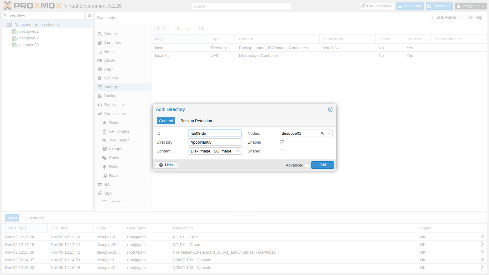
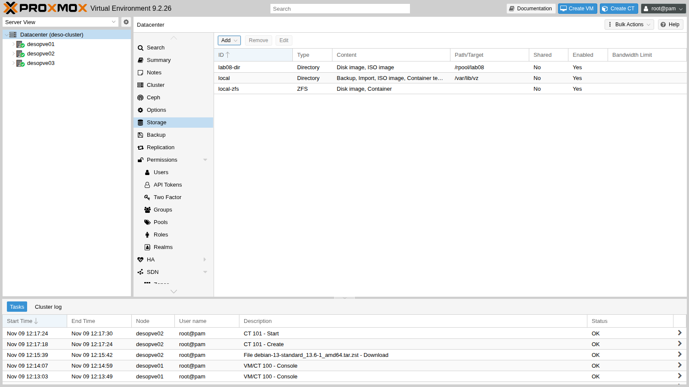
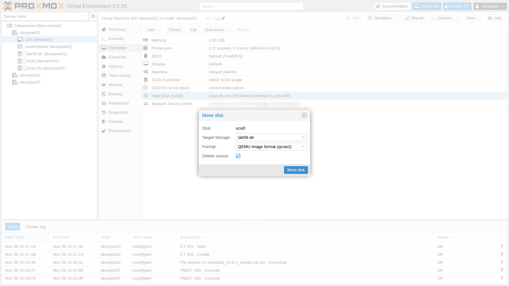
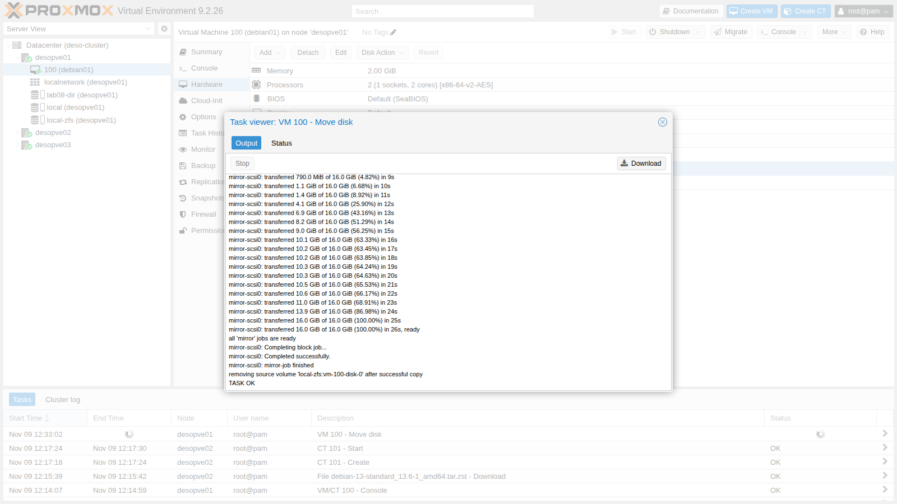
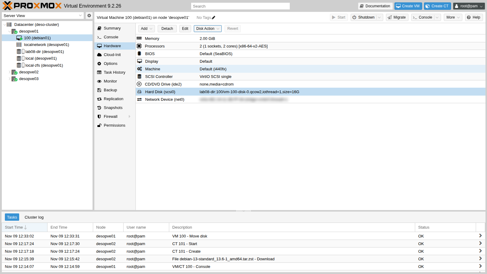

# Lab 08 – Il modello di storage di Proxmox VE

**Livello:** intermedio · **Durata:** 1 ora

## Dipendenze

- **Lab precedenti:** [Lab 07](07-first-vm-and-container.md): VM `100` `debian01` accesa su `desopve01`, con il disco su `local-zfs`.
- **Nodi:** `desopve01` del cluster `deso-cluster`.
- **Credenziali:** `root` / `<password-lab>` → [Appendice B](b-credentials-and-addresses.md).

## Obiettivi

- Capire come Proxmox VE descrive gli storage: tipo, contenuti, formati, storage locale e condiviso.
- Leggere `/etc/pve/storage.cfg` e interrogare gli storage con `pvesm`.
- Aggiungere uno storage di tipo **Directory** e proteggerlo con `is_mountpoint`.
- Spostare a caldo il disco di una VM da uno storage a blocchi a uno storage a file, cambiando formato.
- Vedere il **thin provisioning** nei numeri: dimensione virtuale contro spazio occupato.

## Come funziona

### Storage, volumi e `storage.cfg`

Per Proxmox VE uno **storage** è un posto dove tenere dischi, ISO, template o backup. È definito una sola volta per tutto il cluster, in `/etc/pve/storage.cfg`, e identificato da un **ID** (`local`, `local-zfs`…). Ogni oggetto dentro uno storage è un **volume** e ha un indirizzo unico, il **volume ID**:

```text
local-zfs:vm-100-disk-0                     disco della VM 100 sullo storage local-zfs
local:iso/debian-13.7.0-amd64-netinst.iso   ISO sullo storage local
```

Nella configurazione di una VM i dischi sono scritti proprio così (`scsi0: local-zfs:vm-100-disk-0,...`): la VM non conosce il percorso fisico, che Proxmox VE ricava dallo storage. Per questo un disco si può spostare da uno storage all'altro senza toccare il resto della configurazione.

### Tipi di storage

Il **tipo** dice quale tecnologia c'è sotto. Quelli disponibili in Proxmox VE 9.2 sono:

| Tipo | Descrizione | Livello | Condiviso | Snapshot |
|---|---|---|---|---|
| `dir` | Directory su un file system locale | file | no | con qcow2 |
| `btrfs` | File system BTRFS (anteprima tecnologica) | file | no | sì |
| `nfs` | Condivisione NFS | file | sì | con qcow2 |
| `cifs` | Condivisione SMB/CIFS | file | sì | con qcow2 |
| `cephfs` | File system Ceph | file | sì | sì |
| `zfspool` | Pool ZFS locale: zvol per le VM, dataset per i container | entrambi | no | sì |
| `lvm` | Volume group LVM | blocco | no, sì su LUN condivisa | volume chain (lab 16) |
| `lvmthin` | Thin pool LVM | blocco | no | sì |
| `iscsi` | LUN iSCSI con l'initiator del kernel | blocco | sì | no |
| `iscsidirect` | LUN iSCSI con libiscsi, dentro QEMU | blocco | sì | no |
| `rbd` | Ceph RBD | blocco | sì | sì |
| `zfs` | ZFS over iSCSI | blocco | sì | sì |
| `pbs` | Proxmox Backup Server, solo per i backup | entrambi | sì | – |
| `esxi` | Host ESXi, solo per importare VM (lab 50) | – | – | – |

- **File** o **blocco**: uno storage a file contiene file (immagini `.qcow2`, `.raw`, ISO); uno a blocchi offre dei block device (LV, zvol, LUN), uno per disco.
- **Condiviso**: lo stesso storage è raggiungibile da tutti i nodi con gli stessi dati. È ciò che permette la migrazione live senza copiare i dischi e l'alta disponibilità (lab 48-49). Attenzione: il flag `shared` dice a Proxmox VE che i dati *sono già* condivisi, non li rende condivisi.

### Tipi di contenuto

Ogni storage accetta solo i contenuti che gli abiliti:

| Contenuto | Nell'interfaccia | Cosa contiene | Cartella in uno storage `dir` |
|---|---|---|---|
| `images` | Disk image | dischi delle VM | `images/<VMID>/` |
| `rootdir` | Container | dischi dei container | `images/<VMID>/` |
| `iso` | ISO image | immagini ISO | `template/iso/` |
| `vztmpl` | Container template | template LXC | `template/cache/` |
| `backup` | VZDump backup file | backup | `dump/` |
| `snippets` | Snippets | hookscript, file cloud-init | `snippets/` |
| `import` | Import | immagini e OVA da importare | `import/` |

### Formati dei dischi

- **raw**: i byte del disco, senza intestazioni. È il formato più veloce ed è quello degli storage a blocchi (uno zvol o un LV *sono* il disco). Unica eccezione: l'LVM con *snapshot as volume chain* di Proxmox VE 9, che scrive qcow2 dentro gli LV (lab 16).
- **qcow2**: il formato di QEMU, su storage a file. Cresce man mano che si scrive (thin) e supporta gli snapshot.
- **vmdk**: il formato di altri hypervisor, utile solo per compatibilità.
- **subvol**: per i container su ZFS o directory: il disco è una cartella (un dataset ZFS), non un'immagine.

### Thin provisioning

Un disco **thin** occupa solo lo spazio effettivamente scritto; un disco **thick** riserva subito tutta la sua dimensione. Il thin provisioning permette di assegnare più spazio di quello che esiste (**overprovisioning**), ma bisogna sorvegliare che lo spazio reale non finisca (lab 09).

| Storage | Come diventa thin |
|---|---|
| `zfspool` | opzione `sparse` (attiva su `local-zfs`): lo zvol non ha `refreservation` |
| `lvmthin` | sempre thin |
| `dir`, `nfs`, `cifs` | qcow2, oppure raw "sparse"; l'opzione `preallocation` (predefinita `metadata`) decide quanto riservare alla creazione |
| `lvm` | sempre thick |

## Procedura

### 1. La configurazione degli storage

1. Nell'interfaccia web apri **Datacenter** → **Storage**: sono elencati gli storage creati dall'installazione.

   

2. Gli stessi dati sono nel file condiviso del cluster:

   ```console
   root@desopve01:~# cat /etc/pve/storage.cfg
   dir: local
   	path /var/lib/vz
   	content iso,vztmpl,backup,import

   zfspool: local-zfs
   	pool rpool/data
   	sparse
   	content images,rootdir
   ```

   - `local` è una **directory** su `/var/lib/vz`, che l'installazione ZFS ha messo su un dataset dedicato (`rpool/var-lib-vz`). Contiene ISO, template, backup e file da importare: è uno storage a **file**.
   - `local-zfs` usa il dataset `rpool/data` per i dischi di VM e container: è uno storage a **blocchi** per le VM (zvol) e a file per i container (subvol). È `sparse`, quindi **thin**.

3. L'elenco dei tipi è anche nell'help di `pvesm`:

   ```console
   root@desopve01:~# pvesm help add | sed -n 1,7p
   USAGE: pvesm add <type> <storage> [OPTIONS]

     Create a new storage.

     <type>     <btrfs | cephfs | cifs | dir | esxi | iscsi | iscsidirect |
   	     lvm | lvmthin | nfs | pbs | rbd | zfs | zfspool>
   	     Storage type.
   ```

### 2. Interrogare gli storage con `pvesm`

1. **Stato** di tutti gli storage del nodo, oppure solo di quelli che accettano un certo contenuto:

   ```console
   root@desopve01:~# pvesm status
   Name             Type     Status     Total (KiB)      Used (KiB) Available (KiB)        %
   local             dir     active        44854016          768000        44086016    1.71%
   local-zfs     zfspool     active        45518240         1432128        44086112    3.15%
   ```

   I due storage mostrano lo stesso spazio disponibile (circa 42 GiB): stanno sullo stesso pool `rpool` e se lo dividono.

2. **Contenuto** di uno storage, con volume ID, formato e dimensione:

   ```console
   root@desopve01:~# pvesm list local
   Volid                                     Format  Type           Size VMID
   local:iso/debian-13.7.0-amd64-netinst.iso iso     iso       792723456
   root@desopve01:~# pvesm list local-zfs
   Volid                   Format  Type             Size VMID
   local-zfs:vm-100-disk-0 raw     images    17179869184 100
   ```

3. **Percorso** reale di un volume e spazio effettivamente occupato. Il disco della VM 100 è uno zvol, cioè un block device:

   ```console
   root@desopve01:~# pvesm path local-zfs:vm-100-disk-0
   /dev/zvol/rpool/data/vm-100-disk-0
   root@desopve01:~# zfs get -H -o property,value volsize,used,refreservation,volblocksize,compression rpool/data/vm-100-disk-0
   volsize	16G
   used	1.37G
   refreservation	none
   volblocksize	16K
   compression	on
   ```

   Il disco è da 16 GiB, ma sul pool occupa 1,37 GiB: è thin (`refreservation none`) e ZFS lo comprime.

### 3. Aggiungere uno storage Directory

Uno storage `dir` può stare su qualsiasi file system montato. Qui usi un nuovo dataset ZFS, ma il procedimento è identico con un disco formattato ext4 o XFS.

1. Crea il dataset, che ZFS monta da solo in `/rpool/lab08`:

   ```console
   root@desopve01:~# zfs create rpool/lab08
   root@desopve01:~# zfs list -o name,used,avail,mountpoint rpool/lab08
   NAME          USED  AVAIL  MOUNTPOINT
   rpool/lab08    96K  42.0G  /rpool/lab08
   ```

2. In **Datacenter** → **Storage** premi **Add** → **Directory** e compila:
   - **ID** `lab08-dir`, **Directory** `/rpool/lab08`;
   - **Content** `Disk image` e `ISO image`;
   - **Nodes** `desopve01`: la cartella esiste solo su questo nodo, quindi lo storage va limitato a lui;
   - **Shared** spento: è uno storage locale.

   

3. Premi **Add**. Il nuovo storage compare nell'elenco e, nell'albero, solo sotto `desopve01`.

   

4. Lo storage punta a un punto di mount. Se il dataset non fosse montato, Proxmox VE scriverebbe i dischi nella cartella vuota sottostante, sul file system di sistema. L'opzione `is_mountpoint`, che si imposta da riga di comando, lo impedisce: se il percorso non è montato, lo storage risulta non attivo.

   ```console
   root@desopve01:~# pvesm set lab08-dir --is_mountpoint yes
   root@desopve01:~# grep -A6 "dir: lab08-dir" /etc/pve/storage.cfg
   dir: lab08-dir
   	path /rpool/lab08
   	content iso,images
   	is_mountpoint yes
   	nodes desopve01
   	prune-backups keep-all=1
   	shared 0
   ```

### 4. Spostare il disco della VM su uno storage a file

Sposti il disco della VM `100`, **accesa**, da `local-zfs` (zvol, raw) a `lab08-dir` (file, qcow2).

1. Apri la VM `100` → **Hardware**, seleziona **Hard Disk (scsi0)** e scegli **Disk Action** → **Move Storage**.
2. **Target Storage** `lab08-dir`, **Format** `QEMU image format (qcow2)`, spunta **Delete source** per cancellare il disco di partenza a copia finita.

   

3. Premi **Move disk**. QEMU copia il disco mentre la VM continua a lavorare (*drive mirror*): quando la copia è allineata, passa sul nuovo disco e cancella il vecchio.

   

   ```text
   create full clone of drive scsi0 (local-zfs:vm-100-disk-0)
   Formatting '/rpool/lab08/images/100/vm-100-disk-0.qcow2', fmt=qcow2 cluster_size=65536 extended_l2=off preallocation=metadata compression_type=zlib size=17179869184 lazy_refcounts=off refcount_bits=16
   allocated target volume 'lab08-dir:100/vm-100-disk-0.qcow2'
   drive mirror is starting for drive-scsi0
   ...
   mirror-scsi0: transferred 16.0 GiB of 16.0 GiB (100.00%) in 26s, ready
   all 'mirror' jobs are ready
   mirror-scsi0: Completing block job...
   mirror-scsi0: Completed successfully.
   mirror-scsi0: mirror-job finished
   removing source volume 'local-zfs:vm-100-disk-0' after successful copy
   TASK OK
   ```

4. Nella scheda **Hardware** il disco ora è `lab08-dir:100/vm-100-disk-0.qcow2`.

   

5. Da riga di comando: il file "pesa" 17 GB come dimensione apparente, ma ne occupa 1,2 sul disco. `qemu-img` mostra la dimensione virtuale del disco e quella reale del file.

   ```console
   root@desopve01:~# pvesm list lab08-dir
   Volid                             Format  Type             Size VMID
   lab08-dir:100/vm-100-disk-0.qcow2 qcow2   images    17179869184 100
   root@desopve01:~# ls -lsh /rpool/lab08/images/100/
   total 1.2G
   1.2G -rw-r----- 1 root root 17G Nov  9 13:33 vm-100-disk-0.qcow2
   root@desopve01:~# qemu-img info /rpool/lab08/images/100/vm-100-disk-0.qcow2 | head -4
   image: /rpool/lab08/images/100/vm-100-disk-0.qcow2
   file format: qcow2
   virtual size: 16 GiB (17179869184 bytes)
   disk size: 1.18 GiB
   ```

### 5. Riportare il disco su ZFS da riga di comando

Lo stesso spostamento si fa con `qm disk move`. Riporta il disco su `local-zfs`, dove deve restare per i lab successivi. Il formato diventa di nuovo `raw`, perché su uno zvol non ne esistono altri.

```console
root@desopve01:~# qm disk move 100 scsi0 local-zfs --delete 1
copying volume 'lab08-dir:100/vm-100-disk-0.qcow2' from current storage 'lab08-dir' to target storage 'local-zfs'
create full clone of drive scsi0 (lab08-dir:100/vm-100-disk-0.qcow2)
allocated target volume 'local-zfs:vm-100-disk-0'
drive mirror is starting for drive-scsi0
...
mirror-scsi0: transferred 16.0 GiB of 16.0 GiB (100.00%) in 29s, ready
all 'mirror' jobs are ready
mirror-scsi0: Completing block job...
mirror-scsi0: Completed successfully.
mirror-scsi0: mirror-job finished
removing source volume 'lab08-dir:100/vm-100-disk-0.qcow2' after successful copy
root@desopve01:~# qm config 100 | grep scsi0
scsi0: local-zfs:vm-100-disk-0,iothread=1,size=16G
root@desopve01:~# zfs get -H -o property,value volsize,used,refreservation rpool/data/vm-100-disk-0
volsize	16G
used	1.37G
refreservation	none
```

Il disco è tornato thin: la copia non ha scritto gli spazi vuoti.

## Verifica e test

### Test 1 – Thin e thick sullo stesso pool

L'opzione `sparse` dello storage decide se uno zvol è thin. Per vederlo, definisci un secondo storage `lab08-thick` sullo **stesso** dataset ma senza `sparse`, e crea un volume da 4 GiB in ciascuno. `pvesm alloc` crea un volume senza VM, qui intestato a un VMID inesistente (`990`).

```console
root@desopve01:~# pvesm alloc local-zfs 990 vm-990-disk-0 4G
successfully created 'local-zfs:vm-990-disk-0'
root@desopve01:~# pvesm add zfspool lab08-thick --pool rpool/data --content images --nodes desopve01
root@desopve01:~# pvesm alloc lab08-thick 990 vm-990-disk-1 4G
successfully created 'lab08-thick:vm-990-disk-1'
root@desopve01:~# zfs list -o name,volsize,used,refreservation,avail -r rpool/data
NAME                      VOLSIZE   USED  REFRESERV  AVAIL
rpool/data                      -  5.43G       none  38.0G
rpool/data/vm-100-disk-0      16G  1.37G       none  38.0G
rpool/data/vm-990-disk-0       4G    56K       none  38.0G
rpool/data/vm-990-disk-1       4G  4.06G      4.06G  42.0G
```

- Il volume thin (`disk-0`) occupa 56 KiB.
- Il volume thick (`disk-1`) ha riservato subito 4,06 GiB: lo spazio disponibile del pool scende da 42 a 38 GiB anche se nessuno ci ha scritto.

Elimina i volumi di prova e lo storage `lab08-thick`:

```console
root@desopve01:~# pvesm free local-zfs:vm-990-disk-0
Removed volume 'local-zfs:vm-990-disk-0'
root@desopve01:~# pvesm free lab08-thick:vm-990-disk-1
Removed volume 'lab08-thick:vm-990-disk-1'
root@desopve01:~# pvesm remove lab08-thick
```

### Test 2 – Uno storage Directory non montato

Smonta il dataset e guarda lo stato dello storage: grazie a `is_mountpoint`, Proxmox VE lo dichiara non attivo invece di scrivere sul disco di sistema.

```console
root@desopve01:~# zfs unmount rpool/lab08
root@desopve01:~# pvesm status
unable to activate storage 'lab08-dir' - directory is expected to be a mount point but is not mounted: '/rpool/lab08'
Name             Type     Status     Total (KiB)      Used (KiB) Available (KiB)        %
lab08-dir         dir   inactive               0               0               0    0.00%
...
root@desopve01:~# zfs mount rpool/lab08
root@desopve01:~# pvesm status | grep lab08
lab08-dir         dir     active        44085504             128        44085376    0.00%
```

### Pulizia

Rimuovere uno storage cancella solo la sua definizione, non i dati: il dataset va distrutto a parte.

```console
root@desopve01:~# pvesm remove lab08-dir
root@desopve01:~# zfs destroy rpool/lab08
root@desopve01:~# pvesm status
Name             Type     Status     Total (KiB)      Used (KiB) Available (KiB)        %
local             dir     active        44853504          768000        44085504    1.71%
local-zfs     zfspool     active        45517724         1432132        44085592    3.15%
```

- [ ] Sai leggere `storage.cfg` e distinguere tipo, contenuti, nodi e opzioni di uno storage.
- [ ] Il disco della VM `100` è stato spostato a caldo su `lab08-dir` in qcow2 e riportato su `local-zfs`, con la VM sempre accesa.
- [ ] Hai visto la differenza tra uno zvol thin (`sparse`) e uno thick.
- [ ] Con `is_mountpoint yes`, uno storage Directory non montato risulta `inactive`.

## Stato finale del lab

- Invariato rispetto al lab 07: la VM `100` è accesa su `desopve01` con il disco `local-zfs:vm-100-disk-0` (raw, thin), il CT `101` è acceso su `desopve02`.
- Gli storage di prova `lab08-dir` e `lab08-thick` e il dataset `rpool/lab08` sono stati rimossi.

## Cosa hai imparato

- Uno storage ha un tipo (la tecnologia), dei contenuti ammessi e una visibilità (nodi, condiviso o no), tutto descritto in `/etc/pve/storage.cfg`.
- I volumi hanno un ID `storage:nome` indipendente dal percorso fisico, che `pvesm path` traduce.
- Gli storage a blocchi usano il formato raw (salvo l'LVM con volume chain, lab 16); quelli a file anche qcow2, con thin provisioning e snapshot.
- Il thin provisioning dipende dallo storage: `sparse` su ZFS, sempre su LVM-thin, qcow2 o raw sparse sulle directory.
- Un disco si sposta tra storage a VM accesa, anche cambiando formato.
- Uno storage Directory su un punto di mount va protetto con `is_mountpoint`.

## Riferimenti

- [Proxmox VE – Storage](https://pve.proxmox.com/pve-docs/pve-admin-guide.html#chapter_storage)
- [Proxmox VE – Directory Backend](https://pve.proxmox.com/pve-docs/pve-admin-guide.html#storage_directory)
- [Proxmox VE – Local ZFS Pool Backend](https://pve.proxmox.com/pve-docs/pve-admin-guide.html#storage_zfspool)
- [`pvesm`(1)](https://pve.proxmox.com/pve-docs/pvesm.1.html)
