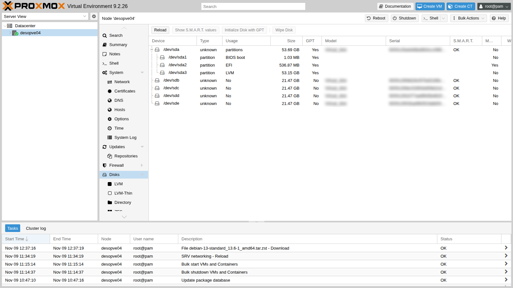
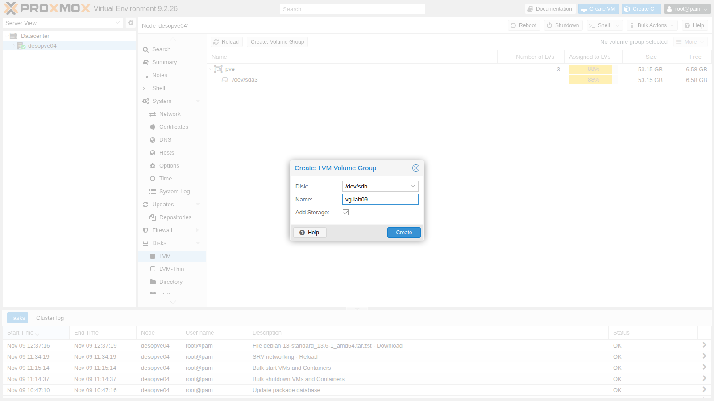
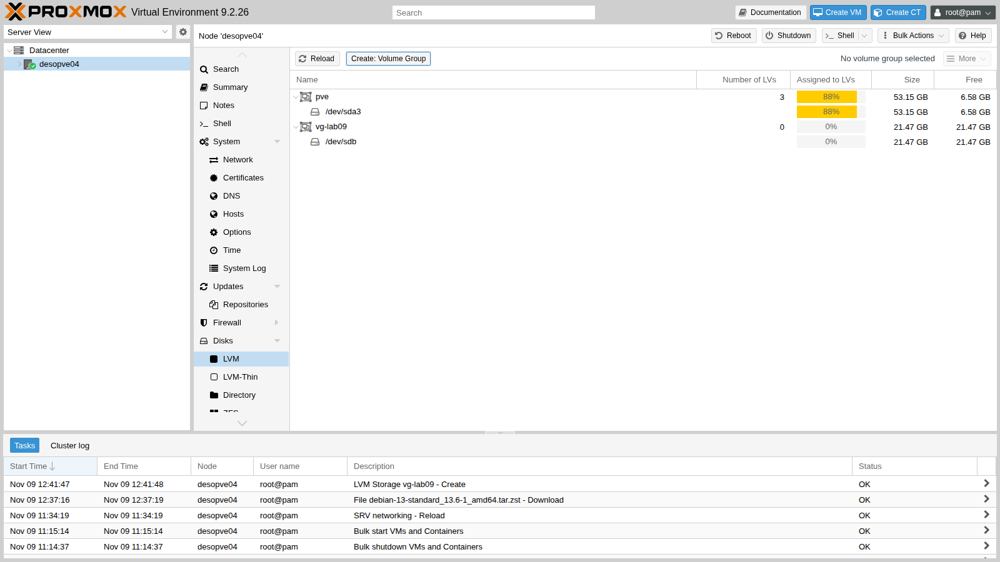
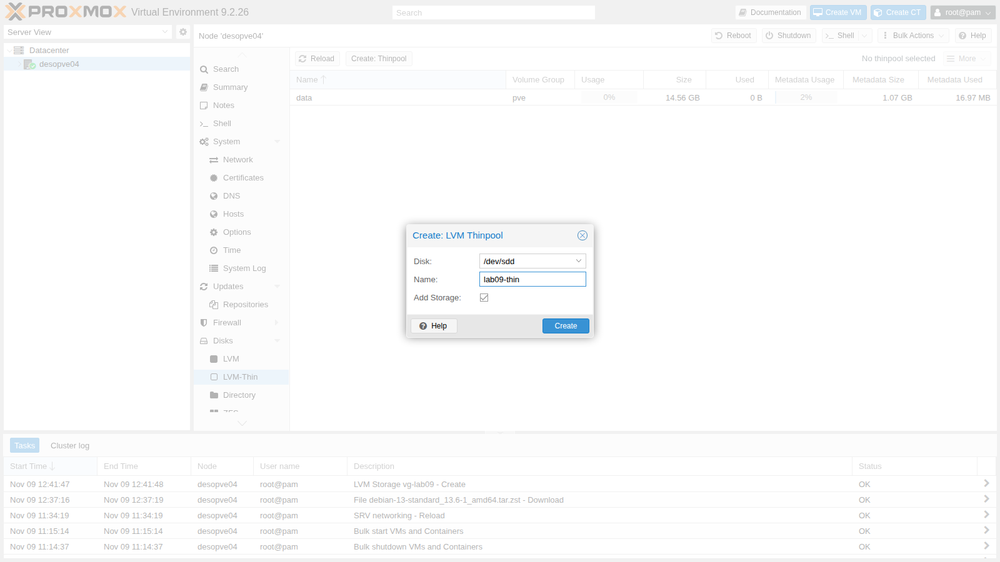
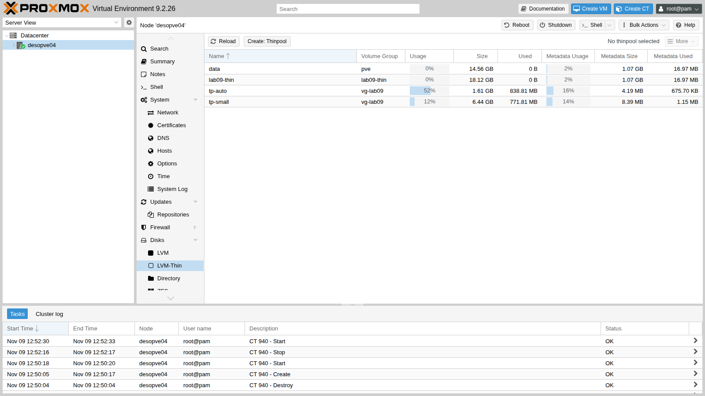
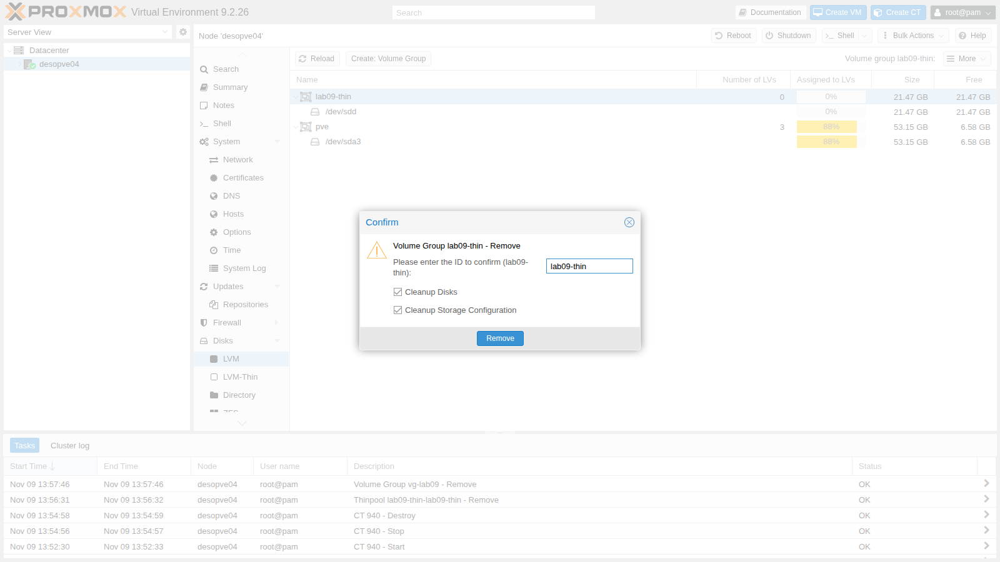

# Lab 09 – LVM e LVM-thin

**Livello:** intermedio · **Durata:** 1 ora e 30 minuti

## Dipendenze

- **Lab precedenti:** [Lab 08](08-storage-model.md): modello di storage, thin provisioning.
- **Nodi:** `desopve04` (nodo autonomo, `172.27.199.24`), usato come banco di prova per lo storage.
- **Hardware:** **quattro dischi da 20 GB**, da inserire a caldo nei vani hot-swap liberi di `desopve04` al passo 2 (vedi l'[hardware del laboratorio](01-lab-architecture.md#hardware-del-laboratorio)). Diventeranno `sdb`, `sdc`, `sdd` e `sde`.
- **Template:** il template Debian 13 nello storage `local` di `desopve04`. Si scarica dalla GUI come nel [Lab 07](07-first-vm-and-container.md), oppure da riga di comando: `pveam update` aggiorna l'elenco, `pveam available --section system | grep debian-13` mostra il nome corrente (in questo lab `debian-13-standard_13.6-1_amd64.tar.zst`) e `pveam download local <nome>` lo scarica.
- **Indirizzi:** `172.27.199.140` per il container di prova.
- **Credenziali:** `root` / `<password-lab>` → [Appendice B](b-credentials-and-addresses.md).

## Obiettivi

- Capire i tre livelli di LVM (PV, VG, LV) e la differenza tra LVM *thick* e *thin*.
- Creare un volume group e un thin pool dall'interfaccia web e leggerli da riga di comando.
- Estendere un volume group con un nuovo disco.
- Vedere cosa succede quando un thin pool sovra-allocato si riempie, e come si recupera.
- Prevenire il problema con il monitoraggio e l'estensione automatica.

## Come funziona

### PV, VG e LV

LVM (*Logical Volume Manager*) mette uno strato tra i dischi e i volumi:

```text
 dischi        /dev/sdb        /dev/sdc
                  │               │
 PV         physical volume  physical volume     pvcreate, pvs
                  └──────┬────────┘
 VG              volume group  (spazio unico)     vgcreate, vgextend, vgs
                 ┌───────┼────────┐
 LV          logical volume  logical volume       lvcreate, lvextend, lvs
```

- Un **PV** è un disco (o una partizione) preparato per LVM.
- Un **VG** unisce uno o più PV in un unico spazio, che si può allargare aggiungendo dischi.
- Un **LV** è un "pezzo" del VG, visto dal sistema come un block device: per Proxmox VE, un disco di una VM o di un container.

### LVM thick e LVM-thin

| | **LVM** (`lvm`) | **LVM-thin** (`lvmthin`) |
|---|---|---|
| Allocazione | **thick**: l'LV occupa subito tutta la sua dimensione | **thin**: i blocchi si allocano quando vengono scritti |
| Overprovisioning | no | sì: la somma dei dischi può superare il pool |
| Snapshot e cloni linked | no (in Proxmox VE 9, *volume chain* in anteprima: lab 16) | sì, veloci |
| Condivisione tra nodi | sì, su una LUN condivisa (lab 15) | no, solo locale |
| Rischio | nessuno: lo spazio è garantito | **pool pieno**: le scritture falliscono |

Un **thin pool** è un LV speciale composto da due parti nascoste: `_tdata`, i dati, e `_tmeta`, la mappa che dice quali blocchi appartengono a quale volume. Entrambe si possono riempire, ed entrambe vanno sorvegliate.

L'installazione di Proxmox VE su ext4 (come `desopve04`, lab 03) usa proprio LVM: il VG `pve` contiene `root`, `swap` e il thin pool `data`, che è lo storage `local-lvm`.

## Procedura

### 1. Il layout LVM dell'installazione

```console
root@desopve04:~# pvs
  PV         VG  Fmt  Attr PSize   PFree
  /dev/sda3  pve lvm2 a--  <49.50g <6.13g
root@desopve04:~# vgs
  VG  #PV #LV #SN Attr   VSize   VFree
  pve   1   3   0 wz--n- <49.50g <6.13g
root@desopve04:~# lvs
  LV   VG  Attr       LSize   Pool Origin Data%  Meta%  Move Log Cpy%Sync Convert
  data pve twi-a-tz-- <13.56g             0.00   1.58
  root pve -wi-ao----  21.68g
  swap pve -wi-ao----   6.12g
```

Nella colonna `Attr` la prima lettera dice il tipo: `t` è un thin pool, `-` un volume normale. `data` è il thin pool di `local-lvm`, ancora vuoto.

### 2. I dischi del nodo

Inserisci i quattro dischi da 20 GB nei vani hot-swap liberi di `desopve04`, a nodo acceso. Il controller segnala i dischi nuovi al kernel da solo; se non compaiono, forza una nuova scansione dei bus SCSI:

```console
root@desopve04:~# for h in /sys/class/scsi_host/host*/scan; do echo "- - -" > $h; done
```

Apri `desopve04` → **Disks**. I quattro dischi da 20 GB hanno **Usage** `No`: sono liberi.



> I campi **Model** e **Serial** dipendono dall'hardware: nel manuale sono oscurati, e negli output da riga di comando i seriali sono sostituiti da segnaposto.

### 3. Creare un volume group dall'interfaccia web

1. **Disks** → **LVM** → **Create: Volume Group**. **Disk** `/dev/sdb`, **Name** `vg-lab09`, **Add Storage** attivo.

   

2. Premi **Create**. Il nuovo VG compare accanto a `pve`, vuoto.

   

3. Proxmox VE ha fatto `pvcreate` e `vgcreate`, e ha aggiunto uno storage `lvm` limitato al nodo:

   ```console
   root@desopve04:~# grep -A4 "lvm: vg-lab09" /etc/pve/storage.cfg
   lvm: vg-lab09
   	vgname vg-lab09
   	content images,rootdir
   	nodes desopve04
   	shared 0
   ```

### 4. LVM thick: lo spazio si prende tutto subito

Alloca un volume da 6 GiB (con un VMID di prova, `990`) e guarda lo spazio libero del VG:

```console
root@desopve04:~# pvesm alloc vg-lab09 990 vm-990-disk-0 6G
  Logical volume "vm-990-disk-0" created.
successfully created 'vg-lab09:vm-990-disk-0'
root@desopve04:~# lvs vg-lab09
  LV            VG       Attr       LSize Pool Origin Data%  Meta%  Move Log Cpy%Sync Convert
  vm-990-disk-0 vg-lab09 -wi-a----- 6.00g
root@desopve04:~# vgs vg-lab09
  VG       #PV #LV #SN Attr   VSize   VFree
  vg-lab09   1   1   0 wz--n- <20.00g <14.00g
root@desopve04:~# pvesm free vg-lab09:vm-990-disk-0
  Logical volume "vm-990-disk-0" successfully removed.
Removed volume 'vg-lab09:vm-990-disk-0'
```

Il volume non contiene ancora niente, ma i suoi 6 GiB sono già spariti dal VG (`VFree` da 20 a 14).

### 5. Estendere il volume group con un secondo disco

L'interfaccia web crea un VG su un solo disco. Per allargarlo usa la riga di comando: `pvcreate` prepara il disco, `vgextend` lo aggiunge.

```console
root@desopve04:~# pvcreate /dev/sdc
  Physical volume "/dev/sdc" successfully created.
root@desopve04:~# vgextend vg-lab09 /dev/sdc
  Volume group "vg-lab09" successfully extended
root@desopve04:~# vgs vg-lab09
  VG       #PV #LV #SN Attr   VSize  VFree
  vg-lab09   2   0   0 wz--n- 39.99g 39.99g
```

Lo storage `vg-lab09` mostra subito i nuovi 40 GiB, senza toccare la configurazione: Proxmox VE legge lo spazio dal VG.

> Un VG su più dischi **senza ridondanza** si perde tutto se si guasta uno qualsiasi dei dischi. In produzione LVM va messo sopra un RAID (hardware o `mdadm`) o una LUN già protetta.

### 6. Creare un thin pool dall'interfaccia web

1. **Disks** → **LVM-Thin** → **Create: Thinpool**. **Disk** `/dev/sdd`, **Name** `lab09-thin`.

   

2. L'interfaccia crea un VG `lab09-thin` sull'intero disco e, dentro, un thin pool con lo stesso nome. Da riga di comando si vedono anche le parti nascoste del pool (tra parentesi quadre):

   ```console
   root@desopve04:~# lvs -a -o lv_name,vg_name,attr,lv_size,data_percent,metadata_percent lab09-thin
     LV                 VG         Attr       LSize   Data%  Meta%
     lab09-thin         lab09-thin twi-a-tz--  16.87g 0.00   1.58
     [lab09-thin_tdata] lab09-thin Twi-ao----  16.87g
     [lab09-thin_tmeta] lab09-thin ewi-ao----   1.00g
     [lvol0_pmspare]    lab09-thin ewi-------   1.00g
   root@desopve04:~# grep -A4 "lvmthin: lab09-thin" /etc/pve/storage.cfg
   lvmthin: lab09-thin
   	thinpool lab09-thin
   	vgname lab09-thin
   	content rootdir,images
   	nodes desopve04
   ```

   Dei 20 GB del disco, 16,87 GiB vanno ai dati e 1 GiB ai metadati, più 1 GiB di riserva (`pmspare`) per riparare i metadati in caso di danni.

### 7. Overprovisioning: un disco da 6 GiB in un pool da 2

Per vedere un pool pieno in pochi minuti, crea nel VG `vg-lab09` un thin pool piccolo, da 2 GiB, e aggiungilo come storage:

```console
root@desopve04:~# lvcreate --type thin-pool -L 2G -n tp-small vg-lab09
  Thin pool volume with chunk size 64.00 KiB can address at most <15.88 TiB of data.
  Logical volume "tp-small" created.
root@desopve04:~# pvesm add lvmthin lab09-small --vgname vg-lab09 --thinpool tp-small --content rootdir,images --nodes desopve04
```

Crea un container con un disco da **6 GiB** su quel pool da **2 GiB**. L'opzione `nesting=1` è quella che l'interfaccia web attiva da sola sui container non privilegiati: serve a systemd.

```console
root@desopve04:~# pct create 940 local:vztmpl/debian-13-standard_13.6-1_amd64.tar.zst --hostname lab09-ct --rootfs lab09-small:6 --memory 512 --cores 1 --unprivileged 1 --features nesting=1 --ostype debian --net0 name=eth0,bridge=vmbr0,ip=172.27.199.140/24,gw=172.27.199.1
...
root@desopve04:~# pct start 940
root@desopve04:~# lvs -o lv_name,attr,lv_size,pool_lv,data_percent,metadata_percent vg-lab09
  LV            Attr       LSize Pool     Data%  Meta%
  tp-small      twi-aotz-- 2.00g          31.27  16.02
  vm-940-disk-0 Vwi-aotz-- 6.00g tp-small 10.42
root@desopve04:~# pct exec 940 -- df -h /
Filesystem                              Size  Used Avail Use% Mounted on
/dev/mapper/vg--lab09-vm--940--disk--0  5.9G  572M  5.0G  11% /
```

Il container vede un disco da 6 GiB con 5 GiB liberi, ma il pool ha solo 2 GiB e ne ha già usato il 31%. È l'**overprovisioning**: funziona finché i dati scritti davvero restano sotto la dimensione del pool.

## Verifica e test

### Test 1 – Il thin pool si riempie

Dentro il container scrivi 3 GB di dati casuali: il file system ha spazio, il pool no.

```console
root@desopve04:~# date +%T; pct exec 940 -- dd if=/dev/urandom of=/root/fill bs=1M count=3000 oflag=direct status=none; echo "dd rc=$?"; date +%T
13:50:28
dd: error writing '/root/fill': No space left on device
dd rc=1
13:51:58
```

La scrittura si è bloccata per circa un minuto e poi è fallita. Il kernel racconta cosa è successo:

```console
root@desopve04:~# dmesg | grep thin
[ 5759.611992] device-mapper: thin: 252:10: reached low water mark for data device: sending event.
[ 5759.614980] device-mapper: thin: 252:10: switching pool to out-of-data-space (queue IO) mode
[ 5822.127628] device-mapper: thin: 252:10: switching pool to out-of-data-space (error IO) mode
root@desopve04:~# dmesg | grep EXT4 | tail -3
[ 5822.130654] EXT4-fs (dm-12): failed to convert unwritten extents to written extents -- potential data loss!  (inode 1595, error -5)
[ 5822.131286] EXT4-fs (dm-12): failed to convert unwritten extents to written extents -- potential data loss!  (inode 1566, error -5)
[ 5822.131944] EXT4-fs (dm-12): failed to convert unwritten extents to written extents -- potential data loss!  (inode 1567, error -5)
root@desopve04:~# lvs -o lv_name,attr,lv_size,pool_lv,data_percent,metadata_percent vg-lab09
  LV            Attr       LSize Pool     Data%  Meta%
  tp-small      twi-aotzD- 2.00g          100.00 29.00
  vm-940-disk-0 Vwi-aotz-- 6.00g tp-small 33.33
```

1. Quando il pool si riempie, device-mapper **mette in coda** le scritture e aspetta 60 secondi che qualcuno lo allarghi (`queue IO`).
2. Passato il minuto, comincia a **rifiutarle** (`error IO`): il file system del container riceve errori di I/O e alcuni dati vanno persi.
3. La `D` in fondo agli attributi del pool significa *out of data space*.

Dal punto di vista del container, invece, va tutto bene: il file system crede di avere ancora 3,7 GiB liberi.

```console
root@desopve04:~# pct exec 940 -- df -h /
Filesystem                              Size  Used Avail Use% Mounted on
/dev/mapper/vg--lab09-vm--940--disk--0  5.9G  1.9G  3.7G  34% /
```

È il pericolo dell'overprovisioning: un guest non può sapere che lo spazio "sotto" è finito. Con una VM, a seconda delle impostazioni del disco, QEMU mette in pausa la VM con lo stato `io-error`, oppure passa l'errore al sistema operativo ospite.

### Test 2 – Recuperare: allargare il pool e liberare spazio

1. Il rimedio immediato è dare spazio al pool. Il VG `vg-lab09` ha ancora quasi 38 GiB liberi:

   ```console
   root@desopve04:~# lvextend -L +4G vg-lab09/tp-small
     Rounding size to boundary between physical extents: 8.00 MiB.
     Size of logical volume vg-lab09/tp-small_tmeta changed from 4.00 MiB (1 extents) to 8.00 MiB (2 extents).
     Size of logical volume vg-lab09/tp-small_tdata changed from 2.00 GiB (512 extents) to 6.00 GiB (1536 extents).
     Logical volume vg-lab09/tp-small successfully resized.
   root@desopve04:~# dmesg | grep thin | tail -2
   [ 5832.296162] device-mapper: thin: 252:10: switching pool to write mode
   [ 5832.296168] device-mapper: thin: 252:10: growing the data device from 32768 to 98304 blocks
   root@desopve04:~# lvs -o lv_name,attr,lv_size,data_percent,metadata_percent vg-lab09/tp-small
     LV       Attr       LSize Data%  Meta%
     tp-small twi-aotz-- 6.00g 33.33  19.68
   ```

   Il pool torna in modalità scrittura. `lvextend` ha allargato anche i metadati: con un pool così piccolo erano solo 4 MiB.

2. Controlla il file system del container, che ha subito errori di scrittura. `pct fsck` lo verifica a container spento:

   ```console
   root@desopve04:~# pct stop 940
   root@desopve04:~# pct fsck 940
   fsck from util-linux 2.41.5
   /dev/mapper/vg--lab09-vm--940--disk--0: clean, 22033/393216 files, 530428/1572864 blocks
   root@desopve04:~# pct start 940
   root@desopve04:~# pct exec 940 -- ls -lh /root/fill
   -rw-r--r-- 1 root root 1.3G Nov  9 12:51 /root/fill
   ```

   Il file system è integro, ma il file è rimasto a 1,3 GB invece dei 3 richiesti: le scritture fallite sono perse.

3. Cancella il file. Nel thin pool, però, i blocchi restano occupati finché il file system non comunica al disco quali blocchi sono tornati liberi (**discard**, o *trim*):

   ```console
   root@desopve04:~# pct exec 940 -- rm /root/fill
   root@desopve04:~# lvs -o lv_name,data_percent vg-lab09
     LV            Data%
     tp-small      33.34
     vm-940-disk-0 33.34
   root@desopve04:~# pct fstrim 940
   /var/lib/lxc/940/rootfs/: 1.4 GiB (1518882816 bytes) trimmed
   root@desopve04:~# lvs -o lv_name,data_percent vg-lab09
     LV            Data%
     tp-small      11.98
     vm-940-disk-0 11.98
   ```

   > Un container non privilegiato non può lanciare `fstrim` da solo (`FITRIM ioctl failed: Operation not permitted`): lo fa il nodo con `pct fstrim`. Se il primo trim non libera spazio, attendi qualche secondo che ext4 registri la cancellazione e ripetilo. Per le VM serve l'opzione **Discard** sul disco virtuale (lab 37).

### Test 3 – Prevenire: estensione automatica del pool

LVM può allargare da solo un thin pool quando supera una soglia, se il VG ha spazio libero. Lo fa il servizio `dmeventd`, che sorveglia i pool. Nell'installazione la soglia è al 100%, cioè la funzione è spenta:

```console
root@desopve04:~# lvmconfig --typeconfig full activation/thin_pool_autoextend_threshold activation/thin_pool_autoextend_percent
thin_pool_autoextend_threshold=100
thin_pool_autoextend_percent=20
```

Invece di cambiare l'impostazione per tutti i pool in `/etc/lvm/lvm.conf`, crea un **profilo** e applicalo a un solo pool: soglia 70%, crescita del 50%.

```console
root@desopve04:~# cat > /etc/lvm/profile/lab09-autoextend.profile <<EOF
activation {
	thin_pool_autoextend_threshold=70
	thin_pool_autoextend_percent=50
}
EOF
root@desopve04:~# lvcreate --type thin-pool -L 1G -n tp-auto --metadataprofile lab09-autoextend vg-lab09
  Thin pool volume with chunk size 64.00 KiB can address at most <15.88 TiB of data.
  Logical volume "tp-auto" created.
root@desopve04:~# lvcreate -V 3G -T vg-lab09/tp-auto -n lv-auto
  WARNING: You have not turned on protection against thin pools running out of space.
  WARNING: Set activation/thin_pool_autoextend_threshold below 100 to trigger automatic extension of thin pools before they get full.
  WARNING: Sum of all thin volume sizes (9.00 GiB) exceeds the size of thin pools (7.00 GiB).
  Logical volume "lv-auto" created.
root@desopve04:~# lvs -o lv_name,lv_size,data_percent,lv_profile,seg_monitor vg-lab09/tp-auto
  LV      LSize Data%  LProfile         Monitor
  tp-auto 1.00g 0.00   lab09-autoextend monitored
```

Gli avvisi di `lvcreate` sono preziosi: LVM segnala da solo che stai sovra-allocando e che la protezione è spenta. Gli avvisi riguardano l'impostazione globale; il nuovo pool usa invece il profilo.

Ora scrivi 800 MiB nel volume da 3 GiB, cioè il 78% del pool da 1 GiB:

```console
root@desopve04:~# dd if=/dev/urandom of=/dev/vg-lab09/lv-auto bs=1M count=800 oflag=direct status=none
root@desopve04:~# lvs -o lv_name,lv_size,data_percent vg-lab09/tp-auto vg-lab09/lv-auto
  LV      LSize Data%
  lv-auto 3.00g 26.04
  tp-auto 1.50g 52.08
root@desopve04:~# journalctl --since "-2 min" --no-hostname | grep dmeventd | grep -E "changed|resized"
Nov 09 13:53:51 dmeventd[440]: Size of logical volume vg-lab09/tp-auto_tdata changed from 1.00 GiB (256 extents) to 1.50 GiB (384 extents).
Nov 09 13:53:51 dmeventd[440]: Logical volume vg-lab09/tp-auto successfully resized.
```

Superato il 70%, `dmeventd` ha allargato il pool del 50% (da 1 a 1,5 GiB) e la scrittura è andata a buon fine. L'estensione automatica funziona solo se il VG ha spazio libero: non sostituisce il monitoraggio, ma guadagna tempo.

Nell'interfaccia web, **Disks** → **LVM-Thin** mostra per ogni pool l'uso dei dati e dei metadati:



### Pulizia

1. Elimina il container, lo storage e i pool di prova, e il profilo:

   ```console
   root@desopve04:~# pct stop 940 && pct destroy 940 --purge 1
   root@desopve04:~# pvesm remove lab09-small
   root@desopve04:~# lvremove -y vg-lab09/lv-auto vg-lab09/tp-auto vg-lab09/tp-small
     Logical volume "lv-auto" successfully removed.
     Logical volume "tp-auto" successfully removed.
     Logical volume "tp-small" successfully removed.
   root@desopve04:~# rm /etc/lvm/profile/lab09-autoextend.profile
   ```

2. Dall'interfaccia web, in **Disks** → **LVM-Thin** seleziona `lab09-thin` e scegli **More** → **Destroy**. Digita l'ID per confermare. **Cleanup Storage Configuration** rimuove lo storage, **Cleanup Disks** cancella le etichette LVM dal disco. Poi, in **Disks** → **LVM**, distruggi allo stesso modo i VG `lab09-thin` e `vg-lab09`.

   

3. Se un disco conserva l'etichetta di PV, la togli da riga di comando:

   ```console
   root@desopve04:~# pvremove /dev/sdb /dev/sdc
     Labels on physical volume "/dev/sdb" successfully wiped.
     Labels on physical volume "/dev/sdc" successfully wiped.
   root@desopve04:~# pvs
     PV         VG  Fmt  Attr PSize   PFree
     /dev/sda3  pve lvm2 a--  <49.50g <6.13g
   ```

- [ ] Hai creato un VG e un thin pool dall'interfaccia web, e li hai riconosciuti con `pvs`, `vgs` e `lvs -a`.
- [ ] Hai esteso un VG con un secondo disco.
- [ ] Hai visto un thin pool pieno: scritture in coda per 60 secondi, poi errori e dati persi, con il guest ignaro di tutto.
- [ ] Hai recuperato il pool con `lvextend` e liberato spazio con `pct fstrim`.
- [ ] L'estensione automatica con un profilo LVM ha allargato il pool prima che si riempisse.

## Stato finale del lab

- Sul cluster nulla è cambiato.
- Su `desopve04` gli storage sono `local` e `local-lvm`. I dischi `sdb`, `sdc`, `sdd` e `sde` sono di nuovo vuoti, pronti per il lab 10.
- Il template `debian-13-standard_13.6-1_amd64.tar.zst` resta nello storage `local` di `desopve04`.

## Cosa hai imparato

- LVM ha tre livelli: PV (dischi), VG (spazio unico, estendibile) e LV (volumi, i dischi dei guest).
- LVM thick riserva subito lo spazio ed è sicuro; LVM-thin alloca su richiesta, permette snapshot e overprovisioning, ma il pool va sorvegliato.
- Un thin pool pieno blocca le scritture per 60 secondi e poi le rifiuta: i guest perdono dati senza accorgersi che lo spazio è finito.
- Si recupera con `lvextend`. Lo spazio dei file cancellati torna al pool solo con il discard (`pct fstrim`, opzione Discard per le VM).
- Data% e Meta% si controllano con `lvs` o nella pagina **LVM-Thin**. Un profilo LVM con soglia e percentuale abilita l'estensione automatica per un singolo pool.

## Riferimenti

- [Proxmox VE – LVM Backend](https://pve.proxmox.com/pve-docs/pve-admin-guide.html#storage_lvm)
- [Proxmox VE – LVM thin Backend](https://pve.proxmox.com/pve-docs/pve-admin-guide.html#storage_lvmthin)
- [Proxmox VE – Logical Volume Manager (LVM)](https://pve.proxmox.com/pve-docs/pve-admin-guide.html#chapter_lvm)
- [`lvmthin`(7) – thin provisioning con LVM](https://manpages.debian.org/trixie/lvm2/lvmthin.7.en.html)
