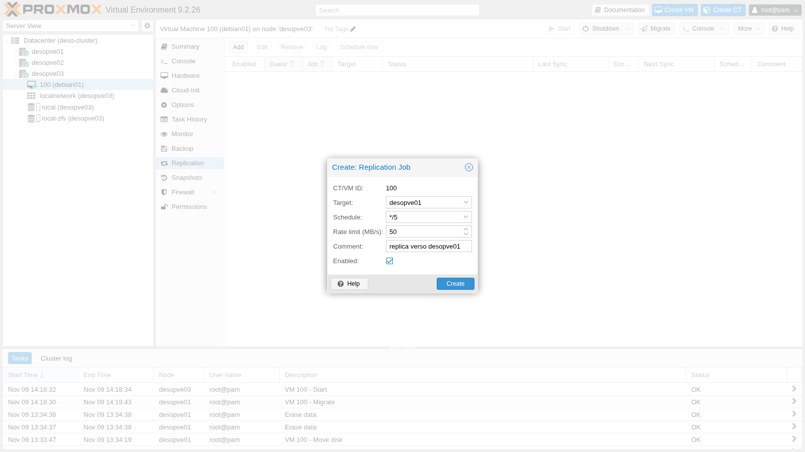
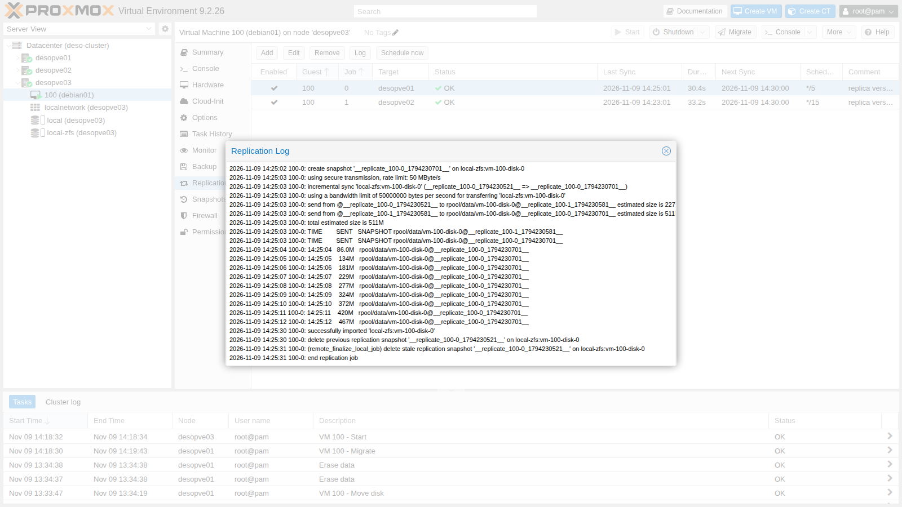
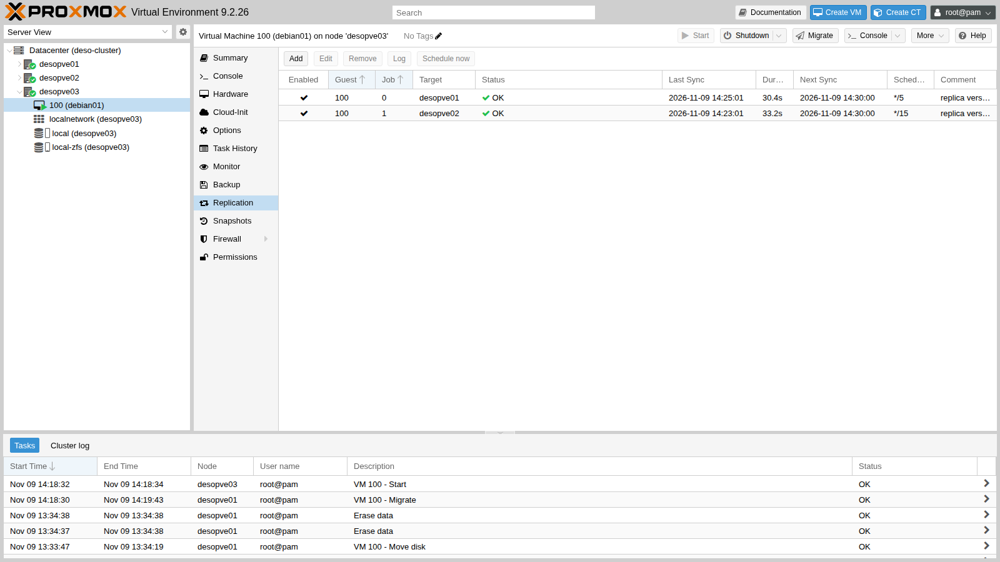
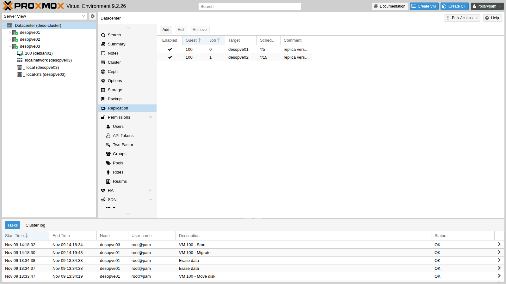
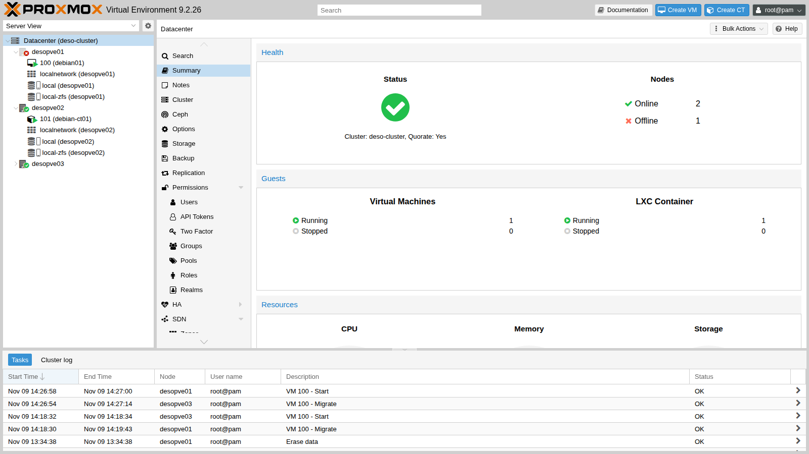
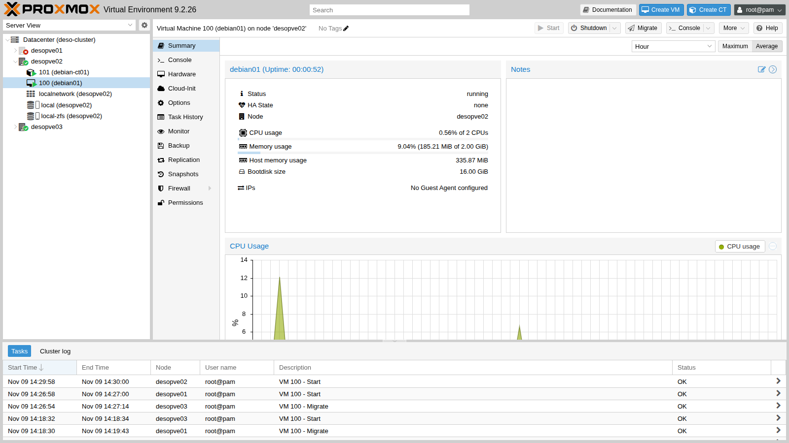

# Lab 11 – Replica ZFS tra nodi e failover manuale

**Livello:** intermedio · **Durata:** 1 ora e 30 minuti

## Dipendenze

- **Lab precedenti:** [Lab 06](06-cluster-corosync.md) per il cluster `deso-cluster` a tre nodi, [Lab 07](07-first-vm-and-container.md) per la VM 100 `debian01` e [Lab 10](10-zfs.md) per i concetti di snapshot e `zfs send`.
- **Storage:** `local-zfs` (pool `rpool/data`) su **tutti** i nodi del cluster, con lo stesso nome. È lo storage creato dall'installazione su ZFS (lab 03).
- **VM:** 100 `debian01` accesa su `desopve01`, con il disco su `local-zfs`, raggiungibile in SSH a `172.27.199.100` come `labuser`.
- **Per il test di guasto:** la possibilità di spegnere di colpo un nodo e di riaccenderlo. Qui il nodo si spegne con un comando del kernel e si riaccende dalla scheda di gestione remota (IPMI, iDRAC, iLO) o con il pulsante di accensione.
- **Credenziali:** `root` / `<password-lab>` → [Appendice B](b-credentials-and-addresses.md).

## Obiettivi

- Capire come funziona la replica asincrona di Proxmox VE e quando conviene usarla.
- Creare job di replica verso più nodi, con pianificazione e limite di banda.
- Leggere lo stato e i log dei job, e riconoscere gli snapshot di replica.
- Misurare quanto una replica accorcia la migrazione di una VM con dischi locali.
- Recuperare a mano una VM da un nodo guasto e misurare i dati persi.
- Rimettere in ordine il cluster quando il nodo guasto torna in servizio.

## Come funziona

### Replica, non storage condiviso

Con uno storage locale come `local-zfs`, il disco di una VM esiste su **un solo nodo**: se il nodo si ferma, la VM non può ripartire altrove. La **replica** (Storage Replication, comando `pvesr`) ne tiene una copia aggiornata su altri nodi:

```text
 desopve01 (sorgente)                      desopve02 (destinazione)
 rpool/data/vm-100-disk-0                  rpool/data/vm-100-disk-0
   @__replicate_100-1_<ora>__  ── zfs send ──▶  @__replicate_100-1_<ora>__
         (ogni 15 minuti invia solo i blocchi cambiati dall'ultimo snapshot)
```

- La replica è **asincrona** e si basa sugli snapshot ZFS: a ogni giro il job crea uno snapshot, invia via SSH la differenza rispetto al giro precedente (`zfs send` incrementale) e cancella lo snapshot vecchio. Il primo giro invia tutto il disco.
- Funziona **solo con storage ZFS** (`zfspool`) e richiede che lo storage abbia lo stesso nome su sorgente e destinazione.
- Si configura per **guest e per nodo di destinazione**: un job ha un ID nella forma `<VMID>-<numero>` e una destinazione; per avere copie su due nodi servono due job.
- I job li esegue il servizio **`pvescheduler`**, secondo una pianificazione in formato *calendar event* (`*/15`, cioè ogni 15 minuti, è il valore predefinito; si possono usare anche forme come `mon..fri 22:30`).
- La copia **non è in tempo reale**: se il nodo sorgente si guasta, si perde tutto ciò che è stato scritto dopo l'ultima replica. Questo intervallo, il *Recovery Point Objective* (RPO), è al massimo pari alla pianificazione più la durata del job.

### Cosa ci si guadagna

- **Migrazioni veloci:** se la destinazione ha già una replica, la migrazione invia solo la differenza. Anche la migrazione a caldo ne approfitta: QEMU tiene una *dirty bitmap* dei blocchi scritti dopo l'ultima replica e copia solo quelli.
- **Ripartenza dopo un guasto:** la VM si può riavviare sul nodo che ha la replica, a mano (questo lab) oppure in automatico con l'alta disponibilità (lab 49), accettando la perdita dei dati più recenti.

La replica **non sostituisce i backup** (lab 46-47): un file cancellato o un ransomware vengono replicati come qualsiasi altra modifica.

### Chi possiede la VM

La configurazione di una VM sta nel file system del cluster, in `/etc/pve/nodes/<nodo>/qemu-server/<VMID>.conf`: la **cartella** in cui si trova il file decide su quale nodo gira la VM. Per far ripartire una VM su un altro nodo dopo un guasto si sposta quel file, ma solo se il nodo guasto è **sicuramente spento**: se fosse ancora acceso e isolato dalla rete, la VM girerebbe due volte sugli stessi dati.

## Procedura

### 1. Verificare lo storage

Lo storage `local-zfs` è definito una sola volta per tutto il cluster, senza la riga `nodes`, quindi esiste su tutti i nodi con lo stesso nome:

```bash title="root@desopve01"
grep -A4 "zfspool: local-zfs" /etc/pve/storage.cfg
```

``` { .text .no-copy title="Output" }
zfspool: local-zfs
	pool rpool/data
	content rootdir,images
	sparse 1
```

### 2. Una migrazione di riferimento, senza replica

Per avere un termine di paragone, migra a caldo la VM 100 verso `desopve03`, che non ha ancora nessuna copia del disco. Con `--with-local-disks` Proxmox VE copia tutto il disco da 16 GiB mentre la VM continua a girare:

```bash title="root@desopve01"
qm migrate 100 desopve03 --online --with-local-disks
```

``` { .text .no-copy title="Output" }
…
mirror-scsi0: transferred 16.0 GiB of 16.0 GiB (100.00%) in 57s, ready
2026-11-09 14:19:36 average migration speed: 1.0 GiB/s - downtime 10 ms
2026-11-09 14:19:36 migration completed, transferred 333.6 MiB VM-state
2026-11-09 14:19:43 migration finished successfully (duration 00:01:13)
```

Un minuto abbondante per un disco quasi vuoto: il tempo cresce con la dimensione del disco e con la banda della rete. La VM ora gira su `desopve03`.

### 3. Creare i job di replica

1. Seleziona la VM **100 (debian01)** → **Replication** → **Add**.
2. Compila il job verso `desopve01`:
   - **Target** `desopve01`;
   - **Schedule** `*/5`, ogni 5 minuti (nel laboratorio, per vedere i giri senza aspettare troppo);
   - **Rate limit (MB/s)** `50`, per non saturare la rete durante il primo invio completo;
   - **Comment** `replica verso desopve01`.

   

3. Premi **Create**, poi aggiungi un secondo job: **Target** `desopve02`, **Schedule** `*/15` (il predefinito), nessun limite di banda.

La configurazione è nel file system del cluster:

```bash title="root@desopve03"
cat /etc/pve/replication.cfg
```

``` { .text .no-copy title="Output" }
local: 100-0
	comment replica verso desopve01
	target desopve01
	rate 50
	schedule */5
	source desopve03

local: 100-1
	comment replica verso desopve02
	target desopve02
	source desopve03
```

Il secondo job non ha la riga `schedule` perché usa il valore predefinito.

### 4. Il primo giro: una copia completa

Pochi secondi dopo la creazione partono i primi giri. **Log** mostra cosa succede: snapshot, invio completo (`full sync`) e importazione sulla destinazione. Con il limite di 50 MB/s, 1,9 GB richiedono circa 40 secondi:

```text
2026-11-09 14:22:02 100-0: create snapshot '__replicate_100-0_1794230521__' on local-zfs:vm-100-disk-0
2026-11-09 14:22:02 100-0: using secure transmission, rate limit: 50 MByte/s
2026-11-09 14:22:02 100-0: full sync 'local-zfs:vm-100-disk-0' (__replicate_100-0_1794230521__)
2026-11-09 14:22:03 100-0: full send of rpool/data/vm-100-disk-0@__replicate_100-0_1794230521__ estimated size is 1.91G
…
2026-11-09 14:22:43 100-0: 14:22:43   1.90G   rpool/data/vm-100-disk-0@__replicate_100-0_1794230521__
2026-11-09 14:23:00 100-0: successfully imported 'local-zfs:vm-100-disk-0'
2026-11-09 14:23:01 100-0: end replication job
```

Il volume da 16 GiB contiene solo 1,9 GB di dati scritti: `zfs send` invia i blocchi usati, non lo spazio vuoto. Il job verso `desopve02`, senza limite, invia la stessa quantità in 7 secondi.

### 5. I giri successivi: solo le differenze

1. Nella VM scrivi 500 MB di dati nuovi:

   ```bash title="labuser@debian01"
   dd if=/dev/urandom of=$HOME/dati-1.bin bs=1M count=500 status=none; sync
   ```

2. Seleziona il job verso `desopve01` e premi **Schedule now**, poi apri **Log**. Questa volta il giro è **incrementale** (`incremental sync`) e invia solo i 511 MB cambiati:

   

3. L'elenco dei job mostra per ognuno l'ultima sincronizzazione, la durata, la prossima esecuzione e lo stato:

   

   Da riga di comando:

   ```bash title="root@desopve03"
   pvesr status
   ```

   ``` { .text .no-copy title="Output" }
   JobID      Enabled    Target                           LastSync             NextSync   Duration  FailCount State
   100-0      Yes        local/desopve01       2026-11-09_14:25:01  2026-11-09_14:30:00  30.423273          0 OK
   100-1      Yes        local/desopve02       2026-11-09_14:23:01  2026-11-09_14:30:00  33.221129          0 OK
   ```

4. **Datacenter** → **Replication** elenca i job di tutti i guest del cluster: è il punto da cui controllarli tutti insieme.

   

5. Gli snapshot di replica si vedono con `zfs list`. Ogni volume conserva l'ultimo snapshot di ciascun job, che fa da base per il giro successivo:

   ```bash title="root@desopve03"
   zfs list -t snapshot -o name,used,creation -r rpool/data
   ```

   ``` { .text .no-copy title="Output" }
   NAME                                                      USED  CREATION
   rpool/data/vm-100-disk-0@__replicate_100-1_1794230581__  1.12M  Mon Nov  9 14:23 2026
   rpool/data/vm-100-disk-0@__replicate_100-0_1794230701__   188K  Mon Nov  9 14:25 2026
   ```

   ```bash title="root@desopve03"
   ssh desopve01 zfs list -t snapshot -o name,used,creation -r rpool/data
   ```

   ``` { .text .no-copy title="Output" }
   NAME                                                      USED  CREATION
   rpool/data/vm-100-disk-0@__replicate_100-1_1794230581__  1.12M  Mon Nov  9 14:23 2026
   rpool/data/vm-100-disk-0@__replicate_100-0_1794230701__     0B  Mon Nov  9 14:25 2026
   ```

   Non cancellare a mano gli snapshot `__replicate_…`: senza la base comune, il giro successivo dovrebbe ricominciare da capo con una copia completa.

### 6. Migrare una VM replicata

Migra la VM 100 da `desopve03` a `desopve01`, che ha già una replica:

```bash title="root@desopve03"
qm migrate 100 desopve01 --online --with-local-disks
```

``` { .text .no-copy title="Output" }
…
2026-11-09 14:26:55 incremental sync 'local-zfs:vm-100-disk-0' (__replicate_100-0_1794230701__ => __replicate_100-0_1794230814__)
2026-11-09 14:26:56 send from @__replicate_100-0_1794230701__ to rpool/data/vm-100-disk-0@__replicate_100-0_1794230814__ estimated size is 154K
…
drive mirror re-using dirty bitmap 'repl_scsi0'
…
2026-11-09 14:27:07 average migration speed: 688.3 MiB/s - downtime 20 ms
2026-11-09 14:27:14 migration finished successfully (duration 00:00:20)
```

| Migrazione a caldo della VM 100 | Dati del disco copiati | Durata |
|---|---|---|
| Verso un nodo senza replica (passo 2) | tutto il disco da 16 GiB | 1 minuto e 13 secondi |
| Verso un nodo con la replica | 154 KB più i blocchi scritti durante la migrazione | 20 secondi |

Prima di spostare la VM, la migrazione esegue un ultimo giro di replica; poi QEMU riusa la *dirty bitmap* `repl_scsi0` e copia solo i blocchi scritti dopo quel giro. Il resto del tempo è la copia della memoria.

Dopo la migrazione Proxmox VE **inverte da solo** i job: quello che puntava a `desopve01` ora replica verso il vecchio nodo, `desopve03`. Il commento, invece, resta quello scritto a mano:

```bash title="root@desopve01"
cat /etc/pve/replication.cfg
```

``` { .text .no-copy title="Output" }
local: 100-0
	comment replica verso desopve01
	target desopve03
	rate 50
	schedule */5
	source desopve01

local: 100-1
	comment replica verso desopve02
	target desopve02
	source desopve01
```

## Verifica e test

### Test – Il nodo si spegne di colpo

La VM 100 gira su `desopve01` e viene replicata su `desopve02` e `desopve03`. Simuli un'interruzione di corrente su `desopve01` e fai ripartire la VM dalla replica su `desopve02`.

1. Nella VM scrivi un file, avvia un giro di replica verso `desopve02` e attendi che finisca. Poi scrivi altri dati, **dopo** la replica:

   ```bash title="labuser@debian01"
   date "+%F %T" > $HOME/A-prima-della-replica.txt; sync
   ```

   ```bash title="root@desopve01"
   pvesr schedule-now 100-1
   pvesr status
   ```

   ``` { .text .no-copy title="Output" }
   JobID      Enabled    Target                           LastSync             NextSync   Duration  FailCount State
   100-0      Yes        local/desopve03       2026-11-09_14:26:54  2026-11-09_14:30:00   3.183833          0 OK
   100-1      Yes        local/desopve02       2026-11-09_14:28:01  2026-11-09_14:30:00  13.542599          0 OK
   ```

   ```bash title="labuser@debian01"
   date "+%F %T" > $HOME/B-dopo-la-replica.txt
   dd if=/dev/urandom of=$HOME/dati-2.bin bs=1M count=200 status=none; sync
   ls -l --time-style=+%T $HOME
   ```

   ``` { .text .no-copy title="Output" }
   -rw-rw-r-- 1 labuser labuser        20 14:27:34 A-prima-della-replica.txt
   -rw-rw-r-- 1 labuser labuser        20 14:28:11 B-dopo-la-replica.txt
   -rw-rw-r-- 1 labuser labuser 524288000 14:24:00 dati-1.bin
   -rw-rw-r-- 1 labuser labuser 209715200 14:28:12 dati-2.bin
   ```

2. Alle 14:28:28, prima del giro successivo, spegni `desopve01` di colpo, senza chiudere niente. Il carattere `o` di *SysRq* chiede al kernel di togliere l'alimentazione all'istante:

   ```bash title="root@desopve01"
   echo o > /proc/sysrq-trigger
   ```

3. Gli altri due nodi hanno ancora il quorum (2 voti su 3), quindi il cluster resta operativo:

   ```bash title="root@desopve02"
   pvecm status | grep -E "Total votes|Quorum:|Flags"
   ```

   ``` { .text .no-copy title="Output" }
   Total votes:      2
   Quorum:           2
   Flags:            Quorate
   ```

   L'interfaccia web segna `desopve01` come offline. La VM 100 compare ancora sotto `desopve01`, con l'ultimo stato noto: nessuno la fa ripartire da solo, perché non c'è l'alta disponibilità.

   

4. Su `desopve02` controlla l'ultimo snapshot di replica ricevuto: è quello delle 14:28.

   ```bash title="root@desopve02"
   zfs list -t snapshot -o name,creation -r rpool/data/vm-100-disk-0
   ```

   ``` { .text .no-copy title="Output" }
   NAME                                                     CREATION
   rpool/data/vm-100-disk-0@__replicate_100-0_1794230814__  Mon Nov  9 14:26 2026
   rpool/data/vm-100-disk-0@__replicate_100-1_1794230881__  Mon Nov  9 14:28 2026
   ```

5. Hai la certezza che `desopve01` è spento: sposta la configurazione della VM nella cartella di `desopve02` e avviala.

   ```bash title="root@desopve02"
   mv /etc/pve/nodes/desopve01/qemu-server/100.conf /etc/pve/nodes/desopve02/qemu-server/100.conf
   qm start 100
   ```

   

6. Nella VM controlla i file:

   ```bash title="labuser@debian01"
   ls -l --time-style=+%T $HOME
   ```

   ``` { .text .no-copy title="Output" }
   -rw-rw-r-- 1 labuser labuser        20 14:27:34 A-prima-della-replica.txt
   -rw-rw-r-- 1 labuser labuser 524288000 14:24:00 dati-1.bin
   ```

   ```bash title="labuser@debian01"
   cat $HOME/B-dopo-la-replica.txt
   ```

   ``` { .text .no-copy title="Output" }
   cat: /home/labuser/B-dopo-la-replica.txt: No such file or directory
   ```

   La VM è ripartita con il disco com'era alle **14:28:01**, l'ora dell'ultima replica. Il file `B` e i 200 MB di `dati-2.bin`, scritti tra le 14:28:01 e lo spegnimento delle 14:28:28, sono **persi**: 27 secondi di scritture. Con la pianificazione `*/15` la perdita poteva arrivare a un quarto d'ora. Il file system della VM, invece, è integro: lo snapshot è coerente come dopo un'interruzione di corrente, e il journal di ext4 lo rimette in ordine all'avvio.

7. Intanto i job si sono adattati da soli. Quello verso `desopve02` (il nodo su cui ora gira la VM) ora punta al nodo guasto, `desopve01`, e fallisce finché il nodo è spento. Quello verso `desopve03` continua dal nuovo nodo:

   ```bash title="root@desopve02"
   pvesr status
   ```

   ``` { .text .no-copy title="Output" }
   JobID      Enabled    Target                           LastSync             NextSync   Duration  FailCount State
   100-0      Yes        local/desopve03       2026-11-09_14:30:01  2026-11-09_14:35:00   6.464296          0 OK
   100-1      Yes        local/desopve01                         -                    -   3.111215          1 command '/usr/bin/ssh -e none … root@172.27.199.21 -- pvesr prepare-local-job 100-1 --last_sync 0 -- local-zfs:vm-100-disk-0' failed: exit code 255
   ```

### Test – Il nodo guasto torna in servizio

1. Riaccendi `desopve01` dalla scheda di gestione remota. Al riavvio rientra nel cluster e riceve la configurazione aggiornata: la VM 100 non è più sua, quindi non parte.

   ```bash title="root@desopve01"
   pvecm status | grep -E "Total votes|Quorate"
   ```

   ``` { .text .no-copy title="Output" }
   Quorate:          Yes
   Total votes:      3
   ```

   ```bash title="root@desopve01"
   qm list
   zfs list -t all -o name,creation -r rpool/data | grep vm-100
   ```

   ``` { .text .no-copy title="Output" }
   rpool/data/vm-100-disk-0                                 Mon Nov  9 14:22 2026
   rpool/data/vm-100-disk-0@__replicate_100-0_1794230814__  Mon Nov  9 14:26 2026
   rpool/data/vm-100-disk-0@__replicate_100-1_1794230881__  Mon Nov  9 14:28 2026
   ```

   Il disco rimasto su `desopve01` è **vecchio**: contiene i 27 secondi di scritture mai replicate, ma la VM ora vive su `desopve02`.

2. Al giro successivo il job riparte da solo. Trova lo snapshot comune delle 14:28 (`__replicate_100-1_1794230881__`), riporta il disco di `desopve01` a quel punto e invia solo le differenze accumulate su `desopve02`: 12,5 MB.

   ```text
   2026-11-09 14:36:02 100-1: incremental sync 'local-zfs:vm-100-disk-0' (__replicate_100-1_1794230881__ => __replicate_100-1_1794231361__)
   2026-11-09 14:36:03 100-1: total estimated size is 12.5M
   2026-11-09 14:36:10 100-1: successfully imported 'local-zfs:vm-100-disk-0'
   2026-11-09 14:36:11 100-1: end replication job
   ```

   Le scritture rimaste solo su `desopve01` vengono scartate: la copia buona è quella su cui la VM ha continuato a lavorare. Se ti servissero, andrebbero recuperate **prima** che la replica riparta, per esempio disattivando il job.

3. Riporta la VM sul suo nodo. Grazie alla replica la migrazione richiede di nuovo pochi secondi:

   ```bash title="root@desopve02"
   qm migrate 100 desopve01 --online --with-local-disks
   ```

   ``` { .text .no-copy title="Output" }
   …
   2026-11-09 14:36:43 incremental sync 'local-zfs:vm-100-disk-0' (__replicate_100-1_1794231361__ => __replicate_100-1_1794231402__)
   drive mirror re-using dirty bitmap 'repl_scsi0'
   2026-11-09 14:37:01 migration finished successfully (duration 00:00:20)
   ```

### Pulizia

Elimina i job di replica e i file di prova nella VM. Rimuovere un job è un'operazione in background: il job viene marcato con `remove_job full` e al giro successivo `pvescheduler` cancella i volumi replicati sulla destinazione e gli snapshot sulla sorgente.

```bash title="labuser@debian01"
rm -f $HOME/dati-*.bin $HOME/A-*.txt $HOME/B-*.txt
```

```bash title="root@desopve01"
pvesr delete 100-0
```

``` { .text .no-copy title="Output" }
Replication job removal is a background task and will take some time.
```

```bash title="root@desopve01"
pvesr delete 100-1
```

``` { .text .no-copy title="Output" }
Replication job removal is a background task and will take some time.
```

```bash title="root@desopve01"
grep -E "^local|remove_job" /etc/pve/replication.cfg
```

``` { .text .no-copy title="Output" }
local: 100-0
	remove_job full
local: 100-1
	remove_job full
```

Un minuto dopo i job sono spariti, insieme alle copie sugli altri nodi:

```bash title="root@desopve01"
cat /etc/pve/replication.cfg
zfs list -t all -o name -r rpool/data | grep vm-100
```

``` { .text .no-copy title="Output" }
rpool/data/vm-100-disk-0
```

```bash title="root@desopve01"
ssh desopve02 'zfs list -t all -o name -r rpool/data | grep vm-100 || echo "nessun volume della VM 100"'
```

``` { .text .no-copy title="Output" }
nessun volume della VM 100
```

```bash title="root@desopve01"
ssh desopve03 'zfs list -t all -o name -r rpool/data | grep vm-100 || echo "nessun volume della VM 100"'
```

``` { .text .no-copy title="Output" }
nessun volume della VM 100
```

- [ ] Hai creato due job di replica, uno con pianificazione `*/5` e limite di banda, e ne hai letto stato e log.
- [ ] Il primo giro ha inviato tutti i dati scritti del disco, i successivi solo le differenze.
- [ ] La migrazione verso un nodo con la replica ha richiesto 20 secondi contro 1 minuto e 13 secondi.
- [ ] Con il nodo sorgente spento hai fatto ripartire la VM su un altro nodo, perdendo solo le scritture successive all'ultima replica.
- [ ] Al rientro del nodo, la replica si è riallineata da sola sulla copia buona.

## Stato finale del lab

- Cluster `deso-cluster` con i tre nodi online; `desopve04` invariato.
- VM 100 `debian01` accesa su `desopve01`, disco `local-zfs:vm-100-disk-0`, senza file di prova.
- Nessun job di replica: `/etc/pve/replication.cfg` è vuoto e non ci sono copie della VM 100 su `desopve02` e `desopve03`.
- CT 101 `debian-ct01` acceso su `desopve02`, invariato.

## Cosa hai imparato

- La replica di Proxmox VE copia i dischi su ZFS verso altri nodi con `zfs send` incrementale, secondo una pianificazione: è asincrona e lascia una finestra di dati non protetti.
- Un job vale per una VM e una destinazione; per più copie servono più job. Il limite di banda protegge la rete durante il primo invio completo.
- Con una replica sul nodo di destinazione, la migrazione di una VM con dischi locali invia solo le differenze ed è molto più veloce.
- Se il nodo sorgente si guasta, la VM si fa ripartire spostando il suo file di configurazione nella cartella di un nodo con la replica, ma solo dopo aver verificato che il nodo guasto è spento.
- Si perdono le scritture successive all'ultima replica; al rientro del nodo, la replica si riallinea sulla copia in uso e scarta le scritture rimaste sul nodo guasto.
- La replica non è un backup e non fa ripartire le VM da sola: per l'avvio automatico serve l'alta disponibilità (lab 49).

## Riferimenti

- [Proxmox VE – Storage Replication](https://pve.proxmox.com/pve-docs/pve-admin-guide.html#chapter_pvesr)
- [Proxmox VE – Schedule Format (calendar events)](https://pve.proxmox.com/pve-docs/pve-admin-guide.html#chapter_calendar_events)
- [Proxmox VE – `pvesr` man page](https://pve.proxmox.com/pve-docs/pvesr.1.html)
- [Proxmox VE – Migration](https://pve.proxmox.com/pve-docs/pve-admin-guide.html#qm_migration)
