# Lab 12 – NAS TrueNAS: installazione e preparazione

**Livello:** base · **Durata:** 1 ora

## Dipendenze

- **Lab precedenti:** [Lab 01](01-lab-architecture.md) per il piano degli indirizzi e [Lab 02](02-domain-controller.md) per il DNS, con i record di `desonas.proxmox.community`. Il NAS non dipende dal cluster: lo si può preparare in parallelo alla Parte 0.
- **Server:** `desonas`, con 4 core, 16 GB di RAM, un disco di sistema da 32 GB e due dischi dati da 100 GB, e una scheda di rete sulla LAN del laboratorio.
- **ISO:** `TrueNAS-SCALE-25.10.8.iso` (TrueNAS Community Edition 25.10 «Goldeye»), da [truenas.com](https://www.truenas.com/download-truenas-community-edition/), su chiavetta USB o sul *virtual media* della scheda di gestione.
- **Servizi:** DNS `172.27.199.20`, NTP e proxy su `netsvc.proxmox.community` (alias `ntp` e `proxy`).
- **Indirizzi:** `172.27.199.10` per il NAS.
- **Credenziali:** `truenas_admin` / `<password-lab>` → [Appendice B](b-credentials-and-addresses.md).

## Obiettivi

- Installare TrueNAS Community Edition e configurarne la rete statica dalla console.
- Completare la configurazione di base dall'interfaccia web: fuso orario, NTP, DNS e proxy.
- Creare un pool ZFS in mirror per i dati.
- Preparare i dataset che useranno NFS, SMB e iSCSI nei lab successivi.
- Creare un utente di servizio per Proxmox VE.

## Come funziona

### Il ruolo del NAS nel laboratorio

Finora i dischi delle VM sono rimasti sui nodi (`local-zfs`). Uno **storage condiviso**, visibile allo stesso modo da tutti i nodi, permette di migrare le VM senza copiare i dischi e di farle ripartire altrove se un nodo si guasta (lab 48-49). Nel laboratorio lo fornisce un NAS esterno al cluster, con tre protocolli:

| Protocollo | Livello | Cosa vede Proxmox VE | Lab |
|---|---|---|---|
| **NFS** | file | una cartella condivisa: dischi in file `raw` o `qcow2`, ISO, backup, template | 13 |
| **SMB/CIFS** | file | come NFS, autenticato con utente e password | 14 |
| **iSCSI** | blocchi | un disco (LUN) su cui creare LVM condiviso | 15 |

### TrueNAS Community Edition

TrueNAS Community Edition (fino alla 24.10 chiamata **SCALE**) è un sistema operativo per NAS basato su Debian e su **OpenZFS**: gli stessi concetti del lab 10, gestiti da un'interfaccia web.

- Il **boot pool** (`boot-pool`) contiene solo il sistema operativo, su un disco dedicato. I dati vanno in un **pool dati** separato, sugli altri dischi.
- Nel pool si creano **dataset**, cioè file system con proprietà proprie (compressione, quote, permessi), e **zvol**, i dischi a blocchi che servono a iSCSI.
- Per un NAS reale valgono le regole di ZFS: dischi visti direttamente, senza controller RAID (al massimo un HBA in modalità IT/passthrough), RAM ECC consigliata e, per le VM, pool in mirror.

## Procedura

### 1. Installazione dalla console

1. Avvia il NAS dalla chiavetta USB con la ISO (o dal *virtual media* della scheda di gestione) e scegli **Install/Upgrade**.

   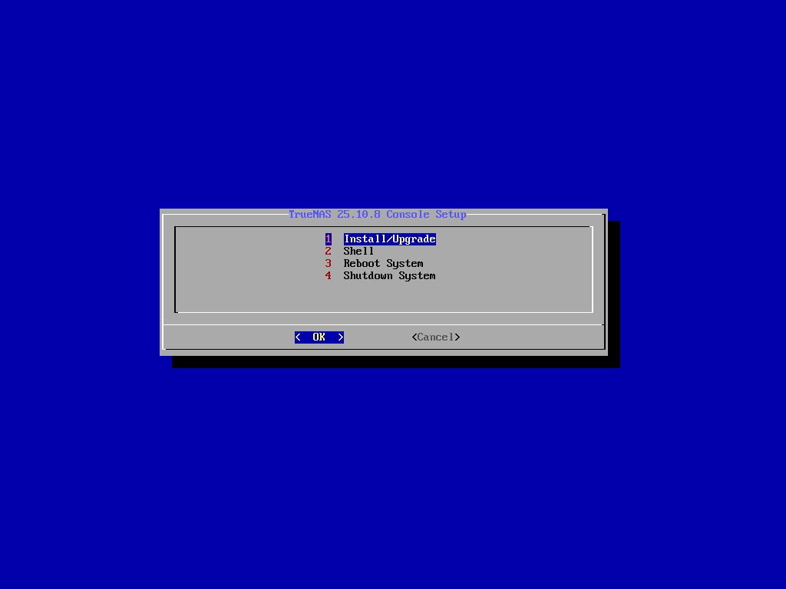

2. Seleziona con la barra spaziatrice **solo il disco da 32 GiB** (`sdb`) e conferma con **OK**. I due dischi da 100 GiB restano liberi per il pool dati: il disco su cui si installa non può più ospitare dati. Alla domanda successiva conferma la cancellazione del disco.

   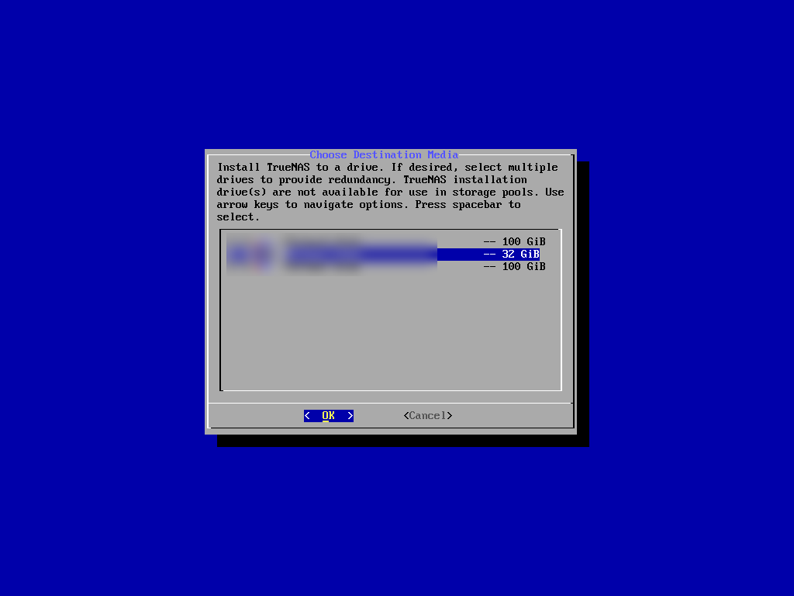

   Come in tutto il manuale, i dati che identificano l'hardware (modello e numero di serie dei dischi, nome e indirizzo fisico della scheda di rete) nelle schermate sono oscurati.

3. Come metodo di autenticazione scegli **Administrative user (truenas_admin)** e imposta la password. L'accesso diretto di `root` con password resta disattivato.

   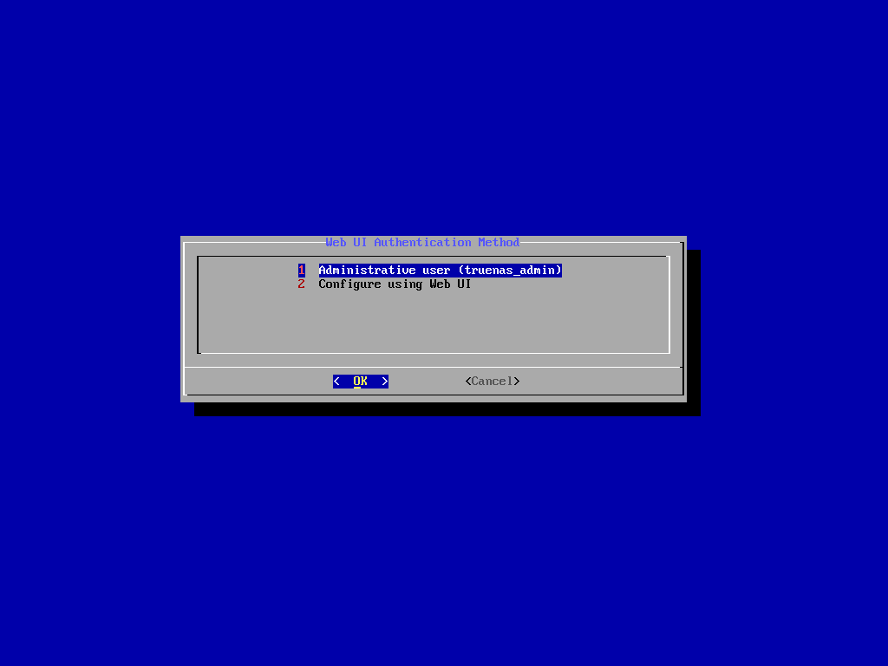

4. Al termine rimuovi la chiavetta (o smonta il *virtual media*) e riavvia dal disco.

   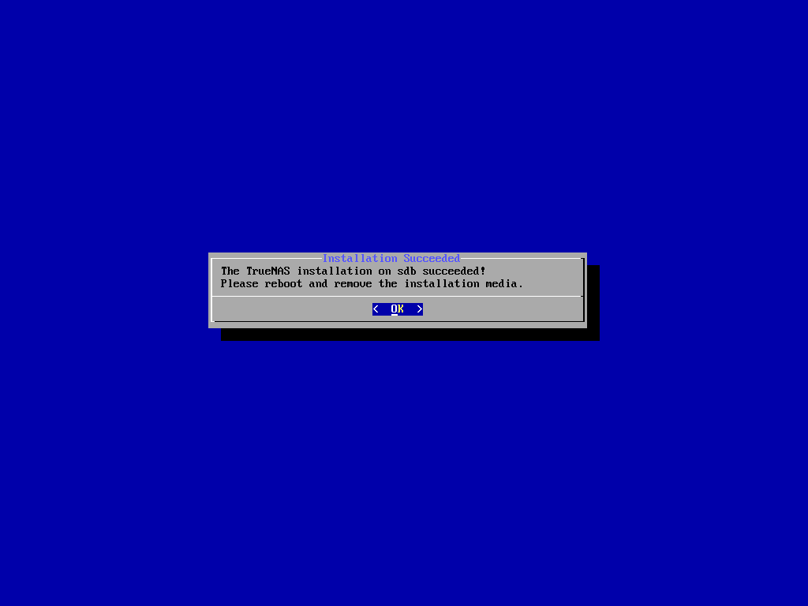

### 2. Rete statica dalla console

Nella rete del laboratorio non c'è un server DHCP, quindi al primo avvio il NAS non ha un indirizzo e la console avvisa che l'interfaccia web non è raggiungibile:

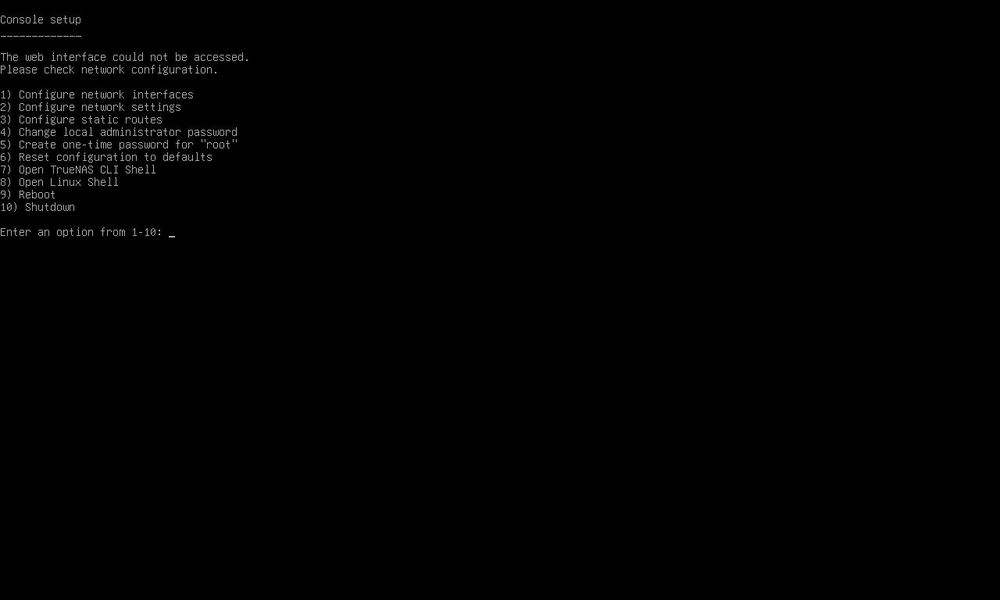

1. Scegli **1) Configure network interfaces** e apri l'unica interfaccia. Imposta `ipv4_dhcp` a **No** e in `aliases` scrivi `172.27.199.10/24`, poi **Save**.

   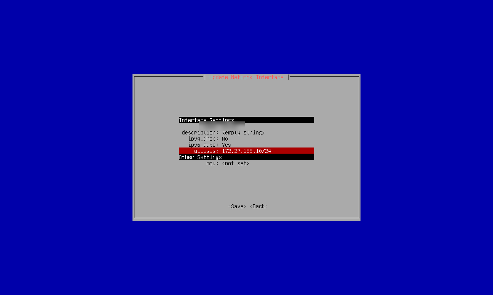

2. Premi **a** per applicare. TrueNAS applica la modifica con un **rollback automatico** dopo 60 secondi: se la nuova rete ti facesse perdere l'accesso, la configurazione tornerebbe indietro da sola. Se tutto funziona, premi **p** per renderla permanente (*persist*).
3. Scegli **2) Configure network settings**: `hostname` `desonas`, `domain` `proxmox.community`, `ipv4gateway` `172.27.199.1`, `nameserver1` `172.27.199.20`, poi **Save**. Nella versione 25.10 il gateway si imposta qui: il menu non ha più una voce separata per la route predefinita.

   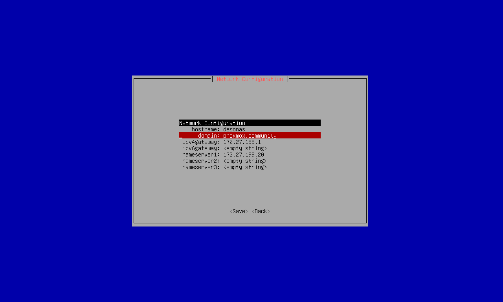

4. La console ora mostra l'indirizzo dell'interfaccia web:

   

### 3. Primo accesso all'interfaccia web

Dal DC apri `https://desonas.proxmox.community` e accedi come `truenas_admin`. Il certificato è autofirmato, come quello di Proxmox VE.

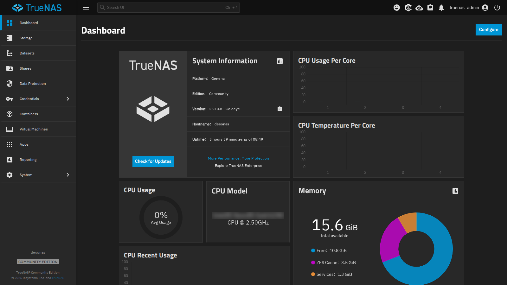

### 4. Fuso orario e tastiera

**System** → **General Settings** → **Localization** → **Settings**: **Timezone** `Europe/Rome`, **Console Keyboard Map** `Italian (it)`, poi **Save**. Senza questo passo l'orario del NAS resta su `America/Los_Angeles`, e log e snapshot pianificati sono sfasati di nove ore rispetto al resto del laboratorio.

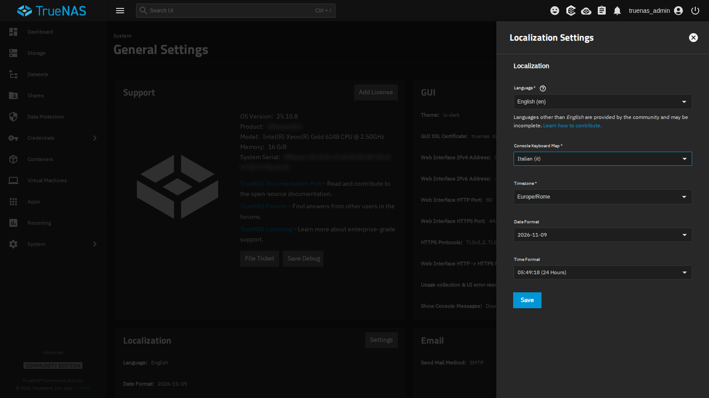

### 5. Sincronizzazione dell'ora

L'ora corretta è importante: le notifiche, i log e, nel lab 14, l'autenticazione SMB dipendono dagli orari. I server predefiniti (`*.debian.pool.ntp.org`) sono su Internet e non sono raggiungibili dal laboratorio.

1. **System** → **Advanced Settings** (conferma l'avviso) → **NTP Servers** → **Add**.
2. **Address** `ntp.proxmox.community`, spunta **IBurst** (prima sincronizzazione rapida) e **Prefer**, poi **Save**. TrueNAS interroga subito il server e rifiuta un indirizzo che non risponde, a meno che si spunti **Force**.

   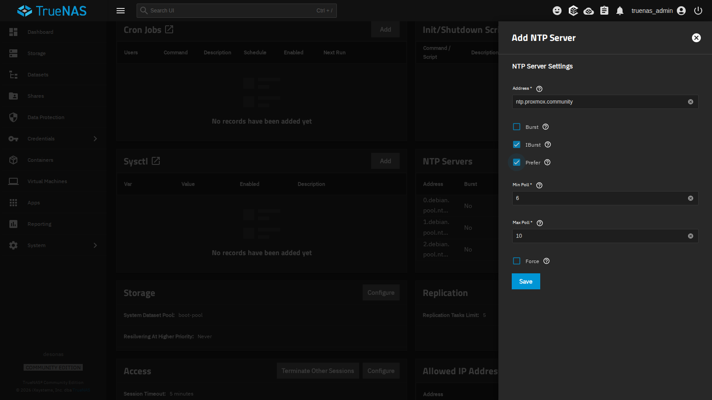

3. Elimina i tre server `0`, `1` e `2.debian.pool.ntp.org` con l'icona del cestino, confermando ogni volta.

### 6. DNS, gateway e proxy

**System** → **Network** → **Network Configuration** → **Settings** riassume quanto impostato dalla console: hostname, dominio, DNS e gateway. In **HTTP Proxy** scrivi `http://proxy.proxmox.community:3128`: TrueNAS lo userà per cercare gli aggiornamenti, come fa Proxmox VE con il proxy del datacenter (lab 04). **Save**.

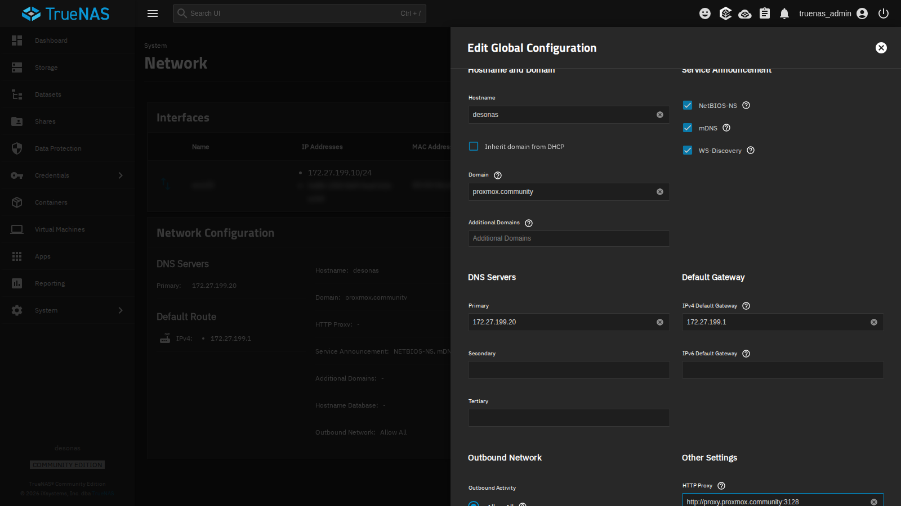

### 7. Il pool dati in mirror

1. **Storage** → **Create Pool**. Nel passo **General Info** il nome è `dati`, senza cifratura.
2. Nel passo **Data** scegli **Layout** `Mirror`; nella selezione automatica dei dischi **Disk Size** `100 GiB (HDD)`, **Width** `2` (dischi per vdev) e **Number of VDEVs** `1`.

   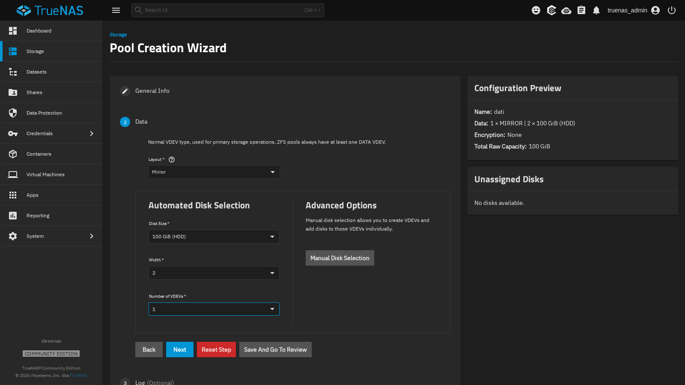

3. Salta i passi facoltativi (Log, Spare, Cache, Metadata, Dedup) con **Save And Go To Review** e controlla il riepilogo: un mirror di due dischi da 100 GiB.

   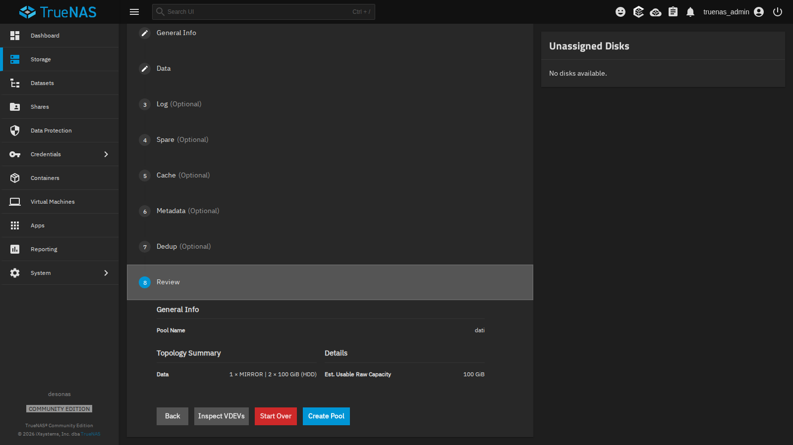

4. **Create Pool**, spunta **Confirm** nell'avviso che i dischi verranno cancellati e premi **Continue**. Dopo pochi secondi il pool è online: 95,44 GiB utilizzabili, con lo scrub già pianificato ogni domenica a mezzanotte.

   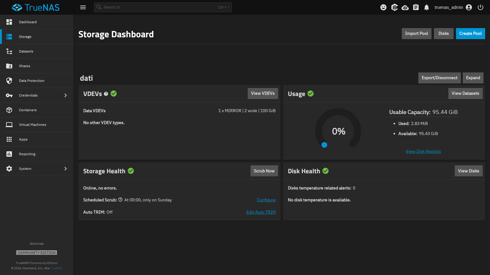

### 8. I dataset per i tre protocolli

Ogni protocollo ha il suo dataset, con proprietà e permessi indipendenti.

1. **Datasets** → seleziona `dati` → **Add Dataset**: **Name** `nfs`, **Dataset Preset** `Generic`, poi **Save**.

   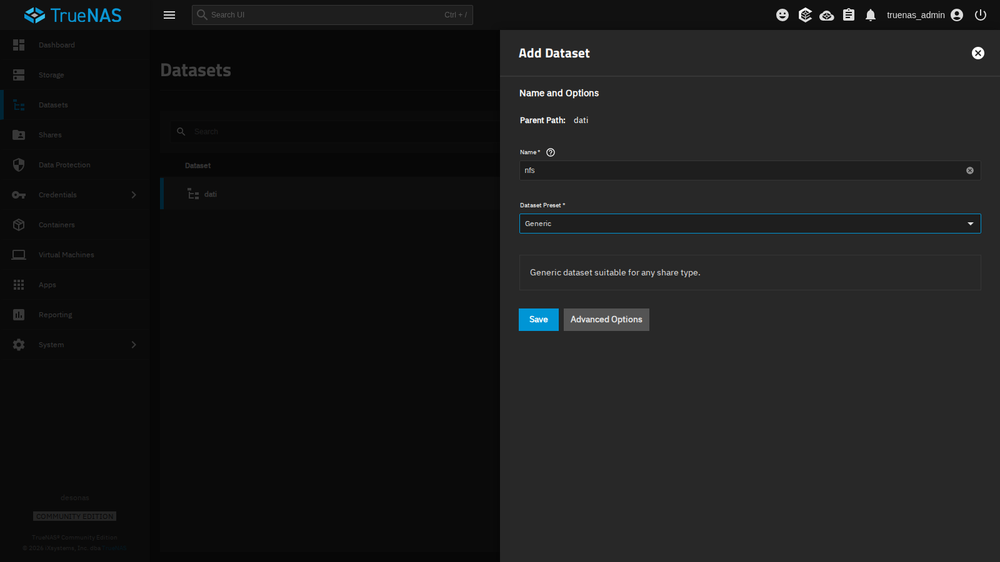

2. Ripeti per `smb` con **Dataset Preset** `SMB` e **togli** la spunta a **Create SMB Share**: la condivisione la creerai nel lab 14. Il preset SMB imposta permessi e opzioni adatti a Windows (ACL NFSv4, nomi case-insensitive).
3. Ripeti per `iscsi` con il preset `Generic`: conterrà gli zvol del lab 15.

I tre dataset ereditano dal pool la compressione LZ4 e `atime` disattivato:

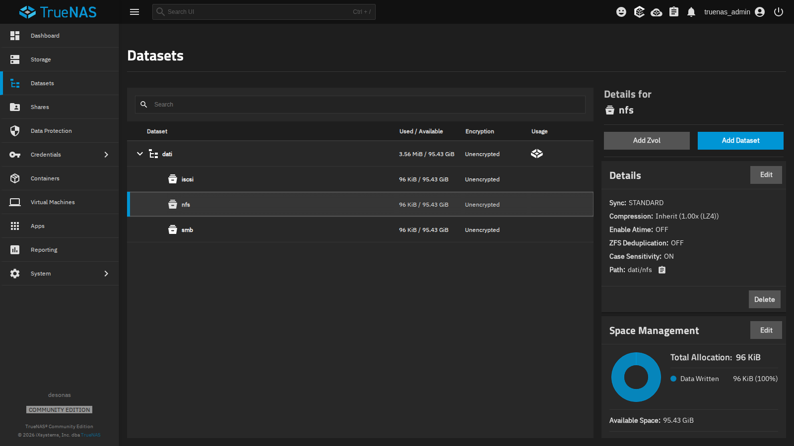

### 9. L'utente di servizio

Proxmox VE accederà alla condivisione SMB con un utente dedicato, non con l'amministratore del NAS.

1. **Credentials** → **Users** → **Add**.
2. **Username** `svc-pve`, lascia attivo solo **SMB Access**, imposta la password `<password-lab>`. Nessun accesso alla shell, a SSH o all'interfaccia web.

   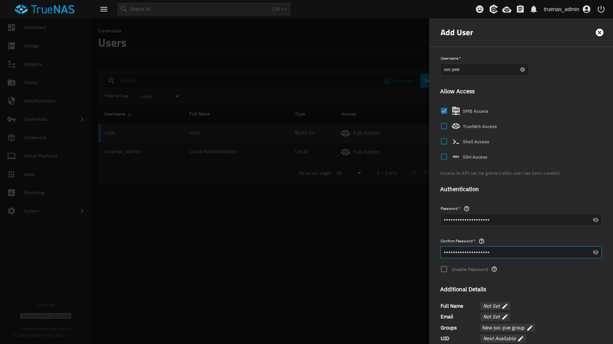

3. **Save**.

## Verifica e test

Da un nodo del cluster controlla che il NAS risponda con il suo nome, che il DNS inverso sia corretto e che l'ora coincida con quella dei nodi:

```console
root@desopve01:~# host desonas.proxmox.community
desonas.proxmox.community has address 172.27.199.10
root@desopve01:~# host 172.27.199.10
10.199.27.172.in-addr.arpa domain name pointer desonas.proxmox.community.
root@desopve01:~# ping -c2 -W1 desonas.proxmox.community | tail -2
2 packets transmitted, 2 received, 0% packet loss, time 1002ms
rtt min/avg/max/mdev = 0.503/1.300/2.097/0.797 ms
root@desopve01:~# curl -skI https://desonas.proxmox.community/ui/ | grep -i "^date"; date -u
date: Mon, 09 Nov 2026 14:04:49 GMT
Mon Nov  9 02:04:49 PM UTC 2026
```

- [ ] Il NAS ha l'indirizzo statico `172.27.199.10` e il nome `desonas.proxmox.community`.
- [ ] L'ora del NAS coincide con quella dei nodi; l'unico server NTP è `ntp.proxmox.community`.
- [ ] Il pool `dati` è un mirror di due dischi, online e senza errori.
- [ ] Esistono i dataset `dati/nfs`, `dati/smb` e `dati/iscsi`, e l'utente `svc-pve` con il solo accesso SMB.

## Stato finale del lab

- **NAS `desonas.proxmox.community`** (`172.27.199.10`), TrueNAS Community Edition 25.10.8:
  - sistema sul disco da 32 GB (`boot-pool`); amministratore `truenas_admin`;
  - fuso `Europe/Rome`, tastiera italiana, NTP `ntp.proxmox.community`, DNS `172.27.199.20`, gateway `172.27.199.1`, proxy `http://proxy.proxmox.community:3128`;
  - pool **`dati`**: mirror dei due dischi da 100 GiB, 95,44 GiB utilizzabili, compressione LZ4;
  - dataset `dati/nfs` (Generic), `dati/smb` (SMB) e `dati/iscsi` (Generic), ancora senza condivisioni;
  - utente `svc-pve` con accesso SMB.
- Cluster e VM invariati.

## Cosa hai imparato

- TrueNAS Community Edition è un sistema per NAS basato su Debian e ZFS: il sistema sta in un boot pool dedicato, i dati in un pool separato.
- Senza DHCP la rete si configura dalla console, con un rollback automatico che protegge da errori.
- Fuso orario e NTP vanno sistemati subito; i server NTP predefiniti sono su Internet.
- Un pool si crea con una procedura guidata: layout, dimensione dei dischi, larghezza e numero di vdev.
- Per NFS, SMB e iSCSI conviene un dataset separato ciascuno; il preset SMB prepara permessi adatti a Windows.
- Proxmox VE accede al NAS con un utente di servizio dedicato, con i soli permessi necessari.

## Riferimenti

- [TrueNAS – Installing TrueNAS Community Edition](https://www.truenas.com/docs/scale/gettingstarted/install/installingscale/)
- [TrueNAS – Console Setup Menu Configuration](https://www.truenas.com/docs/scale/gettingstarted/install/consolesetupmenuscale/)
- [TrueNAS – Creating Storage Pools](https://www.truenas.com/docs/scale/scaletutorials/storage/createpoolwizard/)
- [TrueNAS – Adding and Managing Datasets](https://www.truenas.com/docs/scale/scaletutorials/datasets/datasetsscale/)
- [TrueNAS – Managing Users](https://www.truenas.com/docs/scale/scaletutorials/credentials/managelocalusersscale/)
- [Proxmox VE – Storage](https://pve.proxmox.com/pve-docs/pve-admin-guide.html#chapter_storage)
