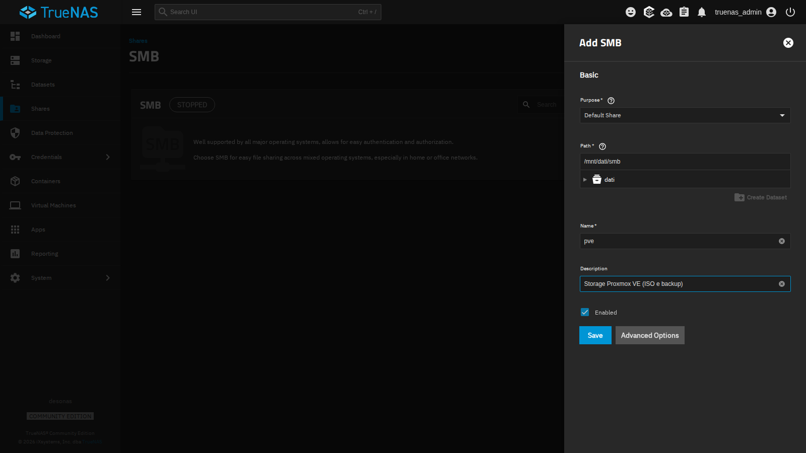
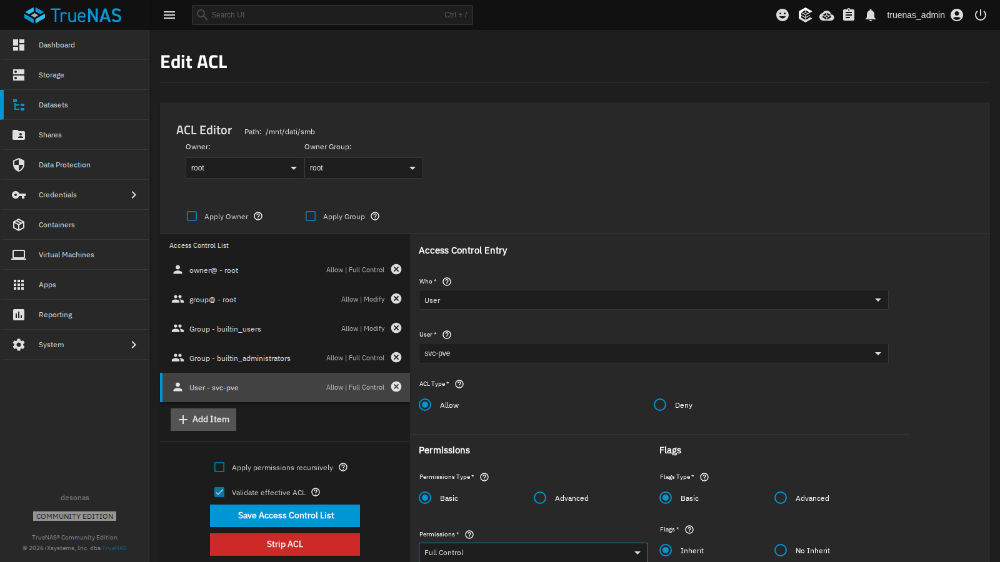
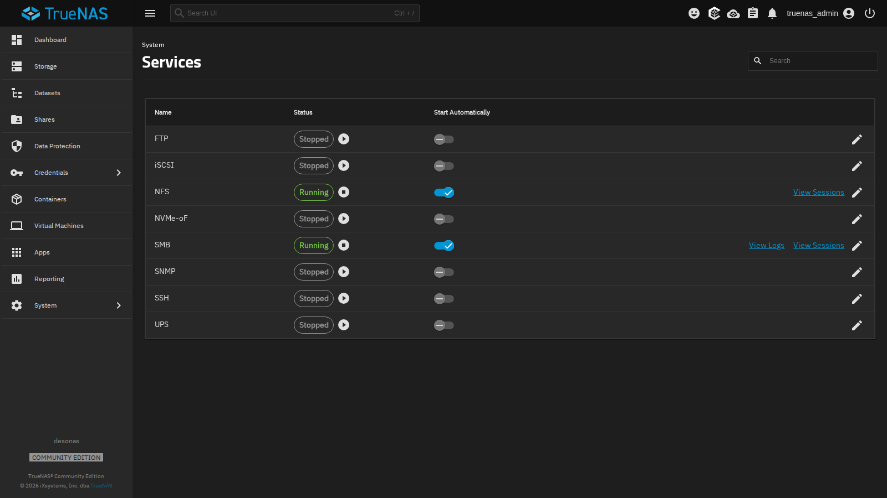
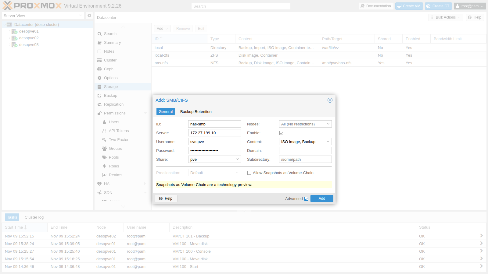
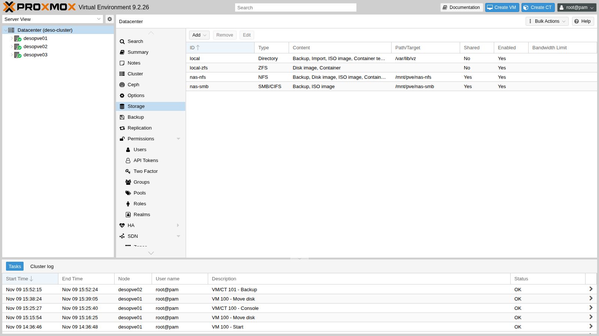
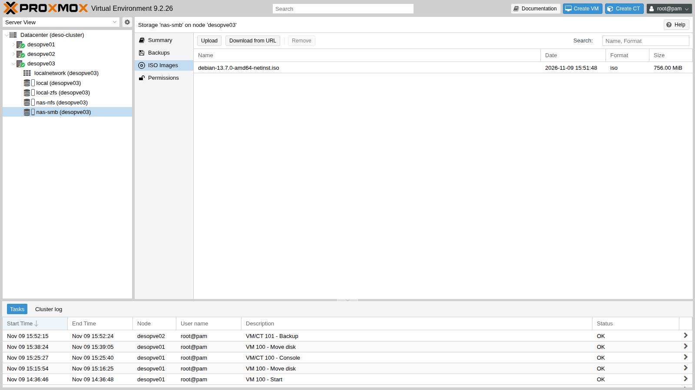
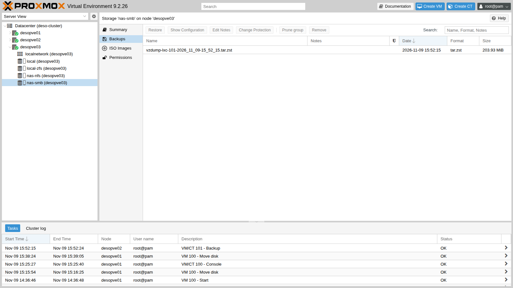

# Lab 14 – Storage SMB/CIFS: condivisione autenticata, permessi e confronto con NFS

**Livello:** intermedio · **Durata:** 1 ora

## Dipendenze

- **Lab precedenti:** [Lab 12](12-truenas-nas.md) per il NAS `desonas` con il dataset `dati/smb` (preset SMB) e l'utente `svc-pve`, e [Lab 13](13-nfs.md) per lo storage `nas-nfs`, che userai nel confronto.
- **Cluster:** `deso-cluster` con i tre nodi (lab 06). Sul nodo `desopve01` c'è la ISO di Debian 13 scaricata nel lab 07; sul nodo `desopve02` gira il container 101.
- **Rete:** i nodi raggiungono `172.27.199.10` sulla LAN del laboratorio (porta TCP 445).
- **Credenziali:** `root` / `<password-lab>` sui nodi, `truenas_admin` / `<password-lab>` sul NAS, `svc-pve` / `<password-lab>` per l'accesso SMB → [Appendice B](b-credentials-and-addresses.md).

## Obiettivi

- Creare una condivisione SMB su TrueNAS e dare i permessi a un utente di servizio.
- Aggiungere lo storage SMB/CIFS al cluster e capire dove Proxmox VE salva la password.
- Fissare la versione del protocollo SMB.
- Usare la condivisione per ISO e backup, visibili da tutti i nodi.
- Riconoscere i problemi tipici: credenziali, permessi, mount `soft`.
- Confrontare SMB e NFS, anche sulla sicurezza delle scritture.

## Come funziona

### SMB in Proxmox VE

SMB (*Server Message Block*), chiamato anche CIFS, è il protocollo di condivisione file di Windows. Come per NFS, Proxmox VE **monta la condivisione su ogni nodo** in `/mnt/pve/<ID>` e la usa come storage di tipo file condiviso. A differenza di NFS, l'accesso è **autenticato**: ogni nodo si presenta al server con un utente e una password.

```text
 desonas (TrueNAS)                              desopve01 / 02 / 03
 /mnt/dati/smb  ── share "pve" ── SMB 3.1.1 ──▶  /mnt/pve/nas-smb
                   utente svc-pve                 ├── template/iso/   ISO
                                                  └── dump/           backup
```

- La password dell'utente sta in `/etc/pve/priv/storage/<ID>.pw`. È nel file system del cluster, quindi tutti i nodi la conoscono, ma la cartella `priv` è leggibile solo da root.
- Il server decide i permessi con le sue ACL: per TrueNAS, l'utente `svc-pve` deve avere il controllo completo del dataset.
- Il client Linux monta la condivisione con opzioni diverse da NFS: i permessi Unix non esistono (`nounix`), e il mount è **`soft`**. Se il server non risponde, le operazioni falliscono con un errore invece di restare in attesa.

### Quando usare SMB

| | NFS | SMB/CIFS |
|---|---|---|
| Autenticazione | per indirizzo IP del client | utente e password (o dominio AD) |
| Permessi Unix (proprietario, `chmod`) | sì | no: li decide il server |
| Comportamento se il server cade | `hard`: si aspetta | `soft`: errore dopo pochi secondi |
| Uso tipico in Proxmox VE | dischi delle VM, ISO, backup | ISO, template e backup; NAS già in uso con Windows |

Per i dischi delle VM conviene NFS (o iSCSI, nel lab 15): con SMB un NAS che non risponde per qualche secondo restituisce errori di I/O al disco virtuale. Nel lab userai SMB per **ISO e backup**.

### Alternativa: autenticazione con Active Directory

Nel laboratorio il NAS usa un utente locale. In un'azienda con Active Directory si può unire TrueNAS al dominio (**Credentials** → **Directory Services** → **Configure Active Directory**: dominio `proxmox.community`, account con il diritto di unire computer al dominio). Così:

- l'utente di servizio diventa un account del dominio (per esempio `PROXMOX\svc-pve`), gestito e scaduto con le regole del dominio;
- in Proxmox VE lo storage si configura con **Username** `svc-pve` e **Domain** `PROXMOX`;
- le ACL della condivisione usano utenti e gruppi del dominio.

Prima dell'unione al dominio servono DNS e orario corretti sul NAS (lab 12): Kerberos rifiuta differenze di orario superiori a 5 minuti.

## Procedura

### 1. La condivisione su TrueNAS

1. Sul NAS: **Shares** → **SMB** → **Add**.
2. **Purpose** `Default Share`, **Path** `/mnt/dati/smb`, **Name** `pve`, **Description** `Storage Proxmox VE (ISO e backup)`.

   

3. **Save**. TrueNAS chiede **Configure ACL**: rispondi **Configure** per aprire l'editor dei permessi del dataset.
4. Nell'editor ACL premi **Add Item** e crea la voce:
   - **Who** `User`, **User** `svc-pve`;
   - **ACL Type** `Allow`, **Permissions** `Full Control`, **Flags** `Inherit`, così vale anche per le cartelle e i file che Proxmox VE creerà.

   

5. **Save Access Control List**.
6. **System** → **Services**: attiva **Start Automatically** per **SMB** e avvia il servizio.

   

Da un nodo controlla che l'utente veda la condivisione:

```console
root@desopve01:~# pvesm scan cifs 172.27.199.10 --username svc-pve --password '<password-lab>'
pve Storage
```

### 2. Aggiungere lo storage al cluster

1. **Datacenter** → **Storage** → **Add** → **SMB/CIFS**.
2. Compila:
   - **ID** `nas-smb`, **Server** `172.27.199.10`;
   - **Username** `svc-pve` e **Password**: il menu **Share** si popola con le condivisioni a cui l'utente ha accesso; scegli `pve`;
   - **Content**: `ISO image` e `Backup` (togli `Disk image`);
   - **Nodes**: tutti.
3. Spunta **Advanced**: lascia **Preallocation** `Default` e **Allow Snapshots as Volume-Chain** disattivato.

   

4. **Add**. Lo storage compare condiviso e attivo:

   

### 3. Fissare la versione di SMB

Il dialogo non ha un campo per la versione del protocollo: senza indicazioni il client negozia la più alta supportata da entrambi. Fissarla evita che un server mal configurato faccia scendere il collegamento a una versione vecchia. Si imposta da riga di comando, e vale dal mount successivo:

```console
root@desopve01:~# pvesm set nas-smb --smbversion 3.11
root@desopve01:~# umount /mnt/pve/nas-smb        # su ogni nodo: pvestatd lo rimonta da solo
root@desopve01:~# grep -A8 "cifs: nas-smb" /etc/pve/storage.cfg
cifs: nas-smb
	path /mnt/pve/nas-smb
	server 172.27.199.10
	share pve
	content iso,backup
	prune-backups keep-all=1
	smbversion 3.11
	username svc-pve
root@desopve01:~# ls -l /etc/pve/priv/storage/
-rw------- 1 root www-data 30 Nov  9 15:49 nas-smb.pw
root@desopve01:~# mount | grep nas-smb
//172.27.199.10/pve on /mnt/pve/nas-smb type cifs (rw,relatime,vers=3.1.1,cache=strict,upcall_target=app,username=svc-pve,uid=0,noforceuid,gid=0,noforcegid,addr=172.27.199.10,file_mode=0755,dir_mode=0755,soft,nounix,serverino,mapposix,reparse=nfs,nativesocket,symlink=native,rsize=4194304,wsize=4194304,bsize=1048576,echo_interval=60,actimeo=1,closetimeo=1)
```

- `vers=3.1.1`: è la versione SMB 3.11, la più recente.
- `uid=0`, `gid=0`, `file_mode=0755`: tutti i file appaiono di root con permessi fissi, qualunque sia il proprietario sul server.
- `soft`: le operazioni falliscono se il server non risponde (lo vedrai nei test).

### 4. ISO e backup condivisi

Copia sulla condivisione la ISO di Debian scaricata nel lab 07 e guardala da un altro nodo:

```console
root@desopve01:~# cp /var/lib/vz/template/iso/debian-13.7.0-amd64-netinst.iso /mnt/pve/nas-smb/template/iso/
root@desopve03:~# pvesm list nas-smb
Volid                                       Format  Type           Size VMID
nas-smb:iso/debian-13.7.0-amd64-netinst.iso iso     iso       792723456
```



Fai un backup del container 101 sulla condivisione (i backup sono l'argomento del lab 46):

```console
root@desopve02:~# vzdump 101 --storage nas-smb --mode snapshot --compress zstd
INFO: Starting Backup of VM 101 (lxc)
INFO: creating vzdump archive '/mnt/pve/nas-smb/dump/vzdump-lxc-101-2026_11_09-15_52_15.tar.zst'
INFO: Total bytes written: 706631680 (674MiB, 87MiB/s)
INFO: archive file size: 203MB
INFO: Finished Backup of VM 101 (00:00:09)
```



## Verifica e test

### Test 1 – Credenziali sbagliate

Con una password errata il server rifiuta l'accesso. È lo stesso errore che vedresti se la password di `svc-pve` cambiasse sul NAS senza aggiornare lo storage:

```console
root@desopve01:~# pvesm scan cifs 172.27.199.10 --username svc-pve --password sbagliata
unexpected status: NT_STATUS_ACCESS_DENIED
```

Per aggiornare la password: **Datacenter** → **Storage** → `nas-smb` → **Edit**, oppure `pvesm set nas-smb --password`.

### Test 2 – I permessi Unix non esistono

```console
root@desopve01:/mnt/pve/nas-smb# touch prova.txt; chmod 600 prova.txt; chown 1000:1000 prova.txt; echo $?
0
root@desopve01:/mnt/pve/nas-smb# ls -l prova.txt
-rwxr-xr-x 1 root root 0 Nov  9 15:51 prova.txt
```

`chmod` e `chown` non danno errore ma non cambiano nulla: con `nounix` i permessi li decide il server con le ACL. Per questo SMB non è adatto ai container, che hanno bisogno di proprietari e permessi Unix reali.

### Test 3 – Il NAS smette di rispondere

Sul nodo `desopve01` avvia un «battito» che ogni 2 secondi scrive l'ora sulla condivisione e registra l'esito:

```console
root@desopve01:~# nohup sh -c 'while true; do if date +%T > /mnt/pve/nas-smb/battito.txt; then echo "$(date +%T) ok"; else echo "$(date +%T) ERRORE"; fi >> /root/smb-battito.log; sleep 2; done' >/dev/null 2>&1 &
```

Sul NAS ferma il servizio SMB (**System** → **Services** → **SMB** → **Stop Service**). Le scritture si bloccano per una decina di secondi, poi falliscono, e così ogni tentativo successivo:

```console
root@desopve01:~# tail -4 /root/smb-battito.log
15:55:33 ok
15:55:35 ok
15:55:47 ERRORE
15:55:59 ERRORE
root@desopve01:~# bash -c 'echo x > /mnt/pve/nas-smb/prova.txt'
bash: line 1: /mnt/pve/nas-smb/prova.txt: Host is down
root@desopve01:~# pvesm status | grep nas-smb
nas-smb          cifs   inactive               0               0               0    0.00%
```

È la differenza con NFS del lab 13: lì i processi restavano in attesa, senza errori, finché il server tornava. Qui l'applicazione riceve un errore (`Host is down`). Per un file ISO o un backup in corso vuol dire un'operazione fallita, da ripetere; per il disco di una VM vorrebbe dire errori di I/O nel sistema operativo ospite.

Riavvia il servizio SMB: dopo pochi secondi il client si riconnette da solo e le scritture riprendono:

```console
root@desopve01:~# tail -3 /root/smb-battito.log
15:57:38 ok
15:57:40 ok
15:57:42 ok
root@desopve01:~# pvesm status | grep nas-smb
nas-smb          cifs     active       100069248          977024        99092224    0.98%
```

Ferma il battito e cancella i file di prova:

```console
root@desopve01:~# pkill -f "^sh -c while true"; rm -f /mnt/pve/nas-smb/battito.txt /mnt/pve/nas-smb/prova.txt /root/smb-battito.log
```

### Test 4 – SMB contro NFS

Dal nodo `desopve01` misura con `fio` le stesse scritture sui due storage del NAS (stesso pool, stessa rete):

```console
root@desopve01:~# fio --name=t --directory=/mnt/pve/nas-smb --rw=randwrite --bs=4k --size=1G \
      --iodepth=16 --ioengine=libaio --direct=1 --runtime=20 --time_based --group_reporting
  write: IOPS=5430, BW=21.2MiB/s (22.2MB/s)(425MiB/20017msec); 0 zone resets
root@desopve01:~# fio --name=t --directory=/mnt/pve/nas-nfs --rw=randwrite --bs=4k --size=1G \
      --iodepth=16 --ioengine=libaio --direct=1 --runtime=20 --time_based --group_reporting
  write: IOPS=962, BW=3851KiB/s (3943kB/s)(75.9MiB/20179msec); 0 zone resets
```

SMB sembra cinque volte più veloce. Ripeti forzando il salvataggio sicuro di ogni scrittura (`--fsync=1`, come fa un database):

```console
root@desopve01:~# fio --name=t --directory=/mnt/pve/nas-smb --rw=randwrite --bs=4k --size=1G \
      --iodepth=1 --ioengine=psync --direct=1 --fsync=1 --runtime=20 --time_based
  write: IOPS=185, BW=741KiB/s (759kB/s)(14.9MiB/20557msec); 0 zone resets
root@desopve01:~# fio --name=t --directory=/mnt/pve/nas-nfs --rw=randwrite --bs=4k --size=1G \
      --iodepth=1 --ioengine=psync --direct=1 --fsync=1 --runtime=20 --time_based
  write: IOPS=339, BW=1358KiB/s (1391kB/s)(26.5MiB/20001msec); 0 zone resets
```

Infine la scrittura sequenziale a blocchi da 1 MiB, quella tipica di ISO e backup:

```console
root@desopve01:~# fio --name=t --directory=/mnt/pve/nas-smb --rw=write --bs=1M --size=1G \
      --iodepth=4 --ioengine=libaio --direct=1 --runtime=20 --time_based --group_reporting
  write: IOPS=688, BW=688MiB/s (722MB/s)(13.6GiB/20292msec); 0 zone resets
root@desopve01:~# fio --name=t --directory=/mnt/pve/nas-nfs --rw=write --bs=1M --size=1G \
      --iodepth=4 --ioengine=libaio --direct=1 --runtime=20 --time_based --group_reporting
  write: IOPS=33, BW=33.3MiB/s (34.9MB/s)(673MiB/20201msec); 0 zone resets
```

Cancella i file di prova creati da `fio`:

```console
root@desopve01:~# rm -f /mnt/pve/nas-smb/t.0.0 /mnt/pve/nas-nfs/t.0.0
```

| Test (dal nodo, `fio`) | NFS | SMB |
|---|---|---|
| Scrittura casuale 4 KiB, coda 16 | 962 IOPS | 5 430 IOPS |
| Scrittura sequenziale 1 MiB, coda 4 | 33 MiB/s | 688 MiB/s |
| Scrittura casuale 4 KiB con `fsync` a ogni scrittura | 339 IOPS | 185 IOPS |

- Con NFS ogni scrittura diretta arriva al NAS come scrittura **stabile**: il NAS risponde solo dopo averla salvata in modo sicuro (ZIL).
- Con SMB il NAS conferma la scrittura appena la riceve in RAM e la salva su disco più tardi, a meno che il client non chieda esplicitamente lo svuotamento (`fsync`). Se il NAS si spegnesse di colpo, le ultime scritture confermate andrebbero perse.
- Quando la sicurezza è la stessa (terzo test), SMB non è più veloce di NFS.

Per ISO e backup, dove ogni file viene chiuso e verificato, la velocità di SMB è un vantaggio. Per i dischi delle VM, che si aspettano scritture sicure, è un rischio in più.

- [ ] La condivisione `pve` usa il dataset `dati/smb`, e l'utente `svc-pve` ha il controllo completo.
- [ ] Lo storage `nas-smb` è montato in SMB 3.1.1 su tutti e tre i nodi, con la password in `/etc/pve/priv/storage/`.
- [ ] La ISO e il backup del container sono visibili da ogni nodo.
- [ ] Sai che cosa succede con password errata, con `chmod` e con il NAS fermo.
- [ ] Sai spiegare perché SMB «vince» il primo confronto con NFS e perde il terzo.

## Stato finale del lab

- **NAS:** condivisione SMB **`pve`** su `/mnt/dati/smb`; ACL con `svc-pve` in `Full Control` (ereditata); servizio SMB attivo con avvio automatico. NFS invariato.
- **Cluster:** storage **`nas-smb`** (CIFS, `//172.27.199.10/pve`, utente `svc-pve`, `smbversion 3.11`, contenuti `iso,backup`, condiviso, su tutti i nodi), montato in `/mnt/pve/nas-smb`. Contiene:
  - la ISO `debian-13.7.0-amd64-netinst.iso`;
  - il backup `vzdump-lxc-101-2026_11_09-15_52_15.tar.zst` del container 101.
- Storage `nas-nfs` invariato e vuoto. VM 100 accesa su `desopve01` (disco su `local-zfs`), CT 101 acceso su `desopve02`.

## Cosa hai imparato

- Lo storage SMB/CIFS è uno storage di tipo file condiviso, montato su ogni nodo in `/mnt/pve/<ID>`, con utente e password salvati in `/etc/pve/priv/storage/`.
- Sul NAS i permessi si danno con le ACL del dataset; sul client i permessi Unix non esistono.
- La versione del protocollo si fissa con `pvesm set <ID> --smbversion`.
- Il mount SMB è `soft`: con il NAS fermo le operazioni falliscono dopo pochi secondi, mentre con NFS restano in attesa.
- Un confronto di velocità ha senso solo a parità di sicurezza delle scritture: SMB conferma le scritture prima di salvarle, NFS no.
- SMB è adatto a ISO, template e backup; per i dischi delle VM si preferiscono NFS, iSCSI o Ceph.

## Riferimenti

- [Proxmox VE – CIFS Backend](https://pve.proxmox.com/pve-docs/pve-admin-guide.html#storage_cifs)
- [Proxmox VE – `pvesm`](https://pve.proxmox.com/pve-docs/pvesm.1.html)
- [TrueNAS – Adding SMB Shares](https://www.truenas.com/docs/scale/scaletutorials/shares/smb/addsmbshares/)
- [TrueNAS – Configuring Active Directory](https://www.truenas.com/docs/scale/scaletutorials/credentials/directoryservices/configuringadscale/)
- [`mount.cifs(8)` – opzioni `soft`, `vers`, `nounix`](https://man7.org/linux/man-pages/man8/mount.cifs.8.html)
