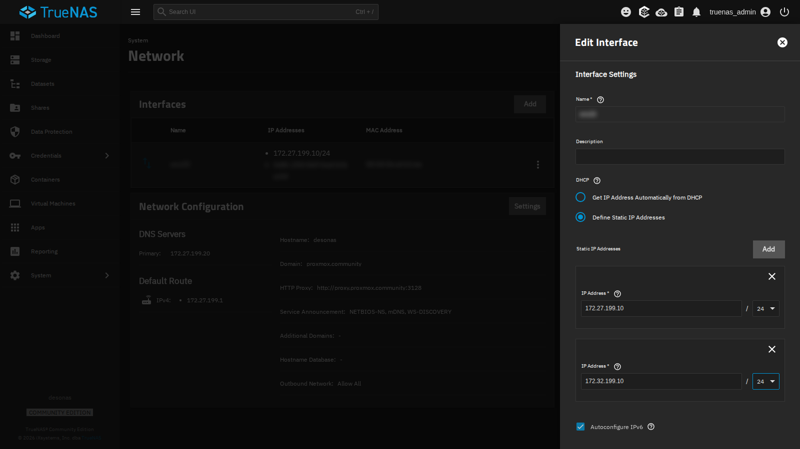
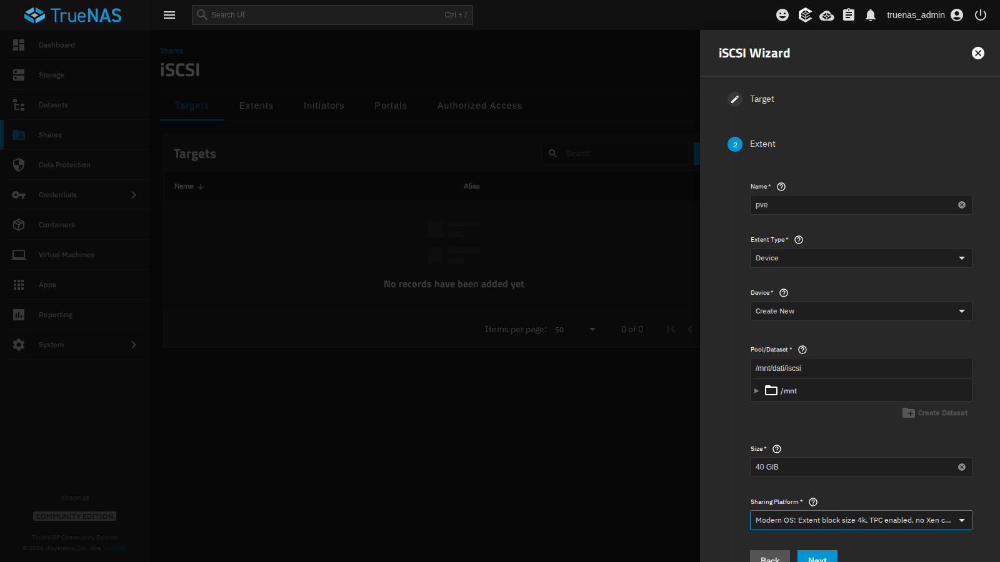
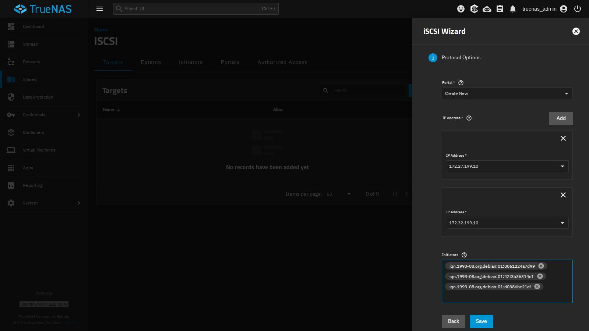
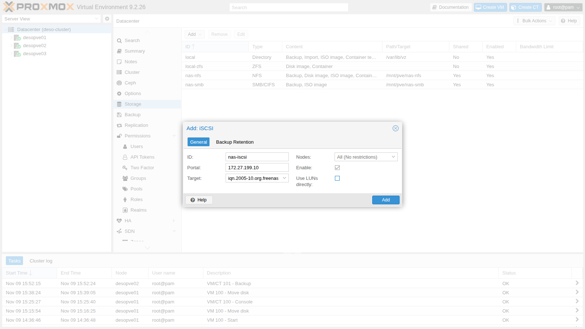
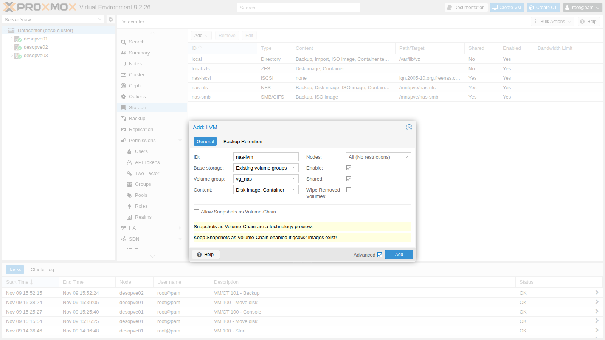
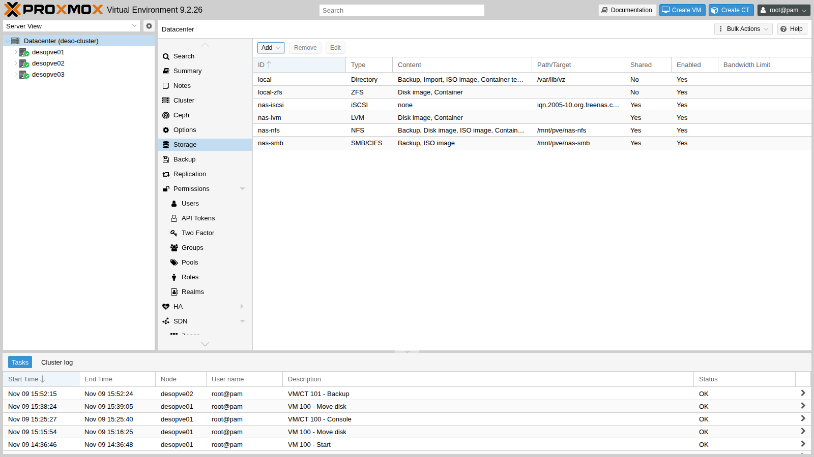

# Lab 15 – iSCSI con LVM condiviso e multipath: caduta di un percorso

**Livello:** avanzato · **Durata:** 2 ore

## Dipendenze

- **Lab precedenti:** [Lab 12](12-truenas-nas.md) per il NAS `desonas` con il dataset `dati/iscsi`, [Lab 09](09-lvm-and-lvm-thin.md) per i concetti di LVM, [Lab 06](06-cluster-corosync.md) per i nodi con la seconda scheda `nic1` (`172.32.199.21-23`), [Lab 11](11-zfs-replication.md) per i tempi di migrazione da confrontare.
- **Cluster:** `deso-cluster` con i tre nodi; VM 100 `debian01` accesa su `desopve01`, con il disco su `local-zfs`.
- **Rete:** i nodi raggiungono il NAS su `172.27.199.10` (scheda `vmbr0`) e, dopo il primo passo, su `172.32.199.10` (scheda `nic1`).
- **Software:** `open-iscsi` è già installato in Proxmox VE; installerai `multipath-tools` tramite il proxy del laboratorio (lab 04).
- **Credenziali:** `root` / `<password-lab>` sui nodi, `truenas_admin` / `<password-lab>` sul NAS, `labuser` / `<password-lab>` nella VM 100 → [Appendice B](b-credentials-and-addresses.md).

## Obiettivi

- Esportare un volume a blocchi (zvol) da TrueNAS in iSCSI, su due indirizzi.
- Collegare i nodi al target e creare sopra uno storage **LVM condiviso**.
- Unire i due percorsi verso il NAS in un unico dispositivo con **multipath**.
- Migrare a caldo una VM con il disco su storage condiviso, copiando solo la memoria.
- Interrompere un percorso con l'I/O in corso e misurare l'effetto sulla VM.
- Riconoscere un problema reale delle reti con due schede sulla stessa rete (stesso switch, stessa VLAN).

## Come funziona

### iSCSI

iSCSI trasporta comandi SCSI su TCP: il nodo vede un **disco** del NAS come se fosse collegato in locale (`/dev/sdX`). A differenza di NFS e SMB non condivide file, ma blocchi.

| Termine | Nel laboratorio |
|---|---|
| **Target**: il «server» che espone i dischi, identificato da un IQN | `iqn.2005-10.org.freenas.ctl:pve` su `desonas` |
| **LUN** / **extent**: il disco esportato | lo zvol `dati/iscsi/pve` da 40 GiB, LUN 0 |
| **Portal**: indirizzo IP e porta TCP (3260) su cui il target risponde | `172.27.199.10:3260` e `172.32.199.10:3260` |
| **Initiator**: il client, con il suo IQN | i tre nodi, `iqn.1993-08.org.debian:01:…` |
| **Initiator group**: chi può collegarsi al target | solo gli IQN dei tre nodi |

### LVM condiviso

Lo stesso disco iSCSI è visto da tutti i nodi. Sopra si crea **un solo** gruppo di volumi LVM (`vg_nas`), e ogni disco di VM è un volume logico (LV):

```text
                 desonas: zvol dati/iscsi/pve (40 GiB)
                   │ 172.27.199.10            │ 172.32.199.10
             percorso 1 (vmbr0)          percorso 2 (nic1)
                   │                          │
  ogni nodo:    /dev/sde                   /dev/sdf      ← lo stesso LUN, due volte
                   └──────── multipath ───────┘
                      /dev/mapper/nas-lun0
                               │
                       VG vg_nas (condiviso)
                       └── vm-100-disk-0 (LV)
```

- LVM non è un file system di cluster: Proxmox VE coordina le modifiche (creare, ingrandire, cancellare LV) con un lock del cluster, e un LV è attivo su un solo nodo alla volta, quello dove gira la VM.
- Lo storage è **thick**: ogni LV occupa subito tutto il suo spazio. Il thin provisioning (LVM-thin) non si può condividere tra nodi.
- Gli snapshot su LVM condiviso esistono solo con la funzione *volume chain* di Proxmox VE 9, che vedrai nel lab 16.

### Multipath

Con due portal ogni nodo apre **due sessioni** iSCSI e vede il LUN due volte (`sde`, `sdf`). Usarli direttamente sarebbe pericoloso: LVM troverebbe due copie dello stesso disco. Il demone **multipathd** riconosce che hanno lo stesso identificativo (WWID) e li unisce in un solo dispositivo, `/dev/mapper/nas-lun0`:

- con `path_grouping_policy multibus` e `round-robin` l'I/O usa **entrambi** i percorsi;
- se un percorso cade, multipathd lo segna `failed` e l'I/O prosegue sull'altro; quando torna, multipathd lo riattiva da solo (lo controlla ogni `polling_interval` secondi);
- con `no_path_retry queue`, se cadono **tutti** i percorsi l'I/O resta in coda (come il mount `hard` di NFS) invece di restituire errori al disco della VM.

## Procedura

### 1. Un secondo indirizzo sul NAS

Il NAS ha una sola scheda: aggiungi il secondo indirizzo come alias, sulla rete `172.32.199.0/24` che i nodi raggiungono con `nic1`.

1. **System** → **Network** → riga dell'interfaccia → **⋮** → **Edit**.
2. In **Static IP Addresses** premi **Add** e inserisci `172.32.199.10` / `24`.

   

3. **Save**, poi **Test Changes** e, entro il tempo indicato, **Save Changes**: se la rete smettesse di funzionare, TrueNAS tornerebbe da solo alla configurazione precedente.

### 2. Il target iSCSI

1. **Shares** → **iSCSI** → **Wizard**.
2. **Target**: `Create New`, **Next**.
3. **Extent**:
   - **Name** `pve` (diventa il nome del target e dell'extent);
   - **Extent Type** `Device`, **Device** `Create New`: TrueNAS crea uno **zvol**, un volume a blocchi ZFS. Un *dataset* non va bene: è un file system, non un disco;
   - **Pool/Dataset** `/mnt/dati/iscsi`, **Size** `40 GiB`;
   - **Sharing Platform** `Modern OS` (blocchi da 4 KiB).

   

4. **Protocol Options**:
   - **Portal** `Create New`, con due **IP Address**: `172.27.199.10` e `172.32.199.10`;
   - **Initiators**: gli IQN dei tre nodi, letti su ciascuno con `cat /etc/iscsi/initiatorname.iscsi`. Solo questi potranno collegarsi.

   

5. **Save**, e accetta di avviare il servizio iSCSI con l'avvio automatico.

> **Autenticazione CHAP.** Il gruppo di initiator limita l'accesso agli IQN dei nodi, ma un IQN si può falsificare. Su reti non dedicate si aggiunge CHAP (**Authorized Access** sul NAS, e utente e password nel file `/etc/iscsi/iscsid.conf` dei nodi). Nel laboratorio la rete è isolata e non lo usiamo.

Lo zvol è **thick** (riserva subito i 40 GiB): lo spazio libero visto dagli storage NFS e SMB scende da circa 95 a 56 GiB.

### 3. Collegare i nodi al target

Su **tutti e tre i nodi** riduci il tempo dopo cui un percorso perso viene considerato guasto (il valore predefinito è 120 secondi), prima del primo collegamento:

```bash title="root@desopve01"
sed -i 's/^node.session.timeo.replacement_timeout = 120/node.session.timeo.replacement_timeout = 15/' /etc/iscsi/iscsid.conf
pvesm scan iscsi 172.27.199.10
```

``` { .text .no-copy title="Output" }
iqn.2005-10.org.freenas.ctl:pve 172.27.199.10:3260,172.32.199.10:3260
```

Il target annuncia entrambi i portal. Aggiungi lo storage iSCSI:

1. **Datacenter** → **Storage** → **Add** → **iSCSI**.
2. **ID** `nas-iscsi`, **Portal** `172.27.199.10`, **Target** dal menu.
3. **Togli** la spunta a **Use LUNs directly**: il LUN non ospiterà direttamente i dischi delle VM, ma il gruppo LVM.

   

4. **Add**. Proxmox VE si collega al target da ogni nodo, su **tutti** i portal annunciati:

```bash title="root@desopve01"
iscsiadm -m session
```

``` { .text .no-copy title="Output" }
tcp: [1] 172.27.199.10:3260,1 iqn.2005-10.org.freenas.ctl:pve (non-flash)
tcp: [2] 172.32.199.10:3260,1 iqn.2005-10.org.freenas.ctl:pve (non-flash)
```

```bash title="root@desopve01"
lsblk -o NAME,SIZE,TRAN,VENDOR,MODEL | grep iscsi
```

``` { .text .no-copy title="Output" }
sde      40G iscsi  TrueNAS  iSCSI Disk
sdf      40G iscsi  TrueNAS  iSCSI Disk
```

```bash title="root@desopve01"
iscsiadm -m session -P3 | grep -E 'Current Portal|Attached scsi disk'
```

``` { .text .no-copy title="Output" }
	Current Portal: 172.27.199.10:3260,1
			Attached scsi disk sde		State: running
	Current Portal: 172.32.199.10:3260,1
			Attached scsi disk sdf		State: running
```

`sde` e `sdf` sono lo **stesso** disco visto dai due percorsi.

### 4. Due schede sulla stessa rete: ARP

In questo laboratorio `vmbr0` e `nic1` sono collegate allo stesso switch, nella stessa VLAN. Linux, per impostazione predefinita, risponde alle richieste ARP per **qualsiasi** suo indirizzo da **qualsiasi** scheda (*ARP flux*): il NAS può così imparare che `172.32.199.22` sta dietro la scheda `vmbr0`, e mandare lì il traffico del secondo percorso.

> **Come si riconosce.** Il problema compare di solito dopo un'interruzione di una delle due schede, per esempio di `nic1`. Le risposte del NAS arrivano dalla scheda sbagliata, la sessione del secondo percorso cade ogni 10 secondi e l'I/O della VM può restare fermo a lungo (in questo laboratorio è successo, con pause fino a 85 secondi). Nel log compaiono errori di connessione ripetuti, e su `vmbr0` passa traffico del portal `172.32.199.10`, che dovrebbe arrivare solo su `nic1`. Un esempio da `desopve02`:
>
> ```bash title="root@desopve02"
> dmesg -T | grep "conn error" | tail -2
> ```
>
> ``` { .text .no-copy title="Output" }
> [Mon Nov  9 16:28:15 2026]  connection2:0: detected conn error (1022)
> [Mon Nov  9 16:28:25 2026]  connection2:0: detected conn error (1022)
> ```
>
> ```bash title="root@desopve02"
> tcpdump -ni vmbr0 -c 2 host 172.32.199.10
> ```
>
> ``` { .text .no-copy title="Output" }
> 16:28:46.780034 IP 172.32.199.10.3260 > 172.32.199.22.36180: Flags [S.], seq 2256764707, ack 4002835344, win 65160, options [mss 1460,sackOK,TS val 675916009 ecr 343433178,nop,wscale 7], length 0
> 16:28:46.781033 IP 172.32.199.10.3260 > 172.32.199.22.36180: Flags [.], ack 49, win 509, options [nop,nop,TS val 675916010 ecr 343433179], length 0
> ```

Conviene quindi prevenirlo subito, prima di configurare multipath.

La soluzione, su **tutti** i nodi con più schede sulla stessa rete: ogni scheda risponde solo per i propri indirizzi (`arp_ignore=1`) e annuncia sempre l'indirizzo giusto (`arp_announce=2`).

```bash title="root@desopve01"
printf 'net.ipv4.conf.all.arp_ignore = 1\nnet.ipv4.conf.all.arp_announce = 2\n' > /etc/sysctl.d/90-arp-multihomed.conf
sysctl -p /etc/sysctl.d/90-arp-multihomed.conf
```

``` { .text .no-copy title="Output" }
net.ipv4.conf.all.arp_ignore = 1
net.ipv4.conf.all.arp_announce = 2
```

Se il NAS ha già imparato l'associazione sbagliata, correggila con un annuncio ARP dalla scheda giusta:

```bash title="root@desopve02"
apt install iputils-arping
arping -c 3 -U -I nic1 -s 172.32.199.22 172.32.199.22
```

Nelle reti di produzione la rete dello storage è separata (switch o VLAN dedicati) e il problema non si presenta.

### 5. Multipath

Su **tutti e tre i nodi**:

1. Installa il pacchetto e leggi il WWID del LUN:

   ```bash title="root@desopve01"
   apt install multipath-tools
   /lib/udev/scsi_id -g -u -d /dev/sde
   ```

   ``` { .text .no-copy title="Output" }
   36589cfc000000580bcccfa017f51b957
   ```

2. Crea `/etc/multipath.conf`: si escludono tutti i dischi (`blacklist`) tranne il LUN del NAS, a cui si dà un nome leggibile.

   ```text
   defaults {
       polling_interval        2
       path_selector           "round-robin 0"
       path_grouping_policy    multibus
       uid_attribute           ID_SERIAL
       failback                immediate
       no_path_retry           queue
       user_friendly_names     yes
   }
   blacklist {
       wwid .*
   }
   blacklist_exceptions {
       wwid "36589cfc000000580bcccfa017f51b957"
   }
   multipaths {
       multipath {
           wwid  "36589cfc000000580bcccfa017f51b957"
           alias nas-lun0
       }
   }
   ```

3. Registra il WWID (le versioni recenti di multipath-tools creano il dispositivo solo per i WWID noti), poi ricarica:

   ```bash title="root@desopve01"
   multipath -a 36589cfc000000580bcccfa017f51b957
   systemctl restart multipathd; multipath -r
   multipath -ll
   ```

   ``` { .text .no-copy title="Output" }
   nas-lun0 (36589cfc000000580bcccfa017f51b957) dm-0 TrueNAS,iSCSI Disk
   size=40G features='1 queue_if_no_path' hwhandler='0' wp=rw
   `-+- policy='round-robin 0' prio=1 status=active
     |- 33:0:0:0 sde 8:64 active ready running
     `- 34:0:0:0 sdf 8:80 active ready running
   ```

   Un solo dispositivo, due percorsi attivi; `queue_if_no_path` è l'effetto di `no_path_retry queue`.

### 6. Il gruppo LVM condiviso

Crea il gruppo di volumi **una sola volta**, da un nodo, sul dispositivo multipath (mai su `sde` o `sdf`):

```bash title="root@desopve01"
pvcreate /dev/mapper/nas-lun0
```

``` { .text .no-copy title="Output" }
  Physical volume "/dev/mapper/nas-lun0" successfully created.
```

```bash title="root@desopve01"
vgcreate vg_nas /dev/mapper/nas-lun0
```

``` { .text .no-copy title="Output" }
  Volume group "vg_nas" successfully created
```

```bash title="root@desopve02"
pvs
```

``` { .text .no-copy title="Output" }
  PV                   VG     Fmt  Attr PSize  PFree
  /dev/mapper/nas-lun0 vg_nas lvm2 a--  39.99g 39.99g
```

Gli altri nodi vedono subito il gruppo, sempre attraverso il dispositivo multipath: LVM ignora da solo i singoli percorsi (`multipath_component_detection=1`).

1. **Datacenter** → **Storage** → **Add** → **LVM**.
2. **ID** `nas-lvm`, **Base storage** `Existing volume groups`, **Volume group** `vg_nas`, **Content** `Disk image, Container`.
3. Spunta **Shared**: senza, Proxmox VE tratterebbe il gruppo come locale a ogni nodo.

   

4. **Add**.



```bash title="root@desopve01"
grep -A5 "lvm: nas-lvm" /etc/pve/storage.cfg
```

``` { .text .no-copy title="Output" }
lvm: nas-lvm
	vgname vg_nas
	content images,rootdir
	saferemove 0
	shared 1
```

### 7. Una VM su storage condiviso

Sposta a caldo il disco della VM 100 su `nas-lvm` (diventa un LV `raw`) e migra la VM:

```bash title="root@desopve01"
qm disk move 100 scsi0 nas-lvm --delete 1
```

``` { .text .no-copy title="Output" }
mirror-scsi0: transferred 16.0 GiB of 16.0 GiB (100.00%) in 1m 20s, ready
mirror-scsi0: Completed successfully.
removing source volume 'local-zfs:vm-100-disk-0' after successful copy
```

```bash title="root@desopve01"
lvs vg_nas
```

``` { .text .no-copy title="Output" }
  LV            VG     Attr       LSize  Pool Origin Data%  Meta%  Move Log Cpy%Sync Convert
  vm-100-disk-0 vg_nas -wi-ao---- 16.00g
```

```bash title="root@desopve01"
qm migrate 100 desopve02 --online
```

``` { .text .no-copy title="Output" }
2026-11-09 16:22:48 starting migration of VM 100 to node 'desopve02' (172.27.199.22)
2026-11-09 16:22:54 migration completed, transferred 274.2 MiB VM-state
2026-11-09 16:22:58 migration finished successfully (duration 00:00:10)
```

Il disco non si sposta: il nodo di arrivo attiva lo stesso LV. Si copia solo la memoria in uso (274 MiB).

| Migrazione a caldo della VM 100 | Durata |
|---|---|
| Disco locale, senza replica (lab 11) | 1 min 13 s |
| Disco locale con replica ZFS (lab 11) | 20 s |
| Disco su storage condiviso (LVM su iSCSI) | 10 s |

## Verifica e test

### Test – Cade un percorso con l'I/O in corso

1. Nella VM 100, ora su `desopve02`, avvia un «battito» che ogni secondo scrive l'ora con i centesimi e la forza sul disco:

   ```bash title="labuser@debian01"
   nohup sh -c 'while true; do date +%T.%N | cut -c1-12 >> $HOME/battito.log; sync; sleep 1; done' >/dev/null 2>&1 &
   ```

2. Su `desopve02` stacca la scheda del secondo percorso, come per un cavo staccato:

   ```bash title="root@desopve02"
   date +%T.%N | cut -c1-12; ip link set nic1 down
   ```

   ``` { .text .no-copy title="Output" }
   16:32:14.282
   ```

3. Dopo circa 15 secondi il percorso risulta guasto e l'I/O continua sul primo:

   ```bash title="root@desopve02"
   multipath -ll nas-lun0 | tail -2
   ```

   ``` { .text .no-copy title="Output" }
     |- 33:0:0:0 sde 8:64 active ready  running
     `- 35:0:0:0 sdg 8:96 failed faulty offline
   ```

   ```bash title="root@desopve02"
   dmesg -T | grep -E 'conn error|recovery timed|Failing path'
   ```

   ``` { .text .no-copy title="Output" }
   [Mon Nov  9 16:32:24 2026]  connection3:0: detected conn error (1022)
   [Mon Nov  9 16:32:29 2026]  session3: session recovery timed out after 5 secs
   [Mon Nov  9 16:32:29 2026] device-mapper: multipath: 252:0: Failing path 8:96.
   ```

   - 10 secondi dopo il distacco, il controllo periodico della sessione (*NOP-Out*, 5 secondi più 5 di attesa) rileva l'errore.
   - Altri 5 secondi e la sessione è dichiarata persa: multipathd imposta sulle sessioni iSCSI un tempo di 5 secondi (`fast_io_fail_tmo`), più breve dei 15 di `iscsid.conf`. Il percorso è `failed`.

4. Riattiva la scheda: il percorso torna da solo.

   ```bash title="root@desopve02"
   date +%T.%N | cut -c1-12; ip link set nic1 up
   ```

   ``` { .text .no-copy title="Output" }
   16:32:49.332
   ```

   ```bash title="root@desopve02"
   dmesg -T | grep Reinstating
   ```

   ``` { .text .no-copy title="Output" }
   [Mon Nov  9 16:32:58 2026] device-mapper: multipath: 252:0: Reinstating path 8:96.
   ```

   ```bash title="root@desopve02"
   multipath -ll nas-lun0 | tail -2
   ```

   ``` { .text .no-copy title="Output" }
     |- 33:0:0:0 sde 8:64 active ready running
     `- 35:0:0:0 sdg 8:96 active ready running
   ```

   Il percorso torna con lo stesso dispositivo: multipath lo riconosce dal WWID, e per LVM e per la VM non cambia nulla. In questo output il secondo percorso si chiama `sdg` e non `sdf`, perché su `desopve02` la sua sessione era già stata ricreata una volta durante il problema ARP descritto al passo 4, e il kernel le aveva dato un nome nuovo. Sui tuoi nodi sarà probabilmente `sdf`.

5. Nella VM cerca le pause del battito più lunghe di 1,5 secondi:

   ```bash title="labuser@debian01"
   awk -F: '{s=$1*3600+$2*60+$3; if (NR>1 && s-p>1.5) printf "pausa di %.1f s, da %s a %s\n", s-p, q, $0; p=s; q=$0}' $HOME/battito.log
   ```

   ``` { .text .no-copy title="Output" }
   pausa di 15.3 s, da 16:32:09.700 a 16:32:25.034
   pausa di 1.8 s, da 16:32:40.597 a 16:32:42.416
   pausa di 1.6 s, da 16:32:44.484 a 16:32:46.123
   pausa di 1.6 s, da 16:32:46.123 a 16:32:47.678
   ```

   - Una scrittura è rimasta in attesa per 15,3 secondi: il tempo di rilevare il guasto (10 secondi di *NOP-Out* più 5 di `fast_io_fail_tmo`) e di rimandare l'I/O sul percorso sano. Nessun errore nella VM, solo un'attesa.
   - Gli orari del battito sono quelli dell'orologio della VM, che qui era indietro di qualche secondo rispetto al nodo: per confrontarli con il `dmesg` del nodo, sincronizza prima la VM con `ntp.proxmox.community`.
   - Le pause da 1,6-1,8 secondi sono il `sleep 1` più il `sync` con un solo percorso.
   - Al ritorno del percorso (16:32:58) non c'è nessuna pausa.

Su `desopve02` è caduto anche il link 1 di Corosync (lab 06), che usa la stessa scheda: il cluster è rimasto in quorum grazie al link 0.

Ferma il battito:

```bash title="labuser@debian01"
pkill -f "^sh -c while true"; rm -f $HOME/battito.log
```

### Pulizia

Riporta la VM su `desopve01` e il disco sullo storage locale. Gli storage `nas-iscsi` e `nas-lvm` restano configurati per i lab successivi.

```bash title="root@desopve02"
qm migrate 100 desopve01 --online
```

``` { .text .no-copy title="Output" }
2026-11-09 16:34:07 migration finished successfully (duration 00:00:10)
```

```bash title="root@desopve01"
qm disk move 100 scsi0 local-zfs --delete 1
```

``` { .text .no-copy title="Output" }
mirror-scsi0: transferred 16.0 GiB of 16.0 GiB (100.00%) in 2m 30s, ready
removing source volume 'nas-lvm:vm-100-disk-0' after successful copy
```

- [ ] Il NAS risponde su `172.27.199.10` e `172.32.199.10`, ed esporta lo zvol `dati/iscsi/pve` ai soli IQN dei nodi.
- [ ] Ogni nodo ha due sessioni iSCSI e un solo dispositivo multipath `nas-lun0` con due percorsi attivi.
- [ ] Lo storage `nas-lvm` è condiviso, sul gruppo `vg_nas` creato sul dispositivo multipath.
- [ ] La migrazione a caldo con il disco su `nas-lvm` copia solo la memoria.
- [ ] Con un percorso staccato l'I/O della VM si ferma per pochi secondi e riprende; al ritorno del percorso non succede nulla.
- [ ] Sui nodi sono attivi `arp_ignore=1` e `arp_announce=2`.

## Stato finale del lab

- **NAS:** alias `172.32.199.10/24` sulla scheda; zvol **`dati/iscsi/pve`** (40 GiB, thick); target **`iqn.2005-10.org.freenas.ctl:pve`** con LUN 0, portal `172.27.199.10:3260` e `172.32.199.10:3260`, initiator group con i tre nodi, senza CHAP; servizio iSCSI attivo con avvio automatico.
- **Nodi `desopve01-03`:**
  - `node.session.timeo.replacement_timeout = 15` in `/etc/iscsi/iscsid.conf`;
  - `multipath-tools` con `/etc/multipath.conf` (alias `nas-lun0`) e il WWID registrato;
  - `/etc/sysctl.d/90-arp-multihomed.conf` con `arp_ignore=1` e `arp_announce=2`;
  - su `desopve02` anche `iputils-arping`.
- **Cluster:** storage **`nas-iscsi`** (iSCSI, nessun contenuto diretto) e **`nas-lvm`** (LVM condiviso sul VG `vg_nas`, contenuti `images,rootdir`, vuoto).
- Storage `nas-nfs` e `nas-smb` invariati. VM 100 accesa su `desopve01`, disco su `local-zfs`; CT 101 acceso su `desopve02`.

## Cosa hai imparato

- iSCSI esporta dischi a blocchi: target, LUN, portal e initiator; con TrueNAS il disco è uno zvol, non un dataset.
- Su un LUN condiviso si crea un solo gruppo LVM, marcato **Shared**: ogni disco di VM è un LV attivo su un nodo alla volta.
- Con due portal ogni nodo vede il LUN due volte; multipath li unisce in un dispositivo con più percorsi, ed è lì che va creato LVM.
- Una VM su storage condiviso si migra copiando solo la memoria.
- Quando cade un percorso l'I/O si ferma per il tempo di rilevazione del guasto (circa 10-15 secondi con i valori predefiniti) e riprende sull'altro, senza errori.
- Due schede sulla stessa rete (stesso switch, stessa VLAN) richiedono `arp_ignore` e `arp_announce`, altrimenti il traffico può tornare dalla scheda sbagliata.

## Riferimenti

- [Proxmox VE – Open-iSCSI initiator](https://pve.proxmox.com/pve-docs/pve-admin-guide.html#storage_open_iscsi)
- [Proxmox VE – LVM Backend](https://pve.proxmox.com/pve-docs/pve-admin-guide.html#storage_lvm)
- [Proxmox VE wiki – Multipath](https://pve.proxmox.com/wiki/Multipath)
- [TrueNAS – Block (iSCSI) Shares Targets](https://www.truenas.com/docs/scale/scaletutorials/shares/iscsi/)
- [`multipath.conf(5)`](https://man7.org/linux/man-pages/man5/multipath.conf.5.html)
- [Linux kernel – `arp_ignore` e `arp_announce`](https://docs.kernel.org/networking/ip-sysctl.html)
