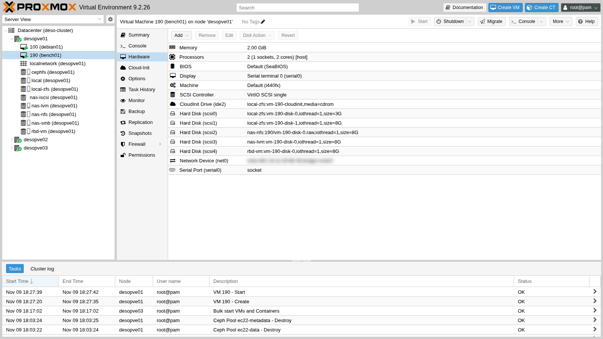
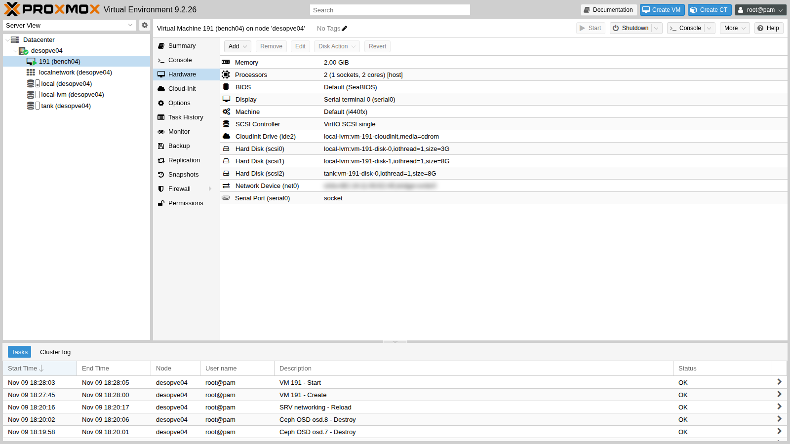

# Lab 19 – Benchmark comparativo dello storage con fio

**Livello:** avanzato · **Durata:** 1 ora e 30 minuti (circa 45 minuti sono di attesa dei test)

## Dipendenze

- **Lab precedenti:** gli storage da confrontare devono esistere:
  - `local-zfs` sul cluster ([Lab 03](03-install-proxmox-ve.md));
  - `local-lvm` e `tank` su `desopve04` ([Lab 09](09-lvm-and-lvm-thin.md), [Lab 10](10-zfs.md));
  - `nas-nfs` ([Lab 13](13-nfs.md));
  - `nas-lvm` su iSCSI ([Lab 15](15-iscsi-lvm-multipath.md));
  - `rbd-vm` su Ceph ([Lab 17](17-ceph-installation.md)).
- **Spazio libero:** 8 GiB su ciascuno di questi storage; 3 GiB su `local-zfs` e `local-lvm` per il sistema delle due VM di test.
- **Internet:** il proxy del laboratorio deve consentire `cloud.debian.org` (con il suo mirror `*.acc.umu.se`) e `deb.debian.org`.
- **Credenziali:** `root` / `<password-lab>` sui nodi → [Appendice B](b-credentials-and-addresses.md). Per entrare nelle VM di test si usa una chiave SSH creata per l'occasione (passo 1).

## Obiettivi

- Misurare lo stesso carico, con lo stesso strumento e la stessa VM, su sei storage diversi.
- Capire cosa misurano IOPS, banda e latenza, e perché la profondità di coda (*queue depth*) cambia tutto.
- Riconoscere i numeri "falsi": letture dalla cache, blocchi mai scritti, scritture confermate dalla RAM.
- Leggere i risultati del laboratorio per quello che sono, e sapere cosa misurare in produzione.

## Come funziona

### Le tre misure

| Misura | Cosa dice | Test tipico |
|---|---|---|
| **IOPS** | quante operazioni al secondo | blocchi piccoli (4 KiB) in posizioni casuali: database, sistemi operativi |
| **Banda** (MB/s) | quanti dati al secondo | blocchi grandi (1 MiB) in sequenza: backup, copie, video |
| **Latenza** (ms) | quanto aspetta una singola operazione | una sola operazione alla volta (*QD1*) |

La **queue depth** (QD) è quante operazioni sono "in volo" insieme. Con QD32 lo storage può lavorarne molte in parallelo e gli IOPS salgono. Con QD1 ogni operazione aspetta la precedente: si misura la latenza pura, che è quello che sente un'applicazione che scrive e aspetta la conferma.

### I tre tranelli dei benchmark

1. **Le cache.** Tra la VM e il disco ci sono più livelli di cache:
   - la cache della VM, che `fio --direct=1` salta;
   - la cache di QEMU, assente con il disco in `cache=none`, il predefinito di Proxmox;
   - l'**ARC di ZFS** sull'host o sul NAS, che **non** si può saltare.

   Una lettura servita dalla RAM vale decine di migliaia di IOPS anche se il disco sotto è lento.

2. **I blocchi mai scritti.** Su storage *thin* (ZFS, LVM-thin, Ceph), leggere un blocco mai scritto non tocca il disco: lo storage risponde "zeri" da solo. Prima di misurare le letture bisogna **riempire** l'area di test (*precondizionamento*).
3. **Le scritture confermate dalla RAM.** Molti storage confermano una scrittura appena è in memoria e la portano su disco dopo, a meno che il sistema non chieda esplicitamente un `fsync`. Le scritture "normali" e quelle con `fsync` hanno quindi costi molto diversi: vanno misurate entrambe.

### Il metodo usato

- **Stessa VM, stessi job:** una VM Debian 13 con un disco da 8 GiB per ogni storage, tutti `VirtIO SCSI single` con `iothread=1` e `cache=none`. Sul cluster serve una VM (`bench01`); per `local-lvm` e `tank`, che stanno su `desopve04`, una seconda VM identica (`bench04`).
- **Dispositivo grezzo:** fio scrive direttamente su `/dev/disk/by-id/...`, senza file system, con `--direct=1` e `libaio`.
- **Precondizionamento:** prima dei test ogni disco viene scritto per intero nell'area di prova (2 GiB).
- **Cinque job da 20 secondi** (più 3 di riscaldamento), ripetuti **due volte**. La tabella riporta la media e, tra parentesi, quanto si discostano le due ripetizioni.
- **Un job in più con `fsync` dopo ogni scrittura**, per misurare il costo di una scrittura davvero sicura su disco.
- I test girano **uno storage alla volta**, mai in parallelo.

## Procedura

### 1. Le VM di test da un'immagine cloud

Invece di installare Debian da ISO, usa l'immagine *cloud* ufficiale: un disco già pronto che si configura al primo avvio con cloud-init (cloud-init e i template sono l'argomento del lab 40).

1. Su `desopve01` e su `desopve04` crea una chiave SSH senza passphrase, usata solo per entrare nelle due VM di test (la cancellerai alla fine):

   ```console
   root@desopve01:~# ssh-keygen -q -t ed25519 -N '' -f /root/bench
   root@desopve04:~# ssh-keygen -q -t ed25519 -N '' -f /root/bench
   ```

   Poi scarica l'immagine nello storage `local` (contenuto **import**) di `desopve01` e di `desopve04`. Il sito di Debian rimanda a un mirror, quindi serve `-L`:

   ```console
   root@desopve01:~# curl -sL -x http://proxy.proxmox.community:3128 \
       -o /var/lib/vz/import/debian-13-genericcloud-amd64.qcow2 \
       https://cloud.debian.org/images/cloud/trixie/latest/debian-13-genericcloud-amd64.qcow2
   root@desopve01:~# qemu-img info /var/lib/vz/import/debian-13-genericcloud-amd64.qcow2 | grep -E "format|virtual"
   file format: qcow2
   virtual size: 3 GiB (3221225472 bytes)
   root@desopve04:~# curl -sL -x http://proxy.proxmox.community:3128 \
       -o /var/lib/vz/import/debian-13-genericcloud-amd64.qcow2 \
       https://cloud.debian.org/images/cloud/trixie/latest/debian-13-genericcloud-amd64.qcow2
   ```

2. Crea `bench01` su `desopve01`. Il disco di sistema viene importato dall'immagine (`import-from`); utente, chiave SSH e rete li imposta cloud-init. Poi aggiungi un disco da 8 GiB per ogni storage da misurare:

   ```console
   root@desopve01:~# qm create 190 --name bench01 --memory 2048 --cores 2 --cpu host \
       --scsihw virtio-scsi-single --net0 virtio,bridge=vmbr0 --boot order=scsi0 \
       --serial0 socket --vga serial0 \
       --scsi0 local-zfs:0,import-from=local:import/debian-13-genericcloud-amd64.qcow2,iothread=1 \
       --ide2 local-zfs:cloudinit --ciuser labuser --sshkeys /root/bench.pub \
       --ipconfig0 ip=172.27.199.190/24,gw=172.27.199.1 \
       --nameserver 172.27.199.20 --searchdomain proxmox.community
   root@desopve01:~# qm set 190 --scsi1 local-zfs:8,iothread=1 --scsi2 nas-nfs:8,format=raw,iothread=1 \
       --scsi3 nas-lvm:8,iothread=1 --scsi4 rbd-vm:8,iothread=1
   root@desopve01:~# qm start 190
   ```

   

   `bench04` (VMID 191, 172.27.199.191) è identica, su `desopve04`, con il sistema su `local-lvm` e i dischi di prova su `local-lvm` e `tank`:

   ```console
   root@desopve04:~# qm create 191 --name bench04 --memory 2048 --cores 2 --cpu host \
       --scsihw virtio-scsi-single --net0 virtio,bridge=vmbr0 --boot order=scsi0 \
       --serial0 socket --vga serial0 \
       --scsi0 local-lvm:0,import-from=local:import/debian-13-genericcloud-amd64.qcow2,iothread=1 \
       --ide2 local-lvm:cloudinit --ciuser labuser --sshkeys /root/bench.pub \
       --ipconfig0 ip=172.27.199.191/24,gw=172.27.199.1 \
       --nameserver 172.27.199.20 --searchdomain proxmox.community
   root@desopve04:~# qm set 191 --scsi1 local-lvm:8,iothread=1 --scsi2 tank:8,iothread=1
   root@desopve04:~# qm start 191
   ```

   

   Lo storage SMB (`nas-smb`) non è nel confronto: Proxmox lo può usare per i dischi delle VM, ma nel lab 14 lo abbiamo configurato solo per ISO e backup, che è l'uso consigliato.

3. Entra nelle VM con la chiave creata al passo 1 (`bench04` allo stesso modo, da `desopve04` verso `.191`):

   ```console
   root@desopve01:~# ssh -i /root/bench labuser@172.27.199.190
   ```

   Installa fio. L'immagine cloud usa i repository Debian in **HTTPS**, quindi il proxy va dichiarato anche per `https`:

   ```console
   labuser@bench01:~$ printf 'Acquire::http::Proxy "http://proxy.proxmox.community:3128";\nAcquire::https::Proxy "http://proxy.proxmox.community:3128";\n' | sudo tee /etc/apt/apt.conf.d/80proxy
   labuser@bench01:~$ sudo apt-get update && sudo apt-get install -y fio
   labuser@bench01:~$ fio --version
   fio-3.39
   labuser@bench01:~$ ls -l /dev/disk/by-id/ | grep drive-scsi | awk '{print $9, $11}'
   scsi-0QEMU_QEMU_HARDDISK_drive-scsi0 ../../sdb
   ...
   scsi-0QEMU_QEMU_HARDDISK_drive-scsi1 ../../sda
   scsi-0QEMU_QEMU_HARDDISK_drive-scsi2 ../../sdc
   scsi-0QEMU_QEMU_HARDDISK_drive-scsi3 ../../sdd
   scsi-0QEMU_QEMU_HARDDISK_drive-scsi4 ../../sde
   ```

   I nomi `sdX` **non** seguono l'ordine dei dischi: qui `scsi1` è `sda` e il sistema è `sdb`. Per non scrivere sul disco sbagliato, lo script usa i nomi stabili `drive-scsiN` in `/dev/disk/by-id`.

### 2. Lo script dei test

Lo script è pubblicato in [`files/19/bench.sh`](../files/19/bench.sh). Crealo in entrambe le VM, per esempio incollandolo con un *here document*, e rendilo eseguibile:

```console
labuser@bench01:~$ cat > ~/bench.sh <<'FINE'
(incolla qui il contenuto di bench.sh)
FINE
labuser@bench01:~$ chmod +x ~/bench.sh
```

Il contenuto:

```bash
#!/bin/bash
# bench.sh etichetta:scsiN ... : stessi job fio su ogni disco, 2 ripetizioni, risultati JSON in ~/res
set -u
mkdir -p ~/res
for pair in "$@"; do
  lab=${pair%%:*}; dev=/dev/disk/by-id/scsi-0QEMU_QEMU_HARDDISK_drive-${pair##*:}
  # precondizionamento: scrive tutta l'area di test, cosi' le letture non leggono blocchi mai allocati
  sudo fio --name=fill --filename=$dev --rw=write --bs=1M --size=2G --direct=1 --ioengine=libaio --iodepth=16 --output-format=json --output=$HOME/res/$lab-fill.json >/dev/null
  for run in 1 2; do
    for job in "rr4k randread 4k 32" "rw4k randwrite 4k 32" "rw4kqd1 randwrite 4k 1" "sr1m read 1M 16" "sw1m write 1M 16"; do
      set -- $job
      sudo fio --name=$1 --filename=$dev --rw=$2 --bs=$3 --iodepth=$4 --size=2G --direct=1 --ioengine=libaio \
        --time_based --runtime=20 --ramp_time=3 --output-format=json --output=$HOME/res/$lab-$1-$run.json >/dev/null
    done
  done
  echo "$(date +%T) $lab finito"
done
touch ~/res/DONE
```

Avvialo in background su `bench01` e, solo quando ha finito, su `bench04`:

```console
labuser@bench01:~$ nohup ./bench.sh local-zfs:scsi1 nas-nfs:scsi2 nas-lvm:scsi3 rbd-vm:scsi4 > bench.log 2>&1 &
labuser@bench01:~$ cat bench.log
17:36:30 local-zfs finito
17:41:39 nas-nfs finito
17:46:13 nas-lvm finito
17:51:30 rbd-vm finito
labuser@bench04:~$ nohup ./bench.sh local-lvm:scsi1 tank:scsi2 > bench.log 2>&1 &
```

Poi un ultimo job per ogni disco, con un `fsync` dopo **ogni** scrittura:

```console
labuser@bench01:~$ sudo fio --name=sync --filename=/dev/disk/by-id/scsi-0QEMU_QEMU_HARDDISK_drive-scsi1 \
    --rw=randwrite --bs=4k --iodepth=1 --fsync=1 --size=2G --direct=1 --ioengine=libaio \
    --time_based --runtime=15 --ramp_time=2 --output-format=json
```

I file JSON di fio contengono tutto (IOPS, banda, latenze medie e percentili). La tabella del carico normale si ricava con lo script [`files/19/riassunto.py`](../files/19/riassunto.py), che legge `jobs[0].read` e `jobs[0].write` di ogni file e calcola media e scarto delle due ripetizioni:

```console
labuser@bench01:~$ python3 riassunto.py ~/res
```

Per la tabella con l'`fsync` basta leggere, nel JSON dell'ultimo job, `jobs[0].write.iops`, `jobs[0].write.lat_ns.mean` e `jobs[0].sync.lat_ns.mean`.

## Verifica e test: i risultati

### Carico normale (senza fsync)

| Storage | Lettura casuale 4k QD32 (IOPS) | Scrittura casuale 4k QD32 (IOPS) | Scrittura 4k QD1 (latenza media, ms) | Lettura sequenziale 1M (MB/s) | Scrittura sequenziale 1M (MB/s) |
|---|---|---|---|---|---|
| `local-zfs` (ZFS mirror, locale) | 44.289 (±3%) | 2.336 (±50%) | 0,21 (±6%) | 3.289 (±0%) | 42 (±19%) |
| `local-lvm` (LVM-thin, locale) | 29.414 (±2%) | 9.347 (±20%) | 1,70 (±4%) | 291 (±3%) | 540 (±9%) |
| `tank` (ZFS RAIDZ1, locale) | 27.866 (±3%) | 3.398 (±15%) | 0,79 (±30%) | 1.036 (±3%) | 44 (±35%) |
| `nas-nfs` (NFS 4.2) | 25.069 (±9%) | 181 (±6%) | 4,47 (±3%) | 1.208 (±1%) | 21 (±23%) |
| `nas-lvm` (iSCSI + LVM, multipath) | 20.424 (±5%) | 4.182 (±15%) | 0,74 (±17%) | 1.082 (±2%) | 15 (±36%) |
| `rbd-vm` (Ceph, replica 3) | 10.357 (±17%) | 306 (±11%) | 8,31 (±25%) | 983 (±1%) | 20 (±27%) |

### Scritture sicure (fsync dopo ogni scrittura, QD1)

| Storage | IOPS | Latenza della scrittura (ms) | Latenza dell'fsync (ms) | Percentile 99 della latenza QD1 senza fsync (ms) |
|---|---|---|---|---|
| `local-zfs` | 288 | 0,52 | 3,39 | 1,06 |
| `local-lvm` | 534 | 1,46 | 1,80 | 3,95 |
| `tank` | 145 | 0,48 | 6,79 | 3,06 |
| `nas-nfs` | 194 | 4,82 | 4,63 | 55,31 |
| `nas-lvm` | 138 | 0,83 | 7,12 | 2,54 |
| `rbd-vm` | 26 | 38,21 | 38,53 | 42,21 |

### Come leggere questi numeri

1. **Le letture di ZFS vengono dalla RAM.** `local-zfs` legge 3,3 GB/s in sequenza e `tank` 1 GB/s: sono letture dall'**ARC**, la cache di ZFS nella RAM del nodo. I dati appena scritti dal precondizionamento sono ancora in memoria. `local-lvm`, che non ha una cache nella RAM del nodo, legge "solo" 291 MB/s, cioè la velocità reale del suo disco. Lo stesso vale per NFS e iSCSI, serviti dalla RAM del NAS (anch'esso ZFS).
2. **Ceph paga la rete e la replica.** Ogni scrittura su `rbd-vm` va al primario e da lì ad altre due copie, attraverso la rete. La latenza QD1 è di 8 ms contro gli 0,2-1,7 dei dischi locali. Con l'`fsync` sale a 38 ms, quindi 26 IOPS. Su Ceph le prestazioni vengono dal **parallelismo** (molte VM, molti OSD, code profonde), non dalla singola operazione.
3. **NFS contro iSCSI.** Sullo stesso NAS, la scrittura casuale QD32 fa 181 IOPS su NFS e 4.182 su iSCSI:
   - con `O_DIRECT` il client NFS invia scritture che il server conferma solo dopo averle messe al sicuro;
   - su iSCSI il NAS conferma dalla RAM e scrive dopo, a meno che il client non chieda un flush.

   Con l'`fsync` dopo ogni scrittura le due tecnologie si avvicinano: 194 e 138 IOPS.

4. **La variabilità conta.** Le scritture sequenziali e quelle casuali QD32 hanno scarti fino al ±50% tra due ripetizioni: il resto del laboratorio (Ceph, NAS, rete condivisa) non è mai fermo. Un singolo run non basta per trarre conclusioni.
5. **I numeri descrivono questo laboratorio, non le tecnologie.** Il laboratorio ha dischi economici, controller con la loro cache, una rete condivisa da tutti i servizi e nodi con poche CPU. Il `local-lvm` che scrive 540 MB/s in sequenza misura soprattutto la cache in scrittura del suo controller. In produzione, con SSD NVMe e reti a 25 Gbit/s, i rapporti tra gli storage sono molto diversi.

### Cosa misurare in produzione

- Sempre su un'area **precondizionata** e più grande della RAM dei nodi (e del NAS), così le cache non falsano le letture.
- Più run, più lunghi (almeno 60 s) e in orari diversi. Riporta mediana e percentili (p99), non solo la media.
- Sia il carico "normale" sia quello con `fsync`: un database vive di `fsync`.
- Per Ceph: più VM o più job in parallelo (`--numjobs`), perché la forza di Ceph è la scalabilità. `rados bench` e `rbd bench` misurano il cluster senza la VM in mezzo.
- Annota tutto: versione di Proxmox, opzioni del disco (`cache`, `iothread`, `discard`), dimensione dei blocchi e della coda.

### Pulizia

Distruggi le VM di test con i loro dischi e cancella la chiave SSH di prova:

```console
root@desopve01:~# qm stop 190 && qm destroy 190 --purge && rm -f /root/bench /root/bench.pub
root@desopve04:~# qm stop 191 && qm destroy 191 --purge && rm -f /root/bench /root/bench.pub
```

## Stato finale del lab

- Lo stato del cluster, di Ceph e di `desopve04` è quello del [Lab 18](18-ceph-growth-maintenance-failures.md): nessuna VM di test, storage vuoti come prima.
- Resta l'immagine `debian-13-genericcloud-amd64.qcow2` nello storage `local` (contenuto **import**) di `desopve01` e `desopve04`: servirà per i template del lab 40.

## Cosa hai imparato

- IOPS, banda e latenza sono tre cose diverse. La queue depth decide quale stai misurando.
- Prima di misurare le letture bisogna scrivere l'area di test, altrimenti si misurano i blocchi vuoti. Le letture di ZFS arrivano spesso dalla RAM.
- Una scrittura confermata dalla RAM e una scrittura con `fsync` hanno costi diversi di un ordine di grandezza: un benchmark serio le misura entrambe.
- Ceph ha latenza alta sulla singola operazione e dà il meglio in parallelo. Gli storage locali hanno latenza bassa ma non sono condivisi.
- Lo stesso NAS si comporta in modo diverso via NFS e via iSCSI, per come confermano le scritture.
- Un benchmark nel laboratorio insegna il **metodo**. I numeri da usare per le decisioni si misurano sull'hardware di produzione.

## Riferimenti

- [fio – documentazione](https://fio.readthedocs.io/en/latest/fio_doc.html)
- [Proxmox VE – Opzioni dei dischi virtuali (cache, iothread)](https://pve.proxmox.com/pve-docs/pve-admin-guide.html#qm_hard_disk)
- [Proxmox VE – Cloud-init support](https://pve.proxmox.com/pve-docs/pve-admin-guide.html#qm_cloud_init)
- [Proxmox VE – Import di immagini disco (`import-from`)](https://pve.proxmox.com/pve-docs/qm.1.html)
- [Ceph – Benchmark di un cluster](https://docs.ceph.com/en/latest/start/hardware-recommendations/)
