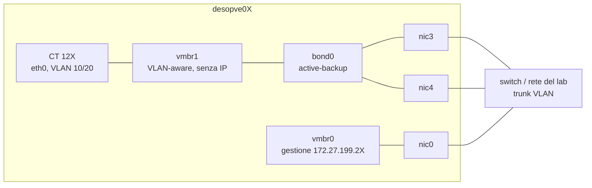
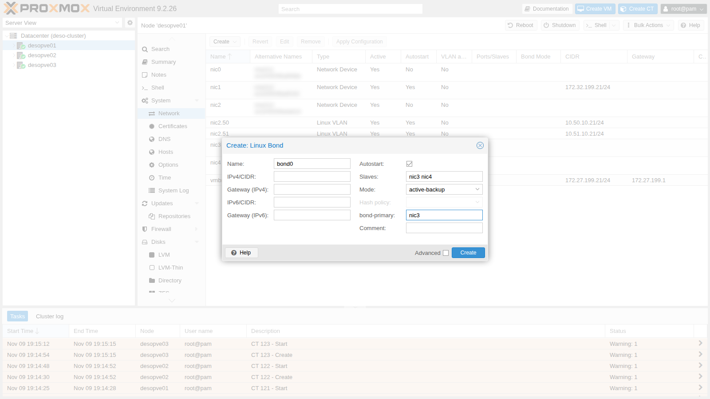
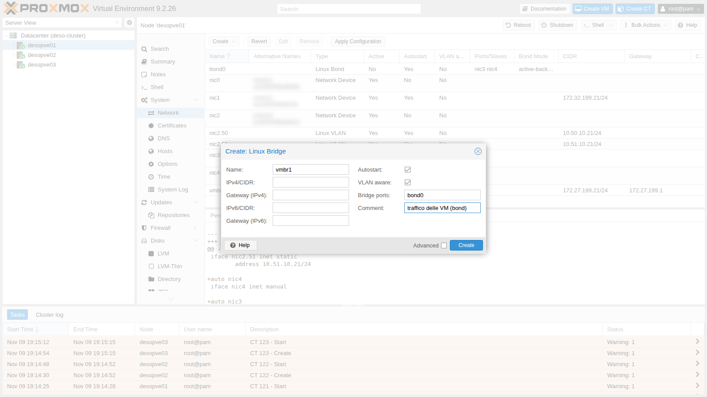
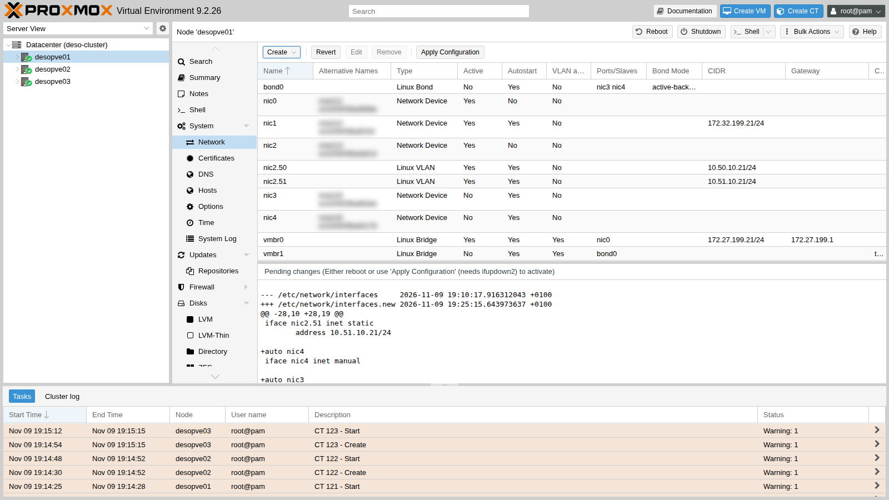
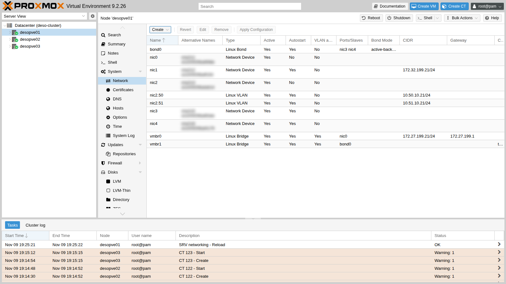

# Lab 21 – Bond: active-backup, balance-alb e LACP, caduta di un link

**Livello:** intermedio · **Durata:** 1 ora e 30 minuti

## Dipendenze

- **Lab precedenti:** [Lab 20](20-bridges-stable-names-vlans.md): schede `nic3` e `nic4` con nome stabile su `desopve01-03`, bridge VLAN-aware, container di prova 121-123 con `ping`, `tcpdump` e `iperf3`.
- **Rete:** le due schede di ogni nodo sono collegate alla stessa rete (allo stesso switch). Per la modalità LACP (802.3ad) servirebbe uno switch con un *port-channel* LACP configurato sulle due porte: nel laboratorio non c'è, e il lab mostra cosa succede in quel caso.
- **Credenziali:** `root` / `<password-lab>` sui nodi → [Appendice B](b-credentials-and-addresses.md).

## Obiettivi

- Capire le modalità di bonding di Linux e quali richiedono una configurazione dello switch.
- Creare un bond di due schede e un bridge VLAN-aware dedicato al traffico delle VM, dalla GUI e dalla riga di comando.
- Staccare un link con il traffico in corso e misurare cosa vede il guest.
- Confrontare *active-backup*, *balance-alb* e *802.3ad* sul lab reale, con i contatori delle schede.
- Verificare l'MTU di una rete prima di usare i *jumbo frame*.

## Come funziona

### Che cos'è un bond

Un **bond** (Linux bonding) unisce più schede fisiche in un'unica interfaccia logica, `bond0`. Serve a due cose:

- **ridondanza:** se un cavo, una porta o uno switch si guastano, il traffico prosegue sulle schede rimaste;
- **banda aggregata**, solo in alcune modalità e solo con molti flussi: **un singolo flusso usa sempre un solo link**.

Il driver controlla lo stato dei link ogni `bond-miimon` millisecondi (qui 100) e smette di usare quelli giù.

### Le modalità

| Modalità | Nome | Switch | Uso di più link | Note |
|---|---|---|---|---|
| 0 | `balance-rr` | port-channel statico | sì, a turno pacchetto per pacchetto | riordina i pacchetti: sconsigliato per TCP |
| 1 | `active-backup` | **nessuna configurazione** | no: un link attivo, gli altri di riserva | la più semplice e robusta; con `bond-primary` scegli il link preferito |
| 2 | `balance-xor` | port-channel statico | sì, per flusso (hash) | |
| 3 | `broadcast` | – | ogni pacchetto su tutti i link | casi molto particolari |
| 4 | **`802.3ad`** (LACP) | **port-channel LACP** | sì, per flusso (hash) | lo standard dei datacenter; con due switch serve MLAG/vPC |
| 5 | `balance-tlb` | nessuna | solo in trasmissione | |
| 6 | `balance-alb` | nessuna | trasmissione e ricezione, **per destinazione** | bilancia la ricezione manipolando le risposte ARP |

Nelle modalità che bilanciano "per flusso" il link si sceglie con una funzione di *hash* (`bond-xmit-hash-policy`): `layer2` (MAC), `layer2+3` (MAC + IP) o `layer3+4` (IP + porte). Con `layer3+4` due connessioni TCP tra gli stessi due host possono usare link diversi; un trasferimento singolo resta comunque su un link.

### Il disegno di questo lab



- `bond0` (`nic3` + `nic4`) è la porta di **`vmbr1`**, un secondo bridge VLAN-aware dedicato al **traffico delle VM**. Gestione, Corosync, storage e Ceph restano sulle loro schede.
- `vmbr1` **non ha un indirizzo IP**: il nodo non comunica su quella rete, la offre solo ai guest. In questo modo il bond non interferisce con il traffico del nodo.

## Procedura

### 1. bond0 e vmbr1 dalla GUI (desopve01)

1. Nodo **desopve01** → **System** → **Network** → **Create** → **Linux Bond**.
   - **Name** `bond0`;
   - **Slaves** `nic3 nic4`;
   - **Mode** `active-backup` (la GUI propone `balance-rr`);
   - **bond-primary** `nic3`: quando è disponibile, il link attivo è sempre questo;
   - nessun indirizzo IP.

   **Hash policy** resta disattivato: serve solo per `balance-xor` e `802.3ad`.

   

2. **Create** → **Linux Bridge**. **Name** `vmbr1`, **Bridge ports** `bond0`, **VLAN aware** attivo, nessun indirizzo IP, un commento che ricordi a cosa serve.

   

3. Le modifiche in attesa mostrano i due blocchi nuovi:

   

4. **Apply Configuration** → **Yes**.

   

   Il file risultante:

   ```text
   auto bond0
   iface bond0 inet manual
   	bond-slaves nic3 nic4
   	bond-miimon 100
   	bond-mode active-backup
   	bond-primary nic3

   auto vmbr1
   iface vmbr1 inet manual
   	bridge-ports bond0
   	bridge-stp off
   	bridge-fd 0
   	bridge-vlan-aware yes
   	bridge-vids 2-4094
   #traffico delle VM (bond)
   ```

   Lo stato del bond si legge in `/proc/net/bonding/bond0`:

   ```console
   root@desopve01:~# cat /proc/net/bonding/bond0
   Ethernet Channel Bonding Driver: v7.0.14-28-pve

   Bonding Mode: fault-tolerance (active-backup)
   Primary Slave: nic3 (primary_reselect always)
   Currently Active Slave: nic3
   MII Status: up
   MII Polling Interval (ms): 100
   Up Delay (ms): 0
   Down Delay (ms): 0
   Peer Notification Delay (ms): 0

   Slave Interface: nic3
   MII Status: up
   Speed: 10000 Mbps
   Duplex: full
   Link Failure Count: 0
   Permanent HW addr: <MAC>
   Slave queue ID: 0

   Slave Interface: nic4
   MII Status: up
   Speed: 10000 Mbps
   Duplex: full
   Link Failure Count: 0
   Permanent HW addr: <MAC>
   Slave queue ID: 0
   ```

### 2. La stessa configurazione sugli altri nodi (CLI)

Su `desopve02` e `desopve03` aggiungi gli stessi due blocchi a `/etc/network/interfaces`, prima della riga `source /etc/network/interfaces.d/*`, dopo averne fatto una copia (`cp /etc/network/interfaces /root/interfaces.bak-lab21`). Poi applica e controlla:

```console
root@desopve02:~# ifreload -a
root@desopve02:~# grep -E "Currently Active|MII Status" /proc/net/bonding/bond0 | head -2
Currently Active Slave: nic3
MII Status: up
root@desopve02:~# cat /sys/class/net/vmbr1/bridge/vlan_filtering
1
```

Ripeti su `desopve03` e verifica che cluster e Ceph non abbiano subito interruzioni (`pvecm status`, `ceph -s`).

### 3. I container sulla rete delle VM

Sposta i tre container su `vmbr1`, con le stesse VLAN e gli stessi indirizzi. Si fa a caldo:

```console
root@desopve01:~# pct set 121 -net0 name=eth0,bridge=vmbr1,tag=10,ip=10.10.10.121/24
root@desopve02:~# pct set 122 -net0 name=eth0,bridge=vmbr1,tag=10,ip=10.10.10.122/24
root@desopve03:~# pct set 123 -net0 name=eth0,bridge=vmbr1,tag=20,ip=10.20.20.123/24
root@desopve01:~# pct exec 121 -- ping -c2 -W1 10.10.10.122 | tail -2
2 packets transmitted, 2 received, 0% packet loss, time 1001ms
rtt min/avg/max/mdev = 0.927/1.380/1.834/0.453 ms
root@desopve01:~# bridge vlan show dev veth121i0
port              vlan-id
veth121i0         10 PVID Egress Untagged
```

Dalla GUI è lo stesso campo **Bridge** della scheda di rete del container (o della VM) che hai usato nel lab 20 per il tag.

### 4. Guasto del link attivo (active-backup)

Il CT 121 manda cinque ping al secondo al CT 122. Nel frattempo, su `desopve01`, si stacca il link attivo `nic3` e, dopo 13 secondi, lo si ricollega. Stacca il cavo di `nic3`, oppure simula il guasto con `ip link set nic3 down`.

```console
root@desopve01:~# pct exec 121 -- bash -c "ping -D -i 0.2 -c 150 -W 1 10.10.10.122 > /root/ab.log" &
root@desopve01:~# ip link set nic3 down
root@desopve01:~# grep -E "Currently Active|Link Failure" /proc/net/bonding/bond0
Currently Active Slave: nic4
Link Failure Count: 1
Link Failure Count: 0
root@desopve01:~# ip link set nic3 up
root@desopve01:~# grep "Currently Active" /proc/net/bonding/bond0
Currently Active Slave: nic3
root@desopve01:~# pct exec 121 -- tail -2 /root/ab.log
150 packets transmitted, 150 received, 0% packet loss, time 31030ms
rtt min/avg/max/mdev = 0.395/0.868/10.409/0.806 ms
```

Nessun pacchetto perso, né al guasto né al ritorno su `nic3` (il *primary*): il ritardo massimo è stato di circa 10 ms. Il kernel registra ogni passaggio:

```console
root@desopve01:~# journalctl -k | grep bond0 | tail -4
Nov 09 19:26:44 desopve01 kernel: bond0: (slave nic3): link status definitely down, disabling slave
Nov 09 19:26:44 desopve01 kernel: bond0: (slave nic4): making interface the new active one
Nov 09 19:26:57 desopve01 kernel: bond0: (slave nic3): link status definitely up, 10000 Mbps full duplex
Nov 09 19:26:57 desopve01 kernel: bond0: (slave nic3): making interface the new active one
```

Quando il link attivo cambia, lo switch deve reimparare su quale porta si trovano i MAC dei guest. `bond0` e `vmbr1` non hanno indirizzi IP, quindi il bond non manda ARP gratuiti per conto dei guest: lo switch impara ogni MAC dal primo frame che il guest trasmette sul nuovo link. Qui il ping continuo lo fa subito; un guest silenzioso resta irraggiungibile finché non trasmette, o finché la voce non scade nella tabella MAC dello switch.

### 5. Banda: un flusso, un link

Con `iperf3` misuri la banda tra il CT 121 e il CT 122 (server sul 122 con `iperf3 -s -D`):

```console
root@desopve01:~# pct exec 121 -- iperf3 -c 10.10.10.122 -t 10 -f g | tail -4
[  5]   0.00-10.00  sec  6.54 GBytes  5.62 Gbits/sec  191            sender
[  5]   0.00-10.00  sec  6.54 GBytes  5.61 Gbits/sec                  receiver
```

In *active-backup* lavora un solo link alla volta: la banda è quella di una scheda.

### 6. balance-alb: bilanciamento senza configurare lo switch

1. Su `desopve01` e `desopve02` cambia la modalità: in `bond0` sostituisci `bond-mode active-backup` con `bond-mode balance-alb` e togli la riga `bond-primary`, così nessuna scheda è preferita. `ifreload -a` applica il cambio a caldo.

   ```console
   root@desopve01:~# ifreload -a; grep "Bonding Mode" /proc/net/bonding/bond0
   Bonding Mode: adaptive load balancing
   ```

2. Quattro flussi paralleli verso lo stesso container, misurando i byte trasmessi da ciascuna scheda. Leggi i contatori prima e dopo il test, e fai la differenza:

   ```console
   root@desopve01:~# cat /sys/class/net/nic3/statistics/tx_bytes /sys/class/net/nic4/statistics/tx_bytes
   root@desopve01:~# pct exec 121 -- iperf3 -c 10.10.10.122 -t 10 -P 4 -f g | grep "SUM.*receiver"
   [SUM]   0.00-10.00  sec  6.66 GBytes  5.72 Gbits/sec                  receiver
   root@desopve01:~# cat /sys/class/net/nic3/statistics/tx_bytes /sys/class/net/nic4/statistics/tx_bytes
   ```

   | Scheda | Byte trasmessi durante il test |
   |---|---|
   | `nic3` | 7,17 GB |
   | `nic4` | 0,00 GB |

   Tutto il traffico è passato da `nic3`. *balance-alb* bilancia **per destinazione**: tutti i flussi verso lo stesso host usano la stessa scheda. Con molti guest che parlano con molti host diversi, il carico **in trasmissione** si distribuisce sui due link. Il bilanciamento in ricezione (*rlb*, che manipola le risposte ARP) vale invece solo per gli indirizzi IP del nodo, non per i guest dietro il bridge: il traffico che arriva ai guest entra da una scheda sola.

3. Guasto di `nic3` con il ping in corso:

   ```console
   root@desopve01:~# pct exec 121 -- bash -c "ping -D -i 0.2 -c 100 -W 1 10.10.10.122 > /root/alb.log" &
   root@desopve01:~# ip link set nic3 down
   root@desopve01:~# grep -E "Slave Interface|MII Status" /proc/net/bonding/bond0 | tail -4
   Slave Interface: nic3
   MII Status: down
   Slave Interface: nic4
   MII Status: up
   root@desopve01:~# ip link set nic3 up
   root@desopve01:~# pct exec 121 -- tail -2 /root/alb.log
   100 packets transmitted, 99 received, 1% packet loss, time 20559ms
   ```

   Un pacchetto perso su cento (circa 200 ms): il tempo per spostare il traffico e riannunciare i MAC.

### 7. LACP (802.3ad) senza uno switch che lo negozia

LACP è la modalità standard nei datacenter: le schede del nodo e le porte dello switch formano un unico canale, e il protocollo LACP verifica continuamente che i due lati siano d'accordo. **Richiede la configurazione dello switch.** Ecco cosa succede se lo switch non la ha.

1. Su `desopve01` imposta:

   ```text
   auto bond0
   iface bond0 inet manual
   	bond-slaves nic3 nic4
   	bond-miimon 100
   	bond-mode 802.3ad
   	bond-xmit-hash-policy layer3+4
   	bond-lacp-rate fast
   ```

2. Applica (`ifreload -a`) e osserva lo stato:

   ```console
   root@desopve01:~# grep -E "Mode|Hash|LACP|Aggregator ID|Number of ports|Partner Mac|Slave Interface" /proc/net/bonding/bond0
   Bonding Mode: IEEE 802.3ad Dynamic link aggregation
   Transmit Hash Policy: layer3+4 (1)
   LACP active: on
   LACP rate: fast
   	Aggregator ID: 1
   	Number of ports: 1
   	Partner Mac Address: 00:00:00:00:00:00
   Slave Interface: nic3
   Aggregator ID: 1
   Slave Interface: nic4
   Aggregator ID: 2
   ```

   - **`Partner Mac Address: 00:00:00:00:00:00`**: dall'altra parte nessuno risponde a LACP.
   - Ogni scheda finisce in un **aggregatore diverso** (1 e 2) e l'aggregatore attivo ha **una sola porta**: il bond funziona, ma come un *active-backup* travestito, senza aggregare banda.

3. Il traffico passa, e alla caduta di `nic3` il bond attiva l'altro aggregatore:

   ```console
   root@desopve01:~# pct exec 121 -- ping -c4 -W1 10.10.10.122 | tail -2
   4 packets transmitted, 4 received, 0% packet loss, time 3064ms
   rtt min/avg/max/mdev = 0.475/0.594/0.718/0.091 ms
   root@desopve01:~# pct exec 121 -- bash -c "ping -D -i 0.2 -c 75 -W 1 10.10.10.122 > /root/lacp.log" &
   root@desopve01:~# ip link set nic3 down; sleep 3; ip link set nic3 up
   root@desopve01:~# pct exec 121 -- tail -2 /root/lacp.log
   75 packets transmitted, 75 received, 0% packet loss, time 15335ms
   ```

   In produzione, con LACP configurato sullo switch, `Partner Mac Address` mostra il MAC dello switch e le due schede stanno nello **stesso** aggregatore (`Number of ports: 2`). Con due switch per la ridondanza, questi devono supportare MLAG/vPC (o stack), perché LACP vede i due switch come uno solo.

4. Torna ad *active-backup* su `desopve01` e `desopve02` (stesso blocco del passo 1, con `bond-primary nic3`) e applica con `ifreload -a`. È la scelta giusta quando non si controlla la configurazione dello switch.

### 8. MTU e jumbo frame: verificare prima di usarli

I *jumbo frame* (MTU 9000) riducono il carico della CPU per il traffico storage e di migrazione, ma funzionano solo se **tutto il percorso** li accetta: schede, bond, switch, porte dei guest e guest. Una porta della catena rimasta a 1500 scarta i frame più grandi, e la prova sembra fallire per colpa della rete.

Prova temporanea (con `ip link`, quindi non persistente) tra il CT 121 su `desopve01` e il CT 122 su `desopve02`. Su ogni nodo alza l'MTU del bond (che la applica anche a `nic3` e `nic4`), del lato nodo della scheda del container (`veth121i0`, `veth122i0`) e della scheda nel container. Il bridge `vmbr1` non va toccato: per i frame che lo attraversano conta l'MTU delle porte.

```console
root@desopve01:~# ip link set bond0 mtu 9000; ip link set veth121i0 mtu 9000
root@desopve01:~# pct exec 121 -- ip link set eth0 mtu 9000
root@desopve02:~# ip link set bond0 mtu 9000; ip link set veth122i0 mtu 9000
root@desopve02:~# pct exec 122 -- ip link set eth0 mtu 9000
root@desopve01:~# pct exec 121 -- ping -M do -s 1472 -c 3 -W 1 10.10.10.122 | tail -2
3 packets transmitted, 3 received, 0% packet loss, time 2036ms
rtt min/avg/max/mdev = 0.480/0.799/1.392/0.419 ms
root@desopve01:~# pct exec 121 -- ping -M do -s 8972 -c 3 -W 1 10.10.10.122 | tail -2
3 packets transmitted, 0 received, 100% packet loss, time 2081ms
```

`-M do` vieta la frammentazione, e `-s 8972` più 28 byte di intestazioni fa un pacchetto da 9000 byte: non passa, mentre quello da 1500 sì. Per capire dove sta il limite, prova dimensioni crescenti:

```console
root@desopve01:~# for s in 4000 8000 8910 8912; do r=$(pct exec 121 -- ping -M do -s $s -c 2 -W 1 10.10.10.122 | grep -o "[0-9]* received"); echo "$s: $r"; done
4000: 2 received
8000: 2 received
8910: 2 received
8912: 0 received
```

Lo switch del laboratorio accetta pacchetti fino a 8938 byte (8910 di dati ICMP più 28 di intestazioni), ma non arriva a 9000: con l'MTU 9000 sui nodi, i pacchetti più grandi verrebbero persi in silenzio. Per usare i jumbo frame bisognerebbe scegliere un'MTU comune che passi su tutto il percorso, cioè qui al massimo 8938. In questo laboratorio restiamo a 1500. Riporta tutto com'era:

```console
root@desopve01:~# pct exec 121 -- ip link set eth0 mtu 1500; ip link set veth121i0 mtu 1500; ip link set bond0 mtu 1500
root@desopve02:~# pct exec 122 -- ip link set eth0 mtu 1500; ip link set veth122i0 mtu 1500; ip link set bond0 mtu 1500
```

In produzione l'MTU si imposta nel file di rete (`mtu 9000` sulle schede, sul bond e sul bridge) solo dopo aver verificato lo switch, e si controlla sempre con `ping -M do`.

## Verifica e test

| Prova | Risultato |
|---|---|
| `bond0` + `vmbr1` VLAN-aware su `desopve01-03` | attivi, senza interruzioni per cluster e Ceph |
| *active-backup*, guasto e ritorno del link attivo | 0 pacchetti persi su 150, ritardo massimo ~10 ms |
| Banda, un flusso (*active-backup*) | 5,62 Gbit/s |
| *balance-alb*, 4 flussi verso un solo host | 5,72 Gbit/s, tutto su `nic3` |
| *balance-alb*, guasto di un link | 1 pacchetto perso su 100 |
| *802.3ad* senza switch LACP | partner `00:00:00:00:00:00`, aggregatori separati, una porta attiva; nessuna perdita al guasto |
| Jumbo frame sul percorso | 9000 byte non passano (100% di perdita); il massimo è 8938 byte. Restiamo a 1500 |

## Stato finale del lab

- **`desopve01-03`:** `bond0` (`nic3` + `nic4`, *active-backup*, `bond-primary nic3`, `miimon 100`) e **`vmbr1`** VLAN-aware (`2-4094`) senza indirizzo IP, per il traffico delle VM. MTU 1500 ovunque.
- **Rete di gestione, Corosync, iSCSI e Ceph:** invariati (`vmbr0` su `nic0`, `nic1`, `nic2.50`/`nic2.51`).
- **Container di prova, ora su `vmbr1`:** CT 121 (`desopve01`, VLAN 10, `10.10.10.121`), CT 122 (`desopve02`, VLAN 10, `10.10.10.122`, server `iperf3` attivo), CT 123 (`desopve03`, VLAN 20, `10.20.20.123`).
- Copie della configurazione precedente in `/root/interfaces.bak-lab21` su `desopve02` e `desopve03`.

## Cosa hai imparato

- Un bond dà ridondanza sempre e banda solo con molti flussi: un singolo trasferimento usa un link.
- *active-backup* non chiede niente allo switch e, nel laboratorio, ha superato guasto e ritorno senza perdere pacchetti.
- *balance-alb* distribuisce il traffico per destinazione, senza configurare lo switch.
- *802.3ad* è lo standard, ma solo con LACP configurato sullo switch: senza partner il bond funziona con un link solo. `Partner Mac Address: 00:00:00:00:00:00` è il segnale da riconoscere.
- Un bridge senza IP sul nodo offre una rete ai guest senza esporre il nodo su quella rete.
- L'MTU si verifica end-to-end con `ping -M do` prima di attivare i jumbo frame.

## Riferimenti

- [Proxmox VE – Linux Bond](https://pve.proxmox.com/pve-docs/pve-admin-guide.html#sysadmin_network_bond)
- [Linux kernel – Bonding driver](https://docs.kernel.org/networking/bonding.html)
- [iperf3](https://software.es.net/iperf/)
